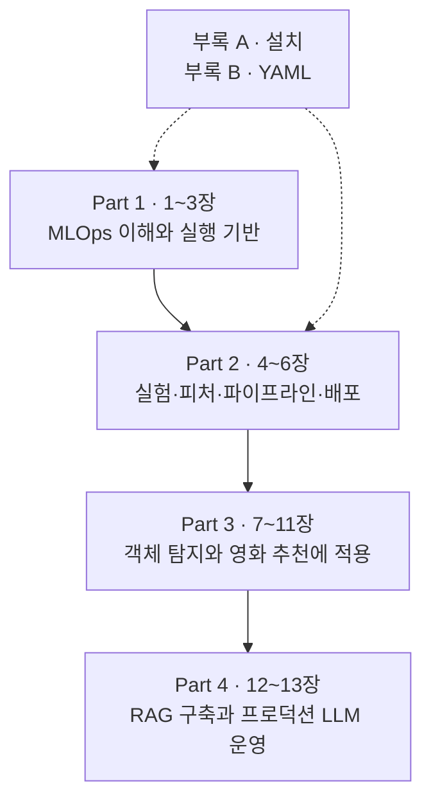

## 이 책을 한 장의 지도로 펼치면

맛있는 요리 하나를 만드는 것과 식당을 매일 운영하는 것은 다른 일입니다. 요리 실력만으로는 재료 관리, 주문 처리, 위생 점검, 손님이 몰릴 때의 대응까지 해결되지 않죠.

머신러닝도 비슷합니다. 노트북에서 좋은 점수를 얻은 모델이 요리라면, **여러 팀이 모델을 반복해서 학습·검증·배포하고 문제를 발견할 수 있게 해주는 공통 기반**이 ML 플랫폼입니다. 이 책은 알고리즘 이론보다 그 식당을 설계하고 운영하는 방법에 가깝습니다.

**『Machine Learning Platform Engineering』**은 Benjamin Tan Wei Hao, Shanoop Padmanabhan, Varun Mallya가 쓴 Manning의 책입니다. 이 시리즈는 제공된 EPUB의 *about this book*, 각 Part 소개와 실제 챕터 목차를 기준으로 구성했습니다. 본문은 **4개 Part, 13개 챕터**이며, 설치와 YAML을 돕는 **부록 A·B**가 붙습니다.

## 책 전체를 관통하는 질문

이 책을 읽으며 붙잡을 질문은 “어떤 도구를 설치할까?”보다 **“모델이 바뀌어도 서비스를 믿을 수 있으려면 무엇을 남기고 자동화해야 할까?”**입니다.

앞부분의 도구 소개가 뒤쪽 프로젝트에서 다시 등장합니다. 따라서 “이미 배운 내용의 반복”이라기보다, **작은 예제에서 배운 설계를 다른 데이터와 운영 조건에 적용하는 과정**으로 읽는 편이 좋습니다.

## Part별로 무엇을 쌓는가

### Part 1. MLOps의 기초를 놓기 — 1~3장

먼저 ML 프로젝트를 한 번 끝내는 작업이 아니라 계속 돌아오는 생애주기로 봅니다. 그다음 컨테이너와 Kubernetes, 배포 자동화, 기본 모니터링을 통해 모델이 올라갈 바닥을 만듭니다.

| 글 | 원문 챕터 | 읽으며 답할 질문 |
| --- | --- | --- |
| [01. 시작하기](../01-getting-started/) | Getting started with MLOps and ML engineering | 실험에서 서비스로 넘어갈 때 무엇이 추가되는가? |
| [02. MLOps란 무엇인가](../02-what-is-mlops/) | What is MLOps? | 자동화의 대상은 모델 파일인가, 모델을 만드는 과정인가? |
| [03. Kubernetes 기반](../03-kubernetes-foundation/) | Building applications on Kubernetes | 같은 애플리케이션을 반복해서 배포하고 관측하려면 무엇이 필요한가? |

이 Part의 성과는 명령어 암기가 아니라 **실행 환경·배포·관측의 역할을 구분할 수 있는 것**입니다.

### Part 2. 공통 ML 플랫폼 기능 만들기 — 4~6장

실험 결과를 기억하고, 같은 피처를 재사용하고, 여러 작업을 순서대로 실행하고, 예측을 서비스하는 능력을 붙입니다. 소득 분류 예제가 이 기능들을 연결하는 작은 연습장 역할을 합니다.

| 글 | 원문 챕터 | 읽으며 답할 질문 |
| --- | --- | --- |
| [04. 실험과 피처 관리](../04-experiments-and-features/) | Designing reliable ML systems | 이 모델이 어떤 실험과 피처에서 나왔는지 설명할 수 있는가? |
| [05. ML 파이프라인](../05-ml-pipelines/) | Orchestrating ML pipelines | 서로 다른 컨테이너의 작업을 어떻게 하나의 실행으로 묶는가? |
| [06. 모델의 프로덕션화](../06-productionizing-models/) | Productionizing ML models | 배포 후 입력 데이터가 달라지면 어떻게 알아차리는가? |

MLflow, Feast, Kubeflow Pipelines, BentoML, Evidently를 **제품 목록이 아니라 서로 다른 책임을 맡는 부품**으로 보는 것이 핵심입니다.

### Part 3. 실제 프로젝트에 적용하기 — 7~11장

두 가지 데이터 유형을 다룹니다. 하나는 신분증 이미지에서 카드 영역을 찾는 객체 탐지이고, 다른 하나는 사용자와 영화의 평점 데이터를 사용하는 추천입니다. 이미지와 표 데이터의 차이가 저장 방식, 검증, 운영 관측에 어떻게 영향을 미치는지 비교해 볼 수 있습니다.

| 글 | 원문 챕터 | 읽으며 답할 질문 |
| --- | --- | --- |
| [07. 데이터 분석과 준비](../07-data-preparation/) | Data analysis and preparation | 노트북의 탐색을 재실행 가능한 데이터 준비 작업으로 바꾸려면? |
| [08. 학습과 검증 I](../08-training-and-validation-1/) | Model training and validation: Part 1 | 학습이 끝났다는 사실과 모델이 쓸 만하다는 사실은 어떻게 다른가? |
| [09. 학습과 검증 II](../09-training-and-validation-2/) | Model training and validation: Part 2 | 데이터 이동 비용과 실험 추적을 어떻게 함께 설계할까? |
| [10. 추론과 서빙](../10-inference-and-serving/) | Model inference and serving | 모델 파일을 다른 사람이 쓸 수 있는 서비스로 만들려면? |
| [11. 모니터링과 설명가능성](../11-monitoring-and-explainability/) | Monitoring and explainability | 서비스가 살아 있는지와 예측이 유용한지를 각각 어떻게 볼까? |

책에서 OCR 시스템이라는 넓은 맥락도 사용하지만, 이 프로젝트의 주요 학습 대상은 **신분증 객체 탐지**입니다. 카드 위치를 찾는 것과 카드 안의 글자를 읽는 OCR을 같은 작업으로 혼동하지 않는 것이 좋습니다.

### Part 4. LLM을 위한 운영으로 확장하기 — 12~13장

마지막에는 사내 문서를 찾아 답하는 **DakkaBot**을 만듭니다. 직접 학습한 모델의 가중치를 관리하던 문제에, 검색 문서·벡터 인덱스·프롬프트·외부 모델 API를 관리하는 문제가 더해집니다.

| 글 | 원문 챕터 | 읽으며 답할 질문 |
| --- | --- | --- |
| [12. LLM 기반 시스템](../12-llm-powered-systems/) | Designing LLM-powered systems | 잘못된 답변의 원인이 검색인지 생성인지 구분할 수 있는가? |
| [13. 프로덕션 LLM 설계](../13-production-llm-systems/) | Production LLM system design | 답변 품질·안전·비용을 바꾸는 변경을 어떻게 검증하고 되돌릴까? |

RAG는 **필요한 문서를 먼저 찾고 그 내용을 참고해 답하게 하는 방식**입니다. 문서를 잘못 찾으면 모델이 커져도 답이 좋아지지 않을 수 있습니다. 또한 검색을 붙였다고 환각이나 정보 유출 위험이 사라지는 것은 아닙니다.

## 도구 이름보다 역할을 기억하기

| 역할 | 책에서 다루는 도구 | 해결하려는 문제 |
| --- | --- | --- |
| 실행 환경과 클러스터 | Docker, Kubernetes, Helm | 의존성과 자원을 관리하며 반복 배포하기 |
| 빌드와 배포 자동화 | GitLab CI, Argo CD | 변경을 검증하고 선언된 상태로 배포하기 |
| 실험 추적과 모델 관리 | MLflow | 어떤 조건으로 만든 모델인지 추적하기 |
| 피처 재사용 | Feast | 학습·배치·온라인 예측에 필요한 피처 제공하기 |
| 작업 오케스트레이션 | Kubeflow Pipelines | 단계 사이의 데이터와 실행 의존성 관리하기 |
| 모델 서비스 | BentoML, MLflow Serving, KServe | 모델을 사용할 수 있는 인터페이스 제공하기 |
| 운영 관측과 학습 분석 | Prometheus, Grafana, Loki, Alertmanager, TensorBoard | 서비스 상태와 학습 과정을 각각 살피기 |
| 데이터 변화와 모델 설명 | Evidently, Deepchecks, Eigen-CAM, EMF | 입력 변화와 예측 행동 조사하기 |
| RAG와 대화 UI | Gemini, FAISS, LangChain, Chainlit | 문서 검색과 답변 생성을 연결하기 |
| LLM 품질·안전·비용 | Langfuse, DeepEval, Promptfoo, Guardrails AI, RedisVL | 추적·평가·방어·캐시를 운영하기 |

이 표는 “모두 도입해야 한다”는 체크리스트가 아닙니다. **우리 문제를 풀기 위한 최소 기능을 고르고, 왜 나머지를 지금 넣지 않는지도 설명하는 것**이 더 중요한 독서 성과입니다.

## 부록은 언제 보면 좋을까

**부록 A, Installation and setup**은 클러스터와 Kubeflow, MLflow 및 주변 구성 요소의 설치가 막힐 때 돌아갈 참고 자료입니다. 로컬 설치 안내는 Mac·Linux 중심이므로, Windows에서 실습한다면 WSL2나 별도 Linux 환경 등 실행 환경을 먼저 정해야 합니다.

**부록 B, Basics of YAML**은 Kubernetes 설정을 읽는 보조 지도입니다. 들여쓰기, 문자열, 리스트와 맵, 앵커와 별칭이 낯설다면 3장 전후에 함께 읽으면 좋습니다.

책의 명령어와 API는 집필 당시 버전을 전제로 합니다. 특히 KFP의 버전별 데이터 전달 방식, BentoML의 Service·Runner API, MLflow의 모델 단계 관리 등은 현재 설치한 버전과 다를 수 있습니다. **책의 동작 원리를 이해하는 일과 최신 버전에서 그대로 실행되는지는 별도로 확인해야 합니다.**

## 북클럽에서는 이렇게 읽습니다

다음은 책의 공식 일정이 아니라 이 시리즈를 활용하기 위한 운영 제안입니다.

1. **읽기 전:** 해당 글의 쉬운 비유를 읽고, 이번 장이 없으면 어떤 문제가 생길지 한 문장으로 적습니다.
2. **읽는 동안:** 도구 이름 옆에 “입력·출력·실패했을 때의 영향”을 적습니다. 코드를 전부 설명하는 것보다 이 경계를 설명하는 데 집중합니다.
3. **모임에서:** 각 장의 토론 질문에 우리 팀이나 가상의 서비스 사례를 대입합니다. 정답 맞히기보다 선택의 근거와 비용을 비교합니다.
4. **모임 후:** 직접 해볼 활동의 결과물을 한 장 남깁니다. 환경이 없어도 설계 표, 실패 시나리오, 검증 기준은 만들 수 있습니다.

예를 들어 첫 모임에서는 “정확도가 가장 높은 모델을 바로 배포해도 되는가?”를 이야기해 보세요. 지연 시간, 데이터 누수, 재현성, 롤백 가능성까지 대화가 확장되면 이 책의 핵심에 들어온 것입니다.

**자주 빠지는 함정:** 도구 설치 완료를 플랫폼 완성으로 여기거나, 실습 코드가 그대로 조직의 프로덕션 설계라고 생각하는 것입니다. 기능이 연결되어도 접근 제어·비용·담당자·장애 대응은 별도로 설계해야 합니다.

## 엔지니어링·컨설팅 역량까지 연결하는 방법

이 시리즈의 목표는 “도구 이름을 안다”가 아니라 **문제를 진단하고, 대안을 비교하고, 구현 결과를 증거로 설명할 수 있다**입니다. 쉬운 설명 뒤에 붙는 실무·컨설팅 절은 이 목표를 위한 확장 가이드이며 원문의 직접 요약과 구분합니다.

| 읽는 구간 | 엔지니어가 남길 결과 | 컨설팅에서 설명할 결과 |
| --- | --- | --- |
| 1~3장 | 생애주기·책임 경계, 재현 가능한 실행·배포 기반 | 현황 진단, 요구사항, 자체 구축·구매의 결정 근거 |
| 4~6장 | 실험·피처 계보, 작업 계약, 서비스와 드리프트 대응 | 목표 구조, 데이터·모델 관리 정책, 운영 절차 |
| 7~9장 | 데이터 계약, 검증 게이트, 학습 자원·성능 측정 | 품질 위험과 개선 우선순위, 비용·효율의 근거 |
| 10~11장 | 출시 명세, 부하·복구 결과, SLO와 실행 지침 | 운영 인수 조건, 책임 분담, 서비스 품질 보고 |
| 12~13장 | 검색·답변 평가, 권한 경계, 변경·비용 통제 | LLM 도입 타당성, 수용 기준, 안전·비용 관리안 |

컨설팅의 첫 질문은 “무슨 플랫폼이 필요한가?”보다 **“지금 어떤 의사결정이 얼마나 자주 막히고, 그 손실을 무엇으로 확인할 수 있는가?”**입니다. 인터뷰만으로 결론을 내리지 말고 실제 배포 기록, 데이터 장애, 실험 이력과 비용 명세를 함께 봅니다.

제안서에서는 대안과 단계별 도입을 비교합니다. 예를 들어 파이프라인이 거의 바뀌지 않는 작은 팀에 Kubernetes 기반 플랫폼을 먼저 제안하는 것과, 반복적인 수동 검증을 먼저 줄이는 것은 비용과 효과가 다릅니다.

### 북클럽의 최종 결과물

모든 챕터를 읽은 뒤에는 하나의 프로젝트에 대해 다음을 연결해 설명해 보세요.

1. **문제와 기준:** 업무 목표, 데이터 사용 범위, 현재 병목과 성공 기준.
2. **설계 결정:** 채택·제외한 대안, 의존성, 운영 비용과 담당자.
3. **검증 증거:** 데이터·모델·서비스 시험 결과, 실패 재현과 복구 기록.
4. **인수 자료:** 배포·롤백 절차, SLO, 알림·실행 지침, 접근·보존 정책.

실습 환경이 없다면 설계 검토까지는 할 수 있지만, 성능·복구·운영 가능성을 확인했다고 주장해서는 안 됩니다. **그린 구조, 실제 구현한 구조, 실제로 검증한 범위를 따로 표시하는 습관**이 엔지니어링과 컨설팅 모두에서 중요합니다.

## 한 줄 정리

**이 책은 좋은 모델 하나를 만드는 책보다, 모델과 LLM 애플리케이션을 반복해서 안전하게 바꿀 수 있는 운영 기반을 만드는 책입니다.**

출처: 제공된 EPUB의 책 소개·목차·Part 소개. [Manning liveBook](https://livebook.manning.com/book/machine-learning-platform-engineering)과 [저자 코드](https://github.com/practical-mlops)는 원문 학습을 위한 참고 링크입니다.

[시리즈 목차](../) · [다음: 01. MLOps와 ML 엔지니어링 시작하기](../01-getting-started/)
