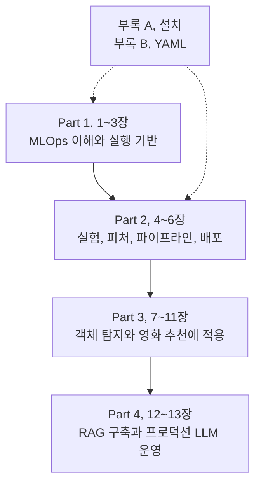

모델을 API로 배포하는 것과 그 모델을 다시 만들고 안전하게 바꾸는 것은 다른 일이다. 이 책은 학습 코드뿐 아니라 데이터와 실험 기록, 배포와 복구까지 연결하는 **플랫폼 쪽의 문제**를 다룬다.

『Machine Learning Platform Engineering』은 이 전체 흐름을 다루는 책이다. 저자는 Benjamin Tan Wei Hao, Shanoop Padmanabhan, Varun Mallya이고 출판사는 Manning이다. 4개 Part와 13개 챕터, 설치와 YAML을 다루는 부록 두 개로 구성된다.

도구 이름이 많이 나오지만 각각을 따로 익히기보다, 학습에서 만든 결과를 다음 단계가 어떻게 받아 쓰는지 따라가는 식으로 읽고 정리했다.

## 책 전체를 관통하는 질문

어떤 데이터와 코드로 만든 모델인지, 왜 출시했고 문제가 생기면 어디로 되돌릴 수 있는지 설명할 수 있어야 한다. 네 Part는 이 질문에 필요한 기능을 차례로 붙이는 구성이다.

## 책의 흐름

### Part 1. MLOps의 기초 (1~3장)

ML 프로젝트를 한 번 끝내는 작업이 아니라 계속 돌아오는 생애주기로 본다. 컨테이너와 Kubernetes, 배포 자동화와 기본 모니터링으로 모델이 올라갈 바닥을 만드는 구간이다.

| 글 | 원문 챕터 | 핵심 쟁점 |
| --- | --- | --- |
| [01. 시작하기](../01-getting-started/) | Getting started with MLOps and ML engineering | 실험에서 서비스 운영으로 넘어갈 때 필요한 요건 |
| [02. MLOps란 무엇인가](../02-what-is-mlops/) | What is MLOps? | 모델 산출물과 생성 과정의 자동화 범위 |
| [03. Kubernetes 기반](../03-kubernetes-foundation/) | Building applications on Kubernetes | 애플리케이션의 반복 배포와 관측에 필요한 기반 |

### Part 2. 공통 ML 플랫폼 기능 (4~6장)

실험 결과를 기록하고 피처를 재사용하며, 여러 작업을 연결해 예측을 서비스한다. 소득 분류 예제로 각 기능을 연결한다.

| 글 | 원문 챕터 | 핵심 쟁점 |
| --- | --- | --- |
| [04. 실험, 피처, 파이프라인](../04-experiments-features-pipelines/) | Designing reliable ML systems, Orchestrating ML pipelines | 모델 버전과 피처 정의를 배치 추론까지 잇는 저장소 구성 |
| 06. 모델의 프로덕션화 | Productionizing ML models | 배포 후 입력 변화의 감지 |

### Part 3. 실제 프로젝트에 적용 (7~11장)

신분증 이미지에서 카드 영역을 찾는 객체 탐지와 사용자, 영화 평점을 쓰는 추천을 다룬다. 이미지와 표 데이터의 차이가 저장, 검증, 운영 관측에 어떻게 영향을 주는지 비교할 구간이다.

| 글 | 원문 챕터 | 핵심 쟁점 |
| --- | --- | --- |
| 07. 데이터 분석과 준비 | Data analysis and preparation | 노트북 탐색을 재실행 가능한 데이터 준비로 전환 |
| 08. 학습과 검증 I | Model training and validation: Part 1 | 학습 완료와 모델 실용성 평가의 차이 |
| 09. 학습과 검증 II | Model training and validation: Part 2 | 데이터 이동 비용과 실험 추적의 조정 |
| 10. 추론과 서빙 | Model inference and serving | 모델 파일을 재사용 가능한 서비스로 전환 |
| 11. 모니터링과 설명가능성 | Monitoring and explainability | 서비스 가용성과 예측 품질의 별도 관측 |

책은 OCR 시스템이라는 넓은 맥락도 쓰지만 주요 학습 대상은 신분증 객체 탐지이다. 카드 위치를 찾는 것과 카드 안의 글자를 읽는 OCR은 구분해 둔다.

### Part 4. LLM 운영 (12~13장)

마지막에는 사내 문서를 찾아 답하는 DakkaBot을 만든다. 직접 학습한 모델의 가중치를 관리하던 문제에 검색 문서, 벡터 인덱스, 프롬프트, 외부 모델 API 관리가 더해진다.

| 글 | 원문 챕터 | 핵심 쟁점 |
| --- | --- | --- |
| 12. LLM 기반 시스템 | Designing LLM-powered systems | 잘못된 답변의 검색과 생성 원인 구분 |
| 13. 프로덕션 LLM 설계 | Production LLM system design | 답변 품질, 안전, 비용 변경의 검증과 롤백 |

RAG는 필요한 문서를 먼저 찾고 그 내용을 참고해 답하게 하는 방식이다. 문서를 잘못 찾으면 모델이 커져도 답이 좋아지지 않을 수 있다. 검색을 붙였다고 환각이나 정보 유출 위험이 사라지는 것도 아니다.

## 도구 이름보다 역할을 기억하기

| 역할 | 책에서 다루는 도구 | 해결하려는 문제 |
| --- | --- | --- |
| 실행 환경과 클러스터 | Docker, Kubernetes, Helm | 의존성과 자원을 관리하며 반복 배포하기 |
| 빌드와 배포 자동화 | GitLab CI, Argo CD | 변경을 검증하고 선언된 상태로 배포하기 |
| 실험 추적과 모델 관리 | MLflow | 어떤 조건으로 만든 모델인지 추적하기 |
| 피처 재사용 | Feast | 학습, 배치, 온라인 예측에 필요한 피처 제공하기 |
| 작업 오케스트레이션 | Kubeflow Pipelines | 단계 사이의 데이터와 실행 의존성 관리하기 |
| 모델 서비스 | BentoML, MLflow Serving, KServe | 모델을 사용할 수 있는 인터페이스 제공하기 |
| 운영 관측과 학습 분석 | Prometheus, Grafana, Loki, Alertmanager, TensorBoard | 서비스 상태와 학습 과정을 각각 살피기 |
| 데이터 변화와 모델 설명 | Evidently, Deepchecks, Eigen-CAM, EMF | 입력 변화와 예측 행동 조사하기 |
| RAG와 대화 UI | Gemini, FAISS, LangChain, Chainlit | 문서 검색과 답변 생성을 연결하기 |
| LLM 품질, 안전, 비용 | Langfuse, DeepEval, Promptfoo, Guardrails AI, RedisVL | 추적, 평가, 방어, 캐시를 운영하기 |

필요한 도구만 선택하고, 해결할 문제와 기존 체계의 한계를 먼저 따진다.

## 함께 볼 부록

각 도구를 직접 연결해 보려면 [ML 플랫폼 엔지니어링 통합 실습](/docs/tech/ops/mlops/labs/)을 함께 볼 수 있다. 영화 추천, 합성 카드 탐지와 문서 검색을 실행 가능한 코드로 나누고, 정상 실행 이후의 실패 실험과 결과 확인 절차를 추가했다. Azure 배포 구성은 제공하지만 이 자료 작성 중 클라우드 리소스를 생성하지 않았다.

부록 A, Installation and setup은 클러스터와 Kubeflow, MLflow 및 주변 구성 요소의 설치 참고 자료이다. 로컬 안내는 Mac, Linux 중심이므로 Windows 실습에서는 WSL2나 별도 Linux 환경 등 실행 환경부터 정해야 한다.

부록 B, Basics of YAML은 Kubernetes 설정을 읽는 보조 지도이다. 들여쓰기, 문자열, 리스트, 맵, 앵커, 별칭은 3장과 함께 확인할 항목이다.

책의 명령어와 API는 집필 당시 버전이 전제이다. KFP의 데이터 전달, BentoML의 Service, Runner API, MLflow의 모델 단계 관리는 현재 버전과 다를 수 있다. 책의 동작 원리와 최신 버전에서 그대로 실행되는지는 별개로 확인해야 한다.

## 실제 업무와 연결할 지점

도구가 설치되어 있어도 운영 책임과 장애 대응이 빠져 있으면 플랫폼이 완성됐다고 보기 어렵다. 각 구간에서 필요한 결과물을 같이 생각해 볼 수 있다.

| 읽는 구간 | 엔지니어가 남길 결과 |
| --- | --- |
| 1~3장 | 생애주기, 책임 경계, 재현 가능한 실행, 배포 기반 |
| 4~6장 | 실험, 피처 계보, 작업 계약, 서비스와 드리프트 대응 |
| 7~9장 | 데이터 계약, 검증 게이트, 학습 자원, 성능 측정 |
| 10~11장 | 출시 명세, 부하, 복구 결과, SLO와 실행 지침 |
| 12~13장 | 검색, 답변 평가, 권한 경계, 변경, 비용 통제 |

### 프로젝트에서 확인할 것

1. 문제와 기준: 업무 목표, 데이터 사용 범위, 현재 병목과 성공 기준.
2. 설계 결정: 채택, 제외한 대안, 의존성, 운영 비용과 담당자.
3. 검증 증거: 데이터, 모델, 서비스 시험 결과, 실패 재현과 복구 기록.
4. 인수 자료: 배포, 롤백 절차, SLO, 알림, 실행 지침, 접근, 보존 정책.

설계한 구조와 실제 구현한 구조는 다를 수 있다. 성능과 복구 시간은 실행 결과로 확인해야 한다.

## 남는 질문

책의 도구를 모두 설치하는 것보다, 지금 반복해서 겪는 실패가 무엇이고 그 판단 근거를 어디에 남길지 정하는 편이 먼저다. 정확도가 높은 모델을 고르는 일도 지연 시간과 데이터 누수, 재현성과 복구까지 함께 보면 다른 결정이 될 수 있다.

[Manning liveBook](https://livebook.manning.com/book/machine-learning-platform-engineering) / [저자 코드](https://github.com/practical-mlops)

[시리즈 목차](../), [다음: 01. MLOps와 ML 엔지니어링 시작하기](../01-getting-started/)
