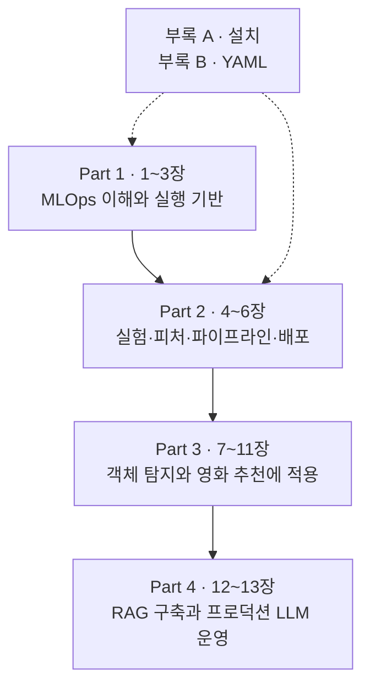

## 책을 펼치며 잡은 관점

맛있는 요리 하나를 만드는 것과 식당을 매일 운영하는 것은 다른 일이다. 요리 실력만으로 재료 관리, 주문 처리, 위생 점검과 주문이 몰릴 때의 대응까지 해결되지는 않는다.

노트북에서 좋은 점수를 얻은 모델이 요리라면, **여러 팀이 모델을 반복해서 학습·검증·배포하고 문제를 발견할 수 있게 하는 공통 기반**이 ML 플랫폼이다. 이 책도 알고리즘 이론보다 그 식당을 설계하고 운영하는 방법에 가깝다고 읽었다.

**『Machine Learning Platform Engineering』**은 Benjamin Tan Wei Hao, Shanoop Padmanabhan, Varun Mallya가 쓴 Manning의 책이다. EPUB의 *about this book*, Part 소개와 목차를 기준으로 읽기 지도를 정리했다. 본문은 **4개 Part, 13개 챕터**, 보조 자료는 설치와 YAML을 다루는 **부록 A·B**다.

**현재 공개한 독서노트는 이 소개 글과 1~3장이다.** 챕터당 한 아티클을 두고 본문은 원문의 절 번호를 따른다. 아래 4~13장 표는 책의 전체 구성을 보여 주는 지도이며, 아직 공개하지 않은 글의 링크는 두지 않았다.

## 책 전체를 관통하는 질문

이 책을 읽으며 붙잡은 질문은 “어떤 도구를 설치할까?”보다 **“모델이 바뀌어도 서비스를 믿을 수 있으려면 무엇을 남기고 자동화해야 할까?”**다.

앞부분에서 소개한 도구가 뒤쪽 프로젝트에 다시 나온다. 단순 반복이라기보다 **작은 예제에서 배운 설계를 다른 데이터와 운영 조건에 적용하는 과정**으로 보는 편이 맞겠다.

## Part별로 무엇을 쌓는가

### Part 1. MLOps의 기초를 놓기 — 1~3장

ML 프로젝트를 한 번 끝내는 작업이 아니라 계속 돌아오는 생애주기로 본다. 컨테이너와 Kubernetes, 배포 자동화와 기본 모니터링으로 모델이 올라갈 바닥을 만드는 구간이다.

| 글 | 원문 챕터 | 읽으며 답할 질문 |
| --- | --- | --- |
| [01. 시작하기](../01-getting-started/) | Getting started with MLOps and ML engineering | 실험에서 서비스로 넘어갈 때 무엇이 추가되는가? |
| [02. MLOps란 무엇인가](../02-what-is-mlops/) | What is MLOps? | 자동화의 대상은 모델 파일인가, 모델을 만드는 과정인가? |
| [03. Kubernetes 기반](../03-kubernetes-foundation/) | Building applications on Kubernetes | 같은 애플리케이션을 반복해서 배포하고 관측하려면 무엇이 필요한가? |

이 Part에서 남길 것은 명령어 암기보다 **실행 환경·배포·관측의 역할 구분**이다.

### Part 2. 공통 ML 플랫폼 기능 만들기 — 4~6장

실험 결과를 기억하고, 피처를 재사용하고, 여러 작업을 연결하고, 예측을 서비스하는 능력을 붙인다. 소득 분류 예제가 기능들을 연결하는 작은 연습장 역할을 한다. 이 구간의 글은 아직 비공개다.

| 글 | 원문 챕터 | 읽으며 답할 질문 |
| --- | --- | --- |
| 04. 실험과 피처 관리 | Designing reliable ML systems | 이 모델이 어떤 실험과 피처에서 나왔는지 설명할 수 있는가? |
| 05. ML 파이프라인 | Orchestrating ML pipelines | 서로 다른 컨테이너의 작업을 어떻게 하나의 실행으로 묶는가? |
| 06. 모델의 프로덕션화 | Productionizing ML models | 배포 후 입력 데이터가 달라지면 어떻게 알아차리는가? |

MLflow, Feast, Kubeflow Pipelines, BentoML, Evidently를 **제품 목록보다 서로 다른 책임을 맡는 부품**으로 읽는 것이 핵심이다.

### Part 3. 실제 프로젝트에 적용하기 — 7~11장

신분증 이미지에서 카드 영역을 찾는 객체 탐지와 사용자·영화 평점을 쓰는 추천을 다룬다. 이미지와 표 데이터의 차이가 저장·검증·운영 관측에 어떻게 영향을 주는지 비교할 구간이다.

| 글 | 원문 챕터 | 읽으며 답할 질문 |
| --- | --- | --- |
| 07. 데이터 분석과 준비 | Data analysis and preparation | 노트북의 탐색을 재실행 가능한 데이터 준비 작업으로 바꾸려면? |
| 08. 학습과 검증 I | Model training and validation: Part 1 | 학습이 끝났다는 사실과 모델이 쓸 만하다는 사실은 어떻게 다른가? |
| 09. 학습과 검증 II | Model training and validation: Part 2 | 데이터 이동 비용과 실험 추적을 어떻게 함께 설계할까? |
| 10. 추론과 서빙 | Model inference and serving | 모델 파일을 다른 사람이 쓸 수 있는 서비스로 만들려면? |
| 11. 모니터링과 설명가능성 | Monitoring and explainability | 서비스가 살아 있는지와 예측이 유용한지를 각각 어떻게 볼까? |

책은 OCR 시스템이라는 넓은 맥락도 쓰지만 주요 학습 대상은 **신분증 객체 탐지**다. 카드 위치를 찾는 것과 카드 안의 글자를 읽는 OCR은 구분해 둔다.

### Part 4. LLM을 위한 운영으로 확장하기 — 12~13장

마지막에는 사내 문서를 찾아 답하는 **DakkaBot**을 만든다. 직접 학습한 모델의 가중치를 관리하던 문제에 검색 문서·벡터 인덱스·프롬프트·외부 모델 API 관리가 더해진다.

| 글 | 원문 챕터 | 읽으며 답할 질문 |
| --- | --- | --- |
| 12. LLM 기반 시스템 | Designing LLM-powered systems | 잘못된 답변의 원인이 검색인지 생성인지 구분할 수 있는가? |
| 13. 프로덕션 LLM 설계 | Production LLM system design | 답변 품질·안전·비용을 바꾸는 변경을 어떻게 검증하고 되돌릴까? |

RAG는 **필요한 문서를 먼저 찾고 그 내용을 참고해 답하게 하는 방식**이다. 문서를 잘못 찾으면 모델이 커져도 답이 좋아지지 않을 수 있다. 검색을 붙였다고 환각이나 정보 유출 위험이 사라지는 것도 아니다.

## 도구 이름보다 역할을 기억하기

| 역할 | 책에서 다루는 도구 | 해결하려는 문제 |
| --- | --- | --- |
| 실행 환경과 클러스터 | Docker, Kubernetes, Helm | 의존성과 자원을 관리하며 반복 배포하기 |
| 빌드와 배포 자동화 | GitLab CI, Argo CD | 변경을 검증하고 선언된 상태로 배포하기 |
| 실험 추적과 모델 관리 | MLflow | 어떤 조건으로 만든 모델인지 추적하기 |
| 피처 재사용 | Feast | 학습·배치·온라인 예측에 필요한 피처 제공하기 |
| 작업 오케스트레이션 | Kubeflow Pipelines | 단계 사이의 데이터와 실행 의존성 관리하기 |
| 모델 서비스 | BentoML, MLflow Serving, KServe | 모델을 사용할 수 있는 인터페이스 제공하기 |
| 운영 관측과 학습 분석 | Prometheus, Grafana, Loki, Alertmanager, TensorBoard | 서비스 상태와 학습 과정을 각각 살피기 |
| 데이터 변화와 모델 설명 | Evidently, Deepchecks, Eigen-CAM, EMF | 입력 변화와 예측 행동 조사하기 |
| RAG와 대화 UI | Gemini, FAISS, LangChain, Chainlit | 문서 검색과 답변 생성을 연결하기 |
| LLM 품질·안전·비용 | Langfuse, DeepEval, Promptfoo, Guardrails AI, RedisVL | 추적·평가·방어·캐시를 운영하기 |

모두 도입해야 한다는 체크리스트는 아니다. **문제를 풀 최소 기능을 고르고, 나머지를 지금 넣지 않는 이유도 설명할 수 있는 것**이 더 중요한 독서 성과라고 본다.

## 함께 볼 부록

**부록 A, Installation and setup**은 클러스터와 Kubeflow, MLflow 및 주변 구성 요소의 설치 참고 자료다. 로컬 안내는 Mac·Linux 중심이므로 Windows 실습에서는 WSL2나 별도 Linux 환경 등 실행 환경부터 정할 필요가 있다.

**부록 B, Basics of YAML**은 Kubernetes 설정을 읽는 보조 지도다. 들여쓰기, 문자열, 리스트·맵, 앵커·별칭은 3장과 함께 확인할 항목이다.

책의 명령어와 API는 집필 당시 버전이 전제다. KFP의 데이터 전달, BentoML의 Service·Runner API, MLflow의 모델 단계 관리는 현재 버전과 다를 수 있다. **책의 동작 원리와 최신 버전에서 그대로 실행되는지는 별개로 확인해야 한다.**

## 북클럽에서 남기고 싶은 것

책의 공식 일정이 아니라 읽으며 쌓아갈 결과물에 대한 메모다.

1. **읽기 전:** 이번 장이 없으면 어떤 문제가 생길지 한 문장으로 정리.
2. **읽는 동안:** 도구의 입력·출력·실패 영향과 낯선 용어를 기록.
3. **모임에서:** 실제 또는 가상의 서비스 사례로 선택의 근거와 비용을 비교.
4. **모임 후:** 설계 표·실패 시나리오·검증 결과 중 하나를 남기고, 미확인 사항도 표시.

첫 모임의 질문은 “정확도가 가장 높은 모델을 바로 배포해도 되는가?” 정도가 좋겠다. 지연 시간, 데이터 누수, 재현성, 롤백까지 연결해서 이야기할 수 있다.

**놓치지 말 것:** 도구 설치 완료가 플랫폼 완성은 아니다. 기능이 연결되어도 접근 제어·비용·담당자·장애 대응이 남는다.

## 엔지니어링·컨설팅 역량까지 연결하는 방법

목표는 도구 이름을 아는 데서 끝나지 않고 **문제를 진단하고, 대안을 비교하고, 구현 결과를 증거로 설명할 수 있는 것**이다. 실무·컨설팅 메모는 이 목표를 위한 보충이며 원문의 요약과 구분한다.

| 읽는 구간 | 엔지니어가 남길 결과 | 컨설팅에서 설명할 결과 |
| --- | --- | --- |
| 1~3장 | 생애주기·책임 경계, 재현 가능한 실행·배포 기반 | 현황 진단, 요구사항, 자체 구축·구매의 결정 근거 |
| 4~6장 | 실험·피처 계보, 작업 계약, 서비스와 드리프트 대응 | 목표 구조, 데이터·모델 관리 정책, 운영 절차 |
| 7~9장 | 데이터 계약, 검증 게이트, 학습 자원·성능 측정 | 품질 위험과 개선 우선순위, 비용·효율의 근거 |
| 10~11장 | 출시 명세, 부하·복구 결과, SLO와 실행 지침 | 운영 인수 조건, 책임 분담, 서비스 품질 보고 |
| 12~13장 | 검색·답변 평가, 권한 경계, 변경·비용 통제 | LLM 도입 타당성, 수용 기준, 안전·비용 관리안 |

컨설팅의 첫 질문도 “무슨 플랫폼이 필요한가?”보다 **“지금 어떤 의사결정이 얼마나 자주 막히고, 그 손실을 무엇으로 확인할 수 있는가?”**여야 한다. 인터뷰뿐 아니라 배포 기록, 데이터 장애, 실험 이력과 비용 명세를 같이 볼 필요가 있다.

파이프라인이 거의 바뀌지 않는 작은 팀에 Kubernetes 기반 플랫폼을 먼저 제안하는 것과 수동 검증부터 줄이는 것은 비용과 효과가 다르다. 제안에도 대안과 단계별 도입의 이유가 있어야 한다.

### 북클럽의 최종 결과물

전부 읽은 뒤에는 하나의 프로젝트에서 아래 내용을 연결해 설명하는 것을 목표로 삼는다.

1. **문제와 기준:** 업무 목표, 데이터 사용 범위, 현재 병목과 성공 기준.
2. **설계 결정:** 채택·제외한 대안, 의존성, 운영 비용과 담당자.
3. **검증 증거:** 데이터·모델·서비스 시험 결과, 실패 재현과 복구 기록.
4. **인수 자료:** 배포·롤백 절차, SLO, 알림·실행 지침, 접근·보존 정책.

실습 환경이 없다면 설계 검토까지는 가능하지만 성능·복구·운영 가능성을 확인했다고 주장할 수는 없다. **그린 구조, 구현한 구조, 실제 검증한 범위를 따로 표시하는 습관**을 가져가야겠다.

## 한 줄 정리

**좋은 모델 하나보다 모델과 LLM 애플리케이션을 반복해서 안전하게 바꿀 수 있는 운영 기반을 다루는 책이다.**

출처: 제공된 EPUB의 책 소개·목차·Part 소개. 원문과 실습 참고는 [Manning liveBook](https://livebook.manning.com/book/machine-learning-platform-engineering), [저자 코드](https://github.com/practical-mlops).

[시리즈 목차](../) · [다음: 01. MLOps와 ML 엔지니어링 시작하기](../01-getting-started/)
