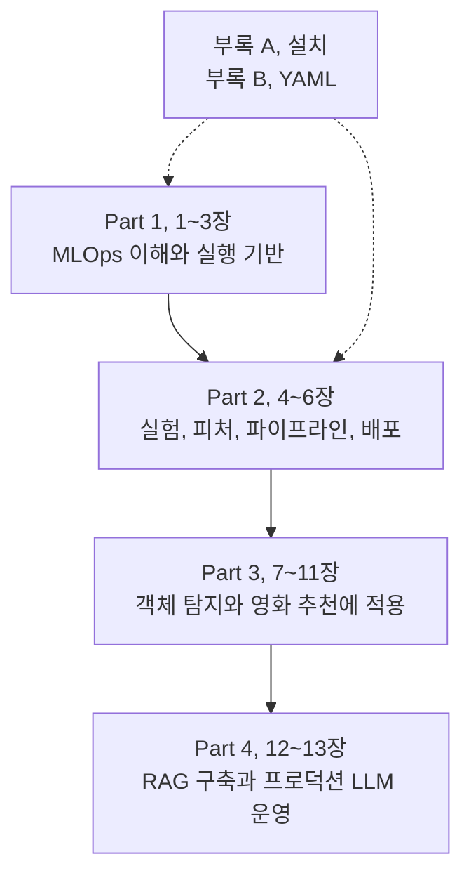

모델을 API로 배포할 수 있어도 그 모델을 다시 만들고 안전하게 바꾸는 일은 별개의 문제입니다. 학습 데이터와 코드가 무엇이었는지, 어떤 평가를 통과했는지, 운영 중 문제가 생기면 어디까지 되돌릴 수 있는지를 함께 봐야 합니다.

『Machine Learning Platform Engineering』은 이 전체 흐름을 다루는 책입니다. 저자는 Benjamin Tan Wei Hao, Shanoop Padmanabhan, Varun Mallya이고 출판사는 Manning입니다. 4개 Part와 13개 챕터, 설치와 YAML을 다루는 부록 두 개로 구성됩니다.

제가 이 책에서 먼저 이해하고 싶은 부분도 모델 하나의 구현보다 학습과 배포 사이를 연결하는 구조입니다. 도구마다 어떤 문제를 해결하고 어디까지 책임지는지 구분하면서 읽으려고 합니다.

## 책 전체를 관통하는 질문

모델이 바뀌어도 서비스를 믿을 수 있으려면 무엇을 기록하고 자동화해야 할까요?

앞부분에서 소개한 도구가 뒤쪽 프로젝트에 다시 나옵니다. 같은 설계라도 이미지, 표 데이터, 문서 검색에서 조건이 어떻게 달라지는지 비교할 수 있습니다.

## 책의 흐름

### Part 1. MLOps의 기초 (1~3장)

ML 프로젝트를 한 번 끝내는 작업이 아니라 계속 돌아오는 생애주기로 봅니다. 컨테이너와 Kubernetes, 배포 자동화와 기본 모니터링으로 모델이 올라갈 바닥을 만드는 구간입니다.

| 글 | 원문 챕터 | 핵심 쟁점 |
| --- | --- | --- |
| [01. 시작하기](../01-getting-started/) | Getting started with MLOps and ML engineering | 실험에서 서비스로 넘어갈 때 무엇이 추가되는가? |
| [02. MLOps란 무엇인가](../02-what-is-mlops/) | What is MLOps? | 자동화의 대상은 모델 파일인가, 모델을 만드는 과정인가? |
| [03. Kubernetes 기반](../03-kubernetes-foundation/) | Building applications on Kubernetes | 같은 애플리케이션을 반복해서 배포하고 관측하려면 무엇이 필요한가? |

이 구간에서는 명령어보다 실행 환경과 배포, 관측의 역할을 구분하는 것이 중요하다고 생각했습니다. 뒤에서 소개하는 ML 도구들도 결국 이 기반 위에서 실행됩니다.

### Part 2. 공통 ML 플랫폼 기능 (4~6장)

실험 결과를 기록하고 피처를 재사용하며, 여러 작업을 연결해 예측을 서비스합니다. 소득 분류 예제로 각 기능을 연결합니다.

| 글 | 원문 챕터 | 핵심 쟁점 |
| --- | --- | --- |
| [04. 실험과 피처 관리](../04-experiments-and-features/) | Designing reliable ML systems | 이 모델이 어떤 실험과 피처에서 나왔는지 설명할 수 있는가? |
| [05. ML 파이프라인](../05-ml-pipelines/) | Orchestrating ML pipelines | 서로 다른 컨테이너의 작업을 어떻게 하나의 실행으로 묶는가? |
| 06. 모델의 프로덕션화 | Productionizing ML models | 배포 후 입력 데이터가 달라지면 어떻게 알아차리는가? |

MLflow, Feast, Kubeflow Pipelines, BentoML, Evidently가 차례로 등장합니다. 처음에는 도구 이름이 많아 보이지만, 실험 기록과 피처 관리, 실행 순서와 배포, 데이터 변화 관측이라는 서로 다른 문제를 맡습니다.

### Part 3. 실제 프로젝트에 적용 (7~11장)

신분증 이미지에서 카드 영역을 찾는 객체 탐지와 사용자, 영화 평점을 쓰는 추천을 다룹니다. 이미지와 표 데이터의 차이가 저장, 검증, 운영 관측에 어떻게 영향을 주는지 비교할 구간입니다.

| 글 | 원문 챕터 | 핵심 쟁점 |
| --- | --- | --- |
| 07. 데이터 분석과 준비 | Data analysis and preparation | 노트북의 탐색을 재실행 가능한 데이터 준비 작업으로 바꾸려면? |
| 08. 학습과 검증 I | Model training and validation: Part 1 | 학습이 끝났다는 사실과 모델이 쓸 만하다는 사실은 어떻게 다른가? |
| 09. 학습과 검증 II | Model training and validation: Part 2 | 데이터 이동 비용과 실험 추적을 어떻게 함께 설계할까? |
| 10. 추론과 서빙 | Model inference and serving | 모델 파일을 다른 사람이 쓸 수 있는 서비스로 만들려면? |
| 11. 모니터링과 설명가능성 | Monitoring and explainability | 서비스가 살아 있는지와 예측이 유용한지를 각각 어떻게 볼까? |

책은 OCR 시스템이라는 넓은 맥락도 쓰지만 주요 학습 대상은 신분증 객체 탐지입니다. 카드 위치를 찾는 것과 카드 안의 글자를 읽는 OCR은 구분해 둡니다.

### Part 4. LLM 운영 (12~13장)

마지막에는 사내 문서를 찾아 답하는 DakkaBot을 만듭니다. 직접 학습한 모델의 가중치를 관리하던 문제에 검색 문서, 벡터 인덱스, 프롬프트, 외부 모델 API 관리가 더해집니다.

| 글 | 원문 챕터 | 핵심 쟁점 |
| --- | --- | --- |
| 12. LLM 기반 시스템 | Designing LLM-powered systems | 잘못된 답변의 원인이 검색인지 생성인지 구분할 수 있는가? |
| 13. 프로덕션 LLM 설계 | Production LLM system design | 답변 품질, 안전, 비용을 바꾸는 변경을 어떻게 검증하고 되돌릴까? |

RAG는 필요한 문서를 먼저 찾고 그 내용을 참고해 답하게 하는 방식입니다. 문서를 잘못 찾으면 모델이 커져도 답이 좋아지지 않을 수 있습니다. 검색을 붙였다고 환각이나 정보 유출 위험이 사라지는 것도 아닙니다.

## 도구 이름보다 역할을 기억하기

| 역할 | 책에서 다루는 도구 | 해결하려는 문제 |
| --- | --- | --- |
| 실행 환경과 클러스터 | Docker, Kubernetes, Helm | 의존성과 자원을 관리하며 반복 배포하기 |
| 빌드와 배포 자동화 | GitLab CI, Argo CD | 변경을 검증하고 선언된 상태로 배포하기 |
| 실험 추적과 모델 관리 | MLflow | 어떤 조건으로 만든 모델인지 추적하기 |
| 피처 재사용 | Feast | 학습, 배치, 온라인 예측에 필요한 피처 제공하기 |
| 작업 오케스트레이션 | Kubeflow Pipelines | 단계 사이의 데이터와 실행 의존성 관리하기 |
| 모델 서비스 | BentoML, MLflow Serving, KServe | 모델을 사용할 수 있는 인터페이스 제공하기 |
| 운영 관측과 학습 분석 | Prometheus, Grafana, Loki, Alertmanager, TensorBoard | 서비스 상태와 학습 과정을 각각 살피기 |
| 데이터 변화와 모델 설명 | Evidently, Deepchecks, Eigen-CAM, EMF | 입력 변화와 예측 행동 조사하기 |
| RAG와 대화 UI | Gemini, FAISS, LangChain, Chainlit | 문서 검색과 답변 생성을 연결하기 |
| LLM 품질, 안전, 비용 | Langfuse, DeepEval, Promptfoo, Guardrails AI, RedisVL | 추적, 평가, 방어, 캐시를 운영하기 |

도구를 모두 도입할 필요는 없습니다. 해결할 문제가 무엇인지, 기존 체계로는 왜 부족한지부터 따져야 합니다.

## 함께 볼 부록

각 도구를 직접 연결해 보려면 [ML 플랫폼 엔지니어링 통합 실습](../../ml-platform-engineering-labs/)을 함께 볼 수 있습니다. 영화 추천, 합성 카드 탐지와 문서 검색을 실행 가능한 코드로 나누고, 정상 실행 이후의 실패 실험과 결과 확인 절차를 추가했습니다. Azure 배포 구성은 제공하지만 이 자료 작성 중 클라우드 리소스를 생성하지는 않았습니다.

부록 A, Installation and setup은 클러스터와 Kubeflow, MLflow 및 주변 구성 요소의 설치 참고 자료입니다. 로컬 안내는 Mac, Linux 중심이므로 Windows 실습에서는 WSL2나 별도 Linux 환경 등 실행 환경부터 정할 필요가 있습니다.

부록 B, Basics of YAML은 Kubernetes 설정을 읽는 보조 지도입니다. 들여쓰기, 문자열, 리스트, 맵, 앵커, 별칭은 3장과 함께 확인할 항목입니다.

책의 명령어와 API는 집필 당시 버전이 전제입니다. KFP의 데이터 전달, BentoML의 Service, Runner API, MLflow의 모델 단계 관리는 현재 버전과 다를 수 있습니다. 책의 동작 원리와 최신 버전에서 그대로 실행되는지는 별개로 확인해야 합니다.

## 실제 업무와 연결할 지점

도구가 설치되어 있어도 운영 책임과 장애 대응이 빠져 있으면 플랫폼이 완성됐다고 보기 어렵습니다. 각 구간에서 필요한 결과물을 같이 생각해 볼 수 있습니다.

| 읽는 구간 | 엔지니어가 남길 결과 |
| --- | --- |
| 1~3장 | 생애주기, 책임 경계, 재현 가능한 실행, 배포 기반 |
| 4~6장 | 실험, 피처 계보, 작업 계약, 서비스와 드리프트 대응 |
| 7~9장 | 데이터 계약, 검증 게이트, 학습 자원, 성능 측정 |
| 10~11장 | 출시 명세, 부하, 복구 결과, SLO와 실행 지침 |
| 12~13장 | 검색, 답변 평가, 권한 경계, 변경, 비용 통제 |

### 프로젝트에서 확인할 것

1. 문제와 기준: 업무 목표, 데이터 사용 범위, 현재 병목과 성공 기준.
2. 설계 결정: 채택, 제외한 대안, 의존성, 운영 비용과 담당자.
3. 검증 증거: 데이터, 모델, 서비스 시험 결과, 실패 재현과 복구 기록.
4. 인수 자료: 배포, 롤백 절차, SLO, 알림, 실행 지침, 접근, 보존 정책.

설계한 구조와 실제 구현한 구조는 다를 수 있습니다. 성능과 복구 시간은 실행 결과로 확인해야 합니다.

## 남는 질문

정확도가 가장 높은 모델을 바로 배포해도 될까요? 지연 시간과 데이터 누수, 재현성과 롤백까지 생각하면 점수 하나만으로 결정하기는 어렵습니다.

책을 읽으면서도 이 질문을 계속 기준으로 두려고 합니다. 어떤 도구를 쓸지보다 그 도구로 어떤 근거를 남기고 어떤 실패를 줄일지 설명할 수 있어야겠습니다.

[Manning liveBook](https://livebook.manning.com/book/machine-learning-platform-engineering) / [저자 코드](https://github.com/practical-mlops)

[시리즈 목차](../), [다음: 01. MLOps와 ML 엔지니어링 시작하기](../01-getting-started/)
