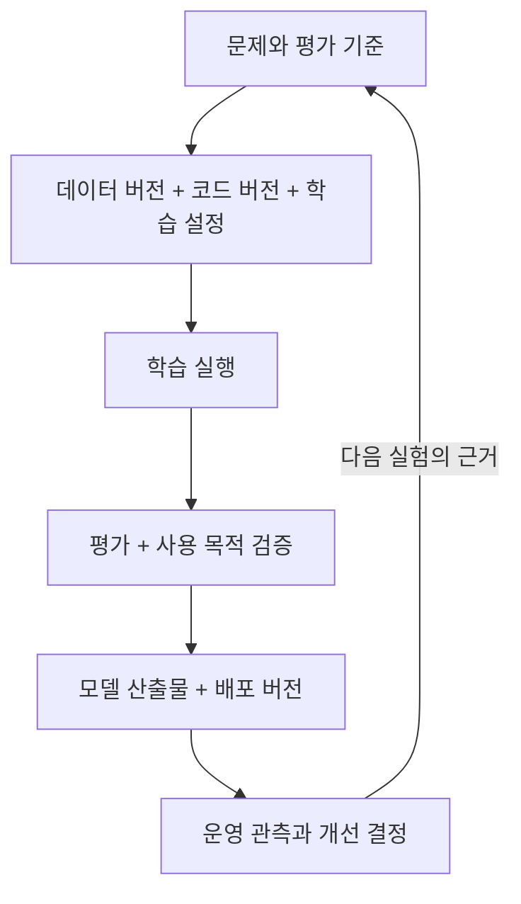
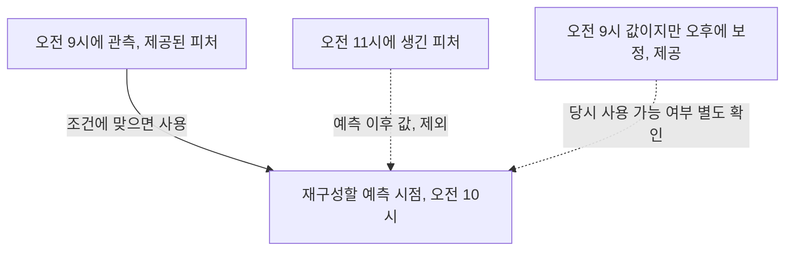

맛있는 음식을 한 번 만드는 것과 매일 같은 품질로 가게를 운영하는 것은 다릅니다. 레시피뿐 아니라 재료의 출처, 조리 환경, 주문 처리와 문제가 생겼을 때의 대응도 필요합니다. ML에서도 학습한 모델은 완성된 서비스가 아니라 그 서비스를 구성하는 재료 하나입니다.

1장은 이 차이를 ML 생애주기와 플랫폼의 관점에서 설명합니다. 읽고 나면 모델과 서비스의 배포 단위를 구분하고, 실험 결과에서 데이터까지 거슬러 올라가는 이력을 설계할 수 있어야 합니다. 아래의 수치와 작은 예시는 개념을 확인하기 위해 추가한 학습용 상황이며 책의 실험 결과는 아닙니다.

## 1.1 ML 생애주기

ML 생애주기는 문제 정의부터 데이터 준비, 학습, 평가, 배포와 개선까지 연결한 지도입니다. 직선처럼 그릴 수 있어도 실제로는 앞 단계로 자주 돌아갑니다. 지표가 나쁘다면 모델뿐 아니라 데이터와 문제 정의도 다시 봐야 합니다.

학습과 추론은 먼저 구분할 필요가 있습니다. 학습은 데이터와 정답을 이용해 모델의 가중치를 구하는 과정입니다. 추론은 이미 학습한 모델에 새 입력을 넣어 예측을 얻는 과정입니다. 새 사진 한 장을 받아 카드 위치를 찾는 API 요청이 들어올 때마다 모델을 다시 학습하는 것은 아닙니다.

### 1.1.1 실험 단계

실험의 첫 질문은 “이 문제에 ML이 필요한가?”입니다. 단순한 규칙으로 충분하다면 더 저렴하고 설명하기 쉬울 수 있습니다. ML이 필요하다면 어떤 의사결정을 개선할지와 성공 기준부터 정해야 합니다.

| 단계 | 해야 할 일 | 남길 근거 |
| --- | --- | --- |
| 문제 정의 | 사용자, 업무 목표와 오판의 비용 확인 | 기준선, 기대 효과, 평가 기준 |
| 데이터 수집, 준비 | 라벨링과 학습, 검증, 테스트 분할 | 원천, 라벨 기준, 분할 규칙 |
| 데이터 버전 관리 | 어떤 데이터를 사용했는지 고정 | 스냅샷 또는 재구성 가능한 식별자 |
| 학습 | 데이터, 코드, 설정으로 모델 생성 | 실행 조건, 가중치, 로그 |
| 평가 | 학습에 쓰지 않은 데이터로 성능 측정 | 평가셋 버전, 지표, 오류 사례 |
| 사용 목적 검증 | 업무 요구를 만족하는지 확인 | 승인, 보류 기준과 판단 근거 |

여기서 평가(evaluation)는 측정에, 검증(validation)은 의도한 용도에 적합한지 확인하는 데 초점을 둡니다. 조직마다 용어가 다를 수 있으므로 이름보다 절차와 책임을 합의하는 것이 중요합니다.

신분증 탐지를 예로 보면 학습 데이터는 사진만으로 구성되지 않습니다. 사진에서 카드가 어디에 있는지 표시한 경계 상자와 클래스 정보도 필요합니다. 사진은 입력이고 상자와 클래스가 정답입니다. 학습 결과는 이 대응 관계를 반영한 모델 가중치입니다.

데이터를 나누는 이유도 각각 다릅니다. 학습셋은 가중치를 학습하는 데, 검증셋은 모델과 설정을 선택하는 데 사용합니다. 테스트셋은 그 선택에 쓰지 않고 마지막 성능을 확인하는 용도로 남깁니다. 같은 영상에서 뽑은 거의 동일한 프레임이 학습셋과 테스트셋에 섞이면 새로운 촬영 상황에서의 성능을 과대평가하기 쉽습니다.

같은 코드라도 데이터가 바뀌면 다른 모델이 나옵니다. 계보(lineage)는 완성품에서 재료와 제조 이력까지 거슬러 올라가는 연결입니다. 여기서는 데이터, 코드, 설정과 실행, 결과의 관계를 뜻합니다.



자동화는 마지막에 붙이는 장식이 아닙니다. 실험부터 준비, 학습, 평가를 파이프라인으로 묶으면 수동 순서와 누락을 줄이고 운영에서도 같은 절차를 재사용하기 쉽습니다. 다만 기록이 있다는 사실만으로 비트 단위의 동일한 결과까지 보장되지는 않습니다.

실험 결과가 나쁘면 가중치 파일만으로는 이유를 알기 어렵습니다. 어떤 이미지와 라벨을 썼는지, 분할은 어떻게 했는지, 전처리와 학습 설정은 무엇이었는지 함께 찾아야 합니다. 모델 파일을 보관하는 일과 모델을 다시 만들 수 있는 상태를 유지하는 일은 다릅니다.

### 1.1.2 개발, 스테이징, 프로덕션 단계

실험이 “어떤 방법이 좋은가?”를 찾는다면, 운영에서는 그 방법을 반복해서 안전하게 실행하고 바꾸는 능력이 중요합니다. 스테이징은 실제 출시 전 조합을 확인하는 검증 환경입니다. 여기서 확인한 모델, 전처리, 환경 조합이 프로덕션에도 일치해야 합니다.

| 실험에서 묻는 질문 | 운영에서 추가되는 질문 |
| --- | --- |
| 어떤 데이터와 모델이 효과적인가? | 그 데이터, 코드, 설정을 다시 찾을 수 있는가? |
| 평가 점수가 충분한가? | 실제 입력에서도 품질과 응답 시간이 유지되는가? |
| 학습을 실행할 수 있는가? | 실패를 감지하고 재실행하거나 되돌릴 수 있는가? |
| 이번 결과가 좋은가? | 다음 변경도 같은 기준으로 검증할 수 있는가? |

운영에서는 모델을 API나 배치 작업으로 배포하고 부하, 오류, 데이터 변화, 예측 품질을 관측합니다. 새 데이터나 관측 결과가 재학습의 계기가 될 수 있지만 재학습 자동화와 무조건적인 자동 출시는 구분해야 합니다.

배포에는 가중치 외에도 입력을 모델이 기대하는 형식으로 바꾸는 전처리와 결과를 응답으로 만드는 코드가 포함됩니다. 학습에서는 이미지를 일정한 크기로 바꾸고 픽셀값을 정규화했는데 API에서는 원본을 그대로 넣는다면 같은 모델도 다른 입력을 받습니다. 이런 차이가 학습과 서빙 사이의 불일치입니다.

재학습은 새 후보를 만드는 과정이고 출시는 그 후보를 사용자에게 연결하는 결정입니다. 기존 모델보다 점수가 좋아도 특정 문서 유형에서 실패하거나 응답 시간이 늘었다면 출시를 보류할 수 있습니다. 문제가 생겼을 때는 모델만이 아니라 호환되는 전처리와 서비스 코드까지 함께 되돌려야 합니다.

배포 전에는 되돌릴 모델과 코드, 설정 조합을 정해 둬야 합니다. 새 모델의 점수뿐 아니라 실제 요청 지연과 자원 사용, 승인과 복구를 맡을 사람도 필요합니다.

## 1.2 MLOps에 필요한 역량

### 1.2.1 ML 엔지니어의 역량

ML 엔지니어는 알고리즘 하나만 잘 알아서는 부족합니다. 소프트웨어 설계, 테스트, 디버깅, 데이터 처리, 모델 평가, 실행 환경과 자동화를 연결해야 합니다.

| 역량 | 현장에서 답해야 할 질문 |
| --- | --- |
| 소프트웨어 엔지니어링 | 오류를 재현하고 원인을 좁힐 수 있는가? |
| ML, 통계 이해 | 지표와 분할 방식이 목표에 맞는가? |
| 데이터 엔지니어링 | 스키마, 시점, 품질 문제를 찾을 수 있는가? |
| 인프라, 자동화 | 실행과 배포를 반복하고 관측, 복구할 수 있는가? |

예측 오류가 발생하면 코드 버그인지, 데이터 오류인지, 모델의 한계인지, 인프라 장애인지부터 좁혀야 합니다.

예를 들어 모델이 카드를 잘 찾지 못한다는 증상도 원인은 여러 가집니다. 이미지 회전 정보를 전처리에서 누락했을 수도 있고, 새 카메라의 촬영 조건이 학습 데이터와 다를 수도 있습니다. 모델 로딩 실패로 다른 버전이 실행되고 있을 가능성도 있습니다. 알고리즘 지식과 서비스 디버깅을 따로 떼기 어려운 이유입니다.

### 1.2.2 선수 지식

Python과 기본적인 ML 흐름을 이해하고, 익숙하지 않은 프레임워크, 운영 도구를 배울 준비가 필요합니다. 책은 Kubernetes 기초를 설명한 뒤 플랫폼을 점진적으로 붙이는 구성입니다.

한 사람이 모든 영역의 전문가여야 한다는 뜻은 아닐 것 같습니다. 데이터와 평가를 잘 아는 사람, 서비스와 인프라를 잘 아는 사람이 같은 실행 흐름을 보면서 책임과 연결 지점을 합의하는 것이 먼저입니다.

## 1.3 ML 플랫폼 구축

플랫폼은 도구를 모아 놓은 화면이 아니라 실험과 학습, 배포와 관측을 반복할 수 있게 하는 공통 기반입니다. 원천 데이터 수집과 데이터 웨어하우스 전체를 모두 플랫폼의 책임으로 넣을 필요는 없습니다. 어떤 입력을 받아 무엇을 제공하는지, 누가 운영하는지부터 정해야 합니다.


그림 1.4. ML 플랫폼의 구성. 출처: Machine Learning Platform Engineering, 1장.

이 그림은 위에서 아래로 내려오는 모델 개발 흐름과 옆에서 받쳐 주는 공통 기능을 함께 보여 줍니다.

1. 업무 요구에서 문제와 모델을 정의합니다. 어떤 문제를 풀지 결정하는 일까지 플랫폼이 대신하지는 않습니다.
2. 파란 영역에서는 데이터를 준비하고 모델을 학습한 뒤 평가하고 배포합니다. 파이프라인 오케스트레이션은 이 단계의 순서와 실행 의존성을 관리합니다.
3. 실험 추적에는 파라미터와 지표를 남깁니다. 모델 레지스트리에는 관리할 모델과 버전을 등록합니다. 둘을 연결해야 배포한 모델이 어느 실험에서 나왔는지 찾을 수 있습니다.
4. 아래의 Model API는 사용자 요청을 받습니다. 모니터링 결과는 다시 개선이나 재학습의 근거가 됩니다.

피처 스토어에서 나오는 선이 학습과 API 양쪽으로 연결되는 점도 중요합니다. 학습 때 계산한 특성을 실제 요청에서도 같은 의미로 제공해야 한다는 뜻입니다. 다만 그림의 부품을 전부 설치해야 한다는 의미는 아닙니다. 이미지 모델처럼 전처리가 서비스 안에서 끝나는 경우와 여러 팀이 공통 특성을 쓰는 표 데이터 모델은 필요한 구성이 다릅니다.

### 1.3.1 자체 구축과 구매

직접 구축하면 각 구성 요소의 역할과 한계를 파악할 수 있습니다. 그렇다고 실제 도입에서도 자체 구축이 항상 유리한 것은 아닙니다.

관리형 서비스는 구축 부담을 줄일 수 있지만 통합, 권한, 비용 관리가 남습니다. 자체 구축은 조정의 자유가 큰 대신 업그레이드와 장애, 사용자 지원을 감당해야 합니다. 같은 요구사항과 기간으로 총비용을 비교해야 합니다.

| 조건 | 관리형 서비스에서 볼 것 | 자체 구축에서 볼 것 |
| --- | --- | --- |
| 빠른 초기 도입 | 기존 데이터와 인증 체계에 연결 가능한가? | 설치 이후 운영할 인력이 있는가? |
| 특수한 실행 환경 | 필요한 GPU와 네트워크 구성을 지원하는가? | 드라이버와 실행 환경을 직접 유지할 수 있는가? |
| 데이터 통제 | 보관 위치와 접근 정책이 요구에 맞는가? | 권한과 감사 기록을 직접 설계할 수 있는가? |
| 장기 비용 | 사용량 증가와 이전 비용은 어느 정도인가? | 업그레이드와 장애 대응 비용을 포함했는가? |

직접 구축하면 사용료가 사라진다는 식의 비교는 맞지 않습니다. 운영 담당자의 시간과 장애 위험도 비용입니다. 반대로 관리형이라고 플랫폼과 모델의 운영 책임까지 모두 없어지는 것도 아닙니다.

### 1.3.2 MLOps에서 LLMOps로

LLM 애플리케이션에서도 버전, 배포와 모니터링은 유효합니다. 여기에 문서 처리, 임베딩, 벡터 검색, 프롬프트, 답변 평가, 안전과 토큰 비용이 추가됩니다.

즉 모델 파일만이 아니라 어떤 문서와 인덱스, 프롬프트와 모델 API의 조합으로 답했는지도 추적해야 합니다. 이 장에서는 확장을 예고하고 자세한 구현은 후반부에서 다룹니다.

임베딩은 문서나 질문을 벡터로 표현하는 방식이고, 벡터 검색은 그 표현의 유사도를 이용해 관련 자료를 찾는 방식입니다. 여기서는 두 역할을 구분하는 정도로 이해했습니다.

### 1.3.3 책에서 사용하는 도구

| 공통 능력 | 도구, 기반 | 관리할 대상 |
| --- | --- | --- |
| ML 작업 실행 | Kubeflow Pipelines | 단계의 의존성과 실행 산출물 |
| 피처 제공 | Feast | 정의, 시점, 학습/서빙 조회 |
| 실험 추적, 모델 등록 | MLflow | 실행 조건, 평가, 모델 버전 |
| 배포 | 컨테이너, 레지스트리, CI/CD | 실행 환경과 변경된 서비스 |

MLflow를 설치했다고 데이터 품질이 보장되지는 않고, 피처 스토어를 넣었다고 학습, 서빙의 모든 차이가 사라지지도 않습니다. 도구 사이의 데이터와 설정을 일관되게 연결해야 합니다.

오케스트레이터는 모델을 학습하는 알고리즘이 아니라 작업을 실행하고 연결하는 쪽입니다. 실험 추적은 어떤 조건에서 어떤 결과가 나왔는지 기록하고, 레지스트리는 그중 어떤 모델을 관리하고 서비스할지 연결합니다. 역할이 겹쳐 보이는 도구를 비교할 때도 이 차이를 먼저 봐야 합니다.

새 도구를 제안할 때는 해결할 문제와 기존 체계와의 연결, 운영 담당자를 함께 정해야 합니다. 책의 조합이 모든 조직에 그대로 맞지는 않습니다.

#### Run, artifact와 피처 시점

[MLflow 공식 문서](https://mlflow.org/docs/latest/ml/tracking/)에서 run은 한 번의 실행, experiment는 관련 실행을 묶는 단위, artifact는 가중치, 그래프처럼 실행이 남긴 파일 산출물로 구분합니다. 모델 파일을 저장하는 것과 그 모델을 만든 과정을 추적하는 것은 다른 일입니다.

피처 스토어는 모델 입력으로 쓸 특성값의 정의와 조회, 재사용을 관리합니다. Point-in-time join은 지금의 최신 값이 아니라 학습 샘플의 과거 기준 시점에 맞는 값을 붙이는 방식입니다.



[Feast의 point-in-time join 문서](https://docs.feast.dev/getting-started/concepts/point-in-time-joins)를 확인하면 이벤트 시각과 값이 실제로 만들어진 시각도 구분해야 합니다. 시간 컬럼 하나가 있다고 미래 정보 누수가 자동으로 막히는 것은 아닙니다. 저장소, 버전이 제공하는 시점 처리와 지연 도착, 보정 데이터 정책까지 확인할 부분입니다.

## 1.4 ML 시스템 만들기

### 1.4.1 프로젝트를 통해 배우는 것

프로젝트는 한 번 끝내는 튜토리얼이 아니라 데이터와 요구가 바뀌면 앞 단계로 돌아가는 생애주기의 연습입니다. 모델 성능이 낮으면 더 큰 모델부터 찾기보다 데이터와 평가의 가정도 다시 확인합니다.

신분증 객체 탐지, 영화 추천, 문서 기반 RAG는 데이터와 모델은 다르지만 준비 → 실행 → 검증 → 배포 → 관측 → 개선이라는 문제를 공유합니다. 이미지에서 익힌 데이터 전달과 배포 원칙을 표 데이터와 LLM에도 다시 적용하는 구조입니다.

### 1.4.2 세 프로젝트의 차이와 운영 질문

| 프로젝트 | 데이터, 기능 | 비교할 운영 문제 |
| --- | --- | --- |
| 신분증 탐지 | 이미지에서 카드 위치 탐지 | 라벨, 좌표, 영상 분할, 이미지별 실패 |
| 영화 추천 | 사용자, 아이템, 평점으로 추천 | 시점, 식별자, 새 사용자, 추천 품질 |
| DakkaBot | 사내 문서를 검색해 답변 생성 | 문서 최신성, 권한, 근거, 토큰 비용 |

첫 프로젝트는 OCR이라는 넓은 문맥 안에 있지만 카드 위치를 찾는 객체 탐지와 글자 인식은 다른 작업입니다. 세 프로젝트를 비교할 때도 기능의 이름보다 실제 입력, 출력과 실패 비용을 구분해야 합니다.

## 하나의 카드 탐지 요청을 끝까지 따라가기

휴대전화로 찍은 사진에서 카드 위치를 찾아 잘라 주는 서비스를 생각해 보겠습니다. 아직 글자를 읽거나 신분증의 진위를 판단하는 서비스는 아닙니다. 문제의 범위를 이렇게 좁혀야 라벨과 평가 기준도 정할 수 있습니다.

입력은 사진 한 장이고 출력은 카드의 경계 상자입니다. 폭 1,000, 높이 800인 사진에서 `(100, 160, 900, 640)`을 반환했다면 왼쪽 위와 오른쪽 아래 좌표를 뜻하도록 계약할 수 있습니다. 반면 YOLO 학습 라벨은 보통 정규화한 중심 좌표와 폭, 높이를 사용합니다. 이 상자는 `(0.5, 0.5, 0.8, 0.6)`이 됩니다.

같은 상자여도 표현이 다릅니다. 학습 라벨의 첫 두 값을 왼쪽 위 좌표로 잘못 해석하면 모델을 바꾸지 않고도 잘못된 크롭이 만들어집니다. 그래서 API 계약에는 좌표의 기준, 원본과 리사이즈 이미지 중 어느 크기인지, 카드가 없을 때의 응답까지 들어가야 합니다.

| 구간 | 실제로 하는 일 | 빠졌을 때 나타나는 문제 |
| --- | --- | --- |
| 데이터 준비 | 이미지와 상자의 짝, 좌표 범위, 촬영 단위 분할 확인 | 정답이 틀리거나 유사 이미지가 평가에 섞임 |
| 학습 | 리사이즈, 정규화 후 모델 가중치 조정 | 다른 입력 표현으로 학습 |
| 평가 | 미사용 사진에서 탐지와 크롭 실패 확인 | 점수는 좋아도 잘려 나간 카드 모서리를 놓침 |
| API | 같은 전처리 후 추론, 원본 좌표로 복원 | 입력 크기에 따라 다른 위치를 반환 |
| 운영 | 버전별 오류, 지연, 재촬영 비율 관측 | API는 정상인데 사용자 작업은 실패 |

### 모델 지표와 업무 결과 사이에 다리 놓기

가령 기존 수동 처리에서 사진 1,000장 중 120장을 다시 요청했다고 해보겠습니다. 새 서비스가 재촬영을 70장으로 줄였지만 잘못 잘라 낸 사진 40장을 다음 단계로 넘긴다면, 재촬영 비율 하나만으로 성공이라고 할 수 없습니다.

업무 목표가 처리 시간 단축이라도 카드 누락과 잘못된 승인 같은 손실을 함께 봐야 합니다. 학습을 시작하기 전에 기준선과 실패 유형을 적어 두면 나중에 지표가 좋아졌다는 이유만으로 목표를 바꾸는 일을 줄일 수 있습니다.

예를 들어 “새 촬영 환경에서도 카드 누락을 줄이고, 지연 예산을 지키며, 실패하면 재촬영 안내로 전환한다”까지 정하면 데이터 수집, 평가, API 설계가 같은 목표를 바라봅니다. 구체적인 허용치는 업무 담당자와 정할 값이지 모든 모델에 통하는 정답은 아닙니다.

### 데이터를 어떻게 나누느냐도 모델의 일부입니다

동영상 A에서 100프레임, 동영상 B에서 100프레임을 뽑았다고 해보겠습니다. 200장을 무작위로 섞으면 A의 거의 같은 프레임이 학습과 테스트에 함께 들어갈 수 있습니다. 이 평가는 새 장면을 이해하는 능력보다 이미 본 장면을 기억하는 능력을 높게 평가할 위험이 있습니다.

먼저 어떤 새 상황으로 일반화하려는지 정해야 합니다. 새로운 촬영 세션을 평가하려면 세션 단위, 처음 보는 문서나 사람을 평가하려면 그 식별자 단위로 묶어 분리합니다. 시간에 따른 변화가 문제라면 과거로 학습하고 이후 기간으로 검증하는 방식도 검토합니다.

분할 이후의 표본 수와 유형 분포도 확인해야 합니다. 묶음을 나눴다는 사실만으로 모든 문서 유형이 평가셋에 충분히 들어가지는 않습니다.

## 실습: 출시 조합 기록

도구를 설치하기 전에 다음과 같은 출시 명세를 한 장 만들어 볼 수 있습니다. 아래 값은 형식을 설명하는 예시 식별자입니다.

```json
{
  "release_id": "card-study-001",
  "code_revision": "git-commit-of-training-code",
  "dataset_snapshot": "cards-synthetic-v1",
  "split_policy": "capture-session-grouped-v1",
  "preprocessing": "resize-and-coordinate-transform-v1",
  "model_uri": "models:/card-detector/3",
  "image_digest": "digest-of-serving-image",
  "evaluation_report": "reports/card-study-001.json",
  "rollback_release": "card-study-000"
}
```

`release_id`는 서비스의 출시 조합이고 모델 버전 3과 같은 개념이 아닙니다. 모델이 그대로여도 좌표 복원 코드를 바꾸면 새 출시가 됩니다. 반대로 서버 이미지를 그대로 두고 외부 모델 참조만 바꿔도 사용자의 예측 결과가 달라질 수 있습니다.

이 명세에서 `dataset_snapshot`이 단순히 오늘도 내용이 바뀌는 폴더 이름이라면 재현 정보로 부족합니다. 불변 스냅샷이나 파일별 해시, 재구성 가능한 쿼리와 원천 버전이 필요합니다. 데이터 위치를 아는 것과 그때의 내용을 아는 것은 다릅니다.

다음 세 상황에서 어느 항목을 확인할지 먼저 답해 보겠습니다.

| 상황 | 먼저 확인할 연결 | 판단 이유 |
| --- | --- | --- |
| 어제와 같은 사진의 좌표가 달라짐 | 출시 → 모델, 전처리, 이미지 | 가중치 외의 변경도 출력에 영향 |
| 평가 점수를 다시 계산할 수 없음 | 실행 → 평가셋, 분할, 지표 정의 | 점수만 저장하면 계산 조건을 잃음 |
| 이전 모델로 돌렸는데 오류가 계속됨 | 이전 출시의 전처리와 API 규격 | 모델만 되돌리면 호환되지 않는 조합이 남을 수 있음 |

이 명세는 다른 사람이 어떤 모델과 데이터를 가져와야 하는지 식별하는 기준입니다. 같은 숫자까지 재현한 것은 아니며 난수, 라이브러리, 하드웨어의 영향은 별도로 검증해야 합니다.

### 작은 파일로 출처가 달라지는 순간 확인하기

레시피에 “냉장고의 재료”라고만 적으면 냉장고 내용이 바뀐 뒤에는 같은 요리를 재현하기 어렵습니다. 파일 경로도 냉장고의 주소와 비슷합니다. 해시는 그때 들어 있던 내용의 지문에 가깝습니다.

다음 코드는 Python 기본 라이브러리만 사용합니다. `lineage_study.py`로 저장해서 빈 실습 폴더에서 실행합니다. 실제 모델을 학습하는 실습이 아니라, 동일한 파일 이름에서도 내용이 달라질 수 있다는 것을 확인하는 실습입니다.

```python
import hashlib
import json
from pathlib import Path

snapshot = Path("lineage_snapshot.csv")
if snapshot.exists():
    raise FileExistsError("Use an empty study folder to preserve existing data")
snapshot.write_text("image,label\ncard-001,card\n", encoding="utf-8")
original = hashlib.sha256(snapshot.read_bytes()).hexdigest()
manifest = {"dataset": snapshot.name, "sha256": original}
Path("lineage_manifest.json").write_text(
    json.dumps(manifest, indent=2), encoding="utf-8"
)
print("Recorded dataset:", manifest["dataset"])
print("Original SHA-256:", original)
print("Matches before change:", hashlib.sha256(snapshot.read_bytes()).hexdigest() == original)
with snapshot.open("a", encoding="utf-8") as stream:
    stream.write("card-002,no-card\n")
current = hashlib.sha256(snapshot.read_bytes()).hexdigest()
print("Modified SHA-256:", current)
print("Matches after change:", current == original)
```

```powershell
python lineage_study.py
```

실행해 보니 앞의 비교는 `True`, 데이터를 추가한 뒤의 비교는 `False`로 바뀌었습니다. 이름과 경로는 그대로인데 데이터 내용이 바뀐 것입니다. 이것이 “어제 쓴 CSV 경로가 있다”만으로 충분하지 않은 이유입니다. 해시는 내용을 복구해 주지 않으므로 원본 스냅샷도 보존해야 합니다.

### 실행 결과 확인하기

화면에서는 긴 해시 문자열을 외울 필요가 없습니다. 첫 비교의 `True`와 마지막 비교의 `False`를 보고, **파일의 위치와 내용의 버전은 다르다**는 점을 확인하면 됩니다. 실무에서는 불일치가 나면 원본을 복구하거나 새 데이터 버전으로 실험해야지, 기존 명세의 해시만 바꿔 맞추면 안 됩니다.

데이터에 행 하나만 추가해도 모델의 학습 입력이 달라지므로 새 스냅샷으로 취급해야 합니다. 같은 레시피라도 재료가 바뀌면 결과가 달라질 수 있습니다.

## 플랫폼 경계와 책임

ML 플랫폼팀이 데이터 수집부터 모든 모델의 업무 성과까지 책임진다고 가정하면 경계가 무한히 커집니다. 플랫폼이 제공하는 기능, 모델팀이 결정하는 품질, 데이터팀이 보장하는 입력, 업무팀이 승인하는 출시 조건을 먼저 나눠야 합니다.

| 설계 판단 | 확인할 증거 | 결정 결과 |
| --- | --- | --- |
| ML 도입이 필요한가? | 규칙 기반 기준선, 예상 효과, 오판 비용 | ML, 규칙, 수동 처리 중 선택 |
| 공통 플랫폼이 필요한가? | 팀별 반복 업무, 배포 빈도, 장애 기록 | 공통화할 기능과 남겨 둘 자율성 |
| 자체 구축할 것인가? | 요구 기능, 통합, 운영 인력, 종료, 이전 비용 | 관리형, 자체, 혼합 구조와 이유 |
| 누가 변경을 승인하는가? | 현재 승인 경로, 업무 위험과 규정 | 역할별 승인, 운영, 장애 책임 |

총비용은 라이선스나 클라우드 청구서만이 아닙니다. 구축, 통합 작업, 업그레이드, 온콜, 보안 검토, 사용자 지원과 향후 이전 비용을 같은 기간으로 비교해야 합니다. 오픈소스의 무료 사용과 무료 운영은 다릅니다.

## 모델 이력에 필요한 정보

중고차 가격 예측 모델이라면 다음 정보를 함께 관리해야 합니다.

| 항목 | 적어 볼 내용 |
| --- | --- |
| 해결하려는 문제 | 가격을 추천해 누구의 어떤 결정을 돕는가? |
| 입력과 정답 | 예측 시점에 실제로 얻을 수 있는 정보인가? |
| 재현 정보 | 데이터 스냅샷, 코드 커밋, 학습 설정 |
| 배포 조건 | 품질 기준, 지연 시간, 승인 담당자 |
| 실패 대응 | 이전 버전과 수동 처리 절차 |

채우기 어려운 항목은 모델링보다 먼저 합의해야 할 부분입니다.

## 출시 조합과 재현성

### 평가와 validation dataset의 차이

책 1장의 model validation은 사용 목적에 맞는지 업무 관계자가 확인하는 의미로도 사용됩니다. 학습·검증·테스트 분할의 validation은 모델과 설정을 선택하는 데이터의 역할입니다. 같은 단어라도 문맥이 다르므로 “누가 무엇을 확인하는가”를 붙여 읽어야 합니다.

### 모델 성능과 프로젝트의 업무 가치

문제 자체의 가치가 작거나 정답 수집과 운영 비용이 효과보다 클 수 있습니다. 평가 지표와 실제 의사결정의 관계를 먼저 설명해야 합니다.

### 자체 플랫폼 구축의 판단 기준

반복되는 불편 하나를 기준으로 직접 구축, 관리형 서비스, 간단한 스크립트의 유지 비용을 비교해야 합니다. 학습을 위한 구축과 회사의 도입 결정도 분리할 필요가 있습니다.

REST API가 응답한다고 프로덕션 전환이 끝난 것은 아닙니다. 데이터 변화와 부하, 롤백도 고려해야 합니다.

## 마치며

처음에는 플랫폼을 구성하는 도구에 눈이 갔지만, 1장에서 더 중요하게 느낀 것은 모델의 생성 근거와 운영 책임을 연결하는 일이었습니다. 실험 기록과 데이터 버전, 코드와 배포 버전을 따로 보관하는 것만으로는 충분하지 않습니다.

어떤 모델이 왜 만들어졌고 어떤 근거로 배포됐는지 따라갈 수 있어야 합니다. 이후 장에서 도구를 보더라도 이 연결이 어디에서 만들어지는지 먼저 확인하려고 합니다.

배포할 대상은 가중치 파일 하나가 아니라 데이터와 코드, 전처리, 평가를 설명할 수 있는 출시 조합입니다.

[이전: 책 전체 구성](../00-overview/), [시리즈 목차](../), [다음: 02. MLOps란 무엇인가](../02-what-is-mlops/)
