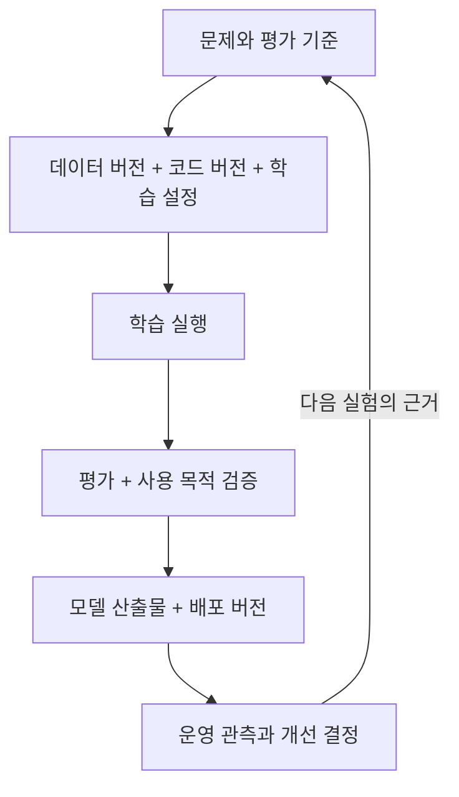
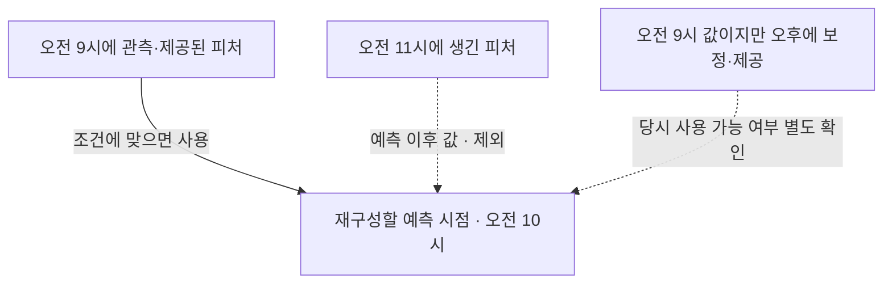

**원문 범위:** 1장 *Getting started with MLOps and ML engineering*, 1.1~1.4.

EPUB의 절 번호를 따라 읽으며 정리한 노트다. **실무 판단**과 뒤쪽의 실무·컨설팅 메모는 책의 내용에서 확장한 내 적용 기준이다.

## 읽고 잡은 관점

맛있는 요리 하나와 매일 운영되는 식당은 다르다. 누가 조리하든 비슷한 품질이 나와야 하고, 재료가 바뀌거나 주문이 몰려도 대응해야 한다.

이 장에서 모델과 플랫폼의 차이도 그렇게 이해했다. 높은 점수의 모델 하나보다 **같은 과정을 다시 실행하고, 다른 환경에 배포하며, 결과가 나빠지면 알아차리는 능력**이 중요하다.

## 1.1 ML 생애주기 — 실험에서 운영까지

ML 생애주기는 문제 정의부터 데이터 준비, 학습, 평가, 배포와 개선까지 연결한 지도다. 직선처럼 그릴 수 있어도 실제로는 앞 단계로 자주 돌아간다. 지표가 나쁘다면 모델뿐 아니라 데이터와 문제 정의도 다시 봐야 한다.

### 1.1.1 실험 단계 — 가설과 근거를 함께 남기기

실험의 첫 질문은 **“이 문제에 ML이 필요한가?”**다. 단순한 규칙으로 충분하다면 더 저렴하고 설명하기 쉬울 수 있다. ML이 필요하다면 어떤 의사결정을 개선할지와 성공 기준부터 정해야 한다.

| 단계 | 해야 할 일 | 남길 근거 |
| --- | --- | --- |
| 문제 정의 | 사용자·업무 목표와 오판의 비용 확인 | 기준선, 기대 효과, 평가 기준 |
| 데이터 수집·준비 | 라벨링과 학습·검증·테스트 분할 | 원천·라벨 기준·분할 규칙 |
| 데이터 버전 관리 | 어떤 데이터를 사용했는지 고정 | 스냅샷 또는 재구성 가능한 식별자 |
| 학습 | 데이터·코드·설정으로 모델 생성 | 실행 조건, 가중치, 로그 |
| 평가 | 학습에 쓰지 않은 데이터로 성능 측정 | 평가셋 버전, 지표, 오류 사례 |
| 사용 목적 검증 | 업무 요구를 만족하는지 확인 | 승인·보류 기준과 판단 근거 |

여기서 **평가(evaluation)**는 측정에, **검증(validation)**은 의도한 용도에 적합한지 확인하는 데 초점을 둔다. 조직마다 용어가 다를 수 있으므로 이름보다 절차와 책임을 합의하는 것이 중요하다.

같은 코드라도 데이터가 바뀌면 다른 모델이 나온다. **계보(lineage)**는 완성품에서 재료와 제조 이력까지 거슬러 올라가는 연결이다. 여기서는 데이터·코드·설정과 실행·결과의 관계를 뜻한다.

자동화는 마지막에 붙이는 장식이 아니다. 실험부터 준비·학습·평가를 파이프라인으로 묶으면 수동 순서와 누락을 줄이고 운영에서도 같은 절차를 재사용하기 쉽다. 다만 기록이 있다는 사실만으로 비트 단위의 동일한 결과까지 보장되지는 않는다.

### 1.1.2 개발·스테이징·프로덕션 단계 — 통제된 변경과 피드백

실험이 “어떤 방법이 좋은가?”를 찾는다면, 운영에서는 그 방법을 **반복해서 안전하게 실행하고 바꾸는 능력**이 중요하다. 스테이징은 실제 출시 전 조합을 확인하는 검증 환경이다. 여기서 확인한 모델·전처리·환경 조합이 프로덕션에도 일치해야 한다.

| 실험에서 묻는 질문 | 운영에서 추가되는 질문 |
| --- | --- |
| 어떤 데이터와 모델이 효과적인가? | 그 데이터·코드·설정을 다시 찾을 수 있는가? |
| 평가 점수가 충분한가? | 실제 입력에서도 품질과 응답 시간이 유지되는가? |
| 학습을 실행할 수 있는가? | 실패를 감지하고 재실행하거나 되돌릴 수 있는가? |
| 이번 결과가 좋은가? | 다음 변경도 같은 기준으로 검증할 수 있는가? |

운영에서는 모델을 API나 배치 작업으로 배포하고 부하·오류·데이터 변화·예측 품질을 관측한다. 새 데이터나 관측 결과가 재학습의 계기가 될 수 있지만 **재학습 자동화와 무조건적인 자동 출시는 구분**해야 한다.

**실무 판단:** 배포 전 질문은 “성능이 나빠지면 되돌릴 모델·코드·설정 조합은 무엇인가?”다. 새 모델의 점수뿐 아니라 실제 요청 지연, 자원 사용, 승인·복구 담당자까지 설명할 수 있어야 한다.

## 1.2 MLOps에 필요한 역량

### 1.2.1 ML 엔지니어의 역량 — 경계를 넘나드는 디버깅

ML 엔지니어는 알고리즘 하나만 잘 알아서는 부족하다. 소프트웨어 설계·테스트·디버깅, 데이터 처리, 모델 평가, 실행 환경과 자동화를 연결해야 한다.

| 역량 | 현장에서 답해야 할 질문 |
| --- | --- |
| 소프트웨어 엔지니어링 | 오류를 재현하고 원인을 좁힐 수 있는가? |
| ML·통계 이해 | 지표와 분할 방식이 목표에 맞는가? |
| 데이터 엔지니어링 | 스키마·시점·품질 문제를 찾을 수 있는가? |
| 인프라·자동화 | 실행과 배포를 반복하고 관측·복구할 수 있는가? |

**실무 판단:** 예측 오류가 발생했을 때 코드 버그, 데이터 오류, 모델 한계, 인프라 장애 중 어디부터 조사할지 가설을 세우고 증거를 찾는 능력이 필요하다.

### 1.2.2 선수 지식 — 필요한 만큼 단계적으로 익히기

Python과 기본적인 ML 흐름을 이해하고, 익숙하지 않은 프레임워크·운영 도구를 배울 준비가 필요하다. 책은 Kubernetes 기초를 설명한 뒤 플랫폼을 점진적으로 붙이는 구성이다.

북클럽에서도 서로 다른 경험을 활용할 수 있겠다. 데이터 과학 관점에서는 평가와 데이터의 가정을, 소프트웨어·인프라 관점에서는 실행·배포·복구를 검토하면 사각지대를 줄일 수 있다.

## 1.3 ML 플랫폼 구축 — 공통 능력을 조합하기

플랫폼은 도구를 모아 놓은 화면이 아니라 실험·학습·배포·관측에 필요한 공통 작업 기반이다. 원천 데이터 수집과 전체 데이터 웨어하우스를 모두 플랫폼의 책임으로 넣을 필요는 없다. **입력과 출력, 운영 책임의 경계**가 먼저다.

### 1.3.1 자체 구축과 구매 — 학습 목적과 도입 결정을 구분하기

책은 직접 조립해 보며 구성 요소와 한계를 배우는 데 의미를 둔다. 자체 구축이 언제나 더 낫다는 주장으로 읽지는 않았다.

관리형 서비스는 구축 부담을 줄일 수 있지만 통합·권한·비용 관리가 남는다. 자체 구축은 조정의 자유가 큰 대신 업그레이드·장애·사용자 지원을 감당해야 한다. **같은 요구사항과 기간으로 총비용을 비교**해야 한다는 쪽으로 정리했다.

### 1.3.2 MLOps에서 LLMOps로 — 기존 원칙에 새 관리 대상 더하기

LLM 애플리케이션에서도 버전, 배포와 모니터링은 유효하다. 여기에 문서 처리, 임베딩·벡터 검색, 프롬프트, 답변 평가, 안전과 토큰 비용이 추가된다.

즉 “모델 파일이 무엇인가?”에 더해 **어떤 문서·인덱스·프롬프트·모델 API의 조합으로 답했는가?**를 추적해야 한다. 이 장은 그 확장을 예고하고 자세한 구현은 후반부에서 다룬다. 임베딩은 문서·질문을 벡터로 표현하는 방식이고, 벡터 검색은 그 표현의 유사도를 이용해 관련 자료를 찾는 방식 정도로 먼저 구분해 둔다.

### 1.3.3 책에서 사용하는 도구 — 이름보다 책임 보기

| 공통 능력 | 도구·기반 | 관리할 대상 |
| --- | --- | --- |
| ML 작업 실행 | Kubeflow Pipelines | 단계의 의존성과 실행 산출물 |
| 피처 제공 | Feast | 정의·시점·학습/서빙 조회 |
| 실험 추적·모델 등록 | MLflow | 실행 조건·평가·모델 버전 |
| 배포 | 컨테이너·레지스트리·CI/CD | 실행 환경과 변경된 서비스 |

MLflow를 설치했다고 데이터 품질이 보장되지는 않고, 피처 스토어를 넣었다고 학습·서빙의 모든 차이가 사라지지도 않는다. 도구 사이의 데이터와 설정을 일관되게 연결해야 한다.

**실무 판단:** 새 도구를 제안할 때 해결할 실패, 기존 체계와의 연결, 운영 소유자, 도입하지 않을 대안을 함께 적어야 한다. 책의 조합은 학습 가능한 한 사례이지 모든 조직의 표준 정답은 아니다.

#### 추가로 확인한 용어: run·artifact·피처 시점

[MLflow 공식 문서](https://mlflow.org/docs/latest/ml/tracking/)에서 **run은 한 번의 실행**, **experiment는 관련 실행을 묶는 단위**, **artifact는 가중치·그래프처럼 실행이 남긴 파일 산출물**로 구분한다. 모델 파일을 저장하는 것과 그 모델을 만든 과정을 추적하는 것은 다른 일이다.

피처 스토어는 모델 입력으로 쓸 특성값의 정의·조회·재사용을 관리한다. 여기서 낯선 개념이 **point-in-time join**이었다. “지금의 최신 값”이 아니라 **학습 샘플의 과거 기준 시점에 맞는 값**을 붙이는 방식이다.

[Feast의 point-in-time join 문서](https://docs.feast.dev/getting-started/concepts/point-in-time-joins)를 확인하면 이벤트 시각과 값이 실제로 만들어진 시각도 구분해야 한다. **시간 컬럼 하나가 있다고 미래 정보 누수가 자동으로 막히는 것은 아니다.** 저장소·버전이 제공하는 시점 처리와 지연 도착·보정 데이터 정책까지 확인할 부분이다.

## 1.4 ML 시스템 만들기 — 공통 기반을 다른 문제에 적용하기

### 1.4.1 프로젝트를 통해 배우는 것

프로젝트는 한 번 끝내는 튜토리얼이 아니라 데이터와 요구가 바뀌면 앞 단계로 돌아가는 생애주기의 연습이다. 모델 성능이 낮으면 더 큰 모델부터 찾기보다 데이터와 평가의 가정도 다시 확인한다.

신분증 객체 탐지, 영화 추천, 문서 기반 RAG는 데이터와 모델은 다르지만 **준비 → 실행 → 검증 → 배포 → 관측 → 개선**이라는 문제를 공유한다. 이미지에서 익힌 데이터 전달과 배포 원칙을 표 데이터와 LLM에도 다시 적용하는 구조다.

### 1.4.2 세 프로젝트의 차이와 운영 질문

| 프로젝트 | 데이터·기능 | 비교할 운영 문제 |
| --- | --- | --- |
| 신분증 탐지 | 이미지에서 카드 위치 탐지 | 라벨·좌표·영상 분할, 이미지별 실패 |
| 영화 추천 | 사용자·아이템·평점으로 추천 | 시점·식별자·새 사용자, 추천 품질 |
| DakkaBot | 사내 문서를 검색해 답변 생성 | 문서 최신성·권한·근거, 토큰 비용 |

첫 프로젝트는 OCR이라는 넓은 문맥 안에 있지만 **카드 위치를 찾는 객체 탐지와 글자 인식은 다른 작업**이다. 세 프로젝트를 비교할 때도 기능의 이름보다 실제 입력·출력과 실패 비용을 구분해야 한다.

## 실무 메모: 플랫폼 경계와 책임

여기부터는 원문을 바탕으로 확장한 적용 메모다.

ML 플랫폼팀이 데이터 수집부터 모든 모델의 업무 성과까지 책임진다고 가정하면 경계가 무한히 커진다. **플랫폼이 제공하는 기능, 모델팀이 결정하는 품질, 데이터팀이 보장하는 입력, 업무팀이 승인하는 출시 조건**을 먼저 나눠야 한다.

| 설계 판단 | 확인할 증거 | 결정 결과 |
| --- | --- | --- |
| ML 도입이 필요한가? | 규칙 기반 기준선, 예상 효과, 오판 비용 | ML·규칙·수동 처리 중 선택 |
| 공통 플랫폼이 필요한가? | 팀별 반복 업무, 배포 빈도, 장애 기록 | 공통화할 기능과 남겨 둘 자율성 |
| 자체 구축할 것인가? | 요구 기능, 통합·운영 인력, 종료·이전 비용 | 관리형·자체·혼합 구조와 이유 |
| 누가 변경을 승인하는가? | 현재 승인 경로, 업무 위험과 규정 | 역할별 승인·운영·장애 책임 |

총비용은 라이선스나 클라우드 청구서만이 아니다. 구축·통합 작업, 업그레이드, 온콜, 보안 검토, 사용자 지원과 향후 이전 비용을 같은 기간으로 비교해야 한다. 오픈소스의 무료 사용과 무료 운영은 다르다.

## 컨설팅 메모: 도구 제안 전의 현황 확인

고객의 최근 모델 하나를 실험에서 배포까지 따라가며 단계별 대기 시간, 수동 전달, 승인, 실패와 재작업을 확인해야 한다. “자동화가 부족하다”는 의견을 **반복되는 어떤 작업이 어떤 손실을 만드는가**로 바꾸는 과정이다.

남길 산출물은 **현황 생애주기 지도, 책임 분담표, 우선순위가 붙은 요구사항, 구축·구매 비교 결정 기록(ADR)**이다. ADR은 선택한 구조뿐 아니라 검토한 대안과 결정 이유를 남기는 기록이다. 제안마다 해결할 병목, 측정할 효과, 선행 조건과 운영 책임자를 붙여야 한다.

완료의 증거는 아키텍처 그림 자체가 아니다. 합의한 한 모델을 대상으로 데이터·코드·실험·배포 버전을 추적할 수 있고, 실패했을 때 담당 팀과 다음 행동을 설명할 수 있어야 한다.

## 적용해 볼 것: 모델의 이력서

가상의 중고차 가격 예측 모델에 아래 내용을 한 페이지로 남기는 연습을 해볼 만하다. 실제 구현을 주장하는 사례가 아니라 점검할 항목을 구체화한 것이다.

| 항목 | 적어 볼 내용 |
| --- | --- |
| 해결하려는 문제 | 가격을 추천해 누구의 어떤 결정을 돕는가? |
| 입력과 정답 | 예측 시점에 실제로 얻을 수 있는 정보인가? |
| 재현 정보 | 데이터 스냅샷, 코드 커밋, 학습 설정 |
| 배포 조건 | 품질 기준, 지연 시간, 승인 담당자 |
| 실패 대응 | 이전 버전과 수동 처리 절차 |

채우기 어려운 항목은 모델링보다 먼저 합의해야 할 부분이다.

## 북클럽 토론

**Q. 모델 성능이 좋아도 프로젝트를 중단할 수 있을까요?**

문제 자체의 가치가 작거나 정답 수집과 운영 비용이 효과보다 클 수 있다. 평가 지표와 실제 의사결정의 관계를 먼저 설명해야 한다.

**Q. 우리 팀은 지금 플랫폼을 직접 만들어야 할까요?**

반복되는 불편 하나를 기준으로 직접 구축·관리형 서비스·간단한 스크립트의 유지 비용을 비교해야 한다. 학습을 위한 구축과 회사의 도입 결정도 분리할 필요가 있다.

**놓치지 말 것:** REST API가 응답한다고 프로덕션 전환이 끝난 것은 아니다. 데이터 변화, 부하, 롤백과 담당자가 남아 있다.

## 한 줄 정리

**ML 엔지니어링의 출발점은 모델 선택보다 문제부터 운영 피드백까지 연결된 생애주기의 설계다.**

보충 조사: MLflow Tracking과 Feast 공식 문서, 2026-10-19 확인. 도식은 관계를 정리한 자체 개념도이며 원문 그림의 복제가 아니다.

[이전: 책 전체 구성](../00-overview/) · [시리즈 목차](../) · [다음: 02. MLOps란 무엇인가](../02-what-is-mlops/)
