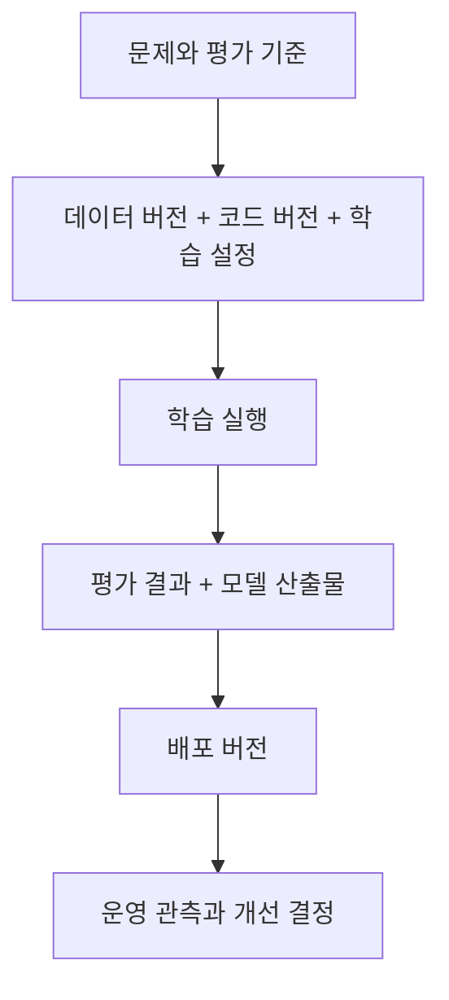

**원문 범위:** 1장 *Getting started with MLOps and ML engineering*, 1.1~1.4.

## 먼저, 요리와 식당을 구분해 봅시다

집에서 한 번 맛있게 만든 요리를 식당 메뉴로 내놓으려면 무엇이 달라질까요? 누가 조리하든 비슷한 품질이 나와야 하고, 재료가 바뀌거나 주문이 몰려도 대응할 수 있어야 합니다.

모델도 같습니다. 한 번 높은 점수를 얻는 것을 넘어 **같은 과정을 다시 실행하고, 다른 환경에 배포하며, 나빠진 결과를 알아차리는 일**이 필요합니다. 이 장은 그 전체 과정을 ML 생애주기와 ML 플랫폼이라는 두 관점으로 설명합니다.

## 실험과 운영은 연결되어 있지만 목표가 다릅니다

실험 단계에서는 문제를 정의하고, 데이터를 준비하고, 모델을 학습·평가하면서 가설을 바꿉니다. 첫 질문은 “어떤 모델을 쓸까?”가 아니라 **“이 문제에 ML이 필요한가?”**입니다. 단순한 규칙으로 충분하다면 그것이 더 저렴하고 설명하기 쉬울 수 있습니다.

개발·스테이징·프로덕션으로 넘어가면 반복 실행과 통제된 변경이 중요해집니다.

| 실험에서 묻는 질문 | 운영에서 추가되는 질문 |
| --- | --- |
| 어떤 데이터와 모델이 효과적인가? | 그 데이터·코드·설정을 다시 찾을 수 있는가? |
| 평가 점수가 충분한가? | 실제 입력에서도 품질과 응답 시간이 유지되는가? |
| 학습을 실행할 수 있는가? | 실패를 감지하고 재실행하거나 되돌릴 수 있는가? |
| 이번 결과가 좋은가? | 다음 변경도 같은 기준으로 검증할 수 있는가? |

자동화는 마지막에 붙이는 장식이 아닙니다. 초기에 학습·평가를 파이프라인으로 묶어 두면, 운영으로 이동할 때 같은 절차에 배포와 감시를 연결하기 쉬워집니다. 다만 **재학습을 자동화하는 것과 새 모델의 무조건적인 자동 배포는 구분**해야 합니다.

## 모델만 버전 관리하면 부족한 이유

같은 코드라도 다른 데이터로 학습하면 다른 모델이 나옵니다. 따라서 추적해야 할 단위는 모델 파일 하나가 아닙니다.

이 연결 관계를 **계보(lineage)**라고 생각하면 됩니다. 책에서는 데이터 버전 관리, 실험 추적, 모델 등록과 배포를 이런 재현성의 관점에서 연결합니다. 기록이 있다고 결과가 항상 비트 단위로 같아지는 것은 아니지만, 차이의 원인을 조사할 출발점이 생깁니다.

## ML 플랫폼은 도구 모음이 아니라 공통 작업 기반입니다

Kubeflow Pipelines는 단계의 실행을, MLflow는 실험과 모델 관리를, Feast는 피처의 저장·조회·재사용을 담당합니다. 컨테이너와 CI/CD는 실행 환경과 배포 절차를 받쳐 줍니다.

여기서 중요한 것은 **도구마다 어떤 책임을 맡기는지**입니다. MLflow를 설치했다고 데이터 품질이 보장되지는 않고, 피처 스토어를 넣었다고 학습과 서빙의 모든 차이가 사라지지도 않습니다. 각 도구 사이에 데이터와 설정이 일관되게 흘러가야 합니다.

책은 직접 플랫폼을 조립해 보는 학습을 권하지만, “직접 구축이 언제나 구매보다 낫다”는 뜻은 아닙니다. 관리형 서비스와 자체 구축의 선택에서는 필요한 기능뿐 아니라 운영 인력, 통합 비용, 변경의 자유도까지 함께 봐야 합니다.

## 세 프로젝트를 관통하는 읽기 관점

신분증 객체 탐지, 영화 추천, 문서 기반 RAG는 데이터와 모델은 다르지만 **준비 → 실행 → 검증 → 배포 → 관측 → 개선**이라는 문제를 공유합니다. 이미지에서 익힌 데이터 전달과 배포 원칙을 표 데이터와 LLM에도 다시 적용해 보는 구조입니다.

ML 엔지니어에게도 한 가지 전문성만 요구되지 않습니다. 소프트웨어 디버깅, 데이터 처리, ML 평가, 인프라 자동화가 연결됩니다. 처음부터 모두 전문가가 되기보다, 어느 경계에서 문제가 생겼는지 찾아갈 수 있는 능력이 중요합니다.

## 실무 적용: 플랫폼 경계와 책임부터 계약합니다

이하의 실무·컨설팅 관점은 원문을 바탕으로 확장한 적용 가이드입니다.

ML 플랫폼팀이 데이터 수집부터 모든 모델의 업무 성과까지 책임진다고 가정하면 경계가 무한히 커집니다. **플랫폼이 제공하는 기능, 모델팀이 결정하는 품질, 데이터팀이 보장하는 입력, 업무팀이 승인하는 출시 조건**을 먼저 나누어야 합니다.

| 설계 판단 | 확인할 증거 | 결정 결과 |
| --- | --- | --- |
| ML 도입이 필요한가? | 규칙 기반 기준선, 예상 효과, 오판 비용 | ML·규칙·수동 처리 중 선택 |
| 공통 플랫폼이 필요한가? | 팀별 반복 업무, 배포 빈도, 장애 기록 | 공통화할 기능과 남겨 둘 자율성 |
| 자체 구축할 것인가? | 요구 기능, 통합·운영 인력, 종료·이전 비용 | 관리형·자체·혼합 구조와 이유 |
| 누가 변경을 승인하는가? | 현재 승인 경로, 업무 위험과 규정 | 역할별 승인·운영·장애 책임 |

총비용은 라이선스나 클라우드 청구서만이 아닙니다. 구축·통합 작업, 업그레이드, 온콜, 보안 검토, 사용자 지원과 향후 이전 비용을 같은 기간으로 비교합니다. 오픈소스의 무료 사용과 무료 운영은 다릅니다.

## 컨설팅 관점: 도구 제안보다 발견 단계가 먼저입니다

고객에게 최근 모델 하나를 골라 실험에서 배포까지 실제로 따라가 달라고 요청해 보세요. 단계별 대기 시간, 수동 전달, 승인, 실패와 재작업을 관찰합니다. “자동화가 부족하다”는 의견을 **반복되는 어떤 작업이 어떤 손실을 만드는가**로 바꾸는 과정입니다.

산출물은 **현황 생애주기 지도, 책임 분담표, 우선순위가 붙은 요구사항, 구축·구매 비교 결정 기록(ADR)**입니다. 각 제안에는 해결할 병목, 측정할 효과, 선행 조건과 운영 책임자를 붙입니다.

완료의 증거는 아키텍처 그림 자체가 아닙니다. 합의한 한 모델을 대상으로 데이터·코드·실험·배포 버전을 추적할 수 있고, 실패했을 때 담당 팀과 다음 행동을 설명할 수 있어야 합니다.

## 직접 해보기: 모델의 이력서 만들기

가상의 중고차 가격 예측 모델을 하나 정하고, 다음을 한 페이지로 적어 보세요. 아래 사례는 북클럽 활동을 위한 재구성입니다.

| 항목 | 적어 볼 내용 |
| --- | --- |
| 해결하려는 문제 | 가격을 추천해 누구의 어떤 결정을 돕는가? |
| 입력과 정답 | 예측 시점에 실제로 얻을 수 있는 정보인가? |
| 재현 정보 | 데이터 스냅샷, 코드 커밋, 학습 설정 |
| 배포 조건 | 품질 기준, 지연 시간, 승인 담당자 |
| 실패 대응 | 이전 버전과 수동 처리 절차 |

표를 채우기 어렵다면 모델링보다 먼저 합의해야 할 부분을 발견한 것입니다.

## 북클럽 토론

**Q. 모델 성능이 좋아도 프로젝트를 중단할 수 있을까요?**

네. 문제 자체의 가치가 작거나, 정답 수집과 운영 비용이 효과보다 클 수 있습니다. 평가 지표와 실제 의사결정의 관계를 먼저 설명해야 합니다.

**Q. 우리 팀은 지금 플랫폼을 직접 만들어야 할까요?**

정해진 답은 없습니다. 반복되는 불편 하나를 고르고, 직접 구축·관리형 서비스·간단한 스크립트의 유지 비용을 비교해 보세요. 학습을 위한 구축과 회사의 도입 결정도 분리해야 합니다.

**자주 빠지는 함정:** REST API가 응답하면 프로덕션 전환이 끝났다고 생각하는 것입니다. 데이터 변화, 부하, 롤백과 담당자가 남아 있습니다.

## 한 줄 정리

**ML 엔지니어링의 출발점은 모델 선택이 아니라, 문제부터 운영 피드백까지 연결된 생애주기를 설계하는 것입니다.**

[이전: 책 전체 구성](../00-overview/) · [시리즈 목차](../) · [다음: 02. MLOps란 무엇인가](../02-what-is-mlops/)
