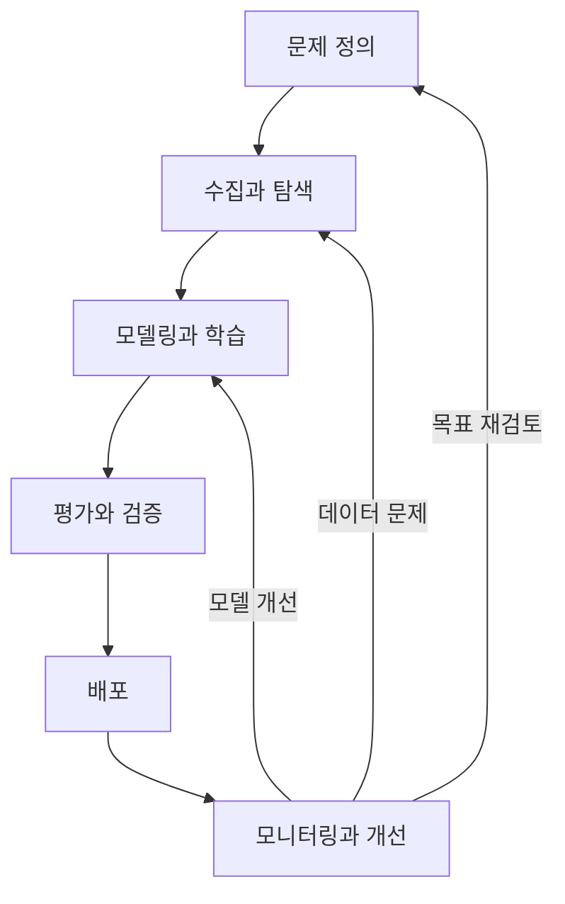
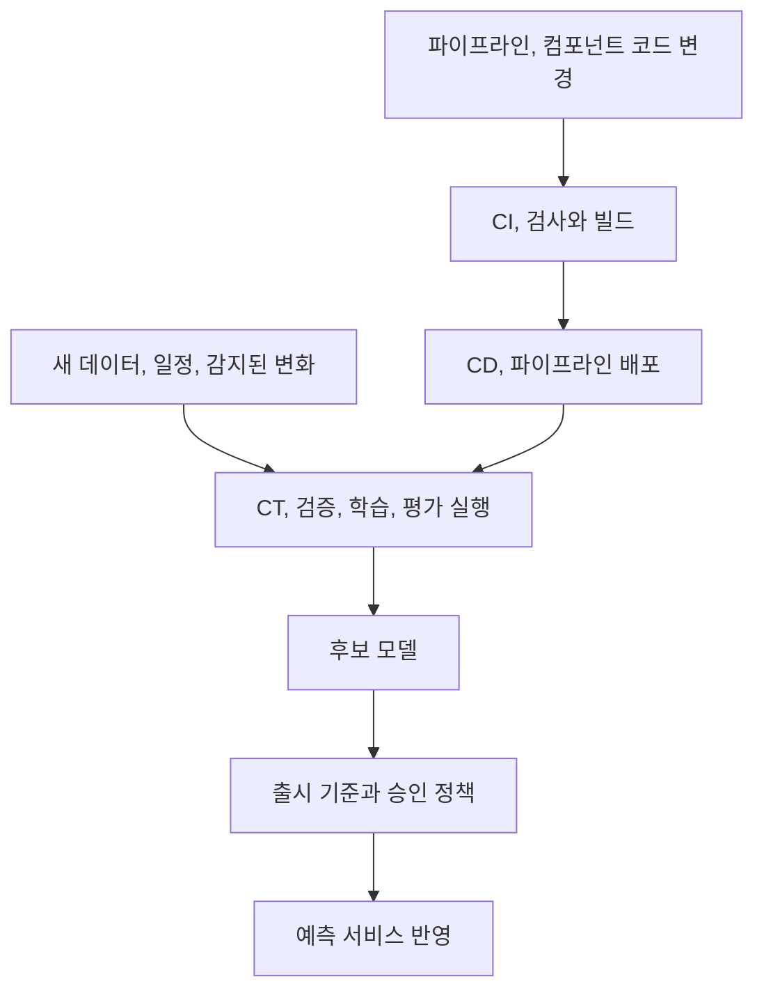

ML 서비스는 첫 배포로 끝나지 않는다. 사용자와 데이터가 달라지면 모델을 다시 살펴야 한다. MLOps는 이 반복을 관리하는 일이다. 변화가 생겼을 때 새 버전을 만들고 검증할 수 있어야 한다.

## 2.1 반복되는 MLOps 생애주기

이 장은 데이터 수집, 탐색적 데이터 분석(EDA), 모델링, 학습, 평가, 배포, 모니터링, 유지, 개선을 하나의 고리로 묶는다.

모니터링에서 문제가 발견되었다고 항상 학습으로 돌아가지는 않는다. 입력 스키마가 깨졌다면 수집을, 평가 기준이 잘못됐다면 문제 정의를, 서버가 느리다면 서빙 구성을 먼저 고쳐야 한다.

### 2.1.1 데이터 수집 — 무엇을 대표하는 표본인가?

문제와 측정 가능한 목표를 정한 뒤 필요한 데이터, 라벨을 수집한다. 공개 데이터가 있더라도 실제 서비스의 사용자와 상황을 대표하는지는 별도로 확인해야 한다.

책은 신분증 이미지, 영화 평점, RAG 문서처럼 다른 형태의 데이터를 같은 생애주기에서 다룬다. 이미지의 촬영, 라벨 기준, 평점에서 관측되지 않은 선호, 문서의 최신성과 권한이 서로 다른 문제를 만든다.

수집 경로와 사용 범위, 표본의 편향, 라벨 책임자와 갱신 주기를 남겨야 한다. 데이터가 많다는 사실보다 실제 의사결정을 평가할 수 있는지가 중요하다.

### 2.1.2 탐색적 데이터 분석 — 가정을 검사로 바꾸기

탐색적 데이터 분석(EDA)은 분포를 구경하는 일이 아니라 스키마, 결측, 이상치, 불균형, 계절성에 대한 가정을 확인하는 과정이다. 무엇을 모델이 배울 수 있고 어떤 입력에서 실패할지 가설을 만든다.

“평점은 항상 허용 범위에 있다”, “사용자 ID는 비어 있지 않다”는 가정은 실행 가능한 품질 검사로 바꿀 수 있다. 소수 집단의 표본 부족은 추가 수집과 평가 범위의 한계로 기록할 문제다.

데이터 사전과 품질 규칙, 확인되지 않은 가정을 구분해 남긴다. EDA는 처음 한 번으로 끝나지 않으며 새 데이터와 운영 실패가 들어오면 갱신해야 한다.

### 2.1.3 모델링과 학습 — 모델은 실행의 산출물

모델은 데이터와 코드, 설정을 적용해 만든 산출물이다. 모델 구조, 학습 코드, 하이퍼파라미터, 데이터를 분리해 버전과 계보를 남기면 실험을 비교하고 원인을 조사하기 쉽다. 하이퍼파라미터는 학습이 스스로 얻는 가중치와 달리 학습률, 모델 크기처럼 실험에서 정하는 조건이다.

실험 추적은 좋은 결과만이 아니라 실패한 시도도 보존한다. 하이퍼파라미터 탐색에도 비교 기준과 자원 예산이 필요하다. 모든 값을 설정으로 빼기보다 실제로 바꿀 항목부터 드러내는 편이 낫다.

실행을 다시 찾는 것과 수치가 완전히 같아지는 것은 다른 요구다. 어떤 환경과 데이터, 설정으로 나온 결과인지 설명하는 것부터 확인해야 한다.

### 2.1.4 모델 평가 — 업무 목표에 맞는 기준

모든 문제에 같은 지표를 쓰면 안 된다. 분류에서는 precision, recall, 회귀에서는 MAE, MSE 등 후보가 다르며, 같은 분류 문제도 오탐과 미탐의 비용에 따라 선택이 달라진다.

스팸 차단을 예로 들면 정상 메일을 차단하는 비용과 스팸을 놓치는 비용이 같지 않다. “정확도 95%”라는 숫자만으로 배포 여부를 정할 수 없는 이유다.

Precision은 차단한 것 중 실제 스팸의 비율, recall은 전체 스팸 중 잡아낸 비율이다. MAE는 예측 오차의 절댓값을 평균한 값, MSE는 오차를 제곱해 평균한 값이라 큰 오차의 영향이 더 커진다. 지표 이름보다 어떤 실패에 무게를 두는지 이해할 필요가 있다.

다중 클래스에서는 macro, micro 등 집계 방식까지 맞춰야 지표를 비교할 수 있다. 정의와 평균 방식은 [scikit-learn 평가 문서](https://scikit-learn.org/stable/modules/model_evaluation.html)를 참고할 수 있다.

평가에는 대표성을 갖춘 독립 데이터, 기준선과 동일한 비교 조건, 오류 유형 분석이 필요하다. 최종 테스트 결과를 보며 계속 후보를 고르면 그 데이터도 선택 과정에 사용된다.

전체 평균뿐 아니라 중요한 사용자 집단과 데이터 조건별 결과, 표본 수도 확인한다. 평가 데이터나 지표, 출시 기준이 바뀌면 변경 이유도 모델 버전과 연결해야 한다.

### 2.1.5 배포 — 실제 실행 환경까지 검증하기

배포는 API, 배치, 엣지 장치 등 모델을 소비하는 방식에 맞춰 설계한다. 학습 환경에서 빠르다는 사실만으로 실제 CPU, GPU, 장치에서 요구사항을 충족한다고 볼 수 없다.

변환, 최적화한 모델은 최종 형식에서도 품질과 지연을 다시 확인해야 한다. 모델뿐 아니라 전처리, 의존성과 서비스 규격도 함께 배포, 복구할 수 있어야 한다.

스테이징에서 확인한 조합과 출시된 조합이 일치하는지, 롤백할 버전이 실제로 실행 가능한지 기록한다. 배포 자동화는 승인 정책을 대체하지 않는다.

### 2.1.6 모니터링 — 시스템, 데이터, 예측을 따로 보기

데이터 분포와 품질, 시스템 오류와 지연, 모델의 성능과 잘못된 예측을 구분해 관측한다. 로그와 버전 정보가 있어야 이상이 어떤 변경과 관련되는지 조사할 수 있다.

운영에서는 정답이 늦게 들어오기도 한다. 서비스 지연과 오류는 즉시 관측할 수 있어도 예측이 맞았는지는 나중에 알 수 있다. 즉시 볼 대리 신호와 정답이 도착한 뒤 볼 실제 품질 지표를 구분해야 한다.

모델이 내는 신뢰 점수인 confidence나 분포 변화인 드리프트는 조사 신호이지 정확도의 증명이 아니다. 알림 담당자와 다음 행동까지 정하지 않으면 대시보드가 있어도 대응은 늦어진다.

#### 데이터 드리프트와 개념 드리프트

데이터 드리프트는 입력 분포 `P(X)`의 변화, 개념 드리프트는 입력이 주어졌을 때 정답의 관계 `P(Y|X)`의 변화다. [Evidently의 설명](https://www.evidentlyai.com/ml-in-production/data-drift)에서도 두 개념을 구분한다.

같은 가격, 이용 조건에도 사람들이 구매하는 방식이 달라지면 개념 변화의 문제다. 사용자 구성만 바뀌고 집단별 구매 방식은 같다면 입력 분포 변화일 수 있다. 둘은 함께 생길 수도 있고, 변화가 있다고 반드시 모델 품질이 하락하는 것도 아니다.

용어 자체가 조직마다 넓게 쓰이므로 “드리프트가 났다”에서 끝내지 말고 무엇의 분포나 관계를 어떤 기간과 비교했는가를 확인해야 한다.

### 2.1.7 유지, 업데이트, 검토 — 고리를 닫기

모니터링 결과를 버그 수정, 데이터 복구, 재학습, 새 모델 비교와 업무 목표 재검토에 연결한다. 서비스의 가치가 없어지면 모델을 폐기하는 결정도 생애주기에 포함된다.

변경 이유와 검증 내용, 그 결과를 남겨야 한다. 자동 재학습이 수집 장애를 학습 데이터에 흡수하는 경로가 되어서는 안 된다.

## 2.2 견고한 MLOps가 중요한 이유

노트북 하나의 성공 뒤에는 데이터 처리, 환경, 모델과 서비스 사이의 의존성이 숨어 있다. 모델과 팀이 늘어날수록 수동 전달, 중복 구현, 불명확한 버전이 변경 속도와 신뢰성을 떨어뜨린다.

MLOps에 투자하는 이유는 도구를 많이 갖추기 위해서가 아니라 재작업을 줄이고 실패를 발견, 복구하면서 실험을 지속하기 위해서다. 작은 팀에서도 필요한 반복을 선택적으로 줄일 수 있다.

수동 절차를 전부 없애기보다 오류 빈도와 영향, 반복 비용을 측정해 먼저 개선할 구간을 골라야 한다.

## 2.3 성숙한 조직에서의 MLOps 역할

성숙한 조직에서는 좋은 실행 경로가 공통 기능으로 제공된다. 실험 기록과 모델 등록을 기본으로 사용하고, 데이터 과학자와 엔지니어가 매번 배포 절차를 새로 협의하지 않게 만드는 것이다.

실험 속도뿐 아니라 협업, 감사 가능한 변경, 일관된 출시와 유지보수가 쉬워진다. 다만 표준화를 강제하는 것만으로 성공하지는 않는다. 팀이 실제로 사용하고 지원받을 수 있어야 한다.

플랫폼 이용률뿐 아니라 실험과 출시의 대기 시간, 지원 요청, 우회하는 수동 작업도 봐야 한다. 채택되지 않는 표준은 공통 기능으로 정착하기 어렵다.

## 2.4 DevOps와 MLOps — 관리 대상을 늘리기

DevOps도 변경, 자동화, 모니터링과 협업을 다룬다. MLOps에서는 여기에 데이터와 모델이 코드와 별도로 바뀐다는 점이 추가된다.

| 관점 | 일반적인 소프트웨어 운영 | ML 운영에서 더 확인할 것 |
| --- | --- | --- |
| 변경의 원인 | 코드, 설정, 의존성 변경 | 데이터, 학습 조건, 모델 변경 |
| 검증 | 기능과 시스템 요구 충족 | 통계적 품질, 데이터 누수, 집단별 성능 |
| 배포 단위 | 애플리케이션과 인프라 | 모델, 전처리, 피처 정의, 학습 파이프라인 |
| 관측 | 오류율, 지연, 자원 | 입력 분포, 예측 품질, 비즈니스 결과 |

일반 소프트웨어도 외부 데이터의 영향을 받는다. 절대적인 경계가 아니라 ML에서 무엇을 더 명시적으로 추적해야 하는지 보는 비교다.

#### CI, CD와 CT의 차이

[Google Cloud의 MLOps 아키텍처 문서](https://cloud.google.com/architecture/mlops-continuous-delivery-and-automation-pipelines-in-machine-learning)는 CI와 CD에 CT를 더해 설명한다. CI는 코드 변경을 통합하고 검사하는 과정, CD는 검증된 변경을 전달하거나 배포하는 과정, CT는 데이터와 조건의 변화에 따른 지속 학습이다.

CD는 continuous delivery와 continuous deployment 양쪽 의미로 쓰인다. 전달 가능한 상태로 준비하는 것과 운영에 자동 출시하는 것은 다르므로 승인 경계를 명시해야 한다.

실행을 자동화하더라도 잘못된 데이터나 품질이 낮은 후보의 출시를 막을 수 있어야 한다.

## 2.5 MLOps 성숙도 — 자동화하는 대상의 차이

책은 Google의 자동화 수준 구분을 소개한다.

| 수준 | 중심 특징 | 무엇을 반복 가능하게 만드는가 |
| --- | --- | --- |
| Level 0 | 수동, 스크립트 중심의 학습과 배포 | 개별 모델을 사람이 전달 |
| Level 1 | 데이터, 모델 검증을 포함한 학습 파이프라인 자동화 | 새 데이터로 모델을 다시 만드는 과정 |
| Level 2 | 파이프라인 구성 요소 자체의 CI/CD 자동화 | 학습 절차와 구성 요소를 바꾸는 과정 |

### 2.5.1 Level 0 — 수동 중심

사람이 스크립트와 파일을 전달하며 학습, 배포를 진행한다. 초기 검증에는 빠를 수 있지만 반복할수록 환경과 버전 차이, 담당자 의존성이 부담이 된다. 첫 개선은 클러스터 도입보다 실행 기록과 검증 절차를 정리하는 일일 수 있다.

### 2.5.2 Level 1 — 학습 파이프라인 자동화

새 데이터가 들어오면 검증, 학습, 평가를 거쳐 후보 모델을 만든다. 개별 모델을 수동으로 전달하는 대신 재사용 가능한 학습 절차를 운영한다. 실험과 운영에서 같은 절차를 사용하는 것도 중요한 성질이다.

### 2.5.3 Level 2 — 파이프라인 자체의 CI/CD

컴포넌트와 파이프라인 코드를 바꿀 때도 검사, 빌드, 배포를 자동화한다. 기존 파이프라인을 다시 실행하는 것과 파이프라인 자체를 안전하게 수정, 배포하는 것은 다른 능력이다.

높은 수준을 무조건 목표로 할 필요는 없다. 사용 사례와 변경 빈도에 맞게 투자해야 하며, 학습 자동화가 있어도 출시 승인이나 예외 처리에는 사람이 관여할 수 있다.

## 실무 메모: 작업 단위의 성숙도 진단

한 조직에서도 팀과 모델마다 자동화 수준은 다르다. 조직 전체에 점수 하나를 매기기보다 데이터 검증, 학습, 평가, 출시, 운영 대응을 따로 진단하는 편이 실용적이다.

| 진단 대상 | 인터뷰 외에 확인할 증거 | 다음 개선 후보 |
| --- | --- | --- |
| 실험 재현 | 실행 기록으로 같은 입력을 다시 찾는 과정 | 코드, 데이터, 환경 연결 |
| 변경 검증 | 출시 전 실제 검사 결과와 탈락 사례 | 데이터, 모델 검증 게이트 |
| 전달 속도 | 최근 변경의 작업, 대기 시간 | 반복 수동 전달 제거 |
| 운영 대응 | 최근 장애의 감지, 복구 기록 | 책임자, 실행 지침, 복구 경로 |
| 파이프라인 변경 | 구성 요소 변경의 시험, 배포 기록 | 파이프라인 자체의 CI/CD |

“자동 재학습 중”이라는 답만으로 Level 1이라고 확정할 수 없다. 잘못된 데이터에서 실행이 중단되는지, 새 모델이 기존 모델보다 나쁠 때 출시가 막히는지 확인해야 한다.

실험에서 운영으로 옮길 때 다른 전처리 코드를 다시 작성한다면 자동화가 있어도 불일치 위험이 남는다. 공유 컴포넌트뿐 아니라 같은 입력에서의 결과 비교로 실험, 운영 대칭성을 확인해야 한다.

## 컨설팅 메모: 다음 투자로 넘어갈 조건

“3개월 뒤 고도화”보다 어떤 모델을 대상으로 무엇을 검증하면 다음 투자로 넘어갈지가 필요하다. 수동 전달이 병목이라면 첫 단계는 모델 등록과 출시 기록의 연결이지 전체 클러스터 교체가 아닐 수 있다.

산출물은 기능별 현황, 목표 격차표와 단계별 도입 계획이다. 단계마다 범위, 의존성, 담당자, 효과 측정 방식과 중단 조건을 명시해야 한다.

모델 변경의 준비 시간과 승인 대기, 실행 시간과 재작업을 분리해 측정해야 한다. 검증을 생략해서 시간이 줄었다면 운영 역량이 향상됐다고 보기 어렵다.

## 반복 작업의 비용

자동화 우선순위를 정하려면 최근 모델 변경에서 데이터 준비, 학습, 평가, 배포에 각각 얼마나 걸렸는지 봐야 한다. 실행 시간과 승인 대기를 구분하면 병목이 달라 보일 수 있다.

결과물에는 자동화할 작업, 성공 기준, 실패 알림을 받을 사람이 함께 있어야 한다. “Level 2로 간다”보다 실행 가능한 목표다.

## 질문

### 재학습을 매일 돌리면 MLOps가 잘된 것일까?

데이터 검증, 모델 비교, 출시 기준이 없다면 잘못된 모델을 더 자주 만들 뿐일 수 있다. 빈도보다 반복 과정의 통제가 중요하다.

### 언제 재학습보다 데이터 파이프라인을 고쳐야 할까?

특정 시점부터 결측률이 급증하거나 단위가 바뀐 경우가 그렇다. 정상 데이터를 복구하지 않고 재학습하면 장애를 새로운 정상으로 학습할 수 있다.

성숙도 단계는 다음 개선 지점을 찾는 기준이다. 모든 조직이 같은 속도로 올라가야 하는 서열은 아니다.

## 한 줄 정리

MLOps는 한 번의 배포 속도보다 데이터와 모델의 변화를 반복해서 검증하고 개선하는 능력이다.

[이전: 01. 시작하기](../01-getting-started/), [시리즈 목차](../), [다음: 03. Kubernetes 기반](../03-kubernetes-foundation/)
