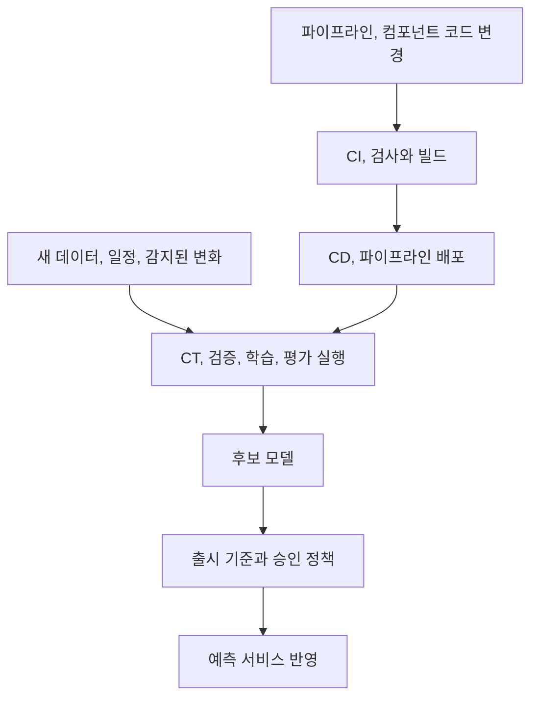

가게에서 손님 취향이 달라졌다고 무조건 레시피부터 바꾸지는 않습니다. 재료가 잘못 들어왔는지, 조리 도구가 고장 났는지부터 확인해야 합니다. ML 운영도 마찬가지입니다. 예측이 나빠졌다는 신호가 곧바로 재학습하라는 명령은 아닙니다.

2장의 핵심은 관측 결과를 다음 행동으로 연결하는 반복 구조입니다. 이 글에서는 책의 생애주기와 성숙도 구분을 정리한 뒤, 지표의 손실을 계산하고 나쁜 후보를 거절하는 작은 실습까지 이어갑니다. 추가한 수치와 코드는 학습용이며 실제 출시 정책을 대신하지 않습니다.

## 2.1 반복되는 MLOps 생애주기

이 장은 데이터 수집, 탐색적 데이터 분석(EDA), 모델링, 학습, 평가, 배포, 모니터링, 유지, 개선을 하나의 고리로 묶습니다.


그림 2.2. 순환하는 ML 생애주기. 출처: Machine Learning Platform Engineering, 2장.

마지막에 모델 폐기까지 있다는 점을 놓치기 쉽습니다. 성능이 떨어졌다고 항상 새 모델을 학습해야 하는 것은 아닙니다. 풀던 문제의 가치가 없어졌거나 다른 절차가 더 효과적이라면 운영을 끝내는 것이 맞을 수 있습니다. 개선 여부를 판단하려면 처음 정한 업무 목적과 현재 운영 결과를 다시 연결해야 합니다.

모니터링에서 문제가 발견되었다고 항상 학습으로 돌아가지는 않습니다. 입력 스키마가 깨졌다면 수집을, 평가 기준이 잘못됐다면 문제 정의를, 서버가 느리다면 서빙 구성을 먼저 고쳐야 합니다.

### 2.1.1 데이터 수집

문제와 측정 가능한 목표를 정한 뒤 필요한 데이터, 라벨을 수집합니다. 공개 데이터가 있더라도 실제 서비스의 사용자와 상황을 대표하는지는 별도로 확인해야 합니다.

책은 신분증 이미지, 영화 평점, RAG 문서처럼 다른 형태의 데이터를 같은 생애주기에서 다룹니다. 이미지의 촬영, 라벨 기준, 평점에서 관측되지 않은 선호, 문서의 최신성과 권한이 서로 다른 문제를 만듭니다.

수집 경로와 사용 범위, 표본의 편향, 라벨 책임자와 갱신 주기를 남겨야 합니다. 데이터가 많다는 사실보다 실제 의사결정을 평가할 수 있는지가 중요합니다.

라벨도 객관적으로 주어진 정답이라고만 볼 수는 없습니다. 신분증의 어느 부분까지 상자를 그릴지 기준이 다르면 같은 사진에 다른 정답이 생깁니다. 추천에서는 평점이 없는 영화를 싫어한다고 해석할 수도 없습니다. 데이터가 어떻게 만들어졌는지 모르면 모델의 오류와 수집 과정의 한계를 구분하기 어렵습니다.

### 2.1.2 탐색적 데이터 분석

탐색적 데이터 분석(EDA)은 분포를 구경하는 일이 아니라 스키마, 결측, 이상치, 불균형, 계절성에 대한 가정을 확인하는 과정입니다. 무엇을 모델이 배울 수 있고 어떤 입력에서 실패할지 가설을 만듭니다.

“평점은 항상 허용 범위에 있다”, “사용자 ID는 비어 있지 않다”는 가정은 실행 가능한 품질 검사로 바꿀 수 있습니다. 소수 집단의 표본 부족은 추가 수집과 평가 범위의 한계로 기록할 문제입니다.

데이터 사전과 품질 규칙, 확인되지 않은 가정을 구분해 남깁니다. EDA는 처음 한 번으로 끝나지 않으며 새 데이터와 운영 실패가 들어오면 갱신해야 합니다.

EDA에서 발견한 사실은 후속 처리로 이어져야 합니다. 이미지 크기가 제각각이면 모델 입력 크기로 바꾸는 규칙이 필요하고, 평점에 빈 값이 있으면 제외할지 다른 의미가 있는지 정해야 합니다. 잘못된 값을 모두 0으로 바꾸는 것처럼 손쉬운 처리도 데이터의 의미를 바꿀 수 있습니다.

스키마가 맞는 것과 데이터가 유효한 것도 다릅니다. `rating` 열이 숫자여도 허용 범위를 벗어난 값이 들어갈 수 있습니다. 타입 검사와 값의 범위, 다른 열과의 관계를 함께 봐야 합니다.

### 2.1.3 모델링과 학습

모델은 데이터와 코드, 설정을 적용해 만든 산출물입니다. 모델 구조, 학습 코드, 하이퍼파라미터, 데이터를 분리해 버전과 계보를 남기면 실험을 비교하고 원인을 조사하기 쉽습니다. 하이퍼파라미터는 학습이 스스로 얻는 가중치와 달리 학습률, 모델 크기처럼 실험에서 정하는 조건입니다.

실험 추적은 좋은 결과만이 아니라 실패한 시도도 보존합니다. 하이퍼파라미터 탐색에도 비교 기준과 자원 예산이 필요합니다. 모든 값을 설정으로 빼기보다 실제로 바꿀 항목부터 드러내는 편이 낫습니다.

모델을 비교할 때 바꾼 조건을 구분해야 합니다. 데이터와 분할, 전처리까지 동시에 바뀌었다면 점수 차이가 모델 구조 때문인지 알기 어렵습니다. 최소한 데이터 버전, 코드 버전, 설정, 평가셋을 실행 결과와 묶어 두어야 이후 비교가 가능합니다.

실행을 다시 찾는 것과 수치가 완전히 같아지는 것은 다른 요구입니다. 어떤 환경과 데이터, 설정으로 나온 결과인지 설명하는 것부터 확인해야 합니다.

### 2.1.4 모델 평가

모든 문제에 같은 지표를 쓰면 안 됩니다. 분류에서는 precision, recall, 회귀에서는 MAE, MSE 등 후보가 다르며, 같은 분류 문제도 오탐과 미탐의 비용에 따라 선택이 달라집니다.

스팸 차단을 예로 들면 정상 메일을 차단하는 비용과 스팸을 놓치는 비용이 같지 않습니다. “정확도 95%”라는 숫자만으로 배포 여부를 정할 수 없는 이유입니다.

Precision은 차단한 것 중 실제 스팸의 비율, recall은 전체 스팸 중 잡아낸 비율입니다. MAE는 예측 오차의 절댓값을 평균한 값, MSE는 오차를 제곱해 평균한 값이라 큰 오차의 영향이 더 커집니다. 지표 이름보다 어떤 실패에 무게를 두는지 이해할 필요가 있습니다.

메일 10,000개 중 스팸이 100개인 경우를 생각해 볼 수 있습니다. 전부 정상 메일로 통과시켜도 정확도는 99%입니다. 이 값만 보면 괜찮아 보이지만 스팸은 하나도 잡지 못합니다.


| 실제 데이터 | 스팸으로 차단 | 정상으로 통과 |
| ------------ | ------- | ------- |
| 스팸 100개 | 80개 | 20개 |
| 정상 메일 9,900개 | 40개 | 9,860개 |


위 결과에서는 차단한 120개 중 80개가 스팸이므로 precision은 약 66.7%입니다. 실제 스팸 100개 중 80개를 잡았으므로 recall은 80%입니다. 정상 메일을 잃는 비용이 크다면 precision이, 스팸을 놓치는 비용이 크다면 recall이 더 중요한 판단 기준이 됩니다. 어느 쪽을 택할지는 업무의 손실 구조에 달려 있습니다.

다중 클래스에서는 macro, micro 등 집계 방식까지 맞춰야 지표를 비교할 수 있습니다. 정의와 평균 방식은 [scikit-learn 평가 문서](https://scikit-learn.org/stable/modules/model_evaluation.html)를 참고할 수 있습니다.

평가에는 대표성을 갖춘 독립 데이터, 기준선과 동일한 비교 조건, 오류 유형 분석이 필요합니다. 최종 테스트 결과를 보며 계속 후보를 고르면 그 데이터도 선택 과정에 사용됩니다.

전체 평균뿐 아니라 중요한 사용자 집단과 데이터 조건별 결과, 표본 수도 확인합니다. 평가 데이터나 지표, 출시 기준이 바뀌면 변경 이유도 모델 버전과 연결해야 합니다.

### 2.1.5 배포

배포는 API, 배치, 엣지 장치 등 모델을 소비하는 방식에 맞춰 설계합니다. 학습 환경에서 빠르다는 사실만으로 실제 CPU, GPU, 장치에서 요구사항을 충족한다고 볼 수 없습니다.

변환, 최적화한 모델은 최종 형식에서도 품질과 지연을 다시 확인해야 합니다. 모델뿐 아니라 전처리, 의존성과 서비스 규격도 함께 배포, 복구할 수 있어야 합니다.

스테이징에서 확인한 조합과 출시된 조합이 일치하는지, 롤백할 버전이 실제로 실행 가능한지 기록합니다. 배포 자동화는 승인 정책을 대체하지 않습니다.

검증된 모델을 서비스에 연결하는 과정에서도 문제가 생길 수 있습니다. 전처리 열 순서가 달라졌거나 모델이 기대하는 라이브러리 버전이 없으면 평가할 때와 다른 결과가 나옵니다. 모델 파일을 올렸다는 사실보다 같은 입력에 대해 기대한 출력이 나오는지 확인하는 것이 중요합니다.

### 2.1.6 모니터링

데이터 분포와 품질, 시스템 오류와 지연, 모델의 성능과 잘못된 예측을 구분해 관측합니다. 로그와 버전 정보가 있어야 이상이 어떤 변경과 관련되는지 조사할 수 있습니다.

운영에서는 정답이 늦게 들어오기도 합니다. 서비스 지연과 오류는 즉시 관측할 수 있어도 예측이 맞았는지는 나중에 알 수 있습니다. 즉시 볼 대리 신호와 정답이 도착한 뒤 볼 실제 품질 지표를 구분해야 합니다.

모델이 내는 신뢰 점수인 confidence나 분포 변화인 드리프트는 조사 신호이지 정확도의 증명이 아닙니다. 알림 담당자와 다음 행동까지 정하지 않으면 대시보드가 있어도 대응은 늦어집니다.


| 관측 대상 | 바로 알 수 있는 것 | 추가로 필요한 것 |
| --------------- | ------------- | ------------------ |
| API 오류와 지연 | 요청 처리의 기술적 실패 | 장애 원인과 사용자 영향 |
| 입력 분포와 결측률 | 들어오는 데이터의 변화 | 수집 오류인지 실제 환경 변화인지 |
| 예측값과 confidence | 모델 행동의 변화 | 실제 정답과 오류 유형 |
| 정답 기반 평가 | 실제 예측 품질 | 정답 수집 지연과 표본의 대표성 |


정답이 나중에 도착하는 문제라면 요청 시점의 모델 버전과 예측을 정답에 연결할 식별자가 필요합니다. 이 연결이 없으면 운영 중 어떤 버전이 잘못된 예측을 했는지 집계하기 어렵습니다.

#### 데이터 드리프트와 개념 드리프트

데이터 드리프트는 입력 분포 `P(X)`의 변화, 개념 드리프트는 입력이 주어졌을 때 정답의 관계 `P(Y|X)`의 변화입니다. [Evidently의 설명](https://www.evidentlyai.com/ml-in-production/data-drift)에서도 두 개념을 구분합니다.

같은 가격, 이용 조건에도 사람들이 구매하는 방식이 달라지면 개념 변화의 문제입니다. 사용자 구성만 바뀌고 집단별 구매 방식은 같다면 입력 분포 변화일 수 있습니다. 둘은 함께 생길 수도 있고, 변화가 있다고 반드시 모델 품질이 하락하는 것도 아닙니다.

용어 자체가 조직마다 넓게 쓰이므로 “드리프트가 났다”에서 끝내지 말고 무엇의 분포나 관계를 어떤 기간과 비교했는가를 확인해야 합니다.

### 2.1.7 유지, 업데이트, 검토

모니터링 결과를 버그 수정, 데이터 복구, 재학습, 새 모델 비교와 업무 목표 재검토에 연결합니다. 서비스의 가치가 없어지면 모델을 폐기하는 결정도 생애주기에 포함됩니다.

변경 이유와 검증 내용, 그 결과를 남겨야 합니다. 자동 재학습이 수집 장애를 학습 데이터에 흡수하는 경로가 되어서는 안 됩니다.

## 2.2 견고한 MLOps가 중요한 이유

노트북 하나의 성공 뒤에는 데이터 처리, 환경, 모델과 서비스 사이의 의존성이 숨어 있습니다. 모델과 팀이 늘어날수록 수동 전달, 중복 구현, 불명확한 버전이 변경 속도와 신뢰성을 떨어뜨립니다.

MLOps에 투자하는 이유는 도구를 많이 갖추기 위해서가 아니라 재작업을 줄이고 실패에 대응하면서 실험을 지속하기 위해서입니다. 작은 팀에서도 필요한 반복을 선택적으로 줄일 수 있습니다.

수동 절차를 전부 없애기보다 오류 빈도와 영향, 반복 비용을 측정해 먼저 개선할 구간을 골라야 합니다.

## 2.3 성숙한 조직에서의 MLOps 역할

성숙한 조직에서는 좋은 실행 경로가 공통 기능으로 제공됩니다. 실험 기록과 모델 등록을 기본으로 사용하고, 데이터 과학자와 엔지니어가 매번 배포 절차를 새로 협의하지 않게 만드는 것입니다.

실험 속도뿐 아니라 협업, 감사 가능한 변경, 일관된 출시와 유지보수가 쉬워집니다. 다만 표준화를 강제하는 것만으로 성공하지는 않습니다. 팀이 실제로 사용하고 지원받을 수 있어야 합니다.

플랫폼 이용률뿐 아니라 실험과 출시의 대기 시간, 지원 요청, 우회하는 수동 작업도 봐야 합니다. 채택되지 않는 표준은 공통 기능으로 정착하기 어렵습니다.

## 2.4 DevOps와 MLOps

DevOps도 변경, 자동화, 모니터링과 협업을 다룹니다. MLOps에서는 여기에 데이터와 모델이 코드와 별도로 바뀐다는 점이 추가됩니다.


| 관점 | 일반적인 소프트웨어 운영 | ML 운영에서 더 확인할 것 |
| ------ | -------------- | ------------------------ |
| 변경의 원인 | 코드, 설정, 의존성 변경 | 데이터, 학습 조건, 모델 변경 |
| 검증 | 기능과 시스템 요구 충족 | 통계적 품질, 데이터 누수, 집단별 성능 |
| 배포 단위 | 애플리케이션과 인프라 | 모델, 전처리, 피처 정의, 학습 파이프라인 |
| 관측 | 오류율, 지연, 자원 | 입력 분포, 예측 품질, 비즈니스 결과 |


일반 소프트웨어도 외부 데이터의 영향을 받습니다. 절대적인 경계가 아니라 ML에서 무엇을 더 명시적으로 추적해야 하는지 보는 비교입니다.

#### CI, CD와 CT의 차이

[Google Cloud의 MLOps 아키텍처 문서](https://cloud.google.com/architecture/mlops-continuous-delivery-and-automation-pipelines-in-machine-learning)는 CI와 CD에 CT를 더해 설명합니다. CI는 코드 변경을 통합하고 검사하는 과정, CD는 검증된 변경을 전달하거나 배포하는 과정, CT는 데이터와 조건의 변화에 따른 지속 학습입니다.

CD는 continuous delivery와 continuous deployment 양쪽 의미로 쓰입니다. 전달 가능한 상태로 준비하는 것과 운영에 자동 출시하는 것은 다르므로 승인 경계를 명시해야 합니다.



실행을 자동화하더라도 잘못된 데이터나 품질이 낮은 후보의 출시를 막을 수 있어야 합니다.

## 2.5 MLOps 성숙도

책은 Google의 자동화 수준 구분을 소개합니다.


| 수준 | 중심 특징 | 무엇을 반복 가능하게 만드는가 |
| ------- | ---------------------------- | -------------------- |
| Level 0 | 수동, 스크립트 중심의 학습과 배포 | 개별 모델을 사람이 전달 |
| Level 1 | 데이터, 모델 검증을 포함한 학습 파이프라인 자동화 | 새 데이터로 모델을 다시 만드는 과정 |
| Level 2 | 파이프라인 구성 요소 자체의 CI/CD 자동화 | 학습 절차와 구성 요소를 바꾸는 과정 |


### 2.5.1 Level 0 수동 중심

사람이 스크립트와 파일을 전달하며 학습, 배포를 진행합니다. 초기 검증에는 빠를 수 있지만 반복할수록 환경과 버전 차이, 담당자 의존성이 부담이 됩니다. 첫 개선은 클러스터 도입보다 실행 기록과 검증 절차를 정리하는 일일 수 있습니다.

### 2.5.2 Level 1 학습 파이프라인 자동화

새 데이터가 들어오면 검증, 학습, 평가를 거쳐 후보 모델을 만듭니다. 개별 모델을 수동으로 전달하는 대신 재사용 가능한 학습 절차를 운영합니다. 실험과 운영에서 같은 절차를 사용하는 것도 중요한 성질입니다.

예를 들어 매주 새 데이터를 넣어 같은 전처리와 평가를 수행할 수 있다면, 모델을 만드는 절차가 반복 가능한 상태입니다. 다만 전처리 코드를 바꿀 때 여전히 수동으로 파일을 옮겨야 한다면 파이프라인 자체의 변경은 아직 자동화되지 않은 것입니다.

### 2.5.3 Level 2 파이프라인의 CI/CD

컴포넌트와 파이프라인 코드를 바꿀 때도 검사, 빌드, 배포를 자동화합니다. 기존 파이프라인을 다시 실행하는 것과 파이프라인 자체를 안전하게 수정, 배포하는 것은 다른 능력입니다.

전처리 컴포넌트 수정이 코드 검사와 이미지 빌드를 거쳐 새 파이프라인으로 배포되고, 그 파이프라인으로 만든 모델이 정해진 평가를 통과하는 흐름입니다. 모델이 자주 만들어지는지와 모델을 만드는 시스템을 안전하게 바꿀 수 있는지는 따로 봐야 합니다.

높은 수준을 무조건 목표로 할 필요는 없습니다. 사용 사례와 변경 빈도에 맞게 투자해야 하며, 학습 자동화가 있어도 출시 승인이나 예외 처리에는 사람이 관여할 수 있습니다.

## 자동화 수준을 확인할 기준

한 조직에서도 팀과 모델마다 자동화 수준은 다릅니다. 조직 전체에 점수 하나를 매기기보다 데이터 검증, 학습, 평가, 출시, 운영 대응을 따로 진단하는 편이 실용적입니다.


| 진단 대상 | 인터뷰 외에 확인할 증거 | 다음 개선 후보 |
| -------- | ----------------------- | ----------------- |
| 실험 재현 | 실행 기록으로 같은 입력을 다시 찾는 과정 | 코드, 데이터, 환경 연결 |
| 변경 검증 | 출시 전 실제 검사 결과와 탈락 사례 | 데이터, 모델 검증 게이트 |
| 전달 속도 | 최근 변경의 작업, 대기 시간 | 반복 수동 전달 제거 |
| 운영 대응 | 최근 장애의 감지, 복구 기록 | 책임자, 실행 지침, 복구 경로 |
| 파이프라인 변경 | 구성 요소 변경의 시험, 배포 기록 | 파이프라인 자체의 CI/CD |


“자동 재학습 중”이라는 답만으로 Level 1이라고 확정할 수 없습니다. 잘못된 데이터에서 실행이 중단되는지, 새 모델이 기존 모델보다 나쁠 때 출시가 막히는지 확인해야 합니다.

실험에서 운영으로 옮길 때 다른 전처리 코드를 다시 작성한다면 자동화가 있어도 불일치 위험이 남습니다. 공유 컴포넌트뿐 아니라 같은 입력에서의 결과 비교로 실험, 운영 대칭성을 확인해야 합니다.

## 정확도가 아니라 실패 비용으로 비교해 보기

앞의 스팸 사례에서 정상 메일을 차단한 40건은 거짓 양성(FP), 스팸을 놓친 20건은 거짓 음성(FN)입니다. 두 실수를 같은 비용으로 취급하면 업무에 맞지 않는 모델을 고를 수 있습니다.

정상 메일을 잃는 손실을 건당 100, 스팸이 통과하는 불편을 건당 2라는 가상 단위로 두겠습니다. 이때 총손실은 `40 × 100 + 20 × 2 = 4,040`입니다. 다른 임계값에서 FP가 10건, FN이 50건이라면 손실은 `10 × 100 + 50 × 2 = 1,100`으로 줄어듭니다. Recall은 낮아져도 이 가정에서는 두 번째 선택이 낫습니다.

```python
def error_cost(false_positive, false_negative, fp_cost=100, fn_cost=2):
    counts = (false_positive, false_negative)
    if any(not isinstance(value, int) or value < 0 for value in counts):
        raise ValueError("Error counts must be non-negative integers")
    return false_positive * fp_cost + false_negative * fn_cost


print(error_cost(40, 20))
print(error_cost(10, 50))
```

실행하면 `4040`, `1100`이 나옵니다. 비용 비율을 반대로 바꾸면 어떤 결론이 나오는지도 계산해 보세요. 손실값은 임의의 가정이므로 이 숫자로 실제 스팸 서비스를 결정할 수는 없습니다. 중요한 것은 지표 선택이 업무의 손실 구조에 의존한다는 점입니다.

ROC-AUC가 높다고 위 손실까지 최소인 것도 아닙니다. AUC는 점수의 순위 구분 능력을 요약하고, FP와 FN은 실제로 사용할 임계값에 따라 달라집니다. 임계값은 검증 데이터에서 고르고, 최종 테스트 결과를 보며 계속 조정하지 않아야 합니다.

## 직접 해보기: 자동 실행보다 먼저 거절 경로 만들기

자동차 공장에 컨베이어 벨트만 있고 불량품을 멈추는 검사가 없다면 생산 속도가 위험을 키울 수 있습니다. 학습 파이프라인의 검증 게이트도 같은 역할입니다. 잘못된 입력이나 기준 미달의 후보가 다음 단계로 넘어가지 않게 합니다.

다음은 모델을 학습하는 코드가 아니라, 평가 결과를 받아 후보를 보류하는 규칙을 연습하는 코드입니다. 결측률, 검증 AUC, p95 지연은 앞 단계가 실제로 계산해 전달해야 합니다.

```python
def release_decision(report):
    required = {
        "missing_rate", "validation_auc", "baseline_auc",
        "p95_latency_ms", "schema_valid"
    }
    if not required.issubset(report):
        raise ValueError("Incomplete evaluation report")
    numeric = ("missing_rate", "validation_auc", "baseline_auc", "p95_latency_ms")
    from math import isfinite
    if any(
        isinstance(report[key], bool)
        or not isinstance(report[key], (int, float))
        or not isfinite(report[key])
        for key in numeric
    ):
        raise ValueError("Metrics must be finite numbers")
    if any(not 0 <= report[key] <= 1 for key in numeric[:3]):
        raise ValueError("Rates and AUC must be between 0 and 1")
    if report["p95_latency_ms"] < 0 or not isinstance(report["schema_valid"], bool):
        raise ValueError("Invalid latency or schema result")
    reasons = []
    if not report["schema_valid"]:
        reasons.append("schema mismatch")
    if report["missing_rate"] > 0.01:
        reasons.append("missing rate exceeds 1%")
    if report["validation_auc"] < report["baseline_auc"] + 0.02:
        reasons.append("validation AUC improvement is below 0.02")
    if report["p95_latency_ms"] > 200:
        reasons.append("p95 latency exceeds 200 ms")
    return {"eligible": not reasons, "reasons": reasons}


candidate = {
    "missing_rate": 0.005,
    "validation_auc": 0.84,
    "baseline_auc": 0.80,
    "p95_latency_ms": 170,
    "schema_valid": True,
}
print(release_decision(candidate))
print(release_decision({**candidate, "missing_rate": 0.08}))
```

첫 결과는 `eligible: True`, 두 번째는 `eligible: False`와 결측률 초과 이유입니다. NaN처럼 비교를 조용히 빠져나갈 수 있는 값도 거절하도록 했습니다. 실제 서비스에서는 평가 보고서의 진위, 표본 수, 집단별 결과, 승인과 롤백 준비도 확인해야 합니다. 이 함수만으로 출시 시스템이 완성되는 것은 아닙니다.

다음으로 지연을 260ms로 바꾸고, `schema_valid`를 `False`로 바꿔 보세요. AUC가 아무리 좋아도 별도의 이유로 보류되어야 합니다. 거절 이유를 감춘 채 이전 값으로 대체하면 운영자는 무엇이 잘못됐는지 알기 어렵습니다.

### 코드의 조건문을 쉬운 말로 읽기

이 함수는 출입문 앞의 검사표와 같습니다. 모델을 더 똑똑하게 만드는 코드가 아니라, 들어와도 되는 후보인지 확인하는 코드입니다. `eligible`은 “출시 완료”가 아니라 “여기에 적힌 검사 조건은 통과했다”는 뜻입니다.

`missing_rate: 0.005`는 입력의 0.5%가 빠졌다는 뜻입니다. 허용치를 1%로 정했으므로 이 조건은 통과합니다. 반면 `0.08`은 8%라서 보류합니다. 0.08을 0.08%로 읽으면 결론이 완전히 달라집니다.

`validation_auc`와 `baseline_auc`는 후보와 기존 기준선을 같은 검증 데이터에서 비교하기 위한 값입니다. 서로 다른 데이터에서 나온 숫자 두 개를 넣어도 함수는 그 사실을 알아내지 못합니다. 코드가 숫자를 비교할 수 있다는 것과 비교 조건이 올바르다는 것은 별개입니다.

`p95_latency_ms`는 응답 시간의 검사입니다. 공부를 잘하는 학생이라도 약속한 시간 안에 답하지 못하면 실시간 상담을 맡기기 어려운 것과 비슷합니다. 품질과 속도는 각각 통과해야 할 조건입니다.

### 실행 결과 확인하기

위 두 Python 블록을 각각 `cost_study.py`, `gate_study.py`로 저장해 실행했습니다.


앞의 두 숫자는 손실 가정에 따른 계산이고, 뒤의 두 줄은 가상의 평가 보고서에 검사 규칙을 적용한 결과입니다. 실제 운영 모델의 성능 측정값으로 해석하면 안 됩니다.

`eligible: False`가 오류 없이 출력되는 것은 실패가 아닙니다. 나쁜 후보를 의도대로 거절했다는 뜻입니다. 불량품을 멈춘 검사 장치가 정상 작동한 것과 같습니다. 학습과 배포 자동화에서도 성공 경로뿐 아니라 이 거절 경로가 살아 있는지 확인해야 합니다.

직접 확인할 질문: “AUC를 0.99로 올리고 결측률을 8%로 유지하면 통과할까요?” 아닙니다. 좋은 점수 하나로 입력 품질 조건을 면제하지 않기 때문입니다.

### 무엇을 다시 실행해야 할까요?

| 관측한 증상 | 먼저 조사할 곳 | 재학습부터 하면 생길 위험 |
| --- | --- | --- |
| 배포 직후 모든 요청이 열 누락 오류 | API 입력, 피처 계약, 전처리 버전 | 호환성 오류를 학습 문제로 착각 |
| 특정 수집기에서 결측이 갑자기 증가 | 수집기와 원천 스키마 | 장애 데이터를 정상으로 학습 |
| 새 사용자에게만 추천 품질 하락 | 새 사용자 비중, 초기 추천 정책 | 이력이 없는 사람의 문제를 기존 사용자 재학습으로 덮음 |
| 입력 분포는 비슷한데 정답 기반 손실 증가 | 라벨 지연, 정책 변화, `P(Y|X)` | 드리프트 검사 통과만으로 품질 이상을 놓침 |
| API는 느려졌지만 같은 입력의 예측은 동일 | 자원, 피처 조회, 모델 로딩 | 불필요한 학습으로 원인 조사가 늦어짐 |

정답을 나중에 알게 되는 경우에는 예측 시점에 `request_id`, 모델 버전, 입력 기준 시점, 예측값을 남기고 나중의 정답과 연결해야 합니다. 개인 식별 정보 전체를 로그에 남기라는 뜻은 아닙니다. 필요한 연결 식별자와 보존 범위를 정해야 합니다.

### 성숙도 단계 구분을 실제 변경에 적용하기

금요일마다 담당자가 노트북을 실행하고 파일을 전달한다면 수동 구간이 중심입니다. 같은 데이터 준비·학습·평가가 일정에 맞춰 실행되고 부적절한 후보가 중단된다면 학습 절차의 자동화에 가까워집니다. 그 절차의 코드를 바꿀 때도 검사, 이미지 빌드, 시험 실행, 배포가 이어진다면 파이프라인 자체의 CI/CD까지 확장한 것입니다.

여기서 API의 Docker 이미지만 자동 배포하는 경우를 구별해야 합니다. 모델을 만드는 절차는 여전히 수동일 수 있으므로 그것만으로 Level 2라고 볼 수 없습니다. 반대로 출시 승인에 사람이 남아 있다는 사실만으로 전체 자동화 수준을 낮게 판단해서도 안 됩니다.

## 반복 작업의 비용

자동화 우선순위를 정하려면 최근 모델 변경에서 데이터 준비, 학습, 평가, 배포에 각각 얼마나 걸렸는지 봐야 합니다. 실행 시간과 승인 대기를 구분하면 병목이 달라 보일 수 있습니다.

결과물에는 자동화할 작업, 성공 기준, 실패 알림을 받을 사람이 함께 있어야 합니다. “Level 2로 간다”보다 실행 가능한 목표입니다.

## 질문

### 재학습을 매일 돌리면 MLOps가 잘된 것일까요?

데이터 검증, 모델 비교, 출시 기준이 없다면 잘못된 모델을 더 자주 만들 뿐일 수 있습니다. 빈도보다 반복 과정의 통제가 중요합니다.

### 언제 재학습보다 데이터 파이프라인을 고쳐야 할까요?

특정 시점부터 결측률이 급증하거나 단위가 바뀐 경우가 그렇습니다. 정상 데이터를 복구하지 않고 재학습하면 장애를 새로운 정상으로 학습할 수 있습니다.

성숙도 단계는 다음 개선 지점을 찾는 기준입니다. 모든 조직이 같은 속도로 올라가야 하는 서열은 아닙니다.

## 마치며

Level 1과 Level 2의 차이를 모델 배포 횟수로만 보면 놓치는 부분이 있습니다. 같은 학습 절차를 다시 실행하는 것과 그 절차 자체를 검사하고 바꾸는 것은 다른 능력입니다.

그래서 현재 상태를 볼 때도 배포 자동화가 있는지 하나만 묻기보다 데이터 검증, 학습과 평가, 모델 등록과 출시를 나눠 확인해야겠다고 생각했습니다. 어디가 수동으로 끊기는지 알아야 다음 개선도 정할 수 있습니다.

한 줄 정리: MLOps의 성숙도는 모델을 자주 만드는 정도보다 잘못된 입력과 변경을 거절하고 원인에 맞게 되돌아갈 수 있는지에 달려 있습니다.

[이전: 01. 시작하기](../01-getting-started/), [시리즈 목차](../), [다음: 03. Kubernetes 기반](../03-kubernetes-foundation/)