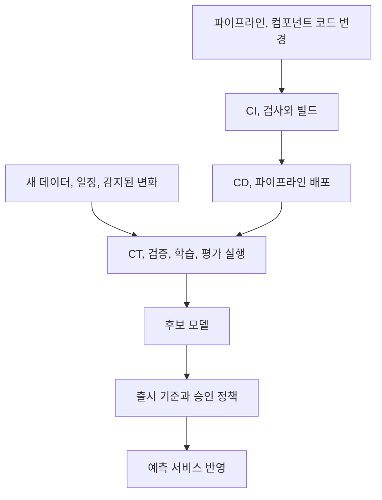

예측이 나빠졌을 때 재학습부터 하고 싶어진다. 그런데 수집 과정이 깨졌거나 서버가 느려진 거라면 고칠 곳이 따로 있다. 그래서 2장은 **관측한 문제를 다음 행동으로 연결하는 과정**으로 읽었고, 자동화 수준에 따라 그 연결이 어떻게 달라지는지 정리했다. 아래 수치와 코드는 판단 방식을 보이려고 만든 학습용 예시다.

## 2.1 반복되는 MLOps 생애주기

MLOps 생애주기는 데이터 수집과 EDA에서 시작해 모델링, 학습, 평가, 배포, 모니터링을 거쳐 유지와 개선으로 이어진다.


그림 2.2. 순환하는 ML 생애주기. 출처: Machine Learning Platform Engineering, 2장.

성능이 떨어졌다고 늘 재학습하는 것도 아니다. 문제의 가치가 사라졌거나 다른 절차가 더 낫다면 모델을 폐기한다. 개선 여부는 처음 정한 업무 목표에 운영 결과를 대어 보고 정한다.

모니터링에서 이상을 찾았을 때 돌아갈 곳도 원인마다 다르다. 입력 스키마가 깨졌다면 수집을 고치고, 평가 기준이 잘못됐다면 문제 정의로 돌아간다. 서버가 느리면 서빙 구성부터 본다.

### 2.1.1 데이터 수집

문제와 측정 가능한 목표를 정하고 나서 필요한 데이터와 라벨을 모은다. 공개 데이터가 있어도 그것이 실제 서비스의 사용자와 상황을 대표하는지는 따로 확인해야 한다.

책은 신분증 이미지, 영화 평점, RAG 문서처럼 형태가 다른 데이터를 같은 생애주기로 다룬다. 이미지는 촬영 조건과 라벨 기준이, 평점은 드러나지 않은 선호가, 문서는 최신성과 권한이 각각 문제가 된다.

그래서 수집 경로와 사용 범위, 표본의 편향, 라벨 책임자와 갱신 주기를 기록해 둔다. 데이터의 양보다 그 데이터로 실제 의사결정을 평가할 수 있는지가 더 중요하다.

라벨을 객관적인 정답으로만 보기도 어렵다. 신분증의 어디까지 상자를 그릴지 기준이 다르면 같은 사진에 정답이 둘 생긴다. 추천에서 평점이 없는 영화를 싫어한다고 읽을 수도 없다. 데이터가 만들어진 과정을 모르면 모델의 오류와 수집의 한계를 가려내기 어렵다.

### 2.1.2 탐색적 데이터 분석

탐색적 데이터 분석(EDA)에서는 스키마, 결측, 이상치, 불균형, 계절성에 대한 가정을 확인한다. 분포를 훑어보는 데서 그치지 않고, 모델이 무엇을 배울 수 있고 어떤 입력에서 실패할지 가설을 세운다.

“평점은 항상 허용 범위에 있다”, “사용자 ID는 비어 있지 않다” 같은 가정은 실행 가능한 품질 검사로 옮길 수 있다. 소수 집단의 표본이 부족하다면 추가 수집 대상이자 평가 범위의 한계로 적어 둔다.

데이터 사전, 품질 규칙, 아직 확인하지 못한 가정은 구분해서 남긴다. EDA는 한 번으로 끝나지 않는다. 새 데이터가 들어오거나 운영에서 실패가 생기면 다시 갱신한다.

EDA에서 찾은 사실은 후속 처리로 이어진다. 이미지 크기가 제각각이면 모델 입력 크기로 맞추는 규칙이 필요하다. 평점에 빈 값이 있으면 버릴지, 빈 값에 다른 의미가 있는지 정해야 한다. 잘못된 값을 모두 0으로 채우는 손쉬운 처리도 데이터의 의미를 바꿀 수 있다.

스키마가 맞아도 데이터가 유효하다고 할 수는 없다. `rating` 열이 숫자여도 허용 범위 밖의 값이 들어올 수 있다. 타입과 값의 범위, 다른 열과의 관계를 같이 봐야 한다.

### 2.1.3 모델링과 학습

모델은 데이터에 코드와 설정을 적용해 만든 산출물이다. 모델 구조, 학습 코드, 하이퍼파라미터, 데이터를 나눠 버전과 계보를 남기면 실험끼리 비교하고 원인을 찾기 쉽다. 하이퍼파라미터는 학습률이나 모델 크기처럼 실험하는 사람이 정하는 조건으로, 학습이 스스로 찾는 가중치와 구분된다.

실험 추적에는 좋은 결과뿐 아니라 실패한 시도도 남긴다. 하이퍼파라미터 탐색에도 비교 기준과 자원 예산이 있어야 한다. 모든 값을 설정으로 빼기보다 실제로 바꿀 항목부터 드러내는 편이 낫다.

모델을 비교할 때는 무엇을 바꿨는지가 분명해야 한다. 데이터와 분할, 전처리까지 한꺼번에 바뀌었다면 점수 차이가 모델 구조 때문인지 알 수 없다. 데이터 버전, 코드 버전, 설정, 평가셋을 실행 결과와 묶어 두어야 나중에 비교할 수 있다.

실행을 다시 찾아내는 것과 수치를 똑같이 재현하는 것은 요구 수준이 다르다. 우선은 어떤 환경과 데이터, 설정에서 나온 결과인지 설명할 수 있어야 한다.

### 2.1.4 모델 평가

지표는 문제마다 다르게 고른다. 분류라면 precision과 recall, 회귀라면 MAE와 MSE 같은 후보가 있다. 같은 분류 문제라도 오탐과 미탐의 비용에 따라 선택이 갈린다.

스팸 차단에서 정상 메일을 막는 비용과 스팸을 놓치는 비용은 같지 않다. “정확도 95%”라는 숫자 하나로 배포를 정할 수 없는 이유다.

Precision은 차단한 메일 중 실제 스팸의 비율이고, recall은 전체 스팸 중 잡아낸 비율이다. MAE는 예측 오차의 절댓값 평균이다. MSE는 오차를 제곱해 평균하므로 큰 오차가 더 크게 반영된다. 지표 이름을 외우기보다 각 지표가 어떤 실패에 무게를 두는지 알아야 한다.

메일 10,000개 중 스팸이 100개라고 하자. 모두 정상으로 통과시켜도 정확도는 99%다. 숫자는 그럴듯하지만 스팸은 하나도 못 잡는다.

| 실제 데이터 | 스팸으로 차단 | 정상으로 통과 |
| ------------ | ------- | ------- |
| 스팸 100개 | 80개 | 20개 |
| 정상 메일 9,900개 | 40개 | 9,860개 |

이 결과에서 차단한 120개 중 스팸은 80개이므로 precision은 약 66.7%다. 실제 스팸 100개 중 80개를 잡았으니 recall은 80%다. 정상 메일을 잃는 비용이 크면 precision을, 스팸을 놓치는 비용이 크면 recall을 더 본다. 어느 쪽인지는 업무의 손실 구조가 정한다.

다중 클래스라면 macro, micro 같은 집계 방식까지 맞춰야 지표를 비교할 수 있다. 정의와 평균 방식은 [scikit-learn 평가 문서](https://scikit-learn.org/stable/modules/model_evaluation.html)에 정리되어 있다.

평가에는 대표성 있는 독립 데이터와 기준선과 같은 비교 조건, 오류 유형 분석이 필요하다. 최종 테스트 결과를 보면서 후보를 계속 고르면 테스트 데이터도 선택 과정에 쓰인 셈이 된다.

전체 평균만 보지 말고 중요한 사용자 집단과 데이터 조건별 결과, 그 표본 수도 확인한다. 평가 데이터나 지표, 출시 기준을 바꿨다면 그 이유도 모델 버전에 연결해 둔다.

### 2.1.5 배포

배포 방식은 모델을 쓰는 쪽에 맞춘다. API일 수도, 배치나 엣지 장치일 수도 있다. 학습 환경에서 빨랐다고 실제 CPU, GPU, 장치에서도 요구사항을 맞춘다는 보장은 없다.

모델을 변환하거나 최적화했다면 최종 형식에서 품질과 지연을 다시 잰다. 배포와 복구의 단위에는 모델뿐 아니라 전처리, 의존성, 서비스 규격도 들어간다.

스테이징에서 확인한 조합이 그대로 출시됐는지, 롤백할 버전이 실제로 실행되는지 기록한다. 배포를 자동화해도 승인 정책은 따로 있어야 한다.

검증을 마친 모델도 서비스에 붙이는 과정에서 어긋날 수 있다. 전처리의 열 순서가 바뀌었거나 모델이 기대하는 라이브러리 버전이 없으면 평가 때와 다른 결과가 나온다. 모델 파일을 올렸는지보다 같은 입력에 기대한 출력이 나오는지를 확인해야 한다.

### 2.1.6 모니터링

관측 대상은 데이터 분포와 품질, 시스템 오류와 지연, 모델 성능과 잘못된 예측으로 나눠 본다. 로그와 버전 정보가 남아 있어야 이상이 어느 변경에서 비롯됐는지 추적할 수 있다.

운영에서는 정답이 늦게 들어오는 일이 많다. 지연과 오류는 바로 보이지만 예측이 맞았는지는 나중에야 안다. 그래서 바로 볼 수 있는 대리 신호와 정답이 도착한 뒤에 볼 실제 품질 지표를 나눠 둔다.

모델이 내는 신뢰 점수(confidence)나 분포 변화인 드리프트는 조사를 시작할 신호다. 그것만으로 정확도를 증명하지는 못한다. 알림을 받을 사람과 그다음 행동을 정해 두지 않으면 대시보드가 있어도 대응이 늦다.

| 관측 대상 | 바로 알 수 있는 것 | 추가로 필요한 것 |
| --------------- | ------------- | ------------------ |
| API 오류와 지연 | 요청 처리의 기술적 실패 | 장애 원인과 사용자 영향 |
| 입력 분포와 결측률 | 들어오는 데이터의 변화 | 수집 오류인지 실제 환경 변화인지 |
| 예측값과 confidence | 모델 행동의 변화 | 실제 정답과 오류 유형 |
| 정답 기반 평가 | 실제 예측 품질 | 정답 수집 지연과 표본의 대표성 |

정답이 나중에 오는 문제라면 요청 시점의 모델 버전과 예측을 정답에 이어 줄 식별자가 필요하다. 이 연결이 없으면 어느 버전이 잘못 예측했는지 집계하기 어렵다.

#### 데이터 드리프트와 개념 드리프트

데이터 드리프트는 입력 분포 `P(X)`가 바뀌는 것이고, 개념 드리프트는 입력과 정답의 관계 `P(Y|X)`가 바뀌는 것이다. [Evidently의 설명](https://www.evidentlyai.com/ml-in-production/data-drift)도 두 개념을 나눠 설명한다.

가격과 이용 조건이 같은데 사람들의 구매 방식이 달라졌다면 개념이 변한 것이다. 사용자 구성만 바뀌고 집단별 구매 방식은 그대로라면 입력 분포가 변한 쪽일 수 있다. 둘은 함께 일어나기도 하고, 변화가 있다고 모델 품질이 꼭 떨어지는 것도 아니다.

드리프트라는 말은 조직마다 넓게 쓰인다. “드리프트가 났다”에서 멈추지 말고 무엇의 분포나 관계를 어느 기간과 비교했는지 물어야 한다.

### 2.1.7 유지, 업데이트, 검토

모니터링 결과는 버그 수정, 데이터 복구, 재학습, 새 모델 비교, 업무 목표 재검토로 이어진다. 서비스의 가치가 사라졌다면 모델을 폐기하는 것도 생애주기의 한 단계다.

무엇을 왜 바꿨고 어떻게 검증했는지, 결과가 어땠는지 남긴다. 자동 재학습이 수집 장애를 그대로 학습 데이터로 빨아들이는 통로가 되어서는 안 된다.

## 2.2 견고한 MLOps가 중요한 이유

노트북 하나에서 성공한 결과 뒤에는 데이터 처리, 환경, 모델, 서비스 사이의 의존성이 숨어 있다. 모델과 팀이 늘수록 수동 전달과 중복 구현, 불분명한 버전이 변경 속도와 신뢰성을 깎아 먹는다.

MLOps에 투자하는 목적은 재작업을 줄이고, 실패에 대응하면서도 실험을 이어 가는 데 있다. 작은 팀이라면 필요한 반복만 골라서 줄여도 된다.

수동 절차를 한꺼번에 없애려 하기보다 오류 빈도와 영향, 반복 비용을 재 보고 먼저 손볼 구간을 고른다.

## 2.3 성숙한 조직에서의 MLOps 역할

성숙한 조직은 검증된 실행 경로를 공통 기능으로 제공한다. 실험 기록과 모델 등록이 기본으로 깔려 있어서, 데이터 과학자와 엔지니어가 배포할 때마다 절차를 새로 협의하지 않아도 된다.

그러면 실험 속도뿐 아니라 협업, 감사 가능한 변경, 일관된 출시와 유지보수가 수월해진다. 다만 표준을 강제한다고 자리 잡지는 않는다. 팀이 실제로 쓰고 도움을 받을 수 있어야 한다.

그래서 플랫폼 이용률과 함께 실험과 출시의 대기 시간, 지원 요청, 플랫폼을 우회하는 수동 작업도 본다. 아무도 쓰지 않는 표준은 공통 기능이 되지 못한다.

## 2.4 DevOps와 MLOps

DevOps도 변경, 자동화, 모니터링, 협업을 다룬다. MLOps는 여기에 데이터와 모델이 코드와 따로 바뀐다는 조건을 더한다.

| 관점 | 일반적인 소프트웨어 운영 | ML 운영에서 더 확인할 것 |
| ------ | -------------- | ------------------------ |
| 변경의 원인 | 코드, 설정, 의존성 변경 | 데이터, 학습 조건, 모델 변경 |
| 검증 | 기능과 시스템 요구 충족 | 통계적 품질, 데이터 누수, 집단별 성능 |
| 배포 단위 | 애플리케이션과 인프라 | 모델, 전처리, 피처 정의, 학습 파이프라인 |
| 관측 | 오류율, 지연, 자원 | 입력 분포, 예측 품질, 비즈니스 결과 |

일반 소프트웨어도 외부 데이터의 영향을 받는다. 그러니 이 표는 두 분야의 경계를 긋는 것이 아니고, ML에서 무엇을 더 드러내 놓고 추적해야 하는지 보여 준다.

#### CI, CD와 CT의 차이

[Google Cloud의 MLOps 아키텍처 문서](https://cloud.google.com/architecture/mlops-continuous-delivery-and-automation-pipelines-in-machine-learning)는 CI와 CD에 CT를 더해 설명한다. CI는 코드 변경을 통합하고 검사하는 과정이고, CD는 검증된 변경을 전달하거나 배포하는 과정이다. CT는 데이터와 조건이 바뀔 때 모델을 계속 다시 학습하는 것을 말한다.

CD는 continuous delivery로도, continuous deployment로도 쓰인다. 언제든 내보낼 수 있게 준비해 두는 것과 운영에 자동으로 출시하는 것은 다르니, 승인이 어디서 끼어드는지 적어 둬야 한다.



실행을 자동화하더라도 잘못된 데이터나 품질이 떨어지는 후보는 출시 전에 걸러져야 한다.

## 2.5 MLOps 성숙도

책은 Google이 나눈 자동화 수준을 소개한다.

| 수준 | 중심 특징 | 무엇을 반복 가능하게 만드는가 |
| ------- | ---------------------------- | -------------------- |
| Level 0 | 수동, 스크립트 중심의 학습과 배포 | 개별 모델을 사람이 전달 |
| Level 1 | 데이터, 모델 검증을 포함한 학습 파이프라인 자동화 | 새 데이터로 모델을 다시 만드는 과정 |
| Level 2 | 파이프라인 구성 요소 자체의 CI/CD 자동화 | 학습 절차와 구성 요소를 바꾸는 과정 |

### 2.5.1 Level 0 수동 중심

사람이 스크립트와 파일을 넘겨 가며 학습하고 배포한다. 초기 검증에는 이쪽이 빠를 수 있다. 하지만 반복할수록 환경과 버전 차이, 특정 담당자에 대한 의존이 쌓인다. 첫 개선으로는 클러스터를 들이는 것보다 실행 기록과 검증 절차를 정리하는 편이 나을 때가 많다.

### 2.5.2 Level 1 학습 파이프라인 자동화

새 데이터가 들어오면 검증, 학습, 평가를 거쳐 후보 모델이 나온다. 모델을 하나씩 손으로 넘기는 대신 재사용할 수 있는 학습 절차를 운영한다. 실험과 운영이 같은 절차를 쓴다는 점도 이 단계의 중요한 성질이다.

매주 새 데이터를 넣어 같은 전처리와 평가를 돌릴 수 있다면 모델을 만드는 절차는 반복 가능한 상태다. 그런데 전처리 코드를 고칠 때마다 여전히 파일을 손으로 옮긴다면, 파이프라인 자체를 바꾸는 일은 아직 자동화되지 않았다.

### 2.5.3 Level 2 파이프라인의 CI/CD

컴포넌트와 파이프라인 코드를 바꿀 때도 검사, 빌드, 배포가 자동으로 이어진다. 있는 파이프라인을 다시 돌리는 능력과 파이프라인 자체를 안전하게 고쳐 배포하는 능력은 별개다.

예를 들어 전처리 컴포넌트를 고치면 코드 검사와 이미지 빌드를 거쳐 새 파이프라인으로 배포된다. 그 파이프라인이 만든 모델은 정해진 평가를 통과해야 한다. 모델을 자주 만드는 것과 모델을 만드는 시스템을 안전하게 바꾸는 것은 따로 따져 봐야 한다.

높은 수준을 무조건 목표로 삼을 필요는 없다. 사용 사례와 변경 빈도에 맞춰 투자하면 된다. 학습이 자동화되어 있어도 출시 승인이나 예외 처리에는 사람이 들어갈 수 있다.

## 자동화 수준을 확인할 기준

같은 조직 안에서도 팀과 모델마다 자동화 수준이 다르다. 조직 전체에 점수 하나를 매기기보다 데이터 검증, 학습, 평가, 출시, 운영 대응을 하나씩 진단하는 편이 쓸모 있다.

| 진단 대상 | 인터뷰 외에 확인할 증거 | 다음 개선 후보 |
| -------- | ----------------------- | ----------------- |
| 실험 재현 | 실행 기록으로 같은 입력을 다시 찾는 과정 | 코드, 데이터, 환경 연결 |
| 변경 검증 | 출시 전 실제 검사 결과와 탈락 사례 | 데이터, 모델 검증 게이트 |
| 전달 속도 | 최근 변경의 작업, 대기 시간 | 반복 수동 전달 제거 |
| 운영 대응 | 최근 장애의 감지, 복구 기록 | 책임자, 실행 지침, 복구 경로 |
| 파이프라인 변경 | 구성 요소 변경의 시험, 배포 기록 | 파이프라인 자체의 CI/CD |

누가 “자동 재학습 중”이라고 답했다고 바로 Level 1로 볼 수는 없다. 잘못된 데이터가 들어오면 실행이 멈추는지, 새 모델이 기존 모델보다 나쁘면 출시가 막히는지 확인해 봐야 한다.

실험에서 운영으로 옮기면서 전처리 코드를 새로 짠다면 자동화가 있어도 불일치 위험이 남는다. 공유 컴포넌트를 쓰는지만 보지 말고, 같은 입력에서 두 쪽 결과가 같은지 비교해 실험과 운영의 대칭성을 확인한다.

## 정확도가 아니라 실패 비용으로 비교해 보기

앞의 스팸 사례에서 정상 메일을 막은 40건은 거짓 양성(FP), 스팸을 놓친 20건은 거짓 음성(FN)이다. 두 실수를 같은 비용으로 치면 업무에 맞지 않는 모델을 고르게 된다.

가상 단위로 정상 메일 손실을 건당 100, 스팸 통과 손실을 건당 2로 두자. 그러면 총손실은 `40 × 100 + 20 × 2 = 4,040`이다. 다른 임계값에서 FP가 10건, FN이 50건이라면 손실은 `10 × 100 + 50 × 2 = 1,100`으로 준다. Recall은 떨어졌지만 이 가정에서는 두 번째가 낫다.

```python
def error_cost(false_positive, false_negative, fp_cost=100, fn_cost=2):
    counts = (false_positive, false_negative)
    if any(not isinstance(value, int) or value < 0 for value in counts):
        raise ValueError("Error counts must be non-negative integers")
    return false_positive * fp_cost + false_negative * fn_cost


print(error_cost(40, 20))
print(error_cost(10, 50))
```

실행하면 `4040`, `1100`이 나온다. 비용 비율을 뒤집으면 두 모델의 우열도 뒤집힐 수 있다. 손실값은 임의로 정한 가정이라 이 숫자로 실제 스팸 서비스를 결정할 수는 없다.

ROC-AUC가 높다고 위 손실까지 가장 작은 것은 아니다. AUC는 점수로 순위를 얼마나 잘 가르는지 요약한 값이고, FP와 FN은 실제로 쓸 임계값에 따라 정해진다. 임계값은 검증 데이터에서 고르고, 최종 테스트 결과를 보면서 다시 조정하지 않는다.

## 실습: 입력 품질과 모델 평가 게이트

자동차 공장에 컨베이어 벨트만 있고 불량품을 멈출 검사가 없다면, 생산이 빠를수록 위험도 커진다. 학습 파이프라인의 검증 게이트가 그 검사 역할을 한다. 잘못된 입력이나 기준에 못 미치는 후보가 다음 단계로 넘어가지 못하게 막는다.

아래 코드는 모델을 학습하지 않는다. 평가 결과를 받아 후보를 보류할지 정하는 규칙만 연습한다. 결측률, 검증 AUC, p95 지연은 앞 단계에서 실제로 계산해 넘겨줘야 하는 값이다.

```python
def release_decision(report):
    required = {
        "missing_rate", "validation_auc", "baseline_auc",
        "p95_latency_ms", "schema_valid"
    }
    if not required.issubset(report):
        raise ValueError("Incomplete evaluation report")
    numeric = ("missing_rate", "validation_auc", "baseline_auc", "p95_latency_ms")
    from math import isfinite
    if any(
        isinstance(report[key], bool)
        or not isinstance(report[key], (int, float))
        or not isfinite(report[key])
        for key in numeric
    ):
        raise ValueError("Metrics must be finite numbers")
    if any(not 0 <= report[key] <= 1 for key in numeric[:3]):
        raise ValueError("Rates and AUC must be between 0 and 1")
    if report["p95_latency_ms"] < 0 or not isinstance(report["schema_valid"], bool):
        raise ValueError("Invalid latency or schema result")
    reasons = []
    if not report["schema_valid"]:
        reasons.append("schema mismatch")
    if report["missing_rate"] > 0.01:
        reasons.append("missing rate exceeds 1%")
    if report["validation_auc"] < report["baseline_auc"] + 0.02:
        reasons.append("validation AUC improvement is below 0.02")
    if report["p95_latency_ms"] > 200:
        reasons.append("p95 latency exceeds 200 ms")
    return {"eligible": not reasons, "reasons": reasons}


candidate = {
    "missing_rate": 0.005,
    "validation_auc": 0.84,
    "baseline_auc": 0.80,
    "p95_latency_ms": 170,
    "schema_valid": True,
}
print(release_decision(candidate))
print(release_decision({**candidate, "missing_rate": 0.08}))
```

첫 결과는 `eligible: True`이고, 두 번째는 `eligible: False`와 함께 결측률 초과라는 이유가 나온다. NaN처럼 비교를 슬쩍 빠져나가는 값도 거절하게 했다. 실제 서비스라면 평가 보고서가 믿을 만한지, 표본 수와 집단별 결과는 어떤지, 승인과 롤백 준비가 됐는지도 봐야 한다. 이 함수 하나로 출시 시스템이 완성되지는 않는다.

지연을 260ms로 올리거나 `schema_valid`를 `False`로 바꿔도 AUC와 상관없이 각각의 사유로 보류된다. 거절 이유를 숨기고 이전 값으로 대체하면 운영자는 무엇이 잘못됐는지 알 수 없다.

### 코드의 조건문을 쉬운 말로 읽기

이 함수는 출입문 앞의 검사표에 가깝다. 모델을 더 똑똑하게 만들지는 않고, 들여보내도 되는 후보인지만 확인한다. 그래서 `eligible`은 출시가 끝났다는 뜻이 아니다. 여기 적힌 검사 조건을 통과했다는 뜻이다.

`missing_rate: 0.005`는 입력의 0.5%가 비어 있다는 뜻이다. 허용치를 1%로 잡았으니 통과한다. `0.08`은 8%라서 보류된다. 0.08을 0.08%로 잘못 읽으면 결론이 정반대가 된다.

`validation_auc`와 `baseline_auc`는 후보와 기존 기준선을 같은 검증 데이터에서 비교하려는 값이다. 서로 다른 데이터에서 나온 숫자를 넣어도 함수는 눈치채지 못한다. 코드는 숫자를 비교할 뿐, 비교 조건이 맞는지는 사람이 챙겨야 한다.

`p95_latency_ms`는 응답 시간 검사다. 공부를 잘하는 학생이라도 정해진 시간 안에 답하지 못하면 실시간 상담을 맡기기 어렵다. 품질과 속도는 각각 따로 통과해야 한다.

### 실행 결과 확인하기

위 두 Python 블록을 각각 `cost_study.py`, `gate_study.py`로 저장해 실행한다.

손실값은 `4040`과 `1100`으로 나온다. 게이트 쪽은 결측률만 8%로 바꿔도 후보가 거절되고 이유가 함께 돌아온다. 넣은 평가값은 가상이므로, 여기서 보는 것은 검사 규칙이 의도대로 움직이는지다.

`eligible: False`가 오류 없이 찍혔다면 나쁜 후보를 의도대로 거른 것이다. 불량품 앞에서 멈춘 검사 장치와 같다. 자동화할 때도 성공 경로만이 아니라 이 거절 경로가 살아 있는지 확인해야 한다.

AUC가 0.99여도 결측률이 8%면 게이트를 넘지 못한다. 점수가 좋다고 입력 품질 조건이 면제되지는 않는다.

### 변경 원인에 따른 재실행 범위

| 관측한 증상 | 먼저 조사할 곳 | 재학습부터 하면 생길 위험 |
| --- | --- | --- |
| 배포 직후 모든 요청이 열 누락 오류 | API 입력, 피처 계약, 전처리 버전 | 호환성 오류를 학습 문제로 착각 |
| 특정 수집기에서 결측이 갑자기 증가 | 수집기와 원천 스키마 | 장애 데이터를 정상으로 학습 |
| 새 사용자에게만 추천 품질 하락 | 새 사용자 비중, 초기 추천 정책 | 이력이 없는 사람의 문제를 기존 사용자 재학습으로 덮음 |
| 입력 분포는 비슷한데 정답 기반 손실 증가 | 라벨 지연, 정책 변화, `P(Y|X)` | 드리프트 검사 통과만으로 품질 이상을 놓침 |
| API는 느려졌지만 같은 입력의 예측은 동일 | 자원, 피처 조회, 모델 로딩 | 불필요한 학습으로 원인 조사가 늦어짐 |

정답을 나중에야 알게 되는 경우라면 예측 시점에 `request_id`, 모델 버전, 입력 기준 시점, 예측값을 남겨 두고 나중에 들어온 정답과 잇는다. 개인 식별 정보를 통째로 로그에 남기라는 말은 아니다. 연결에 필요한 식별자와 보존 범위를 정해 두면 된다.

### 성숙도 단계 구분을 실제 변경에 적용하기

금요일마다 담당자가 노트북을 돌려 파일을 넘긴다면 수동 구간이 중심이다. 데이터 준비, 학습, 평가가 일정에 맞춰 같은 방식으로 돌고 부적절한 후보에서 멈춘다면 학습 절차 자동화에 가깝다. 그 절차의 코드를 고칠 때도 검사, 이미지 빌드, 시험 실행, 배포가 이어진다면 파이프라인 자체의 CI/CD까지 간 것이다.

API의 Docker 이미지만 자동 배포하는 경우는 따로 봐야 한다. 모델을 만드는 절차는 여전히 수동일 수 있으니 그것만으로 Level 2라고 하기 어렵다. 거꾸로 출시 승인에 사람이 남아 있다고 해서 자동화 수준 전체를 낮게 볼 이유도 없다.

## 반복 작업의 비용

자동화할 순서를 정하려면 최근 모델 변경에서 데이터 준비, 학습, 평가, 배포가 각각 얼마나 걸렸는지 봐야 한다. 실행 시간과 승인 대기를 나눠 보면 병목이 다른 곳에 있을 수 있다.

결과물에는 자동화할 작업과 성공 기준, 실패 알림을 받을 사람이 같이 들어가야 한다. “Level 2로 간다”보다 실행하기 쉬운 목표다.

## 자동화와 품질 조건

### 재학습 빈도와 MLOps의 성숙도

데이터 검증, 모델 비교, 출시 기준이 없으면 재학습을 자주 해도 잘못된 모델을 더 자주 만들 수 있다. 얼마나 자주 도는지보다 그 반복을 얼마나 통제하는지가 성숙도를 가른다.

### 재학습에 앞서는 데이터 파이프라인 점검

어느 시점부터 결측률이 치솟거나 단위가 바뀐 경우가 여기에 해당한다. 데이터를 정상으로 되돌리지 않고 재학습하면 장애를 새로운 정상으로 학습하게 된다.

성숙도 단계는 다음에 손볼 곳을 찾는 기준이다. 모든 조직이 같은 속도로 올라가야 하는 서열로 볼 필요는 없다.

## 마치며

Level 1은 학습 절차를, Level 2는 파이프라인 자체를 자동화한다. 그래도 성숙도를 판단할 때는 자동화 범위보다 잘못된 입력과 변경을 거절하고 원인에 맞게 복구하는 능력을 본다.

[이전: 01. 시작하기](../01-getting-started/), [시리즈 목차](../), [다음: 03. Kubernetes 기반](../03-kubernetes-foundation/)