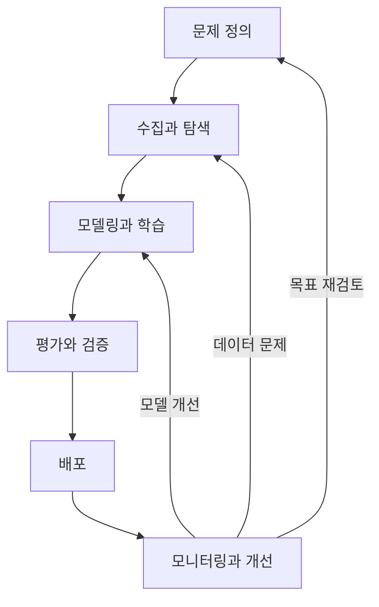

**원문 범위:** 2장 *What is MLOps?*, 2.1~2.5.

## 먼저, 결승선보다 순환선을 떠올려 보세요

버스가 종점에 도착했다고 운행이 끝나는 것은 아닙니다. 다음 승객과 도로 상황에 맞춰 다시 출발합니다. ML 서비스도 첫 배포가 종착점이 아닙니다. 사용자와 데이터가 달라지면 모델을 다시 살펴야 합니다.

**MLOps는 그 반복을 믿을 수 있는 과정으로 만드는 일**입니다. 모델 하나의 성능보다, 변화가 생겼을 때 얼마나 안전하게 새 버전을 만들고 검증할 수 있는지가 중요해집니다.

## 생애주기를 닫힌 고리로 읽기

이 장은 데이터 수집, 탐색적 데이터 분석(EDA), 모델링·학습, 평가, 배포, 모니터링, 유지·개선을 하나의 고리로 묶습니다.

모니터링에서 문제가 발견되었다고 항상 학습으로 돌아가는 것은 아닙니다. 입력 스키마가 깨졌다면 수집을, 평가 기준이 잘못됐다면 문제 정의를, 서버가 느리다면 서빙 구성을 먼저 고쳐야 합니다.

데이터 수집에서는 대표성과 편향을, EDA에서는 결측·분포·누수 가능성을, 평가에서는 목표에 맞는 지표와 독립된 데이터셋을 확인합니다. **고리의 뒤쪽에서 발견한 문제를 앞쪽의 어떤 가정으로 연결할지**가 MLOps의 실질적인 역할입니다.

## DevOps를 버리는 것이 아니라 관리 대상을 늘립니다

DevOps도 변경, 자동화, 모니터링과 협업을 다룹니다. MLOps에서는 여기에 **데이터와 모델이 코드와 별도로 바뀐다는 점**이 추가됩니다.

| 관점 | 일반적인 소프트웨어 운영 | ML 운영에서 더 확인할 것 |
| --- | --- | --- |
| 변경의 원인 | 코드·설정·의존성 변경 | 데이터·학습 조건·모델 변경 |
| 검증 | 기능과 시스템 요구 충족 | 통계적 품질, 데이터 누수, 집단별 성능 |
| 배포 단위 | 애플리케이션과 인프라 | 모델, 전처리, 피처 정의, 학습 파이프라인 |
| 관측 | 오류율·지연·자원 | 입력 분포, 예측 품질, 비즈니스 결과 |

일반 소프트웨어도 외부 데이터의 영향을 받습니다. 이 비교는 절대적인 경계가 아니라, ML에서 무엇을 더 명시적으로 추적해야 하는지 이해하기 위한 것입니다.

## 평가 점수와 비즈니스 목표를 연결하기

모든 문제에 같은 지표를 쓰면 안 됩니다. 분류에서는 precision·recall, 회귀에서는 MAE·MSE 등 후보가 다르며, 같은 분류 문제도 오탐과 미탐의 비용에 따라 선택이 달라집니다.

예를 들어 북클럽의 가상 사례로 스팸 차단을 생각해 보세요. 정상 메일을 차단하는 비용과 스팸을 놓치는 비용이 같지 않습니다. “정확도 95%”라는 숫자만으로 배포 여부를 정할 수 없는 이유입니다.

운영에서는 정답이 늦게 들어오기도 합니다. 서비스 지연과 오류는 즉시 관측할 수 있어도 예측이 맞았는지는 나중에 알 수 있습니다. **즉시 볼 대리 신호와 정답이 도착한 뒤 볼 실제 품질 지표를 구분**해야 합니다.

## 성숙도는 설치한 도구 수가 아닙니다

책은 Google의 자동화 수준 구분을 소개합니다.

| 수준 | 중심 특징 | 무엇을 반복 가능하게 만드는가 |
| --- | --- | --- |
| Level 0 | 수동·스크립트 중심의 학습과 배포 | 개별 모델을 사람이 전달 |
| Level 1 | 데이터·모델 검증을 포함한 학습 파이프라인 자동화 | 새 데이터로 모델을 다시 만드는 과정 |
| Level 2 | 파이프라인 구성 요소 자체의 CI/CD 자동화 | 학습 절차와 구성 요소를 바꾸는 과정 |

특히 Level 1과 Level 2의 차이가 중요합니다. **기존 학습 파이프라인을 다시 실행하는 것**과 **학습 파이프라인 자체를 안전하게 수정·배포하는 것**은 다른 능력입니다.

높은 수준을 무조건 목표로 할 필요는 없습니다. 사용 사례와 변경 빈도에 맞게 투자해야 하며, 학습 자동화가 있더라도 출시 승인이나 예외 처리에는 사람이 관여할 수 있습니다.

## 실무 적용: 성숙도를 작업 단위로 진단합니다

다음은 원문을 확장한 실무 적용 기준입니다. 한 조직에서도 팀과 모델마다 자동화 수준은 다릅니다. 조직 전체에 점수 하나를 매기기보다 **데이터 검증·학습·평가·출시·운영 대응**을 따로 진단합니다.

| 진단 대상 | 인터뷰 외에 확인할 증거 | 다음 개선 후보 |
| --- | --- | --- |
| 실험 재현 | 실행 기록으로 같은 입력을 다시 찾는 과정 | 코드·데이터·환경 연결 |
| 변경 검증 | 출시 전 실제 검사 결과와 탈락 사례 | 데이터·모델 검증 게이트 |
| 전달 속도 | 최근 변경의 작업·대기 시간 | 반복 수동 전달 제거 |
| 운영 대응 | 최근 장애의 감지·복구 기록 | 책임자·실행 지침·복구 경로 |
| 파이프라인 변경 | 구성 요소 변경의 시험·배포 기록 | 파이프라인 자체의 CI/CD |

“자동 재학습 중”이라는 답만으로 Level 1이라고 확정하지 않습니다. 잘못된 데이터에서 실행이 중단되는지, 새 모델이 기존 모델보다 나쁠 때 출시가 막히는지 확인해야 합니다.

실험에서 운영으로 옮길 때 서로 다른 전처리 코드를 다시 작성한다면 자동화가 있어도 불일치 위험이 남습니다. 공유 컴포넌트뿐 아니라 같은 입력에서의 결과 비교로 실험·운영 대칭성을 검증합니다.

## 컨설팅 관점: 단계적 로드맵에는 통과 조건이 있어야 합니다

“3개월 뒤 고도화” 대신 **어떤 모델을 대상으로 무엇을 검증하면 다음 투자로 넘어갈지**를 정합니다. 예를 들어 수동 전달이 병목이면 첫 단계는 모델 등록과 출시 기록의 연결이지 전체 클러스터 교체가 아닐 수 있습니다.

산출물은 **기능별 현황·목표 격차표와 단계별 도입 계획**입니다. 단계마다 범위, 의존성, 담당자, 효과 측정 방식과 중단 조건을 명시합니다.

측정에서는 모델 변경의 준비 시간과 승인 대기, 실행 시간과 재작업을 분리하세요. 전체 시간이 줄어도 검증을 생략해서 얻은 개선이라면 운영 역량의 향상이라고 보기 어렵습니다.

## 직접 해보기: 우리 팀의 반복 비용 찾기

최근 모델 변경 하나를 떠올리고, “데이터 준비 → 학습 → 평가 → 배포 → 확인”의 단계별로 걸린 시간과 수동 전달을 적어 보세요. 그런 다음 가장 자주 틀리거나 오래 기다리는 단계 하나를 골라 자동화 후보로 정합니다.

결과물에는 **자동화할 작업, 성공 기준, 실패 알림을 받을 사람**을 함께 적어 주세요. 단순히 “Level 2로 간다”는 목표보다 실행하기 쉽습니다.

## 북클럽 토론

**Q. 재학습을 매일 돌리면 MLOps가 잘된 것일까요?**

데이터 검증, 모델 비교, 출시 기준이 없다면 잘못된 모델을 더 자주 만들 뿐일 수 있습니다. 빈도보다 반복 과정의 통제가 중요합니다.

**Q. 어떤 관측값이 모델 재학습이 아니라 데이터 파이프라인 수리를 요구할까요?**

특정 시점부터 결측률이 급증하거나 단위가 바뀐 경우를 생각해 보세요. 정상 데이터를 복구하지 않고 재학습하면 장애를 새로운 정상으로 학습할 수 있습니다.

**자주 빠지는 함정:** 성숙도 단계를 팀의 등급표로 사용하는 것입니다. 단계는 다음 병목을 찾는 지도이지, 모든 조직이 같은 속도로 올라가야 하는 서열이 아닙니다.

## 한 줄 정리

**MLOps는 한 번의 배포를 빠르게 하는 것보다, 데이터와 모델의 변화를 반복해서 검증하고 개선하는 능력입니다.**

[이전: 01. 시작하기](../01-getting-started/) · [시리즈 목차](../) · [다음: 03. Kubernetes 기반](../03-kubernetes-foundation/)
