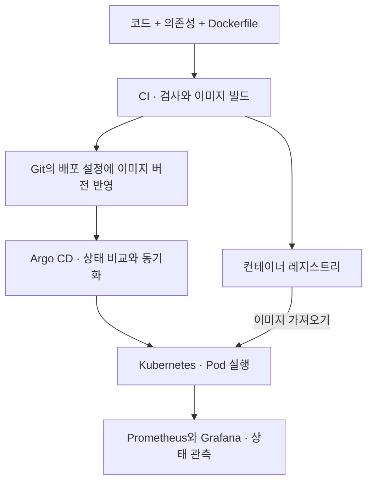

**원문 범위:** 3장 *Building applications on Kubernetes*, 3.1~3.5.

## 먼저, 상자와 물류센터의 차이입니다

물건을 규격 상자에 담으면 옮기기 편해집니다. 하지만 상자만으로는 어느 창고에 둘지, 파손되면 어떻게 대체할지 정해지지 않습니다.

애플리케이션과 의존성을 담는 **컨테이너 이미지**가 상자라면, 배치·재시작·복제본 관리를 맡는 **Kubernetes**는 물류센터의 운영 체계입니다. 이 장은 ML에 앞서 간단한 FastAPI 애플리케이션으로 그 기반을 배웁니다.

## Docker는 실행 환경을 포장합니다

Dockerfile은 이미지를 만드는 레시피이고, 이미지는 배포할 포장이며, 컨테이너는 그 이미지를 실행한 인스턴스입니다. 레지스트리는 이미지를 저장하고 다른 환경에서 가져올 수 있게 합니다.

컨테이너를 사용하면 환경 차이를 줄일 수 있지만, 모든 차이가 없어지지는 않습니다. CPU 아키텍처, GPU 드라이버, 외부 서비스와 설정은 여전히 영향을 줍니다. 또한 이미지 태그를 다시 덮어쓰면 같은 이름이 다른 내용을 가리킬 수 있으므로, 실제 배포한 버전을 식별할 수 있어야 합니다.

## Kubernetes 객체는 역할을 나누어 이해합니다

클러스터의 **컨트롤 플레인**은 원하는 상태와 배치 결정을 관리하고, **워커 노드**는 실제 워크로드를 실행합니다. `kubectl`은 이 상태를 조회하고 변경하는 인터페이스입니다.

| 객체 | 쉬운 역할 | 혼동하지 말아야 할 점 |
| --- | --- | --- |
| Pod | 함께 실행되는 컨테이너의 최소 배치 단위 | 영구적인 서버 주소나 데이터 보관함이 아님 |
| ReplicaSet | 정해진 수의 Pod 복제본 유지 | 보통 Deployment를 통해 관리 |
| Deployment | 버전 교체와 복제본의 선언적 관리 | 애플리케이션 상태를 선언하는 것이지 모델 품질을 보장하는 것이 아님 |
| Service | 바뀌는 Pod 앞에 안정적인 접근 지점 제공 | 실제 트래픽 대상과 포트 설정이 맞아야 함 |
| Namespace | 자원과 이름을 나누는 범위 | 그 자체만으로 완전한 보안 격리가 되지는 않음 |
| ConfigMap | 일반 설정 분리 | 비밀 정보를 넣는 곳이 아님 |
| Secret | 민감한 설정을 전달하는 객체 | 기본 인코딩만으로 안전한 암호화가 되는 것은 아님 |

Service의 유형도 구분합니다. **ClusterIP**는 기본적으로 클러스터 내부 접근, **NodePort**는 노드 포트를 통한 노출, **LoadBalancer**는 지원되는 환경의 로드밸런서 연계를 제공합니다. `port-forward`는 개발·점검에 유용하지만 일반 사용자의 접속 방식으로 삼지는 않습니다.

## Helm, CI, CD는 서로 대체재가 아닙니다

**Helm**은 여러 Kubernetes 객체를 차트와 값으로 묶어 관리합니다. **CI**는 변경된 코드를 검사하고 이미지를 만들며, **CD**는 준비된 변경을 배포합니다.

책은 GitLab CI와 Argo CD를 사용합니다. Argo CD의 중요한 관점은 Git의 선언과 클러스터의 실제 상태를 비교하는 **GitOps**입니다. 다만 차이가 있다고 항상 자동으로 덮어쓰는 것은 아니며, 자동 동기화와 self-heal 등 설정에 따라 동작이 달라집니다.

실무에 적용한다면 코드 커밋, 이미지 버전, 배포 설정 변경의 연결을 남겨야 합니다. 그러면 “누가 서버에서 무엇을 바꿨나?” 대신 “어떤 변경이 배포되었나?”를 추적할 수 있습니다.

## 운영 상태를 볼 창문도 함께 만듭니다

Prometheus는 애플리케이션이 노출하는 메트릭을 수집하고, Grafana는 그 데이터를 질의·시각화합니다. 로그는 개별 오류의 맥락을 찾는 데, 메트릭은 시간에 따른 상태와 추세를 파악하는 데 유용합니다.

여기서 볼 것은 요청 수, 오류율, 응답 시간, 자원 사용량입니다. **이 지표가 정상이라는 사실과 ML 예측이 맞는다는 사실은 다릅니다.** 이후 장에서 데이터 변화와 모델별 지표를 더합니다.

## 실무 적용: 실행 가능과 운영 인수 가능을 구분합니다

다음 항목은 책의 기본 배포를 실제 운영으로 확장할 때의 점검 기준입니다.

| 영역 | 설계할 것 | 증거로 확인할 것 |
| --- | --- | --- |
| 자원 | CPU·메모리 requests/limits, GPU와 스케줄링 | 대표 부하에서 사용량·대기·OOM 여부 |
| 시작과 상태 | 초기화 시간, startup·readiness·liveness의 의미 | 느린 모델 로딩 때 불필요한 재시작이 없는지 |
| 권한과 네트워크 | 최소 권한 ServiceAccount, RBAC, 통신 경계 | 허용·거부되어야 할 접근의 실제 결과 |
| 비밀과 이미지 | Secret 전달, 불변 이미지 식별, 취약점 점검 | 이미지에 자격 증명이 없고 출처를 추적하는지 |
| 배포와 복구 | 변경 승인, 롤아웃, 이전 버전 복구 | 배포 실패 때 트래픽·모델 버전을 되돌리는지 |

Pod 자동 재시작은 모델·설정의 올바른 복구와 다릅니다. 또한 가용성을 위한 복제본 수, 노드 분산, 외부 저장소와 레지스트리 장애를 함께 봐야 합니다. 운영 설계는 단일 Pod를 잘 띄우는 것보다 넓습니다.

비용도 자원 사용률만으로 판단하지 않습니다. GPU가 모델 로딩과 대기로 묶이는 시간, 이미지 전송, 빈번한 Pod 생성과 유휴 자원을 측정해야 합니다.

## 컨설팅 관점: 고객에게 클러스터를 남기기 전에 운영 주체를 정합니다

고객의 Kubernetes 운영팀, 업그레이드 정책, 인증 체계, 네트워크·스토리지 제약을 확인합니다. 새 ML 플랫폼을 기존 표준과 별개로 만들면 기능은 빨리 나와도 인수가 막힐 수 있습니다.

산출물은 **배포 경계도, 환경별 설정·이미지 연결표, 접근 제어표, 운영 인수 체크리스트**입니다. “관리형 Kubernetes를 쓰니 운영은 없다”가 아니라 제공자와 고객이 각각 책임지는 범위를 표시합니다.

운영 인수 시에는 실습용 환경에서 이미지 다운로드 실패, 메모리 부족, 초기화 지연을 각각 재현하고 조사·복구 과정을 남깁니다. 제안한 통제와 실제 시험한 통제를 구분해야 합니다.

## 직접 해보기: 실패를 한 번 따라가 보기

설치 환경이 있다면 간단한 API의 Deployment와 Service를 만들고 Pod 하나를 삭제한 뒤, 복제본이 어떻게 복구되는지 관찰해 보세요. 실습용 클러스터에서만 진행하고 프로덕션 자원은 건드리지 않습니다.

환경이 없다면 “이미지 주소가 틀림 → Pod가 뜨지 않음 → Service에 정상 대상이 없음”의 흐름을 그려 보세요. 각 단계에서 확인할 상태·이벤트·로그를 적으면 됩니다.

## 북클럽 토론

**Q. 컨테이너 이미지가 같으면 모델 결과도 같을까요?**

데이터, 외부 피처, 모델 파일, 런타임 설정까지 같다는 보장이 없습니다. 이미지 재현성과 ML 실험 재현성을 나누어 생각해야 합니다.

**Q. 모든 팀이 Kubernetes부터 도입해야 할까요?**

아닙니다. 여러 워크로드의 공통 운영이 필요한지와 클러스터 유지 비용을 비교해야 합니다. 이 책에서는 뒤쪽 플랫폼 기능을 연결하는 기반으로 선택한 것입니다.

**자주 빠지는 함정:** 복제본 수를 늘리면 모든 장애와 성능 문제가 해결된다고 보는 것입니다. 모델 초기화, GPU·스토리지 제약, 잘못된 입력은 별도의 문제입니다.

## 한 줄 정리

**컨테이너는 실행 환경을 포장하고, Kubernetes와 CI/CD는 그 포장을 반복해서 배치·교체·관측하는 기반을 제공합니다.**

[이전: 02. MLOps란 무엇인가](../02-what-is-mlops/) · [시리즈 목차](../) · [다음: 04. 실험과 피처 관리](../04-experiments-and-features/)
