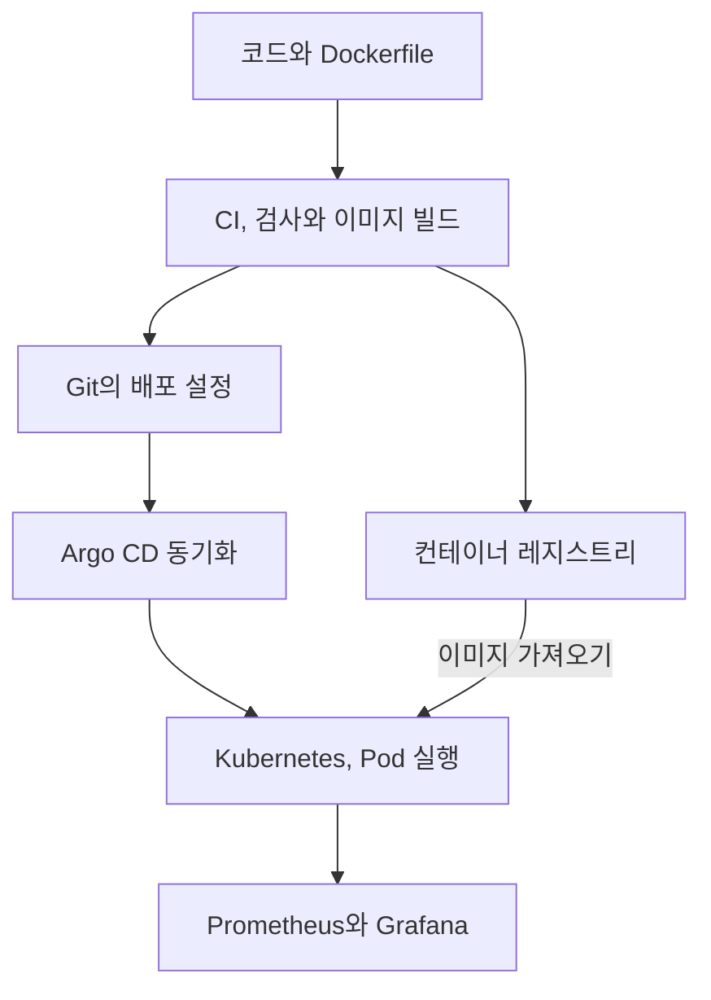

3장은 모델보다 모델을 올릴 실행 환경을 먼저 다룬다. 노트북에서 돌던 앱을 클러스터에 올리면 실패할 수 있는 곳이 이미지, 배치, 네트워크, 배포 경로로 나뉜다. 이 층을 구분해 두어야 뒤 장에서 모델 서비스가 실패했을 때 어디부터 볼지 정할 수 있다.

책은 모델 없는 작은 FastAPI 앱 하나로 포장, 실행, 배포, 관측의 흐름을 보여 준다.

## 이미지는 실행 환경을 고정하지만 모델까지 특정하지는 않는다

Dockerfile은 이미지를 정의하고, 이미지는 배포 단위이며, 컨테이너는 그 이미지의 실행 인스턴스다. 레지스트리는 이미지를 보관했다가 배포 환경에 내어 준다. `RUN`은 이미지를 만드는 동안 실행되고 `CMD`나 `ENTRYPOINT`는 컨테이너가 시작될 때 실행되므로, 빌드가 성공해도 API가 제대로 뜨는지는 띄워서 요청을 보내 봐야 안다.

태그는 다른 이미지에 다시 붙일 수 있는 이름이고, digest는 이미지 내용을 가리키는 해시다. 실제로 배포한 것을 추적하려면 커밋과 digest를 함께 남긴다. 모델을 실행 시점에 외부 저장소에서 읽는다면 이미지 버전만으로는 어떤 모델이 돌고 있는지 알 수 없으니 모델 버전도 따로 기록한다.

컨테이너가 환경 차이를 모두 없애 주지는 않는다. CPU 아키텍처, GPU 드라이버, 외부 서비스, 런타임 설정은 여전히 결과에 영향을 준다. 포트도 프로세스가 실제로 듣는 포트, 이미지의 포트 선언, 호스트 쪽 매핑이 각각 다른 설정이다.

## Kubernetes는 선언한 상태를 계속 맞춘다

컨트롤 플레인의 API server, etcd, Scheduler, Controller가 클러스터 상태와 배치를 맡고, 워커 노드의 kubelet과 컨테이너 런타임이 실제 컨테이너를 실행한다. 구성 요소들은 API server를 거쳐 상태를 읽고 쓰며, etcd는 그 상태를 저장한다. 워커는 containerd 같은 런타임을 CRI로 쓰므로 Docker로 빌드했다고 노드도 Docker Engine으로 돈다는 뜻은 아니다.

그림 3.4. Kubernetes 구성 요소. 출처: Machine Learning Platform Engineering, 3장.

Deployment를 제출하면 API server가 선언을 저장하고, Controller가 Pod를 만들고, Scheduler가 노드를 고르고, 그 노드의 kubelet이 컨테이너를 띄운다. 그래서 자원이 모자라 `Pending`에 머무는 문제, 이미지를 못 가져오는 `ImagePullBackOff`, 실행 뒤 프로세스가 죽는 반복 재시작은 조사할 곳이 서로 다르다.

그림 3.5. Deployment, ReplicaSet, Pod와 Container의 관계. 출처: Machine Learning Platform Engineering, 3장.

Deployment가 ReplicaSet을, ReplicaSet이 Pod 수를 관리한다. Controller는 원하는 상태와 관측한 상태의 차이를 반복해서 줄이는 조정 루프(reconciliation)로 움직이므로, Pod를 손으로 지워도 다시 생기고 선언이 틀렸다면 몇 번을 재시작해도 고쳐지지 않는다. 실패한 Pod는 새 Pod로 대체되며, 컨테이너 재시작과 Pod 교체와 모델 버전 롤백은 서로 다른 복구다. 복제본이 여러 개여도 같은 노드나 저장소에 기대면 함께 장애를 겪는다.

## Service는 바뀌는 Pod 앞에 고정된 입구를 만든다

Pod는 주소와 수명이 계속 바뀐다. Service는 label selector로 대상 Pod를 고르고, 자기 `port`로 받은 요청을 Pod의 `targetPort`로 넘긴다. selector가 Pod label과 어긋나거나 `targetPort`가 앱이 실제로 듣는 포트와 다르면 Pod가 Running이어도 요청은 실패한다. Service 객체가 생겼다고 요청 경로까지 정상인 것은 아니어서 selector, EndpointSlice의 대상, 포트를 차례로 본다.

Running과 Ready도 다르다. readiness probe가 실패한 Pod는 Service 트래픽 대상에서 빠지고, liveness나 startup probe가 실패하면 컨테이너가 재시작된다. 모델 서비스라면 readiness는 모델 로딩과 초기화가 끝났을 때만 성공해야 한다.

모델 없는 연습용 앱의 `/ready`가 200을 돌려준 화면이다. 이 앱의 readiness는 항상 성공하므로 이 응답이 모델 준비 완료를 뜻하지는 않는다. Namespace, ConfigMap, Secret으로 범위와 설정을 나누고 Helm 차트로 객체 묶음을 패키징해도, 권한과 비밀 보호와 values에 섞인 모델 참조는 따로 관리해야 한다.

## CI/CD는 운영 중인 버전을 커밋까지 거슬러 올라가게 한다

CI는 변경을 검사하고 이미지를 만든다. CD는 검증한 결과를 배포 환경에 연결한다. 커밋 A로 만든 이미지의 digest를 배포 설정에 적고 그 설정도 커밋하면 실행 중인 서비스에서 원래 코드까지 추적할 수 있다. `latest` 태그만 덮어쓰면 Git의 설정은 그대로인데 이미지 내용만 바뀐다.

GitOps는 Git의 선언을 기준으로 클러스터를 맞추는 방식이고, Argo CD가 그 비교와 동기화를 맡는다. [자동 동기화 정책](https://argo-cd.readthedocs.io/en/stable/user-guide/auto_sync/)에서 새 선언 반영(auto-sync), 수동 변경 되돌리기(self-heal), 사라진 자원 삭제(prune)는 각각 따로 켜는 설정이다. 손으로 고친 긴급 변경은 다음 동기화에 덮어써질 수 있다.

`Synced`는 클러스터가 Git 선언과 맞는다는 뜻이고 `Healthy`는 자원 상태가 정상이라는 뜻이다. 틀린 모델 버전을 Git에 적어도 동기화는 성공하므로, 모델 품질 검증은 배포 도구 밖에서 따로 해야 한다.

## 3.5 Prometheus와 Grafana

Prometheus는 앱이 노출한 메트릭 엔드포인트를 주기적으로 가져가(scrape) 저장하고, Grafana는 그 데이터를 질의해 그린다. 메트릭 유형마다 읽는 법이 다르다.

| 메트릭 유형 | 예시 | 해석할 때 |
| --- | --- | --- |
| Counter | 요청 수, 오류 수 | 누적값이므로 구간 증가율(`rate`)로 읽는다 |
| Gauge | 현재 메모리, 대기 작업 | 한 시점 값과 추세를 구분한다 |
| Histogram | 지연 분포 | 분위수는 버킷 경계와 표본에 영향을 받는다 |
| Summary | 개수, 합, 설정한 분위수 | 인스턴스별 분위수를 합산할 수 없다 |

요청 수 Counter가 10,000이라는 값은 프로세스가 언제 시작했는지에 따라 의미가 달라진다. 평균 지연만 보면 느린 일부 요청을 놓치므로 p95 같은 분위수를 보되 어떤 구간과 트래픽을 집계했는지 함께 적는다. 오류율을 계산할 때 요청이 없는 구간을 0%로 읽으면 수집 실패를 놓친다.

사용자 ID나 요청 ID를 label로 붙이면 시계열 수(카디널리티)가 폭증한다. 개별 요청의 맥락은 로그와 트레이스에 맡긴다. 요청 수, 오류율, 지연, 자원 사용량이 모두 정상이어도 예측이 맞는다는 보장은 없다. 데이터 변화와 예측 품질은 따로 관측해야 한다.

## 배포가 정상이어도 모델은 틀릴 수 있다

컨테이너와 Kubernetes는 지정한 이미지를 실행하고 선언한 상태를 유지할 뿐, 모델의 품질을 판단하지 않는다. 이미지 생성, Pod 실행, 요청 연결, 예측 품질은 성공 조건이 서로 다르고 각각 증거가 필요하다. 같은 이미지라도 데이터, 외부 피처, 모델 파일이 같다는 보장은 없어서, 4장부터 MLflow와 Feast로 그 빈 곳을 기록하고 연결한다.

## 실습 {#ch03-practice}

이미지를 만들어 API를 Kubernetes에 올리고 요청 경로와 지표를 확인하는 과정은 [3장 실습 기록](/docs/tech/machine-learning-platform-engineering/practice/ch03/)에 따로 모았다.

[이전: 02. MLOps란 무엇인가](../02-what-is-mlops/), [시리즈 목차](../), [다음: 04~05. 실험, 피처, 파이프라인](../04-experiments-features-pipelines/)
