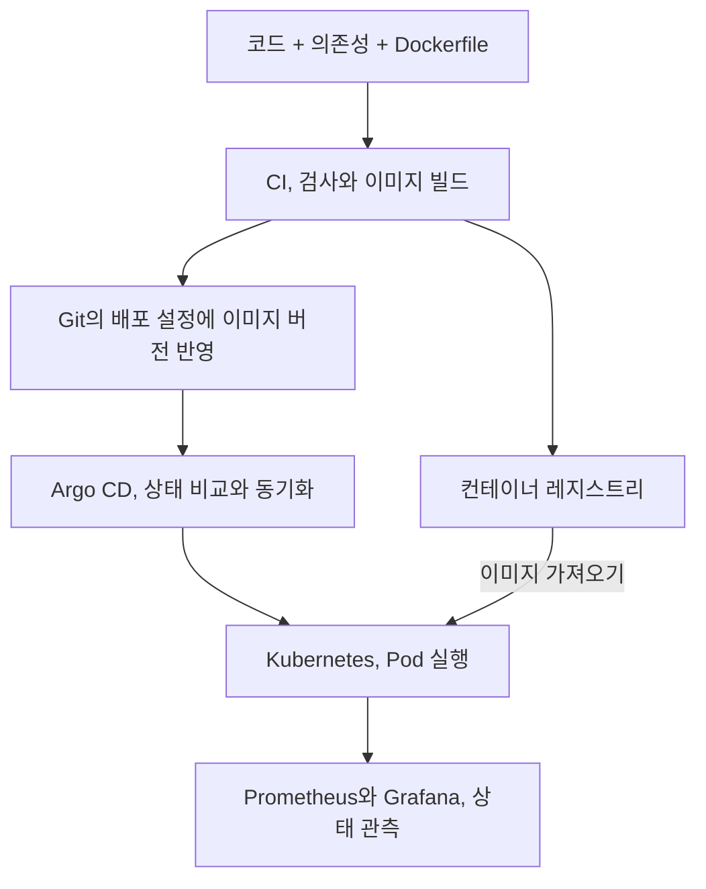
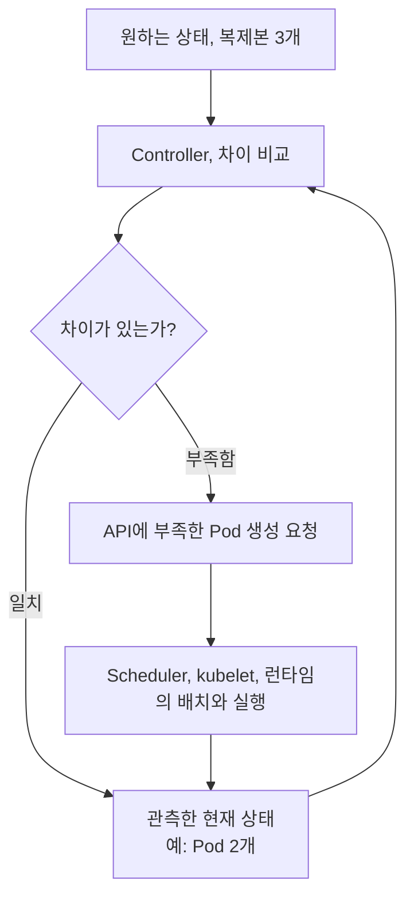

3장은 ML 도구를 올리기 전에 컨테이너와 Kubernetes, CI/CD와 모니터링의 역할을 설명합니다. 예제는 간단한 FastAPI 서비스지만 모델을 서빙할 때도 같은 실행 기반이 필요합니다.

이번 장에서는 각 도구를 따로 외우기보다 코드 변경이 실제 서비스가 되기까지의 경로를 따라가려고 했습니다. 이미지를 만드는 일, Pod를 실행하는 일, 요청을 연결하는 일은 서로 다른 단계입니다.

## 3.1 컨테이너와 도구

이 장은 ML 모델 대신 간단한 FastAPI 애플리케이션을 사용합니다. 모델의 복잡도를 빼고 포장, 실행, 배포, 관측을 먼저 이해하려는 구성입니다.

| 책임 | 책에서 사용하는 도구 | 확인할 결과 |
| --- | --- | --- |
| 실행 환경 포장 | Docker | 같은 식별자의 이미지를 가져와 실행 |
| 배치, 복제본 관리 | Kubernetes | 원하는 워크로드 상태 유지 |
| 검사, 빌드 | GitLab CI | 변경을 검사하고 이미지, 배포 설정 연결 |
| 선언된 상태 배포 | Argo CD | Git 선언과 실제 상태 비교, 동기화 |
| 운영 수치 관측 | Prometheus, Grafana | 지연, 오류, 트래픽, 자원 확인 |



도구의 경계를 이해해야 장애도 분리할 수 있습니다. 이미지 빌드가 성공해도 클러스터에서 이미지를 가져오지 못할 수 있고, Pod가 실행되어도 Service가 잘못된 포트를 가리킬 수 있습니다.

## 3.2 Docker

Dockerfile은 이미지를 만드는 레시피, 이미지는 배포할 포장, 컨테이너는 그 이미지를 실행한 인스턴스입니다. 레지스트리는 이미지를 저장하고 다른 환경에서 가져올 수 있게 하는 저장소입니다.

이미지 하나에서 여러 컨테이너를 실행할 수 있습니다. 각 컨테이너의 메모리와 실행 상태는 별개입니다. 학습한 모델을 이미지에 넣을 수도 있고 실행할 때 외부 저장소에서 읽을 수도 있습니다. 후자라면 이미지 버전만으로는 실제 사용한 모델을 특정할 수 없으므로 모델 버전도 따로 남겨야 합니다.

### 3.2.1 애플리케이션 코드 작성

책의 예제는 요청을 받으면 응답을 돌려주는 FastAPI 서비스입니다. 먼저 로컬에서 입력 경로, 응답 형식과 의존성을 확인한 다음 컨테이너로 옮기는 순서입니다.

실행 명령과 환경 변수, 포트를 코드 밖에서도 알 수 있어야 합니다. 프로세스가 루프백 주소에만 바인딩되어 있으면 포트 매핑을 해도 외부 요청이 도달하지 않을 수 있습니다.

여기서 구분할 것은 애플리케이션의 오류와 실행 환경의 오류입니다. 로컬에서도 같은 요청이 실패한다면 앱의 입력 처리와 의존성부터 봐야 합니다. 로컬에서는 되지만 컨테이너에서 실패한다면 파일 경로와 설치된 패키지, 실행 명령과 환경 변수가 달라졌는지 확인합니다.

### 3.2.2 Dockerfile 작성

| 주요 지시어 | 의미 | 점검할 사항 |
| --- | --- | --- |
| `FROM` | 기반 이미지 선택 | 버전, 아키텍처, 보안 업데이트 |
| `WORKDIR` | 작업 경로 지정 | 코드와 상대 경로의 일관성 |
| `COPY` | 빌드 문맥의 파일 복사 | 비밀, 불필요한 데이터 제외 |
| `RUN` | 빌드 중 명령 실행 | 시스템, Python 의존성의 재현성 |
| `ARG` / `ENV` | 빌드 인자 / 환경 변수 | 자격 증명을 이미지에 남기지 않기 |
| `ENTRYPOINT` / `CMD` | 기본 실행 방식 | 정상 기동, 종료와 인자 전달 |

Python 패키지가 설치되어도 OS 라이브러리나 GPU 런타임까지 갖춰지는 것은 아닙니다. 호스트와 이미지의 역할을 구분하고, 환경별 비밀 정보는 실행 시점의 승인된 비밀 관리 방식으로 전달해야 합니다.

`RUN`은 이미지를 만드는 동안 실행되고, `ENTRYPOINT`와 `CMD`는 컨테이너가 시작될 때의 실행을 정합니다. 빌드가 성공했다는 것은 패키지를 만들었다는 뜻이지, API가 정상 기동한다는 뜻은 아닙니다. 이미지를 실제로 실행해 요청을 보내는 확인이 별도로 필요합니다.

의존성 파일을 먼저 복사하고 설치한 뒤 앱 코드를 복사하면 코드만 바뀐 빌드에서 의존성 설치 계층을 재사용하기 쉽습니다. 반대로 비밀 파일이나 대용량 학습 데이터를 무심코 복사하면 이미지가 커지고 배포 속도와 보안에 영향을 줍니다.

### 3.2.3 이미지 빌드와 푸시

로컬 빌드 → 로컬 컨테이너 실행 확인 → 레지스트리 푸시 → 배포 환경에서 가져오기 순서입니다. 애플리케이션, 포트 전달, 레지스트리 인증 중 어디가 잘못됐는지 나눠 볼 수 있습니다.

이미지 태그는 다시 지정될 수 있습니다. 변경 가능한 이름만 기록하지 말고 실제 빌드, 배포에 사용한 커밋과 불변 digest를 연결해야 합니다.

[Kubernetes 이미지 문서](https://kubernetes.io/docs/concepts/containers/images/)에서 tag는 옮겨 붙일 수 있는 이름, digest는 이미지 내용을 식별하는 해시로 구분합니다. `latest`라는 이름을 기록하는 것과 실제 배포한 내용을 기록하는 것은 다릅니다.

컨테이너를 사용하면 환경 차이를 줄일 수 있지만 모두 없어지지는 않습니다. CPU 아키텍처, GPU 드라이버, 외부 서비스와 런타임 설정은 여전히 영향을 줍니다.

포트도 호스트와 컨테이너를 나눠 봐야 합니다. 컨테이너 안의 앱이 8083 포트에서 듣고 있고 호스트의 8081을 그 포트에 연결했다면 브라우저에서는 호스트의 8081로 요청합니다. 이미지에 포트를 선언하는 것과 실제 프로세스가 그 포트에서 실행되는 것, 외부 포트를 연결하는 것은 서로 다른 설정입니다.

## 3.3 Kubernetes

Kubernetes는 컨테이너를 어디에 배치하고 원하는 상태를 어떻게 유지할지 관리합니다. `docker run`을 여러 번 실행하는 것보다 넓은 범위의 조정 체계입니다.

### 3.3.1 Kubernetes 아키텍처

컨트롤 플레인은 API server, etcd, scheduler와 controller 등으로 상태, 배치, 조정을 관리합니다. 워커 노드에서는 kubelet과 컨테이너 런타임이 실제 워크로드를 실행합니다.


그림 3.4. Kubernetes 구성 요소. 출처: Machine Learning Platform Engineering, 3장.

그림의 Master node는 현재 주로 컨트롤 플레인이라고 부르는 관리 영역입니다. 박스의 구분은 책임을 나타냅니다. 워커가 etcd에 직접 요청한다는 뜻으로 읽으면 안 됩니다. 각 구성 요소는 API server를 통해 상태를 읽고 갱신하며 etcd는 그 클러스터 상태를 저장합니다.

| 구성 요소 | 맡는 일 | 맡지 않는 일 |
| --- | --- | --- |
| API server | 자원 생성과 조회 요청을 받고 API 제공 | 앱의 추론 요청을 대신 처리하지 않음 |
| etcd | 클러스터의 선언과 상태 저장 | 학습 이미지와 모델 가중치 보관소가 아님 |
| Scheduler | 배치되지 않은 Pod에 적합한 노드 선택 | 컨테이너 프로세스를 직접 실행하지 않음 |
| Controller | 원하는 상태와 현재 상태의 차이 조정 | 모든 장애의 업무상 원인을 판단하지 않음 |
| kubelet | 자기 노드의 Pod 실행 상태 관리 | 클러스터 전체의 배치 결정을 하지 않음 |
| 컨테이너 런타임 | 이미지에서 컨테이너를 실행하고 관리 | 어떤 모델을 출시할지 결정하지 않음 |

Deployment를 제출하면 API server가 선언을 받아 저장합니다. Controller가 필요한 Pod를 만들고 Scheduler가 노드를 배정합니다. 그 노드의 kubelet이 런타임을 통해 컨테이너를 실행합니다. 그래서 자원이 부족해 배치되지 않은 문제와 프로세스가 실행된 뒤 죽는 문제는 조사할 위치가 다릅니다.

[Kubernetes 아키텍처 문서](https://kubernetes.io/docs/concepts/architecture/) 기준으로 컨테이너 런타임은 containerd, CRI-O 등이고, kubelet은 CRI(Container Runtime Interface)라는 인터페이스로 런타임과 연결됩니다. Docker로 이미지를 빌드했다고 워커도 Docker Engine으로 실행한다는 뜻은 아닙니다.

빌드 도구와 실행 런타임을 구분하고 GPU 드라이버와 런타임의 호환 조건도 별도로 확인해야 합니다.

### 3.3.2 kubectl

`kubectl`은 API server와 상호작용하는 명령행 도구입니다. context는 어느 클러스터, 인증 정보, 기본 Namespace 조합에 접속할지 고르는 설정입니다. 먼저 대상이 맞는지 확인하고 상태, 이벤트, 로그를 순서대로 보는 것이 안전합니다.

상태를 확인할 때 사용하는 명령어. `<namespace>`와 `<pod-name>`은 대상 환경에 맞게 바꿉니다.

```shell
kubectl config current-context
kubectl get nodes
kubectl get pods -n <namespace> -o wide
kubectl describe pod <pod-name> -n <namespace>
kubectl logs <pod-name> -n <namespace> --previous
kubectl get services,endpointslices -n <namespace>
```

`--previous`는 이전에 종료된 컨테이너의 로그가 있을 때 사용합니다. 다중 컨테이너 Pod라면 대상 컨테이너도 지정해야 합니다. `Pending`은 배치, 볼륨, 자원, `ImagePullBackOff`는 이미지 경로, 접근, 반복 재시작은 프로세스, 설정, probe 문제 등으로 가설을 좁힙니다. EndpointSlice는 Service 뒤의 접속 대상과 준비 상태를 담는 자원입니다.

### 3.3.3 Kubernetes 객체

| 객체 | 쉬운 역할 | 혼동하지 말아야 할 점 |
| --- | --- | --- |
| Pod | 함께 실행되는 컨테이너의 최소 배치 단위 | 영구적인 서버 주소나 데이터 보관함이 아님 |
| ReplicaSet | 정해진 수의 Pod 복제본 유지 | 보통 Deployment를 통해 관리 |
| Deployment | 버전 교체와 복제본의 선언적 관리 | 애플리케이션 상태를 선언하는 것이지 모델 품질을 보장하는 것이 아님 |


그림 3.5. Deployment, ReplicaSet, Pod와 Container의 관계. 출처: Machine Learning Platform Engineering, 3장.

Deployment → ReplicaSet → Pod의 관리 관계를 이해하면 Pod를 수동으로 지워도 왜 다시 만들어지는지 설명할 수 있습니다. 선언 자체가 잘못되었다면 재시작을 반복해도 문제가 해결되지 않습니다.

ReplicaSet은 원하는 수의 Pod를 유지하고 Deployment는 새 버전의 Pod 템플릿과 ReplicaSet을 관리합니다. 이미지를 바꾸면 기존 Pod의 프로세스를 그대로 고치는 것이 아니라 새 템플릿에 맞는 Pod를 만드는 흐름입니다. 그래서 서비스 주소를 특정 Pod에 직접 고정하지 않습니다.

Pod 안의 컨테이너는 네트워크 공간을 공유합니다. 여러 컨테이너가 함께 있어야 하는 경우에 같은 Pod로 묶을 수 있지만, API 복제본 세 개를 같은 Pod 안에 넣는 방식으로 가용성을 확보하는 것은 아닙니다. 독립적으로 배치할 복제본은 별도 Pod로 다룹니다.

[Controller 문서](https://kubernetes.io/docs/concepts/architecture/controller/)의 핵심은 reconciliation, 즉 원하는 상태와 관측된 상태의 차이를 반복해서 줄이는 조정 루프입니다. 온도조절기가 설정 온도와 실제 온도를 비교하는 것에 가깝습니다.



실패한 Pod가 다른 노드로 그대로 이동하는 것이 아니라 새 UID의 Pod로 대체될 수 있습니다. 컨테이너 재시작, Pod 교체, 모델 버전 롤백은 서로 다른 복구입니다. [Pod 생애주기](https://kubernetes.io/docs/concepts/workloads/pods/pod-lifecycle/)에서 이 차이를 확인할 수 있습니다.

복제본이 여러 개여도 같은 노드나 저장소, 외부 서비스에 의존하면 공통 장애에 취약합니다. 복제본 수와 장애 격리는 다릅니다.

### 3.3.4 네트워크와 Service

Pod의 주소와 수명이 바뀌어도 안정적으로 접근하도록 Service를 사용합니다. selector는 label 조건으로 대상을 고르는 방식입니다. 대상 선택, Service의 `port`, 실제 프로세스가 받는 `targetPort`의 연결을 확인해야 합니다.

예를 들어 Service가 `app: detector`라는 label을 가진 Pod를 대상으로 삼고 `port: 80`, `targetPort: 8083`으로 설정되었다면, 내부 사용자는 Service의 80으로 요청하고 실제 앱은 Pod 안의 8083에서 받습니다. 앱이 8000에서 실행되고 있다면 Pod가 Running이어도 요청은 실패할 수 있습니다.

이때는 Service의 selector가 Pod label과 일치하는지, EndpointSlice에 대상이 있는지, 대상 포트가 앱과 맞는지 순서대로 확인합니다. Service 객체가 생성됐다는 사실만으로 요청 경로가 정상이라는 보장은 없습니다.

| 유형 | 기본 사용 범위 | 운영 시 확인할 것 |
| --- | --- | --- |
| ClusterIP | 클러스터 내부의 안정적 접근 | DNS, selector, 준비된 대상 Pod |
| NodePort | 노드 포트를 통한 노출 | 방화벽, 노드 접근, 노출 범위 |
| LoadBalancer | 제공자 또는 구현체의 외부 로드밸런서 연계 | 지원 환경, 외부 주소, 비용, 접근 정책 |

`port-forward`는 개발, 점검에는 유용하지만 일반 사용자의 접속 경로는 아닙니다. Service가 있다고 인증, TLS, 외부 접근 정책까지 자동으로 완성되는 것도 아닙니다. TLS는 통신 구간을 보호하는 계층이며 사용자 권한 판정과 별개입니다.

### 3.3.5 기타 객체

| 객체 | 역할 | 운영상 주의 |
| --- | --- | --- |
| Namespace | 이름과 자원의 관리 범위 | RBAC, 네트워크 정책, 쿼터가 별도로 필요 |
| ConfigMap | 일반 설정을 코드와 분리 | 변경이 실행 중 프로세스에 언제 반영되는지 확인 |
| Secret | 민감한 설정 전달 | 인코딩을 암호화로 오해하지 않고 접근, 저장 보호 |

RBAC는 역할에 따라 API 자원 접근을 허용하는 권한 관리 방식입니다. 네트워크 정책은 워크로드 사이 통신을 제한하고, 쿼터는 자원 사용 범위를 제한합니다. Namespace 하나로 이 셋이 모두 해결되지는 않습니다.

설정과 비밀을 분리해도 계정 권한, 로그 노출과 보존은 별도로 관리해야 합니다. 환경 변수로 주입한 설정은 객체만 바꾼다고 기존 프로세스의 값이 즉시 바뀌지는 않습니다.

### 3.3.6 Helm 차트

하나의 서비스에도 Deployment, Service와 설정 등 여러 객체가 필요합니다. Helm은 템플릿과 `values`를 가진 차트로 이 조합을 패키징합니다.

차트 버전, 환경별 값, 이미지, 모델 버전을 연결하고 실제 렌더링된 명세를 검토해야 합니다. 차트가 문법적으로 유효해도 잘못된 selector나 과도한 자원 요구 같은 의미적 오류는 남을 수 있습니다.

템플릿은 공통 구조이고 values는 환경에 따라 바꿀 값입니다. 같은 앱을 개발과 운영에 배포하면서 복제본 수나 자원 요청만 바꾸는 경우에 유용합니다. 다만 환경별 값 안에 모델 참조나 전처리 설정이 섞여 있으면 차트 버전만 같아도 실제 서비스 동작은 달라질 수 있습니다.

### 3.3.7 정리

Docker로 포장한 앱을 Kubernetes가 실행하고 Service로 연결하며 Helm으로 관련 선언을 관리할 수 있습니다. 배포를 여전히 사람이 한다면 반복, 실수, 권한 문제는 남습니다. 다음 절은 이 변경 경로의 자동화입니다.

## 3.4 지속적 통합과 배포

CI는 변경된 코드를 검사하고 이미지를 만드는 통합 과정입니다. CD는 검증한 변경을 전달, 배포하는 과정입니다. 자동 출시까지 할지는 별도 정책입니다. 빌드와 배포의 책임을 구분해야 어떤 검사를 통과한 버전이 운영에 있는지 설명할 수 있습니다.

### 3.4.1 GitLab CI

책은 GitLab CI로 변경에 따른 작업을 정의합니다. 핵심은 UI보다 코드 커밋 → 검사 → 이미지 식별자 → 배포 설정 변경의 연결입니다.

레지스트리 인증과 배포 권한은 CI의 승인된 비밀 저장소, 최소 권한 계정으로 관리해야 합니다. 테스트가 실패해도 운영 참조 갱신이 계속되지 않는지, 빌드한 것과 배포하는 것이 같은지 확인할 부분입니다.

코드 커밋 A로 만든 이미지의 digest를 배포 설정에 기록하고 그 설정도 커밋하면, 실제 서비스에서 원래 코드까지 거슬러 올라갈 수 있습니다. 반대로 매번 같은 `latest` 태그만 덮어쓰면 Git의 설정이 바뀌지 않았는데 실제 이미지 내용은 달라질 수 있습니다.

CI가 테스트와 이미지를 만들었다면 CD는 그 결과를 운영 환경에 연결하는 역할입니다. 모든 CI 계정에 클러스터 관리자 권한을 주는 것과 Git의 배포 선언만 갱신하게 하는 것은 권한 범위가 다릅니다.

### 3.4.2 Argo CD

GitOps는 Git에 버전 관리한 선언을 기준으로 실제 운영 상태를 맞추는 방식입니다. Argo CD가 Git의 선언과 클러스터 상태를 비교하는 흐름이 그 사례입니다.

다만 차이가 있다고 항상 자동으로 덮어쓰지는 않습니다. [Argo CD 자동 동기화 정책](https://argo-cd.readthedocs.io/en/stable/user-guide/auto_sync/)에서 auto-sync, self-heal, prune은 서로 구분된 설정입니다. 새 선언을 자동 반영하는 것, 수동 변경을 되돌리는 것, Git에서 사라진 자원을 삭제하는 것은 같은 동작이 아닙니다.

코드 커밋, 이미지 버전, 배포 설정 변경을 연결하면 “누가 서버에서 무엇을 바꿨나?” 대신 “어떤 변경이 배포되었나?”를 추적할 수 있습니다.

긴급 수동 조치가 다음 동기화에서 덮어써질 수 있습니다. 긴급 변경을 Git에 어떻게 반영하고 승인하거나 되돌릴지 정해야 합니다. `Synced`와 `Healthy`는 선언과 자원 상태의 신호입니다. ML 품질을 승인했다는 뜻은 아닙니다.

`Synced`는 관측한 자원 명세가 Git의 선언과 맞는지를, `Healthy`는 자원 종류별 상태 판단이 정상인지를 나타냅니다. 틀린 모델 버전을 Git에 적어 두어도 동기화는 성공할 수 있습니다. 따라서 배포 상태와 모델의 업무상 품질 검증은 분리해야 합니다.

## 3.5 Prometheus와 Grafana

Prometheus는 애플리케이션이 노출한 메트릭 엔드포인트에서 수치를 수집하고 저장합니다. 이 수집을 scrape라고 합니다. Grafana는 그 데이터를 질의, 시각화하고, Alertmanager는 알림을 그룹화, 라우팅합니다.

| 메트릭 유형 | 의미와 예시 | 해석 주의 |
| --- | --- | --- |
| Counter | 요청, 오류처럼 누적되는 횟수 | 재시작에 따른 초기화를 고려해 변화율 해석 |
| Gauge | 현재 메모리, 대기 작업처럼 오르내리는 값 | 한 시점과 장기 추세를 구분 |
| Histogram | 지연 등 관측값의 구간별 분포 | 버킷 설계와 표본 수, 집계 방식 확인 |
| Summary | 관측값의 개수, 합과 설정한 분위수 | 인스턴스별 분위수를 단순 합산할 수 없음 |

[Prometheus 메트릭 유형 문서](https://prometheus.io/docs/concepts/metric_types/)는 Counter, Gauge, Histogram, Summary를 구분합니다. 표의 버킷 설명은 classic histogram 기준입니다. Native histogram은 구조가 다르므로 계측 라이브러리와 서버 버전을 같이 확인해야 합니다.

먼저 메트릭 노출, 수집 대상 발견, scrape 성공, 질의 결과를 순서대로 확인합니다. 대시보드가 비었다고 요청이 없었다고 단정하면 안 됩니다.

요청 수 Counter의 현재 값이 10,000이라고 해도 그 자체로 지금 부하가 높다는 뜻은 아닙니다. 언제 시작한 프로세스의 누적값인지에 따라 다릅니다. 일정 구간의 증가율을 봐야 현재 초당 요청량을 알 수 있습니다.

지연은 평균만 보면 일부 사용자의 느린 요청을 놓칠 수 있습니다. p95는 관측한 요청의 약 95%가 그 시간 이하였다는 뜻입니다. Histogram에서는 관측값이 구간에 모이므로 계산한 분위수는 버킷 경계와 표본에 영향을 받습니다. “p95가 낮다”는 결론에도 어떤 구간과 트래픽을 집계했는지가 필요합니다.

요청 수, 오류율, 응답 시간, 자원 사용량이 정상인 것과 ML 예측이 맞는 것은 다릅니다. 데이터 변화와 실제 예측 품질은 별도 관측입니다.

사용자 ID나 요청 ID를 메트릭 label로 무제한 추가하면 시계열 수가 폭증할 수 있습니다. 서로 다른 label 조합이 만드는 시계열 수가 카디널리티(cardinality)입니다. 개별 요청의 맥락은 로그와 트레이스로 나누고 알림에는 담당자와 대응 절차를 연결해야 합니다.

label 설계는 [Prometheus 이름, label 지침](https://prometheus.io/docs/practices/naming/)을 참고했습니다.

## 운영에서 확인할 부분

애플리케이션이 실행되는 것과 운영팀이 인수할 수 있는 상태는 다릅니다.

| 영역 | 설계할 것 | 증거로 확인할 것 |
| --- | --- | --- |
| 자원 | CPU, 메모리 requests/limits, GPU와 스케줄링 | 대표 부하에서 사용량, 대기, OOM 여부 |
| 시작과 상태 | 초기화 시간, startup, readiness, liveness의 의미 | 느린 모델 로딩 때 불필요한 재시작이 없는지 |
| 권한과 네트워크 | 최소 권한 ServiceAccount, RBAC, 통신 경계 | 허용, 거부되어야 할 접근의 실제 결과 |
| 비밀과 이미지 | Secret 전달, 불변 이미지 식별, 취약점 점검 | 이미지에 자격 증명이 없고 출처를 추적하는지 |
| 배포와 복구 | 변경 승인, 롤아웃, 이전 버전 복구 | 배포 실패 때 트래픽, 모델 버전을 되돌리는지 |

Probe는 컨테이너 상태를 확인하는 검사입니다. startup은 초기화, readiness는 트래픽을 받을 준비, liveness는 실행 중 복구 필요 여부를 판단하는 데 사용합니다. requests/limits는 자원 요청, 상한이고, OOM은 메모리 부족으로 실행이 중단되는 경우입니다.

[Probe 공식 문서](https://kubernetes.io/docs/concepts/workloads/pods/probes/)에서 확인할 차이는 실패 뒤의 행동입니다. readiness 실패는 일반적인 Service 트래픽에서 대상을 제외하는 신호이고, liveness, startup 실패는 설정된 조건과 재시작 정책에 따라 컨테이너 재시작으로 이어집니다.

Pod 자동 재시작은 모델, 설정의 올바른 복구와 다릅니다. 복제본 수, 노드 분산, 외부 저장소와 레지스트리 장애도 함께 봐야 합니다. 비용에서도 GPU가 모델 로딩과 대기로 묶이는 시간, 이미지 전송과 유휴 자원을 확인할 필요가 있습니다.

## 장애 확인 순서

테스트 환경에서 Deployment가 관리하는 Pod를 삭제하면 새 Pod가 만들어지는 과정을 볼 수 있습니다. 기존 Pod의 재시작과 새 Pod의 생성을 구분해서 확인할 부분입니다.

“이미지 주소가 틀림 → Pod가 뜨지 않음 → Service에 정상 대상이 없음”처럼 증상이 이어집니다. 이미지 가져오기와 프로세스 기동, Service 연결을 나눠 보면 원인을 좁히기 쉽습니다.

## 질문

### 컨테이너 이미지가 같으면 모델 결과도 같을까요?

데이터, 외부 피처, 모델 파일, 런타임 설정까지 같다는 보장은 없습니다. 이미지 재현성과 ML 실험 재현성을 나누어 봐야 합니다.

### 모든 팀이 Kubernetes부터 도입해야 할까요?

여러 워크로드의 공통 운영이 필요한지와 클러스터 유지 비용을 비교해야 합니다. 책에서는 뒤쪽 플랫폼 기능을 연결하는 기반으로 선택한 것입니다.

복제본 수를 늘려도 모델 초기화, GPU와 스토리지 제약, 잘못된 입력은 해결되지 않습니다.

## 마치며

컨테이너와 Kubernetes가 모델의 품질까지 판단해 주는 것은 아닙니다. 지정한 이미지를 실행하고 선언한 상태를 유지하는 역할입니다. 잘못된 모델을 선언해도 배포 자체는 정상으로 보일 수 있습니다.

결국 배포 상태와 모델의 평가 결과를 따로 확인하고 연결해야 합니다. 이후 ML 도구를 붙일 때도 기존 실행 기반과 모델 고유의 검증이 어디서 만나는지 살펴볼 필요가 있겠습니다.

[이전: 02. MLOps란 무엇인가](../02-what-is-mlops/), [시리즈 목차](../)
