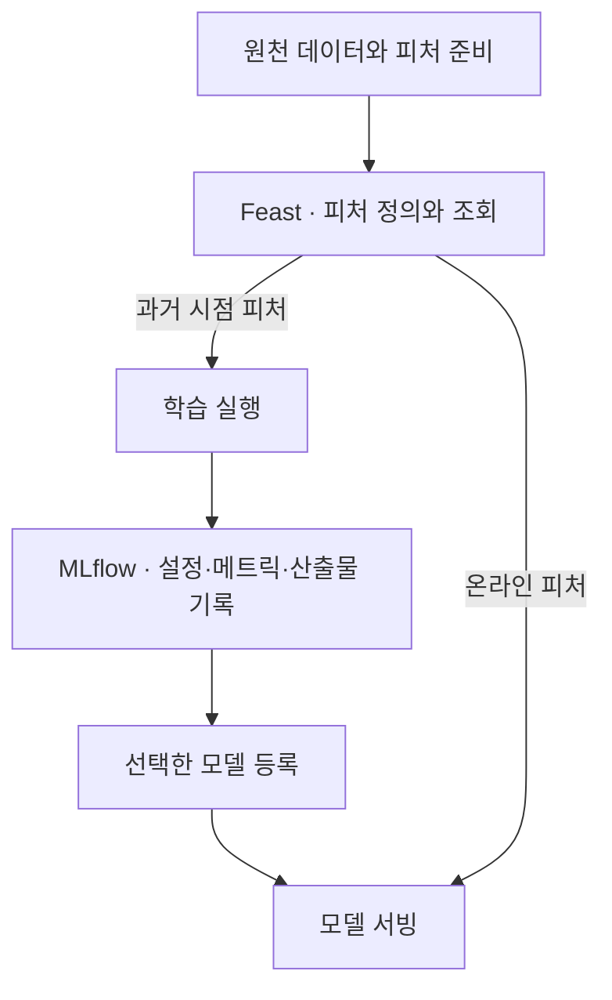

**원문 범위:** 4장 *Designing reliable ML systems*, 4.1~4.2.

## 먼저, 실험 노트와 공용 재료 창고입니다

어제 만든 빵이 유난히 맛있었는데 밀가루 종류와 발효 시간을 기록하지 않았다면 다시 만들기 어렵습니다. 다른 제빵사가 같은 재료를 제각각 손질해도 결과가 달라집니다.

**MLflow는 실험의 이력을 남기는 노트**, **Feast는 여러 작업이 사용할 피처를 정의하고 찾아 쓰게 하는 기반**으로 생각해 보세요. 이 장은 소득 분류 예제로 두 역할을 연결합니다.

## 4.1 MLflow로 실험 추적하기

### 4.1.1 데이터 탐색 — 기록할 입력 이해하기

소득 분류 데이터의 스키마와 범주별 분포부터 확인한다. 모델 점수뿐 아니라 어떤 데이터를 탐색했는지와 탐색 결과도 실험의 출처에 포함된다.

### 4.1.2 MLflow Tracking — 실행과 산출물

책은 데이터를 탐색한 그림부터 학습한 모델과 평가 결과까지 기록합니다. 한 번의 실행은 **run**, 관련 실행을 묶는 단위는 **experiment**입니다.

| 기록 | 예시 | 나중에 답할 질문 |
| --- | --- | --- |
| 파라미터 | 학습률, 트리 깊이 | 어떤 설정으로 실행했는가? |
| 메트릭 | ROC-AUC, 오류율 | 같은 기준에서 어떤 결과가 나왔는가? |
| 아티팩트 | 모델 파일, 그래프, 참고 데이터 | 결과물을 다시 가져올 수 있는가? |
| 추적용 메타데이터 | 코드와 데이터 버전, 실행 목적 | 두 실행 사이에 무엇이 달랐는가? |

마지막 항목은 플랫폼이 알아서 모두 채워 주리라 기대하면 안 됩니다. 팀에서 필요한 정보를 정하고 기록 절차에 넣어야 합니다. **추적 도구가 있다는 것과 재현 가능한 기록이 있다는 것은 다릅니다.**

### 4.1.3 모델 레지스트리 — 선택한 모델 관리

실험 추적은 “무엇을 시도했고 어떻게 나왔나?”에 답합니다. **모델 레지스트리**는 그중 관리할 모델을 등록하고 버전을 추적하는 장소입니다.

책에서는 여러 분류기를 비교하고 조건에 맞는 모델을 검색하여 등록합니다. 여기서 배워야 할 것은 특정 모델이 우승했다는 사실보다 **선택 근거를 실행 기록까지 거슬러 올라갈 수 있게 하는 연결**입니다.

한 가지 실무 주의점도 있습니다. 최종 테스트셋을 보며 모델을 계속 고르면 테스트셋이 선택 과정에 간접적으로 사용됩니다. 모델 선택용 검증 데이터와 마지막 확인용 테스트 데이터의 역할을 구분해야 합니다.

## 4.2 Feast를 피처 스토어로 사용하기

실제 데이터는 여러 파일이나 테이블에 흩어져 있습니다. 매번 조인과 변환을 다시 구현하면 학습과 서빙의 정의가 달라지기 쉽습니다. 이를 **training-serving skew**, 즉 학습·서빙 불일치라고 부릅니다.

Feast에서 **entity**는 피처가 누구에 대한 것인지 나타내는 식별자입니다. 사용자라면 `user_id`가 될 수 있습니다. **feature view**는 데이터 소스와 조회할 피처들을 묶어 정의합니다.

### 4.2.1 피처 등록

entity와 데이터 소스, feature view를 정의하고 레지스트리에 반영한다. 피처 이름이 같더라도 의미와 변환 정의가 달라지면 같은 입력으로 취급할 수 없다.

### 4.2.2 피처 조회

| 조회 방식 | 주로 쓰는 상황 | 중요한 기준 |
| --- | --- | --- |
| Historical / offline | 과거 시점 학습 데이터, 배치 처리 | 그 시점에 알 수 있었던 피처인지 |
| Online | 사용자 요청에 빠르게 응답하는 예측 | 낮은 지연, 최신성, 누락 처리 |

예를 들어 지난달의 이탈을 예측하는 학습 데이터에 오늘 계산한 누적 사용량을 넣으면 미래 정보가 섞입니다. 피처 이름뿐 아니라 **조회 시점과 데이터의 유효 시점**을 관리해야 하는 이유입니다.

피처 스토어는 이런 일관성을 돕지만, 원천 데이터의 오류나 잘못된 피처 정의를 자동으로 고쳐 주지는 않습니다. 온라인 저장소에 피처를 공급하는 절차도 따로 필요합니다.

### 4.2.3 Feature server

다른 애플리케이션에서 피처를 조회할 수 있는 API 접점이다. SDK를 직접 쓰기 어려운 언어에서도 사용할 수 있지만, 접근 권한과 지연·오류 처리는 별도로 설계해야 한다.

### 4.2.4 Feast UI

등록된 entity와 피처, 원천 정보를 탐색하는 화면이다. 등록 상태를 확인하는 것과 실제 피처 값의 최신성·품질을 검증하는 것은 다르다.

### 정리: 실험과 피처의 연결

이 흐름에서 모델 버전과 피처 정의가 어떤 조합이었는지 남기면, 나중에 예측이 바뀌었을 때 모델과 입력 중 무엇이 달라졌는지 조사하기 쉬워집니다.

## 실무 적용: 레지스트리를 신뢰 경계로 만듭니다

다음은 실험 기록을 실제 출시 판단에 사용하기 위한 확장 관점입니다. 등록된 모델마다 **원천 실행, 데이터 스냅샷, 코드·환경, 피처 계약, 평가 결과, 승인 근거**가 연결되어야 합니다.

등록 권한과 출시 승인 권한도 같을 필요는 없습니다. 후보를 많이 만드는 기능과 운영 대상을 바꾸는 기능의 접근 범위를 나눕니다. 별칭이나 단계 이름이 바뀌더라도 실제 서비스가 선택한 구체 버전은 기록해야 합니다.

| 피처 운영 항목 | 정할 기준 | 시험할 실패 |
| --- | --- | --- |
| 시간 의미 | event time, 사용 가능 시점, 허용 지연 | 늦게 도착한 값이 과거 학습에 섞임 |
| 최신성 | 갱신 주기와 stale 판단 | 온라인 값이 오래되어도 정상처럼 사용 |
| 누락 | 기본값·실패·대체 경로의 구분 | 미등록 entity 또는 일부 피처 누락 |
| 변환 일관성 | 학습·서빙 변환의 버전 | 같은 원천 입력에서 서로 다른 피처 생성 |
| 소유권 | 정의·수정·장애 담당 | 공용 피처 변경이 여러 모델에 영향 |

피처 스토어 도입 여부는 재사용 모델 수와 조인·온라인 조회 요구로 판단합니다. 단일 모델의 작은 배치 작업이라면 버전이 명확한 변환 파이프라인과 저장소가 더 단순한 해법일 수 있습니다.

## 컨설팅 관점: 재현성은 데모로 입증합니다

고객의 과거 배포 모델 하나를 선택해 레지스트리에서 출발하여 학습 실행과 입력 데이터까지 찾아갑니다. “기록할 수 있다”는 제품 설명보다 **이미 운영 중인 모델을 역추적할 수 있는가**가 강한 증거입니다.

산출물은 **모델·피처 카탈로그, 계보 필수 항목, 버전·승인·보존 정책**입니다. 기준 시점 조회에서는 예측 시점 이후의 정보가 들어가지 않는 작은 반례 데이터로 결과를 검증합니다.

재현 시험이 실패하면 도구 교체부터 제안하지 않습니다. 빠진 기록, 접근할 수 없는 저장소, 덮어쓴 데이터, 환경 불일치 중 무엇이 원인인지 분류하고 보완 순서를 정합니다.

## 직접 해보기: 재현에 필요한 정보 찾기

“어제 ROC-AUC가 0.9인 모델”이라는 메모만 남았다고 가정해 보세요. 데이터 범위, 분할 방법, 전처리 버전, 코드 커밋, 모델 위치 중 무엇이 없으면 재현이 막히는지 표시합니다.

그다음 `user_id`, 조회 시점, 최근 30일 사용 횟수를 갖는 피처 표를 그려 보세요. 집계에 예측 시점 이후 데이터가 들어가지 않는지 서로 검토합니다.

## 북클럽 토론

**Q. MLflow에 모델 파일을 올리면 재현성이 확보되나요?**

파일을 다시 가져올 수는 있지만, 만드는 과정을 재현하려면 데이터·코드·설정·환경이 추가로 필요합니다.

**Q. 피처 스토어 도입 전에 무엇부터 표준화해야 할까요?**

피처의 의미, 소유자, 갱신 주기, 결측 처리와 시간 기준입니다. 정의가 모호하면 공용 저장소에서도 모호함을 공유할 뿐입니다.

**자주 빠지는 함정:** 가장 높은 메트릭 하나로 모델을 선택하거나, 온라인 피처가 최신이라는 이유만으로 과거 학습에도 그대로 사용하는 것입니다.

## 한 줄 정리

**신뢰할 수 있는 모델에는 “어떤 실험에서 나왔는가”와 “어떤 시점의 피처를 쓰는가”라는 두 종류의 이력이 필요합니다.**

[이전: 03. Kubernetes 기반](../03-kubernetes-foundation/) · [시리즈 목차](../) · [다음: 05. ML 파이프라인](../05-ml-pipelines/)
