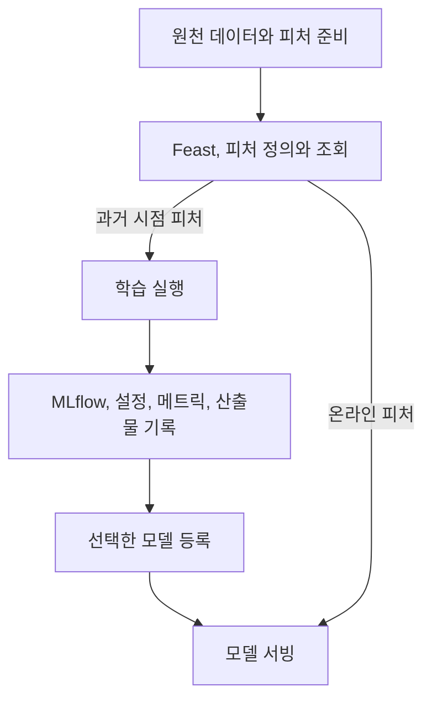

어제 만든 음식이 더 맛있었다고 해도 재료와 조리 시간을 적어 두지 않았다면 다시 만들기 어렵습니다. 모델도 점수만 기억해서는 어느 데이터와 전처리가 그 결과를 만들었는지 찾을 수 없습니다. MLflow는 실험의 기록장을, Feast는 모델에 넣을 재료의 정의와 조회 창구를 맡습니다.

책 4장은 소득 분류로 두 기능을 연결합니다. 이 글에서는 책의 흐름을 따라가되, 별도로 만든 합성 데이터로 MLflow 기록과 등록 모델의 재로딩을 직접 확인합니다. Feast는 과거 시점을 바꾸면 조회 결과가 어떻게 달라지는지까지 확인합니다. 예제의 점수는 소득 예측의 실용성을 증명하지 않습니다.

## 4.1 MLflow로 실험 추적하기

### 4.1.1 데이터 탐색

소득 분류 데이터의 스키마와 범주별 분포부터 확인합니다. 모델 점수뿐 아니라 어떤 데이터를 탐색했는지와 탐색 결과도 실험의 출처에 포함됩니다.

책 예제의 입력은 직업, 학력 등 범주형 열이고 정답은 소득 구간입니다. 범주를 숫자로 바꿀 때 `Private=0`, `Public=1`, `Self-employed=2`처럼 놓으면 모델이 그 순서나 간격에 의미를 부여할 수 있습니다. 원-핫 인코딩은 범주마다 별도의 표시 열을 만드는 대안입니다.

예를 들어 학습에 `Private`, `Public`만 있었다면 두 열의 순서와 의미가 고정되어야 합니다. 추론 때 새로 `get_dummies()`를 호출하면 입력 배치의 범주 구성에 따라 열이 빠지거나 바뀔 수 있습니다. 단순한 열 이름 보정뿐 아니라 학습한 인코더 자체를 모델과 함께 보관하는 이유입니다.

인코더는 먼저 학습 데이터에만 맞추고 같은 변환을 검증과 테스트에 적용합니다. 전체 데이터를 본 뒤 분할하면 변환의 종류에 따라 평가 정보가 학습 과정으로 새어 들어갈 수 있습니다. 평균 대체나 스케일링처럼 통계를 학습하는 변환에서는 특히 명확한 누수입니다.

데이터를 확인할 때는 전체 건수만 보지 않습니다. 빈 문자열, `?` 같은 결측 표현, 범주별 표본 수, 정답 비율과 중복 행도 봐야 합니다. 소득 데이터의 인종·성별 같은 민감한 열을 교육 예제에서 봤다고 실제 의사결정에 곧바로 사용해도 된다는 뜻은 아닙니다. 사용 적법성, 차별 위험, 목적 적합성은 별도 판단입니다.

### 4.1.2 MLflow Tracking

책은 데이터를 탐색한 그림부터 학습한 모델과 평가 결과까지 기록합니다. 한 번의 실행은 run, 관련 실행을 묶는 단위는 experiment입니다.

| 기록 | 예시 | 나중에 답할 질문 |
| --- | --- | --- |
| 파라미터 | 학습률, 트리 깊이 | 어떤 설정으로 실행했는가? |
| 메트릭 | ROC-AUC, 오류율 | 같은 기준에서 어떤 결과가 나왔는가? |
| 아티팩트 | 모델 파일, 그래프, 참고 데이터 | 결과물을 다시 가져올 수 있는가? |
| 추적용 메타데이터 | 코드와 데이터 버전, 실행 목적 | 두 실행 사이에 무엇이 달랐는가? |

마지막 항목은 플랫폼이 알아서 모두 채워 주리라 기대하면 안 됩니다. 팀에서 필요한 정보를 정하고 기록 절차에 넣어야 합니다. 추적 도구가 있다는 것과 재현 가능한 기록이 있다는 것은 다릅니다.

### 실행 기록을 실험 공책처럼 읽기

Experiment는 공책 한 권, run은 실험 한 번을 적은 한 페이지라고 생각하면 쉽습니다. 그 페이지에 “트리 깊이는 3이었다”라고 적는 것이 parameter, “검증 AUC는 얼마였다”라고 적는 것이 metric입니다. 그림이나 완성된 모델 파일을 끼워 두는 것이 artifact입니다.

모델 레지스트리는 그 공책 전체가 아니라, 다시 사용할 완성품에 이름과 버전을 붙이는 목록입니다. 완성품 3번에서 어느 공책의 어느 페이지로 돌아갈 수 있어야 재료와 조건을 확인할 수 있습니다.

그래서 `start_run()`이 모델을 학습해 주는 것은 아닙니다. 그 안에서 `fit()`이 학습하고, `log_metric()`이 측정값을 적고, `log_model()`이 모델을 보관합니다. 세 호출의 역할을 나눠 읽으면 MLflow가 하는 일과 모델 라이브러리가 하는 일이 구분됩니다.

### 기록의 저장 위치도 둘로 나뉩니다

Tracking의 파라미터와 지표, 실행 상태 같은 메타데이터는 backend store에, 모델과 그림 같은 파일은 artifact store에 저장합니다. 화면에서 run이 보이더라도 파일 저장소 접근이 끊기면 모델 다운로드는 실패할 수 있습니다.

책은 MinIO에 데이터를 보관하고 `mlflow.log_input()`으로 데이터의 출처를 실행에 연결합니다. 입력 메타데이터 기록이 모든 원천 데이터를 자동으로 복사해 주는 것은 아닙니다. 기록된 경로의 CSV를 덮어쓰면 나중에 같은 run에서 다른 데이터를 읽을 위험이 남습니다.

| 식별자 | 가리키는 대상 | 예 |
| --- | --- | --- |
| Experiment | 관련 실행의 묶음 | `income-study` |
| Run ID | 한 번의 실행 기록 | 학습 설정 하나를 적용한 실행 |
| Artifact path | 그 실행 안의 파일 위치 | `model`, `data/snapshot.csv` |
| `runs:/...` URI | 특정 실행의 모델 산출물 | `runs:/<run-id>/model` |
| `models:/.../7` URI | 등록 모델의 구체 버전 | `models:/income-study/7` |

`income-study`라는 experiment 이름이 모델의 artifact path까지 자동으로 정해 주지는 않습니다. `log_model(..., "model")`로 저장했다면 뒤의 URI도 `/model`이어야 합니다.

### 4.1.3 모델 레지스트리

실험 추적은 “무엇을 시도했고 어떻게 나왔나?”에 답합니다. 모델 레지스트리는 그중 관리할 모델을 등록하고 버전을 추적하는 장소입니다.

책에서는 여러 분류기를 비교하고 조건에 맞는 모델을 검색해 등록합니다. 특정 모델이 가장 높은 점수를 받았다는 결과보다 그 선택을 실행 기록까지 거슬러 확인할 수 있다는 점이 중요했습니다.

한 가지 실무 주의점도 있습니다. 최종 테스트셋을 보며 모델을 계속 고르면 테스트셋이 선택 과정에 간접적으로 사용됩니다. 모델 선택용 검증 데이터와 마지막 확인용 테스트 데이터의 역할을 구분해야 합니다.

### 직접 해보기: 전처리까지 묶어 기록하고 다시 불러오기

빈 폴더에서 Python 3.11 또는 3.12 가상환경을 사용합니다. 아래 버전은 이 학습 예제의 기준이며 최신 MLflow API 전체를 설명하는 버전은 아닙니다.

```powershell
python -m venv .venv
.\.venv\Scripts\Activate.ps1
python -m pip install mlflow==2.16.2 scikit-learn==1.5.2 pandas==2.2.3 numpy==1.26.4 sqlalchemy==2.0.36
```

다음 코드를 `income_study.py`로 저장합니다. 실제 개인 데이터를 사용하지 않도록 합성 데이터를 만들었고, 수치형 열도 추가했습니다. 따라서 책의 소득 데이터와 분포나 성능을 비교하면 안 됩니다.

```python
import hashlib
from pathlib import Path

import mlflow
import mlflow.sklearn
import numpy as np
import pandas as pd
from mlflow.models import infer_signature
from sklearn.compose import ColumnTransformer
from sklearn.dummy import DummyClassifier
from sklearn.ensemble import RandomForestClassifier
from sklearn.metrics import roc_auc_score
from sklearn.model_selection import train_test_split
from sklearn.pipeline import Pipeline
from sklearn.preprocessing import OneHotEncoder
from sklearn.tree import DecisionTreeClassifier

rng = np.random.default_rng(23)
hours = rng.integers(20, 61, size=600)
workclass = rng.choice(["private", "public", "self-employed"], size=600)
effect = pd.Series(workclass).map({
    "private": 0.0, "public": -0.4, "self-employed": 0.8
}).to_numpy()
score = (hours - 40) / 8 + effect + rng.normal(size=600)
data = pd.DataFrame({
    "hours_per_week": hours.astype(float),
    "workclass": workclass,
    "target": (score > 0).astype(int),
})
snapshot = Path("income_snapshot.csv")
snapshot.write_text(data.to_csv(index=False), encoding="utf-8")
fingerprint = hashlib.sha256(snapshot.read_bytes()).hexdigest()

train_valid, test = train_test_split(
    data, test_size=0.2, random_state=23, stratify=data["target"]
)
train, valid = train_test_split(
    train_valid, test_size=0.25, random_state=23,
    stratify=train_valid["target"]
)
columns = ["hours_per_week", "workclass"]
baseline = DummyClassifier(strategy="prior").fit(train[columns], train["target"])
baseline_auc = roc_auc_score(
    valid["target"], baseline.predict_proba(valid[columns])[:, 1]
)

mlflow.set_tracking_uri("sqlite:///income-study.db")
mlflow.set_experiment("income-study")
candidates = []
for name, estimator in [
    ("tree", DecisionTreeClassifier(max_depth=3, random_state=23)),
    ("forest", RandomForestClassifier(
        n_estimators=80, max_depth=5, random_state=23
    )),
]:
    transform = ColumnTransformer([
        ("workclass", OneHotEncoder(handle_unknown="ignore"), ["workclass"]),
        ("hours", "passthrough", ["hours_per_week"]),
    ])
    model = Pipeline([("transform", transform), ("classifier", estimator)])
    with mlflow.start_run(run_name=name) as run:
        model.fit(train[columns], train["target"])
        auc = roc_auc_score(
            valid["target"], model.predict_proba(valid[columns])[:, 1]
        )
        mlflow.log_params({
            "model_kind": name, "split_seed": 23,
            "max_depth": estimator.max_depth,
            "train_rows": len(train), "validation_rows": len(valid),
        })
        mlflow.set_tag("data_sha256", fingerprint)
        mlflow.set_tag("code_sha256", hashlib.sha256(
            Path(__file__).read_bytes()
        ).hexdigest())
        mlflow.log_metric("validation_auc", auc)
        mlflow.log_metric("baseline_validation_auc", baseline_auc)
        mlflow.log_artifact(str(snapshot), artifact_path="data")
        mlflow.sklearn.log_model(
            model, "model",
            signature=infer_signature(train[columns], model.predict(train[columns])),
            input_example=train[columns].head(2),
        )
        candidates.append((auc, run.info.run_id, model))

best_auc, run_id, selected = max(candidates, key=lambda item: item[0])
if best_auc < baseline_auc + 0.05:
    raise RuntimeError("No candidate passed the validation improvement gate")

with mlflow.start_run(run_id=run_id):
    test_auc = roc_auc_score(
        test["target"], selected.predict_proba(test[columns])[:, 1]
    )
    mlflow.log_metric("final_test_auc", test_auc)
registered = mlflow.register_model(f"runs:/{run_id}/model", "income-study")
fixed_uri = f"models:/income-study/{registered.version}"
loaded = mlflow.sklearn.load_model(fixed_uri)
np.testing.assert_allclose(
    selected.predict_proba(test[columns]),
    loaded.predict_proba(test[columns]),
)
Path("selected_model_uri.txt").write_text(fixed_uri, encoding="utf-8")
print({"model_uri": fixed_uri, "validation_auc": best_auc, "test_auc": test_auc})
```

```powershell
python income_study.py
mlflow ui --backend-store-uri sqlite:///income-study.db --host 127.0.0.1 --port 5000
```

UI 명령은 같은 폴더에서 실행하고 `http://127.0.0.1:5000`을 엽니다. 외부에 노출하는 팀 서버 구성은 아닙니다. 두 run의 `validation_auc`, 데이터 해시, snapshot과 model 파일을 찾고, Models 화면에서 출력한 구체 버전과 연결되는지 확인합니다. 끝나면 Ctrl+C로 UI를 종료합니다.

이 코드에서 중요한 것은 최고 점수 자체보다 네 가지 연결입니다.

1. 검증셋으로 후보를 고른 뒤 선택된 모델에만 최종 테스트를 적용합니다.
2. 인코더와 분류기를 하나의 `Pipeline`으로 저장해 추론 때 범주 열을 다시 학습하지 않습니다.
3. 데이터와 실행 스크립트의 해시를 기록하고 실제 작은 데이터 파일도 보관합니다.
4. 등록 버전으로 다시 읽은 예측 확률이 저장 전과 같은지 비교합니다.

여기서 데이터 해시와 스크립트 해시만으로 환경 전체가 설명되지는 않습니다. 실제 프로젝트에서는 코드 커밋, 잠금 의존성, 데이터 권한, 학습 환경과 승인도 연결해야 합니다. 인코더의 `handle_unknown="ignore"`는 새 범주에서 예외를 피하는 동작이지 그 범주에 대해 모델이 잘 배웠다는 보장이 아닙니다.

### MLflow에서 실험과 모델 연결 확인하기


공책 한 권 안에 두 페이지가 생긴 모습입니다. `tree`, `forest`는 모델 종류를 나타내도록 붙인 run 이름입니다. 이 목록에 있다는 사실만으로 어느 쪽이 좋다고 결론 내리지 않고 같은 검증 지표를 열어 비교합니다.


이번 실행에서는 tree의 검증 AUC가 약 `0.9521`, 최종 테스트 AUC가 약 `0.8939`였습니다. 기준선의 검증 AUC는 `0.5`입니다. 화면의 `max_depth: 3`, 학습 360행, 검증 120행이 코드의 조건과 맞는지 확인합니다.

두 점수는 서로 다른 데이터에서 계산했으므로 같아야 하는 값이 아닙니다. 최종 테스트 AUC가 더 낮다고 파일 저장 오류라고 단정하지도 않습니다. 더 중요한 확인은 **검증으로 선택한 후보에 테스트를 나중에 한 번 적용했다**는 순서입니다. 합성 데이터의 이 수치를 실제 소득 분류 성능으로 일반화하지 않습니다.

이 예제는 작은 CSV를 artifact로 보관하고 태그에 해시를 기록합니다. 그래서 화면의 `Datasets used`가 비어 있어도 CSV가 없는 것은 아닙니다. `log_input()`으로 데이터셋 메타데이터를 기록하는 기능과 파일 artifact 보관은 다른 동작입니다.


모델 목록에서 `income-study`의 버전 `1`을 열고 Source Run이 `tree`로 연결되는지 확인했습니다. 이 세 가지를 연결하면 등록 모델에서 원래 실험 페이지로 돌아갈 수 있습니다. 버전 1이 자동으로 프로덕션에 배포됐다는 뜻은 아닙니다. 스크립트는 등록 모델을 재로딩하고 예측이 같은지 비교하는 데까지 실행했습니다.

### 일부러 깨뜨려 보기

`income_snapshot.csv`의 한 값을 수정하고 SHA-256을 다시 계산하면 해시가 바뀝니다. 이때 수정된 파일은 기존 run이 사용한 데이터가 아닙니다. 스크립트를 다시 실행하면 원래 규칙으로 파일을 재생성하므로, 파일 수정과 학습 데이터 변경을 혼동하지 마세요.

또 저장된 모델에 `workclass` 열 없이 입력하면 정상 예측 대신 오류가 나야 합니다. “열이 없으면 0”이라는 임의 보정으로 숨기지 않는 편이 계약 위반을 찾기 쉽습니다. 실패한 run은 좋은 점수만 남기려고 삭제하기보다 원인과 함께 비교 대상으로 남깁니다.

별칭 `champion`이나 책에서 사용하는 stage 이름은 운영 대상을 가리키는 편리한 이름입니다. 다만 이름이 가리키는 버전은 바뀔 수 있습니다. 배치를 시작할 때 구체 버전으로 해석해 고정하고 그 URI를 결과에 남기는 편이 재실행을 설명하기 쉽습니다. MLflow 2.x의 stage 중심 예제와 이후 alias 중심 권장 방식도 구분해서 읽어야 합니다.

## 4.2 Feast를 피처 스토어로 사용하기

실제 데이터는 여러 파일이나 테이블에 흩어져 있습니다. 매번 조인과 변환을 다시 구현하면 학습과 서빙의 정의가 달라지기 쉽습니다. 이를 training-serving skew, 즉 학습, 서빙 불일치라고 부릅니다.

Feast에서 entity는 피처가 누구에 대한 것인지 나타내는 식별자입니다. 사용자라면 `user_id`가 될 수 있습니다. feature view는 데이터 소스와 조회할 피처들을 묶어 정의합니다.

### 4.2.1 피처 등록

entity와 데이터 소스, feature view를 정의하고 레지스트리에 반영합니다. 피처 이름이 같더라도 의미와 변환 정의가 달라지면 같은 입력으로 취급할 수 없습니다.

| 구성 요소 | 쉬운 역할 | 저장하는 것 |
| --- | --- | --- |
| Entity | 누구의 값인가 | `user_id` 같은 조인 키의 정의 |
| Data source | 원래 값은 어디에 있는가 | 파일·테이블 위치와 시간 필드 |
| Feature view | 어떤 값을 묶어서 조회할까 | 스키마, source, entity, TTL |
| Registry | 정의를 찾아보는 목록 | entity와 feature view 등의 메타데이터 |
| Offline store | 과거 학습 자료 | 시점별 피처 이력 |
| Online store | 요청에 빠르게 줄 값 | 일반적으로 entity별 최신 피처 |

Registry를 피처 값이 모두 담긴 데이터베이스로 생각하면 안 됩니다. `feast apply`는 정의를 반영하는 작업이고, 오프라인 값을 온라인 저장소로 옮기는 `materialize`는 별도 작업입니다. UI에 feature view가 보이는데 온라인 값은 없는 상황이 가능한 이유입니다.

### 4.2.2 피처 조회

| 조회 방식 | 주로 쓰는 상황 | 중요한 기준 |
| --- | --- | --- |
| Historical / offline | 과거 시점 학습 데이터, 배치 처리 | 그 시점에 알 수 있었던 피처인지 |
| Online | 사용자 요청에 빠르게 응답하는 예측 | 낮은 지연, 최신성, 누락 처리 |

예를 들어 지난달의 이탈을 예측하는 학습 데이터에 오늘 계산한 누적 사용량을 넣으면 미래 정보가 섞입니다. 피처 이름뿐 아니라 조회 시점과 데이터의 유효 시점을 관리해야 하는 이유입니다.

### 피처 저장소를 과거 장부와 오늘의 안내판으로 나누기

Offline store는 날짜별 기록이 남은 장부이고, online store는 요청이 오면 빨리 읽어 줄 최신 안내판에 가깝습니다. 장부를 안내판으로 옮겨 적는 작업이 materialization입니다. 안내판에 최신 숫자가 있다고 해서 지난달에도 그 숫자를 알고 있었다는 뜻은 아닙니다.

피처 정의를 등록하는 `apply`는 장부의 열 이름과 위치를 등록하는 쪽이고, `materialize`는 실제 값을 안내판으로 옮기는 쪽입니다. 두 작업을 한 단계로 생각하면 “등록은 성공했는데 값이 없어요”라는 상황을 설명하기 어렵습니다.

### Point-in-time join을 숫자로 계산하기

사용자 42에게 다음 세 피처가 있다고 하겠습니다. 예측 기준 시점이 5월 22일이면 그 시점 이전의 가장 최근 값인 5월 21일의 36을 골라야 합니다.

| user_id | 관측 시점 | hours_per_week |
| --- | --- | --- |
| 42 | 5월 7일 | 30 |
| 42 | 5월 21일 | 36 |
| 42 | 6월 4일 | 52 |

사용자 ID만으로 조인하면 6월 값까지 붙거나 한 사용자에 여러 행이 생깁니다. 미래의 52를 넣은 학습 결과는 그때 실제로 만들 수 있었던 예측의 평가가 아닙니다.

TTL이 2일이라면 5월 22일 기준으로 최근 2일 범위에서 후보를 찾습니다. 기준 시점을 5월 25일로 옮기면 5월 21일 값은 범위 밖입니다. 원천에 행이 있다는 것과 그 조회에 유효한 값이 있다는 것은 다릅니다.

더 까다로운 경우는 5월 21일에 발생했지만 5월 23일에 도착한 데이터입니다. 이벤트 시각만 보면 과거 값이어도 5월 22일에는 사용하지 못했습니다. 지연 도착과 보정 이력이 있다면 사용 가능 시점까지 재구성하는 정책이 필요합니다. Point-in-time join이라는 이름만으로 모든 누수가 해결되지는 않습니다.

### 직접 해보기: 로컬 Feast로 과거 값과 온라인 값 비교하기

위 MLflow 환경과 분리한 Python 3.11/3.12 환경에 `feast==0.40.1`, `pyarrow==17.0.0`, `pandas==2.2.3`, `numpy==1.26.4`를 설치합니다. `feature_study.py`로 저장할 아래 코드는 작은 피처 저장소를 만듭니다. `income-features-study` 폴더가 이미 있으면 덮어쓰지 않고 실패합니다.

```python
from datetime import datetime, timezone
from pathlib import Path

import pandas as pd
from feast import FeatureStore

repo = Path("income-features-study").resolve()
repo.mkdir()
source = repo / "hours.parquet"
pd.DataFrame({
    "user_id": [42, 42],
    "event_timestamp": pd.to_datetime([
        "2025-05-21T00:00:00Z", "2025-06-04T00:00:00Z"
    ]),
    "hours_per_week": [36.0, 52.0],
    "workclass": ["private", "self-employed"],
}).to_parquet(source, index=False)
(repo / "feature_store.yaml").write_text(
    "project: income_study\n"
    "provider: local\n"
    "entity_key_serialization_version: 2\n"
    "registry: registry.db\n"
    "offline_store:\n  type: file\n"
    "online_store:\n  type: sqlite\n  path: online.db\n",
    encoding="utf-8",
)
(repo / "features.py").write_text(
    "from datetime import timedelta\n"
    "from feast import Entity, FeatureView, Field, FileSource, ValueType\n"
    "from feast.types import Float64, String\n"
    "user = Entity(name='user', join_keys=['user_id'], value_type=ValueType.INT64)\n"
    f"source = FileSource(path={str(source)!r}, timestamp_field='event_timestamp')\n"
    "hours = FeatureView(name='hours', entities=[user], "
    "ttl=timedelta(days=365), "
    "schema=[Field(name='hours_per_week', dtype=Float64), "
    "Field(name='workclass', dtype=String)], source=source)\n",
    encoding="utf-8",
)
import importlib.util

spec = importlib.util.spec_from_file_location("study_features", repo / "features.py")
definitions = importlib.util.module_from_spec(spec)
spec.loader.exec_module(definitions)
store = FeatureStore(repo_path=str(repo))
store.apply([definitions.user, definitions.hours])
entities = pd.DataFrame({
    "user_id": [42],
    "event_timestamp": pd.to_datetime(["2025-05-22T00:00:00Z"]),
})
entities.to_parquet(repo / "requests.parquet", index=False)
historical = store.get_historical_features(
    entity_df=entities, features=["hours:hours_per_week"]
).to_df()
print("Historical:", historical["hours_per_week"].tolist())
store.materialize(
    datetime(2025, 5, 1, tzinfo=timezone.utc),
    datetime(2025, 6, 5, tzinfo=timezone.utc),
)
online = store.get_online_features(
    features=["hours:hours_per_week"], entity_rows=[{"user_id": 42}]
).to_dict()
print("Online:", online["hours_per_week"])
```

실행 후 확인할 값은 `Historical: [36.0]`, `Online: [52.0]`입니다. 과거 시점의 조회와 최신값 조회를 의도적으로 나눈 것입니다. 이 온라인 값을 5월22일의 학습에 사용하면 안 됩니다.

과거 시점으로 조회했을 때는 `Historical: [36.0]`이 나왔습니다. 이어서 materialization을 실행하고 온라인으로 조회하니 `Online: [52.0]`가 반환됐습니다. **과거 장부에서 찾은 값과 오늘 안내판의 값이 서로 달라야 정상인 상황**입니다.

직접 확인할 질문: “학습 점수를 높이려고 36 대신 52를 넣어도 될까요?” 안 됩니다. 예측 당시 아직 없던 정보를 주는 것은 답안지를 미리 보여 주는 것과 비슷한 누수입니다.

이 시각은 학습 결과를 일정하게 확인하려고 고정했습니다. 온라인 값을 가져왔다는 사실이 현재 서비스에서도 최신이라는 증명은 아닙니다. 요청을 처리할 때는 값의 관측 시각과 허용할 수 있는 지연도 별도로 확인해야 합니다.

피처 스토어는 이런 일관성을 돕지만, 원천 데이터의 오류나 잘못된 피처 정의를 자동으로 고쳐 주지는 않습니다. 온라인 저장소에 피처를 공급하는 절차도 따로 필요합니다.

### 4.2.3 Feature server

다른 애플리케이션에서 피처를 조회할 수 있는 API 접점입니다. SDK를 직접 쓰기 어려운 언어에서도 사용할 수 있지만, 접근 권한과 지연, 오류 처리는 별도로 설계해야 합니다.

### 4.2.4 Feast UI

등록된 entity와 피처, 원천 정보를 탐색하는 화면입니다. 등록 상태를 확인하는 것과 실제 피처 값의 최신성, 품질을 검증하는 것은 다릅니다.

### 정리: 실험과 피처의 연결



이 흐름에서 모델 버전과 피처 정의가 어떤 조합이었는지 남기면, 나중에 예측이 바뀌었을 때 모델과 입력 중 무엇이 달라졌는지 조사하기 쉬워집니다.

## 모델 등록과 출시 권한

등록된 모델마다 원천 실행, 데이터 스냅샷, 코드와 환경, 피처 계약, 평가 결과와 승인 근거가 연결되어야 합니다.

등록 권한과 출시 승인 권한도 같을 필요는 없습니다. 후보를 많이 만드는 기능과 운영 대상을 바꾸는 기능의 접근 범위를 나눕니다. 별칭이나 단계 이름이 바뀌더라도 실제 서비스가 선택한 구체 버전은 기록해야 합니다.

| 피처 운영 항목 | 정할 기준 | 시험할 실패 |
| --- | --- | --- |
| 시간 의미 | event time, 사용 가능 시점, 허용 지연 | 늦게 도착한 값이 과거 학습에 섞임 |
| 최신성 | 갱신 주기와 stale 판단 | 온라인 값이 오래되어도 정상처럼 사용 |
| 누락 | 기본값, 실패, 대체 경로의 구분 | 미등록 entity 또는 일부 피처 누락 |
| 변환 일관성 | 학습, 서빙 변환의 버전 | 같은 원천 입력에서 서로 다른 피처 생성 |
| 소유권 | 정의, 수정, 장애 담당 | 공용 피처 변경이 여러 모델에 영향 |

피처 스토어 도입 여부는 재사용 모델 수와 조인, 온라인 조회 요구로 판단합니다. 단일 모델의 작은 배치 작업이라면 버전이 명확한 변환 파이프라인과 저장소가 더 단순한 해법일 수 있습니다.

## 재현에 필요한 정보

“어제 ROC-AUC가 0.9인 모델”이라는 기록만으로는 실험을 재현할 수 없습니다. 데이터 범위와 분할 방법, 전처리 버전, 코드 커밋, 모델 위치도 필요합니다.

`user_id`별 최근 30일 사용 횟수라면 조회 시점도 중요합니다. 집계에 예측 시점 이후 데이터가 섞이지 않아야 합니다.

## 더 생각해 볼 부분

Q. MLflow에 모델 파일을 올리면 재현성이 확보되나요?

파일을 다시 가져올 수는 있지만, 만드는 과정을 재현하려면 데이터, 코드, 설정, 환경이 추가로 필요합니다.

Q. 피처 스토어 도입 전에 무엇부터 표준화해야 할까요?

피처의 의미, 소유자, 갱신 주기, 결측 처리와 시간 기준입니다. 정의가 모호하면 공용 저장소에서도 모호함을 공유할 뿐입니다.

온라인 피처가 최신이라는 이유로 과거 학습에도 그대로 쓰면 미래 정보가 섞일 수 있습니다. 모델 점수와 별개로 데이터의 시점부터 확인할 필요가 있습니다.

## 마치며

이번 장은 실험 기록과 피처 조회가 각각 다른 방향에서 재현성을 받쳐 준다는 점으로 정리했습니다. 모델 버전만 남기지 않고 사용한 데이터와 변환, 피처의 기준 시점까지 연결해야 결과의 차이를 설명할 수 있겠습니다.

한 줄 정리: MLflow는 어떤 실험의 모델인지, Feast는 누구의 어느 시점 피처인지 설명하며 두 이력이 함께 맞아야 예측을 재구성할 수 있습니다.

[이전: 03. Kubernetes 기반](../03-kubernetes-foundation/), [시리즈 목차](../), [다음: 05. ML 파이프라인](../05-ml-pipelines/)
