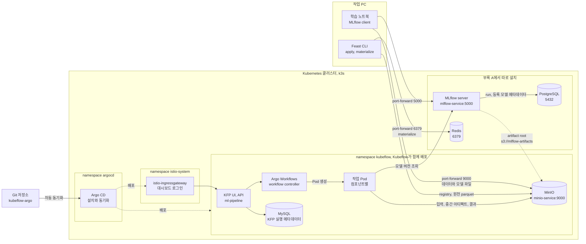
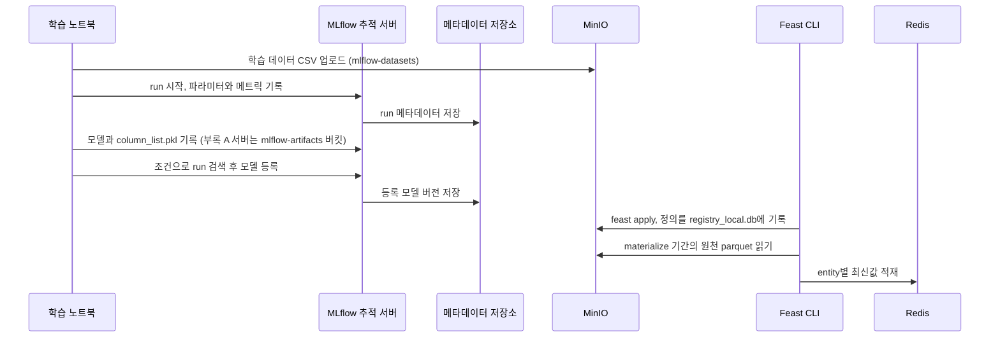
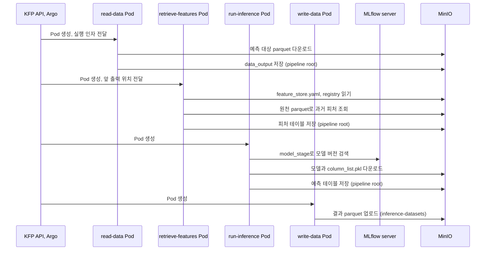
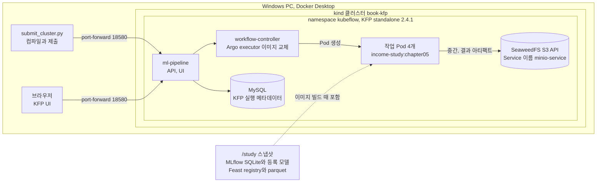
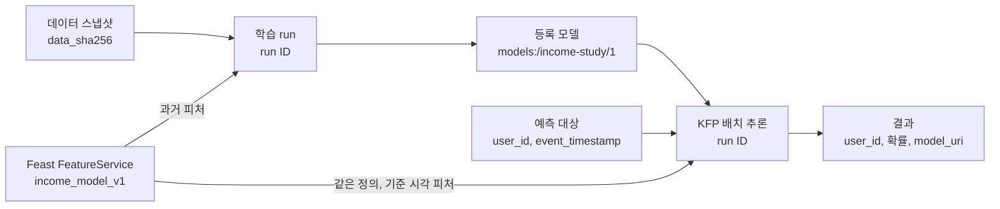

어제 만든 음식이 맛있었다면 재료를 어디서 샀고, 어떤 순서로 조리했고, 완성품을 어느 냉장고에 넣었는지 알아야 다시 만들 수 있습니다. 재료 창고와 조리 기록, 주방 작업 지시서가 서로 다른 건물에 흩어져 있으면 각각을 잘 알아도 한 그릇의 음식으로 이어지지 않습니다.

책은 4장에서 MLflow와 Feast를, 5장에서 Kubeflow Pipelines를 다룹니다. 세 도구가 함께 쓰는 클러스터와 저장소의 설치 방법은 부록 A에 있고, 5장의 파이프라인은 학습이 아니라 배치 추론을 자동화합니다.

그래서 두 장을 하나로 합쳐 **어느 서비스가 어디에 무엇을 저장하고, 다음 단계가 그것을 어떻게 찾는지**를 기준으로 다시 정리했습니다. 책의 구성은 부록 A와 4~5장의 명령, 공식 예제 저장소의 매니페스트와 컴포넌트 인자를 근거로 그렸습니다. 실습은 같은 흐름을 로컬과 kind 클러스터에서 실행한 기록이며, 책과 다른 부분은 따로 표시합니다.

책의 노트북과 5장 파이프라인을 원래 코드 그대로 따라 하고 싶다면 [책 4~5장 로컬 실습 SOP](/docs/tech/machine-learning-platform-engineering/book-ch04-05-sop/)를 보세요. 책이 전제하는 클러스터를 명령 하나로 만드는 [공개 저장소](https://github.com/johklo/ml-platform-book-env)와, 버킷 생성부터 KFP 실행 결과 확인까지 번호를 붙인 절차가 있습니다.

## 1. 기술 아키텍처: 서비스와 저장소의 연결

### 책이 전제하는 클러스터 구성

부록 A는 Kubernetes와 Kubeflow부터 설치합니다. 순서는 다음과 같습니다.

1. 작업 PC에 `yq`, `kustomize`, `kubectl`을 설치하고 k3s 또는 MicroK8s로 단일 노드 클러스터를 만듭니다. CPU 4개, 메모리 12GB, 디스크 50GB 이상을 권합니다.
2. 저자의 [kubeflow-argo](https://github.com/vmallya-123/kubeflow-argo) 저장소를 내려받아 `kubectl apply -k argocd/`로 **Argo CD**를 먼저 설치합니다.
3. 같은 저장소에서 `kubectl apply -f kubeflow.yaml`을 실행합니다. 이 파일은 Argo CD Application 하나이며, 저장소의 Kubeflow 매니페스트 전체를 자동 동기화(`prune`, `selfHeal`)하도록 등록합니다. Argo CD가 구성 요소별 Application을 만들어 배포하고, 책은 모두 초록색이 될 때까지 30분 정도 걸렸다고 적습니다.
4. `istio-ingressgateway` 주소로 Kubeflow 대시보드에 접속해 기본 계정 `user@kubeflow.org`로 로그인합니다.

여기서 Argo CD와 Kubeflow를 구분해 둡니다. **Argo CD는 Kubeflow에 포함된 도구가 아니라 책이 Kubeflow 매니페스트를 배포하는 방식으로 고른 GitOps 도구입니다.** 반면 KFP가 작업을 Pod로 실행할 때 쓰는 Argo Workflows는 Kubeflow Pipelines에 포함됩니다. 이름은 비슷하지만 하나는 배포 도구, 하나는 실행 엔진입니다.

| 구분 | 구성 요소 | 설치 방법 |
| --- | --- | --- |
| 설치 도구 | Argo CD | 부록 A.1.7, `kubectl apply -k argocd/` |
| Kubeflow와 함께 배포 | Istio, Dex와 인증, cert-manager, Knative, 중앙 대시보드, Notebooks, Profiles | `kubeflow.yaml` 적용 후 Argo CD가 배포 |
| Kubeflow Pipelines와 함께 배포 | KFP API와 UI, Argo Workflows, MySQL, **MinIO** | 같은 경로에 포함 |
| 따로 설치 | PostgreSQL, Redis | 부록 A의 Bitnami Helm 차트 |
| 따로 설치 | MLflow 추적 서버 | 부록 A에서 이미지를 빌드하고 Deployment, Service 적용 |
| 따로 설치 | Yatai, Evidently UI | 부록 A, 모델 서빙과 데이터 변화 관측을 다루는 6장에서 사용 |
| 직접 생성 | 버킷 `mlflow-datasets`, `mlflow-artifacts`, `feature-registry`, 피처 원천 버킷 | MinIO 웹 콘솔 또는 업로드 스크립트 |

그래서 **MinIO는 따로 설치하지 않습니다.** KFP가 작업 사이의 파일을 보관하려고 함께 띄우는 MinIO를 책의 다른 도구들도 공용 객체 저장소로 빌려 씁니다. 4장은 `kubectl port-forward svc/minio-service -n kubeflow 9000:9000`으로 PC에서 접속하고, 기본 계정 `minio/minio123`으로 웹 콘솔에 로그인해 버킷을 만드는 것으로 시작합니다. 자동으로 생기는 것은 KFP가 쓰는 `mlpipeline` 버킷뿐이고, 나머지 버킷은 직접 만들어야 합니다.

MLflow 서버의 위치는 장마다 다릅니다. 4장 본문은 PC에서 `mlflow ui`로 로컬 추적 서버를 띄우고 `set_tracking_uri("http://localhost:5000")`로 접속합니다. 이때 run과 모델은 PC에 저장되고, MinIO에는 학습에 쓴 CSV만 올라갑니다. 책은 팀이 함께 쓰려면 클러스터에 MLflow를 설치하라며 부록 A를 안내합니다. 5장의 추론 컴포넌트는 `mlflow_host`와 MinIO 접속 정보를 함께 받으므로, Pod에서 접근할 수 있는 이 클러스터 MLflow 서버를 전제로 합니다. 아래 그림은 이 5장 기준의 구성입니다.



그림에서 MinIO에 화살표가 몰리는 것이 핵심입니다. KFP의 부속품으로 함께 설치된 MinIO 하나가 여러 역할을 동시에 맡습니다.

| 역할 | 버킷 또는 위치 | 쓰는 쪽 | 읽는 쪽 |
| --- | --- | --- | --- |
| 원천 데이터 보관 | `mlflow-datasets`, 피처 원천 버킷 | 학습 노트북, 피처 생성 작업 | 재현 조사, Feast 과거 조회 |
| 도구의 저장 백엔드 | `mlflow-artifacts`, `feature-registry` | MLflow client, `feast apply` | 추론 Pod, 피처 조회 Pod |
| 작업 사이의 전달 | KFP pipeline root, `mlpipeline` | 각 작업 Pod의 출력 | 다음 작업 Pod의 입력 |
| 업무 결과 | `inference-datasets` | 결과 저장 Pod | 후속 시스템 |

피처 원천 버킷 이름은 자료마다 다릅니다. 책 본문의 `FileSource`는 `s3://feature_data_sets/...`를 가리키지만, 공식 [chapter-4](https://github.com/practical-mlops/chapter-4) README는 `feature-data-sets` 버킷에 파일을 옮기라고 안내합니다. S3 규칙상 버킷 이름에는 밑줄을 쓸 수 없으므로 실제로 만들 때는 하이픈 이름과 경로를 맞춥니다. Feast registry도 4장 본문은 PC에서 등록한 `registry_local.db`, 5장 저장소의 Kubernetes Job은 클러스터에서 다시 등록한 `registry.db`를 사용합니다.

이 구조에서 세 가지가 보입니다.

1. **MLflow 서버는 두 저장소를 사용합니다.** run과 모델 버전 같은 메타데이터는 PostgreSQL에, 모델 파일은 MinIO에 있습니다. 서버가 `--default-artifact-root s3://mlflow-artifacts`로 실행되므로 client가 MinIO에 파일을 직접 올리고 내려받습니다. 5장 추론 컴포넌트가 MLflow 주소와 함께 MinIO 접속 키와 `AWS_ENDPOINT_URL`도 받는 이유입니다.
2. **5장 배치 추론은 Redis를 거치지 않습니다.** 과거 시점 피처는 MinIO의 원천 parquet에서 `get_historical_features()`로 읽습니다. Redis는 실시간 서빙용 최신값 저장소입니다.
3. **MinIO 장애는 거의 모든 단계를 멈춥니다.** 원천, 모델, Feast 정의, 작업 사이의 전달이 모두 같은 서버에 있기 때문입니다. 버킷마다 소유자, 접근 권한, 보존 기간도 다르게 정해야 합니다.

부록 A의 매니페스트는 MinIO 기본 계정 `minio/minio123`을 환경 변수에 그대로 넣습니다. 5장 컴포넌트도 `access_key`, `secret_key`를 파이프라인 파라미터로 받으므로 KFP UI의 실행 인자에 노출됩니다. 학습용 기본값이며 실제 환경에서는 Kubernetes Secret과 서비스 계정 권한으로 바꿔야 합니다.

책이 사용한 Kubeflow 1.7 시기의 KFP는 MinIO를 기본 객체 저장소로 함께 배포했습니다. [공식 문서](https://www.kubeflow.org/docs/components/pipelines/operator-guides/configure-object-store/)에 따르면 KFP 2.15부터 기본 배포는 SeaweedFS로 바뀌었고, MinIO를 포함한 S3 호환 저장소는 계속 설정할 수 있습니다. 지금 Kubeflow를 새로 설치하면 같은 자리에 SeaweedFS가 들어올 수 있다는 뜻입니다.

### 학습과 등록 시점의 흐름 (책 4장)



4장 본문의 로컬 `mlflow ui`를 쓰면 메타데이터 저장소와 모델 파일은 PC의 로컬 폴더이고, 부록 A의 서버를 쓰면 각각 PostgreSQL과 MinIO의 `mlflow-artifacts` 버킷입니다. 학습 데이터 CSV는 두 경우 모두 `mlflow-datasets` 버킷에 올리고 그 경로를 `log_input()`으로 run에 연결합니다.

책의 순서에서는 학습이 Feast를 거치지 않고, Feast 등록은 학습이 끝난 뒤에 따로 합니다. 그래서 두 도구는 **열 이름이 같다는 사실로만** 이어집니다. 이 글의 실습은 순서를 바꿔 Feast 정의를 먼저 만들고, 학습 코드가 그 정의로 데이터를 조회한 뒤 MLflow에 기록하도록 고쳤습니다.

이 단계는 사람이 PC에서 port-forward를 열고 실행합니다. 책의 KFP 파이프라인에는 학습, 모델 등록, `materialize`가 포함되지 않습니다. 파이프라인이 실행되는 시점에는 **이미 등록된 모델 버전과 Feast 정의가 있어야 합니다.**

### 배치 추론 시점의 흐름 (책 5장)



KFP는 앞 작업이 pipeline root에 남긴 파일 위치를 기록해 두었다가, 다음 작업을 실행할 때 그 파일을 Pod 안의 입력 경로로 내려받아 줍니다. 작업 사이에 파이썬 객체나 메모리가 전달되는 것이 아닙니다. 그래서 4장에서 PC의 `localhost:9000`으로 등록한 Feast 정의를 5장 Pod가 그대로 쓸 수 없습니다. Pod 안의 `localhost`는 PC가 아니라 그 Pod 자신입니다.

책은 원천 경로의 endpoint를 클러스터 서비스 주소 `minio-service.kubeflow.svc.cluster.local:9000`으로 바꾸고, `feast apply`를 클러스터 안의 Kubernetes Job으로 다시 실행합니다. **Feast 정의에는 피처 이름뿐 아니라 원천 위치와 접속 주소도 함께 기록되기 때문입니다.**

### 실습에서 구성한 아키텍처

실습에서는 모든 서비스를 그대로 띄우기보다 작업의 분리와 아티팩트 전달을 먼저 확인했습니다.



| 구성 | 책 | 실습 | 영향 |
| --- | --- | --- | --- |
| 클러스터 | k3s, Argo CD로 Kubeflow 1.7 전체 | kind, `kubectl apply -k`로 KFP standalone 2.4.1 | Argo CD, Istio, Notebooks 없이 Pipelines만 사용 |
| 객체 저장소 | KFP와 함께 배포된 MinIO | SeaweedFS, `minio-service` 이름 유지 | 2.4.1 매니페스트의 MinIO 이미지를 받을 수 없어 교체 |
| MLflow | 서버, PostgreSQL, MinIO artifact | 이미지 안의 SQLite와 등록 모델 | 모델 조회가 네트워크를 거치지 않음 |
| Feast | MinIO registry와 원천, Redis | 이미지 안의 file registry와 parquet | 배치 추론에는 온라인 저장소가 필요 없음 |
| 입력과 결과 | MinIO에서 읽고 `inference-datasets`에 업로드 | 이미지의 요청 파일, 결과는 KFP 아티팩트 | 업무 결과 쓰기는 통합 실습에서 이어감 |
| 모델 참조 | `model_stage` 검색 | `models:/income-study/1` 구체 버전 | 재실행해도 같은 모델 |

공유 MLflow 서버와 원격 Feast 구성을 검증한 것은 아니라는 점을 구분해 둡니다. 모델이나 원천 데이터를 바꾸려면 이미지를 새 태그로 다시 빌드합니다.

## 2. 처음부터 끝까지 함께 고정할 식별자

도구가 여러 개여도 결과를 설명하려면 다음 값들이 끊기지 않고 이어져야 합니다.



| 식별자 | 예 | 기록하는 곳 |
| --- | --- | --- |
| 데이터 스냅샷 | CSV의 SHA-256 | MLflow run tag와 artifact |
| 코드 | 학습 스크립트 해시, 이미지 태그 | MLflow tag, 컴포넌트 이미지 |
| 피처 정의 | FeatureService `income_model_v1`, `features.py` 해시 | Feast registry, MLflow run과 모델 버전의 tag |
| 모델 | `models:/income-study/1`과 원천 run | MLflow 모델 레지스트리 |
| 예측 기준 시각 | `event_timestamp` | 예측 대상 파일과 결과 |
| 파이프라인 실행 | KFP run ID | KFP 메타데이터, 결과 아티팩트 경로 |

모델 이름이나 stage만 남기면 나중에 다른 버전을 가리킬 수 있습니다. 결과 파일에 구체 모델 URI를 함께 기록하는 이유입니다.

## 3. Feast: 피처를 정의하고 과거 시점과 현재로 조회하기 (책 4.2)


과거 거래 장부와 오늘의 안내판을 함께 관리하는 모습으로 읽으면 쉽습니다. 책의 구성에서 장부인 Offline store는 MinIO의 parquet 파일, 안내판인 Online store는 Redis, 가운데 Registry는 MinIO의 `registry_local.db`입니다. 위쪽 `get_historical_features`는 학습이나 배치 기준 시점에 맞는 값을 찾고, 아래쪽 `get_online_features`는 Redis의 최신값을 빠르게 가져옵니다.

여러 파일이나 테이블에 흩어진 데이터를 매번 조인하고 변환하면 학습과 서빙의 정의가 달라지기 쉽습니다. 이를 training-serving skew, 즉 학습과 서빙의 불일치라고 부릅니다.

### 등록과 적재는 다른 작업입니다

| 구성 요소 | 쉬운 역할 | 저장하는 것 |
| --- | --- | --- |
| Entity | 누구의 값인가 | `user_id` 같은 조인 키의 정의 |
| Data source | 원래 값은 어디에 있는가 | 파일이나 테이블 위치, 시간 필드, 접속 주소 |
| Feature view | 어떤 값을 묶어서 조회할까 | 스키마, source, entity, TTL |
| Registry | 정의를 찾아보는 목록 | entity와 feature view 등의 메타데이터 |
| Offline store | 과거 학습 자료 | 시점별 피처 이력 |
| Online store | 요청에 빠르게 줄 값 | 일반적으로 entity별 최신 피처 |

Registry를 피처 값이 모두 담긴 데이터베이스로 생각하면 안 됩니다. `feast apply`는 정의를 반영하고, `materialize`는 오프라인 값을 온라인 저장소로 옮깁니다. UI에 feature view가 보이는데 온라인 값은 없는 상황이 가능한 이유입니다.

Data source에 접속 주소가 포함된다는 점이 4장과 5장 사이의 연결 문제를 만듭니다. 책은 PC에서 MinIO를 `localhost:9000`으로 port-forward하고 `s3_endpoint_override`를 그 주소로 둔 채 등록합니다. 같은 정의를 클러스터 Pod에서 읽으면 `localhost`가 Pod 자신을 가리키므로, 5장에서 클러스터 주소로 바꿔 다시 등록합니다. 피처 정의와 실행 환경의 접속 정보를 분리해 두면 이런 재등록을 줄일 수 있습니다.

### Point-in-time join을 숫자로 계산하기

| 조회 방식 | 주로 쓰는 상황 | 중요한 기준 |
| --- | --- | --- |
| Historical, offline | 과거 시점 학습 데이터, 배치 추론 | 그 시점에 알 수 있었던 피처인지 |
| Online | 사용자 요청에 빠르게 응답하는 예측 | 낮은 지연, 최신성, 누락 처리 |

사용자 42에게 다음 세 피처가 있다고 하겠습니다. 예측 기준 시점이 5월 22일이면 그 시점 이전의 가장 최근 값인 5월 21일의 36을 골라야 합니다.

| user_id | 관측 시점 | hours_per_week |
| --- | --- | --- |
| 42 | 5월 7일 | 30 |
| 42 | 5월 21일 | 36 |
| 42 | 6월 4일 | 52 |

사용자 ID만으로 조인하면 6월 값까지 붙거나 한 사용자에 여러 행이 생깁니다. 미래의 52를 넣은 학습 결과는 그때 실제로 만들 수 있었던 예측의 평가가 아닙니다.

TTL이 2일이라면 5월 22일 기준으로 최근 2일 범위에서 후보를 찾습니다. 기준 시점을 5월 25일로 옮기면 5월 21일 값은 범위 밖입니다. 원천에 행이 있다는 것과 그 조회에 유효한 값이 있다는 것은 다릅니다.

5월 21일에 발생했지만 5월 23일에 도착한 데이터는 이벤트 시각만 보면 과거 값이어도 5월 22일에는 사용하지 못했습니다. 지연 도착과 보정 이력이 있다면 사용 가능 시점까지 재구성하는 정책이 필요합니다.

### 실습: 로컬 Feast의 과거 값과 온라인 값

학습 코드가 Feast와 MLflow를 함께 사용하므로 두 도구를 한 가상환경에 설치합니다. 이번 실행은 WSL2의 Ubuntu 24.04, Python 3.11에서 했습니다. 뒤의 KFP 로컬 실행도 Linux가 필요하므로 Windows에서는 WSL2를 권합니다.

```bash
python3 -m venv .venv
source .venv/bin/activate
python -m pip install mlflow==2.16.2 scikit-learn==1.5.2 feast==0.40.1 \
    pandas==2.2.3 numpy==1.26.4 pyarrow==17.0.0 sqlalchemy==2.0.36
```

`feature_study.py`로 저장할 아래 코드는 작은 피처 저장소를 만듭니다. 사용자 600명의 근무 시간과 근무 형태를 두 시점씩 기록하고, 앞의 예시처럼 사용자 42의 5월 21일 값 36과 6월 4일 값 52를 넣었습니다. 학습 정답은 각 사용자의 기준 시각과 함께 `labels.parquet`에 따로 둡니다. 책의 MinIO와 Redis 대신 로컬 parquet와 SQLite 온라인 저장소를 사용합니다. `income-features-study` 폴더가 이미 있으면 덮어쓰지 않고 실패합니다.

마지막 정의인 `FeatureService`가 이 글의 핵심입니다. 모델이 쓸 피처 묶음에 `income_model_v1`이라는 이름을 붙이고, 학습과 배치 추론, 온라인 조회가 모두 이 이름으로 피처를 요청합니다. 피처 목록을 코드 곳곳에 따로 적지 않아도 같은 계약을 쓰게 됩니다.

```python
from datetime import datetime, timezone
import importlib.util
from pathlib import Path

import numpy as np
import pandas as pd
from feast import FeatureStore

repo = Path("income-features-study").resolve()
repo.mkdir()
rng = np.random.default_rng(23)
users = np.arange(1000, 1600)
classes = ["private", "public", "self-employed"]
observed = pd.Timestamp("2025-04-01", tz="UTC") + pd.to_timedelta(
    rng.integers(0, 30, size=users.size), unit="D"
)
hours = rng.integers(20, 61, size=users.size).astype(float)
workclass = rng.choice(classes, size=users.size)
history = pd.concat([
    pd.DataFrame({
        "user_id": users, "event_timestamp": observed,
        "hours_per_week": hours, "workclass": workclass,
    }),
    pd.DataFrame({
        "user_id": users, "event_timestamp": observed + pd.Timedelta(days=45),
        "hours_per_week": rng.integers(20, 61, size=users.size).astype(float),
        "workclass": rng.choice(classes, size=users.size),
    }),
    pd.DataFrame({
        "user_id": [42, 42],
        "event_timestamp": pd.to_datetime([
            "2025-05-21T00:00:00Z", "2025-06-04T00:00:00Z"
        ]),
        "hours_per_week": [36.0, 52.0],
        "workclass": ["private", "self-employed"],
    }),
], ignore_index=True)
source = repo / "hours.parquet"
history.to_parquet(source, index=False)

effect = pd.Series(workclass).map({
    "private": 0.0, "public": -0.4, "self-employed": 0.8
}).to_numpy()
score = (hours - 40) / 8 + effect + rng.normal(size=users.size)
pd.DataFrame({
    "user_id": users,
    "event_timestamp": observed + pd.Timedelta(days=7),
    "target": (score > 0).astype(int),
}).to_parquet(repo / "labels.parquet", index=False)

(repo / "feature_store.yaml").write_text(
    "project: income_study\n"
    "provider: local\n"
    "entity_key_serialization_version: 2\n"
    "registry: registry.db\n"
    "offline_store:\n  type: file\n"
    "online_store:\n  type: sqlite\n  path: online.db\n",
    encoding="utf-8",
)
(repo / "features.py").write_text(
    "from datetime import timedelta\n"
    "from feast import Entity, FeatureService, FeatureView, Field, FileSource, ValueType\n"
    "from feast.types import Float64, String\n"
    "user = Entity(name='user', join_keys=['user_id'], value_type=ValueType.INT64)\n"
    f"source = FileSource(path={str(source)!r}, timestamp_field='event_timestamp')\n"
    "hours = FeatureView(name='hours', entities=[user], "
    "ttl=timedelta(days=365), "
    "schema=[Field(name='hours_per_week', dtype=Float64), "
    "Field(name='workclass', dtype=String)], source=source)\n"
    "income_model_v1 = FeatureService(name='income_model_v1', features=[hours])\n",
    encoding="utf-8",
)
spec = importlib.util.spec_from_file_location("study_features", repo / "features.py")
definitions = importlib.util.module_from_spec(spec)
spec.loader.exec_module(definitions)
store = FeatureStore(repo_path=str(repo))
store.apply([definitions.user, definitions.hours, definitions.income_model_v1])

service = store.get_feature_service("income_model_v1")
entities = pd.DataFrame({
    "user_id": [42],
    "event_timestamp": pd.to_datetime(["2025-05-22T00:00:00Z"]),
})
entities.to_parquet(repo / "requests.parquet", index=False)
historical = store.get_historical_features(
    entity_df=entities, features=service
).to_df()
print("Historical:", historical["hours_per_week"].tolist())
store.materialize(
    datetime(2025, 4, 1, tzinfo=timezone.utc),
    datetime(2025, 7, 1, tzinfo=timezone.utc),
)
online = store.get_online_features(
    features=service, entity_rows=[{"user_id": 42}]
).to_dict()
print("Online:", online["hours_per_week"])
```

```bash
python feature_study.py
```

과거 시점으로 조회했을 때는 `Historical: [36.0]`이 나왔습니다. 이어서 2025년 4월 1일부터 7월 1일까지 materialization을 실행하고 온라인으로 조회하니 `Online: [52.0]`가 반환됐습니다. **과거 장부에서 찾은 값과 오늘 안내판의 값이 서로 달라야 정상인 상황**입니다. 학습 점수를 높이려고 36 대신 52를 넣으면 예측 당시 아직 없던 정보를 사용하게 됩니다.

같은 폴더의 `labels.parquet`는 다음 절의 학습이, `requests.parquet`는 뒤의 KFP 파이프라인이 읽습니다. 예측 대상 파일에는 사용자 42와 기준 시각 5월 22일이 들어 있습니다. 두 파일 모두 사용자와 기준 시각만 담고, 피처 값은 Feast에서 시점에 맞춰 붙입니다.

### Feature server로 온라인 값 조회하기

Feature server는 SDK를 직접 쓰기 어려운 애플리케이션이 피처를 조회하는 API입니다. 접근 권한과 지연, 오류 처리는 별도로 설계해야 합니다. 앞에서 만든 `income-features-study` 폴더로 이동하고 같은 가상환경에서 서버를 실행했습니다.

```bash
cd income-features-study
feast serve --host 127.0.0.1 --port 16566
```

다른 터미널에서 사용자 `42`와 등록되지 않은 `999`를 FeatureService 이름으로 함께 조회했습니다.

```bash
curl -s -X POST http://127.0.0.1:16566/get-online-features \
  -H 'Content-Type: application/json' \
  -d '{"feature_service": "income_model_v1", "entities": {"user_id": [42, 999]}}'
```

응답은 열별로 묶여 있습니다. 이번 응답의 `metadata.feature_names`는 `user_id`, `workclass`, `hours_per_week` 순서였습니다. 정의에 적은 순서와 다르므로, `feature_names`와 `results`를 같은 인덱스로 짝지어 읽어야 합니다.

| 피처 | 사용자 42 | 사용자 999 |
| --- | --- | --- |
| `hours_per_week` | `52.0`, `PRESENT` | `null`, `NOT_FOUND` |
| `workclass` | `self-employed`, `PRESENT` | `null`, `NOT_FOUND` |

사용자 999도 요청에 넣은 식별자 자체는 반환됐지만 피처 상태는 `NOT_FOUND`였습니다. HTTP 요청이 성공했다고 모델 입력까지 준비된 것은 아닙니다. 이 온라인 API에는 과거 기준 시각을 넣지 않으므로, 배치 추론은 앞의 `get_historical_features()`를 사용합니다.

### Feast UI에서 정의 확인하기

같은 repository 폴더에서 새 터미널을 열고 UI를 실행했습니다.

```powershell
feast ui --host 127.0.0.1 --port 18888
```

`http://127.0.0.1:18888`에서 먼저 **Feature Services → income_model_v1**을 열었습니다.


모델이 쓰는 피처 묶음이 `hours` feature view의 두 열이라는 것이 한 화면에 보입니다. 이어서 **Feature Views → hours**를 열었습니다.


| 화면에서 확인한 항목 | 의미와 확인한 내용 |
| --- | --- |
| Features | `hours_per_week: DOUBLE`, `workclass: STRING`이 정의대로 등록됐습니다. |
| Entities | 조인 기준인 `user`가 연결됐습니다. 코드의 `join_keys`는 `user_id`입니다. |
| Batch Source | 과거 조회의 원천이 `FileSource`의 parquet 파일로 연결됐습니다. 화면의 로컬 경로는 가렸습니다. |
| Materialization Intervals | 실행한 `2025-04-01`부터 `2025-07-01`까지의 구간이 기록됐습니다. |
| Consuming Feature Services | `income_model_v1` 하나가 이 feature view를 사용합니다. |

Materialization 기간이 남아 있어도 모든 사용자의 값이 존재하거나 지금 최신이라는 뜻은 아니므로, 사용자 999처럼 누락된 요청도 따로 검사했습니다. 실습 후 두 서버는 각 터미널의 Ctrl+C로 종료합니다.

## 4. MLflow: Feast에서 조회한 피처로 학습하고 기록하기 (책 4.1)

### 데이터 탐색과 인코딩

소득 분류 데이터의 스키마와 범주별 분포부터 확인합니다. 모델 점수뿐 아니라 어떤 데이터를 탐색했는지와 탐색 결과도 실험의 출처에 포함됩니다.

책 예제의 입력은 직업, 학력 등 범주형 열이고 정답은 소득 구간입니다. 범주를 숫자로 바꿀 때 `Private=0`, `Public=1`, `Self-employed=2`처럼 놓으면 모델이 그 순서나 간격에 의미를 부여할 수 있습니다. 원-핫 인코딩은 범주마다 별도의 표시 열을 만드는 대안입니다.

학습에 `Private`, `Public`만 있었다면 두 열의 순서와 의미가 고정되어야 합니다. 추론 때 새로 `get_dummies()`를 호출하면 입력 배치의 범주 구성에 따라 열이 빠지거나 바뀔 수 있습니다. 책의 5장 추론 컴포넌트가 학습 때 저장한 `column_list.pkl`을 MLflow에서 내려받아 열을 다시 맞추는 이유가 이것입니다. 열 이름 보정보다 학습한 인코더 자체를 모델과 함께 보관하는 편이 더 안전합니다.

인코더는 학습 데이터에만 맞추고 같은 변환을 검증과 테스트에 적용합니다. 빈 문자열, `?` 같은 결측 표현, 범주별 표본 수, 정답 비율과 중복 행도 확인합니다. 소득 데이터의 인종, 성별 같은 민감한 열을 교육 예제에서 봤다고 실제 의사결정에 곧바로 사용해도 된다는 뜻은 아닙니다.

### 실행 기록을 실험 공책처럼 읽기

Experiment는 공책 한 권, run은 실험 한 번을 적은 한 페이지라고 생각하면 쉽습니다. 그 페이지에 “트리 깊이는 3이었다”라고 적는 것이 parameter, “검증 AUC는 얼마였다”라고 적는 것이 metric입니다. 그림이나 완성된 모델 파일을 끼워 두는 것이 artifact입니다.

| 기록 | 예시 | 나중에 답할 질문 |
| --- | --- | --- |
| 파라미터 | 학습률, 트리 깊이 | 어떤 설정으로 실행했는가? |
| 메트릭 | ROC-AUC, 오류율 | 같은 기준에서 어떤 결과가 나왔는가? |
| 아티팩트 | 모델 파일, 그래프, 참고 데이터 | 결과물을 다시 가져올 수 있는가? |
| 추적용 메타데이터 | 코드와 데이터 버전, 실행 목적 | 두 실행 사이에 무엇이 달랐는가? |

`start_run()`이 모델을 학습해 주는 것은 아닙니다. 그 안에서 `fit()`이 학습하고, `log_metric()`이 측정값을 적고, `log_model()`이 모델을 보관합니다. 마지막 표의 추적용 메타데이터는 플랫폼이 알아서 채워 주지 않으므로 팀이 기록 절차에 넣어야 합니다.

앞의 아키텍처 그림처럼 메타데이터는 backend store인 PostgreSQL에, 파일은 artifact store인 MinIO에 저장됩니다. 화면에 run이 보여도 MinIO 접근이 끊기면 모델 다운로드는 실패할 수 있습니다. 책은 `mlflow.log_input()`으로 데이터의 출처를 실행에 연결하지만, 입력 메타데이터 기록이 원천 데이터를 복사해 주지는 않습니다. 기록된 경로의 CSV를 덮어쓰면 같은 run에서 다른 데이터를 읽게 됩니다.

| 식별자 | 가리키는 대상 | 예 |
| --- | --- | --- |
| Experiment | 관련 실행의 묶음 | `income-study` |
| Run ID | 한 번의 실행 기록 | 학습 설정 하나를 적용한 실행 |
| Artifact path | 그 실행 안의 파일 위치 | `model`, `data/snapshot.csv` |
| `runs:/...` URI | 특정 실행의 모델 산출물 | `runs:/<run-id>/model` |
| `models:/.../7` URI | 등록 모델의 구체 버전 | `models:/income-study/7` |

### 모델 레지스트리

실험 추적은 “무엇을 시도했고 어떻게 나왔나?”에 답합니다. 모델 레지스트리는 그중 관리할 모델에 이름과 버전을 붙이는 목록입니다. 완성품 3번에서 원래 공책의 어느 페이지로 돌아갈 수 있어야 재료와 조건을 확인할 수 있습니다.

책에서는 여러 분류기를 비교하고 조건에 맞는 모델을 검색해 등록합니다. 최종 테스트셋을 보며 모델을 계속 고르면 테스트셋이 선택에 간접적으로 사용되므로, 선택용 검증 데이터와 마지막 확인용 테스트 데이터의 역할을 구분해야 합니다.

### 실습: 전처리를 포함한 모델 기록과 재로딩

앞 절과 같은 폴더, 같은 가상환경에서 이어서 실행합니다. 아래 버전은 이 학습 예제의 기준이며 최신 MLflow API 전체를 설명하는 버전은 아닙니다.

MLflow 버전은 자료마다 다릅니다. 책 본문은 `pip install mlflow==2.6.0`과 로컬 `mlflow ui`로 설명하지만, 공식 [chapter-4](https://github.com/practical-mlops/chapter-4) 저장소의 `requirements.txt`와 부록 A의 서버 이미지는 출간 뒤 `mlflow==3.0.0`으로 올라갔습니다. 이 글은 로컬 SQLite만 쓰고 Feast, KFP와 함께 검증한 2.16.2로 고정했습니다. 책 부록처럼 클러스터에 MLflow 서버를 따로 띄운다면 학습 코드의 클라이언트도 서버와 같은 주 버전으로 맞춥니다. MLflow 3에서는 `log_model`의 `artifact_path` 대신 `name`을 쓰고 모델을 별도 객체로 다루는 등 기록 방식이 바뀌었으므로, 2.x 클라이언트와 3.x 서버를 섞으면 모델 기록이나 조회에서 어긋날 수 있습니다.

다음 코드를 `income_study.py`로 저장합니다. 학습 데이터를 직접 만들지 않고 `labels.parquet`의 사용자와 기준 시각을 Feast에 넘겨 `income_model_v1`의 과거 피처를 붙입니다. 실제 개인 데이터가 아닌 합성 데이터이므로 책의 소득 데이터와 분포나 성능을 비교하면 안 됩니다. PostgreSQL과 MinIO 대신 같은 폴더의 SQLite DB와 로컬 artifact 폴더를 사용합니다.

```python
import hashlib
import json
from pathlib import Path

import mlflow
import mlflow.data
import mlflow.sklearn
import numpy as np
import pandas as pd
from feast import FeatureStore
from mlflow import MlflowClient
from mlflow.models import infer_signature
from sklearn.compose import ColumnTransformer
from sklearn.dummy import DummyClassifier
from sklearn.ensemble import RandomForestClassifier
from sklearn.metrics import roc_auc_score
from sklearn.model_selection import train_test_split
from sklearn.pipeline import Pipeline
from sklearn.preprocessing import OneHotEncoder
from sklearn.tree import DecisionTreeClassifier

repo = Path("income-features-study").resolve()
store = FeatureStore(repo_path=str(repo))
service_name = "income_model_v1"
service = store.get_feature_service(service_name)
labels = pd.read_parquet(repo / "labels.parquet")
data = store.get_historical_features(entity_df=labels, features=service).to_df()
data = data.sort_values(["user_id", "event_timestamp"]).reset_index(drop=True)
columns = ["hours_per_week", "workclass"]
if len(data) != len(labels) or data[columns].isna().any().any():
    raise ValueError("Every label row needs point-in-time features")

snapshot = Path("training_snapshot.csv")
snapshot.write_text(data.to_csv(index=False), encoding="utf-8")
lineage = {
    "data_sha256": hashlib.sha256(snapshot.read_bytes()).hexdigest(),
    "code_sha256": hashlib.sha256(Path(__file__).read_bytes()).hexdigest(),
    "feast_project": store.project,
    "feast_feature_service": service_name,
    "feast_definitions_sha256": hashlib.sha256(
        (repo / "features.py").read_bytes()
    ).hexdigest(),
}
feature_refs = sorted(
    f"{projection.name}:{field.name}"
    for projection in service.feature_view_projections
    for field in projection.features
)

train_valid, test = train_test_split(
    data, test_size=0.2, random_state=23, stratify=data["target"]
)
train, valid = train_test_split(
    train_valid, test_size=0.25, random_state=23,
    stratify=train_valid["target"]
)
baseline = DummyClassifier(strategy="prior").fit(train[columns], train["target"])
baseline_auc = roc_auc_score(
    valid["target"], baseline.predict_proba(valid[columns])[:, 1]
)
training_input = mlflow.data.from_pandas(
    data.drop(columns=["event_timestamp"]), source=str(snapshot.resolve()),
    name="income-training-from-feast", targets="target",
)

mlflow.set_tracking_uri("sqlite:///income-study.db")
mlflow.set_experiment("income-study")
candidates = []
for name, estimator in [
    ("tree", DecisionTreeClassifier(max_depth=3, random_state=23)),
    ("forest", RandomForestClassifier(
        n_estimators=80, max_depth=5, random_state=23
    )),
]:
    transform = ColumnTransformer([
        ("workclass", OneHotEncoder(handle_unknown="ignore"), ["workclass"]),
        ("hours", "passthrough", ["hours_per_week"]),
    ])
    model = Pipeline([("transform", transform), ("classifier", estimator)])
    with mlflow.start_run(run_name=name) as run:
        model.fit(train[columns], train["target"])
        auc = roc_auc_score(
            valid["target"], model.predict_proba(valid[columns])[:, 1]
        )
        mlflow.log_params({
            "model_kind": name, "split_seed": 23,
            "max_depth": estimator.max_depth,
            "train_rows": len(train), "validation_rows": len(valid),
            "feature_refs": json.dumps(feature_refs),
        })
        mlflow.set_tags(lineage)
        mlflow.log_input(training_input, context="training")
        mlflow.log_metric("validation_auc", auc)
        mlflow.log_metric("baseline_validation_auc", baseline_auc)
        mlflow.log_artifact(str(snapshot), artifact_path="data")
        for definition in ("features.py", "feature_store.yaml"):
            mlflow.log_artifact(str(repo / definition), artifact_path="feast")
        mlflow.sklearn.log_model(
            model, "model",
            signature=infer_signature(train[columns], model.predict(train[columns])),
            input_example=train[columns].head(2),
        )
        candidates.append((auc, run.info.run_id, model))

best_auc, run_id, selected = max(candidates, key=lambda item: item[0])
if best_auc < baseline_auc + 0.05:
    raise RuntimeError("No candidate passed the validation improvement gate")

with mlflow.start_run(run_id=run_id):
    test_auc = roc_auc_score(
        test["target"], selected.predict_proba(test[columns])[:, 1]
    )
    mlflow.log_metric("final_test_auc", test_auc)
registered = mlflow.register_model(f"runs:/{run_id}/model", "income-study")
client = MlflowClient()
for key in ("feast_feature_service", "feast_definitions_sha256", "data_sha256"):
    client.set_model_version_tag(
        "income-study", registered.version, key, lineage[key]
    )
fixed_uri = f"models:/income-study/{registered.version}"
loaded = mlflow.sklearn.load_model(fixed_uri)
np.testing.assert_allclose(
    selected.predict_proba(test[columns]),
    loaded.predict_proba(test[columns]),
)
Path("selected_model_uri.txt").write_text(fixed_uri, encoding="utf-8")
print({
    "model_uri": fixed_uri, "feature_service": service_name,
    "rows": len(data), "validation_auc": best_auc, "test_auc": test_auc,
})
```

```bash
python income_study.py
mlflow ui --backend-store-uri sqlite:///income-study.db --host 127.0.0.1 --port 5000
```

UI 명령은 같은 폴더에서 실행하고 `http://127.0.0.1:5000`을 엽니다. 두 run의 `validation_auc`, 데이터 해시, snapshot과 model 파일을 찾고, Models 화면에서 출력한 구체 버전과 연결되는지 확인합니다. 끝나면 Ctrl+C로 UI를 종료합니다.

실행하면 `{'model_uri': 'models:/income-study/1', 'feature_service': 'income_model_v1', 'rows': 600, ...}`가 출력됩니다. 정답 600행 모두에 기준 시각의 피처가 붙었다는 뜻입니다. 이 코드에서 중요한 것은 최고 점수보다 다섯 가지 연결입니다.

1. 학습 데이터를 Feast의 `get_historical_features()`로 만들고, 누락된 피처가 하나라도 있으면 학습을 멈춥니다.
2. 사용한 FeatureService 이름, 피처 목록, `features.py` 해시를 run의 tag와 parameter로, `features.py`와 `feature_store.yaml`을 artifact로 남깁니다. `feature_store.yaml`은 저장소 위치 설정일 뿐이고 피처 정의는 `features.py`에 있으므로 둘 다 보관합니다.
3. 검증셋으로 후보를 고른 뒤 선택된 모델에만 최종 테스트를 적용합니다.
4. 인코더와 분류기를 하나의 `Pipeline`으로 저장해 추론 때 범주 열을 다시 학습하지 않습니다.
5. 등록한 모델 버전에도 FeatureService 이름과 정의 해시를 tag로 붙이고, 다시 읽은 예측 확률이 저장 전과 같은지 비교합니다.

MLflow와 Feast는 서로를 직접 알지 못합니다. 두 도구를 잇는 것은 이 학습 코드와 그 코드가 남긴 기록입니다. 모델 버전만 보고도 어떤 피처 계약으로 학습했는지 찾아갈 수 있게 만든 것이 이번 수정의 목적입니다.

`selected_model_uri.txt`에 남긴 구체 버전은 뒤의 KFP 추론이 그대로 사용합니다.

### MLflow에서 실험과 모델 연결 확인하기


공책 한 권 안에 두 페이지가 생긴 모습입니다. `tree`, `forest`는 모델 종류를 나타내도록 붙인 run 이름입니다. Dataset 열에는 두 run 모두 Feast에서 만든 `income-training-from-feast`가 표시됩니다. 같은 데이터로 비교했다는 근거입니다.


이번 실행에서는 forest가 선택됐고 검증 AUC는 약 `0.9337`, 최종 테스트 AUC는 약 `0.9393`이었습니다. tree의 검증 AUC는 약 `0.9128`, 기준선은 `0.5`입니다. 화면의 `max_depth: 5`, 학습 360행, 검증 120행이 코드의 조건과 맞는지, Tags에 `feast_feature_service: income_model_v1`이 있는지 확인합니다.

두 점수는 서로 다른 데이터에서 계산했으므로 같아야 하는 값이 아닙니다. 더 중요한 확인은 **검증으로 선택한 후보에 테스트를 나중에 한 번 적용했다**는 순서입니다. 합성 데이터의 이 수치를 실제 소득 분류 성능으로 일반화하지 않습니다.

`Datasets used`의 `income-training-from-feast`는 `log_input()`으로 남긴 데이터셋 메타데이터입니다. 실제 학습 행은 `training_snapshot.csv`로 따로 보관했습니다. 메타데이터 기록과 파일 artifact 보관은 다른 동작이어서 둘 다 남겼습니다.

Artifacts 탭에서는 학습에 사용한 Feast 정의도 열어 볼 수 있습니다.


Feast registry가 나중에 바뀌더라도, 이 run이 학습할 때 어떤 정의를 썼는지는 run 안의 사본으로 확인할 수 있습니다.


모델 목록에서 `income-study`의 버전 `1`을 열고 Source Run이 `forest`로 연결되는지, Tags에 `feast_feature_service`가 붙었는지 확인했습니다. 뒤의 KFP 추론은 이 tag를 읽어 파이프라인에 넘긴 FeatureService와 다르면 중단합니다. 버전 1이 자동으로 프로덕션에 배포됐다는 뜻은 아닙니다.

### 일부러 깨뜨려 보기

`training_snapshot.csv`의 한 값을 수정하고 SHA-256을 다시 계산하면 해시가 바뀝니다. 수정된 파일은 기존 run이 사용한 데이터가 아닙니다. 스크립트를 다시 실행하면 Feast에서 다시 조회해 파일을 만들므로, 파일 수정과 학습 데이터 변경을 혼동하지 않아야 합니다. `features.py`의 피처를 바꾸면 `feast_definitions_sha256`도 바뀌므로 다른 피처 계약으로 학습한 run을 구분할 수 있습니다.

저장된 모델에 `workclass` 열 없이 입력하면 정상 예측 대신 오류가 나야 합니다. “열이 없으면 0”이라는 임의 보정으로 숨기지 않는 편이 계약 위반을 찾기 쉽습니다.

별칭 `champion`이나 책의 stage 이름은 운영 대상을 가리키는 편리한 이름이지만, 가리키는 버전은 바뀔 수 있습니다. MLflow 2.x의 stage 중심 예제와 이후 alias 중심 방식도 구분해서 읽습니다. 배치를 시작할 때 구체 버전으로 해석해 고정하고 그 URI를 결과에 남깁니다.

## 5. Kubeflow Pipelines: 고정한 모델과 피처로 배치 추론하기 (책 5장)


책의 그림은 앞의 배치 추론 시퀀스를 한 장으로 줄인 것입니다. 왼쪽 세로 화살표는 **다음에 할 일**, 오른쪽 저장소와 오가는 가로 화살표는 **파일을 어디에 남기고 다시 읽는지**입니다.

### 컴포넌트 계약

| 컴포넌트 | 받는 것 | 내보내는 것 | 접속하는 서비스 |
| --- | --- | --- | --- |
| 데이터 읽기 | 대상 파일 위치 | 사용자 목록 | MinIO |
| 피처 조회 | 사용자와 기준 시각, 피처 목록 | 모델 입력 피처 | MinIO의 Feast registry와 원천 |
| 추론 | 피처, 모델 참조 | 예측이 붙은 데이터 | MLflow, MinIO |
| 데이터 쓰기 | 결과 데이터, 목적지 | 저장된 결과 | MinIO |

재사용성은 작은 함수의 개수보다 입력과 출력의 의미가 명확한지에 달려 있습니다. 피처 열 순서나 데이터 형식이 몰래 바뀌면 단계가 성공해도 예측은 틀릴 수 있습니다.

책에서는 각 Python 프로그램을 이미지로 만들고 컴포넌트 YAML의 `inputValue`, `inputPath`, `outputPath`로 인자를 연결합니다. 이 장의 실습은 같은 원리를 KFP 2.x의 Python 컴포넌트로 표현합니다.

### 코드가 실행되는 세 시점

| 시점 | 지금 하는 일 | 아직 하지 않은 일 |
| --- | --- | --- |
| 컴포넌트, 파이프라인 정의 | 어떤 작업과 연결이 있는지 작성 | 데이터를 읽거나 모델로 예측하지 않음 |
| `Compiler().compile()` | 정의를 실행 명세 YAML로 변환 | 클러스터에 Pod를 띄우지 않음 |
| 로컬 runner 또는 클러스터 실행 | 실제 입력으로 작업 수행 | 업무 품질과 출시 승인을 대신하지 않음 |

컴파일에 성공해도 주소와 권한, 패키지 설치 상태까지 확인된 것은 아닙니다. 실행할 때 “모델을 찾지 못함”이 나온다면 앞의 아키텍처 그림에서 그 Pod가 어디에 접속하는지부터 확인합니다.

### 파라미터와 아티팩트

주문 번호와 포장된 음식은 모두 작업 사이에서 전달되지만 같은 방식으로 다루지 않습니다. `model_uri`, 처리 기준일 같은 작은 설정값은 파라미터이고, 사용자 목록과 피처 테이블, 예측 결과 같은 파일은 아티팩트입니다.

| SDK 또는 명세 표현 | 컨테이너 안에서의 의미 | 흔한 오해 |
| --- | --- | --- |
| `str`, `int` 파라미터 | 작은 실행 인자 | 대용량 테이블을 문자열 인자로 전달 |
| `Input[Dataset]` | 앞 단계가 남긴 파일을 읽을 입력 | 앞 Pod의 pandas 객체를 그대로 받음 |
| `Output[Dataset]` | 이 단계가 결과를 써야 할 위치 | 함수에서 DataFrame을 반환하면 자동 저장 |
| `inputPath`, `outputPath` | 런타임이 해석한 로컬 파일 경로 | PC의 경로 문자열을 모든 Pod가 공유 |

`Output[Dataset]`으로 받은 객체의 `.path`에 실제 파일을 써야 런타임이 pipeline root에 보관하고 다음 단계로 전달합니다. KFP의 `Dataset`은 파일의 종류를 선언할 뿐, 열 타입이나 결측을 자동으로 검사하지 않습니다.

### 실습: 모델과 Feast를 연결한 네 단계 파이프라인

이 예제는 앞에서 실행해 만든 `selected_model_uri.txt`, `income-study.db`, `income-features-study` 폴더를 사용합니다. 같은 가상환경에 `kfp==2.10.1`을 추가로 설치합니다. 컴파일만 할 때는 KFP SDK만 필요합니다.

다음 코드를 `pipeline_study.py`로 저장합니다.

```python
from kfp import compiler, dsl
from kfp.dsl import Dataset, Input, Output


@dsl.component(base_image="python:3.12-slim-bookworm", install_kfp_package=False)
def read_data(source_path: str, entities: Output[Dataset]):
    from pathlib import Path
    import pandas as pd

    frame = pd.read_parquet(source_path)
    required = ["user_id", "event_timestamp"]
    if not set(required).issubset(frame.columns):
        raise ValueError("Entity input must include ID and prediction time")
    if frame.empty or frame[required].isna().any().any():
        raise ValueError("Entity input is empty or contains missing keys")
    if frame.duplicated(required).any():
        raise ValueError("Duplicate entity and prediction time")
    Path(entities.path).parent.mkdir(parents=True, exist_ok=True)
    frame[required].to_parquet(entities.path, index=False)


@dsl.component(base_image="python:3.12-slim-bookworm", install_kfp_package=False)
def retrieve_features(
    repo_path: str, feature_service: str,
    entities: Input[Dataset], features: Output[Dataset]
):
    from pathlib import Path
    import pandas as pd
    from feast import FeatureStore

    requests = pd.read_parquet(entities.path)
    store = FeatureStore(repo_path=repo_path)
    frame = store.get_historical_features(
        entity_df=requests,
        features=store.get_feature_service(feature_service),
    ).to_df()
    keys = ["user_id", "event_timestamp"]
    aligned = requests.merge(frame, on=keys, how="left", validate="one_to_one")
    columns = ["hours_per_week", "workclass"]
    if aligned[columns].isna().any().any():
        raise ValueError("Historical features are missing for requested entities")
    Path(features.path).parent.mkdir(parents=True, exist_ok=True)
    aligned.to_parquet(features.path, index=False)


@dsl.component(base_image="python:3.12-slim-bookworm", install_kfp_package=False)
def run_inference(
    tracking_uri: str, model_uri: str, feature_service: str,
    features: Input[Dataset], predictions: Output[Dataset]
):
    from pathlib import Path
    import re
    import mlflow
    import mlflow.sklearn
    import pandas as pd
    from mlflow import MlflowClient

    match = re.fullmatch(r"models:/([^/]+)/([0-9]+)", model_uri)
    if not match:
        raise ValueError("Use a fixed numeric registered-model version")
    mlflow.set_tracking_uri(tracking_uri)
    version = MlflowClient().get_model_version(*match.groups())
    if version.tags.get("feast_feature_service") != feature_service:
        raise ValueError("Model was not trained with this feature service")
    model = mlflow.sklearn.load_model(model_uri)
    frame = pd.read_parquet(features.path)
    inputs = frame[["hours_per_week", "workclass"]]
    positive = list(model.classes_).index(1)
    frame["probability_gt_50k"] = model.predict_proba(inputs)[:, positive]
    frame["model_uri"] = model_uri
    frame["feature_service"] = feature_service
    Path(predictions.path).parent.mkdir(parents=True, exist_ok=True)
    frame.to_parquet(predictions.path, index=False)


@dsl.component(base_image="python:3.12-slim-bookworm", install_kfp_package=False)
def write_data(predictions: Input[Dataset], result: Output[Dataset]):
    from pathlib import Path
    import pandas as pd

    frame = pd.read_parquet(predictions.path)
    if not frame["probability_gt_50k"].between(0, 1).all():
        raise ValueError("Invalid prediction probability")
    Path(result.path).parent.mkdir(parents=True, exist_ok=True)
    frame.to_parquet(result.path, index=False)
    print(frame.to_string(index=False))


@dsl.pipeline(name="income-study-batch")
def study_pipeline(
    source_path: str, repo_path: str, tracking_uri: str,
    model_uri: str, feature_service: str
):
    read = read_data(source_path=source_path)
    features = retrieve_features(
        repo_path=repo_path, feature_service=feature_service,
        entities=read.outputs["entities"],
    )
    predict = run_inference(
        tracking_uri=tracking_uri, model_uri=model_uri,
        feature_service=feature_service,
        features=features.outputs["features"],
    )
    write_data(predictions=predict.outputs["predictions"])


if __name__ == "__main__":
    compiler.Compiler().compile(
        pipeline_func=study_pipeline,
        package_path="income-study-pipeline.yaml",
    )
```

```powershell
python pipeline_study.py
```

`income-study-pipeline.yaml`에 네 task와 입력, 출력 연결이 생성되는지 확인합니다. task 호출을 한 줄씩 썼기 때문에 순서가 생긴 것이 아니라, `read.outputs["entities"]`를 다음 task의 입력으로 사용했기 때문에 데이터 의존성이 생깁니다. 데이터 전달 없이 순서만 필요할 때 사용하는 `.after()`와도 다릅니다.

책의 추론 컴포넌트와 달리 `run_inference`는 `models:/이름/숫자` 형식만 받습니다. stage 이름으로 검색하지 않으므로 같은 파이프라인을 다시 실행해도 같은 모델을 읽습니다. 또 피처 조회와 추론이 같은 `feature_service` 인자를 받고, 추론은 모델 버전의 `feast_feature_service` tag와 이 인자가 다르면 예측하지 않고 실패합니다. MLflow에 남긴 기록이 배치 추론의 안전장치로 다시 쓰이는 셈입니다.

### 클러스터 없이 실행 흐름 확인하기

아래 SubprocessRunner 실행은 Linux 또는 WSL2 환경을 기준으로 합니다. Windows 네이티브에서는 KFP의 POSIX 셸 명령과 Python 경로 처리 때문에 실패할 수 있으므로 YAML 컴파일과 구분합니다. WSL2를 사용할 때는 그 안의 새 가상환경에서 앞의 파일과 모델을 다시 생성합니다.

다음은 같은 폴더에서 `run_pipeline_study.py`로 저장할 로컬 실행 코드입니다.

```python
from pathlib import Path
from kfp import local
from pipeline_study import study_pipeline

root = Path.cwd()
local.init(
    runner=local.SubprocessRunner(use_venv=False),
    pipeline_root=str(root / "kfp-local-output"),
)
study_pipeline(
    source_path=str(root / "income-features-study" / "requests.parquet"),
    repo_path=str(root / "income-features-study"),
    tracking_uri="sqlite:///" + (root / "income-study.db").as_posix(),
    model_uri=(root / "selected_model_uri.txt").read_text(encoding="utf-8").strip(),
    feature_service="income_model_v1",
)
```

```powershell
python run_pipeline_study.py
```

WSL2의 Ubuntu 24.04, Python 3.11.15와 KFP 2.10.1 환경에서 실행했습니다. 작업별 성공 상태는 다음 의미로 해석했습니다.

1. `read-data` 성공은 요청 목록을 파일로 읽고 다음 단계의 아티팩트로 썼다는 뜻입니다.
2. `retrieve-features` 성공은 Feast에서 조회한 값을 요청 목록에 맞춰 연결했고 필수 값의 누락이 없었다는 뜻입니다.
3. `run-inference` 성공은 구체 버전의 MLflow 모델을 읽어 예측했다는 뜻입니다.
4. `write-data`와 전체 pipeline의 성공 뒤에는 마지막 parquet의 내용을 따로 확인합니다.

마지막 파일에는 `user_id: 42`, 기준 시각 `2025-05-22`, `hours_per_week: 36.0`, `workclass: private`, `model_uri: models:/income-study/1`, `feature_service: income_model_v1`이 남았고, 확률은 약 `0.496542`였습니다. 온라인 조회 값은 52였지만 이 배치는 5월 22일을 기준으로 **과거 값 36을 사용했습니다.** MLflow의 고정 버전과 Feast의 과거 피처가 결과 파일 한 줄에서 만난 것입니다.

SubprocessRunner는 현재 PC의 파일과 패키지를 공유합니다. 다음에는 각 작업을 Kubernetes Pod로 분리하고, 파일 전달을 클러스터의 아티팩트 저장소에 맡겼습니다.

### 그대로 클러스터에 올리면 안 되는 이유

기본 Python 이미지에는 pandas, Feast와 MLflow가 없습니다. PC의 `source_path`, 로컬 Feast registry와 SQLite DB도 Pod에서 보이지 않습니다.

| 로컬 예제 | 책의 클러스터 구성에서 필요한 변경 |
| --- | --- |
| PC의 `requests.parquet` 읽기 | MinIO에서 대상 파일 다운로드 |
| PC의 Feast repository | 클러스터 주소로 다시 등록한 registry와 source |
| `sqlite:///...` MLflow | `mlflow-service`와 MinIO artifact store |
| 기본 Python 이미지 | 고정 의존성과 코드를 담은 실행 이미지 |
| 마지막 `Output[Dataset]` | 필요하면 `inference-datasets` 같은 업무 목적지에 확정 쓰기 |

### Kubernetes에서 네 작업 실행하기

Docker Desktop의 Linux 엔진 위에 kind 클러스터를 만들고 **Kubeflow Pipelines standalone**을 설치했습니다. 앞의 실습 아키텍처 그림의 구성입니다.

| 구성 | 실습 환경 |
| --- | --- |
| Kubernetes | kind 0.27.0, 노드 이미지 `kindest/node:v1.31.6` |
| KFP 서버 | `2.4.1`, `platform-agnostic` 설치 |
| Python SDK | `kfp==2.10.1` |
| 컴포넌트 | Python 3.11 이미지, 앞과 같은 고정 의존성 |
| 아티팩트 저장소 | SeaweedFS `3.85`, S3 API, Kubernetes Secret으로 인증 |

서버와 Python SDK는 별도로 버전이 매겨집니다. SDK 버전 `2.10.1`을 서버 설치 태그로 사용하면 해당 태그를 찾지 못합니다.

#### 1. 독립된 학습용 클러스터 만들기

Docker Desktop을 실행한 뒤 `kind`와 `kubectl`을 사용할 수 있는 PowerShell에서 진행합니다. 별도 kubeconfig를 지정해 기존 클러스터와 구분했습니다.

```powershell
$env:KUBECONFIG = Join-Path $PWD "book-kfp.config"
kind create cluster --name book-kfp --image kindest/node:v1.31.6 --wait 180s
kubectl get nodes

$version = "2.4.1"
kubectl apply -k "github.com/kubeflow/pipelines/manifests/kustomize/cluster-scoped-resources?ref=$version"
kubectl wait --for condition=established --timeout=60s crd/applications.app.k8s.io
kubectl apply -k "github.com/kubeflow/pipelines/manifests/kustomize/env/platform-agnostic?ref=$version"
```

설치 중 `minio`에서 `ImagePullBackOff`가 발생했습니다. 이벤트를 보니 예전 `gcr.io/ml-pipeline/minio` 이미지를 찾지 못했고, 첫 실행에서는 Argo executor의 예전 미러도 같은 문제로 멈췄습니다. 모델 코드가 실행되기 전의 이미지 다운로드 문제였습니다. 책의 Kubeflow 설치에 포함된 MinIO가 이 standalone 설치에도 같은 이름으로 들어 있다는 점도 여기서 확인했습니다.

저장소는 S3 호환 SeaweedFS로 바꾸고, executor는 같은 버전의 Argo 원본 이미지를 사용했습니다. [저장소 패치](/downloads/ml-platform-engineering/kfp-cluster/object-store-patch.yaml)는 기존 Secret을 읽으며 인증값을 코드에 넣지 않습니다. [Executor 패치](/downloads/ml-platform-engineering/kfp-cluster/executor-patch.yaml)는 이미지 주소를 바꿉니다. `minio-service`라는 Service 이름을 유지했기 때문에 KFP의 다른 구성 요소는 설정을 바꾸지 않고 그대로 접속합니다.

```powershell
curl.exe -fLo object-store-patch.yaml https://johklo.github.io/downloads/ml-platform-engineering/kfp-cluster/object-store-patch.yaml
curl.exe -fLo executor-patch.yaml https://johklo.github.io/downloads/ml-platform-engineering/kfp-cluster/executor-patch.yaml
kubectl -n kubeflow patch deployment minio --patch-file object-store-patch.yaml
kubectl -n kubeflow patch deployment workflow-controller --patch-file executor-patch.yaml
kubectl -n kubeflow rollout status deployment/minio --timeout=180s
kubectl -n kubeflow rollout status deployment/mysql --timeout=300s
kubectl -n kubeflow rollout status deployment/metadata-grpc-deployment --timeout=300s
kubectl -n kubeflow rollout status deployment/ml-pipeline --timeout=300s
```

이 구성은 로컬 학습용입니다. 기본 standalone 설치의 인증, TLS, 네트워크 구성을 운영 환경에 그대로 사용하지 않습니다.

#### 2. Pod가 읽을 모델과 피처 준비하기

앞의 Feast와 MLflow 실습 결과를 이미지 빌드 중 `/study`에 생성했습니다. Dockerfile은 `feature_study.py`를 먼저, `income_study.py`를 다음에 실행합니다. 모든 Pod가 같은 이미지의 입력 스냅샷을 읽고, 작업 결과만 KFP 저장소를 통해 전달합니다. `feature_study.py`, `income_study.py`, `pipeline_study.py`를 같은 폴더에 저장한 뒤 실행했습니다.

```powershell
curl.exe -fLo Dockerfile https://johklo.github.io/downloads/ml-platform-engineering/kfp-cluster/Dockerfile
curl.exe -fLo submit_cluster.py https://johklo.github.io/downloads/ml-platform-engineering/kfp-cluster/submit_cluster.py
docker build -t income-study:chapter05 .
kind load docker-image income-study:chapter05 --name book-kfp
```

[Dockerfile](/downloads/ml-platform-engineering/kfp-cluster/Dockerfile)은 앞과 같은 패키지 버전을 설치하고 모델과 피처를 생성합니다. [제출 스크립트](/downloads/ml-platform-engineering/kfp-cluster/submit_cluster.py)는 네 컴포넌트의 기본 이미지만 바꿔 컴파일합니다. PC의 경로 대신 `/study`의 경로를 파라미터로 넘기고, 캐시는 꺼서 네 작업을 모두 실행하게 했습니다.

#### 3. UI에 접속하고 실행 제출하기

한 터미널에서 UI 연결을 유지합니다.

```powershell
kubectl -n kubeflow port-forward --address 127.0.0.1 svc/ml-pipeline-ui 18580:80
```

다른 터미널에서 앞의 가상환경을 활성화하고 실행합니다.

```powershell
python submit_cluster.py
```

브라우저에서 `http://127.0.0.1:18580`을 열고 **Experiments → chapter-05 → income-study-kubernetes**로 들어갑니다. 제출 스크립트는 실행 ID를 `cluster-run-id.txt`에 남기고 실행이 끝날 때까지 기다립니다.

작업이 멈췄을 때는 다음 순서로 원인을 좁힙니다.

```powershell
kubectl -n kubeflow get pods
kubectl -n kubeflow get events --field-selector type=Warning
kubectl -n kubeflow logs <작업-Pod-이름> -c main
```

`ImagePullBackOff`는 이미지 위치와 접근 권한부터 확인합니다. Pod가 실행된 뒤 Python 예외가 나온다면 그때 입력 파일, 패키지와 모델 버전을 확인합니다. 둘을 구분하니 모델 코드를 불필요하게 고치지 않고 문제를 찾을 수 있었습니다.

#### 4. 실행 그래프와 저장된 결과 확인하기

저장소와 executor 이미지 설정을 고친 뒤 다시 제출하니 `read-data → retrieve-features → run-inference → write-data`가 모두 성공했습니다. 캐시를 끈 상태에서 각 컴포넌트가 별도 Pod로 실행됐습니다.


파란 아이콘의 상자는 작업이고, 노란 폴더는 작업이 pipeline root에 남긴 파일입니다. 입출력 패널의 주소가 `minio://`로 시작하는 것도 눈여겨볼 부분입니다. 실제 저장소는 SeaweedFS지만 KFP는 같은 Service 이름의 S3 호환 저장소를 MinIO라고 부릅니다. `retrieve-features`는 `entities`를 받아 `features`를 내보냅니다. 앞의 배치 추론 시퀀스에서 `pipeline root`로 표시한 화살표가 화면의 노란 폴더입니다.

마지막 `write-data`를 선택해 **Input/Output**을 열었습니다. 입력 `predictions`와 출력 `result`가 같은 실행 ID 아래의 서로 다른 저장 경로로 연결되어 있었습니다.


미리보기에 `PAR1`과 깨진 문자처럼 보이는 내용이 나오는 것은 parquet 파일을 텍스트로 표시하기 때문입니다. **Output Artifacts → result → View All**의 파일을 `result`로 저장하면 다음처럼 읽을 수 있습니다.

```powershell
python -c "import pandas as pd; print(pd.read_parquet('result').to_string(index=False))"
```

| 사용자 | 조회 기준 시각 | 주당 근무 시간 | 근무 형태 | 예측 확률 | 모델 | FeatureService |
| --- | --- | --- | --- | --- | --- | --- |
| 42 | 2025-05-22 UTC | 36.0 | private | 0.496542 | `models:/income-study/1` | `income_model_v1` |

로컬 실행과 같은 결과였습니다. 온라인 최신값 `52`가 아니라 기준 시각의 과거 값 `36`이 클러스터의 마지막 파일까지 유지됐습니다. **작업 상태의 성공**, **작업 사이의 파일 전달**, **파일에 담긴 값**을 각각 확인하니 실행 그래프를 읽는 기준이 분명해졌습니다.

실습을 마치면 port-forward 터미널에서 Ctrl+C로 연결을 종료합니다. 학습용 클러스터만 정리하려면 `kind delete cluster --name book-kfp`를 실행합니다.

## 6. 결과와 실패를 읽는 기준

### 예측 결과에서 확인할 세 가지

첫째, 사용자 ID를 결과에 남겨야 합니다. 모델 입력에서 ID를 제외하는 것과 결과 테이블에서까지 ID를 버리는 것은 다릅니다.

둘째, 확률과 클래스를 구분해야 합니다. `predict_proba()`의 0.73은 특정 클래스의 확률 추정치이지 클래스 번호가 아닙니다. 클래스 순서는 모델의 `classes_`로 확인하고, 결정 임계값은 업무 목적에 따라 검증합니다.

셋째, 움직이는 stage나 alias 대신 구체 모델 버전을 사용해야 합니다. 코드 버전, 데이터 스냅샷과 피처의 기준 시점도 함께 고정해야 같은 작업을 다시 수행했다고 말할 수 있습니다.

### 실패를 넣고 어디서 멈추는지 확인하기

| 실험 | 기대하는 중단 위치 | 확인할 이유 |
| --- | --- | --- |
| 사용자 ID를 존재하지 않는 999로 변경 | 피처 조회 | 누락을 0으로 덮어 정상 예측하지 않음 |
| 모델 URI를 존재하지 않는 숫자 버전으로 변경 | 추론 | 등록 모델 조회 오류가 결과 저장으로 이어지지 않음 |
| 모델 URI에 `champion` 사용 | 추론 | 불변 버전 계약 위반을 명시 |
| `feature_service`를 다른 이름으로 전달 | 피처 조회 또는 추론 | 학습 때와 다른 피처 계약으로 예측하지 않음 |
| 원천 파일 경로를 틀리게 변경 | 데이터 읽기 | 뒤 task가 성공한 것처럼 계속되지 않음 |
| 같은 사용자와 시각의 행을 두 번 전달 | 데이터 읽기 | 업무 키 중복이 결과를 증식시키지 않음 |

Feast가 조회 가능한 행만 반환하는 경우를 고려해 원래 요청 목록에 다시 조인하고 결측을 검사했습니다. “반환된 행만 보니 결측이 없다”와 “모든 요청에 피처가 있다”는 다른 조건입니다.

### 재시도와 결과의 일관성

| 상황 | 필요한 설계 | 검증 방법 |
| --- | --- | --- |
| MinIO나 MLflow의 일시 장애 | 제한된 재시도, 대기, 타임아웃 | 외부 호출 실패를 넣고 회복 여부 확인 |
| 잘못된 스키마 | 명시적 실패와 원인 보고 | 재시도로 통과하지 않고 중단하는지 확인 |
| 결과 저장 중단 | 멱등성, 임시 쓰기 후 확정 | 부분 결과, 중복 노출 여부 확인 |
| 같은 기간 재실행 | 데이터, 모델, 코드와 대상 기간 식별 | 같은 실행 의미의 중복 결과 방지 |
| 캐시 재사용 | 입력과 의존성 버전의 명시 | 외부 데이터 변경 후 낡은 결과를 쓰지 않는지 확인 |

멱등성은 같은 의도의 작업을 반복해도 업무 결과가 중복되거나 망가지지 않도록 하는 성질입니다. KFP 실행 ID와 업무 처리 키는 다를 수 있습니다. 새 실행 ID가 발급되었다고 같은 날짜의 예측을 `inference-datasets`에 중복 저장해도 되는 것은 아닙니다.

컴포넌트는 서로 다른 자원, 재사용 범위, 실패와 재시도 정책을 가진 경계에서 나눕니다. 너무 잘게 나누면 Pod 시작과 데이터 이동의 비용이 커집니다. 자격 증명은 이미지나 파이프라인 파라미터에 노출하지 말고 Secret과 서비스 계정 권한으로 전달합니다.

## 마치며

두 장을 따로 읽을 때는 MLflow, Feast, KFP의 기능 목록처럼 보였습니다. 부록 A의 클러스터 구성을 먼저 그리고 나니, 세 도구가 MinIO라는 같은 저장소를 공유하며 각자 다른 시점에 다른 파일을 쓰고 읽는다는 구조가 보였습니다.

두 도구가 실제로 이어지는 지점은 학습 코드였습니다. Feast의 FeatureService로 학습 데이터를 만들고 그 이름과 정의를 MLflow에 남기니, 모델 버전에서 피처 계약으로, 다시 배치 추론의 검사로 흐름이 이어졌습니다. 학습 시점에는 MLflow가 모델 버전을, Feast가 피처 정의를 남깁니다. 추론 시점에는 KFP가 그 두 가지를 예측 기준 시각과 함께 별도 Pod에서 다시 찾아 씁니다. 결과 파일 한 줄에 사용자, 과거 피처 값, 구체 모델 버전이 함께 남아야 예측이 왜 그렇게 나왔는지 거슬러 올라갈 수 있습니다.

[이전: 03. Kubernetes 기반](../03-kubernetes-foundation/), [시리즈 목차](../)
