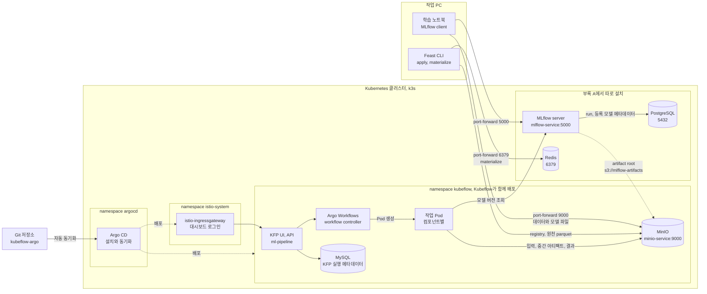
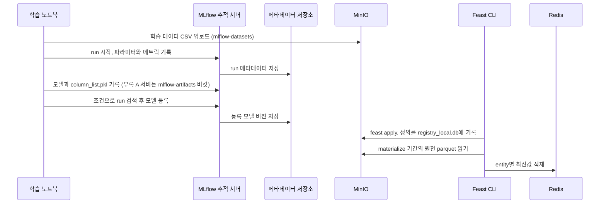
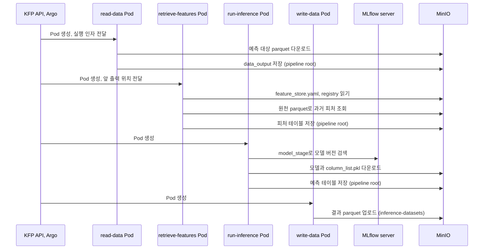
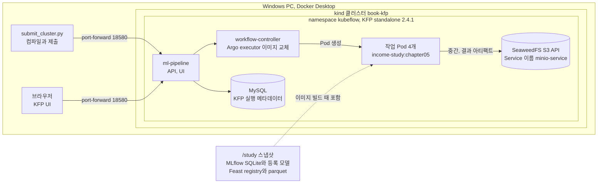
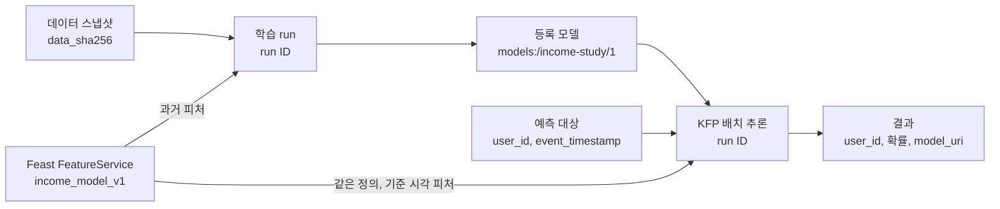
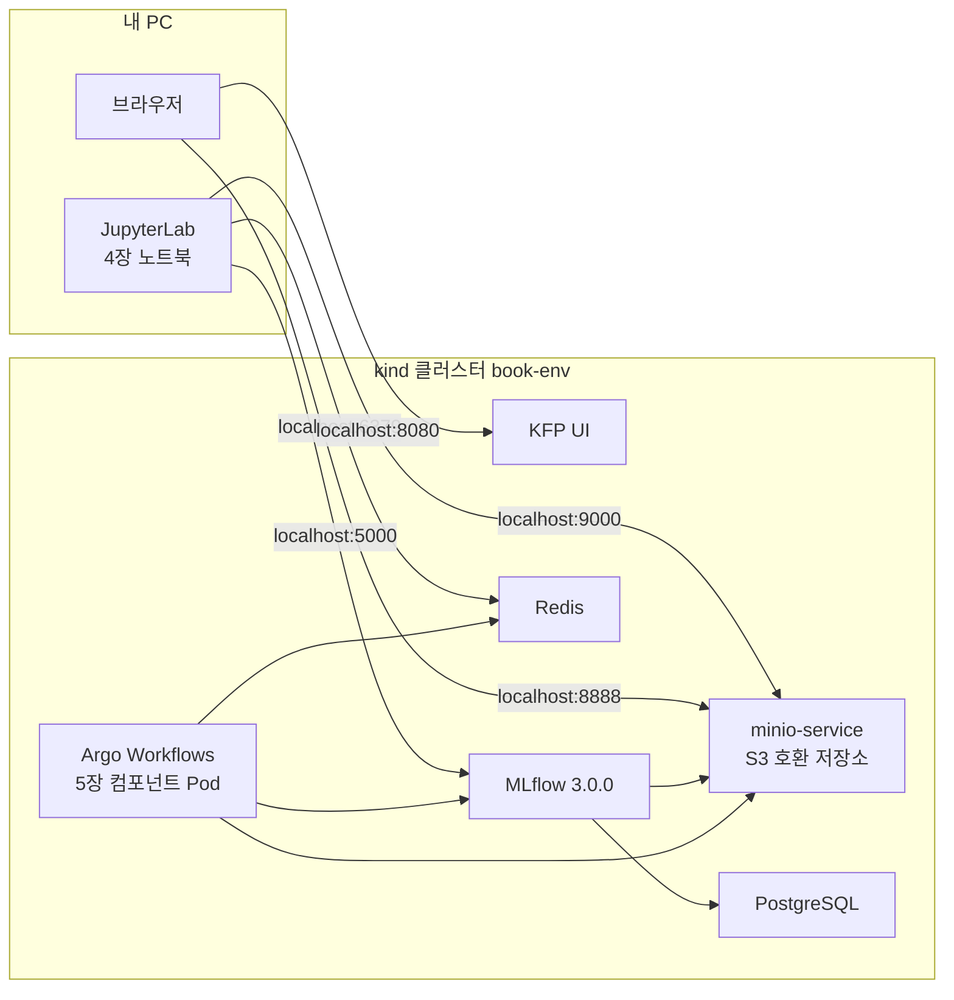
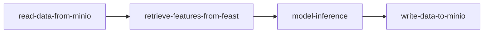

4장의 MLflow와 Feast를 5장의 Kubeflow Pipelines까지 이어서 정리했다. 도구를 하나씩 보는 것보다 학습 데이터가 어디에 저장되고, 등록한 모델과 피처를 추론에서 어떻게 다시 찾는지 따라가는 편이 이해하기 쉬웠다. 특히 5장 파이프라인은 학습이 아니라 **이미 등록한 모델을 사용하는 배치 추론**이라는 점을 먼저 구분해 두면 좋다.

앞부분은 도구의 연결 구조와 이를 확인하기 위한 작은 실습이고, 맨 아래에는 [책 코드로 따라 하는 로컬 실습 SOP](#book-lab-sop)를 붙였다. SOP에서 쓰는 [ml-platform-book-env](https://github.com/johklo/ml-platform-book-env)는 클러스터 생성부터 버킷 설정, KFP 결과 확인까지 한 환경에서 이어 갈 수 있도록 만든 저장소다.

## 1. 기술 아키텍처: 서비스와 저장소의 연결

### 책이 전제하는 클러스터 구성

책의 실습 환경을 보려면 부록 A부터 확인해야 한다. Kubernetes와 Kubeflow를 먼저 설치하고 그 위에 나머지 서비스를 올리는 순서다.

1. 작업 PC에 `yq`, `kustomize`, `kubectl`을 설치하고 k3s 또는 MicroK8s로 단일 노드 클러스터를 만든다. CPU 4개, 메모리 12GB, 디스크 50GB 이상을 권한다.
2. 저자의 [kubeflow-argo](https://github.com/vmallya-123/kubeflow-argo) 저장소를 내려받아 `kubectl apply -k argocd/`로 **Argo CD**를 먼저 설치한다.
3. 같은 저장소에서 `kubectl apply -f kubeflow.yaml`을 실행한다. 이 파일은 Argo CD Application 하나이며, 저장소의 Kubeflow 매니페스트 전체를 자동 동기화(`prune`, `selfHeal`)하도록 등록한다. Argo CD가 구성 요소별 Application을 만들어 배포하고, 책은 모두 초록색이 될 때까지 30분 정도 걸렸다고 적었다.
4. `istio-ingressgateway` 주소로 Kubeflow 대시보드에 접속해 기본 계정 `user@kubeflow.org`로 로그인한다.

**Argo CD는 Kubeflow 구성 요소가 아니라 책이 Kubeflow 매니페스트 배포에 선택한 GitOps 도구다.** 반면 KFP가 작업을 Pod로 실행할 때 사용하는 Argo Workflows는 Kubeflow Pipelines에 포함된 실행 엔진이다.

| 구분 | 구성 요소 | 설치 방법 |
| --- | --- | --- |
| 설치 도구 | Argo CD | 부록 A.1.7, `kubectl apply -k argocd/` |
| Kubeflow와 함께 배포 | Istio, Dex와 인증, cert-manager, Knative, 중앙 대시보드, Notebooks, Profiles | `kubeflow.yaml` 적용 후 Argo CD 배포 |
| Kubeflow Pipelines와 함께 배포 | KFP API와 UI, Argo Workflows, MySQL, **MinIO** | KFP와 함께 배포 |
| 따로 설치 | PostgreSQL, Redis | 부록 A의 Bitnami Helm chart |
| 따로 설치 | MLflow 추적 서버 | 부록 A 이미지 빌드, Deployment와 Service 적용 |
| 따로 설치 | Yatai, Evidently UI | 부록 A, 6장 모델 서빙과 데이터 변화 관측에 사용 |
| 직접 생성 | 버킷 `mlflow-datasets`, `mlflow-artifacts`, `feature-registry`, 피처 원천 버킷 | MinIO 콘솔 또는 업로드 스크립트 |

**MinIO는 별도 설치하지 않는다.** KFP와 함께 배포되는 MinIO를 다른 도구도 공용 객체 저장소로 쓴다. 4장은 `kubectl port-forward svc/minio-service -n kubeflow 9000:9000`으로 PC에서 접속한 뒤 `minio/minio123` 계정으로 로그인해 버킷을 만든다. 자동 생성되는 버킷은 KFP용 `mlpipeline`뿐이며 나머지는 직접 만들어야 한다.

여기서 헷갈리기 쉬운 부분은 MLflow의 위치다. 4장은 PC에서 `mlflow ui`를 띄우고 `set_tracking_uri("http://localhost:5000")`로 연결하므로 run과 모델은 PC에, 학습 CSV는 MinIO에 저장한다. 반면 부록 A는 클러스터의 공용 서버를 설명하고, 5장 추론은 Pod에서 접근할 수 있는 `mlflow_host`와 MinIO를 전제로 한다.



| 역할 | 버킷 또는 위치 | 쓰는 쪽 | 읽는 쪽 |
| --- | --- | --- | --- |
| 원천 데이터 보관 | `mlflow-datasets`, 피처 원천 버킷 | 학습 및 피처 생성 | 재현, 과거 조회 |
| 도구의 저장 백엔드 | `mlflow-artifacts`, `feature-registry` | MLflow, Feast | 추론 및 피처 조회 Pod |
| 작업 사이의 전달 | KFP pipeline root, `mlpipeline` | 작업 Pod 출력 | 다음 Pod 입력 |
| 업무 결과 | `inference-datasets` | 결과 저장 Pod | 후속 시스템 |

본문 `FileSource`는 `s3://feature_data_sets/...`, 공식 [chapter-4](https://github.com/practical-mlops/chapter-4) README는 `feature-data-sets`를 쓴다. S3 버킷명에 밑줄을 쓸 수 없어 실제 이름은 하이픈으로 맞춘다. Feast registry도 4장 PC의 `registry_local.db`, 5장 클러스터 Job의 `registry.db`로 다르다.

주소와 권한을 볼 때는 두 가지를 나눠 봐야 한다. **MLflow의 메타데이터는 PostgreSQL에, 모델 같은 파일은 MinIO에 저장된다.** `--default-artifact-root s3://mlflow-artifacts`를 쓰는 구성에서는 클라이언트도 MinIO에 접근해야 해서, 5장 추론에 MLflow 주소뿐 아니라 MinIO 키와 `AWS_ENDPOINT_URL`이 함께 들어간다.

부록 A의 기본 계정 `minio/minio123`은 환경 변수에 있고, 5장 컴포넌트는 `access_key`, `secret_key`를 파이프라인 파라미터로 받아 KFP UI에도 노출한다. 실습용 설정으로만 보고 실제 환경에서는 Kubernetes Secret과 서비스 계정 권한으로 바꿔야 한다.

Kubeflow 1.7 KFP는 MinIO를 기본 저장소로 배포했다. [공식 문서](https://www.kubeflow.org/docs/components/pipelines/operator-guides/configure-object-store/)에 따르면 KFP 2.15부터 SeaweedFS가 기본이지만 MinIO 등 S3 호환 저장소도 설정할 수 있다.

### 학습과 등록 시점의 흐름 (책 4장)



로컬 MLflow는 메타데이터와 모델 파일을 PC에 저장하고, 부록 A 서버는 PostgreSQL과 MinIO의 `mlflow-artifacts`를 쓴다. 두 경우 모두 학습 CSV를 `mlflow-datasets`에 올려 `log_input()`으로 run에 연결한다.

책에서는 학습을 마친 뒤 Feast를 등록해서 두 도구가 **열 이름으로만** 연결된다. 이 연결을 코드에서도 확인하고 싶어 아래의 작은 실습에서는 Feast 정의부터 적용하고, Feast에서 조회한 데이터로 모델을 학습하도록 순서를 바꿨다.

이 단계는 PC에서 port-forward를 열어 수동 실행한다. 책의 KFP는 학습, 모델 등록, `materialize`를 수행하지 않으므로 실행 전에 **모델 버전과 Feast 정의를 등록해야 한다.**

### 배치 추론 시점의 흐름 (책 5장)



KFP는 앞 작업의 pipeline root 파일을 다음 Pod 입력으로 전달하며 파이썬 객체나 메모리를 공유하지 않는다. PC `localhost:9000`으로 등록한 Feast 정의는 Pod에서 쓸 수 없다. Pod의 `localhost`는 해당 Pod 자신이다.

책은 endpoint를 `minio-service.kubeflow.svc.cluster.local:9000`으로 바꾸고 클러스터의 Kubernetes Job에서 `feast apply`를 다시 실행한다. **Feast 정의에는 피처 이름, 원천 위치, 접속 주소가 함께 기록된다.**

### 실습에서 구성한 아키텍처

먼저 작업을 Pod로 나누고 파일을 다음 단계에 전달하는 부분부터 확인했다. 이 실습은 모델과 피처를 이미지에 넣은 구성이고, 공용 MLflow 서버와 원격 Feast까지 연결하는 과정은 맨 아래 SOP에서 따로 다룬다.



| 구성 | 책 | 실습 | 영향 |
| --- | --- | --- | --- |
| 클러스터 | k3s, Argo CD로 Kubeflow 1.7 전체 | kind, `kubectl apply -k`로 KFP standalone 2.4.1 | Argo CD, Istio, Notebooks 없이 Pipelines만 사용 |
| 객체 저장소 | KFP와 함께 배포된 MinIO | SeaweedFS, `minio-service` 이름 유지 | 2.4.1 매니페스트의 MinIO 이미지를 받을 수 없어 교체 |
| MLflow | 서버, PostgreSQL, MinIO artifact | 이미지 안의 SQLite와 등록 모델 | 모델 조회가 네트워크를 거치지 않음 |
| Feast | MinIO registry와 원천, Redis | 이미지 안의 file registry와 parquet | 배치 추론에는 온라인 저장소가 필요 없음 |
| 입력과 결과 | MinIO에서 읽고 `inference-datasets`에 업로드 | 이미지의 요청 파일, 결과는 KFP 아티팩트 | 업무 결과 쓰기는 통합 실습에서 이어감 |
| 모델 참조 | `model_stage` 검색 | `models:/income-study/1` 구체 버전 | 재실행해도 같은 모델 |

이 구성에서는 MLflow와 Feast 조회가 이미지 안에서 이뤄지므로 원격 서비스 연결까지 확인한 것은 아니다. 모델이나 원천 데이터가 바뀌면 새 이미지 태그로 다시 빌드해야 한다.

## 2. 처음부터 끝까지 함께 고정할 식별자

재현에 필요한 식별자는 다음과 같다.



| 식별자 | 예 | 기록하는 곳 |
| --- | --- | --- |
| 데이터 스냅샷 | CSV SHA-256 | MLflow run tag와 artifact |
| 코드 | 코드 해시, 이미지 태그 | MLflow tag, 실행 이미지 |
| 피처 정의 | FeatureService `income_model_v1`, `features.py` 해시 | Feast registry, run, 버전 tag |
| 모델 | `models:/income-study/1`과 원천 run | MLflow 모델 레지스트리 |
| 예측 기준 시각 | `event_timestamp` | 예측 대상 파일과 결과 |
| 파이프라인 실행 | KFP run ID | KFP metadata, 결과 경로 |

모델 이름이나 stage는 다른 버전으로 바뀔 수 있으므로 결과에 구체 모델 URI를 기록한다.

## 3. Feast: 피처를 정의하고 과거 시점과 현재로 조회하기 (책 4.2)


Offline store는 MinIO parquet, Online store는 Redis, Registry는 MinIO의 `registry_local.db`다. `get_historical_features`는 기준 시점의 값을, `get_online_features`는 Redis의 최신값을 조회한다.

학습 코드와 서빙 코드에서 조인과 변환을 따로 작성하면 같은 이름의 피처도 다른 값이 될 수 있다. 이런 차이를 training-serving skew라고 한다.

### 등록과 적재는 다르다

| 구성 요소 | 쉬운 역할 | 저장하는 것 |
| --- | --- | --- |
| Entity | 누구의 값인가 | `user_id` 조인 키 |
| Data source | 파일과 테이블 위치, 시간 필드, 접속 주소 | 파일 위치, 접속 정보 |
| Feature view | 피처 schema, entity, TTL | 조회 정의 |
| Registry | entity, feature view 메타데이터 | 정의 목록 |
| Offline store | 과거 피처 이력 | 과거 조회값 |
| Online store | 최신 피처 | 최신 피처 |

Feast에서 먼저 구분할 것은 **정의 등록과 값 적재가 별개**라는 점이다. `feast apply`는 Registry에 정의를 반영하고, `materialize`는 오프라인 값을 온라인 저장소로 옮긴다. UI에 feature view가 보여도 Redis에 값이 들어 있다는 뜻은 아니다.

Data source에는 접속 주소도 있다. 책은 PC의 `localhost:9000`과 `s3_endpoint_override`로 등록하지만 Pod의 `localhost`는 Pod 자신이다. 5장에서는 클러스터 주소로 재등록한다. 정의와 실행 주소를 분리하면 재등록을 줄일 수 있다.

### Point-in-time join을 숫자로 계산하기

| 조회 방식 | 주로 쓰는 상황 | 중요한 기준 |
| --- | --- | --- |
| Historical, offline | 과거 학습과 배치 추론 | 시점상 사용 가능 여부 |
| Online | 실시간 예측 | 지연, 최신성, 누락 |

사용자 42를 5월 22일 시점에 예측한다고 해 보자. 아래 이력에서 쓸 수 있는 최근 값은 5월 21일의 36이다.

| user_id | 관측 시점 | hours_per_week |
| --- | --- | --- |
| 42 | 5월 7일 | 30 |
| 42 | 5월 21일 | 36 |
| 42 | 6월 4일 | 52 |

사용자 ID만 조인하면 6월 값까지 붙거나 행이 중복될 수 있다. 미래의 52를 사용하면 당시 가능한 예측을 평가하지 못한다.

TTL 2일이면 5월 22일에 최근 2일 값을 쓰지만, 기준일이 5월 25일이면 5월 21일 값은 범위 밖이다. 원천 행이 있어도 유효하지 않을 수 있다.

다만 시간 조건으로 조인한다고 모든 누설을 막는 것은 아니다. 5월 21일 발생한 데이터가 23일에 도착했다면 22일에는 알 수 없었던 값이므로, 지연 도착이나 보정 이력이 있는 데이터는 실제 사용 가능 시점까지 고려해야 한다.

### 실습: 로컬 Feast의 과거 값과 온라인 값

Feast와 MLflow를 같은 가상환경에 설치한다. 실습 환경은 WSL2 Ubuntu 24.04와 Python 3.11이며, Linux가 필요한 KFP 로컬 실행도 Windows에서는 WSL2로 진행한다.

```bash
python3 -m venv .venv
source .venv/bin/activate
python -m pip install mlflow==2.16.2 scikit-learn==1.5.2 feast==0.40.1 \
    pandas==2.2.3 numpy==1.26.4 pyarrow==17.0.0 sqlalchemy==2.0.36
```

`feature_study.py`는 사용자 600명의 근무 시간과 근무 형태를 두 시점씩 기록한다. 사용자 42의 5월 21일 값은 36, 6월 4일 값은 52이며 정답은 기준 시각과 함께 `labels.parquet`에 둔다. 로컬 parquet와 SQLite를 쓰며 기존 `income-features-study` 폴더가 있으면 실패한다.

`FeatureService`는 모델 피처 묶음에 `income_model_v1` 이름을 붙인다. 학습, 배치 추론, 온라인 조회가 같은 이름을 사용해 피처 계약을 공유한다.

```python
from datetime import datetime, timezone
import importlib.util
from pathlib import Path

import numpy as np
import pandas as pd
from feast import FeatureStore

repo = Path("income-features-study").resolve()
repo.mkdir()
rng = np.random.default_rng(23)
users = np.arange(1000, 1600)
classes = ["private", "public", "self-employed"]
observed = pd.Timestamp("2025-04-01", tz="UTC") + pd.to_timedelta(
    rng.integers(0, 30, size=users.size), unit="D"
)
hours = rng.integers(20, 61, size=users.size).astype(float)
workclass = rng.choice(classes, size=users.size)
history = pd.concat([
    pd.DataFrame({
        "user_id": users, "event_timestamp": observed,
        "hours_per_week": hours, "workclass": workclass,
    }),
    pd.DataFrame({
        "user_id": users, "event_timestamp": observed + pd.Timedelta(days=45),
        "hours_per_week": rng.integers(20, 61, size=users.size).astype(float),
        "workclass": rng.choice(classes, size=users.size),
    }),
    pd.DataFrame({
        "user_id": [42, 42],
        "event_timestamp": pd.to_datetime([
            "2025-05-21T00:00:00Z", "2025-06-04T00:00:00Z"
        ]),
        "hours_per_week": [36.0, 52.0],
        "workclass": ["private", "self-employed"],
    }),
], ignore_index=True)
source = repo / "hours.parquet"
history.to_parquet(source, index=False)

effect = pd.Series(workclass).map({
    "private": 0.0, "public": -0.4, "self-employed": 0.8
}).to_numpy()
score = (hours - 40) / 8 + effect + rng.normal(size=users.size)
pd.DataFrame({
    "user_id": users,
    "event_timestamp": observed + pd.Timedelta(days=7),
    "target": (score > 0).astype(int),
}).to_parquet(repo / "labels.parquet", index=False)

(repo / "feature_store.yaml").write_text(
    "project: income_study\n"
    "provider: local\n"
    "entity_key_serialization_version: 2\n"
    "registry: registry.db\n"
    "offline_store:\n  type: file\n"
    "online_store:\n  type: sqlite\n  path: online.db\n",
    encoding="utf-8",
)
(repo / "features.py").write_text(
    "from datetime import timedelta\n"
    "from feast import Entity, FeatureService, FeatureView, Field, FileSource, ValueType\n"
    "from feast.types import Float64, String\n"
    "user = Entity(name='user', join_keys=['user_id'], value_type=ValueType.INT64)\n"
    f"source = FileSource(path={str(source)!r}, timestamp_field='event_timestamp')\n"
    "hours = FeatureView(name='hours', entities=[user], "
    "ttl=timedelta(days=365), "
    "schema=[Field(name='hours_per_week', dtype=Float64), "
    "Field(name='workclass', dtype=String)], source=source)\n"
    "income_model_v1 = FeatureService(name='income_model_v1', features=[hours])\n",
    encoding="utf-8",
)
spec = importlib.util.spec_from_file_location("study_features", repo / "features.py")
definitions = importlib.util.module_from_spec(spec)
spec.loader.exec_module(definitions)
store = FeatureStore(repo_path=str(repo))
store.apply([definitions.user, definitions.hours, definitions.income_model_v1])

service = store.get_feature_service("income_model_v1")
entities = pd.DataFrame({
    "user_id": [42],
    "event_timestamp": pd.to_datetime(["2025-05-22T00:00:00Z"]),
})
entities.to_parquet(repo / "requests.parquet", index=False)
historical = store.get_historical_features(
    entity_df=entities, features=service
).to_df()
print("Historical:", historical["hours_per_week"].tolist())
store.materialize(
    datetime(2025, 4, 1, tzinfo=timezone.utc),
    datetime(2025, 7, 1, tzinfo=timezone.utc),
)
online = store.get_online_features(
    features=service, entity_rows=[{"user_id": 42}]
).to_dict()
print("Online:", online["hours_per_week"])
```

```bash
python feature_study.py
```

과거 조회는 `Historical: [36.0]`을 반환했다. 2025년 4월 1일부터 7월 1일까지 materialize한 뒤 온라인 조회는 `Online: [52.0]`을 반환했다. 학습에 36 대신 52를 넣으면 예측 시점에 없던 정보가 누설된다.

`labels.parquet`는 학습, `requests.parquet`는 KFP가 읽는다. 예측 대상에는 사용자 42와 기준 시각 5월 22일만 있고, Feast가 시점에 맞는 피처를 붙인다.

### Feature server로 온라인 값 조회하기

Feature server는 SDK 사용이 어려운 애플리케이션용 피처 조회 API다. 접근 권한, 지연, 오류 처리는 별도로 설계한다. `income-features-study` 폴더에서 같은 가상환경으로 실행한다.

```bash
cd income-features-study
feast serve --host 127.0.0.1 --port 16566
```

다른 터미널에서 FeatureService로 사용자 `42`와 미등록 `999`를 조회한다.

```bash
curl -s -X POST http://127.0.0.1:16566/get-online-features \
  -H 'Content-Type: application/json' \
  -d '{"feature_service": "income_model_v1", "entities": {"user_id": [42, 999]}}'
```

응답은 열별 구조다. `metadata.feature_names`는 `user_id`, `workclass`, `hours_per_week` 순서로 정의와 다를 수 있어 `feature_names`와 `results`를 같은 인덱스로 읽는다.

| 피처 | 사용자 42 | 사용자 999 |
| --- | --- | --- |
| `hours_per_week` | `52.0`, `PRESENT` | `null`, `NOT_FOUND` |
| `workclass` | `self-employed`, `PRESENT` | `null`, `NOT_FOUND` |

사용자 999는 ID가 반환돼도 피처 상태는 `NOT_FOUND`다. HTTP 응답이 성공했다는 이유만으로 모델에 바로 넣으면 안 되는 이유다. 또 온라인 API는 과거 기준 시각을 받지 않으므로, 이 글의 배치 추론처럼 특정 시점의 값이 필요할 때는 `get_historical_features()`를 쓴다.

### Feast UI에서 정의 확인하기

같은 repository 폴더에서 새 터미널로 UI를 실행한다.

```powershell
feast ui --host 127.0.0.1 --port 18888
```

`http://127.0.0.1:18888`에서 **Feature Services → income_model_v1**을 연다.


`Feature Views → hours`에서 피처 타입, entity, FileSource, materialization 기간을 확인한다.


| 화면에서 확인한 항목 | 의미와 확인한 내용 |
| --- | --- |
| Features | `hours_per_week: DOUBLE`, `workclass: STRING` |
| Entities | `user` entity, `join_keys: user_id` |
| Batch Source | `FileSource` parquet 원천 (로컬 경로 비공개) |
| Materialization Intervals | 기간 `2025-04-01`~`2025-07-01` |
| Consuming Feature Services | `income_model_v1` 사용 |

Materialization 기간은 값의 존재나 최신성을 보장하지 않는다. 사용자 999 같은 누락을 검사하고 실습 후 서버를 Ctrl+C로 종료한다.

## 4. MLflow: Feast에서 조회한 피처로 학습하고 기록하기 (책 4.1)

### 데이터 탐색과 인코딩

소득 분류 데이터의 스키마, 범주 분포, 탐색 결과를 실험 출처에 기록한다.

책 예제는 직업, 학력 등 범주형 열로 소득 구간을 예측한다. `Private=0`, `Public=1`, `Self-employed=2`처럼 숫자를 부여하면 순서와 간격이 생기므로 원-핫 인코딩으로 범주별 열을 만든다.

문제는 추론에서도 같은 열 순서와 의미를 유지해야 한다는 점이다. 입력마다 `get_dummies()`를 호출하면 등장한 범주에 따라 열이 달라질 수 있어서 책의 5장 컴포넌트는 MLflow에서 `column_list.pkl`을 내려받는다. 아래 실습에서는 아예 학습한 인코더를 모델과 함께 저장했다.

인코더는 학습 데이터에만 맞추고 검증과 테스트에 같은 변환을 적용한다. 결측 표기(빈 문자열, `?`), 범주별 표본 수, 정답 비율, 중복 행도 확인한다. 교육 예제의 인종, 성별 열을 실제 의사결정에 바로 써도 된다는 뜻은 아니다.

### 실행 기록을 실험 공책처럼 읽기

Experiment는 실행 묶음, run은 개별 실행이다. parameter는 설정값, metric은 측정값, artifact는 모델과 그래프 파일이다.

| 기록 | 예시 | 질문 |
| --- | --- | --- |
| 파라미터 | 학습률, 트리 깊이 | 설정은? |
| 메트릭 | ROC-AUC, 오류율 | 결과는? |
| 아티팩트 | 모델, 그래프, 참고 데이터 | 재사용 가능한가? |
| 추적용 메타데이터 | 코드, 데이터 버전, 목적 | 실행 차이는? |

`start_run()`이 모델을 학습시키는 것은 아니다. 학습은 그 안의 `fit()`이 하고, MLflow는 `log_metric()`과 `log_model()` 호출로 결과를 기록한다. 어떤 코드와 데이터로 왜 실행했는지는 별도 메타데이터로 남겨야 나중에 run을 비교할 수 있다.

PostgreSQL backend store는 메타데이터, MinIO artifact store는 파일을 저장한다. MinIO 장애 시 모델 다운로드가 실패한다. `mlflow.log_input()`은 출처만 기록하고 데이터를 복사하지 않으므로 CSV를 덮어쓰면 기존 run의 입력이 달라진다.

| 식별자 | 가리키는 대상 | 예 |
| --- | --- | --- |
| Experiment | 실행 묶음 | `income-study` |
| Run ID | 한 번의 실행 기록 | 한 번의 학습 실행 |
| Artifact path | 실행 내 파일 위치 | `model`, `data/snapshot.csv` |
| `runs:/...` URI | 실행 모델 산출물 | `runs:/<run-id>/model` |
| `models:/.../7` URI | 등록 모델 버전 | `models:/income-study/7` |

### 모델 레지스트리

실험 추적은 실행과 결과를, 레지스트리는 관리 모델의 이름과 버전을 기록한다. 모델 버전에서 원천 run으로 연결해야 학습 조건을 추적할 수 있다.

책은 분류기들의 점수를 비교해 모델을 등록한다. 다만 테스트 점수를 보고 계속 후보를 고르면 테스트셋도 모델 선택에 쓰인 셈이 된다. 아래 실습은 검증셋으로 후보를 고르고 테스트셋은 마지막 확인에만 사용하도록 나눴다.

### 실습: 전처리를 포함한 모델 기록과 재로딩

아래 예제는 앞 절과 같은 폴더와 가상환경, MLflow 2.x 기준이다.

책 본문은 `mlflow==2.6.0`, 출간 뒤 공식 [chapter-4](https://github.com/practical-mlops/chapter-4) 저장소와 부록 A 서버 이미지는 `mlflow==3.0.0`을 사용한다. 실습은 SQLite, Feast, KFP 호환을 위해 2.16.2로 고정했다. 클러스터에서는 클라이언트와 서버의 주 버전을 맞춘다. MLflow 3은 `artifact_path` 대신 `name`을 쓰는 등 기록 방식이 달라 2.x와 3.x 혼용 시 기록이나 조회가 어긋날 수 있다.

`income_study.py`는 `labels.parquet`의 사용자와 기준 시각에 `income_model_v1` 피처를 붙인다. 합성 데이터는 책의 실제 데이터와 성능 비교에 쓸 수 없다. 저장소는 PostgreSQL과 MinIO 대신 SQLite와 로컬 artifact 폴더다.

```python
import hashlib
import json
from pathlib import Path

import mlflow
import mlflow.data
import mlflow.sklearn
import numpy as np
import pandas as pd
from feast import FeatureStore
from mlflow import MlflowClient
from mlflow.models import infer_signature
from sklearn.compose import ColumnTransformer
from sklearn.dummy import DummyClassifier
from sklearn.ensemble import RandomForestClassifier
from sklearn.metrics import roc_auc_score
from sklearn.model_selection import train_test_split
from sklearn.pipeline import Pipeline
from sklearn.preprocessing import OneHotEncoder
from sklearn.tree import DecisionTreeClassifier

repo = Path("income-features-study").resolve()
store = FeatureStore(repo_path=str(repo))
service_name = "income_model_v1"
service = store.get_feature_service(service_name)
labels = pd.read_parquet(repo / "labels.parquet")
data = store.get_historical_features(entity_df=labels, features=service).to_df()
data = data.sort_values(["user_id", "event_timestamp"]).reset_index(drop=True)
columns = ["hours_per_week", "workclass"]
if len(data) != len(labels) or data[columns].isna().any().any():
    raise ValueError("Every label row needs point-in-time features")

snapshot = Path("training_snapshot.csv")
snapshot.write_text(data.to_csv(index=False), encoding="utf-8")
lineage = {
    "data_sha256": hashlib.sha256(snapshot.read_bytes()).hexdigest(),
    "code_sha256": hashlib.sha256(Path(__file__).read_bytes()).hexdigest(),
    "feast_project": store.project,
    "feast_feature_service": service_name,
    "feast_definitions_sha256": hashlib.sha256(
        (repo / "features.py").read_bytes()
    ).hexdigest(),
}
feature_refs = sorted(
    f"{projection.name}:{field.name}"
    for projection in service.feature_view_projections
    for field in projection.features
)

train_valid, test = train_test_split(
    data, test_size=0.2, random_state=23, stratify=data["target"]
)
train, valid = train_test_split(
    train_valid, test_size=0.25, random_state=23,
    stratify=train_valid["target"]
)
baseline = DummyClassifier(strategy="prior").fit(train[columns], train["target"])
baseline_auc = roc_auc_score(
    valid["target"], baseline.predict_proba(valid[columns])[:, 1]
)
training_input = mlflow.data.from_pandas(
    data.drop(columns=["event_timestamp"]), source=str(snapshot.resolve()),
    name="income-training-from-feast", targets="target",
)

mlflow.set_tracking_uri("sqlite:///income-study.db")
mlflow.set_experiment("income-study")
candidates = []
for name, estimator in [
    ("tree", DecisionTreeClassifier(max_depth=3, random_state=23)),
    ("forest", RandomForestClassifier(
        n_estimators=80, max_depth=5, random_state=23
    )),
]:
    transform = ColumnTransformer([
        ("workclass", OneHotEncoder(handle_unknown="ignore"), ["workclass"]),
        ("hours", "passthrough", ["hours_per_week"]),
    ])
    model = Pipeline([("transform", transform), ("classifier", estimator)])
    with mlflow.start_run(run_name=name) as run:
        model.fit(train[columns], train["target"])
        auc = roc_auc_score(
            valid["target"], model.predict_proba(valid[columns])[:, 1]
        )
        mlflow.log_params({
            "model_kind": name, "split_seed": 23,
            "max_depth": estimator.max_depth,
            "train_rows": len(train), "validation_rows": len(valid),
            "feature_refs": json.dumps(feature_refs),
        })
        mlflow.set_tags(lineage)
        mlflow.log_input(training_input, context="training")
        mlflow.log_metric("validation_auc", auc)
        mlflow.log_metric("baseline_validation_auc", baseline_auc)
        mlflow.log_artifact(str(snapshot), artifact_path="data")
        for definition in ("features.py", "feature_store.yaml"):
            mlflow.log_artifact(str(repo / definition), artifact_path="feast")
        mlflow.sklearn.log_model(
            model, "model",
            signature=infer_signature(train[columns], model.predict(train[columns])),
            input_example=train[columns].head(2),
        )
        candidates.append((auc, run.info.run_id, model))

best_auc, run_id, selected = max(candidates, key=lambda item: item[0])
if best_auc < baseline_auc + 0.05:
    raise RuntimeError("No candidate passed the validation improvement gate")

with mlflow.start_run(run_id=run_id):
    test_auc = roc_auc_score(
        test["target"], selected.predict_proba(test[columns])[:, 1]
    )
    mlflow.log_metric("final_test_auc", test_auc)
registered = mlflow.register_model(f"runs:/{run_id}/model", "income-study")
client = MlflowClient()
for key in ("feast_feature_service", "feast_definitions_sha256", "data_sha256"):
    client.set_model_version_tag(
        "income-study", registered.version, key, lineage[key]
    )
fixed_uri = f"models:/income-study/{registered.version}"
loaded = mlflow.sklearn.load_model(fixed_uri)
np.testing.assert_allclose(
    selected.predict_proba(test[columns]),
    loaded.predict_proba(test[columns]),
)
Path("selected_model_uri.txt").write_text(fixed_uri, encoding="utf-8")
print({
    "model_uri": fixed_uri, "feature_service": service_name,
    "rows": len(data), "validation_auc": best_auc, "test_auc": test_auc,
})
```

```bash
python income_study.py
mlflow ui --backend-store-uri sqlite:///income-study.db --host 127.0.0.1 --port 5000
```

같은 폴더에서 UI를 실행해 `http://127.0.0.1:5000`을 연다. 두 run의 `validation_auc`, 데이터 해시, snapshot, model 파일과 구체 모델 버전을 확인한 뒤 Ctrl+C로 종료한다.

실행하면 `{'model_uri': 'models:/income-study/1', 'feature_service': 'income_model_v1', 'rows': 600, ...}`가 출력된다. 정답 600행 모두에 기준 시각 피처가 연결됐다. 핵심은 다섯 가지다.

1. Feast의 `get_historical_features()`로 학습 데이터를 만들고 피처 누락 시 중단한다.
2. FeatureService, 피처 목록, `features.py` 해시를 run에 tag/parameter로 남기고 `features.py`, `feature_store.yaml`을 artifact로 보관한다. YAML은 저장소 설정, Python 파일은 피처 정의다.
3. 검증셋으로 선택한 모델에만 최종 테스트를 적용한다.
4. 인코더와 분류기를 `Pipeline`으로 저장해 추론 때 재학습하지 않는다.
5. 모델 버전에도 FeatureService와 정의 해시를 tag로 기록하고 재로딩한 예측 확률을 비교한다.

결국 MLflow와 Feast를 이어 주는 것은 학습 코드와 그 코드가 남긴 기록이다. 모델 버전에서 어떤 피처 정의를 썼는지 찾아갈 수 있게 하고, KFP 추론에는 `selected_model_uri.txt`에 저장한 고정 버전을 넘긴다.

### MLflow에서 실험과 모델 연결 확인하기


forest의 검증과 테스트 AUC는 각각 약 `0.9337`, `0.9393`이었다. tree는 `0.9128`, 기준선은 `0.5`다. `max_depth: 5`, 학습 360행, 검증 120행, `feast_feature_service: income_model_v1` tag를 확인한다.

검증셋으로 후보를 고른 뒤 테스트셋에 한 번 적용한다. AUC는 서로 다른 데이터에서 계산되며 합성 데이터 점수를 실제 소득 분류 성능으로 일반화할 수 없다.

`Datasets used`의 `income-training-from-feast`는 `log_input()` 메타데이터다. 학습 행은 `training_snapshot.csv`에 별도 보관한다.


run의 Feast 사본으로 학습 당시 정의를 확인한다.


`income-study` 버전 `1`의 Source Run은 `forest`다. KFP 추론은 `feast_feature_service` tag와 파이프라인 FeatureService가 다르면 중단한다. 버전 1은 프로덕션에 자동 배포되지 않았다.

### 일부러 깨뜨려 보기

`training_snapshot.csv` 수정은 SHA-256을 바꿔 기존 run의 입력과 구분한다. 재실행은 Feast에서 다시 조회한다. `features.py` 변경은 `feast_definitions_sha256`으로 피처 계약을 구분한다.

`workclass`가 없으면 예측이 실패해야 한다. 누락 열을 0으로 채우면 계약 위반을 숨긴다.

`champion` alias와 stage는 가리키는 버전이 바뀔 수 있다. MLflow 2.x stage와 이후 alias를 구분하고 배치 시작 시 구체 버전 URI를 고정한다.

## 5. Kubeflow Pipelines: 고정한 모델과 피처로 배치 추론하기 (책 5장)


세로 화살표는 **작업 순서**, 가로 화살표는 **파일 저장과 재조회 경로**다.

### 컴포넌트 계약

| 컴포넌트 | 받는 것 | 내보내는 것 | 접속하는 서비스 |
| --- | --- | --- | --- |
| 데이터 읽기 | 대상 파일 위치 | 대상 사용자 | MinIO |
| 피처 조회 | 사용자, 기준 시각, 피처 목록 | 모델 입력 | MinIO registry와 원천 |
| 추론 | 피처, 모델 참조 | 예측 결과 | MLflow, MinIO |
| 데이터 쓰기 | 결과와 목적지 | 결과 파일 | MinIO |

재사용성은 함수 수보다 입출력 계약의 명확성에 달려 있다. 피처 열 순서나 형식이 바뀌면 단계가 성공해도 예측이 틀릴 수 있다.

책은 Python 프로그램을 이미지로 만들고 YAML의 `inputValue`, `inputPath`, `outputPath`로 인자를 연결한다. 실습은 같은 원리를 KFP 2.x Python 컴포넌트로 구현한다.

### 코드가 실행되는 세 시점

| 시점 | 지금 하는 일 | 아직 하지 않은 일 |
| --- | --- | --- |
| 컴포넌트, 파이프라인 정의 | 작업과 연결 정의 | 데이터를 읽거나 모델로 예측하지 않음 |
| `Compiler().compile()` | 정의를 실행 명세 YAML로 변환 | 클러스터에 Pod를 띄우지 않음 |
| 로컬 runner 또는 클러스터 실행 | 입력으로 실행 | 업무 품질과 출시 승인 제외 |

YAML 컴파일이 성공해도 서비스 주소나 권한, 컨테이너 패키지가 맞는지는 아직 모른다. 실행 중 모델을 찾지 못한다면 컴파일 코드보다 해당 Pod가 어디로 접속하는지부터 확인하는 편이 빠르다.

### 파라미터와 아티팩트

`model_uri`, 처리 기준일 같은 값은 파라미터이고 사용자 목록, 피처 테이블, 예측 결과는 파일 아티팩트다.

| SDK 또는 명세 표현 | 컨테이너 안에서의 의미 | 흔한 오해 |
| --- | --- | --- |
| `str`, `int` 파라미터 | 소형 인자 | 대용량 데이터 인자 전달 |
| `Input[Dataset]` | 앞 단계 파일 입력 | 앞 Pod 객체 공유 |
| `Output[Dataset]` | 결과 파일 위치 | 반환값 자동 저장 |
| `inputPath`, `outputPath` | 컨테이너 경로 | PC 경로 공유 |

`Output[Dataset]`의 `.path`에 파일을 써야 런타임이 pipeline root에 저장해 다음 단계로 전달한다. KFP `Dataset`은 파일 종류만 지정하며 열 타입과 결측은 검사하지 않는다.

### 실습: 모델과 Feast를 연결한 네 단계 파이프라인

앞서 만든 `selected_model_uri.txt`, `income-study.db`, `income-features-study`를 사용한다. 같은 가상환경에 `kfp==2.10.1`을 설치하며 컴파일에는 KFP SDK만 필요하다.

다음 코드를 `pipeline_study.py`로 저장한다.

```python
from kfp import compiler, dsl
from kfp.dsl import Dataset, Input, Output


@dsl.component(base_image="python:3.12-slim-bookworm", install_kfp_package=False)
def read_data(source_path: str, entities: Output[Dataset]):
    from pathlib import Path
    import pandas as pd

    frame = pd.read_parquet(source_path)
    required = ["user_id", "event_timestamp"]
    if not set(required).issubset(frame.columns):
        raise ValueError("Entity input must include ID and prediction time")
    if frame.empty or frame[required].isna().any().any():
        raise ValueError("Entity input is empty or contains missing keys")
    if frame.duplicated(required).any():
        raise ValueError("Duplicate entity and prediction time")
    Path(entities.path).parent.mkdir(parents=True, exist_ok=True)
    frame[required].to_parquet(entities.path, index=False)


@dsl.component(base_image="python:3.12-slim-bookworm", install_kfp_package=False)
def retrieve_features(
    repo_path: str, feature_service: str,
    entities: Input[Dataset], features: Output[Dataset]
):
    from pathlib import Path
    import pandas as pd
    from feast import FeatureStore

    requests = pd.read_parquet(entities.path)
    store = FeatureStore(repo_path=repo_path)
    frame = store.get_historical_features(
        entity_df=requests,
        features=store.get_feature_service(feature_service),
    ).to_df()
    keys = ["user_id", "event_timestamp"]
    aligned = requests.merge(frame, on=keys, how="left", validate="one_to_one")
    columns = ["hours_per_week", "workclass"]
    if aligned[columns].isna().any().any():
        raise ValueError("Historical features are missing for requested entities")
    Path(features.path).parent.mkdir(parents=True, exist_ok=True)
    aligned.to_parquet(features.path, index=False)


@dsl.component(base_image="python:3.12-slim-bookworm", install_kfp_package=False)
def run_inference(
    tracking_uri: str, model_uri: str, feature_service: str,
    features: Input[Dataset], predictions: Output[Dataset]
):
    from pathlib import Path
    import re
    import mlflow
    import mlflow.sklearn
    import pandas as pd
    from mlflow import MlflowClient

    match = re.fullmatch(r"models:/([^/]+)/([0-9]+)", model_uri)
    if not match:
        raise ValueError("Use a fixed numeric registered-model version")
    mlflow.set_tracking_uri(tracking_uri)
    version = MlflowClient().get_model_version(*match.groups())
    if version.tags.get("feast_feature_service") != feature_service:
        raise ValueError("Model was not trained with this feature service")
    model = mlflow.sklearn.load_model(model_uri)
    frame = pd.read_parquet(features.path)
    inputs = frame[["hours_per_week", "workclass"]]
    positive = list(model.classes_).index(1)
    frame["probability_gt_50k"] = model.predict_proba(inputs)[:, positive]
    frame["model_uri"] = model_uri
    frame["feature_service"] = feature_service
    Path(predictions.path).parent.mkdir(parents=True, exist_ok=True)
    frame.to_parquet(predictions.path, index=False)


@dsl.component(base_image="python:3.12-slim-bookworm", install_kfp_package=False)
def write_data(predictions: Input[Dataset], result: Output[Dataset]):
    from pathlib import Path
    import pandas as pd

    frame = pd.read_parquet(predictions.path)
    if not frame["probability_gt_50k"].between(0, 1).all():
        raise ValueError("Invalid prediction probability")
    Path(result.path).parent.mkdir(parents=True, exist_ok=True)
    frame.to_parquet(result.path, index=False)
    print(frame.to_string(index=False))


@dsl.pipeline(name="income-study-batch")
def study_pipeline(
    source_path: str, repo_path: str, tracking_uri: str,
    model_uri: str, feature_service: str
):
    read = read_data(source_path=source_path)
    features = retrieve_features(
        repo_path=repo_path, feature_service=feature_service,
        entities=read.outputs["entities"],
    )
    predict = run_inference(
        tracking_uri=tracking_uri, model_uri=model_uri,
        feature_service=feature_service,
        features=features.outputs["features"],
    )
    write_data(predictions=predict.outputs["predictions"])


if __name__ == "__main__":
    compiler.Compiler().compile(
        pipeline_func=study_pipeline,
        package_path="income-study-pipeline.yaml",
    )
```

```powershell
python pipeline_study.py
```

`income-study-pipeline.yaml`에 네 task와 입력, 출력 연결이 생성되는지 확인한다. `read.outputs["entities"]` 전달로 데이터 의존성이 생긴다. 호출 순서만 지정하는 `.after()`와 다르다.

`run_inference`는 책과 달리 `models:/이름/숫자` 형식만 받아 재실행에도 같은 모델을 쓴다. 피처 조회와 추론은 같은 `feature_service`를 전달하며, 모델 버전의 `feast_feature_service` tag와 다르면 실패한다.

### 클러스터 없이 실행 흐름 확인하기

SubprocessRunner는 Linux 또는 WSL2에서 실행한다. Windows 네이티브는 POSIX 셸과 Python 경로 처리로 실패할 수 있다. WSL2에서는 새 가상환경에 파일과 모델을 다시 만든다.

다음 코드를 같은 폴더의 `run_pipeline_study.py`로 저장한다.

```python
from pathlib import Path
from kfp import local
from pipeline_study import study_pipeline

root = Path.cwd()
local.init(
    runner=local.SubprocessRunner(use_venv=False),
    pipeline_root=str(root / "kfp-local-output"),
)
study_pipeline(
    source_path=str(root / "income-features-study" / "requests.parquet"),
    repo_path=str(root / "income-features-study"),
    tracking_uri="sqlite:///" + (root / "income-study.db").as_posix(),
    model_uri=(root / "selected_model_uri.txt").read_text(encoding="utf-8").strip(),
    feature_service="income_model_v1",
)
```

```powershell
python run_pipeline_study.py
```

WSL2 Ubuntu 24.04, Python 3.11.15, KFP 2.10.1에서 실행했다. 로그에서 각 task가 다음 순서로 끝나는지 확인한다.

1. `read-data`는 요청 목록을 읽어 다음 단계 artifact로 저장한다.
2. `retrieve-features`는 요청에 과거 피처를 연결하고 누락을 검사한다.
3. `run-inference`는 고정 MLflow 모델 버전으로 예측한다.
4. `write-data`와 pipeline 성공 후 마지막 parquet를 확인한다.

최종 결과는 사용자 `42`, 기준 시각 `2025-05-22`, 피처 `36.0`과 `private`, 모델 `models:/income-study/1`, FeatureService `income_model_v1`, 확률 약 `0.496542`다. 온라인 값 52 대신 과거 값 36을 썼다.

SubprocessRunner는 PC 파일과 패키지를 공유한다. 클러스터는 별도 Pod로 실행하고 artifact 저장소로 파일을 전달한다.

### 그대로 클러스터에 올리면 안 되는 이유

기본 Python 이미지에는 pandas, Feast, MLflow가 없고 PC의 `source_path`, Feast registry, SQLite DB도 Pod에서 보이지 않는다.

| 로컬 예제 | 책의 클러스터 구성에서 필요한 변경 |
| --- | --- |
| PC의 `requests.parquet` 읽기 | MinIO에서 대상 파일 다운로드 |
| PC의 Feast repository | 클러스터 registry와 source |
| `sqlite:///...` MLflow | `mlflow-service`와 MinIO artifact store |
| 기본 Python 이미지 | 고정 의존성과 코드가 든 이미지 |
| 마지막 `Output[Dataset]` | 필요 시 `inference-datasets`에 확정 저장 |

### Kubernetes에서 네 작업 실행하기

Docker Desktop Linux 엔진에 kind 클러스터를 만들고 **Kubeflow Pipelines standalone**을 설치한다.

| 구성 | 실습 환경 |
| --- | --- |
| Kubernetes | kind 0.27.0, 노드 이미지 `kindest/node:v1.31.6` |
| KFP 서버 | `2.4.1`, `platform-agnostic` 설치 |
| Python SDK | `kfp==2.10.1` |
| 컴포넌트 | Python 3.11 이미지, 앞과 같은 고정 의존성 |
| 아티팩트 저장소 | SeaweedFS `3.85`, S3 API, Kubernetes Secret으로 인증 |

서버와 Python SDK 버전은 별개다. 서버 설치 태그에 SDK 버전 `2.10.1`을 쓰면 해당 태그를 찾지 못한다.

#### 1. 독립된 학습용 클러스터 만들기

Docker Desktop을 실행한 뒤 `kind`와 `kubectl`을 사용할 수 있는 PowerShell에서 진행한다. 별도 kubeconfig를 지정해 기존 클러스터와 구분했다.

```powershell
$env:KUBECONFIG = Join-Path $PWD "book-kfp.config"
kind create cluster --name book-kfp --image kindest/node:v1.31.6 --wait 180s
kubectl get nodes

$version = "2.4.1"
kubectl apply -k "github.com/kubeflow/pipelines/manifests/kustomize/cluster-scoped-resources?ref=$version"
kubectl wait --for condition=established --timeout=60s crd/applications.app.k8s.io
kubectl apply -k "github.com/kubeflow/pipelines/manifests/kustomize/env/platform-agnostic?ref=$version"
```

설치 중 `minio`가 `ImagePullBackOff`에 걸렸다. 구형 `gcr.io/ml-pipeline/minio`와 Argo executor 미러를 찾지 못한 이미지 다운로드 문제였다.

저장소를 SeaweedFS, executor를 같은 버전의 Argo 원본 이미지로 교체했다. [저장소 패치](/downloads/ml-platform-engineering/kfp-cluster/object-store-patch.yaml)는 기존 Secret을 읽고 인증값을 코드에 두지 않는다. [Executor 패치](/downloads/ml-platform-engineering/kfp-cluster/executor-patch.yaml)는 이미지 주소를 바꾼다. `minio-service` 이름은 유지해 KFP가 그대로 접속한다.

```powershell
curl.exe -fLo object-store-patch.yaml https://johklo.github.io/downloads/ml-platform-engineering/kfp-cluster/object-store-patch.yaml
curl.exe -fLo executor-patch.yaml https://johklo.github.io/downloads/ml-platform-engineering/kfp-cluster/executor-patch.yaml
kubectl -n kubeflow patch deployment minio --patch-file object-store-patch.yaml
kubectl -n kubeflow patch deployment workflow-controller --patch-file executor-patch.yaml
kubectl -n kubeflow rollout status deployment/minio --timeout=180s
kubectl -n kubeflow rollout status deployment/mysql --timeout=300s
kubectl -n kubeflow rollout status deployment/metadata-grpc-deployment --timeout=300s
kubectl -n kubeflow rollout status deployment/ml-pipeline --timeout=300s
```

이 구성은 로컬 학습용이다. 기본 standalone 설치의 인증, TLS, 네트워크 구성을 운영 환경에 그대로 사용하지 않는다.

#### 2. Pod가 읽을 모델과 피처 준비하기

이미지 빌드 중 앞선 Feast와 MLflow 결과를 `/study`에 만든다. Dockerfile은 `feature_study.py`, `income_study.py` 순으로 실행한다. 모든 Pod가 같은 스냅샷을 읽고 작업 결과는 KFP 저장소로 전달한다. 세 스크립트를 같은 폴더에 둔다.

```powershell
curl.exe -fLo Dockerfile https://johklo.github.io/downloads/ml-platform-engineering/kfp-cluster/Dockerfile
curl.exe -fLo submit_cluster.py https://johklo.github.io/downloads/ml-platform-engineering/kfp-cluster/submit_cluster.py
docker build -t income-study:chapter05 .
kind load docker-image income-study:chapter05 --name book-kfp
```

[Dockerfile](/downloads/ml-platform-engineering/kfp-cluster/Dockerfile)은 고정 패키지를 설치하고 모델과 피처를 만든다. [제출 스크립트](/downloads/ml-platform-engineering/kfp-cluster/submit_cluster.py)는 네 컴포넌트 이미지를 바꿔 컴파일하고 `/study` 경로를 전달하며 캐시를 꺼 모두 실행한다.

#### 3. UI에 접속하고 실행 제출하기

한 터미널에서 UI 연결을 유지한다.

```powershell
kubectl -n kubeflow port-forward --address 127.0.0.1 svc/ml-pipeline-ui 18580:80
```

다른 터미널에서 앞의 가상환경을 활성화하고 실행한다.

```powershell
python submit_cluster.py
```

`http://127.0.0.1:18580`에서 **Experiments → chapter-05 → income-study-kubernetes**를 연다. 제출 스크립트는 실행 ID를 `cluster-run-id.txt`에 기록하고 완료까지 기다린다.

작업 중단 시 다음 순서로 원인을 좁힌다.

```powershell
kubectl -n kubeflow get pods
kubectl -n kubeflow get events --field-selector type=Warning
kubectl -n kubeflow logs <작업-Pod-이름> -c main
```

`ImagePullBackOff`라면 이미지 주소와 다운로드 권한부터 보고, Pod는 떴는데 Python 예외가 난다면 입력 파일과 패키지, 모델 버전을 확인한다.

#### 4. 실행 그래프와 저장된 결과 확인하기

이미지 설정 수정 뒤 네 task가 모두 성공했고, 캐시 없이 별도 Pod에서 실행됐다.


파란 상자는 task, 노란 폴더는 pipeline root 파일이다. SeaweedFS가 실제 저장소지만 KFP는 S3 호환 Service를 MinIO로 표시해 주소가 `minio://`로 시작한다. `retrieve-features`는 `entities`를 받아 `features`를 출력한다.

마지막 `write-data`의 **Input/Output**에서 입력 `predictions`와 출력 `result`가 같은 실행 ID 아래 서로 다른 경로에 저장된 것을 확인한다.


미리보기의 `PAR1`과 깨진 문자는 parquet를 텍스트로 표시한 결과다. **Output Artifacts → result → View All**에서 파일을 `result`로 저장해 읽는다.

```powershell
python -c "import pandas as pd; print(pd.read_parquet('result').to_string(index=False))"
```

| 사용자 | 조회 기준 시각 | 주당 근무 시간 | 근무 형태 | 예측 확률 | 모델 | FeatureService |
| --- | --- | --- | --- | --- | --- | --- |
| 42 | 2025-05-22 UTC | 36.0 | private | 0.496542 | `models:/income-study/1` | `income_model_v1` |

최종 결과는 과거 값 `36`이다. 그래프에서 **작업 상태**, **파일 전달**, **파일 내용**을 확인한다.

실습 후 port-forward를 Ctrl+C로 종료한다. 학습용 클러스터는 `kind delete cluster --name book-kfp`로 정리한다.

## 6. 결과와 실패를 읽는 기준

### 예측 결과에서 확인할 세 가지

첫째, 사용자 ID를 결과에 남긴다. 모델 입력에서 ID를 제외하는 것과 결과에서 ID를 버리는 것은 다르다.

둘째, 확률과 클래스를 구분한다. `predict_proba()`의 0.73은 클래스 확률 추정치이지 클래스 번호가 아니다. 클래스 순서는 `classes_`로 확인하고 임계값은 업무 목적에 맞게 검증한다.

셋째, 움직이는 stage나 alias 대신 구체 모델 버전을 사용한다. 코드, 데이터 스냅샷, 피처 기준 시점도 고정해야 재실행을 재현할 수 있다.

### 실패를 넣고 어디서 멈추는지 확인하기

| 실험 | 중단 위치 | 기대 결과 |
| --- | --- | --- |
| 사용자 ID를 존재하지 않는 999로 변경 | 피처 조회 | 누락값을 0으로 처리하지 않음 |
| 모델 URI를 존재하지 않는 숫자 버전으로 변경 | 추론 | 잘못된 버전이 결과에 저장되지 않음 |
| 모델 URI에 `champion` 사용 | 추론 | 불변 버전 계약 위반을 명시 |
| `feature_service`를 다른 이름으로 전달 | 피처 조회 또는 추론 | 학습 때와 다른 피처 계약으로 예측하지 않음 |
| 원천 파일 경로를 틀리게 변경 | 데이터 읽기 | 후속 task를 실행하지 않음 |
| 같은 사용자와 시각의 행을 두 번 전달 | 데이터 읽기 | 업무 키 중복 방지 |

Feast가 반환한 행만 검사하지 말고 원래 요청에 재조인해 결측을 확인한다.

### 재시도와 결과의 일관성

| 상황 | 필요한 설계 | 검증 방법 |
| --- | --- | --- |
| MinIO나 MLflow의 일시 장애 | 제한된 재시도, 대기, 타임아웃 | 외부 호출 실패 후 회복 확인 |
| 잘못된 스키마 | 명시적 오류 보고 | 재시도 없이 중단 확인 |
| 결과 저장 중단 | 멱등성, 임시 쓰기 후 확정 | 부분 또는 중복 결과 확인 |
| 같은 기간 재실행 | 데이터, 모델, 코드와 대상 기간 식별 | 동일 작업 결과 중복 방지 |
| 캐시 재사용 | 입력과 의존성 버전의 명시 | 외부 데이터 변경 시 낡은 결과 방지 |

멱등성은 반복 실행에도 업무 결과가 중복되거나 손상되지 않는 성질이다. KFP 실행 ID와 업무 키는 다르므로 같은 날짜 결과를 `inference-datasets`에 중복 저장하지 않는다.

컴포넌트를 잘게 나누는 것 자체가 목적은 아니다. 필요한 자원이나 재사용 범위, 실패 후 재시도 방식이 달라지는 지점에서 나누고, Pod 시작과 데이터 이동 비용도 함께 봐야 한다. 자격 증명은 이미지나 파라미터에 넣지 않고 Secret과 서비스 계정 권한으로 전달한다.

## 마치며

두 장을 이어서 보니 중요한 것은 도구의 기능 목록보다 **다음 단계가 앞 단계의 결과를 어떻게 찾느냐**였다. 학습에서 사용한 Feast 정의를 MLflow 모델 버전과 연결하고, 추론에서는 같은 피처 계약과 고정 모델을 사용해야 한다. 결과에도 사용자와 기준 시각, 사용한 피처와 모델 버전을 남겨야 나중에 예측 하나를 거슬러 올라갈 수 있다.

---

## 7. 책 코드로 따라 하는 로컬 실습 SOP {#book-lab-sop}

책에는 "MinIO에 접속해 버킷을 만든다"처럼 짧게 넘어가는 절차가 많다. 막상 따라 하려면 접속할 클러스터부터 준비해야 해서, 책에서 쓰는 환경을 한 번에 만드는 [ml-platform-book-env](https://github.com/johklo/ml-platform-book-env)를 만들었다. 아래는 환경 설치부터 책의 노트북과 파이프라인 실행까지 이어지는 순서다.

앞의 작은 실습과 달리 여기서는 **MLflow 3.0.0 공용 서버와 원격 Feast 저장소**를 쓰고, 저자 코드의 모델 이름과 파라미터를 따른다. 별도 `book-env` 클러스터에서 진행하므로 앞의 `income-study` 파일이나 `book-kfp` 클러스터를 가져올 필요는 없다. 도구 자체의 사용법이 먼저 필요하다면 [도구 기초 가이드](/docs/tech/ops/mlops/basics/)를 참고하면 된다.

### 구성



| 책의 전제 | 이 환경 | 주소 |
|---|---|---|
| Kubeflow Pipelines | KFP 2.4.1 standalone (Argo Workflows, MySQL 포함) | http://localhost:8080 |
| MinIO (`minio` / `minio123`) | 같은 이름과 계정의 S3 호환 저장소 | S3 API `localhost:9000`, 웹 UI http://localhost:8888 |
| MLflow 추적 서버 | MLflow 3.0.0, PostgreSQL 백엔드, 아티팩트는 `mlflow-artifacts` 버킷 | http://localhost:5000 |
| PostgreSQL, Redis Helm 릴리스 | 같은 서비스 이름의 매니페스트 (Redis 비밀번호 `redis123`) | Redis `localhost:6379` |

### 준비물

Docker(메모리 8GB 이상 할당), kind 0.27, kubectl, git, Python 3.11, uv, 디스크 여유 40GB가 필요하다. Windows 11 PowerShell에서 확인했고, macOS와 Linux는 가상환경 활성화 명령만 다르다. 명령은 저장소 최상위 폴더에서 실행한다고 가정하며, 터미널은 명령용 하나와 포트포워딩을 켜 두는 용도 하나를 쓴다.

---

### A. 환경 세팅

#### A-1. 도구 확인

1. 저장소를 받고 도구가 모두 있는지 확인한다.
   ```powershell
   git clone https://github.com/johklo/ml-platform-book-env.git
   cd ml-platform-book-env
   python bookenv.py check
   ```
2. 마지막 줄이 `All required tools are available.`이면 된다. PATH에 없는 도구는 `$env:KIND = "C:\tools\kind.exe"`처럼 경로를 직접 지정할 수 있다(`KUBECTL`, `DOCKER`, `GIT`도 같다).

#### A-2. 클러스터 설치

1. 다음 명령으로 kind 클러스터를 만들고 KFP, PostgreSQL, Redis, MLflow 서버를 설치한다.
   ```powershell
   python bookenv.py up
   ```
2. 이미지가 캐시돼 있으면 8분 정도, 처음이면 20분 넘게 걸린다. `The environment is ready. Next: python bookenv.py forward`가 나오면 끝난 것이다.

설치 중 `metadata-grpc-deployment`, `ml-pipeline`이 몇 번 재시작하는 건 MySQL이 늦게 떠서 생기는 정상 동작이다. 시간 초과가 나면 `python bookenv.py status`로 준비되지 않은 Pod를 확인하고 같은 명령을 다시 실행하면 기존 클러스터를 재사용해 이어서 설치한다.

#### A-3. 포트포워딩과 화면 확인

1. 두 번째 터미널에서 다음을 실행하고 실습이 끝날 때까지 켜 둔다.
   ```powershell
   python bookenv.py forward
   ```
2. 브라우저에서 세 화면이 열리는지 확인한다.
   1. http://localhost:8080 : Pipelines, Experiments, Runs 메뉴가 있는 KFP 화면
   2. http://localhost:5000 : 왼쪽 위에 `mlflow 3.0.0`이 표시되는 MLflow 화면
   3. http://localhost:8888/buckets/ : `mlpipeline` 폴더 하나만 있는 저장소 화면

   

포트가 이미 쓰이고 있다는 오류가 나면 로컬 MLflow나 이전 forward 창을 먼저 종료한다. 실행 중 `Reconnecting ...`이 보이는 건 Pod가 재시작돼 터널을 다시 연 것이라 신경 쓰지 않아도 된다.

> 책은 MinIO 웹 콘솔에 로그인하지만, KFP 2.4.1에 들어 있는 MinIO 이미지는 더 이상 받을 수 없어서 같은 Deployment와 서비스 이름을 유지한 채 SeaweedFS로 바꿨다(KFP도 2.15부터 기본 저장소가 SeaweedFS다). S3 주소와 계정은 책과 같고 웹 화면만 로그인 없는 Filer다. `/buckets` 아래 폴더 하나가 버킷 하나다.

#### A-4. 버킷 만들기

책은 "MinIO에 버킷을 만든다"고만 적고, 5장 결과가 저장되는 `inference-datasets`는 만들라는 말이 아예 없다. 실습에 필요한 버킷은 다섯 개다.

| 버킷 | 용도 |
|---|---|
| `mlflow-datasets` | 4장 노트북이 저장하는 학습, 테스트 CSV |
| `mlflow-artifacts` | MLflow 서버의 모델과 그림 파일 |
| `feature-data-sets` | Feast 원천 parquet, 5장 `entity_df.parquet` |
| `feature-registry` | Feast 레지스트리와 `feature_store.yaml` |
| `inference-datasets` | 5장 예측 결과 |

1. http://localhost:8888/buckets/ 를 연다. 끝의 `/buckets/`까지 입력해야 한다.
2. 오른쪽 위 **New Folder**를 누르고 `mlflow-datasets`를 입력한 뒤 **확인**을 누른다.

   

3. 같은 방법으로 `mlflow-artifacts`, `feature-data-sets`, `feature-registry`, `inference-datasets`를 차례로 만든다.
4. `/buckets/` 목록에 다섯 개와 `mlpipeline`이 보이면 된다.

   

책 본문 일부에 나오는 `feature_data_sets`(밑줄)는 S3 버킷 이름으로 쓸 수 없으므로, 저자 코드와 같은 `feature-data-sets`를 쓴다. 화면 작업 대신 `python bookenv.py buckets`로 한 번에 만들어도 결과는 같다.

#### A-5. 책 코드와 가상환경

1. 저자 코드를 `upstream/`에 받는다. 노트북과 5장 스크립트가 이 위치를 기준으로 파일을 읽는다.
   ```powershell
   git clone https://github.com/practical-mlops/chapter-4.git upstream/chapter-4
   git clone https://github.com/practical-mlops/chapter-5.git upstream/chapter-5
   ```
   이 문서는 chapter-4 `b67a822`, chapter-5 `332915b`(둘 다 2025-07-23)로 확인했다.
2. 가상환경을 만들고 활성화한다.
   ```powershell
   uv venv .venv-book --python 3.11
   uv pip install --python .venv-book -r book/requirements.txt
   .\.venv-book\Scripts\Activate.ps1        # macOS/Linux: source .venv-book/bin/activate
   ```
3. 버전을 확인한다.
   ```powershell
   python -c "import mlflow, feast, kfp, sklearn; print(mlflow.__version__, feast.__version__, kfp.__version__, sklearn.__version__)"
   ```
   `3.0.0 0.40.1 2.9.0 1.5.2`가 나오면 된다. 책 본문은 `mlflow==2.6.0`을 쓰지만 저자 저장소와 부록은 3.0.0이고, 클라이언트는 서버와 주 버전을 맞춰야 한다.

#### A-6. JupyterLab

1. 8888 포트는 저장소 화면이 쓰고 있으니 8890으로 띄운다.
   ```powershell
   jupyter lab --notebook-dir book --port 8890
   ```
2. 출력된 `http://127.0.0.1:8890/lab?token=...` 주소를 열고 `ch04` 폴더에 노트북 두 개가 있는지 확인한다. 이후 터미널 명령은 새 터미널에서 가상환경을 다시 활성화하고 실행한다.

---

### B. 4장 MLflow 실험 추적

`book/ch04/01_mlflow_tracking.ipynb`는 저자의 `chapter-4/mlflow/data_exploration_and_model_training.ipynb`를 셀 순서 그대로 옮긴 것이고, 이 환경 때문에 추가한 셀에는 위에 `[환경]` 표시를 달았다.


#### B-1. 준비 셀

1. `ch04/01_mlflow_tracking.ipynb`를 열고 커널이 `Python 3 (ipykernel)`인지 확인한다.
2. 맨 위부터 `import pandas as pd ...` 셀까지 네 셀을 `Shift+Enter`로 실행한다. 데이터 경로, MLflow가 저장소에 접근할 주소와 계정을 지정하는 셀이다.

첫 셀이 `AssertionError`를 내면 A-5의 코드 내려받기를 하지 않았거나 다른 위치에 받은 것이다.

#### B-2. 데이터 탐색과 첫 run (책 4.1.1~4.1.2)

1. `2. 데이터 탐색` 아래 셀 세 개를 실행한다. `df.info()`에 `RangeIndex: 30162 entries`와 `Data columns (total 9 columns)`가 나오고, 변수별 그래프가 `categorical_variable_plots/`에 저장된다.
2. `3. MLflow 연결` 아래 셀 세 개를 실행한다. 실험 `income-classifier`가 만들어지고 `artifact_location='s3://mlflow-artifacts/1'`이 출력된다.
3. MLflow 화면을 새로 고쳐 `income-classifier` 실험에 `eda-`로 시작하는 run이 있고, Artifacts 탭에 PNG가 있는지 본다.

연결 오류가 나면 forward 창이 꺼진 것이고, `NoSuchBucket`이 나오면 `mlflow-artifacts` 버킷이 없는 것이다.

#### B-3. 모델 세 개 학습 (책 리스팅 4.5)

1. `4. 학습 데이터 분할`과 `5. MinIO 버킷 확인` 아래 셀을 실행한다. `mlflow-datasets bucket found`가 나와야 한다.
2. `6. Decision Tree`, `7. Random Forest`, `8. XGBoost` 셀을 차례로 실행한다. 각각 1분 정도 걸린다.

분할이 무작위라 값은 조금씩 다르지만, 이번 실행의 테스트 ROC AUC는 Decision Tree 0.817, Random Forest 0.855, XGBoost 0.714였다. MLflow 화면에 run 네 개(eda 1개, 모델 3개)가 보이면 된다.


#### B-4. 모델 등록 (책 리스팅 4.7)

1. `9. 가장 좋은 run을 찾아 모델 레지스트리에 등록` 셀을 실행한다.
2. 바로 아래 `[환경]` 셀을 실행해 등록한 버전을 `Production`으로 지정한다. 책에는 이 절차가 없지만 5장 파이프라인이 `model_stage`로 이 값을 찾는다.
   ```text
   bold-moose-377 0.8552045821993023 random-forest-classifier 1
   1 Production 30627206bc81449bad0da833f4e8d210
   ```
3. MLflow 화면의 **Models**에서 `random-forest-classifier`를 열어 확인한다.

   

stage 지정 셀의 `FutureWarning`은 MLflow 3에서 stage가 deprecated라는 안내일 뿐 동작에는 문제가 없다.

---

### C. 4장 Feast 피처 스토어

`book/ch04/02_feast_feature_store.ipynb`는 저자의 `chapter-4/Readme.md` Feast 절차를 그대로 옮기고, 원래 터미널에서 치는 `feast` 명령을 셀에서 실행하게 했다. B를 먼저 하지 않아도 된다.

#### C-1. 준비와 원천 파일 업로드

1. 노트북을 열고 `[환경] 경로와 명령 실행 도우미`, `1. 환경 변수` 셀을 실행한다.
2. `2. 피처 원천 파일을 feature-data-sets 버킷으로 옮기기` 셀을 실행하면 parquet 세 개가 올라간다.
   ```text
   ['demographic_features.parquet', 'occupational_features.parquet', 'relationship_features.parquet']
   ```
3. `3. 피처 저장소 폴더 준비` 셀 두 개를 실행한다. 저자의 `entity.py`, `features.py`, `feature_store.yaml`을 `feature_repo/`로 복사하면서, 저자 환경의 Redis 비밀번호를 `redis123`으로 바꾼다.

#### C-2. `feast apply` (책 4.2.1)

`4. feast apply` 셀을 실행하면 정의가 `s3://feature-registry/registry_local.db`에 기록되고 Redis가 준비된다. 피처 값은 아직 들어가지 않는다.

```text
Deploying infrastructure for relationship
Deploying infrastructure for demographic
Deploying infrastructure for occupation
```

`NoSuchBucket`이면 `feature-registry` 버킷이, Redis 인증 오류면 C-1의 비밀번호 치환이나 6379 터널이 문제다.

#### C-3. 과거 시점 피처 조회 (책 4.2.2)

`5. 과거 시점 피처 조회` 셀은 엔티티의 시각을 기준으로 그때 유효했던 피처 값을 붙인다. 학습 데이터를 만들 때 쓰는 방식이다.

```text
                                user_id           event_timestamp    Sex
0  9f2ac416-06e1-44a0-87bd-d4787c85bf66 2023-01-30 10:59:42+00:00   Male
```

#### C-4. 온라인 저장소 적재와 조회

1. `6. 온라인 저장소로 적재` 셀이 `feast materialize`로 최신 피처 값을 Redis에 복사한다. 세 FeatureView 이름이 출력되면 된다.
2. `7. 온라인 피처 조회` 셀로 Redis에서 바로 읽어 본다. `Sex` 값이 `None`이면 1번을 건너뛴 것이다.

#### C-5. 설정 파일 업로드

`8. feature_store.yaml을 feature-registry 버킷에 올리기` 셀을 실행한다. `feature-registry`에 `feature_store.yaml`, `registry_local.db` 두 파일이 있으면 4장이 끝난다.

---

### D. 5장 Kubeflow Pipelines 배치 추론



컴포넌트는 클러스터 안의 Pod로 돌기 때문에 `localhost` 대신 서비스 주소를 쓰고, 그래서 4장과 별도로 클러스터용 Feast 레지스트리(`registry.db`)와 설정 파일(`feature_store_k8s.yaml`)을 준비한다. 여기부터는 가상환경을 활성화한 터미널에서 진행한다.

#### D-1. 책 코드를 환경에 맞추기

저자 README가 직접 고치라고 하는 두 곳, 컴포넌트 이미지 이름(`varunmallya/...`)과 `scripts/feast/feature_store.yaml`의 Redis 비밀번호를 바꾼다.

```powershell
python book/ch05/prepare.py
```

컴포넌트 네 개의 이미지가 `book-ch5/components:0.1`로 바뀌었다는 줄과 `Redis password set`이 나오면 된다.

#### D-2. 이미지 빌드와 적재

책은 이미지를 Docker Hub에 push하지만 여기서는 로컬에서 빌드해 kind 노드에 바로 넣는다. 저자 Dockerfile과 같고, `python:3.10-slim-buster`가 404를 내서 bookworm으로 바꿨으며 컴포넌트 이미지는 scikit-learn을 노트북과 같은 1.5.2로 맞췄다.

1. 두 이미지를 빌드한다. 처음에는 합쳐서 10분 넘게 걸린다.
   ```powershell
   docker build -t book-ch5/feast-job:0.1 -f book/ch05/Dockerfile.feast-job upstream/chapter-5/scripts/feast
   docker build -t book-ch5/components:0.1 -f book/ch05/Dockerfile.components upstream/chapter-5
   ```
2. 클러스터에 적재한다. 이미지를 다시 빌드하면 이 단계도 다시 해야 한다.
   ```powershell
   python bookenv.py load book-ch5/feast-job:0.1
   python bookenv.py load book-ch5/components:0.1
   ```

#### D-3. 클러스터에서 `feast apply`

저자의 `scripts/feast/k8s/job.yaml`에서 이미지 이름과 네임스페이스만 바꾼 Job을 실행해 클러스터 주소용 레지스트리를 만든다.

```powershell
kubectl apply -f book/ch05/feast-job.yaml
kubectl -n kubeflow wait --for=condition=complete --timeout=300s job/feast-job
kubectl -n kubeflow logs job/feast-job
```

로그에 `Deploying infrastructure` 세 줄이 있으면 된다. `entity_key_serialization_version` 경고는 저자 설정 그대로라 나오는 것이고, Pod가 `ErrImageNeverPull`이면 D-2의 적재를 빠뜨린 것이다. 다시 돌리려면 `kubectl -n kubeflow delete job feast-job`으로 지우고 실행한다.

#### D-4. 입력 파일 업로드와 컴파일

1. 파이프라인이 실행 중에 내려받는 두 파일을 올린다. 클러스터용 설정은 4장의 localhost용 파일을 덮어쓰지 않도록 `feature_store_k8s.yaml`이라는 이름으로 올린다.
   ```powershell
   python book/ch05/upload_inputs.py
   ```
   ```text
   feature-registry ['feature_store.yaml', 'feature_store_k8s.yaml', 'registry.db', 'registry_local.db']
   feature-data-sets ['demographic_features.parquet', 'entity_df.parquet', 'occupational_features.parquet', 'relationship_features.parquet']
   ```
2. 파이프라인을 컴파일한다.
   ```powershell
   cd upstream/chapter-5
   python inference_pipeline.py
   cd ../..
   Select-String -Path upstream/chapter-5/income_classifier_pipeline.yaml -Pattern "image:"
   ```
   모든 줄이 `image: book-ch5/components:0.1`이어야 한다. `varunmallya/...`가 보이면 D-1 전에 컴파일한 것이니 다시 컴파일한다.

#### D-5. 파이프라인 업로드

1. http://localhost:8080 에서 왼쪽 **Pipelines**를 누르고 오른쪽 위 **+ Upload pipeline**을 누른다.

   

2. **Pipeline Name**에 `income-classifier-pipeline`, **Pipeline Description**에 `Chapter 5 income classifier batch inference`를 입력한다.
3. **Upload a file** 라디오 버튼을 먼저 누르고 **Choose file**로 `upstream/chapter-5/income_classifier_pipeline.yaml`을 고른다. 라디오 버튼을 누르지 않으면 `Package URL is empty` 오류와 함께 빈 파이프라인이 남는다.

   

4. **Create**를 누르면 컴포넌트 네 개가 이어진 그래프가 나온다.

   

#### D-6. 실험 만들고 실행하기

1. 왼쪽 **Experiments**에서 **+ Create experiment**를 누르고, 이름 `income-classifier`, 설명 `Chapter 5 batch inference runs`를 입력한 뒤 **Next**를 누른다. MLflow 실험과 이름만 같고 별개다.

   

2. 실행 화면에서 **Pipeline**의 **Choose**로 `income-classifier-pipeline`을 고르고 **Use this pipeline**을 누른다.
3. **Run name**에 `income-classifier-run-1`을 입력하고 파라미터 14개를 채운다. 책 본문에 값이 모여 있지 않아 `book/ch05/run-parameters.json`에 정리했다.

   | 파라미터 | 값 |
   |---|---|
   | access_key / secret_key | `minio` / `minio123` |
   | entity_df_bucket / entity_df_filename | `feature-data-sets` / `entity_df.parquet` |
   | feature_list | `demographic:Sex,demographic:Race,demographic:Native_country,relationship:Relationship,relationship:Marital-Status,occupation:Workclass,occupation:Education,occupation:Occupation` |
   | feature_store_bucket_name / feature_store_config_file_name | `feature-registry` / `feature_store_k8s.yaml` |
   | minio_host | `minio-service.kubeflow.svc.cluster.local:9000` |
   | mlflow_host | `http://mlflow-service.mlflow.svc.cluster.local:5000` |
   | model_name / model_stage / model_type | `random-forest-classifier` / `Production` / `sklearn` |
   | output_bucket / output_file_name | `inference-datasets` / `income_predictions.parquet` |

   

4. **Start**를 누르면 상자들이 차례로 초록색 체크로 바뀐다. 이번 실행은 2분 정도 걸렸다.

   

실패한 상자는 눌러서 **Logs** 탭을 보면 된다. 자주 만나는 원인은 다음과 같다.

| 실패 위치 | 원인 |
|---|---|
| read-data-from-minio `NoSuchKey` | D-4 업로드 누락 |
| retrieve-features-from-feast 레지스트리 오류 | D-3 누락, 또는 설정 파일 이름을 `feature_store.yaml`로 입력 |
| model-inference 모델 없음 | B-4의 Production 지정 누락 |
| write-data-to-minio `NoSuchBucket` | `inference-datasets` 버킷 없음 |
| Pod `ErrImagePull` | D-2 적재 누락, 또는 D-1 전에 컴파일 |

#### D-7. 결과 확인

1. 그래프에서 **model-inference**의 **Logs**, **write-data-to-minio**의 **Input/Output**을 본다. 아티팩트 주소가 `minio://`로 표시되는 건 KFP가 저장소 종류와 상관없이 붙이는 표기다.

   

   

2. http://localhost:8888/buckets/inference-datasets/ 에 `income_predictions.parquet`가 있는지 본다.

   

3. 파일을 직접 읽어 본다.
   ```powershell
   python book/ch05/show_predictions.py
   ```
   ```text
   rows, columns: (30162, 92)
   user_id in output: False
   ```

결과에 `user_id`가 없는 건 저자의 추론 코드가 원-핫 인코딩 전에 이 열을 지우기 때문이다. 실제 서비스라면 예측이 누구의 것인지 알 수 있게 식별자를 함께 저장해야 한다.

---

### E. 정리

실습을 멈출 때는 JupyterLab과 forward 창을 `Ctrl+C`로 끄면 되고, 다시 시작할 때는 `python bookenv.py status`로 Pod 상태를 본 뒤 A-3부터 하면 된다. 재부팅 후 Pod가 계속 재시작되면 지우고 다시 설치하는 편이 빠르다. 모두 지우려면 다음을 실행한다.

```powershell
python bookenv.py down
docker rmi book-ch5/components:0.1 book-ch5/feast-job:0.1 book-env/mlflow:3.0.0 book-env/runtime:0.1
```

### 책과 다른 점

| 항목 | 책 | 이 환경 |
|---|---|---|
| Kubeflow | Argo CD로 전체 설치 | Pipelines만 설치 (4~5장은 Pipelines만 씀) |
| MinIO | MinIO 콘솔 로그인 | 같은 이름과 계정의 SeaweedFS, Filer 화면 |
| PostgreSQL, Redis | Bitnami Helm 차트 | 같은 서비스 이름의 매니페스트 |
| MLflow | 본문 2.6.0, PC의 `mlflow ui` | 3.0.0 서버를 클러스터에 두고 `localhost:5000`으로 연결 |
| 버킷 | "버킷을 만든다" 한 문장, `inference-datasets` 안내 없음 | 다섯 개를 A-4에서 생성 |
| 컴포넌트 이미지 | Docker Hub push | 로컬 빌드 후 `kind load`, 기본 이미지 bookworm |
| 모델 stage | 지정 절차 없음 | B-4에서 `Production` 지정 |
| 5장 Feast 설정 | `feature_store.yaml` | `feature_store_k8s.yaml`로 따로 업로드 |

### 문제 해결

- **MLflow Pod가 `FallbackAsyncAdaptedQueuePool` ImportError로 재시작**: MLflow 3.0.0이 SQLAlchemy 2.1과 맞지 않아서다. `images/mlflow/requirements.txt`에서 `sqlalchemy<2.1`, `alembic<1.17`로 고정해 두었다.
- **S3 요청이 `InternalError`**: 저장소 볼륨이 부족한 경우로, `manifests/kfp/object-store-patch.yaml`의 `-volume.max=100`이 적용됐는지 확인한다.
- **추론 단계의 scikit-learn 경고나 `AttributeError`**: 모델을 저장한 노트북과 컴포넌트 이미지의 scikit-learn 버전이 다른 경우다.

### 부록: 빠른 동작 확인

책 코드와 별개로 환경 전체가 도는지 몇 분 안에 확인하는 예제가 `examples/`에 있다. 버킷이 없으면 알아서 만들고, 마지막에 `All steps passed.`가 나오면 성공이다.

```powershell
uv venv .venv --python 3.11
uv pip install --python .venv -r examples/requirements.txt
.\.venv\Scripts\python.exe examples/run_all.py
```

[이전: 03. Kubernetes 기반](../03-kubernetes-foundation/), [시리즈 목차](../)
