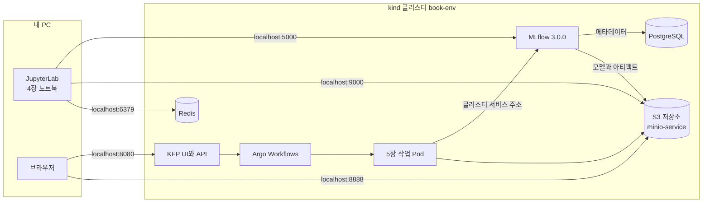
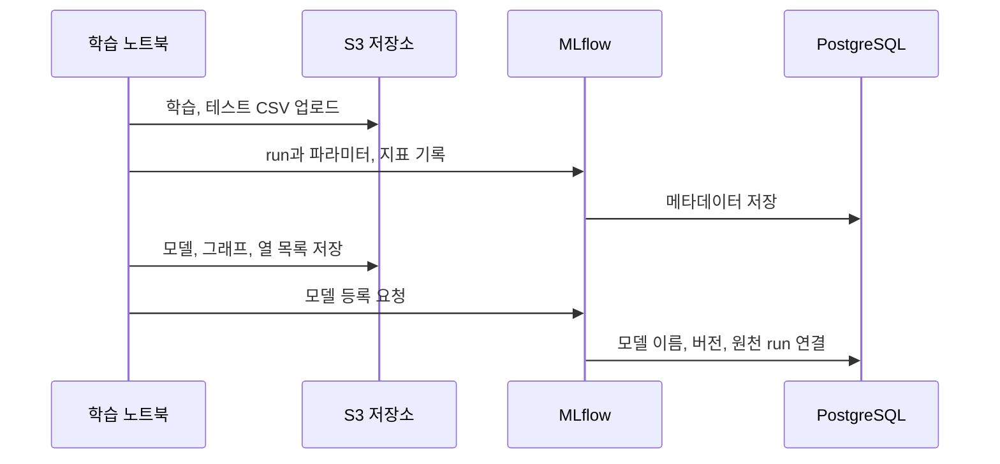
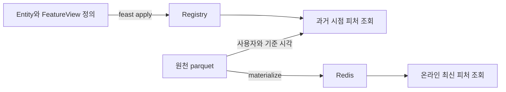
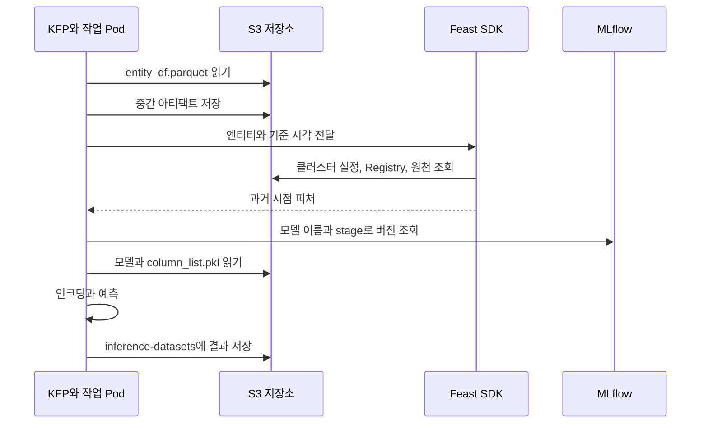

4장의 MLflow와 Feast를 5장의 Kubeflow Pipelines까지 한 실습으로 이어서 정리했다. 도구의 기능을 따로 외우기보다 **데이터를 올리고, 모델을 학습하고, 피처를 조회한 뒤 배치 추론을 실행하는 순서**로 보면 각 도구가 왜 필요한지 이해하기 쉽다.

책은 클러스터가 준비돼 있다는 전제로 버킷 생성이나 설정 변경을 짧게 넘어간다. 그 부분을 보완하려고 [ml-platform-book-env](https://github.com/johklo/ml-platform-book-env)를 만들었다. 아래는 이 저장소로 환경을 설치하고 책의 노트북과 파이프라인을 실행하는 과정에, 각 단계에서 필요한 설명을 함께 넣은 것이다.

## 실습 순서 {#book-lab-sop}

5장의 파이프라인은 모델을 학습하지 않는다. **4장에서 등록한 모델과 Feast 정의를 사용해 배치 추론하는 과정**이므로, 모델 등록과 피처 준비를 먼저 끝내야 한다.


| 구간 | 끝났을 때 남는 것 |
| --- | --- |
| A. 환경 세팅 | KFP, S3 저장소, PostgreSQL, Redis, MLflow 서버와 버킷 다섯 개 |
| B. MLflow | 실험 `income-classifier`, 모델 `random-forest-classifier`의 Production 버전 |
| C. Feast | 원천 parquet, 로컬용 Registry, Redis의 온라인 피처 |
| D. KFP | 클러스터용 Registry와 설정, 파이프라인 실행 기록 |
| E. 결과 확인 | `inference-datasets/income_predictions.parquet` |

앞 단계의 완료 기준을 확인한 뒤 다음 단계로 넘어가면 된다. 명령은 저장소 최상위 폴더에서 실행하고, `cd`가 있는 단계만 작업 위치가 달라진다.

## A. 환경 세팅

### 먼저 볼 구성: 무엇이 함께 설치되는가

책의 부록 A는 k3s 또는 MicroK8s 클러스터에 [kubeflow-argo](https://github.com/vmallya-123/kubeflow-argo)를 내려받아 Argo CD부터 설치한다. `kubectl apply -k argocd/` 뒤 `kubectl apply -f kubeflow.yaml`을 실행하면 Argo CD가 Kubeflow의 구성 요소별 Application을 배포하고 동기화한다.

여기서 Argo CD와 Argo Workflows를 구분해야 한다. **Argo CD는 책이 Kubeflow 설치에 선택한 GitOps 도구**이고, **Argo Workflows는 KFP가 파이프라인 작업을 Pod로 실행하는 엔진**이다. Kubeflow를 설치한다고 Argo CD가 자동으로 생기는 것은 아니다.

| 구성 요소 | 책의 설치 방식 | 이 실습 |
| --- | --- | --- |
| Kubeflow | Argo CD로 전체 설치. Istio, 인증, 대시보드, Notebooks 등 포함 | kind에 KFP standalone 2.4.1만 설치 |
| KFP의 저장소와 실행 기반 | MySQL, MinIO, Argo Workflows가 함께 배포됨 | 같은 구성에서 MinIO 이미지를 SeaweedFS로 교체 |
| PostgreSQL, Redis | 부록 A의 Bitnami Helm 차트로 별도 설치 | 같은 서비스 이름의 매니페스트로 설치 |
| MLflow 서버 | 이미지 빌드 후 Deployment와 Service를 별도 적용 | MLflow 3.0.0 이미지를 빌드해 설치 |
| 업무용 버킷 | MinIO에서 직접 생성 | 저장소 화면에서 직접 생성 |

MinIO가 KFP에 포함된다는 것과 실습용 버킷까지 만들어진다는 것은 다르다. KFP가 준비하는 `mlpipeline` 외에 학습 데이터, 모델 파일, 피처와 예측 결과를 담을 버킷은 직접 만들어야 한다.



책의 4장은 PC에서 `mlflow ui`를 띄우지만, 5장은 Pod에서 접근할 수 있는 MLflow 서버를 전제로 한다. 여기서는 처음부터 공용 서버 하나를 쓰고 PC에 `localhost:5000`으로 연결해, 노트북과 파이프라인이 같은 모델을 보게 했다.

### A-1. 도구 확인

Docker(메모리 8GB 이상 할당), kind 0.27, kubectl, git, Python 3.11, uv와 디스크 여유 40GB를 준비한다. 아래 절차는 Windows 11 PowerShell에서 실행했으며, macOS나 Linux에서는 가상환경 활성화와 PowerShell 전용 명령을 해당 셸에 맞게 바꾼다.

1. 저장소를 내려받고 도구를 확인한다.
   ```powershell
   git clone https://github.com/johklo/ml-platform-book-env.git
   cd ml-platform-book-env
   python bookenv.py check
   ```
2. 마지막에 `All required tools are available.`이 나오면 된다. PATH에 없는 도구는 `$env:KIND = "C:\tools\kind.exe"`처럼 경로를 지정할 수 있다. `KUBECTL`, `DOCKER`, `GIT`도 같은 방식이다.

### A-2. 클러스터 설치

1. 클러스터와 서비스를 설치한다.
   ```powershell
   python bookenv.py up
   ```
2. `The environment is ready. Next: python bookenv.py forward`가 나올 때까지 기다린다. 이미지 캐시가 있던 실행에서는 약 8분 걸렸고, 처음에는 다운로드와 빌드 때문에 20분 넘게 걸릴 수 있다.

설치 중 `metadata-grpc-deployment`, `ml-pipeline`이 MySQL을 기다리며 재시작할 수 있다. 설치가 시간 초과로 끝나면 `python bookenv.py status`로 준비되지 않은 Pod를 확인한다. 원인을 해결한 뒤 `up`을 다시 실행하면 기존 클러스터를 재사용한다.

### A-3. 포트포워딩과 화면 확인

1. 두 번째 터미널에서 다음 명령을 실행하고 실습이 끝날 때까지 켜 둔다.
   ```powershell
   python bookenv.py forward
   ```
2. 브라우저에서 다음 세 화면을 연다.

   | 주소 | 확인할 화면 |
   | --- | --- |
   | http://localhost:8080 | Pipelines, Experiments, Runs 메뉴가 있는 KFP |
   | http://localhost:5000 | 왼쪽 위에 `mlflow 3.0.0`이 표시되는 MLflow |
   | http://localhost:8888/buckets/ | `mlpipeline` 폴더가 있는 저장소 |

   

포트가 이미 사용 중이면 로컬 MLflow나 이전 forward 창부터 확인한다. 실행 중 `Reconnecting ...`이 잠깐 보일 수 있는데, Pod가 재시작돼 터널을 다시 여는 메시지다. 계속 반복되거나 화면이 열리지 않으면 Pod 상태와 포트 충돌을 확인해야 한다.

책의 MinIO 콘솔은 `minio` / `minio123`으로 로그인하지만, KFP 2.4.1의 구형 MinIO 이미지를 받을 수 없어 이 환경은 SeaweedFS로 바꿨다. S3 API의 서비스 이름과 계정은 유지했고, 웹 화면만 로그인 없는 Filer를 쓴다. **`/buckets/` 아래 폴더 하나가 S3 버킷 하나**다. [KFP 공식 문서](https://www.kubeflow.org/docs/components/pipelines/operator-guides/configure-object-store/)에서도 2.15부터 기본 저장소를 SeaweedFS로 안내한다.

### A-4. 버킷 만들기

버킷 이름은 도구별 책임을 구분하는 데도 도움이 된다. 학습 CSV, 모델 파일, 피처 정의, KFP 중간 파일과 최종 예측은 같은 저장소를 쓰더라도 서로 다른 데이터다.

| 버킷 | 저장할 것 | 사용하는 단계 |
| --- | --- | --- |
| `mlflow-datasets` | 학습, 테스트 CSV | B |
| `mlflow-artifacts` | 모델, 그래프, `column_list.pkl` | B, D |
| `feature-data-sets` | 피처 원천 parquet와 예측 대상 `entity_df.parquet` | C, D |
| `feature-registry` | Feast Registry와 설정 파일 | C, D |
| `inference-datasets` | 최종 예측 parquet | D, E |
| `mlpipeline` | KFP 작업 사이에 전달할 아티팩트 | KFP가 준비 |

1. http://localhost:8888/buckets/ 를 연다.
2. 오른쪽 위 **New Folder**를 누르고 `mlflow-datasets`를 입력한 뒤 **확인**을 누른다.

   

3. 같은 방법으로 `mlflow-artifacts`, `feature-data-sets`, `feature-registry`, `inference-datasets`를 차례로 만든다.
4. 목록에 다섯 개와 `mlpipeline`이 보이는지 확인한다.

   

책 본문의 `feature_data_sets`는 밑줄 때문에 S3 버킷 이름으로 쓸 수 없다. 저자 README와 코드가 쓰는 `feature-data-sets`로 맞춘다. 화면 대신 `python bookenv.py buckets`로 한 번에 만들어도 결과는 같다.

### A-5. 책 코드와 가상환경

1. 노트북과 스크립트가 읽을 저자 코드를 `upstream/`에 받는다.
   ```powershell
   git clone https://github.com/practical-mlops/chapter-4.git upstream/chapter-4
   git clone https://github.com/practical-mlops/chapter-5.git upstream/chapter-5
   ```
   확인한 커밋은 chapter-4 `b67a822`, chapter-5 `332915b`이며 둘 다 2025-07-23 기준이다.
2. 패키지를 설치하고 가상환경을 활성화한다.
   ```powershell
   uv venv .venv-book --python 3.11
   uv pip install --python .venv-book -r book/requirements.txt
   .\.venv-book\Scripts\Activate.ps1
   ```
   macOS와 Linux의 활성화 명령은 `source .venv-book/bin/activate`다.
3. 버전을 확인한다.
   ```powershell
   python -c "import mlflow, feast, kfp, sklearn; print(mlflow.__version__, feast.__version__, kfp.__version__, sklearn.__version__)"
   ```
   `3.0.0 0.40.1 2.9.0 1.5.2`가 나오면 된다.

책 본문은 `mlflow==2.6.0`이지만 공식 저장소와 부록은 3.0.0을 사용한다. 이 실습은 서버와 클라이언트를 모두 **3.0.0**으로 맞췄다. KFP 서버 2.4.1과 Python SDK 2.9.0은 서로 다른 구성 요소의 버전이므로 번호가 같아야 하는 것은 아니다.

### A-6. JupyterLab

1. 저장소 화면의 8888과 겹치지 않게 8890으로 실행한다.
   ```powershell
   jupyter lab --notebook-dir book --port 8890
   ```
2. 출력된 `http://127.0.0.1:8890/lab?token=...` 주소를 열고 `ch04` 폴더의 노트북 두 개를 확인한다. 이후 터미널 명령은 새 창에서 같은 가상환경을 활성화하고 실행한다.

## B. MLflow로 학습과 모델 등록

MLflow는 학습 알고리즘이 아니라 **실험 기록과 모델을 다시 찾기 위한 도구**다. `start_run()`으로 기록 범위를 열고, 그 안에서 `fit()`으로 학습한 뒤 메트릭과 모델을 남긴다.

| 개념 | 역할 | 이번 실습 |
| --- | --- | --- |
| Experiment | 관련 run을 묶음 | `income-classifier` |
| Run | 한 번의 실행 기록 | 데이터 탐색, Decision Tree, Random Forest, XGBoost |
| Parameter | 실행 설정 | 트리 깊이 등 모델 설정 |
| Metric | 측정 결과 | `roc_auc_score_test`, 정확도 |
| Artifact | 실행에서 남긴 파일 | 모델, 그래프, `column_list.pkl` |
| Model Registry | 관리할 모델의 이름과 버전 | `random-forest-classifier` v1 |

MLflow 서버가 PostgreSQL에 저장하는 것은 run과 모델 버전의 메타데이터이고, 실제 모델 파일은 `mlflow-artifacts`에 있다. 따라서 서버 화면이 열려도 S3 연결이 끊기면 모델 업로드나 다운로드는 실패할 수 있다.



### B-1. 노트북과 준비 셀

1. `ch04/01_mlflow_tracking.ipynb`를 열고 커널이 `Python 3 (ipykernel)`인지 확인한다. JupyterLab을 `.venv-book`에서 실행했다면 해당 환경의 커널이다.
2. 맨 위부터 `import pandas as pd ...`까지 네 셀을 `Shift+Enter`로 실행한다. 데이터 경로와 S3 접속 주소, 계정을 준비하는 셀이다.

   

노트북은 저자의 `chapter-4/mlflow/data_exploration_and_model_training.ipynb`를 바탕으로 만들었고, 환경에 맞춰 추가한 셀은 `[환경]`으로 표시했다. 첫 셀이 `AssertionError`로 끝나면 A-5의 코드 위치부터 확인한다.

### B-2. 데이터 탐색과 첫 run

1. `2. 데이터 탐색` 아래 셀 세 개를 실행한다. `df.info()`에 30,162행과 9개 열이 나오고 변수별 그래프가 `categorical_variable_plots/`에 저장된다.
2. `3. MLflow 연결` 아래 셀 세 개를 실행한다. `income-classifier` 실험이 만들어지고 `artifact_location='s3://mlflow-artifacts/1'`이 출력된다.
3. MLflow 화면에서 `income-classifier`를 열어 `eda-`로 시작하는 run의 Artifacts 탭에 PNG가 있는지 확인한다.

탐색에서는 결측 표기와 범주별 표본 수, 정답 비율을 먼저 본다. 어떤 열을 썼는지뿐 아니라 데이터가 어떤 상태였는지도 기록해야 다음 실험과 비교할 수 있다. 연결 오류라면 forward를, `NoSuchBucket`이라면 `mlflow-artifacts`를 확인한다.

### B-3. 데이터 분할과 모델 학습

1. `4. 학습 데이터 분할`과 `5. MinIO 버킷 확인` 셀을 실행한다. `mlflow-datasets bucket found`가 나와야 한다.
2. `6. Decision Tree`, `7. Random Forest`, `8. XGBoost` 셀을 차례로 실행한다. 각각 약 1분 걸린다.
3. MLflow에서 run 네 개(탐색 1개, 모델 3개)가 보이는지 확인한다.

   

소득 분류 예제는 직업과 학력 같은 범주형 열을 원-핫 인코딩한다. 추론에서도 같은 열 순서를 써야 해서 학습 시 `column_list.pkl`을 모델과 함께 기록하고, 5장의 추론 컴포넌트가 이를 내려받는다. 서비스에서 새 입력마다 인코딩 열을 임의로 만들면 모델은 같아도 다른 의미의 입력을 받게 된다.

이번 실행의 테스트 ROC AUC는 Decision Tree 약 0.817, Random Forest 0.855, XGBoost 0.714였다. 데이터 분할이 무작위라 같은 수치가 나오지는 않는다. `log_input()`은 데이터 출처를 기록하는 기능이지 원천 CSV를 자동으로 복사하는 기능은 아니라는 점도 구분해야 한다.

### B-4. 모델 등록

1. `9. 가장 좋은 run을 찾아 모델 레지스트리에 등록` 셀을 실행한다.
2. 바로 아래 `[환경]` 셀로 등록 버전을 `Production`으로 지정한다.
   ```text
   bold-moose-377 0.8552045821993023 random-forest-classifier 1
   1 Production 30627206bc81449bad0da833f4e8d210
   ```
3. **Models → random-forest-classifier**에서 버전과 원천 run을 확인한다.

   

책에는 stage를 지정하는 과정이 빠져 있지만, 5장의 `model_stage` 파라미터가 이 값을 찾으므로 여기서 지정해 둔다. MLflow 3의 `FutureWarning`은 stage가 deprecated라는 안내다. Production 지정이 곧 API 배포를 의미하는 것도 아니다.

책 코드를 따라가는 것과 실제 출시 기준은 나눠 봐야 한다. 책은 테스트 점수로 모델을 고르지만, 운영용 실험은 검증셋으로 후보를 선택하고 테스트셋은 마지막 확인에만 쓰는 편이 맞다. 또 stage나 alias는 다른 버전을 가리킬 수 있으므로 실제 배치에서는 실행 시작 시 구체 버전을 확정하고 `models:/이름/숫자` 형태로 기록하는 것이 좋다.

## C. Feast로 피처 정의와 조회

MLflow가 “어떤 모델을 만들었는가”를 기록한다면, Feast는 “모델이 사용할 피처를 어디서 어떤 기준으로 가져오는가”를 관리한다.


| 구성 요소 | 저장하거나 정의하는 것 | 이번 실습 |
| --- | --- | --- |
| Entity | 누구의 값인지 식별할 조인 키 | `user_id` |
| Data source | 원천 위치, 시간 필드와 접속 정보 | S3의 parquet |
| FeatureView | 피처 이름, 타입, Entity와 TTL | demographic, relationship, occupation |
| Registry | 위 정의들의 메타데이터 | `feature-registry`의 Registry 파일 |
| Offline store | 과거 피처 이력 | `feature-data-sets`의 parquet |
| Online store | 빠르게 조회할 최신 피처 | Redis |

**`feast apply`와 `materialize`는 다른 작업**이다. 전자는 정의를 등록하고 후자는 피처 값을 온라인 저장소로 옮긴다. Registry에 FeatureView가 보인다고 Redis에도 값이 있다는 뜻은 아니다.



### C-1. 준비와 원천 파일 업로드

1. `ch04/02_feast_feature_store.ipynb`를 열고 `[환경] 경로와 명령 실행 도우미`, `1. 환경 변수` 셀을 실행한다.
2. `2. 피처 원천 파일을 feature-data-sets 버킷으로 옮기기` 셀을 실행한다.
   ```text
   ['demographic_features.parquet', 'occupational_features.parquet', 'relationship_features.parquet']
   ```
3. `3. 피처 저장소 폴더 준비` 셀 두 개를 실행한다. 저자의 `entity.py`, `features.py`, `feature_store.yaml`을 `feature_repo/`로 복사하면서 Redis 비밀번호를 `redis123`으로 바꾼다.

이 노트북은 저자의 `chapter-4/Readme.md` 명령을 셀에서 실행하게 만든 것이다. S3와 Redis를 모두 쓰므로 forward의 9000과 6379 터널이 열려 있어야 한다.

### C-2. 정의 등록

`4. feast apply` 셀을 실행하면 `s3://feature-registry/registry_local.db`에 정의가 기록되고 Redis가 준비된다.

```text
Deploying infrastructure for relationship
Deploying infrastructure for demographic
Deploying infrastructure for occupation
```

`NoSuchBucket`이면 `feature-registry`를 확인하고, Redis 인증 오류면 비밀번호 치환과 6379 터널을 확인한다. 이 단계까지는 온라인 피처 값을 적재하지 않았다.

### C-3. 과거 시점 피처 조회

`5. 과거 시점 피처 조회` 셀을 실행한다. 결과에 사용자와 `event_timestamp`, `Sex`가 함께 나온다.

```text
                                user_id           event_timestamp    Sex
0  9f2ac416-06e1-44a0-87bd-d4787c85bf66 2023-01-30 10:59:42+00:00   Male
```

과거 조회의 핵심은 사용자 ID만이 아니라 **그때 알 수 있었던 값**을 붙인다는 점이다. 예를 들어 사용자 42의 근무 시간이 5월 21일에 36, 6월 4일에 52였다면 5월 22일 예측에는 36을 써야 한다. 최신값 52를 가져오면 미래 정보가 섞인다.

TTL이 2일이면 5월 25일 조회에서 21일 값은 너무 오래돼 제외된다. 또 21일 발생한 데이터가 23일 도착했다면 22일에는 알 수 없었으므로, 지연 도착이나 보정 이력이 있는 원천은 실제 사용 가능 시점까지 고려해야 한다. 시간 필드 하나만 추가한다고 모든 누설이 막히지는 않는다.

### C-4. 온라인 저장소 적재와 조회

1. `6. 온라인 저장소로 적재` 셀을 실행한다. `feast materialize`가 README의 기간인 `2022-09-16T00:00:00`부터 `2023-09-17T00:00:00`까지 원천을 읽어 Redis에 최신값을 적재한다.
2. `7. 온라인 피처 조회` 셀을 실행하고 `Sex` 값이 비어 있지 않은지 확인한다.

과거 조회는 엔티티의 기준 시각에 맞는 값을 찾고, 온라인 조회는 낮은 지연으로 최신값을 읽는 데 초점을 둔다. 그래서 5장처럼 과거 시각을 기준으로 배치 추론할 때는 온라인 최신값 대신 `get_historical_features()`를 쓴다.

`None`이 나오면 적재 여부와 해당 사용자의 원천 데이터를 확인한다. HTTP 요청 성공이나 적재 기간 표시만으로 모든 사용자에게 유효한 피처가 있다고 볼 수는 없다.

### C-5. 설정 파일 업로드

`8. feature_store.yaml을 feature-registry 버킷에 올리기` 셀을 실행한다. 버킷에 `feature_store.yaml`, `registry_local.db`가 있으면 여기까지 완료다.

중요한 점은 이 설정이 **PC에서 쓰는 localhost용 설정**이라는 것이다. Pod에서 `localhost`는 PC가 아니라 해당 Pod 자신을 가리키므로, D 단계에서는 클러스터 주소를 쓰는 정의와 설정을 따로 준비한다.

### 학습과 추론에서 같은 피처를 쓴다는 것

책의 학습 노트북은 CSV를 직접 읽고 Feast는 뒤에서 별도로 준비한다. 따라서 **이 노트북이 Feast에서 학습 피처를 조회하거나 FeatureService를 MLflow에 기록하는 것은 아니다.** 책의 흐름을 실행한 것과 학습부터 추론까지 피처 계약을 고정한 것은 구분해야 한다.

실제 연결을 강화하려면 필요한 FeatureView를 `income_model_v1` 같은 FeatureService로 묶고, 학습 코드가 그 서비스로 과거 피처를 조회하게 한다. 그때 MLflow run과 모델 버전에 서비스 이름, 피처 목록, 정의 파일의 해시와 데이터 스냅샷을 남기면 추론에서 같은 계약인지 확인할 수 있다. 이 추가 연결은 아래의 보충 예제로 분리했다.

## D. Kubeflow Pipelines로 배치 추론


그림에서 작업 순서와 데이터 이동을 나눠 보면 이해하기 쉽다. KFP는 단계의 순서와 의존성을 관리하고, 실제 데이터는 작업 Pod가 파일로 저장해 다음 Pod에 전달한다. 앞 Pod의 파이썬 객체나 메모리를 공유하는 구조가 아니다.

| 컴포넌트 | 입력 | 출력과 접속 대상 |
| --- | --- | --- |
| read-data-from-minio | `entity_df.parquet` 위치 | S3에서 읽은 예측 대상 사용자와 기준 시각 |
| retrieve-features-from-feast | 대상 엔티티, Feast 설정과 피처 목록 | S3 Registry와 원천에서 조회한 과거 피처 |
| model-inference | 피처, 모델 이름과 stage | MLflow에서 찾은 모델의 예측값 |
| write-data-to-minio | 예측 결과와 목적지 | `inference-datasets`의 최종 parquet |



모델 이름과 처리 설정 같은 작은 값은 파라미터로, 대상 목록과 피처 테이블은 파일 아티팩트로 전달한다. `Input[Dataset]`과 `Output[Dataset]`은 파일 전달 계약이지 열 타입이나 결측 검사가 아니다. 스키마와 업무 키 검사는 컴포넌트 코드에서 해야 한다.

### D-1. 책 코드를 환경에 맞추기

가상환경을 활성화한 새 터미널에서 실행한다.

```powershell
python book/ch05/prepare.py
```

저자 README가 바꾸라고 안내한 컴포넌트 이미지 이름과 Redis 비밀번호를 수정하는 단계다. 이미지 네 개의 참조가 `book-ch5/components:0.1`로 바뀌었다는 줄과 `Redis password set`이 나오면 된다.

### D-2. 이미지 빌드와 적재

책은 이미지를 Docker Hub에 push하지만 이 환경은 로컬에서 빌드해 kind 노드에 바로 넣는다. 저자의 `python:3.10-slim-buster`는 패키지 설치에서 404가 나서 bookworm으로 바꿨고, 컴포넌트의 scikit-learn은 모델을 저장한 노트북과 같은 1.5.2로 맞췄다.

1. 이미지를 빌드한다. 처음에는 두 개를 합쳐 10분 넘게 걸릴 수 있다.
   ```powershell
   docker build -t book-ch5/feast-job:0.1 -f book/ch05/Dockerfile.feast-job upstream/chapter-5/scripts/feast
   docker build -t book-ch5/components:0.1 -f book/ch05/Dockerfile.components upstream/chapter-5
   ```
2. 클러스터에 적재한다.
   ```powershell
   python bookenv.py load book-ch5/feast-job:0.1
   python bookenv.py load book-ch5/components:0.1
   ```

PC에서 이미지가 보인다고 kind 노드에도 있는 것은 아니다. 이미지를 다시 빌드했다면 적재도 다시 해야 한다.

### D-3. 클러스터에서 Feast 정의 등록

```powershell
kubectl apply -f book/ch05/feast-job.yaml
kubectl -n kubeflow wait --for=condition=complete --timeout=300s job/feast-job
kubectl -n kubeflow logs job/feast-job
```

저자 Job에서 이미지 이름과 네임스페이스를 바꾼 것으로, 클러스터 주소를 사용하는 `s3://feature-registry/registry.db`를 만든다. 로그에 `Deploying infrastructure` 세 줄이 나오는지 확인한다.

`entity_key_serialization_version` 경고는 저자의 설정에 명시되지 않아 나오며, `ErrImageNeverPull`은 D-2의 적재를 먼저 확인한다. 다시 실행하려면 `kubectl -n kubeflow delete job feast-job`으로 기존 Job을 지우고 적용한다.

### D-4. 입력 파일 업로드와 컴파일

1. 파이프라인 입력 파일을 올린다.
   ```powershell
   python book/ch05/upload_inputs.py
   ```

   | 원본 | 업로드 위치 |
   | --- | --- |
   | `upstream/chapter-5/scripts/feast/feature_store.yaml` | `feature-registry/feature_store_k8s.yaml` |
   | `upstream/chapter-4/feast/data/entity_df.parquet` | `feature-data-sets/entity_df.parquet` |

   4장의 localhost용 `feature_store.yaml`을 덮어쓰지 않도록 클러스터용 파일 이름을 따로 정했다.
2. 컴파일하고 이미지 참조를 확인한다.
   ```powershell
   cd upstream/chapter-5
   python inference_pipeline.py
   cd ../..
   Select-String -Path upstream/chapter-5/income_classifier_pipeline.yaml -Pattern "image:"
   ```
   macOS와 Linux에서는 마지막 줄 대신 `grep "image:" upstream/chapter-5/income_classifier_pipeline.yaml`을 쓴다. 모든 이미지가 `book-ch5/components:0.1`이어야 하며, `varunmallya/...`가 보이면 D-1을 실행한 뒤 다시 컴파일한다.

컴파일은 정의를 실행 명세 YAML로 바꾸는 단계일 뿐 아직 Pod를 만들거나 데이터를 읽지는 않는다. 이미지, 서비스 주소와 권한이 맞는지는 실제 실행에서 확인해야 한다.

### D-5. 파이프라인 업로드

1. http://localhost:8080 에서 **Pipelines → + Upload pipeline**을 누른다.

   

2. **Pipeline Name**에 `income-classifier-pipeline`, 설명에 `Chapter 5 income classifier batch inference`를 입력한다.
3. **Upload a file** 라디오 버튼을 먼저 누르고 **Choose file**로 `upstream/chapter-5/income_classifier_pipeline.yaml`을 고른다.

   

4. **Create**를 눌러 컴포넌트 네 개가 이어진 그래프를 확인한다.

   

라디오 버튼을 누르지 않으면 `Package URL is empty` 오류가 날 수 있다. 빈 파이프라인이 남았다면 목록에서 삭제한 뒤 다시 업로드한다.

### D-6. 실험 만들고 실행하기

1. **Experiments → + Create experiment**에서 이름 `income-classifier`, 설명 `Chapter 5 batch inference runs`를 입력하고 **Next**를 누른다.

   

   MLflow의 Experiment와 이름은 같지만 별개다. KFP 실험은 파이프라인 실행을, MLflow 실험은 학습 run을 묶는다.
2. 실행 화면에서 **Pipeline → Choose**로 `income-classifier-pipeline`을 고르고 **Use this pipeline**을 누른다. 실험 목록으로 돌아왔다면 해당 실험의 **Create run**으로 들어간다.
3. **Run name**에 `income-classifier-run-1`을 넣고 파라미터를 채운다. 같은 값은 `book/ch05/run-parameters.json`에도 있다.

   | 파라미터 | 값 |
   | --- | --- |
   | access_key | `minio` |
   | secret_key | `minio123` |
   | entity_df_bucket | `feature-data-sets` |
   | entity_df_filename | `entity_df.parquet` |
   | feature_list | `demographic:Sex,demographic:Race,demographic:Native_country,relationship:Relationship,relationship:Marital-Status,occupation:Workclass,occupation:Education,occupation:Occupation` |
   | feature_store_bucket_name | `feature-registry` |
   | feature_store_config_file_name | `feature_store_k8s.yaml` |
   | minio_host | `minio-service.kubeflow.svc.cluster.local:9000` |
   | mlflow_host | `http://mlflow-service.mlflow.svc.cluster.local:5000` |
   | model_name | `random-forest-classifier` |
   | model_stage | `Production` |
   | model_type | `sklearn` |
   | output_bucket | `inference-datasets` |
   | output_file_name | `income_predictions.parquet` |

   

4. **Start**를 누른다. 이번 실행은 약 2분 걸렸고, 네 작업이 차례로 초록색 체크로 바뀌었다.

   

서비스 주소에 `localhost`를 넣지 않는 이유는 작업이 PC가 아닌 Pod에서 돌기 때문이다. 또한 책의 방식은 키를 파라미터로 전달해 UI에도 노출하므로 로컬 실습에만 사용하고, 운영에서는 Secret과 서비스 계정 권한으로 전달해야 한다.

### D-7. 결과 확인

1. 그래프에서 **model-inference → Logs**를 열어 모델 조회와 추론 로그를 본다.

   

2. **write-data-to-minio → Input/Output**에서 앞 단계의 예측 파일이 입력으로 연결됐는지 확인한다.

   

   주소가 `minio://mlpipeline/...`로 보이는 것은 이 구성에서 KFP가 S3 호환 아티팩트 위치를 표시하는 방식이다. 실제 저장소 이미지는 SeaweedFS다.
3. http://localhost:8888/buckets/inference-datasets/ 에서 `income_predictions.parquet`를 확인한다.

   

4. 파일 내용을 읽어 본다.
   ```powershell
   python book/ch05/show_predictions.py
   ```
   ```text
   rows, columns: (30162, 92)
   user_id in output: False
   ```

여기까지 확인하면 작업 성공뿐 아니라 **파일 전달과 실제 결과 저장**까지 이어진 것이다. parquet 미리보기에 `PAR1`이나 깨진 문자가 나오면 텍스트로 표시한 것이므로, 그 화면만으로 내용이 잘못됐다고 판단하지 않는다.

## E. 결과 해석과 오류 대응

### 실행 성공과 예측 품질은 다르다

책 코드의 결과에는 `user_id`가 없다. 추론 코드가 인코딩 전에 이 열을 지우기 때문인데, 실제 서비스라면 예측이 누구의 것인지 알 수 있도록 결과에 다시 붙여야 한다. 모델 입력에서 ID를 제외하는 것과 결과에서 ID를 버리는 것은 다른 문제다.

확률과 클래스도 구분해야 한다. `predict_proba()`가 반환한 값은 클래스 확률 추정치이지 클래스 번호가 아니며, 열 순서는 `classes_`로 확인한다. 임계값은 오탐과 미탐의 업무 비용에 맞춰 검증한다.

재실행을 추적하려면 대상 사용자와 기준 시각, 구체 모델 버전, 피처 정의, 코드와 데이터 스냅샷을 함께 남기는 편이 좋다. KFP run ID는 실행을 구분하지만 같은 날짜의 결과가 중복 저장되지 않게 해 주는 업무 키는 아니다.

### 실패한 단계에서 확인할 것

실패한 상자의 **Logs**를 보고 해당 단계의 입력과 접속 대상부터 확인한다. 포트포워딩은 PC에서 쓰는 경로이고, Pod의 통신은 클러스터 서비스 주소를 따른다는 점을 나눠 보면 원인을 좁히기 쉽다.

| 실패 위치나 증상 | 확인할 것 |
| --- | --- |
| read-data-from-minio의 `NoSuchKey` | D-4의 `entity_df.parquet` 업로드 |
| retrieve-features-from-feast의 Registry 오류 | D-3 Job 성공 여부와 `feature_store_k8s.yaml` 선택 |
| model-inference에서 모델을 찾지 못함 | B-4의 Production 지정, 모델 이름과 MLflow 주소 |
| write-data-to-minio의 `NoSuchBucket` | `inference-datasets` 버킷 |
| `ErrImagePull`, `ErrImageNeverPull` | 로컬 이미지 빌드와 kind 적재, 컴파일한 이미지 이름 |
| MLflow의 `FallbackAsyncAdaptedQueuePool` ImportError | `sqlalchemy<2.1`, `alembic<1.17` 고정 |
| S3의 `InternalError` | 저장소 패치의 `-volume.max=100` 적용 여부 |
| 추론 시 scikit-learn 버전 오류 | 학습 노트북과 컴포넌트 이미지의 1.5.2 일치 |
| `apt-get`의 404 | buster 대신 제공한 bookworm Dockerfile 사용 |

실행 이후에는 사용자나 피처가 누락된 경우, 스키마가 틀린 경우, 잘못된 모델 버전을 넘긴 경우도 따로 시험해야 한다. 없는 값을 모두 0으로 채워 성공시키면 잘못된 예측을 알아채기 어려워진다. S3의 일시 장애에는 제한된 재시도가 가능하지만 스키마 오류는 입력을 고치기 전까지 반복해도 해결되지 않는다.

### 실습 종료

JupyterLab과 forward 창을 `Ctrl+C`로 끄면 접속만 멈춘다. 다시 시작할 때는 `python bookenv.py status`로 상태를 확인하고 A-3부터 진행하면 된다. 클러스터와 모든 실습 기록을 지우려면 다음을 실행한다.

```powershell
python bookenv.py down
docker rmi book-ch5/components:0.1 book-ch5/feast-job:0.1 book-env/mlflow:3.0.0 book-env/runtime:0.1
```

## 보충: 피처 계약을 고정하는 작은 로컬 예제

책 코드의 전체 연결을 확인한 뒤, **Feast로 학습 데이터를 조회하고 사용한 FeatureService를 MLflow 모델 버전까지 기록하는 방식**을 따로 연습할 수 있다. 아래는 기존 작은 예제의 코드이며, 위 `book-env` 실습의 필수 단계는 아니다.

| 실행 순서 | 코드 | 확인할 것 |
| --- | --- | --- |
| 1 | [feature_study.py](/downloads/ml-platform-engineering/kfp-cluster/feature_study.py) | `income_model_v1` 등록, 사용자 42의 과거 값 36과 온라인 값 52 구분 |
| 2 | [income_study.py](/downloads/ml-platform-engineering/kfp-cluster/income_study.py) | Feast 조회로 학습, 서비스 이름과 정의 해시 기록, 모델 버전 고정 |
| 3 | [pipeline_study.py](/downloads/ml-platform-engineering/kfp-cluster/pipeline_study.py) | 모델 버전의 FeatureService tag와 추론 계약 비교 |
| 4 | [run_pipeline_study.py](/downloads/ml-platform-engineering/kfp-cluster/run_pipeline_study.py) | 로컬에서 네 작업 실행 |

Python 3.11의 Linux 또는 WSL2에서 별도 폴더와 가상환경을 사용한다. Windows 네이티브에서는 KFP `SubprocessRunner`의 셸과 경로 처리가 다르므로 이 예제는 WSL2에서 실행한다.

```bash
python3 -m venv .venv
source .venv/bin/activate
python -m pip install mlflow==2.16.2 scikit-learn==1.5.2 feast==0.40.1 \
    pandas==2.2.3 numpy==1.26.4 pyarrow==17.0.0 \
    kfp==2.10.1 sqlalchemy==2.0.36
python feature_study.py
python income_study.py
python pipeline_study.py
python run_pipeline_study.py
```

이 예제는 MLflow 2.16.2와 로컬 SQLite를 쓰므로 위의 MLflow 3.0.0 서버용 가상환경과 섞지 않는다. 결과에는 사용자 `42`, 기준 시각 `2025-05-22`, 근무 시간 `36.0`, FeatureService `income_model_v1`과 고정 모델 URI가 남는다. 합성 데이터의 점수를 책의 소득 데이터 성능과 비교하는 예제는 아니다.

이 작은 예제를 별도 kind 클러스터로 옮길 때 쓰던 [Dockerfile](/downloads/ml-platform-engineering/kfp-cluster/Dockerfile), [제출 스크립트](/downloads/ml-platform-engineering/kfp-cluster/submit_cluster.py), [저장소 패치](/downloads/ml-platform-engineering/kfp-cluster/object-store-patch.yaml), [Executor 패치](/downloads/ml-platform-engineering/kfp-cluster/executor-patch.yaml)도 남겨 두었다. 위 SOP의 `book-ch5` 이미지와는 별개이며, 처음에는 추가 클러스터 대신 로컬 실행까지만 확인해도 충분하다.

책 코드대로 실행하는 과정과 운영에 필요한 보완을 구분해 보면, MLflow와 Feast, KFP가 자동으로 모든 것을 연결해 주는 도구는 아니라는 점이 보인다. 각 단계가 다음 단계에 무엇을 넘기는지 확인하고, 그 연결을 기록으로 남기는 것이 이 두 장에서 가져갈 핵심이다.

[이전: 03. Kubernetes 기반](../03-kubernetes-foundation/), [시리즈 목차](../)
