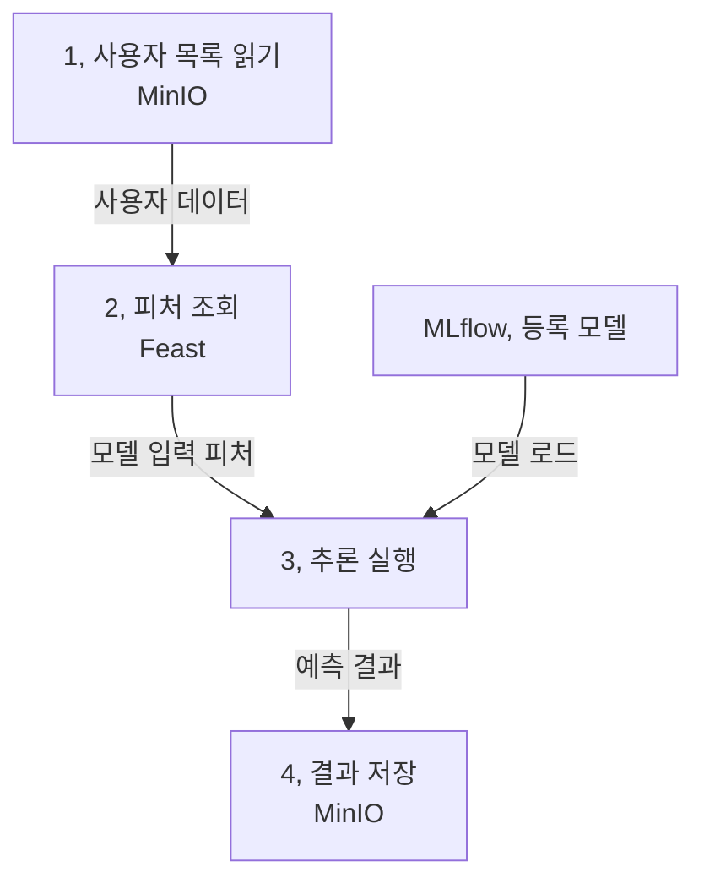

ML 파이프라인은 독립적인 작업의 실행 순서와 데이터 의존성을 명시한다. 함수를 차례로 호출하는 것과 달리 작업마다 실행 환경과 실패 조건이 다를 수 있다.

## 5.1 Kubeflow Pipelines

앞 장에서 만든 소득 분류 모델과 피처를 이용해, 사용자 목록의 소득 범주를 한꺼번에 예측합니다.

이 흐름을 데이터 준비나 학습 파이프라인으로 착각하지 않는 것이 좋습니다. 파이프라인은 학습에만 쓰는 것이 아니라 반복 실행할 ML 업무 전반을 묶는 방법입니다.

배치 추론은 일정 기간의 데이터를 모아 처리하므로, 실행 날짜나 대상 파일 같은 런타임 파라미터도 중요합니다. 같은 코드를 다른 데이터 범위에 적용할 수 있어야 합니다.

### 5.1.1 Kubeflow 컴포넌트

책에서는 Python 코드, 의존성이 들어간 이미지, 실행 명세를 가진 컴포넌트를 만들고 KFP에서 연결합니다. 각 단계가 별도의 Pod에서 실행되므로 같은 노트북의 메모리나 전역 변수를 공유한다고 가정하면 안 됩니다.

| 컴포넌트 | 받는 것 | 내보내는 것 |
| --- | --- | --- |
| 데이터 읽기 | 원천 파일 위치 | 사용자 목록 데이터 |
| 피처 조회 | 사용자 식별자와 시점 | 모델 입력 피처 |
| 추론 | 피처, 사용할 모델 참조 | 예측 결과가 붙은 데이터 |
| 데이터 쓰기 | 결과 데이터, 목적지 | 저장된 결과 |

이 표가 컴포넌트 계약입니다. 재사용성은 작은 함수의 개수보다 입력, 출력의 의미가 명확한지에 달려 있습니다. 피처 열 순서나 데이터 형식이 몰래 바뀌면 단계가 성공해도 예측은 틀릴 수 있습니다.

### 5.1.2 소득 분류 파이프라인

KFP는 작업을 방향성 비순환 그래프(DAG)로 표현합니다. 앞 단계의 출력이 필요한 작업은 기다리고, 독립적인 작업은 병렬 실행될 수 있습니다.

여기서 2장의 순환형 ML 생애주기와 DAG가 모순되는 것은 아닙니다. 한 번의 파이프라인 실행은 비순환 그래프이고, 모니터링과 개선은 다음 파이프라인 실행을 유발하는 바깥쪽 고리입니다.

컴포넌트를 작성한 뒤에는 이를 파이프라인으로 정의하고, 실행 명세로 컴파일해 제출합니다. 작성 시점, 컴파일 시점, 클러스터 실행 시점을 나누어 생각하면 “내 컴퓨터에서는 되는데 Pod에서는 안 된다”는 문제를 찾기 쉽습니다.

#### 실행 환경 메모: 로컬 주소와 클러스터 주소

책은 Feast의 피처 소스와 레지스트리를 클러스터에서 사용할 수 있게 바꾸는 과정도 다룹니다. 로컬에서 `localhost`로 접속한 서비스가 다른 Pod에서도 같은 주소로 보이지는 않습니다.

`localhost`는 그 코드를 실행하는 환경 자신을 뜻합니다. 접속 주소, 인증 정보, 저장소 접근 권한은 컴포넌트가 실제 실행되는 위치를 기준으로 확인해야 합니다.

마지막 저장 단계만 실패했다면 전체 추론을 다시 할지 결과만 다시 쓸지 결정해야 한다. 같은 날짜의 실행을 두 번 했을 때 결과가 중복되는지도 확인할 부분이다.

## 실무 적용: 재시도해도 업무 결과가 망가지지 않아야 합니다

오케스트레이터의 실행 성공이 결과 데이터의 정확성을 뜻하지는 않는다.

| 상황 | 필요한 설계 | 검증 방법 |
| --- | --- | --- |
| 네트워크 일시 실패 | 제한된 재시도, 대기, 타임아웃 | 외부 호출 실패를 넣고 회복 여부 확인 |
| 잘못된 스키마 | 명시적 실패와 원인 보고 | 재시도로 통과하지 않고 중단하는지 확인 |
| 결과 저장 중단 | 멱등성, 임시 쓰기 후 확정 등 저장소에 맞는 방식 | 부분 결과, 중복 노출 여부 확인 |
| 같은 기간 재실행 | 데이터, 모델, 코드와 대상 기간 식별 | 같은 실행 의미의 중복 결과 방지 |
| 캐시 재사용 | 입력과 의존성 버전의 명시 | 외부 데이터 변경 후 낡은 결과를 쓰지 않는지 확인 |

멱등성(idempotency)은 같은 의도의 작업을 반복해도 업무 결과가 중복되거나 망가지지 않도록 하는 성질입니다. KFP 실행 ID와 업무 처리 키는 다를 수 있습니다. 새 실행 ID가 발급되었다고 같은 날짜의 예측을 중복 저장해도 되는 것은 아닙니다.

재시도 가능한 일시 장애와 재시도해도 해결되지 않는 데이터 오류를 구분합니다. 자격 증명은 이미지나 파이프라인 파라미터에 노출하지 말고 실행 환경의 권한, Secret 관리 체계를 사용합니다.

## 컨설팅 관점: 복구 시간과 결과 신뢰성을 함께 봅니다

최근 실패 실행을 가지고 어느 단계부터 다시 시작했는지, 재처리 결과를 누가 확인했는지 묻습니다. 실행 이력에는 초록색이지만 결과가 중복되어 사람이 정리했다면 중요한 운영 결함입니다.

산출물은 컴포넌트 계약서, 재시도, 시간 제한표, 저장 확정, 재처리 정책, 실패 단계별 실행 지침입니다. 표준 컴포넌트를 만들 때에는 책임자와 버전 호환 정책도 남깁니다.

인수 시험에는 정상 실행 외에 “추론 후 저장 실패 → 재실행 → 결과 검증”을 포함합니다. 처리량뿐 아니라 중복, 부분 결과, 원인 추적 가능성과 복구 절차를 확인해야 합니다.

## 컴포넌트 계약과 재처리

각 단계에는 입력 형식, 출력 위치와 실패 조건이 필요하다. 피처 조회는 성공했지만 결과 저장에 실패했다면 어느 단계부터 다시 시작할지 정해야 한다.

실행 식별자와 저장 정책이 있어야 이미 처리한 데이터와 다시 처리할 데이터를 구별할 수 있다.

## 북클럽 토론

Q. 긴 스크립트를 네 파일로 나누면 파이프라인이 되나요?

파일 분리만으로는 부족합니다. 독립된 실행 환경과 입력, 출력, 의존성, 실행 기록이 있어야 실패를 추적하고 단계를 재사용하기 쉬워집니다.

Q. 어떤 단계를 별도 컴포넌트로 나누는 것이 좋을까요?

서로 다른 자원, 재사용 범위, 실패, 재시도 정책을 가진 경계가 후보입니다. 너무 잘게 나누면 Pod 시작과 데이터 이동의 비용이 커질 수도 있습니다.

자주 빠지는 함정: 다른 Pod에서도 이전 단계의 로컬 파일 경로가 그대로 유효하다고 생각하거나, 모델 참조를 고정하지 않아 재실행 때 다른 버전을 읽는 것입니다.

## 한 줄 정리

파이프라인의 핵심은 실행 순서를 나열하는 것이 아니라, 독립적인 작업 사이의 데이터와 책임을 계약으로 만드는 것입니다.

[이전: 04. 실험과 피처 관리](../04-experiments-and-features/), [시리즈 목차](../), [다음: 06. 모델의 프로덕션화](../06-productionizing-models/)
