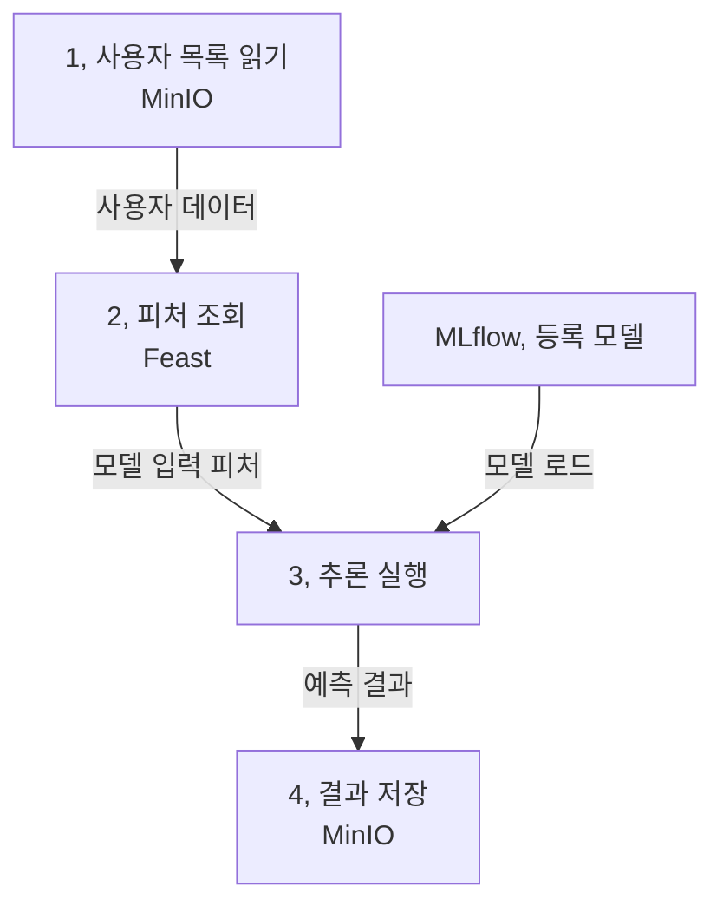

식당에서 주문표를 받아 재료를 준비하고 조리한 뒤 포장하는 작업을 생각해 보겠습니다. 주방마다 별도의 공간에서 일한다면 “옆에 둔 그릇을 쓰세요”라는 지시로는 연결되지 않습니다. 무엇을 어디에 남기고 다음 작업이 무엇을 받아야 하는지 정해야 합니다.

5장의 Kubeflow Pipelines(KFP)는 이런 작업 간의 의존성과 전달을 관리합니다. 책의 핵심은 학습 파이프라인이 아니라, 4장에서 등록한 소득 분류 모델과 피처를 사용하는 네 단계 배치 추론입니다. 아래에서는 계약과 실행 환경을 먼저 해석한 뒤 실제 SDK로 같은 연결을 작성합니다.

## 5.1 Kubeflow Pipelines

앞 장에서 만든 소득 분류 모델과 피처를 이용해, 사용자 목록의 소득 범주를 한꺼번에 예측합니다.



여기서 만드는 것은 학습이 아니라 배치 추론 파이프라인입니다. 파이프라인이라는 말을 학습 자동화에만 연결하기 쉬운데, 반복 실행할 ML 작업 전반에 사용할 수 있습니다.

배치 추론은 일정 기간의 데이터를 모아 처리하므로, 실행 날짜나 대상 파일 같은 런타임 파라미터도 중요합니다. 같은 코드를 다른 데이터 범위에 적용할 수 있어야 합니다.

### 5.1.1 Kubeflow 컴포넌트

책에서는 Python 코드, 의존성이 들어간 이미지, 실행 명세를 가진 컴포넌트를 만들고 KFP에서 연결합니다. 각 단계가 별도의 Pod에서 실행되므로 같은 노트북의 메모리나 전역 변수를 공유한다고 가정하면 안 됩니다.

| 컴포넌트 | 받는 것 | 내보내는 것 |
| --- | --- | --- |
| 데이터 읽기 | 원천 파일 위치 | 사용자 목록 데이터 |
| 피처 조회 | 사용자 식별자와 시점 | 모델 입력 피처 |
| 추론 | 피처, 사용할 모델 참조 | 예측 결과가 붙은 데이터 |
| 데이터 쓰기 | 결과 데이터, 목적지 | 저장된 결과 |

이 표가 컴포넌트 계약입니다. 재사용성은 작은 함수의 개수보다 입력, 출력의 의미가 명확한지에 달려 있습니다. 피처 열 순서나 데이터 형식이 몰래 바뀌면 단계가 성공해도 예측은 틀릴 수 있습니다.

### 5.1.2 소득 분류 파이프라인

KFP는 작업을 방향성 비순환 그래프(DAG)로 표현합니다. 앞 단계의 출력이 필요한 작업은 기다리고, 독립적인 작업은 병렬 실행될 수 있습니다.

여기서 2장의 순환형 ML 생애주기와 DAG가 모순되는 것은 아닙니다. 한 번의 파이프라인 실행은 비순환 그래프이고, 모니터링과 개선은 다음 파이프라인 실행을 유발하는 바깥쪽 고리입니다.

컴포넌트를 작성한 뒤에는 이를 파이프라인으로 정의하고, 실행 명세로 컴파일해 제출합니다. 작성 시점, 컴파일 시점, 클러스터 실행 시점을 나누어 생각하면 “내 컴퓨터에서는 되는데 Pod에서는 안 된다”는 문제를 찾기 쉽습니다.

#### 실행 환경 메모: 로컬 주소와 클러스터 주소

책은 Feast의 피처 소스와 레지스트리를 클러스터에서 사용할 수 있게 바꾸는 과정도 다룹니다. 로컬에서 `localhost`로 접속한 서비스가 다른 Pod에서도 같은 주소로 보이지는 않습니다.

`localhost`는 그 코드를 실행하는 환경 자신을 뜻합니다. 접속 주소, 인증 정보, 저장소 접근 권한은 컴포넌트가 실제 실행되는 위치를 기준으로 확인해야 합니다.

마지막 저장 단계만 실패했다면 전체 추론을 다시 할지 결과만 다시 쓸지 결정해야 합니다. 같은 날짜의 실행을 두 번 했을 때 결과가 중복되는지도 확인할 부분입니다.

## 파라미터와 아티팩트는 왜 구분할까요?

주문 번호와 포장된 음식은 모두 작업 사이에서 전달되지만 같은 방식으로 다루지 않습니다. `model_uri`, 처리 기준일 같은 작은 설정값은 파라미터이고, 사용자 목록과 피처 테이블, 예측 결과 같은 파일은 아티팩트입니다.

KFP의 `Dataset`은 실제 테이블의 모든 열 타입을 자동으로 보장한다는 뜻이 아닙니다. 파일이 데이터셋이라는 종류를 선언할 뿐입니다. `user_id`가 비어 있거나 `hours_per_week`가 문자열이어도 실제 스키마 검사를 구현하지 않으면 놓칠 수 있습니다.

| SDK 또는 명세 표현 | 컨테이너 안에서의 의미 | 흔한 오해 |
| --- | --- | --- |
| `str`, `int` 파라미터 | 작은 실행 인자 | 대용량 테이블을 문자열 인자로 전달 |
| `Input[Dataset]` | 앞 단계가 남긴 파일을 읽을 입력 | 앞 Pod의 pandas 객체를 그대로 받음 |
| `Output[Dataset]` | 이 단계가 결과를 써야 할 위치 | 함수에서 DataFrame을 반환하면 자동 저장 |
| `inputPath`, `outputPath` | 런타임이 해석한 로컬 파일 경로 | PC의 경로 문자열을 모든 Pod가 공유 |

`Output[Dataset]`으로 받은 객체의 `.path`에 실제 파일을 써야 합니다. 런타임은 그 결과를 artifact 저장소에 보관하고 다음 단계의 입력 위치로 전달합니다. Pod A의 `/tmp/result.parquet`가 같은 이름만으로 Pod B에 생기는 것은 아닙니다.

책은 각 Python 프로그램을 이미지로 만들고 컴포넌트 YAML의 `inputValue`, `inputPath`, `outputPath`로 인자를 연결합니다. 아래 예제는 같은 원리를 KFP 2.x의 Python 컴포넌트로 표현합니다. 이미지 기반 실행 명세와 Python SDK를 혼동하지 않도록 구현 방식을 구분해 둡니다.

## 직접 해보기: 4장의 모델과 Feast를 네 작업으로 연결하기

이 예제는 4장의 `income_study.py`, `feature_study.py`를 실행해 만든 로컬 파일을 사용합니다. 소득 예측의 실용성을 검증하는 프로젝트가 아니라, 실제 MLflow 모델과 실제 Feast 조회를 아티팩트로 연결하는 연습입니다.

먼저 그 파일이 있는 폴더의 Python 3.11/3.12 환경에 `kfp==2.10.1`을 설치합니다. 로컬 실행을 할 때는 4장에서 사용한 MLflow, scikit-learn, Feast, pandas, pyarrow와 numpy 버전도 같은 환경에 있어야 합니다. 컴파일만 할 때는 KFP SDK만 필요합니다.

다음 코드를 `pipeline_study.py`로 저장합니다.

```python
from kfp import compiler, dsl
from kfp.dsl import Dataset, Input, Output


@dsl.component(base_image="python:3.12-slim-bookworm", install_kfp_package=False)
def read_data(source_path: str, entities: Output[Dataset]):
    from pathlib import Path
    import pandas as pd

    frame = pd.read_parquet(source_path)
    required = ["user_id", "event_timestamp"]
    if not set(required).issubset(frame.columns):
        raise ValueError("Entity input must include ID and prediction time")
    if frame.empty or frame[required].isna().any().any():
        raise ValueError("Entity input is empty or contains missing keys")
    if frame.duplicated(required).any():
        raise ValueError("Duplicate entity and prediction time")
    Path(entities.path).parent.mkdir(parents=True, exist_ok=True)
    frame[required].to_parquet(entities.path, index=False)


@dsl.component(base_image="python:3.12-slim-bookworm", install_kfp_package=False)
def retrieve_features(
    repo_path: str, entities: Input[Dataset], features: Output[Dataset]
):
    from pathlib import Path
    import pandas as pd
    from feast import FeatureStore

    requests = pd.read_parquet(entities.path)
    store = FeatureStore(repo_path=repo_path)
    frame = store.get_historical_features(
        entity_df=requests,
        features=["hours:hours_per_week", "hours:workclass"],
    ).to_df()
    keys = ["user_id", "event_timestamp"]
    aligned = requests.merge(frame, on=keys, how="left", validate="one_to_one")
    columns = ["hours_per_week", "workclass"]
    if aligned[columns].isna().any().any():
        raise ValueError("Historical features are missing for requested entities")
    Path(features.path).parent.mkdir(parents=True, exist_ok=True)
    aligned.to_parquet(features.path, index=False)


@dsl.component(base_image="python:3.12-slim-bookworm", install_kfp_package=False)
def run_inference(
    tracking_uri: str, model_uri: str,
    features: Input[Dataset], predictions: Output[Dataset]
):
    from pathlib import Path
    import re
    import mlflow
    import mlflow.sklearn
    import pandas as pd

    if not re.fullmatch(r"models:/[^/]+/[0-9]+", model_uri):
        raise ValueError("Use a fixed numeric registered-model version")
    mlflow.set_tracking_uri(tracking_uri)
    model = mlflow.sklearn.load_model(model_uri)
    frame = pd.read_parquet(features.path)
    inputs = frame[["hours_per_week", "workclass"]]
    positive = list(model.classes_).index(1)
    frame["probability_gt_50k"] = model.predict_proba(inputs)[:, positive]
    frame["model_uri"] = model_uri
    Path(predictions.path).parent.mkdir(parents=True, exist_ok=True)
    frame.to_parquet(predictions.path, index=False)


@dsl.component(base_image="python:3.12-slim-bookworm", install_kfp_package=False)
def write_data(predictions: Input[Dataset], result: Output[Dataset]):
    from pathlib import Path
    import pandas as pd

    frame = pd.read_parquet(predictions.path)
    if not frame["probability_gt_50k"].between(0, 1).all():
        raise ValueError("Invalid prediction probability")
    Path(result.path).parent.mkdir(parents=True, exist_ok=True)
    frame.to_parquet(result.path, index=False)


@dsl.pipeline(name="income-study-batch")
def study_pipeline(
    source_path: str, repo_path: str, tracking_uri: str, model_uri: str
):
    read = read_data(source_path=source_path)
    features = retrieve_features(
        repo_path=repo_path, entities=read.outputs["entities"]
    )
    predict = run_inference(
        tracking_uri=tracking_uri, model_uri=model_uri,
        features=features.outputs["features"],
    )
    write_data(predictions=predict.outputs["predictions"])


if __name__ == "__main__":
    compiler.Compiler().compile(
        pipeline_func=study_pipeline,
        package_path="income-study-pipeline.yaml",
    )
```

```powershell
python pipeline_study.py
```

`income-study-pipeline.yaml`에 네 task와 입력·출력 연결이 생성되는지 확인합니다. Python 코드에서 task 호출을 한 줄씩 썼기 때문에 순서가 생긴 것이 아닙니다. `read.outputs["entities"]`를 다음 task의 입력으로 사용했기 때문에 데이터 의존성이 생깁니다. 데이터 전달 없이 순서만 필요할 때 사용하는 `.after()`와도 다릅니다.

### 클러스터 없이 실행 흐름을 확인하기

아래 SubprocessRunner 실행은 Linux 또는 WSL2 환경을 기준으로 합니다. Windows 네이티브에서는 KFP의 POSIX 셸 명령과 Python 경로 처리 때문에 실패할 수 있으므로, YAML 컴파일과 구분해야 합니다. WSL2를 사용할 때는 그 안의 새 가상환경에서 4장의 파일과 모델을 다시 생성합니다. Windows의 가상환경이나 SQLite 아티팩트 경로를 그대로 넘기지 않습니다.

다음은 같은 폴더에서 `run_pipeline_study.py`로 저장할 로컬 실행 코드입니다.

```python
from pathlib import Path
from kfp import local
from pipeline_study import study_pipeline

root = Path.cwd()
local.init(
    runner=local.SubprocessRunner(use_venv=False),
    pipeline_root=str(root / "kfp-local-output"),
)
study_pipeline(
    source_path=str(root / "income-features-study" / "requests.parquet"),
    repo_path=str(root / "income-features-study"),
    tracking_uri="sqlite:///" + (root / "income-study.db").as_posix(),
    model_uri=(root / "selected_model_uri.txt").read_text(encoding="utf-8").strip(),
)
```

```powershell
python run_pipeline_study.py
```

`kfp-local-output` 아래 마지막 task의 결과 Parquet에서 사용자 42, 조회 기준 시각, `hours_per_week: 36.0`, 예측 확률과 고정된 `model_uri`를 확인합니다. 확률값 자체보다 조회한 과거 피처와 모델 버전이 맞는지가 우선입니다.

여기서 쓰는 SubprocessRunner는 현재 PC와 설치한 패키지를 공유하는 실행 방식입니다. Kubernetes Pod의 격리, 이미지 pull, Secret, 서비스 DNS와 artifact 저장소 업로드를 검증한 것은 아닙니다.

### 그대로 클러스터에 올리면 안 되는 이유

위의 기본 Python 이미지에는 pandas, Feast와 MLflow가 없습니다. 게다가 PC의 `source_path`, 로컬 Feast registry와 SQLite DB도 Pod에서 보이지 않습니다. YAML 컴파일이 성공했다는 이유로 곧바로 제출하면 안 됩니다.

실제 클러스터 실행에는 적어도 다음 변경이 필요합니다.

| 로컬 예제 | 책의 클러스터 구성에서 필요한 변경 |
| --- | --- |
| PC의 `requests.parquet` 읽기 | MinIO에서 대상 파일 다운로드 |
| PC의 Feast repository | 클러스터에서 읽을 registry와 source 위치로 구성 |
| `sqlite:///...` MLflow | 접근 가능한 tracking server와 artifact store |
| 기본 Python 이미지 | 고정 의존성과 코드를 담은 실행 이미지 |
| 마지막 `Output[Dataset]` | artifact 저장소 확인, 필요하면 별도 업무 목적지에 확정 쓰기 |

책의 네 번째 컴포넌트는 예측을 MinIO의 업무 결과 파일로 업로드합니다. 이 작은 예제는 KFP의 결과 아티팩트 작성에서 멈춥니다. 둘은 같은 범위가 아닙니다. 클러스터용 이미지 빌드와 별도 프로젝트의 실제 KFP 명세는 [파이프라인 통합 실습](../../ml-platform-labs-04-pipelines/)에서 이어갈 수 있습니다.

## 예측 결과를 읽을 때 확인할 세 가지

첫째, 사용자 ID를 결과에 남겨야 합니다. 모델에 넣을 열에서 ID를 제외하는 것과 결과 테이블에서까지 ID를 버리는 것은 다릅니다. 값만 저장하면 어느 사용자의 예측인지 복구하기 어렵습니다.

둘째, 확률과 클래스를 구분해야 합니다. `predict_proba()`의 결과 0.73은 특정 클래스의 확률 추정치이지 클래스 번호가 아닙니다. 클래스 순서는 모델의 `classes_`로 확인하고, 0.5 같은 결정 임계값은 업무 목적에 따라 검증해야 합니다.

셋째, 실행 중 움직이는 stage나 alias 대신 구체 모델 버전을 사용해야 합니다. “Production 모델로 다시 실행”은 그 이름의 대상이 바뀌었으면 같은 모델의 재실행이 아닙니다. 코드 버전, 데이터 스냅샷과 피처의 기준 시점도 함께 고정해야 합니다.

## 실패를 넣고 어디서 멈추는지 확인하기

먼저 정상 결과를 만든 뒤 하나씩 바꿉니다. 일부러 실패시키는 실험도 정상 동작과 같은 정도로 중요합니다.

| 실험 | 기대하는 중단 위치 | 확인할 이유 |
| --- | --- | --- |
| 사용자 ID를 존재하지 않는 999로 변경 | 피처 조회 | 누락을 0으로 덮어 정상 예측하지 않음 |
| 모델 URI를 존재하지 않는 숫자 버전으로 변경 | 추론 | 등록 모델 조회 오류가 결과 저장으로 이어지지 않음 |
| 모델 URI에 `champion` 사용 | 추론 | 이 실습의 불변 버전 계약 위반을 명시 |
| 원천 파일 경로를 틀리게 변경 | 데이터 읽기 | 뒤 task가 성공한 것처럼 계속되지 않음 |
| 같은 사용자·시각 행을 두 번 전달 | 데이터 읽기 | 업무 키 중복이 결과를 증식시키지 않음 |

Feast가 조회 가능한 행만 반환하는 경우를 고려해 원래 요청 목록에 다시 조인하고 결측을 검사했습니다. “반환된 행만 보니 결측이 없다”와 “모든 요청에 피처가 있다”는 다른 조건입니다.

## 재시도와 결과의 일관성

오케스트레이터의 실행 성공이 결과 데이터의 정확성을 뜻하지는 않습니다.

| 상황 | 필요한 설계 | 검증 방법 |
| --- | --- | --- |
| 네트워크 일시 실패 | 제한된 재시도, 대기, 타임아웃 | 외부 호출 실패를 넣고 회복 여부 확인 |
| 잘못된 스키마 | 명시적 실패와 원인 보고 | 재시도로 통과하지 않고 중단하는지 확인 |
| 결과 저장 중단 | 멱등성, 임시 쓰기 후 확정 등 저장소에 맞는 방식 | 부분 결과, 중복 노출 여부 확인 |
| 같은 기간 재실행 | 데이터, 모델, 코드와 대상 기간 식별 | 같은 실행 의미의 중복 결과 방지 |
| 캐시 재사용 | 입력과 의존성 버전의 명시 | 외부 데이터 변경 후 낡은 결과를 쓰지 않는지 확인 |

멱등성(idempotency)은 같은 의도의 작업을 반복해도 업무 결과가 중복되거나 망가지지 않도록 하는 성질입니다. KFP 실행 ID와 업무 처리 키는 다를 수 있습니다. 새 실행 ID가 발급되었다고 같은 날짜의 예측을 중복 저장해도 되는 것은 아닙니다.

재시도 가능한 일시 장애와 재시도해도 해결되지 않는 데이터 오류를 구분합니다. 자격 증명은 이미지나 파이프라인 파라미터에 노출하지 말고 실행 환경의 권한, Secret 관리 체계를 사용합니다.

## 컴포넌트 계약과 재처리

각 단계에는 입력 형식, 출력 위치와 실패 조건이 필요합니다. 피처 조회는 성공했지만 결과 저장에 실패했다면 어느 단계부터 다시 시작할지 정해야 합니다.

실행 식별자와 저장 정책이 있어야 이미 처리한 데이터와 다시 처리할 데이터를 구별할 수 있습니다.

## 더 생각해 볼 부분

Q. 긴 스크립트를 네 파일로 나누면 파이프라인이 되나요?

파일 분리만으로는 부족합니다. 독립된 실행 환경과 입력, 출력, 의존성, 실행 기록이 있어야 실패를 추적하고 단계를 재사용하기 쉬워집니다.

Q. 어떤 단계를 별도 컴포넌트로 나누는 것이 좋을까요?

서로 다른 자원, 재사용 범위, 실패, 재시도 정책을 가진 경계가 후보입니다. 너무 잘게 나누면 Pod 시작과 데이터 이동의 비용이 커질 수도 있습니다.

다른 Pod에서도 같은 로컬 파일 경로를 볼 수 있다고 가정하면 안 됩니다. 재실행 때 같은 모델을 읽는지까지 확인해야 같은 작업을 다시 수행했다고 말할 수 있습니다.

## 마치며

처음에는 실행 순서를 자동으로 관리하는 기능에 집중했지만, 실패 이후 어느 단계부터 다시 시작할지까지 함께 봐야 한다고 생각했습니다. 같은 실행이 두 번 돌아도 결과가 중복되지 않는지, 각 단계의 출처를 찾을 수 있는지가 중요합니다.

한 줄 정리: 오케스트레이션은 실행 순서만 정하는 것이 아니라 데이터 전달, 고정 버전, 실패와 재실행의 경계를 명시하는 일입니다.

[이전: 04. 실험과 피처 관리](../04-experiments-and-features/), [시리즈 목차](../)

6장 이후의 독서노트는 아직 초안입니다.
