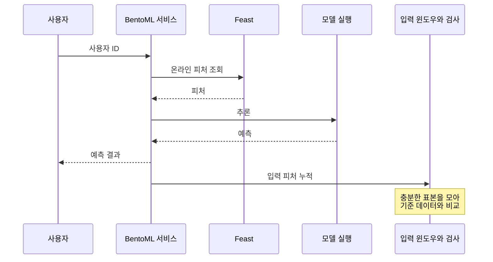

4~5장에서는 MLflow에 등록한 소득 분류 모델과 Feast의 피처를 KFP 배치 추론으로 연결했다. 대상 목록을 한꺼번에 처리하고 결과 파일을 저장하는 흐름이다. 6장은 같은 모델을 사용자 ID가 들어올 때마다 예측하는 API로 바꾸고, 배포 뒤 들어오는 입력이 학습 때와 달라지는지 살펴본다.

이 전환에서 질문도 두 개로 나뉜다. **요청을 안정적으로 처리할 수 있는가**는 서빙의 문제이고, **현재 데이터에서도 예측을 믿을 수 있는가**는 품질 판단의 문제이다. BentoML은 모델과 요청 처리 코드를 배포 단위로 묶고, Evidently는 기준 데이터와 현재 입력을 비교한다. 두 도구의 기능보다 이 역할이 어떻게 이어지는지 중심으로 읽는다.

## 배치 추론의 단계를 요청 경로로 옮긴다

배치에서는 대상 목록 읽기, 피처 조회, 추론, 결과 저장을 정해진 실행으로 처리했다. API에서는 사용자의 ID가 그 시작점이 되고, 피처 조회와 예측을 요청마다 수행해 응답해야 한다. 모델 파일을 서버에 올리는 것만으로 이 주변 단계까지 서비스가 되는 것은 아니다.

그림의 위쪽 왕복은 사용자가 기다리는 요청 경로이고, 입력 윈도우는 여러 요청을 모아 비교하는 관측 경로이다. 피처 조회 실패를 드리프트로 해석하거나 입력 한 행으로 전체 분포를 판단하지 않도록 두 경계를 나눈다. 검사 때문에 응답이 얼마나 늦어져도 되는지, 위험한 입력은 실행 전에 막아야 하는지도 업무 요구에 맞춰 정한다.

요청이 반환되려면 모델 외에 피처 조회, 전처리, 입출력 규격과 의존성이 함께 맞아야 한다. Feast가 반환한 값의 순서와 타입이 학습 때의 모델 입력과 같은지 확인하고, 피처가 없을 때 오류와 대체 동작을 명시해야 한다. 응답이 왔다는 사실과 올바른 입력으로 예측했다는 사실은 다르다.

## Bento는 모델과 요청 처리 코드를 함께 배포하는 단위이다

책은 MLflow 모델을 BentoML 저장소로 가져와 Service와 Runner를 정의하고 `bentofile.yaml`로 패키징한다. 등록된 모델을 요청에서 실행할 수 있는 서비스로 옮기는 과정이다.

| 구성 | 책임 |
| --- | --- |
| 모델 저장소 | 서비스가 사용할 모델 보관 |
| Service | 요청을 받고 피처 조회, 예측, 응답을 연결 |
| Runner | 모델 실행을 담당하는 작업 단위 |
| Bento | 서비스 코드, 모델, 의존성 등을 묶은 배포 패키지 |
| Yatai | 책에서 사용하는 Kubernetes 배포 관리 구성 |

Service는 ID를 받아 피처 조회와 응답을 연결하고 Runner는 모델 실행을 담당한다. Bento는 이 코드와 모델, 의존성을 함께 묶는다. 따라서 어떤 모델 버전과 피처 정의를 사용했는지 배포 기록에 남겨야 요청 결과의 변화를 설명할 수 있다.

Service, Runner, Yatai 절차는 책의 버전에 한정되므로 최신 API와 혼용하지 않는다. 자격 증명은 패키지 밖에서 Secret 관리 방식으로 전달한다. 패키지를 재사용할 수 있게 만드는 일과 환경별 접근 권한을 주는 일은 별개이다.

빌드한 Bento를 원격 저장소에 올리면 배포할 산출물이 생긴다. 이후 Yatai로 배포한 서비스가 실제 요청을 받을 준비가 됐는지는 별도로 확인한다. 모델이 로드되는지, Feast에 접근할 수 있는지, 대표 ID의 응답이 기대한 규격인지까지 봐야 한다. 업로드 성공은 요청 경로의 성공이 아니다.

이렇게 요청 기반 추론이 동작해도 배포 시점의 검증이 계속 유효하다고 볼 수는 없다. 들어오는 사용자의 구성이나 데이터 수집 방식이 바뀔 수 있기 때문이다. 다음 관측 단계는 모델을 다시 배포하는 일이 아니라 현재 입력이 어떤 상태인지 확인하는 일이다.

## Evidently는 현재 입력과 기준 데이터의 차이를 보여 준다

데이터 드리프트(data drift)는 기준과 현재 입력의 분포 차이다. 예를 들어 사용자 구성이 바뀌면 연령이나 사용 패턴의 분포가 달라질 수 있다. 서버가 정상 응답하고 있어도 모델이 학습 때 덜 본 입력을 더 자주 받고 있을 수 있다.

Evidently는 reference와 current 데이터를 비교해 메트릭과 보고서를 만든다. reference는 비교의 기준이므로 어떤 모델과 시점의 데이터인지 기록해야 한다. current의 수집 기간과 피처 정의도 같아야 변화가 실제 사용자 변화인지 처리 방식의 차이인지 해석할 수 있다.

그러나 **드리프트는 곧 예측 품질 저하라는 뜻이 아니다.** 분포가 달라도 모델이 잘 예측할 수 있고, 입력 분포가 비슷해도 입력과 정답의 관계가 바뀌면 품질은 떨어질 수 있다. 정답이 확보되면 해당 구간과 집단의 예측 성능을 따로 평가해야 한다. 정답이 아직 없다면 드리프트는 조사할 신호이지 정확도의 대체 지표가 아니다.

보고서와 대시보드에는 비교 대상, 변화 크기와 지속성, 기준 모델을 함께 남긴다. 경고 표시만 보면 데이터 수집 변경인지 계절성인지 판단할 수 없고, 서로 다른 모델의 기준 데이터를 비교하면 원인을 잘못 찾을 수 있다.

### 배치의 입력 묶음과 API의 관측 윈도우

KFP 배치 파이프라인에서는 피처 조회와 추론 사이에 검사 컴포넌트를 넣을 수 있다. 이미 입력 묶음이 있으므로 비교 결과가 기준을 넘으면 후속 처리를 중단하는 정책도 가능하다. 다만 어떤 변화가 중단 사유인지와 수정 뒤 어디서 재실행할지는 먼저 정해야 한다.

API에서는 요청 한 건이 한 사용자의 피처이므로 분포 비교의 표본으로 부족할 수 있다. 여러 요청을 마이크로배치나 시간 윈도우로 모아 검사하고, 요청 처리와 관측을 어떻게 분리할지 정한다.

| 방식 | 장점 | 정해야 할 것 |
| --- | --- | --- |
| 배치 실행 전 검사 | 문제 있는 묶음의 후속 처리를 통제 | 중단 기준과 재실행 절차 |
| API 입력 윈도우 검사 | 시간에 따른 변화 파악 | 윈도우 크기, 비교 주기, 요청 처리와의 분리 |

짧은 윈도우는 변화를 빨리 볼 수 있지만 표본이 적어 결과가 흔들릴 수 있다. 큰 윈도우는 안정적인 비교에 유리하지만 변화가 늦게 드러날 수 있다. 검사 피처가 많으면 오경보도 늘 수 있으므로 p-value만 보지 않고 변화 크기, 지속성, 업무 영향을 함께 본다. 과거 정상과 이상 사례로 기준을 조정하되 경고가 자동으로 차단이나 재학습을 뜻하게 만들지는 않는다.

## 관측한 변화를 데이터 복구와 모델 판단으로 연결한다

연령 피처의 결측률이 급증했다면 모델을 바로 다시 학습시키기보다 기준 기간과 수집 경로부터 확인한다. 생산 단계의 변경으로 값이 사라진 것이라면 데이터 복구가 먼저이고, 실제 사용자 집단이 달라진 것이라면 현재 구간의 모델 성능을 검토해야 한다.

| 관측 결과 | 먼저 조사할 것 | 가능한 대응 |
| --- | --- | --- |
| 피처 조회 실패, 지연 | 저장소, 네트워크, 권한, 최신성 | 명시적 오류, 업무상 허용된 대체 경로 |
| 입력 분포 변화 | 수집 변경, 계절성, 사용자 구성 | 원인 확인 후 모니터링, 모델 재검토 |
| 스키마, 단위 오류 | 데이터 생산, 변환 단계 | 후속 처리 중단과 데이터 복구 |
| 정답 기반 품질 하락 | 평가 구간, 집단, 데이터와 모델 변경 | 후보 재학습, 검증 후 승인된 출시 |

대응에는 담당자와 서비스 유지 기준이 필요하다. 대체 응답을 사용한다면 정상 예측처럼 숨기지 말고 모델 미사용 비율과 원인을 기록한다. 모델 문제가 아니라 피처 저장소의 지연이나 권한 문제라면 BentoML의 배포 경로와 별개로 그 기반 계층을 조사해야 한다. 패키징 도구가 네트워크, 자원 부족, 롤백의 책임까지 없애지는 않는다.

6장의 흐름은 모델을 API로 만드는 데서 끝나지 않는다. 어떤 입력과 버전으로 예측했는지 관측하고, 변화의 원인을 데이터 문제와 모델 문제로 나눠 대응할 수 있어야 한다. 재학습도 이 판단 뒤에 검증과 승인된 출시로 이어져야 한다.

[다음 장](../07-data-preparation/)은 앞에서 만든 플랫폼을 신분증 탐지와 영화 추천에 적용하면서 데이터 준비로 돌아간다. 새로운 모델을 학습하기 전에 어떤 데이터를 탐색하고, 어떤 조건으로 분할하고, 다음 단계에 무엇을 넘길지 정하는 과정이다. 이 입력의 의미와 버전이 명확해야 배포 후 관측의 기준도 신뢰할 수 있다.

[이전: 04. 실험, 피처, 파이프라인](../04-experiments-features-pipelines/), [시리즈 목차](../), [다음: 07. 데이터 분석과 준비](../07-data-preparation/)
