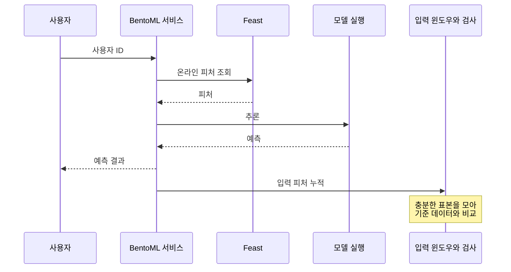

5장에서 배치로 실행한 추론을 6장에서는 API로 바꾸고, 배포 뒤 들어오는 데이터의 변화를 Evidently로 살핀다. 서비스가 요청을 받는 것과 모델이 여전히 잘 예측하는 것은 다르므로, **서빙과 품질 관측을 나눠 보는 흐름**으로 정리했다.

## 6.1 BentoML을 배포 플랫폼으로 사용하기

5장의 배치 추론을 사용자 ID 기반 API로 바꾸고 피처 조회와 예측을 요청마다 수행한다.

요청 지연과 일관성 요구에 따라 검사를 분리한다. 서비스에는 모델 외에 피처 조회, 전처리, 입출력 규격과 의존성도 포함된다.

### 6.1.1 Bento 만들기

MLflow 모델을 BentoML 저장소로 가져와 Service와 Runner를 정의하고 `bentofile.yaml`로 패키징한다.

| 구성 | 책임 |
| --- | --- |
| 모델 저장소 | 서비스가 사용할 모델 보관 |
| Service | 요청을 받고 피처 조회, 예측, 응답을 연결 |
| Runner | 모델 실행을 담당하는 작업 단위 |
| Bento | 서비스 코드, 모델, 의존성 등을 묶은 배포 패키지 |
| Yatai | 책에서 사용하는 Kubernetes 배포 관리 구성 |

Service, Runner, Yatai 절차는 책의 버전에 한정되므로 최신 API와 혼용하지 않는다. 자격 증명은 패키지 밖에서 Secret 관리 방식으로 전달한다.

### 6.1.2 Bento 빌드와 푸시

서비스와 의존성을 패키징해 원격 저장소에 올리고 모델, 코드 버전을 기록한다.

### 6.1.3 Bento 배포

Yatai 배포 뒤 실제 요청을 받을 준비가 됐는지 확인한다. 패키지 저장만으로는 서비스 준비가 끝나지 않는다.

## 6.2 Evidently로 데이터 드리프트 관측하기

데이터 드리프트(data drift)는 기준과 현재 입력의 분포 차이다. 사용자 구성 변화로 연령이나 사용 패턴이 달라질 수 있다.

드리프트는 품질 저하의 증거가 아니다. 입력 분포가 같아도 입력과 정답의 관계가 바뀔 수 있다.

Evidently는 reference와 current를 비교해 메트릭, 보고서를 만든다. 기준 데이터의 모델과 시점도 기록한다.

### 6.2.1 드리프트 보고서와 대시보드

보고서에 비교 대상, 결과, 변화 크기, 지속성과 기준 모델을 남긴다.

### 6.2.2 KFP의 드리프트 검사 컴포넌트

배치 파이프라인은 피처 조회와 추론 사이에서 검사하고 기준 초과 시 중단할 수 있다.

### 6.2.3 API로 배포한 모델의 드리프트 검사

단일 API 요청은 표본이 부족할 수 있어 입력을 마이크로배치나 윈도우로 모아 비교한다.

| 방식 | 장점 | 정해야 할 것 |
| --- | --- | --- |
| 배치 실행 전 검사 | 문제 있는 묶음의 후속 처리를 통제 | 중단 기준과 재실행 절차 |
| API 입력 윈도우 검사 | 시간에 따른 변화 파악 | 윈도우 크기, 비교 주기, 요청 처리와의 분리 |

표본은 안정성과 감지 속도에 영향을 준다. 경고에 따른 차단, 재학습은 업무 위험에 따라 정한다.

## 데이터 변화 이후의 판단

| 관측 결과 | 먼저 조사할 것 | 가능한 대응 |
| --- | --- | --- |
| 피처 조회 실패, 지연 | 저장소, 네트워크, 권한, 최신성 | 명시적 오류, 업무상 허용된 대체 경로 |
| 입력 분포 변화 | 수집 변경, 계절성, 사용자 구성 | 원인 확인 후 모니터링, 모델 재검토 |
| 스키마, 단위 오류 | 데이터 생산, 변환 단계 | 후속 처리 중단과 데이터 복구 |
| 정답 기반 품질 하락 | 평가 구간, 집단, 데이터와 모델 변경 | 후보 재학습, 검증 후 승인된 출시 |

대체 응답을 정상 예측처럼 숨기지 말고 모델 미사용 비율과 원인을 기록한다.

표본, 윈도우는 감지 속도와 안정성의 절충이며 검사 피처가 많으면 오경보도 늘 수 있다. p-value 외에 변화 크기, 지속성, 업무 영향을 보고 과거 정상, 이상 사례로 임계치를 조정한다.

## 드리프트 알림 이후의 대응

결측률이 급증하면 기준 기간과 수집 경로부터 조사한다. 수집 장애는 데이터 복구, 실제 사용자 변화는 모델 재검토로 대응하고 담당자와 서비스 유지 기준을 정한다.

## 드리프트 대응과 배포 기반

### 드리프트와 재학습 결정

드리프트는 수집 오류나 일시적 이벤트일 수 있다. 재학습 전 데이터 정상 여부와 실제 품질, 업무 영향을 확인한다.

### 배포 도구가 감추는 기반 계층

기본 경로는 편해지지만 네트워크, 자원 부족, 권한, 롤백 문제는 남는다. 도구가 감춘 계층을 이해하면 문제가 생겼을 때 조사할 수 있다.

경고만으로 대응하지 말고 비교한 모델과 기준 데이터를 먼저 확인한다.

## 마치며

배포 도구는 서비스화를 돕지만 사후 판단을 대신하지 않는다. 수집 오류와 환경 변화를 구분해 모델 평가에 연결한다.

[이전: 04. 실험, 피처, 파이프라인](../04-experiments-features-pipelines/), [시리즈 목차](../), [다음: 07. 데이터 분석과 준비](../07-data-preparation/)
