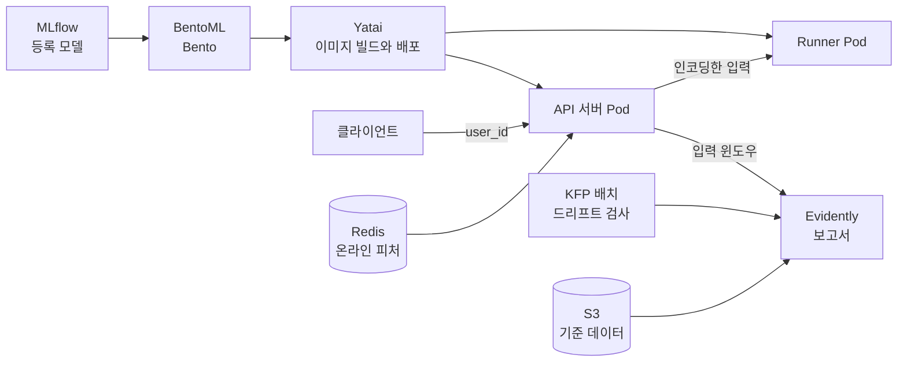

4~5장의 소득 분류 모델은 사용자 목록을 파일로 받아 한꺼번에 예측하는 배치 작업이었다. 6장은 같은 모델을 사용자 ID가 들어올 때마다 답하는 API로 바꾸고, 배포 뒤 들어오는 입력이 학습 때와 달라지는지 지켜본다. 요청을 안정적으로 처리하는지와 지금 데이터에서도 예측을 믿을 수 있는지는 서로 다른 증거로 답해야 한다.

## 전체 그림 {#platform-map}

MLflow에 등록한 모델은 BentoML에서 서비스 코드와 함께 Bento로 묶이고, Yatai가 이를 이미지와 Pod로 바꾼다. 요청이 오면 API 서버가 Redis에서 온라인 피처를 읽어 Runner에 넘기고, 모은 입력은 Evidently 보고서의 비교 대상이 된다. KFP 배치 파이프라인도 추론 전에 같은 방식의 보고서를 만든다.

## 서빙은 모델과 요청 처리를 함께 배포하는 일이다 {#model-serving}

모델의 `predict()`를 부르는 것과 다른 애플리케이션이 쓸 서비스를 운영하는 것은 다르다. 서비스에는 요청 규격, 피처 조회, 전처리, 모델 로드, 동시 요청 처리, 실패 응답이 모두 필요하다. 모델은 메모리에 한 번 올려 재사용하지만 요청마다 피처 조회와 전처리가 일어나므로, Redis 조회가 느리면 Runner를 늘려도 지연은 충분히 줄지 않는다.

BentoML은 이 구성을 몇 가지 역할로 나눈다. Service는 API의 입출력과 처리 흐름을 정의하고, Runner는 모델 계산을 별도 worker에서 실행한다. Bento는 서비스 코드, 모델, 의존성을 묶은 배포 산출물이다. 모델 버전이 같아도 전처리 코드가 바뀌면 다른 Bento이므로, 모델 버전 하나로는 배포를 재현할 수 없다. Yatai는 Bento를 받아 이미지와 Pod로 바꾸는 배포 제어 계층이고, 예측 품질을 판단하지 않는다.

그림 6-1. API 처리와 모델 실행을 분리한 Runner 구조. 출처: [BentoML 1.1.10 공식 문서](https://github.com/bentoml/BentoML/blob/fa278835a5333c5d378a0b03a9b56a9fc4ce21e4/docs/source/concepts/runner.rst), [Apache-2.0](https://github.com/bentoml/BentoML/blob/fa278835a5333c5d378a0b03a9b56a9fc4ce21e4/LICENSE). 원본 도식을 변경 없이 사용했다.

API가 정상 응답했다고 학습과 같은 입력이 만들어졌다는 보장은 없다. 저자 코드는 요청 한 건에 `get_dummies(drop_first=True)`를 적용하는데, 한 행에는 열마다 범주가 하나뿐이라 원-핫 열이 지워진다. 나중에 학습 열 목록으로 순서를 맞춰도 의미는 돌아오지 않는다. 학습에서 fit한 인코더를 서비스에서도 그대로 써야 한다.

## 드리프트 보고서는 입력 변화를 보여 주고 품질은 따로 판단한다 {#drift-concepts}

Evidently는 기준 데이터(reference)와 지금 평가할 데이터(current)를 열별로 비교한다. 책은 모델의 원천 run에서 남긴 학습 데이터를 기준으로 쓴다. 보고서가 말해 주는 것은 입력 분포의 변화이고, 그 변화가 예측을 틀리게 만들었는지는 정답이 모인 뒤에야 알 수 있다.

| 변화 | 달라지는 것 | 입력 비교로 알 수 있는가 |
| --- | --- | --- |
| Covariate shift | 입력 분포 `P(X)` | 알 수 있다 |
| Prediction drift | 예측 분포 `P(y_hat)` | 예측을 모으면 알 수 있다 |
| Label shift | 정답 비율 `P(y)` | 정답이 필요하다 |
| Concept drift | 입력과 정답의 관계 `P(y\|X)` | 정답이 필요하다 |

열마다 KS 검정, 카이제곱 검정, PSI 같은 방법이 열 타입과 표본 수에 따라 달리 쓰인다. p-value는 드리프트가 일어났을 확률이 아니다. 두 분포가 같다고 가정했을 때 지금 본 차이가 얼마나 이례적인지를 나타내므로, 표본이 크면 작은 차이도 잡히고 작으면 중요한 변화를 놓친다. 데이터셋 수준의 `share_of_drifted_columns`가 0.25라면 검사한 열의 4분의 1이 조건을 넘었다는 뜻이고, 예측의 25%가 틀렸다는 뜻으로 읽으면 안 된다.

그림 6-2. 직업 피처의 분포와 검사 결과를 함께 보는 공식 보고서 예시. 출처: [Evidently 0.5.0 보고서 이미지](https://github.com/evidentlyai/evidently/blob/49cce31eaa49ec354d32ccd2edb3c9d492949db1/docs/book/.gitbook/assets/reports/metric_data_drift_table_expand_1-min.png), [Apache-2.0](https://github.com/evidentlyai/evidently/blob/49cce31eaa49ec354d32ccd2edb3c9d492949db1/LICENSE). 이 글의 실습 결과가 아닌 공식 예제다.

API에서는 요청 하나가 표본 하나라서 입력을 윈도우로 모아 비교한다. 작은 윈도우는 빨리 반응하지만 흔들림이 크다. 책의 그림 6.21은 크기 50의 윈도우에서 `share_of_drifted_columns`가 약 0.875로 나오는데, 요청한 사용자는 학습 데이터에서 가져온 사람들이다. 이 값은 운영 환경의 변화보다 표본 크기와 비교 조건을 다시 보라는 신호로 읽어야 한다. 반대로 매번 최근 데이터로 기준을 갈아 끼우면 서서히 진행되는 변화가 정상으로 흡수된다.

## 예측 경로와 관측 경로를 나눈다 {#production-monitoring}

필수 필드나 피처 누락처럼 요청 한 건의 유효성은 예측 전에 검사할 수 있다. 분포 변화는 표본이 쌓여야 해석되므로, 사용자가 기다리는 예측 경로와 여러 표본을 비교하는 관측 경로를 나누는 편이 맞다. 관측 기록 전송을 동기로 부르면 그 지연과 실패가 응답에도 번지니, 버퍼나 별도 수집 경로를 두고 누락을 어떻게 다룰지 정해야 한다.

그림 6-3. 추론 서비스와 collector를 분리한 관측 구조. 출처: [Evidently collector 공식 문서](https://docs-old.evidentlyai.com/user-guide/monitoring/collector_service), [원본 이미지](https://github.com/evidentlyai/evidently/blob/49cce31eaa49ec354d32ccd2edb3c9d492949db1/docs/book/.gitbook/assets/monitoring/monitoring_collector_min.png), [Apache-2.0](https://github.com/evidentlyai/evidently/blob/49cce31eaa49ec354d32ccd2edb3c9d492949db1/LICENSE). 원본 도식을 변경 없이 사용했다.

기록할 값은 피처 조회 직후의 실제 모델 입력이다. `/predict`는 `user_id`만 받으므로, 나중에 같은 ID로 Redis를 다시 읽으면 이미 바뀐 값이 나온다. 여기에 예측 ID, 시각, 모델과 전처리 버전을 함께 남겨야 늦게 도착한 정답을 연결하고 버전 교체의 영향을 구분할 수 있다. 요청 수와 지연 같은 집계는 Prometheus에, 개별 예측 기록은 평가용 저장소에 둔다. 표본이 모자란 구간은 드리프트 없음이 아니라 평가할 자료 부족으로 표시한다.

드리프트 경고는 조사를 시작할 근거이고 재배포 승인이 아니다. 수집 장애나 피처 정의 변경이 원인이면 경로를 고치고, 계절성처럼 알려진 변화면 지켜보며, 새 집단에서 품질이 계속 떨어질 때 재학습을 검토한다. 책의 KFP 예제도 이 경계에서 어긋난다. 본문은 드리프트가 있으면 멈춘다고 설명하지만, 저자의 `detect_drift.py`는 보고서를 올리기만 하고 `.after()`는 실행 순서일 뿐이라 추론은 그대로 진행된다. API 예제도 보고서를 요청 처리 프로세스 안에서 계산하므로 응답이 느려지고, 여러 worker 사이의 윈도우 공유는 다루지 않는다.

## 정리

6장에서 서비스는 요청, 피처, 전처리, 모델 버전을 하나의 실행 단위로 묶었다. 배포 뒤에는 서비스 상태, 입력 변화, 정답 기반 품질을 서로 다른 증거로 확인한다. 배치와 API 어느 쪽이든 비교가 의미를 가지려면 같은 의미의 입력끼리 견줘야 하고, [7장의 데이터 계약](/docs/tech/machine-learning-platform-engineering/07-data-preparation/#training-serving-contract)이 그 기반을 데이터 준비 단계에서 세운다.

## 실습 {#book-ch06-sop}

책 코드로 직접 실행한 순서와 결과 화면은 [6장 실습 기록](/docs/tech/machine-learning-platform-engineering/practice/ch06/)에 따로 모았다.

## 참고 자료

- [BentoML 1.1.10의 Runner](https://github.com/bentoml/BentoML/blob/v1.1.10/docs/source/concepts/runner.rst): 책에서 쓰는 버전의 Service와 Runner 분리.
- [Evidently 구버전의 드리프트 알고리즘](https://docs-old.evidentlyai.com/reference/data-drift-algorithm): 열별 검사와 데이터셋 수준 판정.
- [Evidently 모니터링 구조](https://docs-old.evidentlyai.com/user-guide/monitoring/monitoring_overview): 온라인 예측과 별도 관측 작업의 연결.
- [Evidently의 드리프트 대응](https://www.evidentlyai.com/blog/ml-monitoring-data-drift-how-to-handle): 원인 조사와 재학습 외의 선택지.
- [저자 chapter-6 코드](https://github.com/practical-mlops/chapter-6/tree/890db04409cb3f48c4e493470d79095ec6ab63d6): 기본 서비스와 Evidently 통합 경로.

[이전: 04~05. 실험, 피처, 파이프라인](/docs/tech/machine-learning-platform-engineering/04-experiments-features-pipelines/), [시리즈 목차](/docs/tech/machine-learning-platform-engineering/), [다음: 07. 데이터 분석과 준비](/docs/tech/machine-learning-platform-engineering/07-data-preparation/)
