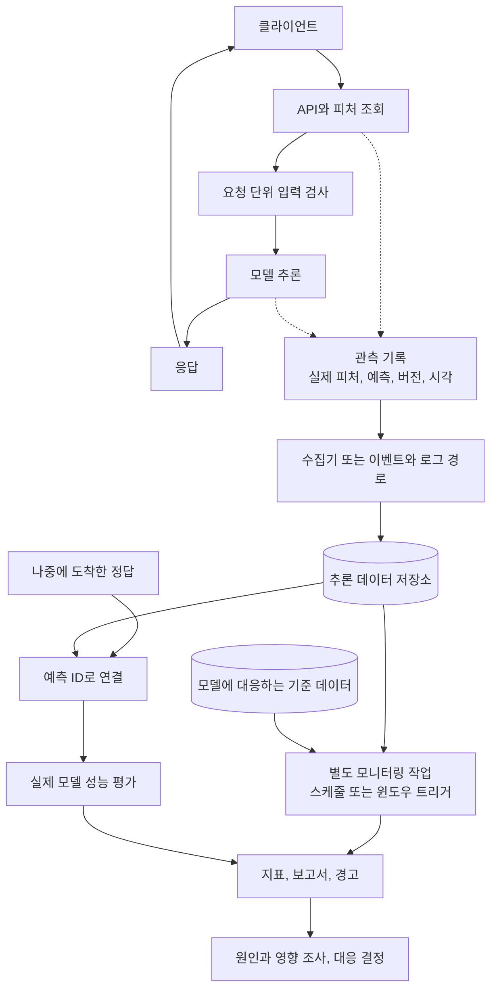
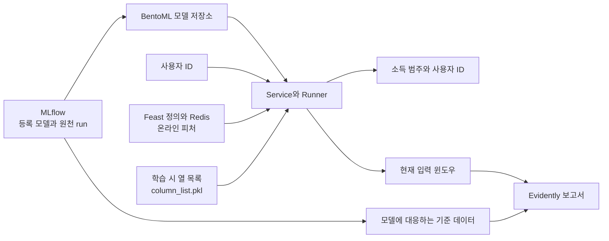
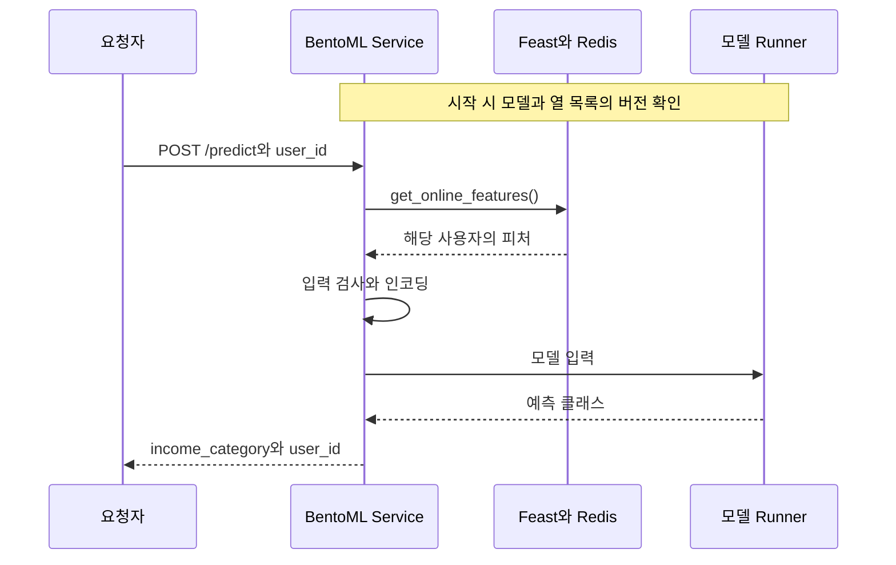

4~5장에서는 사용자 목록과 기준 시각을 파일로 받아 배치 추론했다. 6장은 같은 소득 분류 모델을 사용자 ID 기반 API로 바꾸고, 서비스에 들어오는 피처를 기준 데이터와 비교한다. **모델 등록, API 배포, 예측 품질 관측은 서로 다른 작업**이라는 점을 이 연결에서 볼 수 있다.

이 장의 두 축은 BentoML로 모델을 서비스하는 구조와 Evidently로 데이터 변화를 해석하는 방법이다. 서빙 구성과 드리프트의 원리를 설명한 뒤, [운영 인프라에서 관측을 연결하는 방식](#production-monitoring)을 정리한다. 뒤의 [실습 흐름](#book-ch06-sop)은 이 구조를 저자 코드와 대조해 읽는 부분이다.

## 6.1 BentoML의 모델 서빙 구조 {#model-serving}

### 배치 추론과 온라인 추론

모델의 `predict()`를 호출하는 것과 다른 애플리케이션이 사용할 서비스를 운영하는 것은 다르다. 함수 호출에는 메모리 안의 입력과 모델이 있으면 되지만, 서비스에는 요청 규격, 전처리, 모델 로드, 동시 요청 처리와 실패 응답도 필요하다.

| 구분 | 배치 추론 | 온라인 추론 |
| --- | --- | --- |
| 실행 계기 | 일정이나 준비된 데이터 묶음 | 사용자와 애플리케이션의 요청 |
| 입력 | 파일, 테이블, 대상 기간 | 요청 본문과 요청 시점에 조회한 피처 |
| 응답 시점 | 작업 완료 후 결과 파일 제공 | 요청을 기다리는 클라이언트에 응답 |
| 주요 운영 기준 | 완료 시간, 처리량, 재실행과 결과 중복 | 지연, 동시성, 가용성과 오류 처리 |
| 이 책의 예 | 5장의 대상 목록과 과거 피처 | 6장의 사용자 ID와 온라인 피처 |

온라인이라고 모델을 매번 새로 학습하는 것은 아니다. 이미 학습한 모델을 메모리에 올리고 여러 요청에서 재사용한다. 요청마다 피처 조회, 전처리와 예측이 발생하므로 전체 지연에는 모델 계산 외의 시간도 포함된다. Redis 조회가 느리면 Runner만 늘려도 API 지연이 충분히 줄지 않을 수 있다.

### 모델, Service, Runner, Bento의 관계

BentoML은 학습 프레임워크를 대체하지 않는다. 서로 다른 프레임워크의 모델을 가져와 실행하고, 그 앞뒤의 처리와 환경을 배포 단위로 묶는 역할을 한다. 책에서 사용하는 1.1.10의 주요 개념은 다음과 같다.

| 구성 | 의미 | 소득 분류에서의 역할 |
| --- | --- | --- |
| Model store | 이름과 태그로 모델을 보관하는 저장소 | MLflow에서 가져온 분류기 보관 |
| Service | API의 입출력과 처리 흐름 정의 | 사용자 ID 검사, Feast 조회, 전처리와 응답 |
| Runnable | 실행할 연산과 지원 자원 등을 정의하는 단위 | 모델 프레임워크가 제공하는 예측 연산 |
| Runner | Runnable을 worker에서 실행하는 계산 단위 | 분류기를 로드하고 예측 호출 처리 |
| Bento | 서비스 코드, 모델과 의존성 구성을 묶은 배포 산출물 | 같은 서비스를 다시 실행할 패키지 |
| 컨테이너 이미지 | Bento를 컨테이너 런타임에서 실행할 이미지 | 클러스터에 전달할 실행 환경 |
| Deployment | 특정 버전을 자원, 복제본, 주소와 함께 실행한 상태 | 실제 요청을 받는 API와 Runner |

Service는 요청을 어떻게 해석하고 어떤 연산을 호출할지 정한다. Runner는 모델 계산을 worker에서 실행한다. 두 역할을 나누면 API 처리량과 모델 계산에 필요한 자원을 따로 조정할 수 있다. Runner는 Kubernetes의 학습 Job을 뜻하지 않으며, 항상 별도 Pod인 것도 아니다. 로컬 실행에서는 worker 프로세스로, 책의 Yatai 배포에서는 분리된 Pod로 실행하는 구성을 다룬다.


그림 6-1. API 처리와 모델 실행을 분리한 Runner 구조. 출처: [BentoML 1.1.10 공식 문서](https://github.com/bentoml/BentoML/blob/fa278835a5333c5d378a0b03a9b56a9fc4ce21e4/docs/source/concepts/runner.rst), [Apache-2.0](https://github.com/bentoml/BentoML/blob/fa278835a5333c5d378a0b03a9b56a9fc4ce21e4/LICENSE). 원본 도식을 변경 없이 사용했다.

그림의 경계는 API 요청을 처리하는 프로세스와 계산을 실행하는 프로세스의 구분이다. 아래는 여기에 이 장의 Feast 조회와 전처리를 넣어 읽은 흐름이다.


MLflow Registry는 모델의 이름, 버전과 학습 출처를 관리한다. BentoML의 Model store는 서빙에 가져온 모델을, Bento는 그 모델을 사용하는 서비스 전체를 식별한다. 모델 버전이 같아도 피처 조회나 전처리 코드가 달라지면 다른 서비스가 된다. 따라서 모델 버전만으로 배포를 재현할 수는 없다.

### 입출력 계약과 서빙 성능

API의 계약에는 JSON 필드와 타입뿐 아니라 의미도 들어간다. `user_id`가 문자열이라는 검사와 그 사용자에게 유효한 온라인 피처가 있다는 검사는 다르다. 응답의 확률, 클래스 번호와 소득 범주도 서로 구분해야 한다.

전처리는 학습 때의 의미를 유지해야 한다. 범주 인코딩, 결측 처리, 열 순서와 단위가 바뀌면 같은 모델에 다른 입력을 주게 된다. API가 정상 응답했는지와 학습과 같은 변환을 거쳤는지는 별도로 확인한다.

Runner는 모델과 설정이 지원하면 여러 요청의 계산을 묶는 adaptive batching을 사용할 수 있다. 벡터화와 GPU 활용에는 유리하지만 묶음을 기다리는 시간이 더해지므로 처리량과 개별 요청 지연의 절충이 생긴다. 이 기능은 5장처럼 대상 파일 전체를 처리하는 배치 추론과 다르다. 책의 기본 소득 분류 서비스가 자동으로 적절한 배칭 정책까지 갖췄다는 뜻도 아니다.

### 빌드, 레지스트리와 Yatai의 책임

`bentofile.yaml`은 어떤 서비스와 파일, 모델, 의존성을 포함할지 선언한다. 빌드는 이 선언으로 Bento를 만드는 작업이고, push는 만들어진 산출물을 원격 저장소로 전달하는 작업이다. 패키지 저장과 서비스 실행은 다른 상태다.

책의 Yatai는 Kubernetes에서 Bento의 배포를 관리하는 제어 계층이다. 모델과 Bento의 관리, 이미지 빌드, API 서버와 Runner의 자원 및 복제본 설정, 서비스 노출을 연결한다. 실제 계산은 배포된 worker와 Pod가 수행한다. Yatai가 모델의 예측 품질이나 학습 데이터의 적합성을 판정하지는 않는다.

| 관리 대상 | 필요한 이유 |
| --- | --- |
| 모델 태그와 Bento 태그 | 무엇을 어떤 코드로 서비스했는지 구분 |
| 컨테이너 이미지와 의존성 | 다른 환경에서도 같은 실행 조건 구성 |
| CPU, 메모리, GPU와 복제본 | 모델 크기와 요청 부하에 맞는 실행 용량 |
| 준비 상태와 서비스 주소 | 모델 로드 전의 실행과 요청 가능한 상태 구분 |
| 배포 버전과 전환 기록 | 새 서비스의 문제를 추적하고 이전 구성으로 복구 |

API 복제본을 늘리는 것과 Runner 복제본을 늘리는 것은 같은 조정이 아니다. 모델을 여러 worker에 올리면 메모리 사용량도 증가한다. 전처리, 모델 계산, 저장소 중 어느 구간이 병목인지 측정한 뒤 자원을 조정해야 한다.

### 서비스 관측과 모델 관측

BentoML의 `/metrics`와 Prometheus 연계는 요청 수, 지연과 오류 같은 서비스 동작을 관찰하는 데 쓰인다. 메트릭을 노출하는 것, Prometheus가 수집하는 것, 대시보드와 알림을 만드는 것은 별도 구성이다.

요청이 빠르고 HTTP 200이 많아도 예측이 틀릴 수 있다. 반대로 모델 품질이 유지되어도 피처 조회 장애로 서비스를 쓰지 못할 수 있다. 그래서 이 장의 다음 주제인 데이터와 모델 관측을 인프라 관측과 구분한다.

## 6.2 데이터 드리프트와 Evidently의 관측 원리 {#drift-concepts}

### 입력, 정답과 예측의 변화

입력 피처를 `X`, 실제 정답을 `y`, 모델의 예측을 `y_hat`으로 두면 무엇이 바뀌었는지 나눠 볼 수 있다.

| 변화 | 달라지는 것 | 해석 |
| --- | --- | --- |
| Covariate shift | 입력 분포 `P(X)` | 직업이나 학력 구성이 달라짐. 엄밀한 구분에서는 `P(y\|X)`가 유지된다고 가정 |
| Label / prior shift | 정답 비율 `P(y)` | 소득 범주 비율이 달라짐. 엄밀한 label shift는 `P(X\|y)`의 안정성을 가정 |
| Concept drift | 입력과 정답의 관계 `P(y\|X)` | 같은 피처 조건에서도 소득 범주의 발생 관계가 달라짐 |
| Prediction drift | 예측 분포 `P(y_hat)` | 모델이 반환하는 범주나 확률의 구성이 달라짐 |

이 구분은 원인을 설명하는 틀이며, 운영에서는 여러 변화가 함께 발생할 수 있다. 입력 분포만 비교해서 concept drift를 확인했다고 할 수는 없다. 정답이 늦게 도착하는 서비스에서는 입력과 예측의 변화를 먼저 관찰하고, 정답이 모였을 때 실제 품질을 확인한다.

예를 들어 직업 분류를 수집하는 시스템이 바뀌어 특정 값이 대량으로 결측 처리되면 모델 재학습보다 수집 경로 복구가 우선일 수 있다. 반면 같은 직업과 학력에서도 소득 관계가 지속적으로 달라졌다면 모델과 피처의 재검토가 필요하다.

개별 요청이 특이한지를 보는 이상치 검사와 분포를 비교하는 드리프트 검사도 다르다. 한 사용자의 드문 직업은 이상치일 수 있지만 사용자 전체의 구성이 바뀌었다는 증거는 아니다.

### Reference와 current를 비교하는 방법

Evidently는 기준 데이터(reference)와 평가할 현재 데이터(current)를 받아 열별 변화와 요약을 계산한다. 기준은 학습 데이터일 수도 있고 검증된 정상 기간일 수도 있다. 어느 모델과 기간을 대표하는지에 따라 보고서의 의미가 달라진다.

열의 타입과 표본 수에 따라 비교 방법도 달라진다. 책의 예제와 같은 구버전 API의 선택 규칙은 [Evidently의 드리프트 알고리즘 문서](https://docs-old.evidentlyai.com/reference/data-drift-algorithm)에 정리되어 있다.

| 방법 | 비교하는 것 | 결과를 읽는 기준 |
| --- | --- | --- |
| Kolmogorov–Smirnov(KS) 검정 | 수치형 변수의 경험적 누적분포 차이 | p-value와 분포 차이의 크기를 함께 확인 |
| 카이제곱 검정 | 범주별 관측 빈도 차이 | 범주별 표본과 기대 빈도, p-value 확인 |
| Wasserstein distance | 한 수치 분포를 다른 분포로 옮기는 차이 | 거리, 정규화 방식, 임계치 확인 |
| Jensen–Shannon 계열 지표 | 범주별 확률분포 차이 | 거리나 발산의 정의, 적용한 임계치 확인 |
| PSI | 구간이나 범주별 비율의 변화 | 구간 정의와 비교 임계치 확인 |


그림 6-2. 직업 피처의 분포와 검사 결과를 함께 보는 공식 보고서 예시. 출처: [Evidently 0.5.0 보고서 이미지](https://github.com/evidentlyai/evidently/blob/49cce31eaa49ec354d32ccd2edb3c9d492949db1/docs/book/.gitbook/assets/reports/metric_data_drift_table_expand_1-min.png), [Apache-2.0](https://github.com/evidentlyai/evidently/blob/49cce31eaa49ec354d32ccd2edb3c9d492949db1/LICENSE). 이 글의 실습 결과가 아닌 공식 예제다.

표본 수가 다르면 원시 건수로 그린 막대의 높이도 달라진다. 그림의 인상만으로 판정하지 말고 상대 비율과 선택한 검사, 임계치를 함께 확인한다. 화면의 PSI 값은 아래에서 설명하는 p-value와 같은 지표가 아니다.

p-value는 “드리프트가 발생했을 확률”이 아니다. 같은 분포라는 가정 아래 관측 차이가 얼마나 이례적인지를 해석하는 값이다. 표본이 매우 크면 작은 차이도 통계적으로 드러날 수 있고, 표본이 적으면 중요한 변화를 놓칠 수 있다.

거리 기반 값도 모델 정확도와 같은 지표는 아니다. 선택한 방법, 표본 수, 변화의 크기와 업무 영향을 함께 보고 임계치를 정해야 한다. 서로 다른 검사에서 나온 drift score를 같은 단위처럼 비교하지 않는다.

### 열별 검사와 데이터셋 수준 판정

열별 drift는 어떤 피처가 달라졌는지 보여 준다. 데이터셋 수준 판정은 그 결과를 묶어 “전체 입력을 변화한 것으로 볼 것인가”를 결정하는 규칙이다.

예를 들어 검사 열 8개 중 2개가 변하면 변한 열의 비율은 0.25다. 이것은 예측의 25%가 틀렸다는 뜻이 아니다. 변한 두 열이 모델에 중요한지와 변화가 어느 사용자 집단에 집중되는지도 확인해야 한다.

각 열의 분포가 비슷해도 열 사이의 관계는 바뀔 수 있다. 열별 검사만으로 모든 다변량 변화를 포착하지는 못한다. 많은 열을 반복 검사하면 우연한 경고도 늘어날 수 있으므로 경고의 지속성과 재현 여부를 함께 본다.

결측률과 스키마는 분포 검사와 별도로 다룬다. 결측값을 제외하고 분포를 비교하는 검사에서는 결측 급증을 놓칠 수 있다. 원본이 `DatasetMissingValuesMetric`과 `ColumnSummaryMetric`을 drift metric과 함께 넣는 이유다.

### Metric, Report, Test와 대시보드

| 구성 | 역할 | 그 자체로 하지 않는 것 |
| --- | --- | --- |
| Metric | 결측 비율, 분포 차이, 모델 오차 등의 값 계산 | 모든 지표에 업무상 합격 기준 부여 |
| Report | 선택한 지표와 시각화 결과를 묶음 | 파이프라인이나 API를 자동 차단 |
| Test / Test Suite | 지정한 조건에 대한 통과나 실패 판정 | 재학습과 출시 승인 정책 전체 구현 |
| Workspace / Project | 보고서와 실행 구간을 모아 관리 | 기준 데이터의 적합성 자동 결정 |
| Dashboard | 기간별 지표와 변화 추세 표시 | 원인 분석과 서비스 유지 판단 대체 |

정답이 있으면 문제 유형에 맞는 분류나 회귀 성능도 계산할 수 있지만, 입력만 있는 보고서가 정확도를 새로 알아내는 것은 아니다. 보고서를 만든 뒤 경고, 처리 보류나 추가 평가로 연결하는 정책은 별도로 정해야 한다. 뒤의 D-2에서는 이 구분을 저자의 실제 코드와 대조한다.

### 배치, 마이크로배치와 슬라이딩 윈도우

배치에서는 처리할 묶음 자체가 current가 된다. API는 요청 하나가 표본 하나에 가까우므로 여러 입력을 모아 비교한다.

| 비교 단위 | 특징 | 정할 것 |
| --- | --- | --- |
| 배치 | 파일이나 대상 기간 단위로 비교 | 같은 대상의 재실행, 검사 후 추론 정책 |
| 고정 윈도우 | 고정된 시간이나 건수로 나눈 겹치지 않는 묶음 | 보고서 간격, 트래픽이 적을 때의 최소 표본 |
| 슬라이딩 윈도우 | 최근 표본을 유지하며 반복 비교 | 윈도우 크기, 검사 간격과 겹침 |

작은 윈도우는 빠르게 반응하지만 변동이 크고, 큰 윈도우는 안정적이지만 변화 발견이 늦을 수 있다. 요일과 시간대의 정상적인 변화를 서로 다른 기준과 비교하면 경고가 반복될 수 있다. 겹치는 윈도우의 연속 경고도 독립된 여러 사건처럼 세지 않는다.

새로운 current를 매번 reference로 교체하면 지속적인 변화를 정상으로 흡수할 수 있다. 기준을 고정할지 갱신할지, 갱신 전에 무엇을 검증할지도 관측 설계의 일부다.

## 서빙 인프라에서 드리프트를 다루는 방식 {#production-monitoring}

### 추론 경로와 관측 경로를 나눈다

실시간으로 예측하는 서비스라도 통계 검사를 요청마다 실행할 필요는 없다. [Evidently의 모니터링 구조](https://docs-old.evidentlyai.com/user-guide/monitoring/monitoring_overview)는 온라인 추론을 로그로 남긴 뒤 별도 작업에서 평가하는 방식과, collector가 입력을 모아 계산하는 방식을 구분한다. [Azure ML 모델 모니터링](https://learn.microsoft.com/en-us/azure/machine-learning/concept-model-monitoring?view=azureml-api-2)도 추론 데이터 수집과 정해진 주기의 모니터링 작업을 분리한다.

공통점은 **사용자가 기다리는 예측 경로와 여러 표본을 비교하는 관측 경로의 책임을 나누는 것**이다. 모든 시스템이 같은 주기나 제품을 사용한다는 뜻은 아니다.



점선은 서비스가 관측용 기록을 남긴다는 관계이며, 수집 자체가 무조건 지연이나 실패 없이 끝난다는 뜻은 아니다. collector 전송을 동기 호출하면 그 시간과 실패도 요청 경로에 영향을 줄 수 있다. 비동기 전송, 버퍼나 별도 로그 경로를 택하더라도 메모리 한도, 재시도, 누락과 밀린 기록의 처리가 필요하다.

관측 시스템이 일시적으로 중단됐을 때 예측을 계속할지, 기록이 반드시 남아야 하므로 요청도 제한할지는 서비스 요구사항으로 정한다. 단순히 보고서 계산 실패를 예측 실패로 전파하는 것과 의도적으로 정한 정책은 다르다.

### 어디에서 무엇을 수집하는가

이 책의 `/predict`는 `user_id`만 받는다. HTTP 요청과 응답만 저장하면 사용자 ID와 소득 범주는 남지만, 실제 모델이 본 학력과 직업 등의 분포는 알 수 없다.

따라서 피처 조회 후의 값, 필요하다면 전처리 후의 모델 입력을 관측 대상으로 삼아야 한다. 나중에 같은 사용자 ID로 Redis를 다시 조회하면 값이 바뀌어 있을 수 있으므로 당시 입력을 재구성한 것이 되지 않는다. [Azure ML 데이터 수집 문서](https://learn.microsoft.com/en-us/azure/machine-learning/concept-data-collection?view=azureml-api-2)도 HTTP payload logging과 전처리 전, 처리 중, 처리 후의 데이터를 남기는 custom logging을 구분한다.

| 관측 지점 | 알 수 있는 것 | 기준 데이터와 맞출 것 |
| --- | --- | --- |
| 외부 요청 | 입력 규격, 요청 대상과 오류 | API 계약 |
| Feast 조회 직후 | 실제 사용한 피처, 결측과 최신성 | 같은 피처 정의와 시점 의미의 reference |
| 전처리 직후 | 인코딩, 스케일과 모델 입력 형태 | 같은 전처리 버전의 입력 표현 |
| 모델 출력 | 범주나 확률의 분포, 모델 동작 | 같은 모델 버전의 비교 가능한 예측 |
| 실제 결과 도착 후 | 예측 오차와 집단별 품질 | 예측과 연결되는 정답과 평가 기간 |

다음은 특정 플랫폼의 필수 형식이 아니라 관측 기록에 담을 항목의 예다.

| 항목 | 필요한 이유 |
| --- | --- |
| `prediction_id`, 예측 시각 | 요청, 응답, 늦게 도착한 결과 연결 |
| 모델 버전과 배포 버전 | 트래픽 분할이나 모델 교체의 영향 구분 |
| 피처 정의, 전처리, 스키마 버전 | 서로 다른 의미의 값을 같은 분포로 섞지 않기 위해 |
| 선택한 피처와 예측값 | 분포, 결측과 예측 변화 계산 |
| 피처 시각과 조회 상태 | 오래된 피처, 조회 실패와 실제 값 변화 구분 |
| 표본 추출 조건과 데이터 구간 | 전체 트래픽을 얼마나 대표하는지 해석 |

사용자 ID는 한 사람의 여러 예측에서 반복되므로 예측 사건의 고유 ID를 대신하지 못한다. 원문 전체를 저장해야만 관측이 가능한 것도 아니다. 허용된 피처와 보존 범위를 정하고, 표본 추출을 쓴다면 특정 집단이나 실패 요청이 빠지는지 함께 확인한다.

### 요청 안에서 하는 검사와 밖에서 하는 검사

| 검사 | 실행 위치의 예 | 실패의 의미 |
| --- | --- | --- |
| 필수 필드, 타입, 크기 검사 | API 요청 경로 | 이 요청이 계약을 위반함 |
| 피처 누락, 허용 범위, 최신성 검사 | 피처 조회 후, 추론 전 | 유효한 모델 입력을 만들지 못함 |
| 입력과 예측 분포 비교 | 별도 배치 작업 또는 collector의 윈도우 | 입력 집단이나 모델 동작이 기준과 달라짐 |
| 정답 기반 품질 평가 | 결과가 모인 뒤 별도 작업 | 실제 예측 품질이 평가 기준과 다름 |
| 배치 데이터 품질 게이트 | 배치 추론 파이프라인 내부 | 해당 묶음의 후속 처리를 보류할 조건 |

필수 피처가 없는 요청을 거절하는 것과 “최근 사용자 구성에 변화가 있다”는 이유로 모든 요청을 거절하는 것은 다른 정책이다. 분포 경고가 개별 요청의 잘못을 증명하지는 않는다.

빠른 탐지가 필요하면 [Evidently collector 구조](https://docs-old.evidentlyai.com/user-guide/monitoring/collector_service)처럼 별도 서비스가 건수나 시간 조건으로 윈도우를 모아 계산할 수 있다. 온라인 추론이라는 이유만으로 각 API worker가 보고서 전체를 계산해야 하는 것은 아니다. 반대로 배치 작업에서는 명시적인 품질 검사 결과에 따라 다음 단계를 중단하는 구성이 유효하다.


그림 6-3. 추론 서비스와 collector를 분리한 관측 구조. 출처: [Evidently collector 공식 문서](https://docs-old.evidentlyai.com/user-guide/monitoring/collector_service), [원본 이미지](https://github.com/evidentlyai/evidently/blob/49cce31eaa49ec354d32ccd2edb3c9d492949db1/docs/book/.gitbook/assets/monitoring/monitoring_collector_min.png), [Apache-2.0](https://github.com/evidentlyai/evidently/blob/49cce31eaa49ec354d32ccd2edb3c9d492949db1/LICENSE). 원본 도식을 변경 없이 사용했다.

POST는 수집 지점으로 데이터를 보내는 동작이고, 보고서를 계산하는 작업은 collector의 트리거를 따른다. 그림처럼 역할을 나눠도 전송 지연과 누락을 어떻게 처리할지는 서비스에서 정해야 한다.

### 모니터링 작업 자체의 입력과 상태

모니터링 작업에는 기준 버전, 현재 데이터 구간, 검사할 열, 비교 방법, 최소 표본과 경고 조건이 필요하다. 모델이 교체됐는데 이전 모델의 전처리와 예측 기준을 새 결과와 섞으면 배포 차이를 데이터 변화로 오해할 수 있다.

| 설계 항목 | 판단할 내용 |
| --- | --- |
| 주기와 윈도우 | 얼마나 빨리 알아야 하는지, 그동안 충분한 표본이 쌓이는지 |
| 지연 도착 | 예측 시각과 수집 시각 중 어떤 시간으로 묶고 얼마나 기다릴지 |
| 집단과 버전 | 모델, 지역, 사용자 유형별 변화가 전체 평균에 가려지는지 |
| 기준 갱신 | 정상으로 검증한 새 기준인지, 단순히 최근 자료로 덮어쓰는 것인지 |
| 경고의 지속 조건 | 한 번의 변동과 반복되는 변화를 어떻게 구분할지 |
| 수집과 작업 상태 | 누락, 처리 지연, 마지막 성공 시각과 실제 평가 행 수 |

표본이 없거나 너무 적으면 “드리프트 없음”보다 “평가할 자료 부족”으로 표현해야 한다. 수집이 멈췄는데 마지막 정상 보고서만 계속 보여 주면 서비스가 안정적이라는 잘못된 인상을 줄 수 있다.

Prometheus에는 요청 수, 지연, 수집 오류, 작업 성공 시각과 같은 운영 지표를 내보낼 수 있다. 요청별 피처, 사용자 ID, 예측 ID를 모두 시계열 label로 넣는 방식은 다른 문제다. [Prometheus의 계측 지침](https://prometheus.io/docs/practices/instrumentation/)도 label 조합이 늘 때의 비용을 설명한다. 개별 예측 기록은 평가용 저장소에서, 집계된 운영 상태는 메트릭에서 다루는 역할 구분이 필요하다.

### 정답은 나중에 연결할 수 있어야 한다

입력 drift와 prediction drift는 정답 없이 계산할 수 있지만 정확도와 오차는 실제 결과가 있어야 계산할 수 있다. [Evidently의 지연 정답 처리](https://docs-old.evidentlyai.com/user-guide/monitoring/batch_monitoring)는 입력 검사, 예측 변화, 정답 도착 후 성능 평가를 별도로 수행하는 흐름을 설명한다.

예측 ID와 모델 버전을 기준으로 결과를 연결하고, 결과가 충분히 도착한 예측 구간을 평가한다. 정답이 있는 일부 사례의 품질을 전체 트래픽의 품질로 바로 해석하지 말고 라벨 도착률과 평가 대상도 함께 남긴다. 이 소득 분류 예제에 `/predict`가 있다는 사실만으로 실제 소득 정답까지 수집되는 것은 아니다.

### 경고에서 대응으로 넘어가는 과정

드리프트 경고는 조사할 근거이지 새 모델의 배포 승인 신호가 아니다. [Evidently의 대응 지침](https://www.evidentlyai.com/blog/ml-monitoring-data-drift-how-to-handle)도 수집과 품질 오류를 먼저 확인하고, 변화의 의미에 따라 유지, 재학습, 재보정을 구분한다.

| 조사 결과 | 대응 방향 |
| --- | --- |
| 로그 누락이나 collector 장애로 집단 비율이 달라짐 | 수집 경로 복구와 해당 구간 재평가 |
| Feast 정의 변경 뒤 특정 피처가 결측으로 바뀜 | 피처와 변환 경로 수정, 잘못된 입력의 처리 정책 적용 |
| 계절성이나 알려진 사용자 구성 변화, 품질 유지 | 세부 집단 확인과 관측 지속, 필요하면 기준과 경고 조건 검토 |
| 새로운 집단에서 지속적인 품질 저하 | 필요한 라벨과 데이터 확보, 후보 재학습과 같은 조건의 평가 |
| 새 배포 뒤 오류나 잘못된 전처리가 증가 | 해당 배포 조사, 호환되는 이전 구성으로 복구 검토 |

재학습을 자동으로 시작할 수는 있지만, 새 데이터의 검증과 기존 모델 대비 평가, 서비스 제약 확인, 배포 전환은 서로 다른 판단이다. 어떤 단계까지 자동화할지 정하지 않고 경고가 날 때마다 최신 모델을 바꾸면 데이터 오류를 학습하거나 더 나쁜 모델로 전환할 수 있다.

정답을 빠르고 신뢰할 수 있게 얻는 서비스라면 실제 품질을 주된 경고 신호로 삼고 드리프트는 진단에 활용할 수도 있다. [Evidently도 드리프트 관측이 항상 필수인 것은 아니라고 설명](https://www.evidentlyai.com/blog/ml-monitoring-do-i-need-data-drift)한다. 모델과 업무에 맞는 증거가 무엇인지가 도구의 수보다 중요하다.

### 책의 코드와 운영 참조 구조의 차이

이 장의 원본은 API 프로세스 안에서 피처를 모으고 보고서를 계산하는 교육용 경로를 보여 준다. 윈도우 계산을 이해하기에는 직접적이지만 여러 worker의 상태 공유, 재시작, 수집 누락과 요청 지연까지 해결한 구조는 아니다.

아래 D-3에서 원본의 동작을 먼저 확인한 뒤, 운영에서는 관측용 피처 기록을 어느 지점에서 만들고 어떤 별도 작업이 평가할지 생각하면 된다. [7장의 데이터 계약](../07-data-preparation/#training-serving-contract)에서 다룰 스키마, 전처리, 데이터 버전은 이 비교가 같은 의미의 입력을 대상으로 하게 만드는 기반이다.

## 실습 순서 {#book-ch06-sop}

아래는 [저자의 chapter-6 코드](https://github.com/practical-mlops/chapter-6/tree/890db04409cb3f48c4e493470d79095ec6ab63d6)를 개념에 연결해 읽는 절차다. `ml-platform-book-env`에 BentoML, Evidently나 Yatai를 추가한 실측 기록은 아니다.

온라인 API부터 확인하고 드리프트 검사를 연결하는 순서다. 처음부터 모델, 피처 조회, 컨테이너와 대시보드를 한 번에 실행하면 어느 연결에서 실패했는지 찾기 어렵다.

| 구간 | 준비하거나 확인할 것 |
| --- | --- |
| A. 앞 장의 산출물 확인 | MLflow 모델과 원천 run, `column_list.pkl`, Feast 설정, Redis의 온라인 피처 |
| B. 요청 기반 추론 | 사용자 ID, 피처 조회, 인코딩, 모델 호출과 응답의 연결 |
| C. 서비스 패키징 | Bento 모델 태그, 서비스 코드, 의존성과 실행 위치별 접속 주소 |
| D. 드리프트 관측 | 기준 데이터, 현재 입력 윈도우, 보고서와 후속 처리 정책 |
| E. 결과 해석 | HTTP 성공, 입력의 유효성, 모델 품질을 구분한 확인 |



## A. 앞 장의 산출물과 버전 확인

### A-1. 그대로 쓰는 것과 새로 필요한 것

[4~5장의 실습](../04-experiments-features-pipelines/)에서 만든 자원을 먼저 확인한다.

| 자원 | 확인할 위치 | 6장에서 쓰는 이유 |
| --- | --- | --- |
| `random-forest-classifier` | MLflow의 Models | API에 가져올 모델 |
| 모델 버전의 원천 run | MLflow 모델 상세 | 같은 학습의 열 목록과 기준 데이터 조회 |
| `column_list.pkl` | 원천 run의 Artifacts | 학습 때의 인코딩 열 순서 |
| `feature_store.yaml` | `feature-registry` 버킷 | Feast 정의와 저장소 연결 |
| 온라인 피처 | Redis와 Feast 온라인 조회 | 요청한 사용자의 최신 피처 |
| 학습 CSV와 입력 데이터 기록 | `mlflow-datasets`와 run의 Inputs | 드리프트 비교에 사용할 reference |

5장의 과거 시점 조회가 성공해도 Redis에 온라인 피처가 있다는 뜻은 아니다. 4장의 `materialize`와 온라인 조회까지 끝나 있어야 한다. API는 과거 날짜의 값을 재현하는 대신 온라인 저장소의 값을 읽는 흐름이다.

새로 필요한 것은 BentoML 실행 환경이며, 드리프트를 원격으로 기록하려면 Evidently workspace도 필요하다. 책의 Kubernetes 배포 관리에는 Yatai가 등장하지만, 앞 글의 kind 환경에는 설치되어 있지 않다.

### A-2. 저자 코드와 의존성

`ml-platform-book-env` 최상위 폴더에서 저자 코드를 별도로 받는다.

```powershell
git clone https://github.com/practical-mlops/chapter-6.git upstream\chapter-6
git -C upstream\chapter-6 checkout 890db04409cb3f48c4e493470d79095ec6ab63d6
```

이 글은 2025-07-23의 위 커밋을 기준으로 한다. 주요 진입점은 다음과 같다.

| 파일 | 읽을 내용 |
| --- | --- |
| `bentoml\scripts\download_model.py` | MLflow 모델을 BentoML 모델 저장소로 가져오기 |
| `bentoml\service.py` | 초기화와 `/predict` API |
| `bentoml\src\feature_store.py` | S3에서 Feast 설정을 받고 Redis 연결 구성 |
| `bentoml\src\data_mapper.py` | 입력 인코딩과 예측값의 응답 변환 |
| `bentoml\bento\bentofile.yaml` | 기본 서비스의 패키지 구성 |
| `bentoml\service_with_drift_detection.py` | API 입력과 기준 데이터 연결 |
| `bentoml\data_drift.py` | 입력 윈도우와 보고서 생성 시점 |
| `evidently\kubeflow-pipeline\inference_pipeline.py` | 배치 추론에 검사 작업 추가 |

저자의 README는 Python 3.10과 BentoML 1.1.10의 Service, Runner API를 사용한다. 현재 BentoML 문서의 서비스 선언을 이 코드에 그대로 섞지 않는다.

의존성 파일도 하나로 통일되어 있지 않다. 기본 `requirements.txt`는 MLflow 3.0.0, `requirements_with_drift.txt`는 MLflow 2.7.0과 Evidently 0.5.0을 지정한다. 앞 글의 `.venv-book`을 덮어쓰지 말고 실행 경로별 환경을 분리한다. 아래 서비스 명령은 해당 의존성과 설정을 준비한 뒤 확인할 진입점이지, 기존 환경에서 바로 성공한 설치 명령의 기록은 아니다.

## B. 모델에서 요청 기반 추론으로

### B-1. 모델 가져오기와 버전 고정

`download_model.py`는 `models:/random-forest-classifier/Production`을 읽어 BentoML 모델 저장소에 가져온다. MLflow 모델 파일을 요청마다 내려받는 구조가 아니다.

별도의 BentoML 환경에서 다음 순서로 확인한다.

```powershell
Push-Location .\upstream\chapter-6\bentoml
python .\scripts\download_model.py
bentoml models list
Pop-Location
```

MLflow와 S3의 포트포워딩이 열려 있어야 한다. 모델 이름을 바꿨다면 스크립트와 서비스 설정도 함께 맞춘다.

서비스는 BentoML의 `random-forest-classifier:latest`로 Runner를 만들고, 초기화할 때 MLflow의 Production 모델을 다시 찾아 `column_list.pkl`을 받는다. 두 조회 사이에 Production이나 latest가 이동하면 서로 다른 학습의 모델과 전처리를 조합할 수 있다.

책의 stage 조회를 이해한 뒤에는 **MLflow의 구체 버전, 원천 run, BentoML 모델 태그를 한 묶음으로 기록**하는 편이 좋다. MLflow의 모델 버전과 BentoML의 모델 태그는 다른 식별자다.

### B-2. 설정 파일과 실행 위치

`src\constants.py`는 `ENV_NAME=production`일 때 `production.env`, 그 외에는 `.env`를 읽는다. 일반 환경 변수만 바꾸면 모든 설정이 덮어써진다고 가정하지 말고 `dotenv_values()`로 읽는 값을 확인한다.

| 설정 | 확인할 내용 |
| --- | --- |
| `MLFLOW_HOST` | 모델과 원천 run을 조회할 서버 |
| `MLFLOW_MODEL_NAME`, `MLFLOW_MODEL_STAGE` | 가져온 BentoML 모델과 같은 버전을 가리키는지 |
| `MINIO_HOST` | S3 API의 `호스트:포트`. 웹 화면의 8888과 다름 |
| `FEAST_S3_ENDPOINT_URL` | 프로토콜을 포함한 S3 endpoint |
| `FEATURE_REGISTRY_BUCKET_NAME` | `feature-registry` 버킷 |
| `FEATURE_REGSITRY_FILE_NAME` | 소스가 사용하는 철자를 그대로 확인할 설정 키 |
| `FEAST_REDIS_HOST`, `FEAST_REDIS_PASSWORD` | 실제 온라인 피처를 적재한 Redis |

`DataStore`는 설정 파일을 로컬로 받은 뒤 Redis 주소를 다시 쓰고 Feast를 초기화한다. 설정 파일을 받았다는 사실만으로 Registry와 피처 조회까지 성공한 것은 아니다.

PC에서 실행하는 Python은 앞 글의 localhost 포트포워딩을 쓸 수 있다. 반면 컨테이너의 `localhost`는 PC가 아니며, Pod에서는 클러스터 서비스 주소를 써야 한다. Feast Registry에 남은 원천 주소도 실행 위치에서 접근 가능한지 확인한다.

### B-3. API의 처리 순서



기본 서비스의 진입점은 `service:svc`다. `bentoml` 폴더에서 실행한다.

```powershell
bentoml serve service:svc --port 3000
```

다른 PowerShell 창에서 온라인 저장소에 실제 적재한 사용자 ID로 요청한다.

```powershell
$body = @{ user_id = "<온라인-피처가-있는-user-id>" } | ConvertTo-Json
Invoke-RestMethod http://127.0.0.1:3000/predict -Method Post -ContentType application/json -Body $body
```

입력은 사용자 ID 하나이며 피처 전체를 클라이언트가 보내는 형태가 아니다. 응답의 `user_id`가 요청과 같은지, `income_category`가 예측 클래스의 매핑 결과인지 확인한다. 5장의 확률 열과 이 API의 범주 응답은 같은 형식이 아니다.

### B-4. 응답 전에 확인할 입력 변환

저자의 `InputMapper`는 요청의 피처에 `get_dummies(drop_first=True)`를 적용한 뒤 학습 열 목록으로 재정렬하고 없는 열을 0으로 채운다.

여기에는 배치와 단일 요청의 차이가 있다. 문자열 범주형 열에 값 하나만 들어오면 범주도 하나뿐이라 `drop_first=True`가 그 열을 없앨 수 있다. 이후 재정렬로 열 수를 맞춰도 입력 의미가 복원되지는 않는다. [pandas의 설명](https://pandas.pydata.org/docs/reference/api/pandas.get_dummies.html)도 현재 데이터의 범주 수에서 하나를 제외하는 동작으로 정의한다.

같은 사용자의 배치 입력과 API 입력을 비교해 인코딩 결과부터 확인해야 한다. 운영용 보완은 학습에서 fit한 인코더와 모델을 함께 저장하고 추론에서는 같은 변환을 재사용하는 방식이다. 없는 사용자, 결측 피처와 처음 보는 범주를 모두 0으로 채워 정상 예측처럼 반환하지 않는다.

## C. 서비스에서 배포 패키지로

### C-1. Bento 만들기

로컬 API가 준비된 뒤 `bentoml` 폴더에서 패키지 구성을 확인한다.

```powershell
bentoml build -f .\bento\bentofile.yaml
bentoml list
```

`bentofile.yaml`은 서비스 진입점, 포함할 파일, Python 의존성과 컨테이너 환경을 선언한다. Runner가 사용하는 모델도 확인한다. 빌드 결과의 Bento 태그와 B-1의 모델 태그를 구분해 남긴다.

원본에는 `*.env`와 `production.env`를 패키지에 포함하는 선언이 있다. 실습용 설정을 읽는 구조를 이해하되 실제 자격 증명을 넣은 파일을 빌드하거나 원격 저장소로 올리지 않는다. 운영 설정은 패키지와 분리해 전달한다.

드리프트 서비스의 실제 파일 이름은 `bento\bentofile_with_drift.yaml`이다. README의 `bentofile_with_drift_detection.yaml` 표기와 다르므로 파일 목록을 기준으로 선택한다.

### C-2. 컨테이너와 클러스터 배포

컨테이너 이미지는 별도 단계로 만든다.

```powershell
bentoml containerize income_classifier_service:<생성된-Bento-태그>
```

Bento 빌드는 패키징, containerize는 이미지 생성, push는 원격 저장소 전달이다. 어느 것도 Kubernetes에서 요청을 받기 시작했다는 뜻은 아니다.

책의 Yatai 배포를 따라갈 때는 설치된 Yatai 버전과 배포 명세를 별도로 맞춰야 한다. Pod가 사용할 MLflow, S3, Redis 주소와 권한, 모델 로드 완료, 준비 상태, 실제 요청을 차례로 확인한다. 이 글에서는 새 클러스터 설치나 배포 성공 결과를 추가하지 않는다.

## D. Evidently로 데이터 변화 관측하기

### D-1. 기준 데이터와 현재 데이터

드리프트 검사는 기준(reference)과 현재(current) 입력의 분포를 비교한다. 기준 데이터는 아무 학습 CSV가 아니라 서비스 모델의 학습 조건과 연결되어 있어야 한다.

저자 코드는 모델의 원천 run을 찾고, `run.inputs.dataset_inputs`에서 `REFERENCE_DATASET_NAME`에 맞는 입력 기록을 찾아 CSV를 받는다. 이 경로에서 확인할 것은 다음과 같다.

| 확인할 것 | 이유 |
| --- | --- |
| 원천 run과 모델 버전 | 다른 모델의 학습 데이터와 비교하지 않기 위해 |
| 입력 기록의 태그와 dataset source | 이름이 맞아도 파일 위치가 없거나 형식이 다를 수 있음 |
| 비교할 열과 타입 | 원-핫 인코딩 전 범주형 피처끼리 비교해야 함 |
| 현재 데이터의 기간과 표본 수 | 변화가 어느 구간에서 생겼는지 해석하기 위해 |
| 기준 파일의 버전 | 같은 경로의 파일이 바뀌면 비교 기준도 달라짐 |

소스는 dataset source를 `버킷/객체`로 분리해 읽는다. 기록된 URI가 `s3://`를 포함하는 등 다른 형식이면 파싱부터 맞춰야 한다. MLflow에 데이터 출처를 기록했다고 CSV가 자동으로 복사되는 것도 아니다.

Evidently 0.5.0의 RemoteWorkspace를 쓰려면 별도 workspace 서버를 준비한다. `create_remote_project.py`는 프로젝트 생성, `build_evidently_dashboard.py`는 패널 구성이며 서버를 설치하는 스크립트가 아니다. 둘 다 기본 접속 주소는 로컬 8000이다.

### D-2. 배치 파이프라인에 넣은 검사

`evidently\kubeflow-pipeline`의 흐름은 다음과 같다.


추론 작업의 `.after(detect_drift_task)`는 실행 순서를 정한다. **원본 `detect_drift.py`에는 드리프트 결과가 임계치를 넘으면 실패시키는 분기가 없다.** 보고서를 생성하고 workspace에 올린 뒤 작업을 끝낸다. 검사 프로세스가 오류로 실패하면 후속 작업이 진행되지 않는 것과, 데이터 변화 때문에 의도적으로 차단하는 것은 다르다.

품질 게이트로 쓰려면 검사 결과를 명시적 출력으로 내보내고 조건 분기나 실패 정책을 추가해야 한다. 경고만 남길지, 추론을 보류할지, 사람의 확인을 기다릴지도 정해야 한다.

원본 명세의 `varunmallya/...:latest` 이미지는 앞 글의 `book-ch5/components:0.1`과 다르다. 5장에서 적재한 이미지에 검사 코드가 이미 들어 있다고 가정하지 않는다.

### D-3. API 입력 윈도우와 검사 주기

`service_with_drift_detection.py`는 피처 조회 후 `MonitoringService.iterate()`를 호출한다. `data_drift.py`는 입력을 메모리의 DataFrame에 붙이고 최근 `window_size`행만 유지한다.

| 상태 | 원본 코드의 동작 |
| --- | --- |
| 윈도우보다 표본이 적음 | 기다린다는 로그를 남기고 반환 |
| 윈도우를 채움 | reference와 비교해 보고서 생성 |
| 가득 찬 뒤 새 요청이 들어옴 | 최근 윈도우를 유지하고 다시 보고서 생성 |
| 서비스 재시작 또는 worker 분리 | 윈도우는 프로세스 메모리 상태이므로 공유되거나 보존되지 않음 |

윈도우 크기와 보고서 생성 간격은 다른 값이다. 원본은 윈도우를 채운 뒤 매 요청에서 검사를 다시 수행하며, 보고서 계산과 전송도 요청 경로 안에서 호출한다. 비동기 수집기나 별도 검사 작업으로 분리된 구조는 아니다.

보고서가 자주 생긴다는 것만으로 더 잘 감시한다고 볼 수 없다. 표본 수, 겹치는 윈도우, 지연 시간과 검사 부하를 함께 확인한다. 분리할 때는 어떤 요청 구간을 언제 비교했는지도 기록해야 한다.

## E. 결과 확인과 오류 대응

### E-1. 서로 다른 성공 조건

| 확인 수준 | 남겨야 할 결과 |
| --- | --- |
| API 동작 | 실제 사용자 요청, 응답 형식, 오류 응답과 지연 |
| 입력 의미 | 온라인 피처의 값과 최신성, 학습과 같은 인코딩 |
| 버전 연결 | MLflow 모델 버전, 원천 run, 열 목록과 Bento 모델 태그 |
| 드리프트 관측 | reference 버전, 현재 기간과 행 수, 비교 열, 보고서 |
| 모델 품질 | 정답이 있는 평가, 집단별 결과와 업무 영향 |

HTTP 200과 드리프트 없음은 정확도 보증이 아니다. 분포가 바뀌어도 모델이 잘 예측할 수 있고, 입력 분포가 비슷해도 입력과 정답의 관계가 바뀔 수 있다. 수집 장애, 사용자 구성 변화와 실제 품질 하락을 구분해 대응한다.

### E-2. 실패한 연결에서 확인할 것

| 증상 | 확인할 것 |
| --- | --- |
| BentoML 모델을 찾지 못함 | import 실행 여부, 모델 저장소와 서비스 실행 사용자가 같은지 |
| MLflow Production 모델 조회 실패 | 모델 이름, stage와 서버 주소 |
| `column_list.pkl` 조회 실패 | 선택한 모델의 원천 run과 아티팩트 위치 |
| API의 피처가 비거나 예측이 같게 반복됨 | 온라인 적재, 사용자 ID, 단일 행 인코딩 |
| 컨테이너에서 localhost 연결 실패 | 컨테이너 또는 Pod 기준의 서비스 주소 |
| 드리프트 서비스의 import 오류 | Evidently 0.5.0 경로와 선택한 MLflow 의존성 |
| 기준 데이터가 없다는 오류 | 입력 기록의 태그, source URI와 실제 CSV |
| 보고서는 있는데 추론이 계속됨 | 보고서 작성과 차단 정책이 별개인지 |
| 요청 지연이 검사 후 늘어남 | 요청 안에서 수행하는 보고서 계산과 workspace 전송 |

로컬 서비스는 실행한 터미널에서 `Ctrl+C`로 종료한다. Bento 모델과 패키지는 서비스 종료 뒤에도 남는다. 앞 장의 모델, 피처와 클러스터를 이 장의 종료를 이유로 지울 필요는 없다.

## 참고 자료

- [Evidently 모니터링 구조](https://docs-old.evidentlyai.com/user-guide/monitoring/monitoring_overview), [배치와 지연 정답 평가](https://docs-old.evidentlyai.com/user-guide/monitoring/batch_monitoring), [collector](https://docs-old.evidentlyai.com/user-guide/monitoring/collector_service): 온라인 예측과 별도 관측 작업의 연결.
- [Azure ML 모델 모니터링](https://learn.microsoft.com/en-us/azure/machine-learning/concept-model-monitoring?view=azureml-api-2), [추론 데이터 수집](https://learn.microsoft.com/en-us/azure/machine-learning/concept-data-collection?view=azureml-api-2): 수집 지점, 기준 데이터, 윈도우와 예약 평가의 구체적인 예.
- [Evidently의 드리프트 대응](https://www.evidentlyai.com/blog/ml-monitoring-data-drift-how-to-handle): 원인 조사와 재학습 외의 대응 선택지.
- [출판사의 6장 개요](https://www.manning.com/preview/machine-learning-platform-engineering/chapter-6): BentoML과 Yatai를 이용한 서빙, Evidently 관측의 장별 범위.
- [BentoML 1.1.10의 Service](https://github.com/bentoml/BentoML/blob/v1.1.10/docs/source/concepts/service.rst), [Runner](https://github.com/bentoml/BentoML/blob/v1.1.10/docs/source/concepts/runner.rst), [Bento](https://github.com/bentoml/BentoML/blob/v1.1.10/docs/source/concepts/bento.rst): 책에서 사용하는 버전의 책임과 실행 구조.
- [Evidently 구버전의 드리프트 알고리즘](https://docs-old.evidentlyai.com/reference/data-drift-algorithm): 열별 검사와 데이터셋 수준 판정, 입력 조건.
- [저자 chapter-6 README와 코드](https://github.com/practical-mlops/chapter-6/tree/890db04409cb3f48c4e493470d79095ec6ab63d6): BentoML 1.1.10, 기본 서비스와 Evidently 통합 경로.
- [입력 변환 코드](https://github.com/practical-mlops/chapter-6/blob/890db04409cb3f48c4e493470d79095ec6ab63d6/bentoml/src/data_mapper.py): 요청 단위의 원-핫 인코딩.
- [드리프트 컴포넌트](https://github.com/practical-mlops/chapter-6/blob/890db04409cb3f48c4e493470d79095ec6ab63d6/evidently/kubeflow-pipeline/src/detect_drift/detect_drift.py): 기준 데이터 조회와 보고서 작성.
- [API 입력 윈도우](https://github.com/practical-mlops/chapter-6/blob/890db04409cb3f48c4e493470d79095ec6ab63d6/bentoml/data_drift.py): 표본 누적과 보고서 호출 시점.

이 장에서는 모델 파일을 가져오는 것보다 요청, 피처, 전처리와 모델 버전을 같은 실행으로 묶는 부분이 중요하다. 배포 이후에는 서비스 상태와 데이터 변화, 정답 기반 품질을 서로 다른 증거로 확인해야 한다.

[이전: 04~05. 실험, 피처, 파이프라인](../04-experiments-features-pipelines/), [시리즈 목차](../), [다음: 07. 데이터 분석과 준비](../07-data-preparation/)
