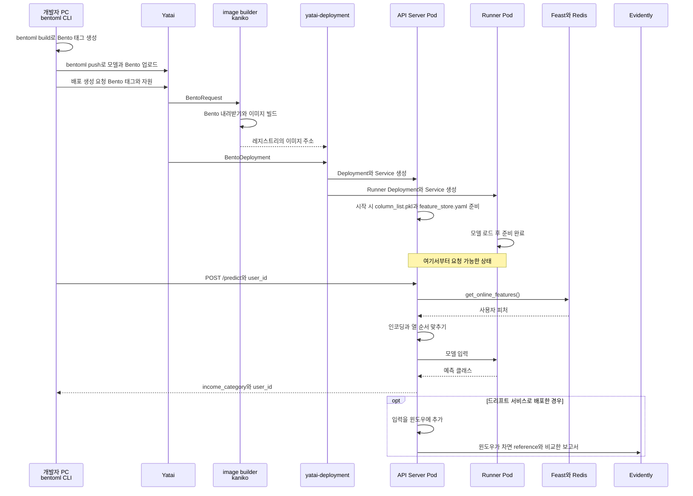
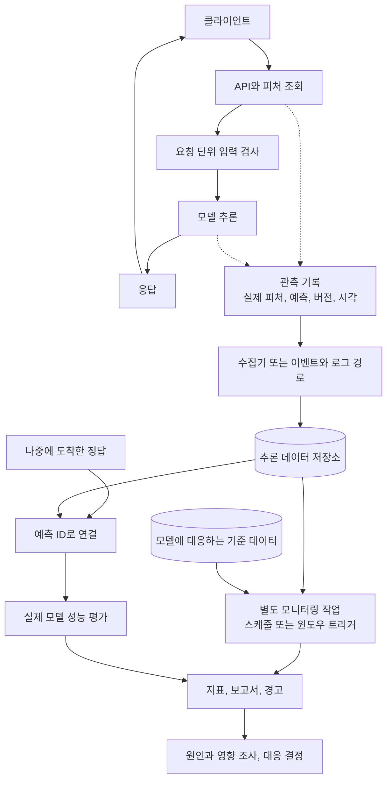

4~5장에서는 MLflow에 등록한 소득 분류 모델과 Feast의 피처를 KFP 배치 추론으로 묶었다. 사용자 목록과 기준 시각을 파일로 받아 결과를 저장하는 흐름이었다. 6장은 같은 모델을 API로 바꿔 사용자 ID가 들어올 때마다 예측하고, 배포 뒤 들어오는 입력이 학습 때와 달라지는지 지켜본다.

질문은 둘로 갈린다. **요청을 안정적으로 처리할 수 있는가**, 그리고 **지금 데이터에서도 예측을 믿을 수 있는가**다. BentoML은 모델과 요청 처리 코드를 배포 단위로 묶고, Evidently는 기준 데이터와 현재 입력을 비교한다. 실습에서 두 답은 자주 엇갈렸다. 잘 응답하는 서비스의 품질이 무너져 있기도 했고, 데이터 변화가 보여도 재학습할 일은 아니었다.

책의 6.1에서는 모델, Service, Runner, Bento가 각각 무엇을 맡는지, 6.2에서는 보고서의 수치가 무엇을 말해 주는지가 핵심이다. 이를 [운영 인프라에서 관측을 연결하는 방식](#production-monitoring)으로 이어 가고, [실습 순서](/docs/tech/machine-learning-platform-engineering/practice/ch06/#book-ch06-sop)에서 실제 클러스터로 따라간다.

## 전체 그림 {#platform-map}

6장에는 MLflow, Feast, BentoML, Yatai, Kubeflow Pipelines, Evidently가 한꺼번에 나온다. 도구별로 읽으면 무엇이 어디로 넘어가는지 잘 보이지 않는다. 아래 그림은 각 구성 요소가 실행되는 위치와 4~5장의 산출물이 API와 드리프트 관측으로 이어지는 순서를 번호로 표시했다.

이 장에서 새로 만드는 부분은 강조했고, 4~5장에서 만든 부분과 7장 이후로 이어질 부분은 따로 구분했다. Yatai 영역 아래의 점선 경로는 같은 Bento 이미지를 일반 Deployment와 Service로 배포하는 대안이다.

```mermaid
flowchart LR
    accTitle: 6장 플랫폼 구성 요소의 실행 위치와 산출물 이동 순서
    accDescr: 개발자 PC의 학습 노트북이 MLflow와 S3, Feast Registry와 Redis를 준비한다. bentoml CLI가 MLflow 모델을 가져와 Bento를 만들고 Yatai에 push하면 이미지 빌더가 이미지를 만들고 BentoDeployment가 API Server와 Runner Pod를 실행한다. 대안 경로는 같은 이미지를 일반 Deployment로 실행한다. API는 요청마다 Redis에서 피처를 읽어 Runner로 예측하고 입력 윈도우를 Evidently로 보낸다. KFP 파이프라인의 드리프트 검사 작업도 Evidently workspace에 보고서를 올린다.
    subgraph PC["개발자 PC"]
        NB["JupyterLab<br/>4장 학습 노트북"]
        CLI["bentoml CLI<br/>import, build, push"]
        SDK["KFP SDK<br/>파이프라인 컴파일"]
        USER["요청 클라이언트<br/>Swagger UI"]
    end
    subgraph KF["kind 클러스터: kubeflow 네임스페이스"]
        KFP["KFP UI와 API"]
        TASK["파이프라인 작업 Pod<br/>대상 읽기, 피처 조회, 추론"]
        S3[("SeaweedFS S3<br/>업무 버킷과 mlpipeline")]
        FREG["Feast Registry 파일<br/>feature-registry 버킷"]
    end
    subgraph MLNS["mlflow 네임스페이스"]
        MLF["MLflow Tracking과<br/>Model Registry"]
        PG[("Postgres<br/>메타데이터")]
    end
    subgraph RNS["redis 네임스페이스"]
        RD[("Redis<br/>Feast 온라인 저장소")]
    end
    subgraph YNS["yatai-system와 서빙 네임스페이스"]
        YAT["Yatai<br/>모델과 Bento 저장소"]
        IMB["yatai-image-builder<br/>kaniko Job"]
        REG[("컨테이너 레지스트리")]
        BD["BentoDeployment<br/>yatai-deployment"]
        APIP["API Server Pod<br/>Service, Feast 조회, 인코딩"]
        RUNP["Runner Pod<br/>random-forest-classifier"]
        ALT["대안: 일반 Deployment와 Service<br/>ch06-serving 네임스페이스"]
    end
    subgraph OBS["관측"]
        DRIFT["KFP 드리프트 검사 작업"]
        EVW["Evidently workspace와 대시보드"]
    end
    NEXT["7장 이후<br/>데이터 계약과 학습 파이프라인"]

    NB -->|"① 등록 모델 버전 + run_id"| MLF
    MLF --- PG
    NB -->|"② 모델 파일, column_list.pkl, 기준 CSV"| S3
    NB -->|"③ feature_store.yaml, Registry"| FREG
    NB -->|"④ materialize: 사용자별 최신 피처"| RD
    MLF -->|"⑤ Production 모델 import"| CLI
    CLI -->|"⑥ bentoml push: Bento 태그와 모델"| YAT
    YAT -->|"⑦ BentoRequest"| IMB
    IMB -->|"⑧ 컨테이너 이미지"| REG
    REG -->|"⑨ 이미지 pull과 Pod 생성"| BD
    BD --> APIP
    BD --> RUNP
    CLI -.->|"⑨' containerize와 kind load"| ALT
    MLF -->|"⑩ 시작 시 column_list.pkl"| APIP
    FREG -->|"⑩ 시작 시 feature_store.yaml"| APIP
    USER -->|"⑪ 요청 user_id"| APIP
    RD -->|"⑫ 온라인 피처"| APIP
    APIP -->|"⑬ 인코딩한 입력과 예측 클래스"| RUNP
    SDK -->|"⑭ 파이프라인 YAML"| KFP
    KFP --> TASK
    TASK -->|"⑮ parquet 데이터셋 URI"| S3
    S3 -->|"⑮ 현재 피처 parquet"| DRIFT
    DRIFT -->|"⑯ 배치 드리프트 보고서"| EVW
    APIP -->|"⑰ 현재 입력 윈도우 보고서"| EVW
    EVW -.->|"재학습과 계약 검토"| NEXT

    classDef thisch fill:#e8f1ff,stroke:#2f6fd6,stroke-width:2px;
    classDef prev fill:#f3f3f3,stroke:#999;
    classDef next fill:#fff6e5,stroke:#d08a00,stroke-dasharray:4 3;
    class CLI,USER,YAT,IMB,REG,BD,APIP,RUNP,ALT,DRIFT,EVW,SDK thisch;
    class NB,KFP,TASK,S3,FREG,MLF,PG,RD prev;
    class NEXT next;
```

| 번호 | 누가 | 무엇을 넘기는가 | 어디에 남는가 | 실습 단계 |
| --- | --- | --- | --- | --- |
| ① | 4장 학습 노트북 | 등록 모델 `random-forest-classifier` 버전과 원천 run_id | MLflow Model Registry, Postgres | A-2, A-3 |
| ② | 4장 학습 노트북 | 모델 파일, `column_list.pkl`, 학습과 기준 CSV | `mlflow-artifacts`, `mlflow-datasets` 버킷 | A-3 |
| ③ | `feast apply`와 5장 Job | Feast 정의와 설정 파일 | `feature-registry` 버킷 | A-2 |
| ④ | `feast materialize` | 사용자별 최신 피처 | Redis | A-2 |
| ⑤ | `download_model.py` | MLflow의 Production 모델 | 로컬 BentoML 모델 저장소 | B-1 |
| ⑥ | `bentoml build`, `bentoml push` | Bento 태그와 모델 태그 | 로컬 Bento 저장소, Yatai | C-1, C-4 |
| ⑦ | Yatai | 이미지를 만들 Bento 요청 | `BentoRequest` 리소스 | C-4 |
| ⑧ | yatai-image-builder | kaniko로 만든 컨테이너 이미지 | 클러스터 안 레지스트리 | C-4 |
| ⑨ | yatai-deployment | API Server와 Runner Pod | `yatai` 네임스페이스 | C-4 |
| ⑨' | `bentoml containerize`, `kind load` | 같은 Bento의 이미지 | `ch06-serving` 네임스페이스 | C-2, C-3 |
| ⑩ | API 서버 초기화 | `column_list.pkl`, `feature_store.yaml` | API 프로세스 메모리와 작업 폴더 | B-2, B-3 |
| ⑪ | 클라이언트 | `{"user_id": ...}` 요청 | HTTP 요청 | B-3, C-3 |
| ⑫ | Feast SDK | 해당 사용자의 온라인 피처 | API 프로세스 메모리 | B-3, B-4 |
| ⑬ | API 서버와 Runner | 학습 열 순서로 인코딩한 입력, 예측 클래스 | 응답 `income_category` | B-3, B-4 |
| ⑭ | KFP SDK | 드리프트 검사를 넣은 파이프라인 YAML | KFP 파이프라인 버전 | D-2 |
| ⑮ | KFP 작업 Pod | 조회한 피처 parquet의 아티팩트 URI | `mlpipeline` 버킷 | D-2 |
| ⑯ | 드리프트 검사 작업 | reference와 current 비교 보고서 | Evidently workspace | D-3 |
| ⑰ | 드리프트 API 서비스 | 최근 요청 윈도우의 보고서 | Evidently workspace | D-4 |

그림은 저장소와 실행 주체를 나눠 보면 읽기 쉽다. MLflow, S3, Redis는 상태를 보관한다. 노트북과 CLI, KFP 작업 Pod, API Pod는 그 상태를 읽어 다음 산출물을 만든다. Yatai는 예측을 계산하지 않는다. Bento를 받아 이미지와 Pod로 바꾸는 배포 제어 계층이다.

아래는 핵심 경로를 시간 순서로 다시 그린 것이다. ⑥부터 ⑰까지가 한 번의 배포와 요청 안에서 어떻게 이어지는지 보여 준다.

## 배치 추론을 BentoML의 요청 경로로 옮긴다 {#model-serving}

모델의 `predict()`를 부르는 일과 다른 애플리케이션이 쓸 서비스를 운영하는 일은 다르다. 함수 호출에는 메모리 안의 입력과 모델만 있으면 된다. 서비스에는 요청 규격, 전처리, 모델 로드, 동시 요청 처리, 실패 응답까지 필요하다.

5장의 배치는 대상 읽기, 피처 조회, 추론, 결과 저장이 한 묶음으로 끝났다. 6장에서는 사용자 ID를 요청으로 받아 온라인 피처를 조회하고, 같은 모델 입력으로 바꿔 응답한다. 모델은 그대로다. 바뀌는 것은 모델을 둘러싼 실행 조건과 실패 조건이다.

| 구분 | 배치 추론 | 온라인 추론 |
| --- | --- | --- |
| 실행 계기 | 일정이나 준비된 데이터 묶음 | 사용자와 애플리케이션의 요청 |
| 입력 | 파일, 테이블, 대상 기간 | 요청 본문과 요청 시점에 조회한 피처 |
| 응답 시점 | 작업 완료 후 결과 파일 제공 | 요청을 기다리는 클라이언트에 응답 |
| 주요 운영 기준 | 완료 시간, 처리량, 재실행과 결과 중복 | 지연, 동시성, 가용성과 오류 처리 |
| 이 책의 예 | 5장의 대상 목록과 과거 피처 | 6장의 사용자 ID와 온라인 피처 |

온라인이라고 모델을 매번 새로 학습하지는 않는다. 학습한 모델을 메모리에 올려 두고 여러 요청에서 재사용한다. 다만 요청마다 피처 조회, 전처리, 예측이 일어나므로 지연에는 모델 계산 밖의 시간도 섞인다. Redis 조회가 느리다면 Runner만 늘려서는 API 지연이 충분히 줄지 않는다.

### 모델 가져오기와 서비스 묶기

3장에서는 FastAPI, Docker, Kubernetes 명세를 손으로 연결했다. BentoML은 이 반복 작업을 ML 서비스용 패키지 구조로 표준화한다. 학습 프레임워크를 대신하지는 않고, 여러 프레임워크의 모델과 그 앞뒤 처리, 실행 환경을 하나의 배포 단위로 묶는다. 책이 쓰는 1.1.10 버전의 주요 개념은 다음과 같다.

| 구성 | 의미 | 소득 분류에서의 역할 |
| --- | --- | --- |
| Model store | 이름과 태그로 모델을 보관하는 저장소 | MLflow에서 가져온 분류기 보관 |
| Service | API의 입출력과 처리 흐름 정의 | 사용자 ID 검사, Feast 조회, 전처리와 응답 |
| Runnable | 실행할 연산과 지원 자원 등을 정의하는 단위 | 모델 프레임워크가 제공하는 예측 연산 |
| Runner | Runnable을 worker에서 실행하는 계산 단위 | 분류기를 로드하고 예측 호출 처리 |
| Bento | 서비스 코드, 모델과 의존성 구성을 묶은 배포 산출물 | 같은 서비스를 다시 실행할 패키지 |
| 컨테이너 이미지 | Bento를 컨테이너 런타임에서 실행할 이미지 | 클러스터에 전달할 실행 환경 |
| Deployment | 특정 버전을 자원, 복제본, 주소와 함께 실행한 상태 | 실제 요청을 받는 API와 Runner |

Service는 요청을 해석하고 어떤 연산을 부를지 정한다. Runner는 모델 계산을 worker에서 실행한다. 둘을 나누면 API 처리량과 모델 계산 자원을 따로 조정할 수 있다. Runner는 Kubernetes의 학습 Job과 관계가 없고, 로컬에서는 worker 프로세스로, 책의 Yatai 배포에서는 분리된 Pod로 뜬다.

그림 6-1. API 처리와 모델 실행을 분리한 Runner 구조. 출처: [BentoML 1.1.10 공식 문서](https://github.com/bentoml/BentoML/blob/fa278835a5333c5d378a0b03a9b56a9fc4ce21e4/docs/source/concepts/runner.rst), [Apache-2.0](https://github.com/bentoml/BentoML/blob/fa278835a5333c5d378a0b03a9b56a9fc4ce21e4/LICENSE). 원본 도식을 변경 없이 사용했다.

그림의 경계는 API 요청을 처리하는 프로세스와 계산을 실행하는 프로세스 사이에 있다. 여기에 이 장의 Feast 조회와 전처리를 넣으면 아래 흐름이 된다.

MLflow Registry는 모델의 이름, 버전, 학습 출처를 관리한다. BentoML의 Model store는 서빙용으로 가져온 모델을, Bento는 그 모델을 쓰는 서비스 전체를 식별한다. 모델 버전이 같아도 피처 조회나 전처리 코드가 바뀌면 다른 서비스다. 모델 버전 하나만으로는 배포를 재현할 수 없다.

책의 가져오기, 빌드, push, 배포는 같은 등록을 되풀이하는 것처럼 보이지만 단계마다 하는 일이 다르다. 학습 결과를 서빙 모델로 가져오고, 서비스를 패키지로 만들고, 실행할 곳에 전달한 뒤, 요청을 받을 수 있는 상태로 바꾼다. 어느 저장소에 이름이 보이는지보다 지금 어느 단계까지 왔는지를 봐야 한다.

### 같은 모델 입력을 만들면서 요청 부하를 처리한다

API 계약에는 JSON 필드와 타입뿐 아니라 의미도 들어간다. `user_id`가 문자열인지 보는 검사와 그 사용자에게 유효한 온라인 피처가 있는지 보는 검사는 별개다. 응답의 확률, 클래스 번호, 소득 범주도 서로 다른 값이다.

전처리는 학습 때의 의미를 지켜야 한다. 범주 인코딩, 결측 처리, 열 순서, 단위 중 하나만 어긋나도 같은 모델에 다른 입력이 들어간다. API가 정상 응답했다고 학습과 같은 변환을 거쳤다고 볼 수는 없다.

소득 분류의 단일 요청이 정확히 여기에 걸렸다. 배치에서는 여러 범주를 보고 원-핫 열을 만들지만, 한 행에는 열마다 범주가 하나뿐이다. 저자 코드의 `get_dummies(drop_first=True)`는 이런 열을 지워 버리고, 나중에 학습 열 목록으로 맞춰도 의미는 돌아오지 않는다. 같은 사용자의 배치 입력과 API 입력을 대조해 보고, 학습에서 fit한 인코더를 서비스에서도 재사용해야 한다.

Runner는 모델과 설정이 지원하면 여러 요청의 계산을 묶는 adaptive batching을 쓸 수 있다. 벡터화와 GPU 활용에는 유리하지만, 묶음을 기다리는 시간만큼 개별 요청은 느려진다. 5장처럼 대상 파일 전체를 처리하는 배치 추론과는 다른 기능이고, 책의 기본 서비스에 알맞은 배칭 정책이 저절로 들어 있지도 않다.

### 빌드, 레지스트리와 Yatai의 책임

`bentofile.yaml`은 어떤 서비스, 파일, 모델, 의존성을 넣을지 선언한다. 빌드는 이 선언대로 Bento를 만들고, push는 만든 산출물을 원격 저장소로 보낸다. 패키지가 저장되어 있다는 것과 서비스가 돌고 있다는 것은 다른 상태다.

책의 Yatai는 Kubernetes에서 Bento 배포를 관리하는 제어 계층이다. 모델과 Bento 관리, 이미지 빌드, API 서버와 Runner의 자원과 복제본 설정, 서비스 노출을 한곳에서 잇는다. 실제 계산은 배포된 worker와 Pod가 한다. 예측 품질이나 학습 데이터가 적합한지는 Yatai의 관심사가 아니다.

| 관리 대상 | 필요한 이유 |
| --- | --- |
| 모델 태그와 Bento 태그 | 무엇을 어떤 코드로 서비스했는지 구분 |
| 컨테이너 이미지와 의존성 | 다른 환경에서도 같은 실행 조건 구성 |
| CPU, 메모리, GPU와 복제본 | 모델 크기와 요청 부하에 맞는 실행 용량 |
| 준비 상태와 서비스 주소 | 모델 로드 전의 실행과 요청 가능한 상태 구분 |
| 배포 버전과 전환 기록 | 새 서비스의 문제를 추적하고 이전 구성으로 복구 |

API 복제본을 늘리는 것과 Runner 복제본을 늘리는 것은 다른 조정이다. 모델을 여러 worker에 올리면 메모리도 그만큼 더 든다. 전처리, 모델 계산, 저장소 중 어디가 병목인지 먼저 재고 나서 자원을 손대야 한다.

### 서비스 관측과 모델 관측

BentoML의 `/metrics`와 Prometheus 연계는 요청 수, 지연, 오류 같은 서비스 동작을 보는 데 쓴다. 메트릭을 노출하는 일, Prometheus가 수집하는 일, 대시보드와 알림을 만드는 일은 각각 따로 구성한다.

요청이 빠르고 HTTP 200이 많아도 예측은 틀릴 수 있다. 거꾸로 모델 품질은 그대로인데 피처 조회 장애로 서비스를 못 쓸 수도 있다. 그래서 데이터와 모델 관측은 인프라 관측과 따로 다룬다.

## 요청이 정상이어도 입력과 예측 품질은 달라질 수 있다 {#drift-concepts}

배포 때 한 검증이 계속 유효하려면 지금 요청이 어떤 입력을 쓰는지 알아야 한다. Evidently의 데이터 비교는 모델이 받는 입력의 변화를 보여 준다. 그 변화가 실제 품질을 떨어뜨렸는지는 정답과 업무 기준으로 따로 판단한다.

### 입력, 정답과 예측의 변화

입력 피처를 `X`, 실제 정답을 `y`, 모델의 예측을 `y_hat`으로 두면 무엇이 바뀌었는지 나눠 볼 수 있다.

| 변화 | 달라지는 것 | 해석 |
| --- | --- | --- |
| Covariate shift | 입력 분포 `P(X)` | 직업이나 학력 구성이 달라짐. 엄밀한 구분에서는 `P(y\|X)`가 유지된다고 가정 |
| Label / prior shift | 정답 비율 `P(y)` | 소득 범주 비율이 달라짐. 엄밀한 label shift는 `P(X\|y)`의 안정성을 가정 |
| Concept drift | 입력과 정답의 관계 `P(y\|X)` | 같은 피처 조건에서도 소득 범주의 발생 관계가 달라짐 |
| Prediction drift | 예측 분포 `P(y_hat)` | 모델이 반환하는 범주나 확률의 구성이 달라짐 |

이 구분은 원인을 설명하는 틀이다. 운영에서는 여러 변화가 한꺼번에 일어나기도 한다. 입력 분포만 비교하고 concept drift를 확인했다고 말할 수는 없다. 정답이 늦게 도착하는 서비스라면 입력과 예측의 변화를 먼저 지켜보고, 정답이 모였을 때 실제 품질을 확인한다.

예를 들어 직업 분류를 수집하는 시스템이 바뀌어 특정 값이 대량으로 결측 처리됐다면 재학습보다 수집 경로 복구가 먼저다. 반면 같은 직업과 학력인데도 소득 관계가 계속 달라진다면 모델과 피처를 다시 봐야 한다.

개별 요청이 특이한지 보는 이상치 검사와 분포를 비교하는 드리프트 검사도 다르다. 한 사용자의 직업이 드물다고 사용자 전체의 구성이 바뀌었다고 할 수는 없다.

### Reference와 current를 비교하는 방법

Evidently는 기준 데이터(reference)와 지금 평가할 데이터(current)를 받아 열별 변화와 요약을 계산한다. 기준은 학습 데이터일 수도, 검증된 정상 기간일 수도 있다. 어느 모델과 어느 기간을 대표하느냐에 따라 보고서의 의미가 달라진다.

학습 데이터를 기준으로 삼는 것은 선택한 모델이 어떤 입력에서 평가됐는지를 지금의 입력과 견주려는 것이다. 그래서 4장에서 남긴 데이터 출처 기록이 6장에서 관측의 입력으로 다시 쓰이고, 모델을 고르는 단계와 배포 뒤 살피는 단계가 같은 원천 run으로 이어진다.

비교 방법은 열의 타입과 표본 수에 따라 달라진다. 책의 예제가 쓰는 구버전 API의 선택 규칙은 [Evidently의 드리프트 알고리즘 문서](https://docs-old.evidentlyai.com/reference/data-drift-algorithm)에 정리되어 있다.

| 방법 | 비교하는 것 | 결과를 읽는 기준 |
| --- | --- | --- |
| Kolmogorov–Smirnov(KS) 검정 | 수치형 변수의 경험적 누적분포 차이 | p-value와 분포 차이의 크기 |
| 카이제곱 검정 | 범주별 관측 빈도 차이 | 범주별 표본과 기대 빈도, p-value |
| Wasserstein distance | 한 수치 분포를 다른 분포로 옮기는 차이 | 거리, 정규화 방식, 임계치 |
| Jensen–Shannon 계열 지표 | 범주별 확률분포 차이 | 거리나 발산의 정의, 임계치 |
| PSI | 구간이나 범주별 비율의 변화 | 구간 정의와 임계치 |

그림 6-2. 직업 피처의 분포와 검사 결과를 함께 보는 공식 보고서 예시. 출처: [Evidently 0.5.0 보고서 이미지](https://github.com/evidentlyai/evidently/blob/49cce31eaa49ec354d32ccd2edb3c9d492949db1/docs/book/.gitbook/assets/reports/metric_data_drift_table_expand_1-min.png), [Apache-2.0](https://github.com/evidentlyai/evidently/blob/49cce31eaa49ec354d32ccd2edb3c9d492949db1/LICENSE). 이 글의 실습 결과가 아닌 공식 예제다.

표본 수가 다르면 원시 건수로 그린 막대 높이도 달라진다. 그림의 인상만으로 판정하지 말고 상대 비율, 선택한 검사, 임계치를 함께 본다. 화면의 PSI 값은 아래에서 설명할 p-value와 성격이 다른 지표다.

p-value를 "드리프트가 일어났을 확률"로 읽기 쉽지만 그렇지 않다. 두 분포가 같다고 가정했을 때 지금 본 차이가 얼마나 이례적인지를 나타내는 값이다. 표본이 아주 크면 작은 차이도 통계적으로 드러나고, 표본이 적으면 중요한 변화를 놓칠 수 있다.

거리 기반 값도 모델 정확도와는 다른 지표다. 선택한 방법, 표본 수, 변화의 크기, 업무 영향을 함께 보고 임계치를 정한다. 서로 다른 검사에서 나온 drift score를 같은 단위처럼 견주지 않는다.

### 열별 검사와 데이터셋 수준 판정

열별 drift는 어떤 피처가 달라졌는지 보여 준다. 데이터셋 수준 판정은 그 결과를 묶어 "전체 입력이 변했다고 볼 것인가"를 정하는 규칙이다.

검사 열 8개 중 2개가 변했다면 변한 열의 비율은 0.25다. 예측의 25%가 틀렸다는 뜻으로 읽으면 안 된다. 변한 두 열이 모델에 중요한지, 변화가 어느 사용자 집단에 몰려 있는지도 따져야 한다.

열마다 분포가 비슷해도 열 사이의 관계는 바뀔 수 있다. 열별 검사로 모든 다변량 변화를 잡아내지는 못한다. 많은 열을 반복 검사하면 우연한 경고도 늘어나므로, 경고가 이어지는지와 다시 나타나는지를 함께 본다.

결측률과 스키마는 분포 검사와 따로 다룬다. 결측값을 빼고 분포를 비교하는 검사는 결측 급증을 놓칠 수 있다. 원본이 `DatasetMissingValuesMetric`과 `ColumnSummaryMetric`을 drift metric과 함께 넣은 이유다.

### Metric, Report, Test와 대시보드

| 구성 | 역할 | 그 자체로 하지 않는 것 |
| --- | --- | --- |
| Metric | 결측 비율, 분포 차이, 모델 오차 등의 값 계산 | 업무상 합격 기준 부여 |
| Report | 선택한 지표와 시각화 결과를 묶음 | 파이프라인이나 API 자동 차단 |
| Test / Test Suite | 지정한 조건의 통과나 실패 판정 | 재학습과 출시 승인 정책 구현 |
| Workspace / Project | 보고서와 실행 구간을 모아 관리 | 기준 데이터의 적합성 판단 |
| Dashboard | 기간별 지표와 변화 추세 표시 | 원인 분석과 서비스 유지 판단 |

정답이 있으면 분류나 회귀 성능도 계산할 수 있지만, 입력만 담은 보고서가 정확도를 알려 주지는 않는다. 보고서를 경고, 처리 보류, 추가 평가로 연결하는 정책도 따로 정해야 한다. 이 구분은 D-2에서 저자의 실제 코드와 맞춰 본다.

### 배치, 마이크로배치와 슬라이딩 윈도우

배치에서는 처리할 묶음이 그대로 current가 된다. API는 요청 하나가 표본 하나에 가까우므로 여러 입력을 모아서 비교한다.

| 비교 단위 | 특징 | 정할 것 |
| --- | --- | --- |
| 배치 | 파일이나 대상 기간 단위로 비교 | 같은 대상의 재실행, 검사 후 추론 정책 |
| 고정 윈도우 | 고정된 시간이나 건수로 나눈 겹치지 않는 묶음 | 보고서 간격, 트래픽이 적을 때의 최소 표본 |
| 슬라이딩 윈도우 | 최근 표본을 유지하며 반복 비교 | 윈도우 크기, 검사 간격과 겹침 |

작은 윈도우는 빨리 반응하지만 흔들림이 크다. 큰 윈도우는 안정적이지만 변화를 늦게 발견한다. 요일이나 시간대에 따른 정상적인 변화를 엉뚱한 기준과 비교하면 경고가 계속 울린다. 겹치는 윈도우에서 연달아 나온 경고를 서로 독립된 사건처럼 세어서도 안 된다.

책의 그림 6.21에서는 크기 50의 API 윈도우로 검사했더니 `share_of_drifted_columns`가 약 0.875로 나온다. 검사한 열 중 약 87.5%가 설정된 변화 조건을 넘었다는 뜻이지, 예측의 87.5%가 틀렸다는 뜻이 아니다. 책도 학습 데이터에서 가져온 사용자로 요청했는데 이런 결과가 나온 점을 작은 표본 탓으로 설명한다.

같은 원천에서 뽑았어도 작은 표본은 전체 기준 분포를 그대로 닮지 않는다. 이 화면은 운영 환경이 변했다는 증거라기보다 윈도우와 비교 조건을 다시 보라는 신호다. 표본 크기, 사용자 선택 방식, 실제 분포를 확인한 뒤 검사 방법과 경고 조건을 조정한다. 경고를 없애려고 임계치만 올리는 것과는 다른 일이다.

새 current로 reference를 매번 갈아 끼우면 서서히 진행되는 변화가 정상으로 흡수된다. 기준을 고정할지 갱신할지, 갱신 전에 무엇을 검증할지도 관측 설계에 들어간다.

## 서빙 인프라에서 드리프트를 다루는 방식 {#production-monitoring}

비교 원리를 알았다면 남는 문제는 현재 표본을 어디서 모으고 언제 검사하느냐다. 요청 하나의 입력이 유효한지는 실행 전에 확인할 수 있다. 분포 변화는 표본이 여럿 쌓이고 적절한 기준이 있어야 해석된다. 관측 데이터를 모으는 경로와 예측을 돌려주는 경로를 나누는 이유가 여기에 있다.

### 추론 경로와 관측 경로를 나눈다

실시간 예측 서비스라도 통계 검사를 요청마다 돌릴 필요는 없다. [Evidently의 모니터링 구조](https://docs-old.evidentlyai.com/user-guide/monitoring/monitoring_overview)는 두 방식을 구분한다. 하나는 온라인 추론을 로그로 남긴 뒤 별도 작업에서 평가하는 방식이고, 다른 하나는 collector가 입력을 모아 계산하는 방식이다. [Azure ML 모델 모니터링](https://learn.microsoft.com/en-us/azure/machine-learning/concept-model-monitoring?view=azureml-api-2)도 추론 데이터 수집과 정해진 주기의 모니터링 작업을 분리한다.

공통점은 **사용자가 기다리는 예측 경로와 여러 표본을 비교하는 관측 경로의 책임을 나눈다**는 것이다. 주기나 제품까지 같을 필요는 없다.

점선은 서비스가 관측용 기록을 남긴다는 뜻일 뿐, 수집이 지연이나 실패 없이 끝난다는 보장은 아니다. collector 전송을 동기로 호출하면 그 시간과 실패가 요청 경로에도 영향을 준다. 비동기 전송이나 버퍼, 별도 로그 경로를 택해도 메모리 한도, 재시도, 누락, 밀린 기록의 처리를 정해야 한다.

관측 시스템이 잠시 멈췄을 때 예측을 계속할지, 기록이 꼭 남아야 하니 요청도 막을지는 서비스 요구사항이 정한다. 보고서 계산 실패가 우연히 예측 실패로 번지는 것과 의도한 정책은 다르다.

### 어디에서 무엇을 수집하는가

이 책의 `/predict`는 `user_id`만 받는다. HTTP 요청과 응답만 저장하면 사용자 ID와 소득 범주는 남지만, 모델이 실제로 본 학력과 직업의 분포는 알 수 없다.

그래서 피처 조회 직후의 값, 필요하면 전처리 직후의 모델 입력을 관측 대상으로 삼는다. 나중에 같은 사용자 ID로 Redis를 다시 조회하면 값이 이미 바뀌었을 수 있으니 그때의 입력을 되살릴 수 없다. [Azure ML 데이터 수집 문서](https://learn.microsoft.com/en-us/azure/machine-learning/concept-data-collection?view=azureml-api-2)도 HTTP payload logging과, 전처리 전후와 처리 중의 데이터를 남기는 custom logging을 구분한다.

| 관측 지점 | 알 수 있는 것 | 기준 데이터와 맞출 것 |
| --- | --- | --- |
| 외부 요청 | 입력 규격, 요청 대상과 오류 | API 계약 |
| Feast 조회 직후 | 실제 사용한 피처, 결측과 최신성 | 같은 피처 정의와 시점 의미의 reference |
| 전처리 직후 | 인코딩, 스케일과 모델 입력 형태 | 같은 전처리 버전의 입력 표현 |
| 모델 출력 | 범주나 확률의 분포, 모델 동작 | 같은 모델 버전의 비교 가능한 예측 |
| 실제 결과 도착 후 | 예측 오차와 집단별 품질 | 예측과 연결되는 정답과 평가 기간 |

아래는 특정 플랫폼이 요구하는 형식이 아니라, 관측 기록에 담을 만한 항목의 예다.

| 항목 | 필요한 이유 |
| --- | --- |
| `prediction_id`, 예측 시각 | 요청, 응답, 늦게 도착한 결과 연결 |
| 모델 버전과 배포 버전 | 트래픽 분할이나 모델 교체의 영향 구분 |
| 피처 정의, 전처리, 스키마 버전 | 서로 다른 의미의 값을 같은 분포로 섞지 않기 위해 |
| 선택한 피처와 예측값 | 분포, 결측과 예측 변화 계산 |
| 피처 시각과 조회 상태 | 오래된 피처, 조회 실패와 실제 값 변화 구분 |
| 표본 추출 조건과 데이터 구간 | 전체 트래픽을 얼마나 대표하는지 해석 |

사용자 ID는 한 사람의 여러 예측에 반복해서 나오므로 예측 사건의 고유 ID 노릇을 하지 못한다. 그렇다고 원문 전체를 저장해야 관측할 수 있는 것도 아니다. 남겨도 되는 피처와 보존 기간을 정하고, 표본 추출을 쓴다면 특정 집단이나 실패 요청이 빠지지 않는지 함께 본다.

### 요청 안에서 하는 검사와 밖에서 하는 검사

| 검사 | 실행 위치의 예 | 실패의 의미 |
| --- | --- | --- |
| 필수 필드, 타입, 크기 검사 | API 요청 경로 | 이 요청이 계약을 위반함 |
| 피처 누락, 허용 범위, 최신성 검사 | 피처 조회 후, 추론 전 | 유효한 모델 입력을 만들지 못함 |
| 입력과 예측 분포 비교 | 별도 배치 작업 또는 collector의 윈도우 | 입력 집단이나 모델 동작이 기준과 달라짐 |
| 정답 기반 품질 평가 | 결과가 모인 뒤 별도 작업 | 실제 예측 품질이 평가 기준과 다름 |
| 배치 데이터 품질 게이트 | 배치 추론 파이프라인 내부 | 해당 묶음의 후속 처리를 보류할 조건 |

필수 피처가 없는 요청을 거절하는 것과 "최근 사용자 구성이 달라졌다"는 이유로 모든 요청을 거절하는 것은 전혀 다른 정책이다. 분포 경고가 개별 요청이 잘못됐다는 증거가 되지는 않는다.

빠른 탐지가 필요하면 [Evidently collector 구조](https://docs-old.evidentlyai.com/user-guide/monitoring/collector_service)처럼 별도 서비스가 건수나 시간 조건으로 윈도우를 모아 계산하게 할 수 있다. 온라인 추론이라고 API worker마다 보고서 전체를 계산할 이유는 없다. 반대로 배치 작업에서는 명시적인 품질 검사 결과에 따라 다음 단계를 멈추는 구성이 잘 맞는다.

그림 6-3. 추론 서비스와 collector를 분리한 관측 구조. 출처: [Evidently collector 공식 문서](https://docs-old.evidentlyai.com/user-guide/monitoring/collector_service), [원본 이미지](https://github.com/evidentlyai/evidently/blob/49cce31eaa49ec354d32ccd2edb3c9d492949db1/docs/book/.gitbook/assets/monitoring/monitoring_collector_min.png), [Apache-2.0](https://github.com/evidentlyai/evidently/blob/49cce31eaa49ec354d32ccd2edb3c9d492949db1/LICENSE). 원본 도식을 변경 없이 사용했다.

POST는 데이터를 수집 지점으로 보내는 동작이고, 보고서 계산은 collector의 트리거를 따른다. 그림처럼 역할을 나눠도 전송 지연과 누락의 처리는 서비스가 정해야 한다.

### 모니터링 작업 자체의 입력과 상태

모니터링 작업에는 기준 버전, 현재 데이터 구간, 검사할 열, 비교 방법, 최소 표본, 경고 조건이 필요하다. 모델을 교체했는데 이전 모델의 전처리와 예측 기준을 새 결과와 섞으면, 배포로 생긴 차이를 데이터 변화로 착각하게 된다.

| 설계 항목 | 판단할 내용 |
| --- | --- |
| 주기와 윈도우 | 얼마나 빨리 알아야 하는지, 그동안 충분한 표본이 쌓이는지 |
| 지연 도착 | 예측 시각과 수집 시각 중 어떤 시간으로 묶고 얼마나 기다릴지 |
| 집단과 버전 | 모델, 지역, 사용자 유형별 변화가 전체 평균에 가려지는지 |
| 기준 갱신 | 정상으로 검증한 새 기준인지, 단순히 최근 자료로 덮어쓰는 것인지 |
| 경고의 지속 조건 | 한 번의 변동과 반복되는 변화를 어떻게 구분할지 |
| 수집과 작업 상태 | 누락, 처리 지연, 마지막 성공 시각과 실제 평가 행 수 |

표본이 없거나 너무 적을 때는 "드리프트 없음"이 아니라 "평가할 자료 부족"이라고 써야 한다. 수집이 멈췄는데 마지막 정상 보고서만 계속 걸려 있으면 서비스가 안정적이라는 착각을 준다.

Prometheus에는 요청 수, 지연, 수집 오류, 작업 성공 시각 같은 운영 지표를 내보낼 수 있다. 요청별 피처, 사용자 ID, 예측 ID까지 시계열 label로 넣는 것은 다른 문제다. [Prometheus의 계측 지침](https://prometheus.io/docs/practices/instrumentation/)도 label 조합이 늘어날 때의 비용을 설명한다. 개별 예측 기록은 평가용 저장소에, 집계된 운영 상태는 메트릭에 두는 식으로 역할을 나눈다.

### 정답은 나중에 연결할 수 있어야 한다

입력 drift와 prediction drift는 정답 없이도 계산된다. 정확도와 오차는 실제 결과가 있어야 나온다. [Evidently의 지연 정답 처리](https://docs-old.evidentlyai.com/user-guide/monitoring/batch_monitoring)는 입력 검사, 예측 변화, 정답 도착 후 성능 평가를 각각 따로 돌리는 흐름을 설명한다.

결과는 예측 ID와 모델 버전으로 연결하고, 결과가 충분히 도착한 구간을 평가한다. 정답이 있는 일부 사례의 품질을 전체 트래픽의 품질로 곧장 옮겨 읽으면 곤란하다. 라벨 도착률과 평가 대상도 함께 남겨 둔다. 이 소득 분류 예제는 `/predict`만 있을 뿐 실제 소득 정답을 모으는 경로는 없다.

### 경고에서 대응으로 넘어가는 과정

드리프트 경고는 조사를 시작할 근거다. 새 모델을 배포해도 좋다는 승인과는 거리가 멀다. [Evidently의 대응 지침](https://www.evidentlyai.com/blog/ml-monitoring-data-drift-how-to-handle)도 수집과 품질 오류부터 확인하고, 변화의 의미에 따라 유지, 재학습, 재보정을 나눠 고르라고 한다.

| 조사 결과 | 대응 방향 |
| --- | --- |
| 로그 누락이나 collector 장애로 집단 비율이 달라짐 | 수집 경로 복구와 해당 구간 재평가 |
| Feast 정의 변경 뒤 특정 피처가 결측으로 바뀜 | 피처와 변환 경로 수정, 잘못된 입력의 처리 정책 적용 |
| 계절성이나 알려진 사용자 구성 변화, 품질 유지 | 세부 집단 확인과 관측 지속, 필요하면 기준과 경고 조건 검토 |
| 새로운 집단에서 지속적인 품질 저하 | 필요한 라벨과 데이터 확보, 후보 재학습과 같은 조건의 평가 |
| 새 배포 뒤 오류나 잘못된 전처리가 증가 | 해당 배포 조사, 호환되는 이전 구성으로 복구 검토 |

재학습을 자동으로 시작할 수는 있다. 다만 새 데이터 검증, 기존 모델과의 비교 평가, 서비스 제약 확인, 배포 전환은 각각 다른 판단이다. 어디까지 자동화할지 정하지 않은 채 경고가 날 때마다 최신 모델로 바꾸면 데이터 오류를 학습하거나 더 나쁜 모델로 갈아탈 수 있다.

정답을 빠르고 믿을 만하게 얻는 서비스라면 실제 품질을 주된 경고 신호로 삼고 드리프트는 진단용으로 쓸 수도 있다. [Evidently도 드리프트 관측이 항상 필수인 것은 아니라고 설명](https://www.evidentlyai.com/blog/ml-monitoring-do-i-need-data-drift)한다. 도구를 몇 개 붙였느냐보다 이 모델과 업무에 맞는 증거가 무엇인지가 중요하다.

### 같은 검사를 배치와 API에서 다르게 연결하는 이유

5장의 배치에는 처리할 묶음이 이미 있다. 조회한 피처를 current로, 모델의 원천 run에서 가져온 데이터를 reference로 삼으면 추론 전에 비교할 수 있다. 책의 6.2.2는 이 자리에 검사 컴포넌트를 넣고, 드리프트가 있으면 멈춘다는 의도를 설명한다.

그런데 고정한 저자 코드의 `detect_drift.py`는 보고서를 만들어 올리기만 하고, 변화 판정을 읽어 막는 분기는 없다. `.after(detect_drift_task)`는 앞 작업이 끝나기를 기다리라는 의존성이지 판정이 아니다. 책이 설명한 품질 게이트와 저장소의 구현 사이에 이런 틈이 있어서, 드리프트가 나와도 추론은 그냥 진행된다. 실제로 멈추게 하려면 판정 출력과 조건 분기, 또는 명시적인 실패 정책을 더해야 한다.

API에서는 요청 하나로는 분포를 만들 수 없으니 여러 입력을 윈도우로 모은다. 책의 6.2.3은 API 프로세스 안에서 최근 표본을 유지하다가, 윈도우가 찬 뒤로는 새 요청마다 보고서를 다시 만드는 경로를 보여 준다. 윈도우 크기는 한 번에 비교하는 표본 수이고, 검사 간격은 계산을 되풀이하는 주기다. 둘은 서로 다른 값이다.

이 예제는 원리를 보여 주기에는 충분하지만, 여러 worker의 상태 공유, 재시작, 수집 누락까지 다루지는 않는다. 요청 안에서 보고서를 계산하면 응답도 그만큼 느려진다. 운영이라면 앞에서 본 별도 관측 경로로 표본을 모아 적절한 주기로 평가한다. 온라인 예측이 필요하다고 모든 통계 계산을 요청 안에서 끝낼 이유는 없다.

두 예제가 공유하는 것은 비교 원리다. 다른 것은 current를 모으는 단위와 검사 결과를 실행에 연결하는 위치다. [7장의 데이터 계약](/docs/tech/machine-learning-platform-engineering/07-data-preparation/#training-serving-contract)에서 다룰 스키마, 전처리, 데이터 버전은 두 경우 모두 같은 의미의 입력끼리 비교하게 만드는 기반이다.

6장에서 바뀐 것은 모델 파일을 서비스에 올린 일만이 아니다. 요청, 피처, 전처리, 모델 버전이 하나의 실행으로 묶였고, 배포 뒤에는 서비스 상태, 입력 변화, 정답 기반 품질을 서로 다른 증거로 확인하게 됐다. 다음 장에서 데이터 준비로 돌아가는 것도 이 계약을 신분증 탐지와 영화 추천이라는 다른 문제에 처음부터 세우기 위해서다.

## 실습 {#book-ch06-sop}

책 코드로 직접 실행한 순서와 결과 화면은 [6장 실습 기록](/docs/tech/machine-learning-platform-engineering/practice/ch06/)에 따로 모았다.

## 참고 자료

- [Evidently 모니터링 구조](https://docs-old.evidentlyai.com/user-guide/monitoring/monitoring_overview), [배치와 지연 정답 평가](https://docs-old.evidentlyai.com/user-guide/monitoring/batch_monitoring), [collector](https://docs-old.evidentlyai.com/user-guide/monitoring/collector_service): 온라인 예측과 별도 관측 작업의 연결.
- [Azure ML 모델 모니터링](https://learn.microsoft.com/en-us/azure/machine-learning/concept-model-monitoring?view=azureml-api-2), [추론 데이터 수집](https://learn.microsoft.com/en-us/azure/machine-learning/concept-data-collection?view=azureml-api-2): 수집 지점, 기준 데이터, 윈도우와 예약 평가의 구체적인 예.
- [Evidently의 드리프트 대응](https://www.evidentlyai.com/blog/ml-monitoring-data-drift-how-to-handle): 원인 조사와 재학습 외의 대응 선택지.
- [출판사의 6장 개요](https://www.manning.com/preview/machine-learning-platform-engineering/chapter-6): BentoML과 Yatai를 이용한 서빙, Evidently 관측의 장별 범위.
- [BentoML 1.1.10의 Service](https://github.com/bentoml/BentoML/blob/v1.1.10/docs/source/concepts/service.rst), [Runner](https://github.com/bentoml/BentoML/blob/v1.1.10/docs/source/concepts/runner.rst), [Bento](https://github.com/bentoml/BentoML/blob/v1.1.10/docs/source/concepts/bento.rst): 책에서 사용하는 버전의 책임과 실행 구조.
- [Evidently 구버전의 드리프트 알고리즘](https://docs-old.evidentlyai.com/reference/data-drift-algorithm): 열별 검사와 데이터셋 수준 판정, 입력 조건.
- [저자 chapter-6 README와 코드](https://github.com/practical-mlops/chapter-6/tree/890db04409cb3f48c4e493470d79095ec6ab63d6): BentoML 1.1.10, 기본 서비스와 Evidently 통합 경로.
- [입력 변환 코드](https://github.com/practical-mlops/chapter-6/blob/890db04409cb3f48c4e493470d79095ec6ab63d6/bentoml/src/data_mapper.py): 요청 단위의 원-핫 인코딩.
- [드리프트 컴포넌트](https://github.com/practical-mlops/chapter-6/blob/890db04409cb3f48c4e493470d79095ec6ab63d6/evidently/kubeflow-pipeline/src/detect_drift/detect_drift.py): 기준 데이터 조회와 보고서 작성.
- [API 입력 윈도우](https://github.com/practical-mlops/chapter-6/blob/890db04409cb3f48c4e493470d79095ec6ab63d6/bentoml/data_drift.py): 표본 누적과 보고서 호출 시점.

[이전: 04~05. 실험, 피처, 파이프라인](/docs/tech/machine-learning-platform-engineering/04-experiments-features-pipelines/), [시리즈 목차](/docs/tech/machine-learning-platform-engineering/), [다음: 07. 데이터 분석과 준비](/docs/tech/machine-learning-platform-engineering/07-data-preparation/)
