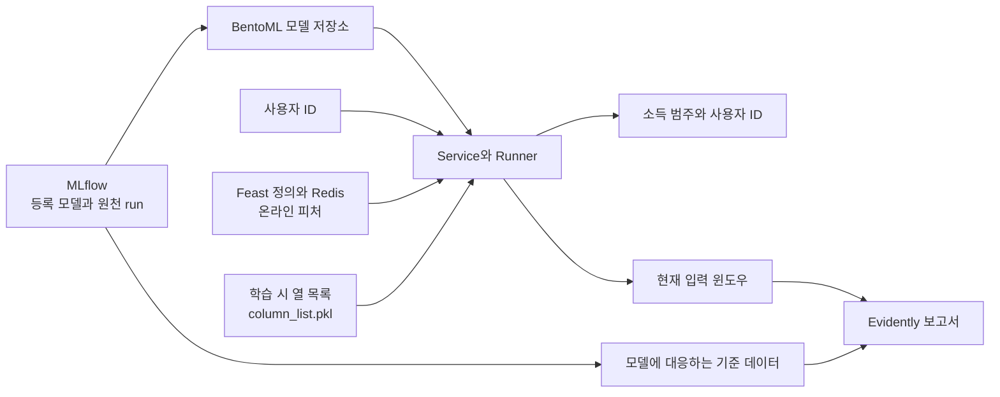
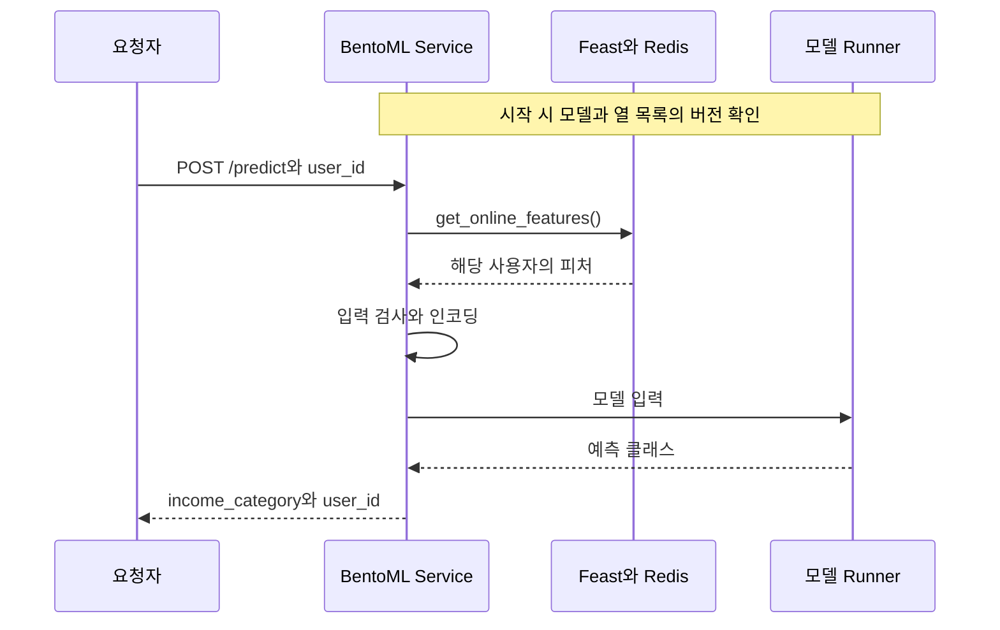

4~5장에서는 사용자 목록과 기준 시각을 파일로 받아 배치 추론했다. 6장은 같은 소득 분류 모델을 사용자 ID 기반 API로 바꾸고, 서비스에 들어오는 피처를 기준 데이터와 비교한다. **모델 등록, API 배포, 예측 품질 관측은 서로 다른 작업**이라는 점을 이 연결에서 볼 수 있다.

앞 글처럼 준비, 처리 흐름, 결과 확인과 오류 대응 순서로 정리했다. 다만 이 글은 [저자의 chapter-6 코드](https://github.com/practical-mlops/chapter-6/tree/890db04409cb3f48c4e493470d79095ec6ab63d6)를 기준으로 읽은 실행 절차다. `ml-platform-book-env`에 BentoML, Evidently나 Yatai를 추가한 실측 기록은 아니다. 앞 글의 설치 스크립트만 실행하면 이 서비스들까지 준비되는 것으로 읽지 않아야 한다.

## 실습 순서 {#book-ch06-sop}

온라인 API부터 확인하고 드리프트 검사를 연결하는 순서다. 처음부터 모델, 피처 조회, 컨테이너와 대시보드를 한 번에 실행하면 어느 연결에서 실패했는지 찾기 어렵다.

| 구간 | 준비하거나 확인할 것 |
| --- | --- |
| A. 앞 장의 산출물 확인 | MLflow 모델과 원천 run, `column_list.pkl`, Feast 설정, Redis의 온라인 피처 |
| B. 요청 기반 추론 | 사용자 ID, 피처 조회, 인코딩, 모델 호출과 응답의 연결 |
| C. 서비스 패키징 | Bento 모델 태그, 서비스 코드, 의존성과 실행 위치별 접속 주소 |
| D. 드리프트 관측 | 기준 데이터, 현재 입력 윈도우, 보고서와 후속 처리 정책 |
| E. 결과 해석 | HTTP 성공, 입력의 유효성, 모델 품질을 구분한 확인 |



## A. 앞 장의 산출물과 버전 확인

### A-1. 그대로 쓰는 것과 새로 필요한 것

[4~5장의 실습](../04-experiments-features-pipelines/)에서 만든 자원을 먼저 확인한다.

| 자원 | 확인할 위치 | 6장에서 쓰는 이유 |
| --- | --- | --- |
| `random-forest-classifier` | MLflow의 Models | API에 가져올 모델 |
| 모델 버전의 원천 run | MLflow 모델 상세 | 같은 학습의 열 목록과 기준 데이터 조회 |
| `column_list.pkl` | 원천 run의 Artifacts | 학습 때의 인코딩 열 순서 |
| `feature_store.yaml` | `feature-registry` 버킷 | Feast 정의와 저장소 연결 |
| 온라인 피처 | Redis와 Feast 온라인 조회 | 요청한 사용자의 최신 피처 |
| 학습 CSV와 입력 데이터 기록 | `mlflow-datasets`와 run의 Inputs | 드리프트 비교에 사용할 reference |

5장의 과거 시점 조회가 성공해도 Redis에 온라인 피처가 있다는 뜻은 아니다. 4장의 `materialize`와 온라인 조회까지 끝나 있어야 한다. API는 과거 날짜의 값을 재현하는 대신 온라인 저장소의 값을 읽는 흐름이다.

새로 필요한 것은 BentoML 실행 환경이며, 드리프트를 원격으로 기록하려면 Evidently workspace도 필요하다. 책의 Kubernetes 배포 관리에는 Yatai가 등장하지만, 앞 글의 kind 환경에는 설치되어 있지 않다.

### A-2. 저자 코드와 의존성

`ml-platform-book-env` 최상위 폴더에서 저자 코드를 별도로 받는다.

```powershell
git clone https://github.com/practical-mlops/chapter-6.git upstream\chapter-6
git -C upstream\chapter-6 checkout 890db04409cb3f48c4e493470d79095ec6ab63d6
```

이 글은 2025-07-23의 위 커밋을 기준으로 한다. 주요 진입점은 다음과 같다.

| 파일 | 읽을 내용 |
| --- | --- |
| `bentoml\scripts\download_model.py` | MLflow 모델을 BentoML 모델 저장소로 가져오기 |
| `bentoml\service.py` | 초기화와 `/predict` API |
| `bentoml\src\feature_store.py` | S3에서 Feast 설정을 받고 Redis 연결 구성 |
| `bentoml\src\data_mapper.py` | 입력 인코딩과 예측값의 응답 변환 |
| `bentoml\bento\bentofile.yaml` | 기본 서비스의 패키지 구성 |
| `bentoml\service_with_drift_detection.py` | API 입력과 기준 데이터 연결 |
| `bentoml\data_drift.py` | 입력 윈도우와 보고서 생성 시점 |
| `evidently\kubeflow-pipeline\inference_pipeline.py` | 배치 추론에 검사 작업 추가 |

저자의 README는 Python 3.10과 BentoML 1.1.10의 Service, Runner API를 사용한다. 현재 BentoML 문서의 서비스 선언을 이 코드에 그대로 섞지 않는다.

의존성 파일도 하나로 통일되어 있지 않다. 기본 `requirements.txt`는 MLflow 3.0.0, `requirements_with_drift.txt`는 MLflow 2.7.0과 Evidently 0.5.0을 지정한다. 앞 글의 `.venv-book`을 덮어쓰지 말고 실행 경로별 환경을 분리한다. 아래 서비스 명령은 해당 의존성과 설정을 준비한 뒤 확인할 진입점이지, 기존 환경에서 바로 성공한 설치 명령의 기록은 아니다.

## B. 모델에서 요청 기반 추론으로

### B-1. 모델 가져오기와 버전 고정

`download_model.py`는 `models:/random-forest-classifier/Production`을 읽어 BentoML 모델 저장소에 가져온다. MLflow 모델 파일을 요청마다 내려받는 구조가 아니다.

별도의 BentoML 환경에서 다음 순서로 확인한다.

```powershell
Push-Location .\upstream\chapter-6\bentoml
python .\scripts\download_model.py
bentoml models list
Pop-Location
```

MLflow와 S3의 포트포워딩이 열려 있어야 한다. 모델 이름을 바꿨다면 스크립트와 서비스 설정도 함께 맞춘다.

서비스는 BentoML의 `random-forest-classifier:latest`로 Runner를 만들고, 초기화할 때 MLflow의 Production 모델을 다시 찾아 `column_list.pkl`을 받는다. 두 조회 사이에 Production이나 latest가 이동하면 서로 다른 학습의 모델과 전처리를 조합할 수 있다.

책의 stage 조회를 이해한 뒤에는 **MLflow의 구체 버전, 원천 run, BentoML 모델 태그를 한 묶음으로 기록**하는 편이 좋다. MLflow의 모델 버전과 BentoML의 모델 태그는 다른 식별자다.

### B-2. 설정 파일과 실행 위치

`src\constants.py`는 `ENV_NAME=production`일 때 `production.env`, 그 외에는 `.env`를 읽는다. 일반 환경 변수만 바꾸면 모든 설정이 덮어써진다고 가정하지 말고 `dotenv_values()`로 읽는 값을 확인한다.

| 설정 | 확인할 내용 |
| --- | --- |
| `MLFLOW_HOST` | 모델과 원천 run을 조회할 서버 |
| `MLFLOW_MODEL_NAME`, `MLFLOW_MODEL_STAGE` | 가져온 BentoML 모델과 같은 버전을 가리키는지 |
| `MINIO_HOST` | S3 API의 `호스트:포트`. 웹 화면의 8888과 다름 |
| `FEAST_S3_ENDPOINT_URL` | 프로토콜을 포함한 S3 endpoint |
| `FEATURE_REGISTRY_BUCKET_NAME` | `feature-registry` 버킷 |
| `FEATURE_REGSITRY_FILE_NAME` | 소스가 사용하는 철자를 그대로 확인할 설정 키 |
| `FEAST_REDIS_HOST`, `FEAST_REDIS_PASSWORD` | 실제 온라인 피처를 적재한 Redis |

`DataStore`는 설정 파일을 로컬로 받은 뒤 Redis 주소를 다시 쓰고 Feast를 초기화한다. 설정 파일을 받았다는 사실만으로 Registry와 피처 조회까지 성공한 것은 아니다.

PC에서 실행하는 Python은 앞 글의 localhost 포트포워딩을 쓸 수 있다. 반면 컨테이너의 `localhost`는 PC가 아니며, Pod에서는 클러스터 서비스 주소를 써야 한다. Feast Registry에 남은 원천 주소도 실행 위치에서 접근 가능한지 확인한다.

### B-3. API의 처리 순서



기본 서비스의 진입점은 `service:svc`다. `bentoml` 폴더에서 실행한다.

```powershell
bentoml serve service:svc --port 3000
```

다른 PowerShell 창에서 온라인 저장소에 실제 적재한 사용자 ID로 요청한다.

```powershell
$body = @{ user_id = "<온라인-피처가-있는-user-id>" } | ConvertTo-Json
Invoke-RestMethod http://127.0.0.1:3000/predict -Method Post -ContentType application/json -Body $body
```

입력은 사용자 ID 하나이며 피처 전체를 클라이언트가 보내는 형태가 아니다. 응답의 `user_id`가 요청과 같은지, `income_category`가 예측 클래스의 매핑 결과인지 확인한다. 5장의 확률 열과 이 API의 범주 응답은 같은 형식이 아니다.

### B-4. 응답 전에 확인할 입력 변환

저자의 `InputMapper`는 요청의 피처에 `get_dummies(drop_first=True)`를 적용한 뒤 학습 열 목록으로 재정렬하고 없는 열을 0으로 채운다.

여기에는 배치와 단일 요청의 차이가 있다. 문자열 범주형 열에 값 하나만 들어오면 범주도 하나뿐이라 `drop_first=True`가 그 열을 없앨 수 있다. 이후 재정렬로 열 수를 맞춰도 입력 의미가 복원되지는 않는다. [pandas의 설명](https://pandas.pydata.org/docs/reference/api/pandas.get_dummies.html)도 현재 데이터의 범주 수에서 하나를 제외하는 동작으로 정의한다.

같은 사용자의 배치 입력과 API 입력을 비교해 인코딩 결과부터 확인해야 한다. 운영용 보완은 학습에서 fit한 인코더와 모델을 함께 저장하고 추론에서는 같은 변환을 재사용하는 방식이다. 없는 사용자, 결측 피처와 처음 보는 범주를 모두 0으로 채워 정상 예측처럼 반환하지 않는다.

## C. 서비스에서 배포 패키지로

### C-1. Bento 만들기

로컬 API가 준비된 뒤 `bentoml` 폴더에서 패키지 구성을 확인한다.

```powershell
bentoml build -f .\bento\bentofile.yaml
bentoml list
```

`bentofile.yaml`은 서비스 진입점, 포함할 파일, Python 의존성과 컨테이너 환경을 선언한다. Runner가 사용하는 모델도 확인한다. 빌드 결과의 Bento 태그와 B-1의 모델 태그를 구분해 남긴다.

원본에는 `*.env`와 `production.env`를 패키지에 포함하는 선언이 있다. 실습용 설정을 읽는 구조를 이해하되 실제 자격 증명을 넣은 파일을 빌드하거나 원격 저장소로 올리지 않는다. 운영 설정은 패키지와 분리해 전달한다.

드리프트 서비스의 실제 파일 이름은 `bento\bentofile_with_drift.yaml`이다. README의 `bentofile_with_drift_detection.yaml` 표기와 다르므로 파일 목록을 기준으로 선택한다.

### C-2. 컨테이너와 클러스터 배포

컨테이너 이미지는 별도 단계로 만든다.

```powershell
bentoml containerize income_classifier_service:<생성된-Bento-태그>
```

Bento 빌드는 패키징, containerize는 이미지 생성, push는 원격 저장소 전달이다. 어느 것도 Kubernetes에서 요청을 받기 시작했다는 뜻은 아니다.

책의 Yatai 배포를 따라갈 때는 설치된 Yatai 버전과 배포 명세를 별도로 맞춰야 한다. Pod가 사용할 MLflow, S3, Redis 주소와 권한, 모델 로드 완료, 준비 상태, 실제 요청을 차례로 확인한다. 이 글에서는 새 클러스터 설치나 배포 성공 결과를 추가하지 않는다.

## D. Evidently로 데이터 변화 관측하기

### D-1. 기준 데이터와 현재 데이터

드리프트 검사는 기준(reference)과 현재(current) 입력의 분포를 비교한다. 기준 데이터는 아무 학습 CSV가 아니라 서비스 모델의 학습 조건과 연결되어 있어야 한다.

저자 코드는 모델의 원천 run을 찾고, `run.inputs.dataset_inputs`에서 `REFERENCE_DATASET_NAME`에 맞는 입력 기록을 찾아 CSV를 받는다. 이 경로에서 확인할 것은 다음과 같다.

| 확인할 것 | 이유 |
| --- | --- |
| 원천 run과 모델 버전 | 다른 모델의 학습 데이터와 비교하지 않기 위해 |
| 입력 기록의 태그와 dataset source | 이름이 맞아도 파일 위치가 없거나 형식이 다를 수 있음 |
| 비교할 열과 타입 | 원-핫 인코딩 전 범주형 피처끼리 비교해야 함 |
| 현재 데이터의 기간과 표본 수 | 변화가 어느 구간에서 생겼는지 해석하기 위해 |
| 기준 파일의 버전 | 같은 경로의 파일이 바뀌면 비교 기준도 달라짐 |

소스는 dataset source를 `버킷/객체`로 분리해 읽는다. 기록된 URI가 `s3://`를 포함하는 등 다른 형식이면 파싱부터 맞춰야 한다. MLflow에 데이터 출처를 기록했다고 CSV가 자동으로 복사되는 것도 아니다.

Evidently 0.5.0의 RemoteWorkspace를 쓰려면 별도 workspace 서버를 준비한다. `create_remote_project.py`는 프로젝트 생성, `build_evidently_dashboard.py`는 패널 구성이며 서버를 설치하는 스크립트가 아니다. 둘 다 기본 접속 주소는 로컬 8000이다.

### D-2. 배치 파이프라인에 넣은 검사

`evidently\kubeflow-pipeline`의 흐름은 다음과 같다.


추론 작업의 `.after(detect_drift_task)`는 실행 순서를 정한다. **원본 `detect_drift.py`에는 드리프트 결과가 임계치를 넘으면 실패시키는 분기가 없다.** 보고서를 생성하고 workspace에 올린 뒤 작업을 끝낸다. 검사 프로세스가 오류로 실패하면 후속 작업이 진행되지 않는 것과, 데이터 변화 때문에 의도적으로 차단하는 것은 다르다.

품질 게이트로 쓰려면 검사 결과를 명시적 출력으로 내보내고 조건 분기나 실패 정책을 추가해야 한다. 경고만 남길지, 추론을 보류할지, 사람의 확인을 기다릴지도 정해야 한다.

원본 명세의 `varunmallya/...:latest` 이미지는 앞 글의 `book-ch5/components:0.1`과 다르다. 5장에서 적재한 이미지에 검사 코드가 이미 들어 있다고 가정하지 않는다.

### D-3. API 입력 윈도우와 검사 주기

`service_with_drift_detection.py`는 피처 조회 후 `MonitoringService.iterate()`를 호출한다. `data_drift.py`는 입력을 메모리의 DataFrame에 붙이고 최근 `window_size`행만 유지한다.

| 상태 | 원본 코드의 동작 |
| --- | --- |
| 윈도우보다 표본이 적음 | 기다린다는 로그를 남기고 반환 |
| 윈도우를 채움 | reference와 비교해 보고서 생성 |
| 가득 찬 뒤 새 요청이 들어옴 | 최근 윈도우를 유지하고 다시 보고서 생성 |
| 서비스 재시작 또는 worker 분리 | 윈도우는 프로세스 메모리 상태이므로 공유·보존되지 않음 |

윈도우 크기와 보고서 생성 간격은 다른 값이다. 원본은 윈도우를 채운 뒤 매 요청에서 검사를 다시 수행하며, 보고서 계산과 전송도 요청 경로 안에서 호출한다. 비동기 수집기나 별도 검사 작업으로 분리된 구조는 아니다.

보고서가 자주 생긴다는 것만으로 더 잘 감시한다고 볼 수 없다. 표본 수, 겹치는 윈도우, 지연 시간과 검사 부하를 함께 확인한다. 분리할 때는 어떤 요청 구간을 언제 비교했는지도 기록해야 한다.

## E. 결과 확인과 오류 대응

### E-1. 서로 다른 성공 조건

| 확인 수준 | 남겨야 할 결과 |
| --- | --- |
| API 동작 | 실제 사용자 요청, 응답 형식, 오류 응답과 지연 |
| 입력 의미 | 온라인 피처의 값과 최신성, 학습과 같은 인코딩 |
| 버전 연결 | MLflow 모델 버전, 원천 run, 열 목록과 Bento 모델 태그 |
| 드리프트 관측 | reference 버전, 현재 기간과 행 수, 비교 열, 보고서 |
| 모델 품질 | 정답이 있는 평가, 집단별 결과와 업무 영향 |

HTTP 200과 드리프트 없음은 정확도 보증이 아니다. 분포가 바뀌어도 모델이 잘 예측할 수 있고, 입력 분포가 비슷해도 입력과 정답의 관계가 바뀔 수 있다. 수집 장애, 사용자 구성 변화와 실제 품질 하락을 구분해 대응한다.

### E-2. 실패한 연결에서 확인할 것

| 증상 | 확인할 것 |
| --- | --- |
| BentoML 모델을 찾지 못함 | import 실행 여부, 모델 저장소와 서비스 실행 사용자가 같은지 |
| MLflow Production 모델 조회 실패 | 모델 이름, stage와 서버 주소 |
| `column_list.pkl` 조회 실패 | 선택한 모델의 원천 run과 아티팩트 위치 |
| API의 피처가 비거나 예측이 같게 반복됨 | 온라인 적재, 사용자 ID, 단일 행 인코딩 |
| 컨테이너에서 localhost 연결 실패 | 컨테이너 또는 Pod 기준의 서비스 주소 |
| 드리프트 서비스의 import 오류 | Evidently 0.5.0 경로와 선택한 MLflow 의존성 |
| 기준 데이터가 없다는 오류 | 입력 기록의 태그, source URI와 실제 CSV |
| 보고서는 있는데 추론이 계속됨 | 보고서 작성과 차단 정책이 별개인지 |
| 요청 지연이 검사 후 늘어남 | 요청 안에서 수행하는 보고서 계산과 workspace 전송 |

로컬 서비스는 실행한 터미널에서 `Ctrl+C`로 종료한다. Bento 모델과 패키지는 서비스 종료 뒤에도 남는다. 앞 장의 모델, 피처와 클러스터를 이 장의 종료를 이유로 지울 필요는 없다.

## 참고 자료

- [저자 chapter-6 README와 코드](https://github.com/practical-mlops/chapter-6/tree/890db04409cb3f48c4e493470d79095ec6ab63d6): BentoML 1.1.10, 기본 서비스와 Evidently 통합 경로.
- [입력 변환 코드](https://github.com/practical-mlops/chapter-6/blob/890db04409cb3f48c4e493470d79095ec6ab63d6/bentoml/src/data_mapper.py): 요청 단위의 원-핫 인코딩.
- [드리프트 컴포넌트](https://github.com/practical-mlops/chapter-6/blob/890db04409cb3f48c4e493470d79095ec6ab63d6/evidently/kubeflow-pipeline/src/detect_drift/detect_drift.py): 기준 데이터 조회와 보고서 작성.
- [API 입력 윈도우](https://github.com/practical-mlops/chapter-6/blob/890db04409cb3f48c4e493470d79095ec6ab63d6/bentoml/data_drift.py): 표본 누적과 보고서 호출 시점.

이 장에서는 모델 파일을 가져오는 것보다 요청, 피처, 전처리와 모델 버전을 같은 실행으로 묶는 부분이 중요하다. 배포 이후에는 서비스 상태와 데이터 변화, 정답 기반 품질을 서로 다른 증거로 확인해야 한다.

[이전: 04. 실험, 피처, 파이프라인](../04-experiments-features-pipelines/), [시리즈 목차](../), [다음: 07. 데이터 분석과 준비](../07-data-preparation/)
