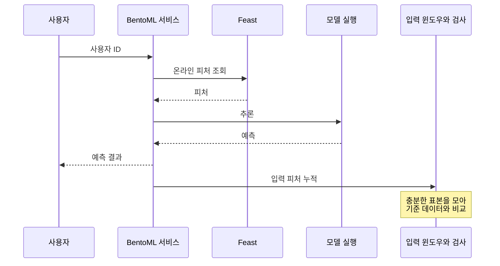

BentoML로 모델을 API로 배포하고 Evidently로 입력 데이터의 변화를 관측한다. 배포 시점에 평가를 통과했더라도 이후에 들어오는 데이터가 달라질 수 있다.

## 6.1 BentoML을 배포 플랫폼으로 사용하기

5장에서는 사용자 목록을 모아 한 번에 추론했습니다. 6장에서는 사용자 식별자를 받으면 피처를 조회하고 예측을 반환하는 API를 만듭니다.

드리프트 검사를 요청 처리와 분리할지는 서비스의 지연과 일관성 요구에 따라 정한다.

여기에는 모델뿐 아니라 피처 조회 코드, 전처리, 입력, 출력 규격과 의존성이 필요합니다. 서비스의 동작은 모델 파일 하나보다 큰 단위로 결정됩니다.

### 6.1.1 Bento 만들기

책의 흐름은 MLflow에 있는 모델을 BentoML의 모델 저장소로 가져오고, 서비스와 Runner를 정의한 뒤, `bentofile.yaml`로 배포 패키지를 만드는 것입니다.

| 구성 | 책임 |
| --- | --- |
| 모델 저장소 | 서비스가 사용할 모델 보관 |
| Service | 요청을 받고 피처 조회, 예측, 응답을 연결 |
| Runner | 모델 실행을 담당하는 작업 단위 |
| Bento | 서비스 코드, 모델, 의존성 등을 묶은 배포 패키지 |
| Yatai | 책에서 사용하는 Kubernetes 배포 관리 구성 |

Service, Runner와 Yatai 관련 절차는 책에서 사용한 버전의 구조로 이해해야 합니다. 최신 BentoML의 API나 제공 기능이 그대로 같다고 전제하지 말고, 실습 코드에 맞는 버전을 먼저 확인하세요.

적용할 때는 비밀 정보를 패키지 안에 넣지 않는 것도 중요합니다. 책의 예제를 따라 서비스 구성을 이해하더라도, 실제 자격 증명은 조직의 Secret 관리 방식으로 전달해야 합니다.

### 6.1.2 Bento 빌드와 푸시

서비스와 의존성 선언을 배포 가능한 패키지로 만들고 원격 저장소에 전달한다. 어떤 모델과 코드가 들어간 패키지인지 버전을 연결해야 한다.

### 6.1.3 Bento 배포

책에서는 Yatai로 클러스터에 배포한다. 저장소에 패키지가 있다는 사실과 실제 요청을 처리할 준비가 되었다는 사실은 다르다.

## 6.2 Evidently로 데이터 드리프트 관측하기

데이터 드리프트(data drift)는 기준 데이터와 현재 입력 데이터의 분포가 달라지는 현상입니다. 예를 들어 사용자 구성이 바뀌어 연령이나 사용 패턴의 분포가 변할 수 있습니다.

이는 모델 품질이 나빠졌을 가능성을 알려 주지만, 변화가 감지되었다고 반드시 정확도가 떨어진 것은 아닙니다. 반대로 입력 분포가 비슷해도 입력과 정답 사이의 관계가 바뀌면 문제가 생길 수 있습니다.

Evidently에서는 reference 데이터와 current 데이터를 비교해 메트릭과 보고서를 만들고, 대시보드로 결과를 살핍니다. 기준 데이터가 어떤 모델과 시점에 대응하는지도 함께 남겨야 비교를 해석할 수 있습니다.

### 6.2.1 드리프트 보고서와 대시보드

비교 대상과 검사 결과를 보고서로 남기고 변화의 크기와 지속성을 확인한다. 보고서가 어느 모델의 기준 데이터와 연결되는지가 중요하다.

### 6.2.2 KFP의 드리프트 검사 컴포넌트

배치 파이프라인에서는 피처 조회와 추론 사이에 드리프트 검사 컴포넌트를 넣을 수 있습니다. 책의 예제는 기준을 넘는 변화가 있으면 실행을 중단하는 흐름을 보여 줍니다.

### 6.2.3 API로 배포한 모델의 드리프트 검사

API에서는 단일 요청을 기준 데이터 전체와 비교하는 통계 검사가 적절하지 않을 수 있습니다. 책은 입력을 일정량 모은 마이크로배치, 윈도우로 비교합니다.

| 방식 | 장점 | 정해야 할 것 |
| --- | --- | --- |
| 배치 실행 전 검사 | 문제 있는 묶음의 후속 처리를 통제 | 중단 기준과 재실행 절차 |
| API 입력 윈도우 검사 | 시간에 따른 변화 파악 | 윈도우 크기, 비교 주기, 요청 처리와의 분리 |

표본이 너무 적으면 불안정하고, 너무 오래 모으면 발견이 늦습니다. 또한 드리프트 경고를 곧바로 서비스 차단이나 자동 재학습으로 연결할지는 업무 위험에 따라 달라집니다.

## 실무 적용: 드리프트를 정책 없는 자동 동작으로 연결하지 않습니다

서비스 품질, 피처 최신성, 데이터 변화와 정답 기반 모델 품질은 관측 방법과 대응이 서로 다르다.

| 관측 결과 | 먼저 조사할 것 | 가능한 대응 |
| --- | --- | --- |
| 피처 조회 실패, 지연 | 저장소, 네트워크, 권한, 최신성 | 명시적 오류, 업무상 허용된 대체 경로 |
| 입력 분포 변화 | 수집 변경, 계절성, 사용자 구성 | 원인 확인 후 모니터링, 모델 재검토 |
| 스키마, 단위 오류 | 데이터 생산, 변환 단계 | 후속 처리 중단과 데이터 복구 |
| 정답 기반 품질 하락 | 평가 구간, 집단, 데이터와 모델 변경 | 후보 재학습, 검증 후 승인된 출시 |

대체 응답은 정상 예측인 것처럼 숨기지 않습니다. 모델을 쓰지 않은 응답의 비율과 원인을 따로 기록해야 실제 가용성과 유용성을 해석할 수 있습니다.

분포 검사의 표본 크기와 윈도우는 감지 속도, 안정성의 절충입니다. 피처를 많이 검사하면 우연한 경고도 늘 수 있습니다. p-value 하나보다 변화의 크기, 지속성, 업무 영향을 함께 보며 임계치는 과거 정상 기간과 알려진 이상 사례로 조정합니다.

## 드리프트 알림 이후의 대응

한 피처의 결측률이 급증했다면 기준 데이터와 비교 기간을 확인하고 수집 경로부터 조사해야 한다. 서비스 유지 여부와 대응 담당자도 미리 정해 둘 필요가 있다.

수집 장애인지 실제 사용자 변화인지에 따라 데이터 복구와 모델 재검토 중 필요한 조치가 달라진다.

## 북클럽 토론

Q. 드리프트가 감지되면 바로 재학습해야 할까요?

아닙니다. 수집 오류나 일시적 이벤트일 수 있습니다. 데이터가 정상인지 확인하고 실제 품질, 비즈니스 영향을 함께 봐야 합니다.

Q. 배포 도구가 있으면 Docker와 Kubernetes를 몰라도 될까요?

기본 경로는 편해지지만 네트워크, 자원 부족, 권한, 롤백 문제는 남습니다. 도구가 감춘 계층을 이해하면 문제가 생겼을 때 조사할 수 있습니다.

자주 빠지는 함정: 요청 하나마다 무거운 분포 검사를 실행하거나, 기준 데이터의 정체를 모른 채 대시보드의 색상만 보고 판단하는 것입니다.

## 한 줄 정리

프로덕션화는 모델을 API로 포장하는 일과, 그 API가 받는 세상의 변화를 관측하고 대응하는 일을 함께 설계하는 것입니다.

[이전: 05. ML 파이프라인](../05-ml-pipelines/), [시리즈 목차](../), [다음: 07. 데이터 분석과 준비](../07-data-preparation/)
