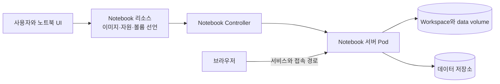
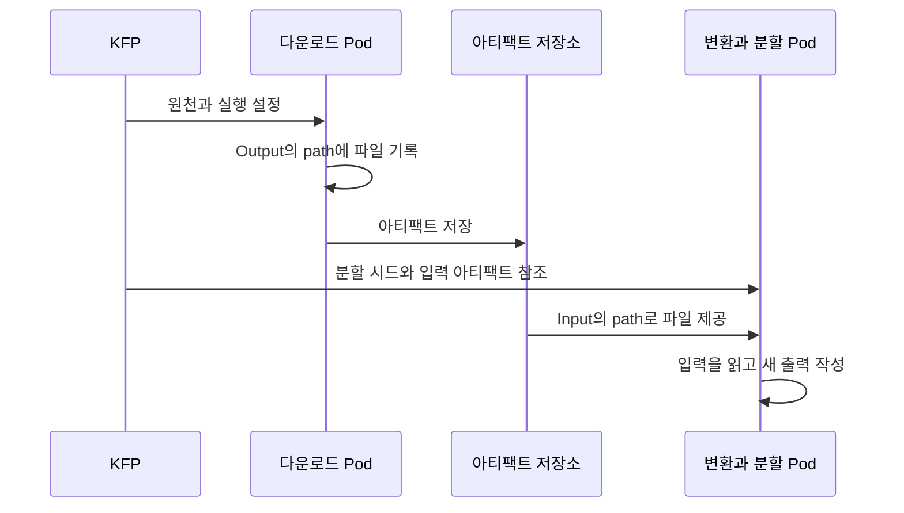
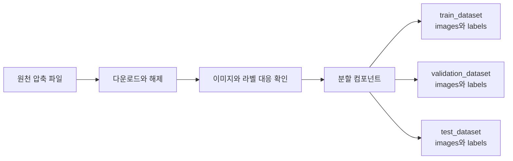
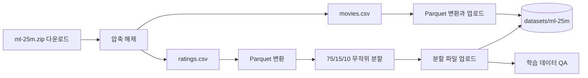

4~5장에서는 준비된 소득 데이터와 모델을 연결했고, 6장에서는 이를 API로 바꿨다. 7장부터는 신분증 탐지와 영화 추천에 사용할 데이터를 준비한다. **파일을 내려받는 것, 다음 Pod로 전달하는 것, 학습에 써도 되는지 확인하는 것은 다른 단계**다.

이 장은 데이터 분석 환경, 컴포넌트 사이의 전달 방식, 두 프로젝트의 데이터 준비로 이어진다. 노트북과 KFP의 구조, 탐지·추천 데이터의 의미를 설명하고 [준비한 데이터가 학습·서빙·관측에 이어지는 계약](#training-serving-contract)을 정리한다. 뒤의 [실습 흐름](#book-ch07-sop)은 그 원칙을 코드와 대조하는 부분이다.

## 7.1 데이터 분석과 Kubeflow 노트북 {#notebook-concepts}

### 데이터 탐색에서 알아내야 하는 것

데이터 분석은 파일이 열리는지 확인하거나 그래프를 그리는 작업에 그치지 않는다. 한 행·이미지가 무엇을 뜻하는지, 정답은 어떻게 만들어졌는지, 어떤 조건이 학습과 평가에 영향을 주는지 알아내는 과정이다.

| 관점 | 신분증 탐지 | 영화 추천 |
| --- | --- | --- |
| 표본의 단위 | 이미지와 그 안의 문서 객체 | 사용자가 영화에 남긴 평점 |
| 관측 조건 | 촬영 기기, 조명, 배경, 회전과 문서 유형 | 사용자 활동량, 영화 노출과 평가 시점 |
| 정답의 의미 | 클래스와 객체 위치 | 관측된 선호·평점 |
| 확인할 분포 | 클래스별 수, 박스 크기, 촬영 조건 | 사용자·영화별 평점 수, 평점 값과 시간 |
| 누락의 의미 | 라벨 누락인지 객체가 없는 이미지인지 | 보지 않았는지, 봤지만 평가하지 않았는지 |

평점이 없다는 것은 낮은 점수를 줬다는 뜻이 아니다. 객체 라벨이 없는 이미지도 실제 배경 이미지인지 주석이 빠진 것인지에 따라 처리가 달라진다. 결측과 빈 파일을 기계적으로 0으로 바꾸기 전에 그 의미부터 정해야 한다.

탐색 과정에서 정한 정규화, 결측 대체와 범주 사전은 학습 데이터로 fit하고 다른 분할에는 같은 변환을 적용한다. 전체 데이터에서 통계를 계산한 뒤 분할하면 검증·테스트의 정보가 학습에 섞일 수 있다.

### 분석 환경을 클러스터에 두는 이유

대규모 자료를 PC로 계속 복사하면 전송 시간과 저장 공간이 필요하고, PC에 없는 GPU나 메모리를 쓰기 어렵다. Kubeflow Notebooks는 개발자가 브라우저로 작업하되 실제 분석은 데이터와 가까운 클러스터에서 수행하게 한다.

공유 클러스터는 사용자마다 다른 환경을 무제한으로 띄우는 공간이 아니다. 관리자는 사용할 이미지와 자원 범위를 정하고, 개발자는 그 안에서 작업에 맞는 환경을 선택한다. 같은 클러스터에 있다는 사실만으로 원천 데이터 접근 권한이나 파이프라인과의 환경 일치가 보장되는 것은 아니다.

### Notebook 리소스와 실행 중인 Pod

사용자가 Notebook을 만들면 Kubeflow의 제어기가 선언된 이미지, 자원과 볼륨 구성을 실제 워크로드로 만든다. Notebook은 원하는 구성을 나타내는 리소스이고, 브라우저 요청을 처리하는 것은 그 구성으로 실행된 서버다.



커널의 메모리 상태, Pod의 임시 파일과 영속 볼륨은 수명이 다르다. Pod가 바뀌면 메모리의 DataFrame은 사라지며, PVC로 연결한 파일은 볼륨과 보존 정책에 따라 남을 수 있다. 노트북 파일이 남아 있다고 모든 셀의 실행 상태까지 복구되는 것은 아니다.

### 이미지 계층과 개발 환경의 재현성

노트북 이미지는 OS와 시스템 라이브러리 위에 노트북 서버, ML 라이브러리, 프로젝트 의존성을 쌓는 구조다. GPU가 필요하면 CUDA 등 실행 조건도 맞춰야 한다.

| 계층 | 포함하는 것 | 관리 이유 |
| --- | --- | --- |
| 기본 OS·런타임 | Python, 시스템 라이브러리와 필요한 GPU 런타임 | 네이티브 의존성과 실행 기반 |
| 노트북 서버 | JupyterLab 같은 브라우저 개발 환경 | 서버 시작, 접속과 작업 사용자 구성 |
| 공통 ML 환경 | 데이터 처리와 학습 라이브러리 | 팀에서 함께 쓰는 의존성 |
| 프로젝트 환경 | 추가 패키지와 설정 | 특정 분석·전처리 코드의 요구사항 |
| 외부 데이터·작업 볼륨 | 원천 데이터, 노트북과 결과 | 이미지와 분리한 영속성·버전 관리 |

셀에서 패키지를 설치해도 그 변경이 이미지에 기록되지는 않는다. 같은 환경을 다시 만들려면 의존성 선언과 이미지 빌드 기록이 필요하다. 이미지 생성·검사·레지스트리 게시를 CI/CD에 넣으면 공통 환경을 반복해서 준비할 수 있다.

탐색 이미지와 파이프라인 이미지는 공통 기반을 공유할 수 있지만 반드시 완전히 같을 필요는 없다. 파이프라인에는 노트북 UI가 필요하지 않을 수 있다. 중요한 것은 전처리와 실행에 필요한 의존성이 일치하고 버전이 확인되는가다.

### 자원, PodDefault와 관리자가 제공하는 선택지

CPU·메모리 requests는 스케줄링에 필요한 자원 요구를 나타내고, limits는 실행 중 사용할 한도를 정한다. 큰 파일을 모두 메모리에 읽으면 노트북이 떠 있어도 메모리 한도로 종료될 수 있다. GPU를 선택하는 것 외에 해당 자원이 있는 노드와 맞는 이미지도 필요하다.

Affinity는 배치할 노드의 조건이나 선호를, toleration은 특정 taint의 허용을 표현한다. PodDefault는 선택 조건에 맞는 Pod에 공통 환경 변수, 볼륨 같은 설정을 주입하는 Kubeflow 구성이다. 어느 것도 데이터 접근 권한이나 정상적인 전처리를 자동으로 보장하지는 않는다.

책은 관리자가 노트북 웹 앱의 이미지 목록과 자원 기본값 같은 메뉴 구성을 조정하는 부분도 다룬다. 선택지를 제공하는 일과 실제 Pod에 적용되는 설정은 구분해야 한다. 사용자에게 필요한 환경을 제공하면서 클러스터 용량, 작업 보존과 유휴 종료를 함께 관리하는 것이 플랫폼의 역할이다.

## 7.2 컴포넌트와 데이터 전달의 원리 {#pipeline-data-concepts}

### 탐색 코드를 컴포넌트로 바꾸는 이유

노트북은 셀 실행 순서와 이전 메모리 상태에 의존하기 쉽다. 컴포넌트는 입력, 출력과 실행 환경을 인터페이스로 정해 필요한 작업만 다시 실행하고 다른 파이프라인에서도 사용할 수 있게 한다.

파이프라인 정의는 이 컴포넌트의 의존 관계를 조립한다. 작성한 Python을 컴파일할 때 데이터를 내려받고 학습하는 것이 아니라, 실행 명세를 만든다. 컴포넌트의 실제 입력 값과 파일 경로는 나중에 작업이 실행될 때 정해진다.

### 세 가지 컴포넌트 작성 방식

| 방식 | 코드와 의존성 준비 | 적합한 상황 |
| --- | --- | --- |
| Lightweight Python component | 함수 코드를 추출하고 `base_image`, `packages_to_install`로 실행 환경 구성 | 작고 독립적인 Python 처리 |
| Containerized Python component | Python 컴포넌트 코드와 의존성을 `target_image` 대상으로 미리 빌드 | 반복 설치를 줄이고 실행 환경을 고정할 때 |
| Container component | 이미 준비한 이미지와 실행 명령·인자를 `ContainerSpec`으로 연결 | 별도 프로그램, 시스템 의존성이나 복잡한 실행 구조 |

Lightweight 컴포넌트는 개발 PC의 가상환경 전체를 복사하지 않는다. 함수 안에서 필요한 모듈을 import하고 실행 이미지에 해당 의존성이 있어야 한다. 바깥 셀의 변수나 별도 Python 파일도 자동으로 함께 들어간다고 가정하면 안 된다.

`packages_to_install`은 작업 시작 때 패키지를 설치할 수 있어 간단하지만, 네트워크와 설치 시간이 실행 조건에 추가된다. 미리 빌드한 이미지는 시작 시 설치를 줄이는 대신 이미지 빌드와 갱신을 관리해야 한다. `target_image`를 적거나 YAML을 컴파일한 것만으로 해당 이미지가 빌드·게시되는 것은 아니다.

### 값 전달과 파일 전달

KFP는 작은 설정과 결과를 파라미터로, 데이터셋·모델 같은 산출물을 아티팩트로 구분한다.

| 구분 | 파라미터 | 아티팩트 |
| --- | --- | --- |
| 의미 | 작은 값의 전달 | 파일 내용과 산출물 식별 정보의 전달 |
| 예 | seed, 버킷 이름, 행 수, 작은 설정 목록 | 이미지 묶음, Parquet, 모델과 보고서 |
| 인터페이스 | `str`, `int`, `float`, `bool` 등 지원 타입 | `Input[Dataset]`, `Output[Model]` 등 |
| 전달 내용 | 직렬화된 값 | URI, 메타데이터와 실행 시 사용할 경로 |
| 책임 | 값의 형식과 의미 정의 | 선언한 출력에 파일 작성, 내용의 검증 |

파라미터에 저장소 URI를 문자열로 넘길 수도 있다. 다만 그 경우에는 파일을 읽고 권한과 버전을 확인하는 일을 코드가 맡는다. 문자열이 경로처럼 생겼다고 KFP가 자동으로 파일 아티팩트로 추적하는 것은 아니다.

KFP 아티팩트는 `.uri`로 저장 위치를, `.path`로 작업 안에서 읽거나 쓸 로컬 경로를 제공하고 `.metadata`에 부가 정보를 남길 수 있다. 출력 아티팩트는 제공된 경로에 내용을 써야 하며, 다른 폴더에 만든 파일이 모두 자동 수집되지는 않는다.

### 아티팩트 타입과 lineage

| 타입 | 표현하는 산출물 |
| --- | --- |
| `Dataset` | 학습·검증 등에 사용할 데이터 |
| `Model` | 학습한 모델 파일과 관련 정보 |
| `Metrics` | 이름과 수치로 된 평가 결과 |
| `ClassificationMetrics` | 혼동행렬 등 분류 평가 정보 |
| `HTML`, `Markdown` | 사람이 읽을 보고서 |
| `Artifact` | 더 구체적인 타입으로 표현하지 않은 일반 산출물 |

타입은 컴포넌트 연결 검사, 결과 표시와 산출물 이력에 도움을 준다. 같은 이름의 파일을 여러 작업에서 만들더라도 어떤 실행이 어떤 입력으로 만든 것인지 구분할 수 있다. KFP는 이런 입출력 관계를 메타데이터로 관리한다.

다만 `Dataset`이라는 타입이 열 이름과 평점 범위까지 검증하지는 않는다. 모델을 만든 데이터가 추적된다는 것과 그 데이터가 적합하다는 것은 다른 주장이다. 스키마와 도메인 검사는 별도로 작성해야 한다.

### 캐시, 외부 상태와 실행 비용

컴포넌트를 나누면 중간 결과를 재사용할 수 있지만, 같은 URI의 파일이 바뀌는 외부 상태까지 입력 식별자에 반영되지 않으면 오래된 결과를 사용할 수 있다. 원천 checksum이나 스냅샷을 입력으로 남기고, 재사용해도 되는 작업과 매번 실행할 작업을 구분한다.

반대로 모든 캐시를 끄면 다운로드와 변환을 반복한다. 컴포넌트를 지나치게 잘게 나누면 Pod 시작과 파일 이동 비용도 늘어난다. 재사용, 자원, 실패와 재시도 단위가 다른 경계를 기준으로 나누는 편이 좋다.

## 7.3 탐지·추천 데이터의 준비 원칙 {#dataset-concepts}

### 같은 파일 처리라도 학습 문제는 다르다

객체 탐지는 이미지 안에 무엇이 어디에 있는지 학습한다. 이미지 전체에 라벨 하나를 붙이는 분류와 다르고, 픽셀별 영역을 정답으로 주는 분할과도 다르다. 이 장의 YOLO 데이터는 클래스와 bounding box의 조합이 핵심이다.

YOLO 형식의 한 객체는 `class_id x_center y_center width height`로 표현한다. 클래스 ID는 클래스 목록과 연결되고, 좌표는 이미지 크기로 정규화한다.

```text
이미지 크기: W, H
픽셀 박스: (x_min, y_min), (x_max, y_max)

x_center = (x_min + x_max) / (2 * W)
y_center = (y_min + y_max) / (2 * H)
width    = (x_max - x_min) / W
height   = (y_max - y_min) / H
```

한 이미지에 객체가 여러 개면 라벨도 여러 행이다. 원천이 문서의 사각형 꼭짓점을 제공한다면 이를 축에 정렬한 박스로 바꾸는지, 회전 박스를 사용하는지부터 정해야 한다. 서로 다른 주석 형식의 좌표를 그대로 옮기면 같은 데이터가 되지 않는다.

추천에서는 사용자와 아이템 사이의 관측된 상호작용을 다룬다. MovieLens 평점은 명시적 피드백이며, 클릭이나 시청 기록처럼 행동으로 추정하는 암묵적 피드백과 구분된다. 관측이 없는 사용자·영화 조합을 모두 낮은 평점의 정답으로 만들 수는 없다.

사용자·영화 ID는 조인과 모델 입력의 키다. 파일 간 일관성과 모델이 사용하는 ID 매핑을 유지해야 한다. 원천 ID의 최대값이 서로 다른 ID의 개수와 같다고 볼 수도 없다.

### CSV, Parquet과 데이터 규모

CSV는 사람이 확인하기 쉽지만 값을 해석할 타입과 구분자·인코딩 규칙이 필요하다. Parquet은 타입을 가진 열 단위 저장 형식으로, 압축과 필요한 열의 읽기에 유리하다. 변환은 물리적 표현을 바꾸는 작업이지 잘못된 값이나 중복을 수정하는 작업은 아니다.

Parquet을 쓴다고 DataFrame 전체를 메모리에 올리는 코드의 한계가 사라지지는 않는다. 현재 코드가 전체 자료를 읽는지, 필요한 열만 읽는지, 묶음으로 처리하는지와 Pod의 메모리 요구를 함께 봐야 한다.

MovieLens의 `ratings.csv`는 `userId`, `movieId`, `rating`, `timestamp`를 제공한다. [원천 설명](https://files.grouplens.org/datasets/movielens/ml-25m-README.html)에 따르면 평점은 0.5~5.0의 반점 단위이며 timestamp는 UTC Unix 초다. 시간 기준과 값 범위도 스키마의 일부다.

### 분할은 평가하려는 상황을 만드는 작업

| 분할 | 주된 용도 | 다른 분할과 구분할 일 |
| --- | --- | --- |
| 학습 | 모델과 전처리의 파라미터 학습 | 학습에 사용한 통계·사전 기록 |
| 검증 | 설정·후보 선택과 개발 중 평가 | 선택 과정의 영향을 받는다는 점 인식 |
| 테스트 | 선택을 마친 뒤 독립적인 최종 평가 | 반복 확인하며 모델을 고르는 자료로 쓰지 않음 |

무작위 분할은 표본이 충분히 독립적이라는 가정에서 출발한다. 같은 영상의 프레임이나 같은 문서의 여러 사진은 독립 표본으로 보기 어렵다. 실제로 처음 볼 문서를 평가하려면 문서·영상 단위 분할이 더 맞을 수 있다.

추천에서 미래 행동을 예측하려면 시간도 중요하다. 사용자별 과거 정보로 모델을 만들고 이후 행동을 평가하는 조건과, 같은 시기의 알려진 사용자 평점을 일부 가리는 조건은 다른 문제다. 신규 사용자·신규 영화의 cold start도 별도로 구분한다.

시드 고정은 정해진 절차의 무작위성을 제어할 뿐 잘못된 평가 설계를 고치지 않는다. 분할 비율보다 어떤 표본과 시간이 경계를 넘지 않아야 하는지를 먼저 정한다.

### 품질 검사와 재현 가능한 데이터 준비

데이터 준비는 다운로드, 파싱, 변환, 분할, 저장과 QA의 연결이다. 각 단계가 성공해도 다음 단계가 요구하는 데이터가 맞는지 검사해야 한다.

| 검사 계층 | 예 |
| --- | --- |
| 파일·저장소 | 다운로드 성공, 압축 형식, 필요한 객체 존재 |
| 스키마 | 열 이름·타입, 이미지·라벨 형식과 좌표 단위 |
| 의미·관계 | 평점 범위, ID 조인, 이미지와 라벨의 대응 |
| 분할·누수 | 같은 원천 그룹과 미래 정보의 혼입 여부 |
| 계보·버전 | 원천 checksum, 변환 코드, 분할 기준과 결과 위치 |

로그는 어느 단계가 실패했는지 찾는 데 쓰고, QA는 넘어가면 안 되는 입력을 구분한다. 전체 자료를 로그에 출력하는 것과 재현 가능한 진단 정보를 남기는 것도 다르다. 원천 식별자, 행·파일 수, 스키마와 실패 유형을 남기면 데이터를 전부 출력하지 않고도 조사 범위를 좁힐 수 있다.

아래의 C·D에서는 이런 원칙을 저자의 두 파이프라인과 대조한다. 원칙상 필요한 검사와 원본 코드가 실제로 수행하는 검사를 구분해서 읽으면 된다.

## 데이터 준비와 서빙을 잇는 계약 {#training-serving-contract}

### 원천 파일에서 모델 입력까지 무엇이 바뀌는가

데이터 준비 파이프라인의 출력은 학습 코드만을 위한 파일이 아니다. 이후 서비스가 같은 의미의 입력을 만들고, 관측 작업이 그 입력을 올바른 기준과 비교할 수 있어야 한다.


그림은 계약을 유지하기 위한 참조 구조이며, 저자 코드가 이 산출물을 모두 자동으로 등록한다는 뜻은 아니다. 다음처럼 서로 다른 종류의 버전을 구분해 남길 수 있다.

| 산출물 | 다음 단계에 필요한 정보 |
| --- | --- |
| 원천 스냅샷 | 출처, 수집 시각과 내용의 식별자 |
| 스키마·의미 규칙 | 열·타입, 좌표·시간·평점의 단위와 허용 범위 |
| 분할 manifest | 어느 샘플·그룹·기간을 각 분할에 넣었는지 |
| 변환 코드·실행 이미지 | 어떤 코드와 의존성으로 데이터를 만들었는지 |
| fit한 전처리 | 범주 사전, 스케일·결측 대체값이나 ID 매핑 |
| QA 결과 | 검사한 규칙, 실패 항목과 평가 대상 |
| 관측 기준 | 어떤 모델·표현·집단과 기간을 비교하는 reference인지 |

`latest` 경로의 파일을 덮어쓰거나 seed 하나만 저장하면 이 관계를 복구하기 어렵다. 같은 이름의 파일이 아니라 같은 내용과 처리 과정을 다시 찾을 수 있어야 한다.

### 스키마 위반, training-serving skew와 drift의 차이

[TensorFlow Data Validation](https://www.tensorflow.org/tfx/data_validation/get_started)은 스키마 검증, 학습·서빙 사이의 skew, 서로 다른 시점 데이터 사이의 drift를 구분한다. 이 장의 환경에 TFDV를 추가하자는 뜻이 아니라, 검사 목적을 나누어 이해하는 예다.

| 구분 | 묻는 것 | 예 |
| --- | --- | --- |
| 스키마·의미 위반 | 이 데이터가 합의한 형식과 값의 조건에 맞는가 | `rating`이 문자열, 좌표 단위 오류, 필수 키 결측 |
| Training-serving skew | 학습과 서비스가 같은 의미의 입력을 만드는가 | 학습은 UTC 초, 서비스는 밀리초를 사용 |
| 시간에 따른 drift | 같은 의미로 측정한 데이터의 분포가 달라졌는가 | 새 사용자 집단 유입으로 선호·직업 구성이 변화 |

비교한 분포가 다르다는 관측만으로 원인을 정할 수는 없다. 사용자 환경의 변화와 파싱·변환 오류는 모두 값의 분포를 바꿀 수 있다. 먼저 계약과 데이터 생성 경로가 같은지 확인해야 한다.

학습에는 정답 열이 있지만 서빙에는 없을 수 있다. 따라서 학습·서빙이 글자 그대로 모든 열을 공유해야 한다는 규칙도 맞지 않는다. 기대하는 차이는 스키마에 표현하고, 모델이 실제 사용하는 피처의 계약을 맞춘다.

### 같은 변환과 같은 시점이라는 조건

범주 사전이나 스케일을 학습 때 만들었다면 추론에서 입력 한 건만 보고 다시 만들지 않는다. fit은 학습에서, 같은 변환의 적용은 검증·테스트와 서빙에서 수행한다.

| 프로젝트 | 유지할 계약 | 깨졌을 때의 결과 |
| --- | --- | --- |
| 소득 분류 | 범주 인코딩, 열 순서와 피처 최신성 | 같은 열 수라도 다른 의미의 모델 입력 |
| 객체 탐지 | 클래스 매핑, 이미지 전처리와 좌표 정의 | 다른 클래스 해석이나 잘못된 박스 |
| 영화 추천 | 사용자·영화 ID 매핑과 사용 가능한 이력의 시점 | 다른 아이템을 가리키거나 미래 행동 혼입 |

이미지 크기를 바꾸는 처리와 픽셀 정규화처럼 학습·추론에서 필요한 전처리와, 학습 자료를 늘리는 augmentation도 구분한다. 학습에 사용한 무작위 증강을 평가나 서비스에 무조건 동일하게 적용하는 것은 아니다.

피처 저장소를 쓴다면 조회 시점도 계약의 일부다. 학습 표본의 기준 시각 이후에 알려진 값을 붙이거나, 과거 이력을 현재 최신값으로 덮어쓰면 실제 서비스 조건을 재현하지 못한다. 저장소가 있다는 사실과 point-in-time 조건을 지켰다는 사실은 별도로 확인한다.

### 준비 단계의 통계가 운영 관측의 기준이 된다

소득 분류 서비스에서 학력·직업 분포를 관찰하려면 어떤 학습 집단과 피처 정의를 기준으로 삼았는지 알아야 한다. 인코딩 전 범주 분포와 인코딩 후 수치 열을 서로 직접 비교할 수는 없다.

추천에서는 사용자 활동량이나 영화별 평점 수, 탐지에서는 촬영 조건이나 문서 유형의 변화가 조사 출발점이 될 수 있다. 어떤 집단과 표현을 비교할지 먼저 정하고, 필요한 자료나 통계를 준비 단계에서 남겨야 한다. 표 데이터용 분포 검사를 이미지 픽셀 전체에 그대로 적용하는 것으로 관측 설계가 끝나지는 않는다.

[6장의 관측 구조](../06-productionizing-models/#production-monitoring)는 이 reference와 서비스의 실제 입력 기록을 연결한다. 사용자 ID만 저장해 두고 나중에 최신 피처를 다시 읽으면 당시 어떤 값으로 예측했는지 알 수 없다. 데이터 준비와 운영 관측이 같은 버전·시간의 의미를 공유해야 하는 이유다.

### 실패를 어디에서 중단할지 정한다

노트북은 탐색을 돕지만 운영 파이프라인은 실패와 재실행의 조건까지 명확해야 한다. 스키마 위반이나 이미지·라벨 불일치는 학습 전에 중단해야 할 이유가 될 수 있다. 파일 다운로드의 일시 장애와 달리 재시도로 잘못된 데이터가 맞아지는 것은 아니다.

부분 출력이 생긴 실행과 검증을 마친 데이터 묶음도 구분한다. 같은 출력 위치를 덮어쓰는 구성이라면 일부 파일만 새 버전이 되는 상황을 막거나, manifest로 일관된 완료 단위를 식별할 수 있어야 한다.

품질 검사를 통과한 데이터로 학습했다는 것과 운영 출시가 승인됐다는 것도 다르다. 데이터 QA, 모델 평가, 서빙 성능과 배포 전환은 연결되지만 서로 다른 책임이다. 이 경계를 보존해야 6장의 drift 경고가 데이터 수정, 추가 평가나 재학습 중 무엇으로 이어져야 하는지 판단할 수 있다.

## 실습 순서 {#book-ch07-sop}

아래는 저자 저장소의 코드와 확인 항목을 정리한 절차다. 새 환경 설치나 전체 데이터 다운로드·파이프라인 실행을 완료한 실측 기록은 아니다.

| 구간 | 확인할 것 |
| --- | --- |
| A. 실행 환경 | 로컬 JupyterLab과 Kubeflow Notebooks의 차이, 별도 컴파일 환경 |
| B. 데이터 전달 | 파라미터, KFP 아티팩트, 공유 볼륨의 경계 |
| C. 신분증 데이터 | 원천 압축 파일, 이미지와 라벨의 대응, 분할 산출물 |
| D. 영화 평점 데이터 | CSV와 Parquet, 스키마, 분할, S3 저장과 QA |
| E. 다음 단계 전달 | 고정한 원천과 코드, 검사 결과, 실패 시 중단 위치 |

책의 예제는 노트북에서 데이터를 살피는 일과 컴포넌트로 다시 실행하는 일을 연결한다. 노트북에서 성공한 셀만 복사하기보다 입력과 결과, 실패 조건을 명시하는 부분을 중심으로 보면 된다.

## A. 노트북과 파이프라인의 실행 환경

### A-1. 앞 장의 환경에서 이어가는 범위

[4~5장](../04-experiments-features-pipelines/)의 JupyterLab은 PC에서 실행한 개발 환경이다. kind에는 KFP standalone을 설치했으므로 Kubeflow 대시보드의 Notebooks 메뉴나 Notebook Controller가 자동으로 생기지 않는다.

| 구분 | PC의 JupyterLab | Kubeflow Notebooks |
| --- | --- | --- |
| 실행 위치 | PC의 Python 프로세스 | 클러스터의 Notebook Pod |
| 환경 | 로컬 가상환경 | Notebook 이미지 |
| 파일 | PC의 작업 폴더 | 연결한 볼륨 또는 Pod의 임시 공간 |
| 서비스 접속 | localhost 포트포워딩 | 클러스터 DNS와 권한 |
| 자원 | PC의 CPU, 메모리, GPU | Pod의 요청량과 제한, 노드 배치 |

책처럼 Kubeflow Notebooks를 쓰려면 해당 구성 요소를 별도로 설치해야 한다. 이 글의 코드를 읽고 컴파일하는 데는 PC의 별도 Python 환경을 사용할 수 있다. 이 차이를 구분해야 4장의 localhost 설정을 Notebook Pod에 그대로 넣는 실수를 피할 수 있다.

### A-2. 노트북을 만들 때 정하는 것

Kubeflow 노트북은 브라우저 화면이 아니라 자원과 저장소를 사용하는 워크로드다.

| 설정 | 확인할 내용 |
| --- | --- |
| 이미지 | Python, 데이터 라이브러리, OS 의존성과 버전 |
| Namespace | 서비스 계정, 네트워크 접근과 자원 할당 범위 |
| Workspace volume | 노트북 재시작 뒤에도 남길 코드와 작업 파일 |
| Data volume | 여러 작업이 읽을 데이터와 읽기·쓰기 권한 |
| PodDefault | 해당 설정을 적용하는 구성에서 공통 환경과 볼륨 주입 |
| Affinity / toleration | 자원에 맞는 노드 선택과 taint 허용 |
| GPU와 유휴 종료 | 탐색에 필요한 자원과 사용하지 않을 때 반환할 정책 |

toleration은 특정 taint를 허용할 뿐 해당 노드에 반드시 배치하라는 조건은 아니다. 같은 이미지를 쓰더라도 데이터 버전, 설정과 숨은 셀 상태가 다르면 같은 결과가 나오지 않는다.

### A-3. 저자 코드의 위치와 컴파일 환경

7장의 두 프로젝트는 하나의 `chapter-7` 저장소가 아니라 다음 저장소에 나뉘어 있다.

| 프로젝트 | 기준 커밋 | 데이터 준비 진입점 |
| --- | --- | --- |
| [object-detection-project](https://github.com/practical-mlops/object-detection-project/tree/c6afb114e628e776a76f9ac50b45899aff5e8eaf) | `c6afb114`, 2025-01-02 | `data_prep_pipeline.py` |
| [movie-recommender-project](https://github.com/practical-mlops/movie-recommender-project/tree/4e0a808e0dca3aef16850cd14df47d2fda9f9bd2) | `4e0a808e`, 2025-04-18 | `01_data_preparation_pipeline.py` |

`ml-platform-book-env` 최상위 폴더에서 코드를 받는다.

```powershell
git clone https://github.com/practical-mlops/object-detection-project.git upstream\object-detection-project
git -C upstream\object-detection-project checkout c6afb114e628e776a76f9ac50b45899aff5e8eaf
git clone https://github.com/practical-mlops/movie-recommender-project.git upstream\movie-recommender-project
git -C upstream\movie-recommender-project checkout 4e0a808e0dca3aef16850cd14df47d2fda9f9bd2
```

영화 추천 저장소의 requirements는 KFP 2.11.0, 객체 탐지 쪽은 `kfp>=2.0.0`이다. 앞 글의 `.venv-book`은 KFP 2.9.0이므로 덮어쓰지 않고 컴파일 환경을 따로 둔다.

```powershell
uv venv .venv-ch07 --python 3.11
uv pip install --python .venv-ch07 kfp==2.11.0
.\.venv-ch07\Scripts\Activate.ps1
```

이 환경은 파이프라인 정의를 읽어 YAML로 바꾸는 용도다. 컴포넌트의 `packages_to_install`은 실제 작업 Pod에서 설치할 의존성이며, PC에 KFP를 설치했다고 다운로드·변환 작업의 환경까지 고정된 것은 아니다.

## B. 다음 Pod에 데이터를 넘기는 방법

### B-1. 파라미터와 아티팩트

5장처럼 KFP 컴포넌트는 서로 다른 Pod에서 실행된다. 앞 셀의 DataFrame이나 앞 Pod의 `/tmp` 경로는 다음 작업에 자동으로 공유되지 않는다.



| 전달 방식 | 적합한 것 | 확인할 조건 |
| --- | --- | --- |
| 파라미터 | seed, 버킷 이름, 원천 버전 같은 작은 설정 | 값의 타입과 의미 |
| KFP 아티팩트 | 데이터셋, 파일 묶음, 모델, 평가 보고서 | 선언한 출력 경로에 실제 파일을 썼는지 |
| S3 URI | 장기 보관할 업무 데이터의 위치 | 다음 작업의 주소, 권한과 객체 버전 |
| 공유 볼륨 | 명시적으로 마운트한 공통 파일 | PVC, 접근 모드, 마운트 경로와 동시 쓰기 |

`Input[Dataset]`은 입력의 의도를 나타낼 뿐 CSV 열이나 YOLO 라벨을 검증하지 않는다. `Artifact`로 선언해도 데이터 파일을 전달할 수 있지만 구체적인 내용 검사는 코드의 책임이다.

### B-2. KFP 경로와 업무용 저장 위치

KFP가 정한 `output.path`와 `s3://datasets/ml-25m/train.parquet.gzip`은 같은 역할의 경로가 아니다. 전자는 실행 사이의 산출물 연결이고, 후자는 코드가 별도로 정한 장기 보관 위치다.

사용자가 임의의 로컬 경로 문자열을 반환하면 KFP가 그 폴더를 자동으로 아티팩트로 수집한다고 볼 수 없다. 출력 타입과 경로, 디렉터리 내부 파일을 함께 확인한다.

## C. 신분증 탐지 데이터 준비

### C-1. 실제 진입점과 데이터 구조

객체 탐지 저장소의 루트 `data_prep_pipeline.py`에는 다운로드, 분할, 파일 목록 출력 컴포넌트가 함께 정의되어 있다. `data_preparation` 폴더에는 `/mnt/pipeline`을 사용하는 별도 코드도 있으므로 두 경로를 섞지 않는다.



MIDV-500 기반 프로젝트라는 설명과 실제 다운로드 파일의 상태도 나눠 봐야 한다. 이 진입점은 배포된 압축 파일을 받아 분할하며, 원천 MIDV 주석을 YOLO 형식으로 바꾸는 변환을 자동으로 실행하지 않는다. 입력에 이미 기대한 이미지·라벨 구조가 있는지 확인해야 한다.

코드는 `DATASET\MINIDATA\images`와 `labels`를 찾고, 다른 스크립트는 `DATA`를 사용한다. 다운로드한 압축 내부의 실제 경로와 선택한 진입점이 맞는지 먼저 본다.

### C-2. 분할 전에 확인할 이미지와 라벨

| 검사 | 확인 방법 |
| --- | --- |
| 파일 대응 | 이미지와 라벨을 파일명 stem으로 연결 |
| 중복과 누락 | 중복 stem, 라벨 없는 이미지, 이미지 없는 라벨 탐지 |
| 라벨 형식 | 클래스 ID와 좌표 항목의 개수, 타입 확인 |
| 좌표 의미 | YOLO의 정규화된 중심 좌표와 너비·높이인지 확인 |
| 데이터 단위 | 문서, 사람, 촬영 영상 등 동일 원천의 그룹 기록 |
| 샘플 표시 | 이미지 위에 박스를 그려 위치와 클래스 확인 |

루트 분할 코드는 이미지 목록과 라벨 목록을 별도의 `glob`으로 만든 뒤 함께 `train_test_split`에 넘긴다. 이때 두 목록의 같은 위치가 같은 샘플이라는 보장은 없다. 파일 수가 같아도 라벨이 다른 이미지와 연결될 수 있으므로, 이름으로 짝을 만들고 누락을 검사한 목록을 분할해야 한다.

YOLO 박스가 정규화 형식이면 클래스 ID, 중심 x·y, 너비·높이의 의미와 범위를 확인한다. 좌상단·우하단 좌표를 그대로 넣거나 픽셀 값을 정규화 값처럼 다루면 학습은 실행되어도 다른 박스를 배우게 된다.

### C-3. 분할과 컴파일

원본은 학습 75%, 검증 15%, 테스트 10%를 목표로 무작위 분할한다. 작은 데이터에서는 정수 반올림 때문에 정확한 행 수 비율이 달라질 수 있다.

같은 촬영 영상의 인접 프레임이나 같은 문서의 유사 이미지가 서로 다른 분할에 들어가면 평가가 쉬워진다. 같은 그룹이 한 분할에만 들어가야 하는지 먼저 정하고, 필요한 경우 그룹 단위 분할로 바꾼다.

컴파일 진입점은 다음과 같다. 명령은 A-3의 환경에서 실행한다.

```powershell
Push-Location .\upstream\object-detection-project
python .\data_prep_pipeline.py
Get-Item .\dataprep_pipeline.yaml
Pop-Location
```

여기서 YAML이 생성되어도 데이터가 다운로드된 것은 아니다. 실제 다운로드와 분할은 클러스터에서 파이프라인을 실행할 때 발생한다.

원본의 파일 목록 출력 작업은 `train_dataset`만 읽는다. 학습 목록이 출력됐다는 사실로 검증·테스트의 내용까지 확인한 것으로 보지 않는다. 세 아티팩트 각각의 이미지·라벨 대응과 그룹 중복을 확인해야 한다.

## D. MovieLens 평점 데이터 준비

### D-1. 다운로드부터 S3 저장까지

영화 추천 프로젝트는 MovieLens 25M의 `ratings.csv`, `movies.csv`를 읽는다. 데이터 준비는 모델 학습과 별도 파이프라인이다.



실제 컴포넌트는 `data_components\dataset_preparation.py`에 있다.

| 컴포넌트 | 입력과 출력 |
| --- | --- |
| `download_ml25m_data` | GroupLens ZIP을 출력 아티팩트에 기록 |
| `unzip_data` | ZIP에서 ratings와 movies를 별도 CSV로 분리 |
| `csv_to_parquet` | CSV를 gzip 압축 Parquet으로 변환 |
| `split_dataset` | ratings를 train, val, test 파일로 작성 |
| `put_to_minio` | 업무용 버킷의 `ml-25m` 경로에 업로드 |
| `qa_data` | 업로드된 train Parquet을 읽어 제한된 검사 수행 |

Parquet은 저장 형식이지 분할 정책이 아니다. 압축과 열 단위 읽기가 유용해도 데이터 누수나 식별자 오류를 해결하지는 않는다.

### D-2. 원본에서 먼저 맞출 스키마

MovieLens의 열 이름은 `userId`, `movieId`, `rating`, `timestamp`다. 그런데 원본 `split_dataset`에는 `ratings_df.user_id`, `ratings_df.item_id`로 최대값을 읽는 두 줄이 남아 있다. 앞의 CSV 변환에는 이 이름으로 바꾸는 단계가 없어 해당 줄에서 실패할 수 있다.

두 값은 그 함수의 뒤에서 쓰이지 않는다. 이 경로를 실행하기 전에는 불필요한 두 줄을 제거하거나, downstream과 일관된 스키마로 수정해야 한다. 학습 전처리도 `userId`, `movieId`를 사용하므로 이 두 줄만 통과시키려고 전체 열을 임의로 바꾸지 않는다.

컴파일은 컴포넌트 내부의 DataFrame 연산까지 실행하지 않는다. YAML 생성 성공이 이 오류를 찾아 주지 않는 이유다.

### D-3. 실행 정의와 업로드 결과

컴파일 명령은 다음과 같다.

```powershell
Push-Location .\upstream\movie-recommender-project
New-Item -ItemType Directory -Force .\compiled_pipelines | Out-Null
python .\01_data_preparation_pipeline.py
Get-Item .\compiled_pipelines\dataPrep_pipeline.yaml
Pop-Location
```

원본의 입력 파라미터는 `minio_bucket`과 분할 seed인 `random_init`이며 기본값은 각각 `datasets`, `42`다. Pod의 S3 접속 주소는 `http://minio-service.kubeflow:9000`으로 지정되어 있다. 앞 장의 서비스 이름과 네임스페이스를 유지하는지 확인한다.

4~5장에서 만든 다섯 업무 버킷에 `datasets`가 포함된 것은 아니다. 이 코드의 업로드 컴포넌트는 버킷 생성을 시도한다. 이미 있는 버킷을 다루는 동작과 생성 권한도 실행 전에 확인한다.

파일 업로드까지 성공하면 다음 객체가 있어야 한다.

```text
datasets
  ml-25m
    movies.parquet.gzip
    train.parquet.gzip
    val.parquet.gzip
    test.parquet.gzip
```

25M 전체 자료는 압축 파일뿐 아니라 해제 CSV, Parquet과 세 분할을 보관할 공간이 필요하다. 작은 자료로 바꿔 시험할 때는 아래 QA의 고정 행 수 조건도 함께 바꿔야 한다.

### D-4. QA가 검사하는 것과 남겨 둔 것

원본 `qa_data`는 train의 열 수가 4인지, 행 수가 `0.75 × 25 × 1,000,000` 이상인지 assert로 확인한다. 열 이름, 결측, 평점 범위나 분할 사이의 중복은 검사하지 않는다.

| 확인 범위 | 추가로 볼 내용 |
| --- | --- |
| 스키마 | 열 수뿐 아니라 열 이름, 타입과 시간 단위 |
| 식별자 | 사용자·영화 ID의 결측, 중복 키의 의미와 movies 조인 |
| 값 | 평점의 허용 범위와 잘못된 timestamp |
| 분할 | train/val/test의 행 수, 키·시간 중복과 목적에 맞는 분할 |
| 저장 결과 | 같은 원천 버전의 파일 묶음인지, 이전 실행의 파일이 섞이지 않았는지 |
| 재현 정보 | 원천 checksum, 코드 커밋, 분할 seed와 산출물 위치 |

파이프라인은 QA를 분할 파일 업로드 작업 뒤에 배치하지만 movies 업로드 뒤라는 의존성은 명시하지 않는다. 따라서 train QA의 성공만으로 movies 업로드와 조인까지 검증했다고 볼 수 없다. 모든 작업의 완료 상태와 실제 객체를 별도로 확인한다.

실행할 때는 5장과 같은 KFP 업로드 절차를 사용할 수 있다. 컴파일한 두 YAML을 서로 다른 파이프라인으로 등록하고 데이터 준비만 실행한다. 학습·검증 파이프라인은 이 장의 데이터 확인을 끝낸 뒤의 작업이다.

## E. 다음 단계가 받을 데이터의 계약

### E-1. 무작위 분할과 서비스의 시간

책 코드의 무작위 분할은 예제 흐름을 이해하는 출발점이다. 실제 미래 추천을 평가하려면 학습에 미래 평점이 섞이지 않는지, 사용자별 시점과 후보 영화가 어떻게 정해지는지 별도로 설계해야 한다.

신규 사용자 추천과 기존 사용자의 미래 행동 예측도 다른 평가 문제다. 시간 순서 분할 하나를 적용했다고 두 문제를 모두 검증한 것은 아니다.

객체 탐지에서는 문서·영상·사람의 중복이, 추천에서는 미래 행동과 집계값이 누수의 원인이 된다. 데이터 형식보다 먼저 서비스가 처음 마주칠 대상과 시점을 정해야 한다.

### E-2. 데이터 계약 예시

다음 YAML은 실행 설정이 아니라 MovieLens 출력의 확인 항목을 정리한 예시다. 원본 파이프라인이 이미 이 검사를 모두 구현한다는 뜻은 아니다.

```yaml
dataset: movie-ratings
contract_version: "1"
required_columns: [userId, movieId, rating, timestamp]
checks:
  - identifiers_are_not_null
  - ratings_are_within_agreed_range
  - timestamps_use_the_agreed_unit
  - all_expected_splits_are_present
split:
  source_example: random_75_15_10
  evaluation_purpose: define_before_training
lineage:
  - source_checksum
  - code_commit
  - split_seed
  - output_snapshot
on_failure:
  action: stop_and_keep_diagnostic_results
```

검사 실패 시 학습으로 넘기지 않고 원천 식별자와 오류 보고서를 보관한다. 원본을 덮어써 고치면 어떤 입력에서 실패했는지 재현하기 어렵다. 신분증 데이터와 진단 자료는 허용된 접근·보존 범위 안에서 다룬다.

### E-3. 실패 위치와 확인할 것

| 증상 | 확인할 것 |
| --- | --- |
| Notebooks 메뉴가 없음 | KFP standalone과 전체 Kubeflow 설치의 차이 |
| PC의 파일을 다음 Pod가 찾지 못함 | KFP 입출력 아티팩트 또는 실제 공유 볼륨 연결 |
| 이미지나 라벨이 0개로 잡힘 | 압축 내부의 `MINIDATA`/`DATA` 경로와 해제 결과 |
| 이미지와 박스가 맞지 않음 | stem 대응, 좌표 형식, 변환과 분할 이전의 파일 쌍 |
| MovieLens split의 AttributeError | `user_id`/`item_id`와 실제 CSV 열 이름 차이 |
| 업로드 단계 실패 | Pod 기준 S3 주소, 버킷 생성 권한과 기존 버킷 처리 |
| 작은 데이터에서 QA 실패 | 25M 전체 자료를 전제로 한 고정 행 수 조건 |
| QA는 성공했지만 후속 학습 실패 | 열 이름·타입, 모든 분할과 movies 객체의 존재 여부 |

다운로드 코드의 HTTP 성공 여부와 TLS 검증, 압축 파일 형식도 확인해야 한다. ZIP이나 tar 경로를 검증해 의도한 작업 폴더 안에만 해제하고, 외부 응답을 검증 없이 학습 데이터로 취급하지 않는다.

로컬 노트북과 컴파일을 마쳐도 클러스터의 실행 기록과 S3 객체는 별도로 남는다. 이전 장의 클러스터를 지우는 대신 선택한 실행의 아티팩트와 데이터 스냅샷을 구분해 관리한다.

## 참고 자료

- [TensorFlow Data Validation의 시작 안내](https://www.tensorflow.org/tfx/data_validation/get_started): 통계·스키마·이상 데이터, 학습·서빙 환경과 skew·drift의 구분.
- [출판사의 7장 개요](https://www.manning.com/preview/machine-learning-platform-engineering/chapter-7): 노트북 환경, 데이터 전달과 컴포넌트 작성 방식, 두 데이터 준비 프로젝트의 범위.
- [Kubeflow 노트북 이미지](https://www.kubeflow.org/docs/components/notebooks/container-images/): 서버 이미지와 ML 프레임워크 이미지의 계층.
- [KFP 데이터 타입](https://www.kubeflow.org/docs/components/pipelines/user-guides/data-handling/data-types/), [아티팩트 전달](https://www.kubeflow.org/docs/components/pipelines/user-guides/data-handling/artifacts/): 타입, 경로와 메타데이터의 역할.
- [YOLO 탐지 데이터 형식](https://docs.ultralytics.com/datasets/detect/): 클래스와 정규화 박스 좌표.
- [MovieLens 25M 데이터 설명](https://files.grouplens.org/datasets/movielens/ml-25m-README.html): 파일 간 ID, 평점과 시간 필드의 의미.
- [Kubeflow Notebooks 개요](https://www.kubeflow.org/docs/components/notebooks/overview/): 클러스터 안에서 실행하는 개발 환경의 범위.
- [객체 탐지 데이터 준비 진입점](https://github.com/practical-mlops/object-detection-project/blob/c6afb114e628e776a76f9ac50b45899aff5e8eaf/data_prep_pipeline.py): 다운로드, 분할과 파일 목록 출력.
- [영화 추천 데이터 준비 파이프라인](https://github.com/practical-mlops/movie-recommender-project/blob/4e0a808e0dca3aef16850cd14df47d2fda9f9bd2/01_data_preparation_pipeline.py): 컴포넌트 연결과 실행 파라미터.
- [영화 데이터 준비 컴포넌트](https://github.com/practical-mlops/movie-recommender-project/blob/4e0a808e0dca3aef16850cd14df47d2fda9f9bd2/data_components/dataset_preparation.py): 변환, 분할, 업로드와 실제 QA 범위.
- [영화 학습 전처리](https://github.com/practical-mlops/movie-recommender-project/blob/4e0a808e0dca3aef16850cd14df47d2fda9f9bd2/training_and_validation_components/data_preprocessing.py): 다음 단계가 기대하는 열과 저장 경로.

다음 학습에 넘길 것은 파일 경로 하나가 아니라 원천, 분할, 검사와 버전이 연결된 데이터다. KFP의 성공 표시와 실제 데이터의 적합성을 나누어 확인해야 이후 모델 평가도 해석할 수 있다.

[이전: 06. 모델을 프로덕션으로](../06-productionizing-models/), [시리즈 목차](../)
