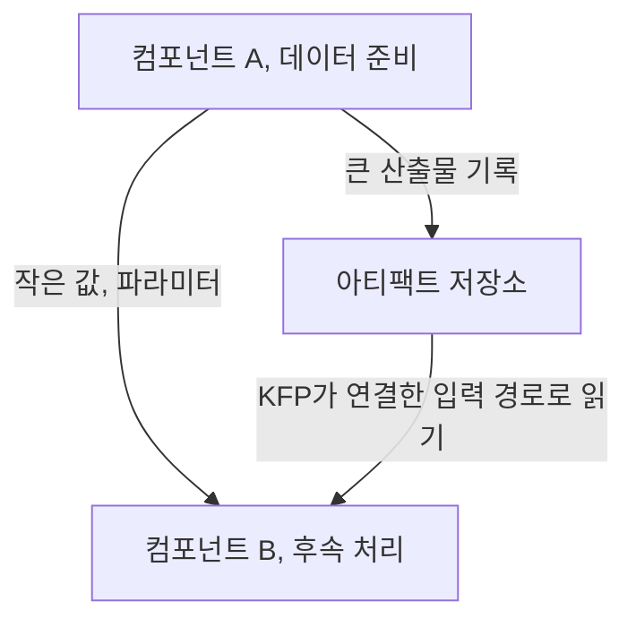

6장은 소득 분류 모델을 서비스로 옮기고 입력 변화를 관측했다. 7장부터는 앞에서 만든 플랫폼을 신분증 탐지와 영화 추천에 적용한다. 새로운 프로젝트에서는 학습 코드보다 먼저 어떤 데이터가 있고, 무엇을 예측하며, 어떤 미지의 사례에서 평가할지 정해야 한다.

이 장은 **노트북에서 발견한 데이터 처리 규칙을 다음 실행에서도 반복할 수 있는 준비 파이프라인으로 옮기는 과정**이다. Kubeflow 노트북의 실행 환경을 마련하고, KFP 컴포넌트 사이의 데이터 전달을 정한 뒤 이미지와 평점 데이터를 각각 검증한다. 탐색, 전달, 품질 검사는 별개의 도구 기능이 아니라 학습이 신뢰할 입력을 얻는 하나의 흐름이다.

## 노트북은 데이터를 이해하는 작업 공간이지 완성된 파이프라인은 아니다

탐색에서는 원본의 형식과 분포를 확인하고, 이미지와 라벨이 맞는지 또는 평점에 어떤 값이 있는지 살펴본다. 이때 찾은 처리 규칙을 노트북 셀에만 남기면 실행 순서와 임시 변수에 의존하게 된다. 먼저 탐색 환경을 재현하고 이후 필요한 처리를 명시적인 컴포넌트로 옮겨야 한다.

Kubeflow 노트북도 이미지, CPU, 메모리, GPU, 볼륨, 네트워크를 사용하는 클러스터 워크로드이다. 브라우저에서 열리는 편리함과 자원, 저장소의 수명은 구분해야 한다.

| 설정 | 왜 중요한가 |
| --- | --- |
| 이미지 | 탐색과 파이프라인의 라이브러리 차이를 줄임 |
| Namespace | 사용 가능한 자원, 설정, 권한의 범위에 영향 |
| Workspace / data volume | 재시작 후 남길 파일과 데이터 접근 경로 결정 |
| PodDefault | 공통 환경 변수나 볼륨 등 구성을 적용 |
| Affinity / toleration | GPU 노드 등 특정 자원의 배치 조건 설정 |

GPU 노트북은 다른 작업의 자원을 점유할 수 있어 유휴 종료와 데이터 영속성을 함께 정한다. toleration은 taint 배제를 허용할 뿐 특정 노드 배치를 보장하지 않는다.

관리자는 노트북 기본값과 이미지 목록을 조정하고 커스텀 이미지를 준비할 수 있다. 같은 이미지는 의존성 차이를 줄여 주지만 데이터와 설정, 숨은 셀 상태가 다르면 결과도 달라진다. 원본 데이터 버전과 탐색에 사용한 설정을 남겨야 이후 파이프라인 결과와 비교할 수 있다.

## 컴포넌트 사이에는 값과 산출물의 전달 계약이 필요하다

노트북에서 확인한 다운로드와 변환, 분할을 KFP 컴포넌트로 옮기면 각 작업은 별도 Pod에서 실행된다. 앞 셀의 Python 객체를 다음 셀이 읽는 방식과 달리 메모리와 로컬 파일을 자동 공유하지 않는다. 출력 파일을 만들었다는 사실만으로 다음 작업이 그 파일을 읽을 수 있는 것은 아니다.

분할 비율이나 데이터 버전처럼 작은 문자열과 숫자는 파라미터로, 데이터셋이나 모델 같은 산출물은 아티팩트로 전달한다. 생산 컴포넌트는 KFP가 관리하는 출력 경로에 기록하고 소비 컴포넌트는 연결된 입력 경로로 읽는다. 그 경로와 URI, 저장소 접근 권한을 함께 확인해야 한다.



| KFP v2 아티팩트 | 담는 것 |
| --- | --- |
| Dataset | 학습, 검증 등에 쓰는 데이터셋 |
| Model | 학습된 모델 산출물 |
| Metrics | 이름과 숫자로 된 평가값 |
| ClassificationMetrics | 혼동행렬 등 분류 평가 정보 |
| HTML / Markdown | 보고서와 사람이 읽을 설명 |
| Artifact | 별도 구체 타입이 없는 일반 산출물 |

아티팩트 타입은 다음 단계에 어떤 산출물을 주는지 나타낸다. 하지만 `Dataset`이라는 이름이 스키마나 라벨의 정확성을 보증하지는 않는다. 전달 계약은 저장 위치를 연결하고 품질 검사는 그 안의 내용이 학습에 적합한지 확인한다. 두 검사가 모두 필요하다.

## 이미지와 평점은 같은 준비 흐름에 다른 검증 기준을 적용한다

두 프로젝트 모두 원본 확보, 변환, 분할, 산출물 저장을 거친다. 차이는 다음 모델이 기대하는 입력의 의미이다. 신분증 탐지는 이미지 안의 대상 위치를, 영화 추천은 사용자와 영화 사이의 평점 관계를 학습하므로 동일한 파일 개수 검사만으로 둘을 검증할 수 없다.

### 객체 탐지에서는 이미지와 라벨을 하나의 표본으로 본다

책은 MIDV-500을 바탕으로 이미지를 준비하고 YOLO가 기대하는 형식으로 정리한다. 데이터 다운로드와 분할을 컴포넌트로 만들어 실행 가능한 흐름으로 묶는다.

YOLO 입력으로 정리할 때는 이미지와 라벨의 대응, 좌표 형식과 범위, 클래스 정의를 확인한다. 라벨 파일이 있어도 다른 이미지의 좌표가 붙었다면 학습 입력은 틀린 것이다. 원본에서 변환한 좌표가 실제 대상 위치와 맞는지 샘플을 시각적으로 확인하는 과정도 필요하다.

train/validation/test 분할에서는 파일 이름이 다른 것과 독립적인 사례인 것을 구분한다. 같은 영상의 유사 프레임이 학습과 평가에 섞이면 이미 본 장면에 가까운 입력으로 성능을 재는 셈이다. 실제 서비스에서 새 문서나 새로운 촬영 조건을 얼마나 잘 처리해야 하는지 정하고, 그 대상에 맞춰 묶음 단위의 분리를 검토한다.

### 추천에서는 식별자와 시간, 평가 대상을 함께 정한다

MovieLens 평점은 다운로드, 압축 해제, Parquet 변환, 분할, 업로드, 품질 확인 단계로 준비한다.

여기서 사용자와 영화 ID는 두 대상을 연결하는 키이고 평점은 학습할 관측값이다. ID의 결측과 중복, 평점의 허용 범위와 타입, 시간의 의미를 확인한다. Parquet로 바꾸면 저장과 읽기 형식이 정리되지만 잘못된 값이나 분할 기준까지 고쳐지는 것은 아니다.

평가하려는 일이 기존 사용자의 미래 행동 예측인지, 처음 보는 사용자에 대한 추천인지에 따라 분할도 달라진다. 시간 순서로 분리하면 미래 기록이 학습에 들어가는 문제를 줄일 수 있지만 신규 사용자 평가를 자동으로 보장하지는 않는다. 전체 데이터로 만든 집계값이나 매핑에도 평가 구간의 정보가 섞이지 않는지 확인해야 한다.

두 프로젝트 모두 준비된 산출물, 로그와 QA 결과로 다음 단계 전달 여부를 판단한다. 이미지에서는 라벨과 분할의 일관성을, 평점에서는 식별자와 시간 기준을 보는 것처럼 학습 목적에 맞는 성공 조건을 둔다.

## 데이터 준비는 실패 조건까지 포함한 실행 계약이다

지금까지 확인한 기준은 한 번의 탐색 결과가 아니라 반복 가능한 계약으로 남겨야 한다. 입력 위치와 원본 버전, 변환 규칙, 분할 기준, 출력 경로와 QA 실패 동작을 명시한다. 컴포넌트화는 숨은 셀 상태를 없애는 데 도움이 되지만 잘못된 처리 규칙도 반복해서 실행할 수 있으므로 검증이 함께 있어야 한다.

운영 데이터에는 타입뿐 아니라 시간의 의미, 식별자의 안정성, 중복과 허용 범위, 개인정보와 변경 통지까지 계약이 필요하다. 생산자가 평점 척도나 ID의 의미를 바꾸면 열 이름이 같아도 기존 모델의 입력으로 그대로 사용할 수 없다.

다음 YAML은 실행 설정이 아닌 데이터 계약 예시다.

```yaml
dataset: movie-ratings
contract_version: "1"
owner_role: data-product-team
required_columns: [user_id, movie_id, rating, timestamp]
checks:
  - identifiers_are_not_null
  - ratings_are_within_agreed_range
  - timestamps_do_not_exceed_snapshot_cutoff
split:
  purpose: estimate_future_recommendation_quality
  strategy: chronological
on_failure:
  action: stop_and_quarantine
  notify_role: data-owner
```

이 YAML은 데이터의 의미와 실패 정책을 설명하는 예시이며 그 자체로 QA를 실행하지는 않는다. 실제 컴포넌트가 허용 범위와 시점, 분할 조건을 검사하고 실패하면 학습으로 넘기지 않아야 한다. 라벨 없는 이미지, 계약에 맞지 않는 ID, 범위 밖 평점을 조용히 버리거나 기본값으로 바꾸면 데이터의 문제가 정상 산출물 안에 숨을 수 있다.

QA 실패 데이터는 학습에서 격리하고 실패 원인과 조사할 자료를 남긴다. 원본을 덮어쓰지 않되 보관 자료의 접근, 보존과 삭제 방침도 정한다. 수정 뒤에는 같은 원본과 설정으로 준비 작업을 재실행하고, 품질 검사와 출력 경로를 다시 확인해야 한다.

7장의 결과는 단순히 다운로드가 끝난 폴더가 아니라 **다음 단계가 의미를 알고 읽을 수 있는 검증된 데이터셋**이다. 탐색에서 찾은 규칙을 컴포넌트의 입력과 출력으로 고정하고, 평가 대상에 맞춰 분할하며, 내용 검사가 실패하면 명시적으로 멈추는 흐름이 된다.

[다음 장](../08-training-and-validation-1/)은 이 신분증 데이터로 YOLO를 학습하고 별도 검증 컴포넌트에서 평가한다. 학습이 정상 종료됐다는 사실이 데이터의 정확성을 거슬러 보증하지는 않는다. 7장에서 정한 라벨과 분할, 데이터 버전이 명확해야 다음 장의 성능 차이도 모델의 변화로 해석할 수 있다.

[이전: 06. 모델의 프로덕션화](../06-productionizing-models/), [시리즈 목차](../), [다음: 08. 학습과 검증 I](../08-training-and-validation-1/)
