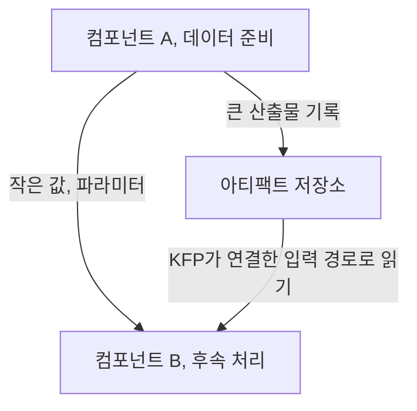

## 먼저, 개인 책상을 공용 작업실로 옮겨 봅시다

혼자 쓸 때 편한 작업 방식이 여러 사람과 큰 재료를 다룰 때도 편하지는 않습니다. 재료를 매번 집으로 옮기는 대신, 보관 장소 가까이에 작업실을 두는 편이 나을 수 있습니다.

Kubeflow 노트북은 데이터와 연산 자원이 있는 클러스터 안에서 탐색하는 작업실입니다. 이 장은 그 탐색을 다른 사람이 재실행할 수 있는 데이터 준비 파이프라인으로 바꿉니다.

## 7.1 데이터 분석

노트북은 브라우저에서 보이지만 실제로는 이미지, CPU, 메모리, GPU, 볼륨과 네트워크가 필요한 워크로드입니다.

| 설정 | 왜 중요한가 |
| --- | --- |
| 이미지 | 탐색과 파이프라인의 라이브러리 차이를 줄임 |
| Namespace | 사용 가능한 자원, 설정, 권한의 범위에 영향 |
| Workspace / data volume | 재시작 후 남길 파일과 데이터 접근 경로 결정 |
| PodDefault | 공통 환경 변수나 볼륨 등 구성을 적용 |
| Affinity / toleration | GPU 노드 등 특정 자원의 배치 조건 설정 |

GPU를 할당한 노트북을 켜 놓으면 다른 작업이 쓰지 못할 수 있습니다. 유휴 종료 정책과 데이터 영속성을 함께 생각해야 합니다. 또한 toleration은 taint에 의한 배제 조건을 허용할 뿐, 특정 노드에 반드시 배치한다는 보장은 아닙니다.

책은 관리자가 노트북 UI의 기본값과 이미지 목록을 조정하고, 필요한 계층을 갖춘 커스텀 이미지를 준비하는 방법도 다룹니다. 노트북과 파이프라인의 환경 차이를 줄이되, 같은 이미지만으로 재현성이 완성되지는 않는다는 점을 기억합니다.

## 7.2 데이터 전달

KFP 컴포넌트는 서로 다른 Pod에서 실행됩니다. 앞 단계의 Python 객체나 로컬 파일을 뒤 단계에서 당연히 볼 수는 없습니다.

문자열, 숫자 같은 작은 값은 파라미터로 전달하고, 데이터셋, 모델처럼 큰 산출물은 파일이나 저장소를 이용한 아티팩트로 전달하는 식으로 구분합니다. KFP가 관리하는 입력, 출력 경로와 URI의 연결을 이해해야 합니다.



| KFP v2 아티팩트 | 담는 것 |
| --- | --- |
| Dataset | 학습, 검증 등에 쓰는 데이터셋 |
| Model | 학습된 모델 산출물 |
| Metrics | 이름과 숫자로 된 평가값 |
| ClassificationMetrics | 혼동행렬 등 분류 평가 정보 |
| HTML / Markdown | 보고서와 사람이 읽을 설명 |
| Artifact | 별도 구체 타입이 없는 일반 산출물 |

타입을 붙이면 의도를 드러낼 수 있지만, 데이터 내용의 정확성까지 검증해 주지는 않습니다. `Dataset`이라는 이름의 파일에도 잘못된 스키마가 들어갈 수 있습니다.

## 7.3 데이터 준비의 실제

### 7.3.1 객체 탐지 데이터 준비

책은 MIDV-500을 바탕으로 이미지를 준비하고 YOLO가 기대하는 형식으로 정리합니다. 데이터 다운로드와 분할을 컴포넌트로 만들어 실행 가능한 흐름으로 묶습니다.

핵심은 이미지와 라벨의 대응, 좌표 형식, 학습, 검증, 테스트 분할입니다. 파일 개수만 맞는다고 올바른 데이터가 되는 것은 아닙니다.

북클럽에서 확장해 볼 중요한 점은 분할 단위입니다. 같은 영상의 비슷한 프레임이 학습과 테스트에 섞이면 평가가 쉬워질 수 있습니다. 실제 서비스에서 마주칠 독립적인 대상을 기준으로 분할했는지 원문 코드와 함께 점검해 보세요.

### 7.3.2 영화 추천 데이터 준비

영화 추천에서는 MovieLens 평점 데이터를 다룹니다. 책은 다운로드, 압축 해제, Parquet 변환, 분할, 업로드, 품질 확인을 나누어 구성합니다.

이미지의 좌표와 라벨 대신 사용자, 영화 식별자, 평점과 데이터 타입이 주요 관심사가 됩니다. Parquet은 표 데이터 처리에 유용하지만, 파일 형식을 바꾸는 것만으로 올바른 분할과 데이터 품질이 생기지는 않습니다.

두 프로젝트의 공통점은 데이터 준비 결과를 명확한 산출물로 남기고, 로그와 QA를 통해 다음 단계로 넘겨도 되는지 확인한다는 것입니다.

## 실무 적용: 스키마 검사만으로 데이터 계약은 완성되지 않습니다

운영 데이터에는 타입뿐 아니라 시간의 의미, 식별자의 안정성, 중복, 허용 범위, 개인정보와 변경 통지까지 계약이 필요하다.

데이터 계약에 들어갈 항목을 YAML로 표현하면 다음과 같다. 실행 설정이 아니라 합의할 내용을 나타낸다.

```yaml
dataset: movie-ratings
contract_version: "1"
owner_role: data-product-team
required_columns: [user_id, movie_id, rating, timestamp]
checks:
  - identifiers_are_not_null
  - ratings_are_within_agreed_range
  - timestamps_do_not_exceed_snapshot_cutoff
split:
  purpose: estimate_future_recommendation_quality
  strategy: chronological
on_failure:
  action: stop_and_quarantine
  notify_role: data-owner
```

시간 순서 분할도 만능은 아닙니다. 신규 사용자에 대한 추천과 기존 사용자의 미래 행동 예측에서는 확인해야 할 조건이 다릅니다.

이미지에서는 같은 문서, 영상, 사람에서 나온 유사 샘플의 혼입을, 추천에서는 미래의 행동이나 집계값의 혼입을 주의합니다. 실제 서비스에서 미지의 대상이 되는 단위와 시간을 먼저 정의하고, 이를 재현하는 분할을 만드는 것이 원칙입니다.

QA에 실패한 데이터는 후속 학습에 섞지 않고 원인을 조사할 수 있는 형태로 격리합니다. 격리한 자료에도 민감한 정보가 남을 수 있으므로 접근 권한과 보존, 삭제 방침이 필요합니다. 원본 데이터를 임의로 덮어써 수정하면 장애 조사와 재현이 어려워집니다.

## 컨설팅 관점: 데이터 품질의 책임과 비용을 가시화합니다

고객의 데이터 생산, 가공, 학습 담당자를 함께 모아 스키마 변경이 어떻게 전달되는지 확인합니다. 라벨링 품질도 추상적인 “정확도”가 아니라 누가 어떤 기준으로 검수하고 불일치를 해결하는지 묻습니다.

산출물은 데이터 계약, 분할, 누수 검토서, 품질 실패 분류표, 데이터 변경 통지, 승인 절차입니다. 책의 작은 QA를 고객의 모든 품질 요구를 충족하는 것으로 제시해서는 안 됩니다.

인수에서는 결측, 잘못된 라벨, 미래 시점, 중복 샘플을 넣은 합성 사례로 검사를 확인합니다. 정상 데이터 통과율뿐 아니라 잘못된 데이터가 실제로 차단되고 담당자에게 연결되는지 증거를 남깁니다.

## 데이터 준비가 실패해야 하는 경우

입력 위치, 스키마, 식별자, 분할 기준과 출력 경로뿐 아니라 실행을 중단할 조건도 정해야 한다.

라벨 없는 이미지, 정의되지 않은 사용자 ID, 허용 범위를 벗어난 평점이 그 예다. QA가 실패하면 원인 조사를 위해 무엇을 보관하고 어디서 중단할지도 필요하다.

## 북클럽 토론

Q. 노트북에서 전처리가 끝났는데 왜 컴포넌트로 바꿀까요?

실행 순서, 입력, 의존성과 결과를 명시해 재실행과 검증을 가능하게 하기 위해서입니다. 숨은 셀 상태에 의존하는 탐색과 운영 절차는 목적이 다릅니다.

Q. 파일 경로 문자열만 넘기면 큰 데이터 전달이 해결되나요?

그 경로를 다음 Pod가 읽을 수 있는 저장소와 권한이 있어야 합니다. KFP의 아티팩트 전달인지 공유 볼륨인지 구분해야 합니다.

자주 빠지는 함정: 학습이 시작되었다는 이유로 데이터 준비가 옳았다고 결론짓거나, 두 프로젝트에 같은 분할 전략을 무조건 적용하는 것입니다.

## 한 줄 정리

데이터 준비는 파일을 옮기는 작업이 아니라, 다음 단계가 믿고 사용할 데이터의 의미, 형식, 경계를 만드는 작업입니다.

[이전: 06. 모델의 프로덕션화](../06-productionizing-models/), [시리즈 목차](../), [다음: 08. 학습과 검증 I](../08-training-and-validation-1/)
