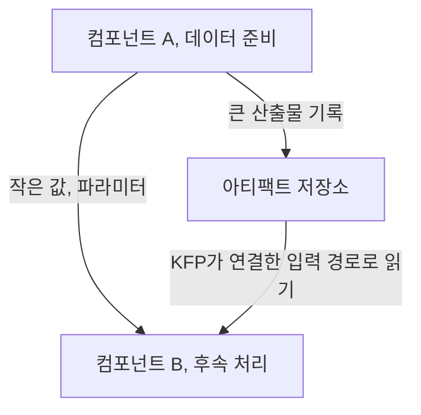

7장부터는 앞에서 만든 플랫폼을 신분증 탐지와 영화 추천에 적용한다. Kubeflow 노트북에서 데이터를 살피는 데서 시작하지만, 중요한 것은 탐색 결과를 **다음 학습에서도 반복할 수 있는 준비 작업**으로 옮기는 부분이다. 노트북이 클러스터에서 돈다고 저장 공간과 데이터 전달까지 해결되는 것은 아니다.

## 7.1 데이터 분석

노트북도 이미지, CPU, 메모리, GPU, 볼륨, 네트워크를 쓰는 워크로드다.

| 설정 | 왜 중요한가 |
| --- | --- |
| 이미지 | 탐색과 파이프라인의 라이브러리 차이를 줄임 |
| Namespace | 사용 가능한 자원, 설정, 권한의 범위에 영향 |
| Workspace / data volume | 재시작 후 남길 파일과 데이터 접근 경로 결정 |
| PodDefault | 공통 환경 변수나 볼륨 등 구성을 적용 |
| Affinity / toleration | GPU 노드 등 특정 자원의 배치 조건 설정 |

GPU 노트북은 다른 작업의 자원을 점유할 수 있어 유휴 종료와 데이터 영속성을 함께 정한다. toleration은 taint 배제를 허용할 뿐 특정 노드 배치를 보장하지 않는다.

관리자는 노트북 기본값, 이미지 목록을 조정하고 커스텀 이미지를 준비할 수 있다. 같은 이미지를 써도 데이터와 설정이 다르면 재현성은 보장되지 않는다.

## 7.2 데이터 전달

KFP 컴포넌트는 별도 Pod에서 실행되므로 Python 객체와 로컬 파일을 자동 공유하지 않는다.

문자열, 숫자는 파라미터로, 데이터셋, 모델은 아티팩트로 전달한다. KFP의 입력, 출력 경로와 URI 연결을 확인한다.



| KFP v2 아티팩트 | 담는 것 |
| --- | --- |
| Dataset | 학습, 검증 등에 쓰는 데이터셋 |
| Model | 학습된 모델 산출물 |
| Metrics | 이름과 숫자로 된 평가값 |
| ClassificationMetrics | 혼동행렬 등 분류 평가 정보 |
| HTML / Markdown | 보고서와 사람이 읽을 설명 |
| Artifact | 별도 구체 타입이 없는 일반 산출물 |

아티팩트 타입은 의도를 나타낼 뿐 내용을 검증하지 않는다. `Dataset`에도 잘못된 스키마가 들어갈 수 있다.

## 7.3 데이터 준비의 실제

### 7.3.1 객체 탐지 데이터 준비

책은 MIDV-500을 바탕으로 이미지를 준비하고 YOLO가 기대하는 형식으로 정리한다. 데이터 다운로드와 분할을 컴포넌트로 만들어 실행 가능한 흐름으로 묶는다.

이미지, 라벨 대응과 좌표, train/validation/test 분할을 검증한다. 파일 개수만으로 데이터 정확성을 판단할 수 없다.

같은 영상의 유사 프레임이 train/test에 섞이면 평가가 쉬워진다. 실제 서비스의 미지 대상에 맞춰 분리한다.

### 7.3.2 영화 추천 데이터 준비

MovieLens 평점은 다운로드, 압축 해제, Parquet 변환, 분할, 업로드, 품질 확인 단계로 준비한다.

추천 데이터는 사용자, 영화 ID, 평점, 타입을 검증한다. Parquet 변환만으로 분할이나 품질이 보장되지는 않는다.

두 프로젝트 모두 산출물, 로그, QA로 다음 단계 전달 여부를 판단한다.

## 스키마 외에 필요한 데이터 조건

운영 데이터에는 타입뿐 아니라 시간의 의미, 식별자의 안정성, 중복, 허용 범위, 개인정보와 변경 통지까지 계약이 필요하다.

다음 YAML은 실행 설정이 아닌 데이터 계약 예시다.

```yaml
dataset: movie-ratings
contract_version: "1"
owner_role: data-product-team
required_columns: [user_id, movie_id, rating, timestamp]
checks:
  - identifiers_are_not_null
  - ratings_are_within_agreed_range
  - timestamps_do_not_exceed_snapshot_cutoff
split:
  purpose: estimate_future_recommendation_quality
  strategy: chronological
on_failure:
  action: stop_and_quarantine
  notify_role: data-owner
```

시간 순서 분할도 만능은 아니다. 신규 사용자에 대한 추천과 기존 사용자의 미래 행동 예측에서는 확인해야 할 조건이 다르다.

이미지는 동일 문서, 영상, 사람의 유사 샘플, 추천은 미래 행동, 집계값 누수를 경계한다. 미지 대상과 시점을 정의해 분할한다.

QA 실패 데이터는 학습에서 격리하고 접근, 보존, 삭제 방침을 정한다. 원본을 덮어쓰면 장애 조사와 재현이 어려워진다.

## 데이터 준비가 실패해야 하는 경우

입력 위치, 스키마, 식별자, 분할 기준과 출력 경로뿐 아니라 실행을 중단할 조건도 정해야 한다.

라벨 없는 이미지, 미정의 사용자 ID, 범위 밖 평점이 실패 사례다. 보관할 조사 자료와 중단 지점도 정한다.

## 데이터 준비의 실행 계약

### 노트북 전처리의 컴포넌트화

컴포넌트는 순서, 입력, 의존성, 출력을 명시해 재실행을 돕는다. 숨은 셀 상태의 탐색과 운영은 구분한다.

### 파일 경로와 저장소 접근성

그 경로를 다음 Pod가 읽을 수 있는 저장소와 권한이 있어야 한다. KFP의 아티팩트 전달인지 공유 볼륨인지 구분해야 한다.

학습 성공이 데이터 정확성을 보장하지 않는다. 이미지와 평점은 평가 대상에 맞춰 분할, 검증한다.

## 마치며

다음 단계의 데이터 의미, 형식, 시간 기준과 위치를 명시해야 학습과 평가를 신뢰할 수 있다.

[이전: 06. 모델의 프로덕션화](../06-productionizing-models/), [시리즈 목차](../), [다음: 08. 학습과 검증 I](../08-training-and-validation-1/)
