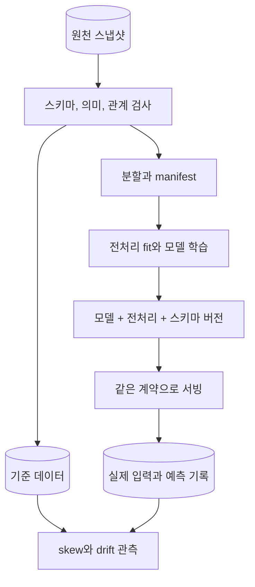

7장부터 플랫폼에 신분증 탐지와 영화 추천이라는 새 프로젝트가 올라간다. 새 프로젝트에서 먼저 정할 것은 학습 코드보다 데이터의 의미, 예측 대상, 평가에 쓸 낯선 사례다. 이 장은 노트북에서 찾은 처리 규칙을 매번 똑같이 반복되는 준비 파이프라인으로 옮기고, 그 결과를 학습과 서빙이 같은 의미로 읽게 만드는 문제를 다룬다.

## 노트북에서 데이터의 의미를 정한다 {#notebook-concepts}

탐색의 목적은 그래프보다 정의에 있다. 표본 하나가 무엇인지, 정답은 어떻게 만들어졌는지, 빈칸은 무엇을 뜻하는지를 정해야 한다. 평점이 비어 있다고 낮은 점수를 준 것은 아니고, 라벨 없는 이미지는 진짜 배경 사진일 수도 주석이 빠진 것일 수도 있다. 정규화나 범주 사전처럼 데이터에서 계산하는 규칙은 학습 분할로만 fit해야 검증과 테스트의 정보가 학습에 새지 않는다.

Kubeflow Notebooks는 이 탐색을 데이터와 가까운 클러스터에서 돌린다. 관리자가 쓸 수 있는 이미지와 자원 범위를 정하고, 개발자는 그 안에서 이미지, CPU와 메모리, workspace와 data volume을 골라 Notebook 리소스로 선언한다. 커널 메모리, Pod의 임시 파일, 영속 볼륨은 수명이 다르다. Pod가 바뀌면 메모리의 DataFrame은 사라지고, 셀에서 설치한 패키지도 이미지에 남지 않는다. 탐색 결과를 다른 실행으로 넘기려면 의존성과 규칙을 코드로 남겨야 한다.

## 탐색 규칙을 컴포넌트의 입력과 출력으로 고정한다 {#pipeline-data-concepts}

노트북 셀은 메모리를 공유하지만 파이프라인 작업은 각자 다른 Pod에서 돈다. 컴포넌트는 입력, 출력, 실행 환경을 인터페이스로 못 박고, KFP는 작은 값은 파라미터로, 데이터셋과 모델 같은 산출물은 아티팩트로 넘긴다. 아티팩트에는 저장 위치 `.uri`, 작업 안에서 읽고 쓸 로컬 경로 `.path`, 부가 정보 `.metadata`가 붙는다. 앞 작업이 `output.path`에 파일을 쓰면 런타임이 저장소에 올리고, 다음 작업은 자기 `input.path`에서 그 내용을 읽는다.

경계는 분명하다. 출력 경로가 아닌 곳에 쓴 파일은 옮겨지지 않는다. S3 URI를 문자열 파라미터로 넘기면 KFP는 파일로 추적하지 않는다. `Dataset` 타입은 lineage와 화면 표시에 쓰일 뿐 열 이름이나 값 범위를 검사하지 않는다. 같은 URI의 내용이 바뀌어도 입력 식별자가 그대로면 캐시가 오래된 결과를 돌려준다.

그림 7-1. 파이프라인 정의와 작업 아티팩트의 객체 저장소 설정. 출처: [Kubeflow 공식 도식](https://github.com/kubeflow/website/blob/796db696b45fd48ef5fe0ab20e82217a322529b2/content/en/docs/components/pipelines/operator-guides/images/kfp-obj-store-configurations.png), [CC BY 4.0](https://creativecommons.org/licenses/by/4.0/). 원본 도식을 변경 없이 사용했다.

컴포넌트 작성 방식은 세 가지다. Lightweight Python 컴포넌트는 함수 코드만 추출해 실행 시 패키지를 설치하고, Containerized Python 컴포넌트는 코드와 의존성을 이미지로 미리 빌드하며, Container 컴포넌트는 준비된 이미지의 명령을 그대로 연결한다. 앞의 것일수록 간단하지만 시작할 때마다 설치 시간과 네트워크가 실행 조건에 끼어든다.

그림 7-2. KFP 공식 예제의 평가 지표 비교 화면. 출처: [Kubeflow run comparison 이미지](https://github.com/kubeflow/website/blob/796db696b45fd48ef5fe0ab20e82217a322529b2/content/en/docs/images/pipelines/v2/run-comparison/scalar-metrics.png), [CC BY 4.0](https://creativecommons.org/licenses/by/4.0/). 이 글의 탐지나 추천 모델에서 측정한 점수가 아니다.

## 모델이 배울 관계에 맞춰 데이터와 분할을 검증한다 {#dataset-concepts}

탐지와 추천은 비슷한 다운로드와 분할 과정을 거치지만 지켜야 할 관계가 다르다. 탐지에서는 이미지와 YOLO 라벨 파일이 같은 stem으로 짝을 이루고, 라벨 한 행은 클래스 ID와 이미지 크기로 정규화한 박스 중심, 너비, 높이다. 책의 컴포넌트는 이미 YOLO 형식으로 정리된 데이터를 전제로 해서 주석을 변환하지 않는다. 엉뚱한 이미지와 라벨이 짝지어져도 작업은 성공하고 정답만 틀린다.

추천에서 MovieLens 평점은 사용자가 영화에 남긴 명시적 피드백이다. `rating`은 0.5~5.0의 반점 단위, `timestamp`는 UTC 기준 Unix 초이고, 관측되지 않은 조합을 낮은 평점으로 볼 수는 없다. 책은 CSV를 Parquet으로 바꾸는데, 형식 변환은 타입과 열 단위 읽기에 유리하지만 잘못된 값이나 중복을 고치지는 않는다.

책의 75/15/10 무작위 분할은 파일을 세 산출물로 나누는 예제로 읽어야 한다. 같은 문서를 여러 번 찍은 사진이나 같은 영상의 프레임은 독립 표본이 아니므로 문서나 영상 단위로 나누는 편이 맞고, 추천에서 미래 행동을 평가하려면 시간으로 나눠야 한다. 시드를 고정해도 잘못된 평가 설계는 그대로 남는다.

QA도 같은 눈으로 봐야 한다. 저자 코드의 train QA는 열 수와 최소 행 수만 확인하고, 평점 범위나 ID 관계, 다른 분할은 검사하지 않는다. **파이프라인의 초록색 성공 표시는 구현한 검사가 끝났다는 뜻이다.** 데이터 오류는 학습 실패로 드러나지 않는 경우가 많아서, 기대 조건을 준비 단계에서 적고 검사해야 나중의 점수를 설명할 수 있다.

## 데이터 준비와 서빙을 잇는 계약 {#training-serving-contract}

준비 단계의 출력은 학습 코드만 읽는 파일이 아니다. 서비스는 같은 의미의 입력을 만들어야 하고, 관측 작업은 그 입력을 맞는 기준과 비교해야 한다. 그래서 원천 스냅샷, 스키마와 단위, 분할 manifest, 학습에서 fit한 전처리, QA 결과를 버전으로 묶어 남긴다. `latest` 경로에 덮어쓰거나 seed 하나만 저장하면 이 관계를 되살릴 수 없다.

검사 목적은 셋으로 나뉜다. 스키마와 의미 위반은 `rating`이 문자열이거나 좌표 단위가 틀린 경우처럼 합의한 형식을 어긴 것이다. Training-serving skew는 학습은 UTC 초를, 서비스는 밀리초를 쓰는 것처럼 두 경로가 다른 입력을 만드는 것이다. Drift는 같은 의미로 측정한 데이터의 분포가 시간에 따라 달라진 것이다. 분포 차이가 보이면 계약과 생성 경로가 같은지부터 확인해야 원인을 가를 수 있다.

변환은 학습 때 fit한 것을 검증, 테스트, 서빙에 그대로 적용한다. 6장의 단일 요청 원-핫 인코딩 문제가 이 조건을 어긴 사례다. 피처 저장소를 쓴다면 조회 시점도 계약에 들어간다. 준비 단계의 통계는 [6장의 관측 구조](/docs/tech/machine-learning-platform-engineering/06-productionizing-models/#production-monitoring)에서 reference가 되므로, 인코딩 전후 중 어떤 표현을 비교할지도 여기서 정한다. 스키마 위반이나 이미지와 라벨의 불일치는 재시도로 고쳐지지 않으니 학습 전에 멈추는 것이 맞다.

## 정리

7장이 만드는 것은 다음 단계가 의미를 알고 읽을 수 있는 데이터셋이다. 아티팩트 전달은 파일을 옮기는 장치이고, 내용이 맞는지는 도메인 검사와 버전 기록이 보증한다. 원천, 라벨, 분할, 전처리의 연결이 분명해야 8장 이후의 성능 차이를 모델의 변화로 읽을 수 있다.

## 실습 {#book-ch07-sop}

책 코드로 직접 실행한 순서와 결과 화면은 [7장 실습 기록](/docs/tech/machine-learning-platform-engineering/practice/ch07/)에 따로 모았다.

## 참고 자료

- [TensorFlow Data Validation의 시작 안내](https://www.tensorflow.org/tfx/data_validation/get_started): 스키마 검증, training-serving skew와 drift의 구분.
- [KFP 아티팩트 전달](https://www.kubeflow.org/docs/components/pipelines/user-guides/data-handling/artifacts/): 타입, 경로와 메타데이터의 역할.
- [YOLO 탐지 데이터 형식](https://docs.ultralytics.com/datasets/detect/): 클래스와 정규화 박스 좌표.
- [MovieLens 25M 데이터 설명](https://files.grouplens.org/datasets/movielens/ml-25m-README.html): ID, 평점과 시간 필드의 의미.
- [영화 데이터 준비 컴포넌트](https://github.com/practical-mlops/movie-recommender-project/blob/4e0a808e0dca3aef16850cd14df47d2fda9f9bd2/data_components/dataset_preparation.py): 변환, 분할, 업로드와 실제 QA 범위.

[이전: 06. 모델을 프로덕션으로](/docs/tech/machine-learning-platform-engineering/06-productionizing-models/), [시리즈 목차](/docs/tech/machine-learning-platform-engineering/)
