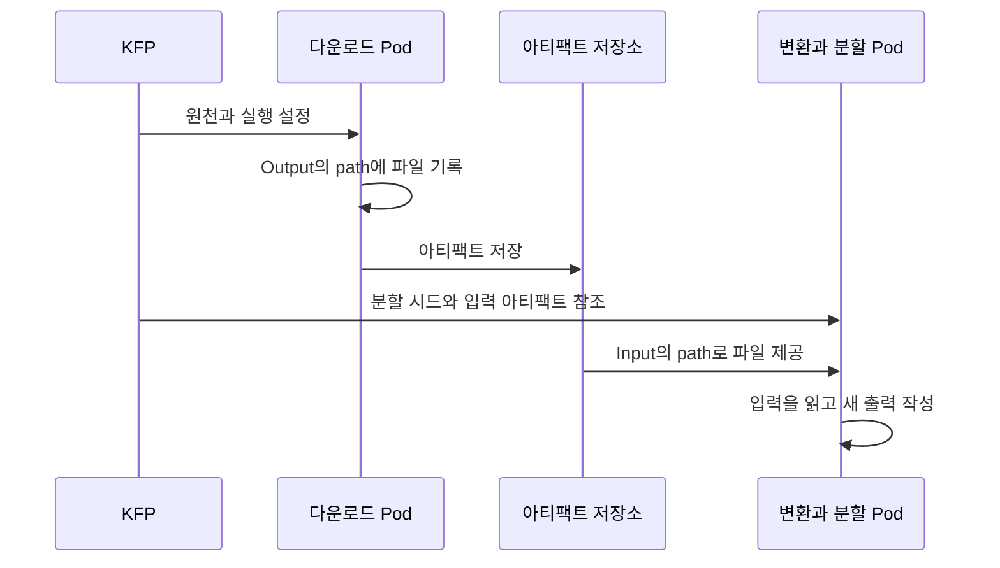
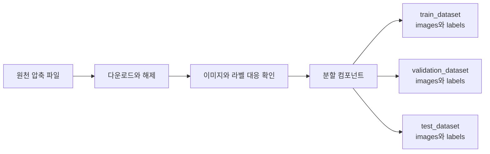
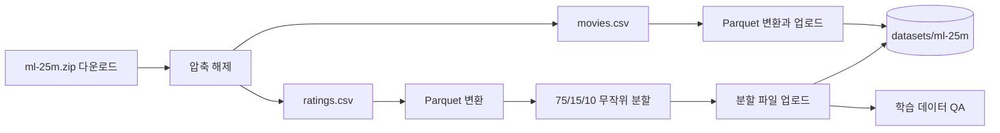

4~5장에서는 준비된 소득 데이터와 모델을 연결했고, 6장에서는 이를 API로 바꿨다. 7장부터는 신분증 탐지와 영화 추천에 사용할 데이터를 준비한다. **파일을 내려받는 것, 다음 Pod로 전달하는 것, 학습에 써도 되는지 확인하는 것은 다른 단계**다.

앞 글의 준비, 실행 흐름, 산출물 확인 순서에 맞춰 두 프로젝트를 읽었다. 여기서는 저자 저장소의 데이터 준비 코드와 확인 항목을 정리하며, 새 환경을 설치하거나 전체 데이터 다운로드와 파이프라인 실행을 완료한 결과로 쓰지는 않는다.

## 실습 순서 {#book-ch07-sop}

| 구간 | 확인할 것 |
| --- | --- |
| A. 실행 환경 | 로컬 JupyterLab과 Kubeflow Notebooks의 차이, 별도 컴파일 환경 |
| B. 데이터 전달 | 파라미터, KFP 아티팩트, 공유 볼륨의 경계 |
| C. 신분증 데이터 | 원천 압축 파일, 이미지와 라벨의 대응, 분할 산출물 |
| D. 영화 평점 데이터 | CSV와 Parquet, 스키마, 분할, S3 저장과 QA |
| E. 다음 단계 전달 | 고정한 원천과 코드, 검사 결과, 실패 시 중단 위치 |

책의 예제는 노트북에서 데이터를 살피는 일과 컴포넌트로 다시 실행하는 일을 연결한다. 노트북에서 성공한 셀만 복사하기보다 입력과 결과, 실패 조건을 명시하는 부분을 중심으로 보면 된다.

## A. 노트북과 파이프라인의 실행 환경

### A-1. 앞 장의 환경에서 이어가는 범위

[4~5장](../04-experiments-features-pipelines/)의 JupyterLab은 PC에서 실행한 개발 환경이다. kind에는 KFP standalone을 설치했으므로 Kubeflow 대시보드의 Notebooks 메뉴나 Notebook Controller가 자동으로 생기지 않는다.

| 구분 | PC의 JupyterLab | Kubeflow Notebooks |
| --- | --- | --- |
| 실행 위치 | PC의 Python 프로세스 | 클러스터의 Notebook Pod |
| 환경 | 로컬 가상환경 | Notebook 이미지 |
| 파일 | PC의 작업 폴더 | 연결한 볼륨 또는 Pod의 임시 공간 |
| 서비스 접속 | localhost 포트포워딩 | 클러스터 DNS와 권한 |
| 자원 | PC의 CPU, 메모리, GPU | Pod의 요청량과 제한, 노드 배치 |

책처럼 Kubeflow Notebooks를 쓰려면 해당 구성 요소를 별도로 설치해야 한다. 이 글의 코드를 읽고 컴파일하는 데는 PC의 별도 Python 환경을 사용할 수 있다. 이 차이를 구분해야 4장의 localhost 설정을 Notebook Pod에 그대로 넣는 실수를 피할 수 있다.

### A-2. 노트북을 만들 때 정하는 것

Kubeflow 노트북은 브라우저 화면이 아니라 자원과 저장소를 사용하는 워크로드다.

| 설정 | 확인할 내용 |
| --- | --- |
| 이미지 | Python, 데이터 라이브러리, OS 의존성과 버전 |
| Namespace | 서비스 계정, 네트워크 접근과 자원 할당 범위 |
| Workspace volume | 노트북 재시작 뒤에도 남길 코드와 작업 파일 |
| Data volume | 여러 작업이 읽을 데이터와 읽기·쓰기 권한 |
| PodDefault | 해당 설정을 적용하는 구성에서 공통 환경과 볼륨 주입 |
| Affinity / toleration | 자원에 맞는 노드 선택과 taint 허용 |
| GPU와 유휴 종료 | 탐색에 필요한 자원과 사용하지 않을 때 반환할 정책 |

toleration은 특정 taint를 허용할 뿐 해당 노드에 반드시 배치하라는 조건은 아니다. 같은 이미지를 쓰더라도 데이터 버전, 설정과 숨은 셀 상태가 다르면 같은 결과가 나오지 않는다.

### A-3. 저자 코드의 위치와 컴파일 환경

7장의 두 프로젝트는 하나의 `chapter-7` 저장소가 아니라 다음 저장소에 나뉘어 있다.

| 프로젝트 | 기준 커밋 | 데이터 준비 진입점 |
| --- | --- | --- |
| [object-detection-project](https://github.com/practical-mlops/object-detection-project/tree/c6afb114e628e776a76f9ac50b45899aff5e8eaf) | `c6afb114`, 2025-01-02 | `data_prep_pipeline.py` |
| [movie-recommender-project](https://github.com/practical-mlops/movie-recommender-project/tree/4e0a808e0dca3aef16850cd14df47d2fda9f9bd2) | `4e0a808e`, 2025-04-18 | `01_data_preparation_pipeline.py` |

`ml-platform-book-env` 최상위 폴더에서 코드를 받는다.

```powershell
git clone https://github.com/practical-mlops/object-detection-project.git upstream\object-detection-project
git -C upstream\object-detection-project checkout c6afb114e628e776a76f9ac50b45899aff5e8eaf
git clone https://github.com/practical-mlops/movie-recommender-project.git upstream\movie-recommender-project
git -C upstream\movie-recommender-project checkout 4e0a808e0dca3aef16850cd14df47d2fda9f9bd2
```

영화 추천 저장소의 requirements는 KFP 2.11.0, 객체 탐지 쪽은 `kfp>=2.0.0`이다. 앞 글의 `.venv-book`은 KFP 2.9.0이므로 덮어쓰지 않고 컴파일 환경을 따로 둔다.

```powershell
uv venv .venv-ch07 --python 3.11
uv pip install --python .venv-ch07 kfp==2.11.0
.\.venv-ch07\Scripts\Activate.ps1
```

이 환경은 파이프라인 정의를 읽어 YAML로 바꾸는 용도다. 컴포넌트의 `packages_to_install`은 실제 작업 Pod에서 설치할 의존성이며, PC에 KFP를 설치했다고 다운로드·변환 작업의 환경까지 고정된 것은 아니다.

## B. 다음 Pod에 데이터를 넘기는 방법

### B-1. 파라미터와 아티팩트

5장처럼 KFP 컴포넌트는 서로 다른 Pod에서 실행된다. 앞 셀의 DataFrame이나 앞 Pod의 `/tmp` 경로는 다음 작업에 자동으로 공유되지 않는다.



| 전달 방식 | 적합한 것 | 확인할 조건 |
| --- | --- | --- |
| 파라미터 | seed, 버킷 이름, 원천 버전 같은 작은 설정 | 값의 타입과 의미 |
| KFP 아티팩트 | 데이터셋, 파일 묶음, 모델, 평가 보고서 | 선언한 출력 경로에 실제 파일을 썼는지 |
| S3 URI | 장기 보관할 업무 데이터의 위치 | 다음 작업의 주소, 권한과 객체 버전 |
| 공유 볼륨 | 명시적으로 마운트한 공통 파일 | PVC, 접근 모드, 마운트 경로와 동시 쓰기 |

`Input[Dataset]`은 입력의 의도를 나타낼 뿐 CSV 열이나 YOLO 라벨을 검증하지 않는다. `Artifact`로 선언해도 데이터 파일을 전달할 수 있지만 구체적인 내용 검사는 코드의 책임이다.

### B-2. KFP 경로와 업무용 저장 위치

KFP가 정한 `output.path`와 `s3://datasets/ml-25m/train.parquet.gzip`은 같은 역할의 경로가 아니다. 전자는 실행 사이의 산출물 연결이고, 후자는 코드가 별도로 정한 장기 보관 위치다.

사용자가 임의의 로컬 경로 문자열을 반환하면 KFP가 그 폴더를 자동으로 아티팩트로 수집한다고 볼 수 없다. 출력 타입과 경로, 디렉터리 내부 파일을 함께 확인한다.

## C. 신분증 탐지 데이터 준비

### C-1. 실제 진입점과 데이터 구조

객체 탐지 저장소의 루트 `data_prep_pipeline.py`에는 다운로드, 분할, 파일 목록 출력 컴포넌트가 함께 정의되어 있다. `data_preparation` 폴더에는 `/mnt/pipeline`을 사용하는 별도 코드도 있으므로 두 경로를 섞지 않는다.



MIDV-500 기반 프로젝트라는 설명과 실제 다운로드 파일의 상태도 나눠 봐야 한다. 이 진입점은 배포된 압축 파일을 받아 분할하며, 원천 MIDV 주석을 YOLO 형식으로 바꾸는 변환을 자동으로 실행하지 않는다. 입력에 이미 기대한 이미지·라벨 구조가 있는지 확인해야 한다.

코드는 `DATASET\MINIDATA\images`와 `labels`를 찾고, 다른 스크립트는 `DATA`를 사용한다. 다운로드한 압축 내부의 실제 경로와 선택한 진입점이 맞는지 먼저 본다.

### C-2. 분할 전에 확인할 이미지와 라벨

| 검사 | 확인 방법 |
| --- | --- |
| 파일 대응 | 이미지와 라벨을 파일명 stem으로 연결 |
| 중복과 누락 | 중복 stem, 라벨 없는 이미지, 이미지 없는 라벨 탐지 |
| 라벨 형식 | 클래스 ID와 좌표 항목의 개수, 타입 확인 |
| 좌표 의미 | YOLO의 정규화된 중심 좌표와 너비·높이인지 확인 |
| 데이터 단위 | 문서, 사람, 촬영 영상 등 동일 원천의 그룹 기록 |
| 샘플 표시 | 이미지 위에 박스를 그려 위치와 클래스 확인 |

루트 분할 코드는 이미지 목록과 라벨 목록을 별도의 `glob`으로 만든 뒤 함께 `train_test_split`에 넘긴다. 이때 두 목록의 같은 위치가 같은 샘플이라는 보장은 없다. 파일 수가 같아도 라벨이 다른 이미지와 연결될 수 있으므로, 이름으로 짝을 만들고 누락을 검사한 목록을 분할해야 한다.

YOLO 박스가 정규화 형식이면 클래스 ID, 중심 x·y, 너비·높이의 의미와 범위를 확인한다. 좌상단·우하단 좌표를 그대로 넣거나 픽셀 값을 정규화 값처럼 다루면 학습은 실행되어도 다른 박스를 배우게 된다.

### C-3. 분할과 컴파일

원본은 학습 75%, 검증 15%, 테스트 10%를 목표로 무작위 분할한다. 작은 데이터에서는 정수 반올림 때문에 정확한 행 수 비율이 달라질 수 있다.

같은 촬영 영상의 인접 프레임이나 같은 문서의 유사 이미지가 서로 다른 분할에 들어가면 평가가 쉬워진다. 같은 그룹이 한 분할에만 들어가야 하는지 먼저 정하고, 필요한 경우 그룹 단위 분할로 바꾼다.

컴파일 진입점은 다음과 같다. 명령은 A-3의 환경에서 실행한다.

```powershell
Push-Location .\upstream\object-detection-project
python .\data_prep_pipeline.py
Get-Item .\dataprep_pipeline.yaml
Pop-Location
```

여기서 YAML이 생성되어도 데이터가 다운로드된 것은 아니다. 실제 다운로드와 분할은 클러스터에서 파이프라인을 실행할 때 발생한다.

원본의 파일 목록 출력 작업은 `train_dataset`만 읽는다. 학습 목록이 출력됐다는 사실로 검증·테스트의 내용까지 확인한 것으로 보지 않는다. 세 아티팩트 각각의 이미지·라벨 대응과 그룹 중복을 확인해야 한다.

## D. MovieLens 평점 데이터 준비

### D-1. 다운로드부터 S3 저장까지

영화 추천 프로젝트는 MovieLens 25M의 `ratings.csv`, `movies.csv`를 읽는다. 데이터 준비는 모델 학습과 별도 파이프라인이다.



실제 컴포넌트는 `data_components\dataset_preparation.py`에 있다.

| 컴포넌트 | 입력과 출력 |
| --- | --- |
| `download_ml25m_data` | GroupLens ZIP을 출력 아티팩트에 기록 |
| `unzip_data` | ZIP에서 ratings와 movies를 별도 CSV로 분리 |
| `csv_to_parquet` | CSV를 gzip 압축 Parquet으로 변환 |
| `split_dataset` | ratings를 train, val, test 파일로 작성 |
| `put_to_minio` | 업무용 버킷의 `ml-25m` 경로에 업로드 |
| `qa_data` | 업로드된 train Parquet을 읽어 제한된 검사 수행 |

Parquet은 저장 형식이지 분할 정책이 아니다. 압축과 열 단위 읽기가 유용해도 데이터 누수나 식별자 오류를 해결하지는 않는다.

### D-2. 원본에서 먼저 맞출 스키마

MovieLens의 열 이름은 `userId`, `movieId`, `rating`, `timestamp`다. 그런데 원본 `split_dataset`에는 `ratings_df.user_id`, `ratings_df.item_id`로 최대값을 읽는 두 줄이 남아 있다. 앞의 CSV 변환에는 이 이름으로 바꾸는 단계가 없어 해당 줄에서 실패할 수 있다.

두 값은 그 함수의 뒤에서 쓰이지 않는다. 이 경로를 실행하기 전에는 불필요한 두 줄을 제거하거나, downstream과 일관된 스키마로 수정해야 한다. 학습 전처리도 `userId`, `movieId`를 사용하므로 이 두 줄만 통과시키려고 전체 열을 임의로 바꾸지 않는다.

컴파일은 컴포넌트 내부의 DataFrame 연산까지 실행하지 않는다. YAML 생성 성공이 이 오류를 찾아 주지 않는 이유다.

### D-3. 실행 정의와 업로드 결과

컴파일 명령은 다음과 같다.

```powershell
Push-Location .\upstream\movie-recommender-project
New-Item -ItemType Directory -Force .\compiled_pipelines | Out-Null
python .\01_data_preparation_pipeline.py
Get-Item .\compiled_pipelines\dataPrep_pipeline.yaml
Pop-Location
```

원본의 입력 파라미터는 `minio_bucket`과 분할 seed인 `random_init`이며 기본값은 각각 `datasets`, `42`다. Pod의 S3 접속 주소는 `http://minio-service.kubeflow:9000`으로 지정되어 있다. 앞 장의 서비스 이름과 네임스페이스를 유지하는지 확인한다.

4~5장에서 만든 다섯 업무 버킷에 `datasets`가 포함된 것은 아니다. 이 코드의 업로드 컴포넌트는 버킷 생성을 시도한다. 이미 있는 버킷을 다루는 동작과 생성 권한도 실행 전에 확인한다.

파일 업로드까지 성공하면 다음 객체가 있어야 한다.

```text
datasets
  ml-25m
    movies.parquet.gzip
    train.parquet.gzip
    val.parquet.gzip
    test.parquet.gzip
```

25M 전체 자료는 압축 파일뿐 아니라 해제 CSV, Parquet과 세 분할을 보관할 공간이 필요하다. 작은 자료로 바꿔 시험할 때는 아래 QA의 고정 행 수 조건도 함께 바꿔야 한다.

### D-4. QA가 검사하는 것과 남겨 둔 것

원본 `qa_data`는 train의 열 수가 4인지, 행 수가 `0.75 × 25 × 1,000,000` 이상인지 assert로 확인한다. 열 이름, 결측, 평점 범위나 분할 사이의 중복은 검사하지 않는다.

| 확인 범위 | 추가로 볼 내용 |
| --- | --- |
| 스키마 | 열 수뿐 아니라 열 이름, 타입과 시간 단위 |
| 식별자 | 사용자·영화 ID의 결측, 중복 키의 의미와 movies 조인 |
| 값 | 평점의 허용 범위와 잘못된 timestamp |
| 분할 | train/val/test의 행 수, 키·시간 중복과 목적에 맞는 분할 |
| 저장 결과 | 같은 원천 버전의 파일 묶음인지, 이전 실행의 파일이 섞이지 않았는지 |
| 재현 정보 | 원천 checksum, 코드 커밋, 분할 seed와 산출물 위치 |

파이프라인은 QA를 분할 파일 업로드 작업 뒤에 배치하지만 movies 업로드 뒤라는 의존성은 명시하지 않는다. 따라서 train QA의 성공만으로 movies 업로드와 조인까지 검증했다고 볼 수 없다. 모든 작업의 완료 상태와 실제 객체를 별도로 확인한다.

실행할 때는 5장과 같은 KFP 업로드 절차를 사용할 수 있다. 컴파일한 두 YAML을 서로 다른 파이프라인으로 등록하고 데이터 준비만 실행한다. 학습·검증 파이프라인은 이 장의 데이터 확인을 끝낸 뒤의 작업이다.

## E. 다음 단계가 받을 데이터의 계약

### E-1. 무작위 분할과 서비스의 시간

책 코드의 무작위 분할은 예제 흐름을 이해하는 출발점이다. 실제 미래 추천을 평가하려면 학습에 미래 평점이 섞이지 않는지, 사용자별 시점과 후보 영화가 어떻게 정해지는지 별도로 설계해야 한다.

신규 사용자 추천과 기존 사용자의 미래 행동 예측도 다른 평가 문제다. 시간 순서 분할 하나를 적용했다고 두 문제를 모두 검증한 것은 아니다.

객체 탐지에서는 문서·영상·사람의 중복이, 추천에서는 미래 행동과 집계값이 누수의 원인이 된다. 데이터 형식보다 먼저 서비스가 처음 마주칠 대상과 시점을 정해야 한다.

### E-2. 데이터 계약 예시

다음 YAML은 실행 설정이 아니라 MovieLens 출력의 확인 항목을 정리한 예시다. 원본 파이프라인이 이미 이 검사를 모두 구현한다는 뜻은 아니다.

```yaml
dataset: movie-ratings
contract_version: "1"
required_columns: [userId, movieId, rating, timestamp]
checks:
  - identifiers_are_not_null
  - ratings_are_within_agreed_range
  - timestamps_use_the_agreed_unit
  - all_expected_splits_are_present
split:
  source_example: random_75_15_10
  evaluation_purpose: define_before_training
lineage:
  - source_checksum
  - code_commit
  - split_seed
  - output_snapshot
on_failure:
  action: stop_and_keep_diagnostic_results
```

검사 실패 시 학습으로 넘기지 않고 원천 식별자와 오류 보고서를 보관한다. 원본을 덮어써 고치면 어떤 입력에서 실패했는지 재현하기 어렵다. 신분증 데이터와 진단 자료는 허용된 접근·보존 범위 안에서 다룬다.

### E-3. 실패 위치와 확인할 것

| 증상 | 확인할 것 |
| --- | --- |
| Notebooks 메뉴가 없음 | KFP standalone과 전체 Kubeflow 설치의 차이 |
| PC의 파일을 다음 Pod가 찾지 못함 | KFP 입출력 아티팩트 또는 실제 공유 볼륨 연결 |
| 이미지나 라벨이 0개로 잡힘 | 압축 내부의 `MINIDATA`/`DATA` 경로와 해제 결과 |
| 이미지와 박스가 맞지 않음 | stem 대응, 좌표 형식, 변환과 분할 이전의 파일 쌍 |
| MovieLens split의 AttributeError | `user_id`/`item_id`와 실제 CSV 열 이름 차이 |
| 업로드 단계 실패 | Pod 기준 S3 주소, 버킷 생성 권한과 기존 버킷 처리 |
| 작은 데이터에서 QA 실패 | 25M 전체 자료를 전제로 한 고정 행 수 조건 |
| QA는 성공했지만 후속 학습 실패 | 열 이름·타입, 모든 분할과 movies 객체의 존재 여부 |

다운로드 코드의 HTTP 성공 여부와 TLS 검증, 압축 파일 형식도 확인해야 한다. ZIP이나 tar 경로를 검증해 의도한 작업 폴더 안에만 해제하고, 외부 응답을 검증 없이 학습 데이터로 취급하지 않는다.

로컬 노트북과 컴파일을 마쳐도 클러스터의 실행 기록과 S3 객체는 별도로 남는다. 이전 장의 클러스터를 지우는 대신 선택한 실행의 아티팩트와 데이터 스냅샷을 구분해 관리한다.

## 참고 자료

- [Kubeflow Notebooks 개요](https://www.kubeflow.org/docs/components/notebooks/overview/): 클러스터 안에서 실행하는 개발 환경의 범위.
- [객체 탐지 데이터 준비 진입점](https://github.com/practical-mlops/object-detection-project/blob/c6afb114e628e776a76f9ac50b45899aff5e8eaf/data_prep_pipeline.py): 다운로드, 분할과 파일 목록 출력.
- [영화 추천 데이터 준비 파이프라인](https://github.com/practical-mlops/movie-recommender-project/blob/4e0a808e0dca3aef16850cd14df47d2fda9f9bd2/01_data_preparation_pipeline.py): 컴포넌트 연결과 실행 파라미터.
- [영화 데이터 준비 컴포넌트](https://github.com/practical-mlops/movie-recommender-project/blob/4e0a808e0dca3aef16850cd14df47d2fda9f9bd2/data_components/dataset_preparation.py): 변환, 분할, 업로드와 실제 QA 범위.
- [영화 학습 전처리](https://github.com/practical-mlops/movie-recommender-project/blob/4e0a808e0dca3aef16850cd14df47d2fda9f9bd2/training_and_validation_components/data_preprocessing.py): 다음 단계가 기대하는 열과 저장 경로.

다음 학습에 넘길 것은 파일 경로 하나가 아니라 원천, 분할, 검사와 버전이 연결된 데이터다. KFP의 성공 표시와 실제 데이터의 적합성을 나누어 확인해야 이후 모델 평가도 해석할 수 있다.

[이전: 06. 모델을 프로덕션으로](../06-productionizing-models/), [시리즈 목차](../)
