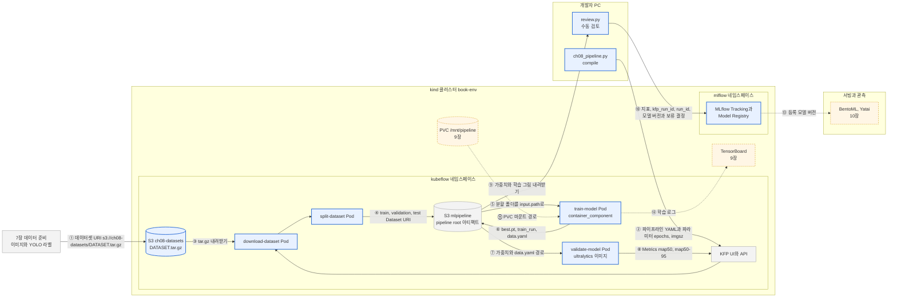
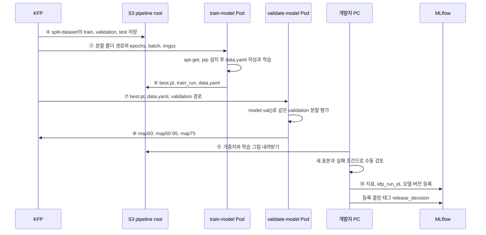
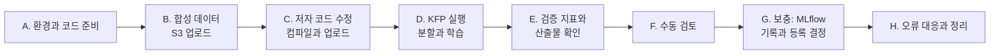

7장에서는 신분증 이미지와 YOLO 라벨을 train, validation, test로 나눴다. 8장은 그 분할로 YOLO를 학습하고, 저장한 가중치로 검증 지표를 남긴다. 노트북에서는 `model.train()` 한 줄이던 일이 파이프라인에서는 Pod와 컨테이너 이미지, 아티팩트 경로, 지표 기록으로 나뉜다.

읽으면서 붙잡은 질문은 두 가지였다. 학습을 언제든 다시 돌릴 수 있는 작업으로 만들려면 무엇을 고정해야 할까. 그리고 초록색으로 끝난 검증 작업은 정확히 무엇을 증명할까. 책은 첫 질문에 공을 들이고, 두 번째는 "trust, but verify"라는 말과 수동 확인으로 짧게 넘어간다. 이 글은 두 질문을 한 흐름으로 이어 본다.

개념은 [전체 그림](#platform-map)에서 출발해 [학습을 컴포넌트로 옮기는 이유](#why-components)를 거쳐 [출시 판단](#release-decision)으로 간다. [실습 순서](#book-ch08-sop)에는 저자 코드를 지금 환경에서 돌리며 막힌 곳과 고친 내용을 화면과 함께 남겼다. 책의 데이터 주소는 더 이상 열리지 않아서 개인 정보가 없는 합성 신분증 데이터를 만들어 썼다. GPU 없이 CPU만 쓰는 kind 클러스터라 데이터 양과 epoch, 이미지 크기도 줄였다.

## 전체 그림 {#platform-map}

8장은 새 인프라를 설치하지 않는다. 4~5장에서 만든 KFP와 S3 저장소 위에서 데이터 아티팩트를 모델 아티팩트와 지표로 바꾸는 구간을 채운다. 그림의 번호는 무엇이 어디로 넘어가는지의 순서다. 강조한 상자가 8장의 범위이고, 점선은 9장 이후에 이 결과를 이어받는 부분이다. MLflow 기록과 등록은 책 8장에는 없고 9장에서 다룬다. 검증 결과가 출시 판단으로 이어지는 모습을 보이려고 보충 실습으로 앞당겼다.



| 번호 | 누가 | 무엇을 넘기는가 | 어디에 남는가 | 실습 단계 |
| --- | --- | --- | --- | --- |
| ① | 데이터 준비에서 S3로 | `MINIDATA/images`, `MINIDATA/labels` 구조의 압축 파일 | `ch08-datasets/DATASET.tar.gz` | B-3 |
| ② | PC에서 KFP로 | 컴파일한 `ch08_pipeline.yaml`과 실행 파라미터 | KFP의 파이프라인, 실험, 실행 기록 | C-4, D-2 |
| ③ | S3에서 다운로드 작업으로 | 압축 파일 | `download-dataset`의 `output_dataset` 아티팩트 | D-3 |
| ④ | 분할 작업에서 pipeline root로 | 이름으로 짝지은 이미지와 라벨 세 묶음 | `mlpipeline/v2/artifacts/.../split-dataset/...` | D-4 |
| ⑤ | pipeline root에서 학습 작업으로 | 세 분할 폴더의 로컬 경로 | 학습 Pod의 `/minio/mlpipeline/...` | D-5 |
| ⑥ | 학습 작업에서 pipeline root로 | `best.pt`, Ultralytics 실행 폴더, `data.yaml` | `train-model/.../model_output`, `data_yaml` | E-3 |
| ⑦ | pipeline root에서 검증 작업으로 | 가중치와 `data.yaml`, 검증 분할 | 검증 Pod의 같은 `/minio/...` 경로 | E-1 |
| ⑧ | 검증 작업에서 KFP로 | `map50`, `map50-95`, `map75` | `validate-model`의 `metrics` 아티팩트 | E-2 |
| ⑨ | pipeline root에서 PC로 | `best.pt`, `results.png`, 예측 샘플 | PC의 `kfp_artifacts` 폴더 | F-1~F-3 |
| ⑩ | PC에서 MLflow로 | 지표, 원천 KFP 실행 ID, 모델 버전 태그 | MLflow 실험 `ch08-id-card`, 모델 `ch08-id-card-detector` | G-1~G-2 |
| ⑪ | PVC에서 학습 작업으로 | 아티팩트 복사 대신 공유하는 마운트 경로 | 9장의 PVC | 9장 |
| ⑫ | 학습 작업에서 TensorBoard로 | epoch별 학습 로그 | 9장의 로그 저장 위치 | 9장 |
| ⑬ | MLflow에서 서빙으로 | 승인된 등록 모델 버전 | 10장의 Bento와 배포 | 10장 |

①부터 ⑩까지는 실습에서 실제로 돌려 화면을 남겼다. ⑪ 이후는 이 결과가 어디로 이어지는지 보여 줄 뿐이고, 이 글에서는 실행하지 않았다.

핵심 경로만 순서대로 그리면 아래와 같다. 학습과 검증이 모두 성공해도 등록 결정은 사람이 마지막에 남긴다.



KFP의 초록색 체크는 ⑧까지 예외 없이 끝났다는 뜻이다. 서비스에 써도 된다는 판단은 ⑨와 ⑩에서 따로 내린다.

## 학습을 컴포넌트로 옮기는 이유 {#why-components}

노트북에서 YOLO를 학습하면 데이터 경로, 패키지 버전, 하이퍼파라미터, 결과 폴더가 모두 그 PC의 상태에 기댄다. 다음 달에 모델을 다시 만들 때도, 다른 사람이 epoch만 바꿔 돌릴 때도, 가중치를 검증 단계로 넘길 때도 그 상태가 필요하다. 그래서 학습을 컴포넌트로 만드는 일은 코드를 옮기는 데서 끝나지 않는다. 입력과 실행 환경과 출력에 이름을 붙여 밖으로 드러내는 데 있다.

책 8장의 학습 컴포넌트는 세 가지 일을 한다. 분할된 이미지와 라벨을 정해진 폴더에 두고, YOLO가 읽을 `data.yaml`을 만들고, 학습해서 가장 좋은 가중치를 출력으로 남긴다. 이 셋을 한 Pod에서 처리하니 KFP가 보는 계약은 단순하다. 세 Dataset을 받아 Model 하나와 설정 Artifact 하나를 낸다. 대신 그 안쪽의 경로 규칙과 패키지 설치는 컴포넌트 코드가 떠안는다.

학습과 검증을 나누는 이유도 같다. 학습은 오래 걸리고 자원을 많이 쓴다. 검증은 가볍지만 기준이 바뀔 때마다 다시 돌려야 한다. 둘을 한 단계로 합치면 평가 기준만 바꿔도 학습을 반복하게 되고, 실패했을 때 어느 쪽 문제인지 가리기도 어렵다. 경계는 변경과 실패의 단위에 맞춰 긋는다.

## 데이터 설정은 학습 입력의 계약이 된다 {#data-config}

YOLO는 데이터 위치를 `data.yaml` 하나로 받는다. 책의 Listing 8.1에는 `path`, `train`, `val`, `test`와 클래스 이름 `0: id_card`가 적혀 있다. YOLOv8은 이미지 경로만 받는다. 라벨은 경로의 `images`를 `labels`로 바꾼 옆 폴더에서 같은 파일 이름으로 찾는다. 라벨 파일 한 줄은 `클래스 중심x 중심y 너비 높이`이고, 네 값은 이미지 크기로 나눈 0~1 사이 값이다.

**이미지와 라벨의 짝은 파일 이름으로만 이어진다.** 그런데 7장의 저자 분할 코드는 이미지 목록과 라벨 목록을 따로 `glob`으로 만든 뒤 함께 `train_test_split`에 넘긴다. 두 목록의 같은 위치가 같은 표본이라는 보장은 없다. 실습의 분할 Pod에서 저자 방식대로 짝지어 보니 192쌍 중 191쌍의 이름이 달랐다. 이대로 학습해도 YOLO는 오류를 내지 않는다. 라벨 없는 이미지는 배경으로, 남의 라벨은 그대로 배운다. 실습에서는 이름으로 짝을 만든 뒤 분할하도록 고쳤다.

`data.yaml`의 모양도 책 본문과 저자 코드가 다르다. Listing 8.1은 `path` 아래 상대 경로를 쓴다. 실제 학습 컴포넌트는 KFP가 넘긴 입력 폴더의 절대 경로를 `train`, `val`, `test`에 직접 적는다. 이 경로는 `/minio/mlpipeline/v2/artifacts/<파이프라인>/<실행 ID>/split-dataset/...` 형태다. 검증 컴포넌트가 이 `data.yaml`을 그대로 읽고도 동작하는 것은 같은 검증 Dataset을 입력으로 받아 같은 로컬 경로에 내려받기 때문이다. 책이 그림 8.6에서 "split-dataset의 출력이 validate-model에 연결된 이유"라고 짧게 언급한 숨은 결합이 이것이다. 검증 컴포넌트의 `validation_dataset` 입력은 코드에서 쓰이지 않는데도 지우면 실패한다.

## 모델 크기와 하이퍼파라미터는 서비스 조건에서 고른다 {#model-choice}

책은 YOLOv8n(Nano)에서 시작한다. 작은 모델로 가능성을 빨리 보고, 부족하면 같은 파이프라인에서 크기만 바꿔 다시 돌린다. 모델 크기, epoch, batch, 해상도는 품질만 바꾸지 않는다. 학습 시간과 메모리, 서빙 지연도 함께 움직인다.

| 선택 | 기대하는 이점 | 함께 확인할 비용 |
| --- | --- | --- |
| 큰 모델 | 더 높은 표현력 | 메모리, 학습, 추론 시간 |
| 큰 입력 이미지 | 작은 대상의 정보 유지 가능 | 연산량과 메모리 |
| 많은 epoch | 충분한 학습 기회 | 과적합, 시간, 비용 |
| 큰 batch | 처리 효율 개선 가능 | 메모리와 학습 동작 변화 |

책의 표 8.1에는 놓치기 쉬운 항목이 둘 있다. 하나는 `optimizer='auto'`다. 전체 반복 수를 보고 최적화기를 고르는데, 이번 작은 학습에서는 로그에 `AdamW(lr=0.002, momentum=0.9)`가 찍혔고 지정한 `lr0`와 `momentum`은 무시됐다. 학습률을 실험 변수로 삼으려면 최적화기를 명시해야 한다. 다른 하나는 `best.pt`의 정체다. 학습 중 validation 분할의 지표가 가장 좋았던 epoch의 가중치다. epoch를 늘려도 그중 최고를 고르지만, epoch가 너무 적으면 최고도 덜 학습된 상태다.

저자 코드는 `imgsz=640`을 고정하고 epoch와 batch만 파라미터로 열어 둔다. 무엇을 입력으로 드러낼지는 실행마다 바꿀 필요가 있는지로 정한다. 이번 실습은 CPU에서 끝나야 해서 `imgsz`를 파라미터로 꺼내 320을 넘겼다. 서비스에서 받을 해상도와 다르게 학습하면 작은 카드에서 성능이 달라진다. 실제로는 이 값을 서빙 조건과 함께 기록해야 한다.

## 시스템 의존성은 컨테이너 경계에서 해결한다 {#container-components}

`@dsl.component`의 `packages_to_install`이 하는 일은 Pod가 시작할 때 `pip install`을 돌리는 것까지다. OpenCV가 요구하는 `libGL.so.1` 같은 운영체제 라이브러리는 pip로 깔 수 없다. 책은 이 문제를 `@dsl.container_component`와 `dsl.ContainerSpec`으로 푼다. 이미지와 명령, 인자를 직접 정하니 `bash -c` 안에서 `apt-get`과 `pip install`을 실행할 수 있다. 학습 스크립트는 heredoc(`cat << 'EOF'`)으로 파일에 쓴 뒤 실행한다.

이때 KFP 입력은 bash의 위치 인자로 들어간다. `bash -c '스크립트' a b c`에서는 첫 인자 `a`가 `$0`이 된다. 그래서 저자 코드의 `--train-path "$0"`부터 `--data-yaml "$7"`까지가 `args` 리스트 순서와 정확히 맞아야 한다. 인자를 하나 늘리면 스크립트의 번호와 리스트 끝을 함께 고쳐야 한다. 이번 실습에서 `--imgsz "$8"`을 붙인 방식이 그 예다.

이 방식은 Dockerfile 없이 Python 파일 하나로 끝난다. 하지만 매 실행마다 패키지를 설치하므로 **실행 환경이 그날의 저장소 상태에 따라 달라진다.** 실제로 책의 코드는 지금 그대로 돌아가지 않았다. `python:3.11-slim`이 Debian trixie로 바뀌면서 `libgl1-mesa-glx` 패키지가 사라졌다. 버전을 고정하지 않은 `ultralytics`와 `torch`는 CUDA용 대용량 휠을 받았다. 최신 NumPy에서는 Ultralytics 8.3.40의 `np.trapz` 호출이 실패했다.

재현만 보면 책의 검증 컴포넌트처럼 의존성을 담은 고정 이미지(`ultralytics/ultralytics:8.0.194-cpu`)가 낫다. 다만 이번에는 학습을 8.3.40, 검증을 8.0.194로 돌려 두 단계의 라이브러리 버전이 다르다. 가중치는 문제없이 읽혔지만, 평가 코드 버전이 다르면 같은 가중치에서도 수치가 달라질 수 있다. 학습과 검증의 이미지는 맞추는 것이 원칙이다.

산출물에도 차이가 있다. 책 8.1.7은 Output artifacts에서 `project` 압축 파일을 내려받아 `best.pt`를 꺼낸다고 설명한다. 그런데 저자의 KFP v2 코드는 `project=os.path.dirname(model_output)`로 학습 폴더를 아티팩트 폴더 밖에 만들고, `best.pt` 하나만 `model_output`으로 복사한다. 혼동 행렬, PR 곡선, `results.csv`, 예측 샘플은 Pod와 함께 사라진다. 실습에서는 학습 폴더 전체를 `model_output/train_run`으로 복사하는 한 줄을 넣었다. 검증 컴포넌트의 그림도 컨테이너 안의 `/usr/src/ultralytics/runs/detect/val`에 저장됐다가 사라진다. 남길 그림은 출력 아티팩트 경로에 저장해야 한다.

## 검증 컴포넌트가 증명하는 것과 증명하지 못하는 것 {#validation-concepts}

검증 컴포넌트는 `best.pt`를 다시 읽어 `model.val()`로 mAP를 계산하고 KFP `Metrics`에 남긴다. 이것으로 세 가지가 확인된다. 저장한 가중치를 다른 Pod, 다른 이미지에서 다시 읽을 수 있다. 정해진 데이터에서 지표를 계산할 수 있다. 그 수치가 실행 기록에 붙어 다른 실행과 비교된다.

지표의 뜻부터 짚어 둔다. IoU는 예측 상자와 정답 상자가 겹친 넓이를 두 상자를 합친 넓이로 나눈 값이다. `map50`은 IoU 0.5 이상을 맞은 것으로 칠 때의 평균 정밀도(AP)다. `map50-95`는 IoU 기준을 0.5부터 0.95까지 0.05씩 올리며 구한 AP의 평균이다. AP는 예측을 신뢰도 순으로 늘어놓았을 때 precision-recall 곡선 아래 넓이라서, 특정 신뢰도 임계값에서의 동작은 직접 알려 주지 않는다. 클래스가 `id_card` 하나뿐이니 mAP가 곧 그 클래스의 AP다. `map50`이 높고 `map50-95`가 낮다면 카드는 찾지만 상자 경계가 덜 정확하다는 뜻이다.

문제는 평가 대상이다. 저자 코드의 검증은 학습 중 `best.pt`를 고르는 데 이미 쓴 validation 분할을 다시 평가한다. 실습에서 학습 로그 마지막 줄과 검증 컴포넌트의 수치가 `0.995 / 0.919`로 똑같았던 이유다. 모델 선택에 쓴 데이터의 점수는 그 선택만큼 낙관적이다. 만들어 둔 test 분할은 `data.yaml`에 적혀 있을 뿐 어디서도 평가하지 않는다. 출시 판단에 쓸 수치는 `model.val(split='test')`처럼 선택에 쓰지 않은 분할에서, 가능하면 한 번만 계산해야 한다. test 점수를 보고 학습 설정을 다시 만지기 시작하면 test도 validation처럼 낙관적인 점수가 된다.

## seed가 막지 못하는 누수 {#leakage}

`random_state=42`는 같은 파일 목록을 늘 같은 방식으로 나누게 해 준다. 하지만 그 분할이 평가하려는 상황을 닮았는지까지 챙겨 주지는 않는다. 7장에서 봤듯이 MIDV-500 같은 신분증 데이터는 문서를 찍은 영상에서 프레임을 뽑은 것이라 인접 프레임이 거의 같은 이미지다. 프레임 단위로 무작위로 나누면 같은 카드, 같은 배경의 다른 프레임이 train과 validation에 동시에 들어간다. 그러면 모델은 처음 보는 카드를 찾는 능력이 아니라 본 장면을 기억하는 능력으로 점수를 얻는다.

실습의 합성 데이터도 같은 구조로 만들었다. 30개 clip이 6프레임씩이다. 저자 분할을 그대로 쓰니 validation의 18개 clip이 모두 train에도 들어 있었다. 같은 데이터를 clip 단위로 나눠 다시 학습해 봤지만, 두 방식의 `map50-95`는 모두 0.928로 같았다. 합성 데이터가 너무 쉬웠던 탓이다. 그렇다고 누수가 무해하다는 뜻은 아니다. 이 데이터가 누수의 영향을 드러낼 만큼 어렵지 않았다. 실제 사진은 조명, 각도, 카드 종류가 훨씬 다양해서 장면을 기억하는 것만으로 점수가 크게 부풀 수 있다. 시간 순서가 있는 데이터라면 과거로 학습하고 미래로 평가하는 시간 분할도 필요하다. seed는 이 두 조건을 대신하지 못한다.

재현성의 범위도 따로 정해 둬야 한다. 고정 seed와 `deterministic=True`를 써도 GPU 종류, 라이브러리 버전, 스레드 수가 다르면 결과가 비트 단위로 같으리라는 법은 없다. 같은 입력과 절차로 돌렸다는 것으로 충분한지, 통계적으로 비슷하면 되는지, 비트 단위까지 같아야 하는지 중 필요한 수준을 고른다.

## 실행 성공, 모델 품질, 출시 결정은 다른 상태다 {#release-decision}

이번 실습의 KFP 실행은 네 작업 모두 초록색으로 끝났고 `map50`은 0.995였다. 그런데 같은 가중치가 강한 흐림, 작게 찍힌 카드, 어두운 조명에서는 카드를 하나도 찾지 못했다. 셋 다 학습 데이터에 없던 조건이다. 수치가 틀린 것은 아니다. 수치를 계산한 분할에 그 조건이 없었다. **학습 실행, 모델 검증, 출시 결정은 성공 조건부터 다른 별개의 상태다.**

| 학습 실행의 성공 조건 | 모델 검증의 성공 조건 | 출시 결정의 조건 |
| --- | --- | --- |
| 프로세스 정상 종료 | 선택에 쓰지 않은 데이터의 평가 결과 확보 | 기존 기준선과 같은 평가셋에서 비교 |
| 가중치 파일 생성 | 저장한 가중치를 깨끗한 환경에서 다시 로드 | 중요한 세부 조건에서 나빠지지 않음 |
| 설정과 로그 저장 | 주요 실패 유형의 예측 샘플 확인 | 허용할 손실과 예외를 승인한 사람과 대상 버전 |

출시 전에 거칠 게이트는 다음과 같이 잡았다.

| 게이트 | 확인할 질문 | 남길 증거 |
| --- | --- | --- |
| 데이터 | 분할, 라벨 짝, 범위가 계약에 맞는가? | 스냅샷과 검사 결과, 그룹 누수 수 |
| 모델 품질 | 기존 기준선과 비교해 요구사항을 충족하는가? | 동일 평가셋의 비교 결과 |
| 세부 집단 | 조명, 국가, 문서 유형 등 중요 조건에서 나빠지지 않는가? | 집단별 지표와 표본 수 |
| 산출물 | 저장한 가중치와 전처리를 다시 읽을 수 있는가? | 깨끗한 환경의 로드, 추론 결과 |
| 서비스 제약 | 목표 환경의 지연, 메모리 안에서 동작하는가? | 대표 하드웨어 시험 결과 |
| 출시 결정 | 허용할 손실과 예외를 누가 승인했는가? | 승인, 보류 이유와 대상 버전 |

평가셋이 작으면 개선폭도 조심해서 읽어야 한다. 이번 validation은 28장이고, 그중 여러 장이 같은 clip의 인접 프레임이었다. 0.995와 0.990의 차이는 이미지 한두 장의 차이일 수 있다. 그래서 표본 수와 불확실성, 실패 유형을 함께 적어 둔다.

### 수동 검토는 수치가 놓친 실패를 찾는 일이다

책 8.1.7은 내려받은 가중치로 표본 이미지를 직접 보며 "trust, but verify"를 강조한다. 이 확인의 목적은 잘 된 사례를 눈으로 다시 보는 데 있지 않다. 지표를 계산한 데이터에 없던 실패 유형을 찾는 데 있다. 책처럼 학습에 쓰지 않은 이미지를 고르고, 흐림, 회전, 작은 대상, 카드 없는 사진처럼 서비스에서 만날 조건을 일부러 섞는다. 여기서 찾은 실패는 다음 학습 데이터와 자동 평가의 세부 집단, 출시 게이트로 옮겨야 한다. 그래야 다음 검토가 사람의 기억에 기대지 않는다.

신뢰도 값도 이때 다시 본다. 책의 그림에서 사전학습 모델은 카드를 `book 0.28`로 잡는다. 상자 위치는 대략 맞아도 클래스와 신뢰도가 서비스 기준에 못 미친다. 서비스에서는 임계값을 정하고, 그 값에서의 오탐과 미탐을 따로 세야 한다. 책의 마지막 말처럼 "신뢰도가 일정 수준 이상이고 상자 좌표가 합리적인가"를 허용 오차와 함께 검사하는 코드로 바꿔야 비로소 자동화가 된다.

누가 책임지는지도 정해야 한다. 누가 어떤 표본으로 확인했는지, 무엇을 실패로 봤는지, 그래서 출시를 보류했는지가 모델 버전 옆에 남아야 한다. 이 글의 보충 실습은 그 결정을 MLflow 모델 버전 태그로 남겨 본다.

## 책 본문과 저자 코드의 차이 {#book-vs-code}

책 8장의 실습 코드는 별도의 `chapter-8` 저장소에 있지 않다. [practical-mlops/object-detection-project](https://github.com/practical-mlops/object-detection-project)의 `training_and_validation_pipeline.py`가 그것이고, 이 글은 커밋 `c6afb11`(2025-01-02) 기준이다. 같은 저장소의 `training_and_validation/` 폴더는 KFP v1 방식, `pipeline_with_pvc.py`는 9장의 PVC 방식이라 이번 실습에서는 쓰지 않았다.

| 위치 | 책 본문 | 저자 코드와 오늘의 실행 | 이 글의 처리 |
| --- | --- | --- | --- |
| 데이터 다운로드 | Manning이 제공한 데이터셋 | `manning.box.com` 주소가 404 | 합성 데이터를 S3에 올리고 boto3로 읽음 |
| 이미지와 라벨 짝 | 언급 없음 | 두 `glob` 목록을 위치로 짝지음, Pod에서 191/192쌍 불일치 | 파일 이름으로 짝지은 뒤 분할 |
| `data.yaml` | `path`와 상대 경로 | KFP 입력의 절대 경로 | 그대로 두고 검증과의 경로 결합을 설명 |
| 시스템 패키지 | `libgl1-mesa-glx` | Debian trixie에 패키지 없음 | `libgl1`로 교체 |
| Python 패키지 | 버전 없이 설치 | CUDA 휠, NumPy 2.4에서 `np.trapz` 오류 | CPU 휠과 `ultralytics==8.3.40`, `numpy==1.26.4` 고정 |
| 학습 산출물 | `project` 압축 파일을 내려받음 | `best.pt`만 출력, 학습 폴더는 아티팩트 밖 | 학습 폴더를 `model_output/train_run`에 복사 |
| 검증 데이터 | 검증 지표 | 모델 선택에 쓴 validation 재평가, test 미사용 | 그대로 실행하고 해석에서 구분 |
| 결과 화면 | 그림 8.9의 실행 목록 지표 열 | KFP 2.4.1 실행 목록에는 지표 열이 없음 | 지표는 metrics 아티팩트의 Visualization에서 확인 |
| 소요 시간 | 1 epoch 약 1시간 | CPU, 192장, 320px, 5 epoch로 축소 | 학습 Pod 약 13분, 그중 학습 0.111시간 |

## 실습 순서 {#book-ch08-sop}

책 8장의 파이프라인을 `book-env` 클러스터에서 끝까지 돌리고, 결과를 수동 검토와 등록 결정까지 이어 본다. GPU가 없고 원래 데이터셋도 받을 수 없어서 두 가지를 바꿨다. 데이터는 개인 정보가 없는 합성 신분증 이미지 192장이고, 학습은 CPU에서 320px, 5 epoch, batch 8이다. 그러니 아래 수치는 책의 모델 성능과 견줄 값이 아니다. 절차가 끝까지 이어졌다는 기록으로 읽으면 된다.



| 구간 | 끝났을 때 남는 것 |
| --- | --- |
| A. 환경과 코드 준비 | 동작하는 `book-env`, 저자 코드 `c6afb11`, `ch08\.venv` |
| B. 합성 데이터 | `ch08-datasets/DATASET.tar.gz` |
| C. 코드 수정과 업로드 | `ch08_pipeline.yaml`, KFP 파이프라인 `ch08-yolo-train-validate` |
| D. KFP 실행 | 실험 `ch08-id-card`, 실행 `ch08-yolo-e5-img320`, 분할과 학습 로그 |
| E. 결과 확인 | `metrics` 아티팩트의 mAP, `model_output/train_run`의 학습 그림 |
| F. 수동 검토 | 사전학습 모델과 학습 모델의 비교, 실패 조건 목록 |
| G. 보충 | MLflow run과 `ch08-id-card-detector` 버전 1의 보류 결정 |
| H. 정리 | 지울 리소스 목록과 오류 대응표 |

명령은 PowerShell 기준이다. 따로 적지 않으면 `ml-platform-book-env` 저장소 아래의 `ch08` 폴더에서 실행한다. `kubectl`과 `kind`가 PATH에 있어야 한다.

## A. 환경과 코드 준비

전체 그림의 ①에 들어가기 전에, ②에서 쓸 컴파일 환경부터 갖춘다.

### A-1. 클러스터와 포트포워딩 확인

1. 4~5장 글의 [환경 세팅](../04-experiments-features-pipelines/#book-lab-sop)대로 `book-env` 클러스터를 만들고, 두 번째 터미널에서 `python bookenv.py forward`를 켜 둔다.
2. `ml-platform-book-env` 폴더에서 상태를 확인한다.
   ```powershell
   python bookenv.py status
   ```
3. 브라우저에서 KFP(http://localhost:8080), MLflow(http://localhost:5000), 저장소(http://localhost:8888/buckets/)가 열리면 된다.

8장은 4장의 버킷이나 Feast 상태가 필요 없다. MLflow 서버는 G 구간의 보충 실습에서만 쓴다.

### A-2. 저자 코드 받기

1. 작업 폴더를 만들고 저자 코드를 받는다.
   ```powershell
   mkdir ch08; cd ch08
   git clone https://github.com/practical-mlops/object-detection-project.git
   git -C object-detection-project log -1 --format="%h %ad %s" --date=short
   ```
2. `c6afb11 2025-01-02 Add pipeline with PVC`가 나오면 이 글과 같은 코드다.

책 8장의 파이프라인은 저장소 최상위의 `training_and_validation_pipeline.py`다. practical-mlops 조직에 `chapter-8` 저장소는 없다.

### A-3. 가상환경

1. 컴파일, 업로드, 수동 검토, MLflow 기록에 쓸 가상환경을 만든다.
   ```powershell
   uv venv .venv --python 3.11
   uv pip install --python .venv kfp==2.9.0 boto3 mlflow==3.0.0 ultralytics==8.3.40 `
       torch==2.5.1 torchvision==0.20.1 numpy==1.26.4 "opencv-python<4.12" `
       --extra-index-url https://download.pytorch.org/whl/cpu --index-strategy unsafe-best-match
   ```
2. 버전을 확인한다.
   ```powershell
   .\.venv\Scripts\python.exe -c "import kfp, ultralytics, torch, mlflow, numpy; print(kfp.__version__, ultralytics.__version__, torch.__version__, mlflow.__version__, numpy.__version__)"
   ```
   ```text
   2.9.0 8.3.40 2.5.1+cpu 3.0.0 1.26.4
   ```
3. Ultralytics 설정이 다른 프로젝트와 섞이지 않게 이 폴더 전용 설정 위치를 쓰고, 내장 MLflow 콜백을 끈다.
   ```powershell
   $env:YOLO_CONFIG_DIR = "$PWD\yolo-config"
   .\.venv\Scripts\yolo.exe settings mlflow=False
   ```

NumPy를 고정하지 않으면 2.4 이상이 깔린다. 그러면 Ultralytics 8.3.40이 학습 마지막 검증에서 `AttributeError: module 'numpy' has no attribute 'trapz'`로 멈춘다. 고정하기 전 로컬 학습에서 실제로 이 오류가 났다. MLflow 콜백은 가상환경에 `mlflow`가 있으면 저절로 켜지고, Windows 경로를 추적 URI로 잘못 읽을 수 있어서 끈다. `YOLO_CONFIG_DIR`은 새 터미널마다 다시 지정한다.

## B. 합성 데이터 준비와 업로드

7장에서 준비했어야 할 데이터셋을 S3에 올린다. 전체 그림의 ①이다.

### B-1. 원래 데이터 주소 확인

저자 코드의 `download_dataset`은 Manning이 공유한 압축 파일을 받는다.

```powershell
curl.exe -sI "https://manning.box.com/shared/static/coiv3n2t5t0v42xgfhlsfi8bhvd7b441.gz" | Select-String "HTTP/"
```
```text
HTTP/1.1 404 Not Found
```

2026-11-07에 확인했을 때 404였다. 같은 파일을 공개적으로 받을 곳이 없어서, 저자 코드가 기대하는 폴더 구조를 그대로 갖춘 합성 데이터를 만들었다.

### B-2. 합성 신분증 데이터 만들기

1. 아래 내용을 `make_synthetic_idcards.py`로 저장한다. 실제 인물이나 문서 정보는 쓰지 않는다. 도형 배경 위에 `SYNTHETIC ID`라고 적은 가짜 카드를 붙이고, MIDV-500처럼 한 clip이 같은 카드와 배경의 인접 프레임 여섯 장이 되게 했다.
   ```python
   """Synthetic ID-card-like detection dataset in YOLO format. No real person or document data."""
   import argparse
   import os
   import random
   import tarfile

   from PIL import Image, ImageDraw, ImageFilter, ImageFont

   W, H = 480, 360


   def background(rng):
       img = Image.new("RGB", (W, H), tuple(rng.randint(40, 220) for _ in range(3)))
       d = ImageDraw.Draw(img)
       for _ in range(rng.randint(8, 25)):
           x0, y0 = rng.randint(-50, W), rng.randint(-50, H)
           x1, y1 = x0 + rng.randint(20, 220), y0 + rng.randint(20, 160)
           color = tuple(rng.randint(0, 255) for _ in range(3))
           if rng.random() < 0.5:
               d.rectangle([x0, y0, x1, y1], fill=color)
           else:
               d.ellipse([x0, y0, x1, y1], fill=color)
       return img.filter(ImageFilter.GaussianBlur(rng.uniform(0.5, 2.5)))


   def card(rng, cw):
       ch = int(cw / 1.586)
       base = tuple(rng.randint(170, 250) for _ in range(3))
       c = Image.new("RGBA", (cw, ch), (0, 0, 0, 0))
       d = ImageDraw.Draw(c)
       d.rounded_rectangle([0, 0, cw - 1, ch - 1], radius=max(4, cw // 20), fill=base + (255,))
       header = tuple(rng.randint(20, 140) for _ in range(3))
       d.rectangle([0, int(ch * 0.05), cw, int(ch * 0.22)], fill=header + (255,))
       font = ImageFont.load_default()
       d.text((int(cw * 0.05), int(ch * 0.08)), "SYNTHETIC ID", fill=(255, 255, 255, 255), font=font)
       # photo placeholder (abstract silhouette, not a face image)
       px0, py0 = int(cw * 0.06), int(ch * 0.30)
       px1, py1 = int(cw * 0.32), int(ch * 0.90)
       d.rectangle([px0, py0, px1, py1], fill=(150, 160, 175, 255))
       cx = (px0 + px1) // 2
       r = (px1 - px0) // 4
       d.ellipse([cx - r, py0 + r // 2, cx + r, py0 + r // 2 + 2 * r], fill=(90, 95, 110, 255))
       d.rectangle([px0 + r // 2, py1 - (py1 - py0) // 3, px1 - r // 2, py1], fill=(90, 95, 110, 255))
       for i in range(5):
           y = int(ch * (0.34 + i * 0.11))
           x1 = int(cw * rng.uniform(0.6, 0.95))
           d.rectangle([int(cw * 0.38), y, x1, y + max(2, ch // 30)], fill=(60, 60, 60, 255))
       return c


   def place(bg, cimg, cx, cy, angle):
       rot = cimg.rotate(angle, expand=True, resample=Image.BICUBIC)
       x0, y0 = int(cx - rot.width / 2), int(cy - rot.height / 2)
       bg.paste(rot, (x0, y0), rot)
       bbox = rot.getchannel("A").getbbox()  # axis-aligned box of the visible card pixels
       bx0, by0, bx1, by1 = bbox[0] + x0, bbox[1] + y0, bbox[2] + x0, bbox[3] + y0
       return max(0, bx0), max(0, by0), min(W, bx1), min(H, by1)


   def main():
       ap = argparse.ArgumentParser()
       ap.add_argument("--out", default="synthetic")
       ap.add_argument("--clips", type=int, default=30)
       ap.add_argument("--frames", type=int, default=6)
       ap.add_argument("--negatives", type=int, default=12)
       ap.add_argument("--seed", type=int, default=8)
       ap.add_argument("--tar", default="DATASET.tar.gz")
       a = ap.parse_args()
       rng = random.Random(a.seed)
       img_dir = os.path.join(a.out, "MINIDATA", "images")
       lbl_dir = os.path.join(a.out, "MINIDATA", "labels")
       os.makedirs(img_dir, exist_ok=True)
       os.makedirs(lbl_dir, exist_ok=True)
       n = 0
       for clip in range(a.clips):
           bg0 = background(rng)
           cimg = card(rng, rng.randint(140, 300))
           cx, cy = rng.uniform(0.3, 0.7) * W, rng.uniform(0.3, 0.7) * H
           ang = rng.uniform(-25, 25)
           for f in range(a.frames):
               bg = bg0.copy()
               box = place(bg, cimg, cx + rng.uniform(-12, 12), cy + rng.uniform(-10, 10), ang + rng.uniform(-4, 4))
               if rng.random() < 0.3:
                   bg = bg.filter(ImageFilter.GaussianBlur(rng.uniform(0.5, 1.5)))
               stem = f"clip{clip:02d}_f{f:02d}"
               bg.save(os.path.join(img_dir, stem + ".jpg"), quality=88)
               bx0, by0, bx1, by1 = box
               with open(os.path.join(lbl_dir, stem + ".txt"), "w") as fh:
                   fh.write(f"0 {(bx0 + bx1) / 2 / W:.6f} {(by0 + by1) / 2 / H:.6f} {(bx1 - bx0) / W:.6f} {(by1 - by0) / H:.6f}\n")
               n += 1
       for i in range(a.negatives):
           stem = f"neg{i:02d}"
           background(rng).save(os.path.join(img_dir, stem + ".jpg"), quality=88)
           open(os.path.join(lbl_dir, stem + ".txt"), "w").close()
           n += 1
       with tarfile.open(a.tar, "w:gz") as tar:
           tar.add(os.path.join(a.out, "MINIDATA"), arcname="MINIDATA")
       print(f"images={n} clips={a.clips} frames_per_clip={a.frames} negatives={a.negatives} tar={a.tar} size={os.path.getsize(a.tar)}")


   if __name__ == "__main__":
       main()
   ```
2. 실행한다.
   ```powershell
   .\.venv\Scripts\python.exe make_synthetic_idcards.py
   ```
   ```text
   images=192 clips=30 frames_per_clip=6 negatives=12 tar=DATASET.tar.gz size=2716385
   ```
   압축 파일 크기는 파일 시각 정보 때문에 실행마다 수십 바이트씩 달라질 수 있다. seed가 같으면 이미지와 라벨 내용은 같다.
3. `synthetic\MINIDATA\images\clip03_f00.jpg`를 열어 카드가 보이는지 본다. 같은 이름의 `labels\clip03_f00.txt`에는 `0 중심x 중심y 너비 높이` 한 줄이 있어야 한다. 카드가 없는 `neg00`~`neg11`은 빈 라벨 파일이다.

압축 파일 안의 경로는 `MINIDATA/images`, `MINIDATA/labels`다. 저자의 `split_dataset`이 `DATASET/MINIDATA/...`를 읽으므로 이 구조는 건드리지 않는다.

### B-3. S3에 업로드

1. 아래 내용을 `upload_dataset.py`로 저장하고 실행한다. PC에서는 포트포워딩된 `127.0.0.1:9000`으로 접근한다.
   ```python
   import boto3
   s3 = boto3.client("s3", endpoint_url="http://127.0.0.1:9000",
                     aws_access_key_id="minio", aws_secret_access_key="minio123")
   names = [b["Name"] for b in s3.list_buckets()["Buckets"]]
   print("before:", names)
   if "ch08-datasets" not in names:
       s3.create_bucket(Bucket="ch08-datasets")
   s3.upload_file("DATASET.tar.gz", "ch08-datasets", "DATASET.tar.gz")
   print([(o["Key"], o["Size"]) for o in s3.list_objects_v2(Bucket="ch08-datasets")["Contents"]])
   ```
   ```powershell
   .\.venv\Scripts\python.exe upload_dataset.py
   ```
   ```text
   [('DATASET.tar.gz', 2716385)]
   ```
2. http://localhost:8888/buckets/ch08-datasets/ 에서 파일을 확인한다.

   

이 위치가 전체 그림 ①의 데이터셋 URI다. 실제 프로젝트라면 같은 이름으로 덮어쓰지 말고 날짜나 해시를 넣은 경로로 버전을 남겨야 한다. 그래야 학습 기록과 데이터를 다시 이을 수 있다.

## C. 저자 코드 수정, 컴파일과 업로드

②에 해당하는 파이프라인 정의를 지금 환경에서 돌아가게 고치고 KFP에 올린다.

### C-1. 고칠 곳

저자 파일을 복사해서 고친다. 원본은 비교용으로 남겨 둔다.

```powershell
Copy-Item object-detection-project\training_and_validation_pipeline.py ch08_pipeline.py
```

| 고친 곳 | 이유 | 확인한 증상 |
| --- | --- | --- |
| `download_dataset` | 다운로드 주소 404 | B-1의 `HTTP/1.1 404` |
| `split_dataset` 짝짓기 | 두 `glob` 목록을 위치로 짝지음 | D-4의 `191/192 pairs have different stems` |
| `split_dataset` 끝의 출력 | 인접 프레임 누수를 숫자로 확인 | D-4의 `val clips also in train: 18/18` |
| `apt-get` 패키지 | trixie에 `libgl1-mesa-glx` 없음 | 아래 확인 명령 |
| `pip install` 버전 | CUDA 휠과 NumPy 2.4 비호환 | A-3의 `np.trapz` 오류 |
| `imgsz`, `workers` | CPU에서 끝나는 크기, 작은 `/dev/shm` 대비 | 학습 시간 |
| 학습 폴더 복사 | 학습 그림이 아티팩트 밖에 남음 | E-3에서 `train_run` 확인 |
| 파이프라인 이름과 자원 | 공유 클러스터에서 구분하고 사용량 제한 | `ch08-` 접두사 |

`libgl1-mesa-glx`가 사라진 것은 Docker로 바로 확인된다.

```powershell
docker run --rm python:3.11-slim bash -c "apt-get update -qq >/dev/null && apt-get install -y --no-install-recommends libgl1-mesa-glx 2>&1 | tail -1"
```
```text
E: Package 'libgl1-mesa-glx' has no installation candidate
```

1. `download_dataset`에서 함수 정의부터 압축 해제 직전까지를 S3에서 읽도록 바꾼다. 데코레이터와 압축 해제 부분은 그대로 둔다.
   ```python
   def download_dataset(output_dataset: Output[Dataset], output_dir: str = "DATASET",
                        s3_endpoint: str = "http://minio-service.kubeflow.svc.cluster.local:9000",
                        bucket: str = "ch08-datasets", key: str = "DATASET.tar.gz"):
       # [ch08 fix] The author's Manning box URL now returns 404.
       # Read the same tar.gz layout (MINIDATA/images, MINIDATA/labels) from S3 instead.
       import os
       import tarfile
       import boto3

       downloaded_file = "DATASET.gz"
       s3 = boto3.client("s3", endpoint_url=s3_endpoint,
                         aws_access_key_id="minio", aws_secret_access_key="minio123")
       s3.download_file(bucket, key, downloaded_file)
       print(f"downloaded s3://{bucket}/{key} ({os.path.getsize(downloaded_file)} bytes)")
   ```
   Pod 안에서는 `localhost` 대신 클러스터 서비스 주소를 쓴다. 키를 코드에 적은 것은 로컬 실습이라서이고, 운영에서는 Secret으로 넘긴다.
2. `split_dataset`의 `images`, `labels` 두 줄을 이름 기준 짝짓기로 바꾼다.
   ```python
       raw_images = list(glob.glob(os.path.join(input_dataset.path, "DATASET", BASE_PATH, "images", "**")))
       raw_labels = list(glob.glob(os.path.join(input_dataset.path, "DATASET", BASE_PATH, "labels", "**")))

       # [ch08 fix] The author zips two independently globbed lists. glob order is not
       # guaranteed, so image i and label i may belong to different samples.
       stem = lambda p: os.path.splitext(os.path.basename(p))[0]
       mismatched = sum(stem(a) != stem(b) for a, b in zip(raw_images, raw_labels))
       print(f"author-style zip(glob, glob): {mismatched}/{len(raw_images)} pairs have different stems")
       label_by_stem = {stem(p): p for p in raw_labels}
       images = sorted(p for p in raw_images if stem(p) in label_by_stem)
       labels = [label_by_stem[stem(p)] for p in images]
       print(f"paired by stem: {len(images)} samples, images without label: {len(raw_images) - len(images)}")
   ```
3. 같은 함수의 마지막 복사 반복문 뒤에 누수 확인 출력을 붙인다. 분할 규칙은 책 그대로 두고 결과만 드러낸다.
   ```python
       # [ch08 check] adjacent-frame leakage: frames of one clip landing in several splits
       clip = lambda p: os.path.basename(p).split("_")[0]
       train_clips = {clip(p) for p in x_train}
       val_clips = {clip(p) for p in x_val}
       test_clips = {clip(p) for p in x_test}
       print(f"split sizes train={len(x_train)} val={len(x_val)} test={len(x_test)}")
       print(f"val clips also in train: {len(val_clips & train_clips)}/{len(val_clips)}")
       print(f"test clips also in train: {len(test_clips & train_clips)}/{len(test_clips)}")
   ```
4. `TRAINING_SCRIPT` 안을 세 군데 고친다. `parse_args()`에 `--imgsz`를 추가하고, `model.train()`의 `imgsz=640`을 `imgsz=args.imgsz`로 바꾸고 `workers=0`을 넣는다. `shutil.copy2(best_model_source, best_model_dest)` 다음에는 학습 폴더 복사를 붙인다.
   ```python
       parser.add_argument('--imgsz', type=int, default=640, help='[ch08] image size (CPU lab uses 320)')
   ```
   ```python
       # [ch08 fix] project=dirname(model_output) is outside the artifact folder, so plots,
       # results.csv and last.pt were never uploaded. Keep the run folder inside the Model artifact.
       shutil.copytree(os.path.join(os.path.dirname(args.model_output), args.model_name),
                       os.path.join(args.model_output, "train_run"), dirs_exist_ok=True)
       print("model artifact contents:", sorted(os.listdir(args.model_output)))
   ```
   `workers=0`은 예방 조치다. Pod의 공유 메모리가 작아서 DataLoader 작업 프로세스가 죽는 일을 피하려는 것이고, 기본값으로 실제 실패하는지는 확인하지 않았다.
5. `train_model`의 시그니처에 `imgsz: int = 640`을 추가하고, `ContainerSpec`의 설치 줄을 바꾼다.
   ```bash
               apt-get install -y --no-install-recommends \
                   libgl1 \
                   libglib2.0-0 \
                   && rm -rf /var/lib/apt/lists/* && \

               pip install --no-cache-dir \
                   --extra-index-url https://download.pytorch.org/whl/cpu \
                   ultralytics==8.3.40 \
                   torch==2.5.1+cpu \
                   torchvision==0.20.1+cpu \
                   numpy==1.26.4 \
                   opencv-python-headless==4.8.1.78 \
                   minio \
                   tqdm \
                   pyyaml && \
   ```
   `python3 /train.py` 줄의 끝은 `--data-yaml "$7" \`와 `--imgsz "$8"`로 바꾸고, `args` 리스트의 `data_yaml.path` 뒤에 `imgsz`를 넣는다. 번호와 리스트 순서가 어긋나면 엉뚱한 값이 엉뚱한 옵션에 들어간다.
6. `validate_model`의 시그니처에 `imgsz: int = 640`을 추가하고 `model.val()`의 `imgsz=640`을 `imgsz=imgsz`로 바꾼다.
7. 파이프라인 정의를 고친다.
   ```python
   @dsl.pipeline(
       name="ch08-yolo-train-validate",
       description="Chapter 8 YOLO train/validate on a synthetic ID-card dataset (CPU)"
   )
   def pipeline(
           epochs: int = 1,
           batch: int = 8,
           random_state: int = 42,
           yolo_model_name: str = "yolov8n_custom",
           imgsz: int = 320,
           dataset_bucket: str = "ch08-datasets"
   ):
       download_op = download_dataset(bucket=dataset_bucket)
       # split_op은 저자 코드와 같다
       train_op = train_model(
           epochs=epochs,
           batch=batch,
           yolo_model_name=yolo_model_name,
           train_dataset=split_op.outputs["train_dataset"],
           validation_dataset=split_op.outputs["validation_dataset"],
           test_dataset=split_op.outputs["test_dataset"],
           imgsz=imgsz
       )
       train_op.set_cpu_limit("4").set_memory_limit("6G")

       validate_op = validate_model(
           data_yaml=train_op.outputs["data_yaml"],
           model=train_op.outputs["model_output"],
           validation_dataset=split_op.outputs["validation_dataset"],
           imgsz=imgsz
       )
       validate_op.set_cpu_limit("2").set_memory_limit("4G")
   ```
   맨 아래 `package_path`는 `'ch08_pipeline.yaml'`로 바꾼다.

### C-2. 컴파일

```powershell
.\.venv\Scripts\python.exe ch08_pipeline.py
Select-String ch08_pipeline.yaml -Pattern "image:"
```
```text
ch08_pipeline.yaml:172:        image: python:3.11
ch08_pipeline.yaml:244:        image: python:3.11
ch08_pipeline.yaml:312:        image: python:3.11-slim
ch08_pipeline.yaml:357:        image: ultralytics/ultralytics:8.0.194-cpu
```

컴파일은 실행 명세만 만든다. 이미지를 받을 수 있는지, 패키지 설치가 성공하는지는 실행해 봐야 안다.

### C-3. 이미지를 kind 노드에 미리 넣기

`ultralytics/ultralytics:8.0.194-cpu`는 압축 상태로 약 1.6GB다. 검증 작업이 이 이미지를 받느라 한참 멈춰 있지 않게 미리 받아 kind 노드에 넣어 둔다.

```powershell
docker pull ultralytics/ultralytics:8.0.194-cpu
docker pull python:3.11-slim
docker pull python:3.11
kind load docker-image ultralytics/ultralytics:8.0.194-cpu python:3.11 --name book-env
docker save --platform linux/amd64 python:3.11-slim -o slim.tar
kind load image-archive slim.tar --name book-env
Remove-Item slim.tar
docker exec book-env-control-plane crictl images | Select-String "python|ultralytics"
```

Docker Desktop의 containerd 이미지 저장소를 쓰는 환경에서는 `kind load docker-image`가 `content digest ... not found`로 실패하는 이미지가 있었다. 그럴 때는 위의 `python:3.11-slim`처럼 `docker save --platform linux/amd64`로 한 플랫폼만 저장해 `kind load image-archive`로 넣는다. 마지막 명령에서 세 이미지가 보이면 된다. 이 단계를 건너뛰어도 Pod가 인터넷에서 직접 받지만 더 오래 걸린다.

### C-4. 파이프라인 업로드

1. http://localhost:8080 에서 **Pipelines → + Upload pipeline**을 누른다.
2. **Pipeline Name**에 `ch08-yolo-train-validate`, 설명에 `Chapter 8 YOLO train and validate (CPU, synthetic ID cards)`를 넣는다.
3. **Upload a file**을 고르고 **Choose file**로 `ch08_pipeline.yaml`을 선택한다.

   

4. **Create**를 누르면 그래프가 나온다.

   

그래프에서 `validation_dataset`이 `train-model`과 `validate-model` 양쪽으로 이어진 선을 찾아보자. 책 그림 8.6이 말한 연결이다. 검증 작업이 학습이 쓴 `data.yaml`의 절대 경로를 같은 위치에 내려받으려면 이 선이 필요하다.

## D. KFP 실행

파라미터를 넘겨 실행하고, 분할 아티팩트가 학습 작업으로 넘어가는 모습을 로그로 본다. 그림으로는 ②~⑤ 구간이다.

### D-1. 실험 만들기

1. 파이프라인 화면의 **+ Create experiment** 또는 **Experiments → + Create experiment**에서 이름 `ch08-id-card`를 넣고 **Next**를 누른다.

   

KFP 실험은 파이프라인 실행을 묶는 단위다. G 구간에서 MLflow 실험도 같은 이름으로 만들지만 둘은 서로 다른 기록이다.

### D-2. 실행 파라미터

1. 실행 화면에서 파이프라인과 실험이 채워졌는지 확인한다. 실험 목록에서 들어왔다면 **Pipeline → Choose**로 `ch08-yolo-train-validate`를 고른다.
2. **Run name**에 `ch08-yolo-e5-img320`을 넣고 파라미터를 채운다.

   | 파라미터 | 값 | 책의 기본값 |
   | --- | --- | --- |
   | batch | `8` | 8 |
   | dataset_bucket | `ch08-datasets` | 없음 |
   | epochs | `5` | 1 |
   | imgsz | `320` | 640 고정 |
   | random_state | `42` | 42 |
   | yolo_model_name | `yolov8n_custom` | 같음 |

   

3. **Start**를 누른다.

책은 1 epoch를 권한다. 여기서는 CPU에 맞춰 320px로 줄인 대신 5 epoch로 늘렸다. 이번 실행에서 1 epoch는 약 1분 20초였다.

### D-3. 실행 그래프

1. 실행 상세 화면에서 네 작업이 차례로 초록색 체크가 되는지 본다. 이번 실행은 모두 17분 11초가 걸렸다.

   

2. `download-dataset`을 눌러 **Logs** 탭에서 `downloaded s3://ch08-datasets/DATASET.tar.gz (2716385 bytes)`를 찾는다. 전체 그림 ③이다.

초록색 체크는 각 Pod가 종료 코드 0으로 끝났다는 뜻이다. 다음 단계로 무엇이 넘어갔는지는 로그와 아티팩트를 봐야 안다.

### D-4. 분할 로그에서 짝과 누수 확인

1. `split-dataset`을 누르고 **Logs** 탭에서 `author-style` 줄을 찾는다.

   

   ```text
   author-style zip(glob, glob): 191/192 pairs have different stems
   paired by stem: 192 samples, images without label: 0
   split sizes train=144 val=28 test=20
   val clips also in train: 18/18
   test clips also in train: 13/14
   ```

첫 줄이 말하는 바는 이렇다. 저자 코드를 그대로 썼다면 192쌍 중 191쌍이 서로 다른 표본의 이미지와 라벨로 묶였을 것이다. Pod의 파일 시스템에서 `glob`이 돌려주는 순서는 이름순이 아니다. 아래 두 줄은 무작위 프레임 분할의 결과다. validation의 clip은 전부, test는 14개 clip 중 13개가 train에도 들어갔다. 전체 그림 ④의 아티팩트가 바로 이 분할이다.

### D-5. 학습 작업의 입력과 로그

1. `train-model`을 누르고 **Input/Output** 탭을 본다. Input Parameters의 `epochs 5`, `imgsz 320`과 세 Dataset의 `minio://mlpipeline/...` URI가 전체 그림 ⑤다.

   

2. **Logs** 탭에서 `5 epochs completed`를 찾는다.

   

   ```text
                    all         28         28      0.998          1      0.995      0.919
   5 epochs completed in 0.111 hours.
   model artifact contents: ['best.pt', 'train_run']
   ```

학습 Pod는 처음부터 끝까지 약 13분이 걸렸다. 그중 학습은 0.111시간(약 7분)이고, 나머지는 대부분 `apt-get`과 `pip install`이었다. 설치에 학습만큼 시간이 든 셈이다. 로그 앞부분의 `optimizer: AdamW(lr=0.002, momentum=0.9)`와 `Downloading .../yolov8n.pt`도 눈여겨볼 만하다. 사전학습 가중치를 매 실행마다 GitHub에서 받는다는 뜻이라, 인터넷이 막힌 클러스터라면 가중치도 이미지나 아티팩트로 넣어야 한다. 마지막 줄 `all ... 0.995 0.919`는 학습이 끝날 때 validation 분할로 계산한 값이고, E-1과 비교할 기준이 된다.

## E. 검증 지표와 산출물 확인

학습이 남긴 가중치를 검증 작업이 다시 읽고, 지표가 KFP 기록에 붙는 모습을 본다.

### E-1. 검증 작업 로그

1. `validate-model`을 누르고 **Logs** 탭에서 `Loading model from`을 찾는다.

   

   ```text
   Ultralytics YOLOv8.0.194 🚀 Python-3.11.4 torch-2.1.0+cpu CPU
   Loading model from: /minio/mlpipeline/v2/artifacts/ch08-yolo-train-validate/.../model_output/best.pt
                      all         28         28      0.998          1      0.995      0.919
   ```

검증 Pod는 학습 Pod와 다른 이미지에서 돌았지만 `best.pt`를 문제없이 읽었다. 저장한 가중치를 다른 환경에서 다시 로드할 수 있다는 뜻이고, 전체 그림 ⑦에 해당한다. 수치는 D-5 마지막 줄과 같다. 같은 가중치로 같은 validation 28장을 평가했으니 당연하고, 바로 그래서 독립적인 평가가 못 된다. 로그 끝의 `Results saved to /usr/src/ultralytics/runs/detect/val`은 컨테이너 안의 경로라 이 그림들은 Pod와 함께 사라진다.

### E-2. Metrics 아티팩트

1. 그래프 맨 아래 `metrics` 아티팩트를 누르고 **Visualization** 탭을 연다.

   

2. `map50 0.995`, `map50-95 0.919318`, `map75 0.995`가 보이면 전체 그림 ⑧까지 끝난 것이다.

`store_session_info` 행은 모델 지표가 아니다. KFP 2.4.1이 아티팩트 저장소 정보를 메타데이터에 함께 붙여서 생긴다. 책 그림 8.9와 달리 실행 목록에 지표 열은 붙지 않았다. KFP 2.4.1의 실험 화면에는 이름, 상태, 소요 시간, 파이프라인 버전만 나온다.


여러 실행의 지표는 실행을 골라 **Compare runs**에서 비교한다. 비교하기 전에 데이터와 분할이 같은지부터 봐야 지표 차이를 모델 차이로 읽을 수 있다.

### E-3. 학습 산출물

1. http://localhost:8888/buckets/mlpipeline/v2/artifacts/ch08-yolo-train-validate/ 아래에서 실행 ID 폴더, `train-model`, 실행 폴더, `model_output/train_run` 순서로 들어간다. 전체 그림 ⑥이 남긴 파일이다.

   

2. `results.png`를 열어 epoch별 손실과 지표를 본다.

   

3. `val_batch0_pred.jpg`를 연다. 학습 중 validation 이미지에 대한 예측이다.

   

`results.png`를 보면 recall과 `mAP50`은 첫 epoch부터 거의 최대값이다. `mAP50-95`만 0.89~0.92 사이에서 움직인다. 카드를 찾는 일은 처음부터 쉬웠고, 상자 경계의 정확도만 조금씩 바뀌었다는 뜻이다. 다만 점 5개로 그린 곡선이라 추세를 말하기는 어렵다. 예측 샘플에는 `clip27_f00`, `clip27_f03`, `clip27_f04`처럼 같은 카드와 배경의 프레임이 반복된다. D-4의 `val clips also in train: 18/18`이 눈에 보이는 장면이다. 이 폴더가 남은 것은 C-1의 4번을 고쳤기 때문이다. 저자 코드 그대로라면 `model_output`에는 `best.pt` 하나만 있다.

## F. 수동 검토

전체 그림의 ⑨, 수동 검토다. 책 8.1.7처럼 가중치를 PC로 내려받아, 지표를 계산한 데이터에 없던 조건에서 시험한다.

### F-1. 가중치 내려받기

책은 UI의 Output artifacts에서 압축 파일을 내려받는다. 여기서는 폴더 단위 아티팩트를 한 번에 받으려고 S3에서 직접 받았다.

1. 아래 내용을 `download_artifacts.py`로 저장한다.
   ```python
   """Download the train-model artifacts of one KFP run from the pipeline root (mlpipeline bucket)."""
   import os, sys, boto3
   run_id = sys.argv[1]
   s3 = boto3.client("s3", endpoint_url="http://127.0.0.1:9000", aws_access_key_id="minio", aws_secret_access_key="minio123")
   prefix = f"v2/artifacts/ch08-yolo-train-validate/{run_id}/train-model/"
   n = 0
   for page in s3.get_paginator("list_objects_v2").paginate(Bucket="mlpipeline", Prefix=prefix):
       for o in page.get("Contents", []):
           rel = o["Key"].split("/train-model/", 1)[1].split("/", 1)[1]   # drop execution id
           dest = os.path.join("kfp_artifacts", rel)
           os.makedirs(os.path.dirname(dest), exist_ok=True)
           s3.download_file("mlpipeline", o["Key"], dest)
           n += 1
   print(f"downloaded {n} files to kfp_artifacts")
   for root in ["kfp_artifacts/model_output", "kfp_artifacts/data_yaml"]:
       print(root, sorted(os.listdir(root)))
   print(open("kfp_artifacts/data_yaml/data.yaml").read())
   ```
2. KFP 실행 상세 화면 주소 끝의 실행 ID를 넣어 실행한다.
   ```powershell
   .\.venv\Scripts\python.exe download_artifacts.py ac2eb3c0-564b-4e68-a1a3-cb3ee44a4394
   ```
   ```text
   downloaded 22 files to kfp_artifacts
   kfp_artifacts/model_output ['best.pt', 'train_run']
   kfp_artifacts/data_yaml ['data.yaml']
   names:
     0: id_card
   nc: 1
   test: /minio/mlpipeline/v2/artifacts/ch08-yolo-train-validate/ac2eb3c0-.../split-dataset/.../test_dataset/images
   train: /minio/mlpipeline/v2/artifacts/ch08-yolo-train-validate/ac2eb3c0-.../split-dataset/.../train_dataset/images
   val: /minio/mlpipeline/v2/artifacts/ch08-yolo-train-validate/ac2eb3c0-.../split-dataset/.../validation_dataset/images
   ```

`data.yaml`의 경로는 Pod 안에서만 의미가 있다. PC에서 이 파일로 `model.val()`을 돌리면 경로가 없어 실패한다. 다시 평가하려면 분할 아티팩트도 내려받고 경로를 바꿔야 한다. 학습 설정을 아티팩트로 남겼어도 그 안의 경로가 실행 환경에 묶여 있으면 재현 가능한 기록이라고 하기 어렵다.

### F-2. 사전학습 모델과 학습 모델 비교

책 Listing 8.15와 8.16은 `cv2.imshow`로 한 장씩 띄운다. 여기서는 창 대신 결과 이미지를 저장하게 바꿨다.

1. 학습에 쓰지 않은 표본을 만든다. B-2의 스크립트를 다른 seed로 돌려 새 clip 4개와 카드 없는 이미지 2장을 `samples`에 모은다.
   ```powershell
   .\.venv\Scripts\python.exe make_synthetic_idcards.py --out holdout --clips 4 --frames 1 --negatives 2 --seed 2026 --tar holdout.tar.gz
   mkdir samples; Copy-Item holdout\MINIDATA\images\*.jpg samples\
   ```
2. 아래 내용을 `review.py`로 저장한다.
   ```python
   """8.1.7 manual review. Saves plotted images instead of cv2.imshow (no GUI needed)."""
   import glob, os, sys
   import cv2
   from ultralytics import YOLO

   weights = sys.argv[1] if len(sys.argv) > 1 else "yolov8n.pt"
   out = sys.argv[2] if len(sys.argv) > 2 else "review_out"
   os.makedirs(out, exist_ok=True)
   model = YOLO(weights)
   for file in sorted(glob.glob("samples/*.jpg")):
       result = model(cv2.imread(file), imgsz=320, verbose=False)
       r = result[0]
       names = [f"{r.names[int(c)]}:{float(s):.2f}" for c, s in zip(r.boxes.cls, r.boxes.conf)]
       print(os.path.basename(file), names if names else "no detection")
       cv2.imwrite(os.path.join(out, os.path.basename(file)), r.plot())
   ```
3. 사전학습 가중치와 학습한 가중치로 각각 실행한다.
   ```powershell
   .\.venv\Scripts\python.exe review.py yolov8n.pt review_pretrained
   .\.venv\Scripts\python.exe review.py kfp_artifacts\model_output\best.pt review_trained
   ```
   ```text
   clip00_f00.jpg ['traffic light:0.34']
   clip01_f00.jpg no detection
   clip02_f00.jpg no detection
   clip03_f00.jpg no detection
   neg00.jpg no detection
   neg01.jpg ['chair:0.33']
   ```
   ```text
   clip00_f00.jpg ['id_card:0.95']
   clip01_f00.jpg ['id_card:1.00']
   clip02_f00.jpg ['id_card:0.86']
   clip03_f00.jpg ['id_card:1.00']
   neg00.jpg no detection
   neg01.jpg no detection
   ```
4. 두 폴더의 이미지를 나란히 놓고 본다.

   

사전학습 YOLOv8n은 COCO의 80개 클래스만 안다. 그래서 카드 주변을 `traffic light 0.34`로 잡거나 아무것도 찾지 못했다. 책의 그림에서 카드를 `book 0.28`로 잡은 것과 같은 현상이다. 학습한 가중치는 새 clip의 카드 네 장을 0.86~1.00으로 찾았고, 카드 없는 두 장에서는 아무것도 찾지 않았다. 책이 말하는 "학습은 동작한다"는 확인은 여기까지로 충분하다.

### F-3. 학습 데이터에 없던 조건 시험

1. 아래 내용을 `stress_review.py`로 저장하고 실행한다. 같은 표본을 90도 회전, 강한 흐림, 작은 카드, 어두운 조명으로 바꾼다.
   ```python
   """Stress cases for manual review: transformations the training data never showed."""
   import os
   from PIL import Image, ImageFilter
   import cv2
   from ultralytics import YOLO
   os.makedirs("stress", exist_ok=True)
   src = Image.open("samples/clip01_f00.jpg")
   cases = {
       "rot90": src.rotate(90, expand=True),
       "blur8": src.filter(ImageFilter.GaussianBlur(8)),
       "small": Image.new("RGB", src.size, (128, 128, 128)),
       "dark": src.point(lambda v: int(v * 0.25)),
   }
   cases["small"].paste(src.resize((src.width // 4, src.height // 4)), (200, 150))
   m = YOLO("kfp_artifacts/model_output/best.pt")
   for k, im in cases.items():
       p = f"stress/{k}.jpg"; im.save(p)
       r = m(cv2.imread(p), imgsz=320, verbose=False)[0]
       print(k, [f"{float(s):.2f}" for s in r.boxes.conf] or "no detection")
       cv2.imwrite(f"stress/{k}_pred.jpg", r.plot())
   ```
   ```powershell
   .\.venv\Scripts\python.exe stress_review.py
   ```
   ```text
   rot90 ['0.98']
   blur8 no detection
   small no detection
   dark no detection
   ```
2. `stress` 폴더의 `*_pred.jpg`를 연다.

   

`map50`이 0.995인 모델이 네 조건 중 세 개에서 카드를 놓쳤다. 학습 데이터의 흐림은 약했고, 카드 크기는 140~300px였고, 조명 변화는 없었다. 검증 분할도 같은 분포에서 나왔으니 지표에는 이 실패가 잡힐 수 없었다. 수동 검토가 남기는 것은 이런 실패 목록이다. 이 목록이 다음 데이터 수집과 세부 평가 집단의 근거가 된다.

### F-4. 무작위 분할과 clip 분할 비교

같은 192장을 두 방식으로 나눠 같은 조건(5 epoch, 320px, seed 42)으로 로컬에서 학습했다. 하나는 저자 방식의 프레임 단위 무작위 분할로, `sklearn`의 `train_test_split`을 저자와 같은 비율로 두 번 적용했다. 다른 하나는 clip 단위 분할로, clip 이름 목록을 seed 42로 섞어 앞 75%를 train, 다음 15%를 validation으로 썼다. 파이프라인 밖의 보조 실험이라 스크립트는 생략한다.

| 분할 | train | validation | train에도 있는 validation clip | map50 | map50-95 |
| --- | --- | --- | --- | --- | --- |
| 프레임 단위 무작위 | 144 | 28 | 18 | 0.995 | 0.928 |
| clip 단위 | 131 | 36 | 0 | 0.995 | 0.928 |

두 방식의 차이는 보이지 않았다. 앞의 [누수 설명](#leakage)대로 합성 데이터가 너무 쉬워서 처음 보는 clip도 거의 완벽하게 찾는다. 그러니 누수가 점수에 영향을 주지 않는다고 결론 낼 수는 없다. 더 중요한 것은 F-3에서 분포 밖 조건의 실패가 나왔다는 사실이다. 같은 분포에서 나눈 검증만으로는 일반화를 판단할 수 없다. 실제 촬영 데이터로 비교하면 차이가 날 수 있지만, 이 글에서는 해 보지 않았다.

## G. 보충: MLflow 기록과 등록 결정

마지막 ⑩은 책 8장의 범위 밖이다. 9장에서 다룰 MLflow 연결을 미리 써서 검증 결과를 등록 결정까지 잇는다.

### G-1. 실행 기록 남기기

1. 아래 내용을 `log_to_mlflow.py`로 저장한다. KFP 실행 ID, 데이터 위치, 학습 설정과 지표, 수동 검토 결과를 한 run에 모은다.
   ```python
   """Record one KFP training run in MLflow and register it with an explicit release decision."""
   import csv, os, sys, yaml
   import mlflow
   from mlflow import MlflowClient

   os.environ.setdefault("MLFLOW_S3_ENDPOINT_URL", "http://127.0.0.1:9000")
   os.environ.setdefault("AWS_ACCESS_KEY_ID", "minio")
   os.environ.setdefault("AWS_SECRET_ACCESS_KEY", "minio123")
   mlflow.set_tracking_uri("http://127.0.0.1:5000")
   mlflow.set_experiment("ch08-id-card")

   kfp_run_id = sys.argv[1]
   art = "kfp_artifacts/model_output/train_run"
   args = yaml.safe_load(open(f"{art}/args.yaml"))
   kfp_metrics = {"map50": 0.995, "map50_95": 0.919318, "map75": 0.995}  # validate-model Metrics artifact of this run
   stress = {"rot90": 1, "blur8": 0, "small": 0, "dark": 0}               # stress_review.py result

   with mlflow.start_run(run_name=f"kfp-{kfp_run_id[:8]}") as run:
       mlflow.set_tags({"kfp_run_id": kfp_run_id, "dataset_uri": "s3://ch08-datasets/DATASET.tar.gz",
                        "dataset_note": "synthetic ID-card-like images, frame-level random split",
                        "author_code": "practical-mlops/object-detection-project@c6afb11"})
       mlflow.log_params({k: args[k] for k in ["model", "epochs", "batch", "imgsz", "optimizer", "seed"]})
       for row in csv.DictReader(open(f"{art}/results.csv")):
           row = {k.strip(): v for k, v in row.items()}
           step = int(row["epoch"])
           mlflow.log_metrics({"train_box_loss": float(row["train/box_loss"]),
                               "val_box_loss": float(row["val/box_loss"]),
                               "val_map50_95_epoch": float(row["metrics/mAP50-95(B)"])}, step=step)
       mlflow.log_metrics({f"kfp_val_{k}": v for k, v in kfp_metrics.items()})
       mlflow.log_metric("stress_detect_rate", sum(stress.values()) / len(stress))
       mlflow.log_artifacts(art, artifact_path="train_run")
       mlflow.log_artifact("kfp_artifacts/data_yaml/data.yaml", artifact_path="config")
       run_id = run.info.run_id

   c = MlflowClient()
   name = "ch08-id-card-detector"
   try:
       c.create_registered_model(name, description="Chapter 8 lab model (synthetic data, CPU, 5 epochs)")
   except Exception:
       pass
   mv = c.create_model_version(name, source=f"runs:/{run_id}/train_run/weights", run_id=run_id,
                               tags={"kfp_val_map50_95": "0.919", "manual_review": "fail: blur, small, dark",
                                     "release_decision": "hold"})
   print("mlflow run_id:", run_id)
   print("registered:", name, "version", mv.version, "status", mv.status)
   ```
2. Windows 콘솔에서 MLflow가 출력하는 이모지 때문에 실패하지 않게 UTF-8을 지정하고 실행한다.
   ```powershell
   $env:PYTHONIOENCODING = "utf-8"
   .\.venv\Scripts\python.exe log_to_mlflow.py ac2eb3c0-564b-4e68-a1a3-cb3ee44a4394
   ```
   ```text
   mlflow run_id: 74f605c4bb544d50bf88abf3500c587b
   registered: ch08-id-card-detector version 1 status READY
   ```
3. http://localhost:5000 에서 실험 `ch08-id-card`의 run `kfp-ac2eb3c0`을 연다. Tags의 `kfp_run_id`가 KFP 실행과 이 기록을 잇는다.

   

4. **Model metrics** 탭에서 KFP 검증 지표와 `stress_detect_rate 0.25`를 함께 본다.

   

`PYTHONIOENCODING` 없이 돌리면 run을 끝내는 단계에서 `UnicodeEncodeError: 'cp949' codec can't encode character`가 나고, run이 `RUNNING` 상태로 남는다. 처음에 그렇게 남은 run은 지우고 다시 실행했다.

### G-2. 등록 결정 확인

1. **Models → ch08-id-card-detector → Version 1**을 연다. 새 모델 레지스트리 UI를 안내하는 창이 뜨면 닫는다.

   

2. `release_decision hold`와 `manual_review fail: blur, small, dark` 태그를 확인한다. Aliases는 비워 둔다.

모델을 등록했다는 것은 이 가중치를 이름과 버전으로 찾을 수 있게 됐다는 뜻까지다. 서비스에 써도 된다는 허락은 아니다. 10장의 서빙이 `champion` 같은 alias로 모델을 찾는다면, alias를 붙이는 순간이 곧 출시 결정이다. 이번 버전은 지표는 높지만 수동 검토에서 실패 조건이 나왔으므로 보류로 남겼다. 실제 운영이라면 결정한 사람과 근거 문서도 함께 남긴다.

## H. 오류 대응과 정리

### H-1. 이번 실행에서 만난 오류

| 증상 | 원인 | 대응 |
| --- | --- | --- |
| `manning.box.com` 다운로드 404 | 원래 데이터 공유 종료 | B 구간의 합성 데이터와 S3 다운로드 |
| `Package 'libgl1-mesa-glx' has no installation candidate` | `python:3.11-slim`이 Debian trixie로 바뀜 | `libgl1`로 교체 |
| `module 'numpy' has no attribute 'trapz'` | NumPy 2.4에서 함수 제거, Ultralytics 8.3.40이 사용 | `numpy==1.26.4` 고정 |
| 학습 Pod의 `pip`가 오래 멈춤 | 버전 미고정 패키지의 의존성 탐색 | 버전 고정, 가능하면 의존성을 담은 이미지 사용 |
| `kind load docker-image`의 `content digest ... not found` | 다중 플랫폼 이미지 인덱스 | `docker save --platform linux/amd64` 후 `kind load image-archive` |
| docker.io의 TLS handshake timeout | 네트워크 일시 오류 | `docker pull` 재시도 |
| MLflow 기록 중 `cp949` `UnicodeEncodeError` | Windows 콘솔 인코딩 | `$env:PYTHONIOENCODING = "utf-8"`, 남은 `RUNNING` run 삭제 |
| MLflow 모델 화면이 회색으로 가려짐 | 새 레지스트리 UI 안내 창 | 창의 닫기 버튼 |

### H-2. 실패한 작업에서 확인할 것

| 실패 위치 | 확인할 것 |
| --- | --- |
| download-dataset의 `NoSuchBucket`, `NoSuchKey` | B-3의 버킷과 파일 이름, `dataset_bucket` 파라미터 |
| split-dataset의 `ValueError` | 압축 파일 안의 `MINIDATA/images`, `MINIDATA/labels` 구조 |
| train-model의 `ImportError: libGL.so.1` | `apt-get` 단계의 패키지 이름과 그 이전 오류 |
| train-model의 `FileNotFoundError: .../weights/best.pt` | 학습 로그 앞부분의 데이터 경로와 라벨 수 |
| validate-model의 경로 오류 | `validation_dataset` 입력을 지우지 않았는지 |
| validate-model의 `ErrImagePull` | C-3의 이미지 적재 |

### H-3. 정리

이 실습이 만든 리소스는 모두 `ch08` 접두사를 쓴다. 다른 장의 실습과 같은 클러스터를 쓴다면 아래 항목만 지운다.

1. KFP: **Runs**에서 `ch08-yolo-e5-img320`을 **Archive**하고, **Experiments**의 `ch08-id-card`를 보관하고, **Pipelines**에서 `ch08-yolo-train-validate`를 삭제한다.
2. 저장소의 데이터와 실행 아티팩트를 지운다.
   ```powershell
   .\.venv\Scripts\python.exe -c "import boto3; s3=boto3.resource('s3',endpoint_url='http://127.0.0.1:9000',aws_access_key_id='minio',aws_secret_access_key='minio123'); b=s3.Bucket('ch08-datasets'); b.objects.all().delete(); b.delete(); s3.Bucket('mlpipeline').objects.filter(Prefix='v2/artifacts/ch08-yolo-train-validate/').delete()"
   ```
3. MLflow: 모델 `ch08-id-card-detector`를 삭제하고 실험 `ch08-id-card`를 삭제한다.
4. PC의 `ch08` 폴더를 지운다. 클러스터 전체를 지우려면 4~5장 글의 정리 단계처럼 `python bookenv.py down`을 실행한다.

## 마치며

학습을 컴포넌트로 옮기는 일은 `model.train()`을 Pod 안에서 부르는 것으로 끝나지 않았다. 데이터의 짝, 경로 규칙, 패키지 버전, 산출물의 위치를 정해야 같은 실행을 다시 할 수 있다. C-1에서 고친 곳도 전부 이 경계에서 나왔다.

검증 작업의 초록색 체크가 말해 주는 것은 생각보다 적었다. 가중치를 다시 읽었고, 정해진 분할에서 지표를 계산했다는 것까지다. 그 분할이 이미 모델 선택에 쓰였고 같은 clip을 공유한다면 수치는 낙관적이다. 9장은 PVC와 MLflow, TensorBoard로 데이터 전달과 실험 추적을 넓히고, 그 위에서 등록 모델 버전을 서빙으로 넘기는 판단을 다시 다룬다.

[이전: 07. 데이터 분석과 준비](../07-data-preparation/), [시리즈 목차](../), [다음: 09. 학습과 검증 II](../09-training-and-validation-2/)
