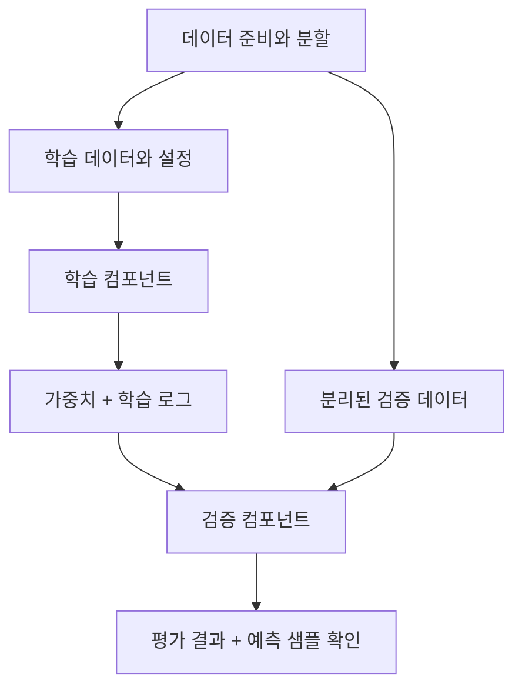

8장은 준비한 신분증 데이터로 YOLO를 학습하고 그 과정을 파이프라인 컴포넌트로 옮긴다. 학습 코드를 실행하는 것에서 끝나지 않고 설정과 의존성, 산출물을 함께 다룬다. **작업이 성공했다는 것과 모델을 써도 된다는 판단은 다르다**는 점을 구분해 정리했다.

## 8.1 객체 탐지 모델 학습

### 8.1.1 사용자 데이터셋으로 YOLO 학습 준비

사전학습 모델이 신분증을 잘 탐지한다고 가정하지 않고 준비한 이미지와 라벨로 YOLO를 학습한다.

YOLO 설정에는 데이터 경로, 분할, 클래스 정의가 필요하다. 학습 입력은 데이터 버전, 라벨 정의, 설정의 조합이다.

컴포넌트는 데이터와 설정을 기록해 자원, 파라미터를 바꿔 재실행하기 쉽게 한다.

### 8.1.2 모델 학습

모델 크기, epoch, batch, 해상도는 품질, 학습 시간, 메모리, 서빙 지연을 바꾼다.

| 선택 | 기대하는 이점 | 함께 확인할 비용 |
| --- | --- | --- |
| 큰 모델 | 더 높은 표현력 | 메모리, 학습, 추론 시간 |
| 큰 입력 이미지 | 작은 대상의 정보 유지 가능 | 연산량과 메모리 |
| 많은 epoch | 충분한 학습 기회 | 과적합, 시간, 비용 |
| 큰 batch | 처리 효율 개선 가능 | 메모리와 학습 동작 변화 |

서비스의 품질, 지연, 비용으로 설정을 비교하고 고정값은 컴포넌트 입력으로 노출한다.

### 8.1.3 시스템 의존성을 위한 컨테이너 컴포넌트

OpenCV의 `libGL.so.1` 사례처럼 Python 패키지 설치만으로 시스템 라이브러리까지 갖춰지지는 않는다.

KFP Python 컴포넌트의 패키지 설치와 이미지, 명령, 인자를 지정하는 컨테이너 컴포넌트를 비교한다.

컨테이너 컴포넌트는 유연하지만 관리 책임이 늘어난다. 매번 설치하기보다 의존성을 포함한 고정 이미지도 고려한다.

### 8.1.4 검증 컴포넌트 만들기

검증은 같은 데이터에 대한 손실을 다시 출력하는 일이 아니다. 분리된 데이터에서 모델을 평가하고, 모델 산출물을 다시 읽을 수 있는지 확인하며, 사용할 기준에 맞는 정보를 남긴다.

객체 탐지는 클래스와 박스 위치를 평가한다. precision, recall, mAP와 예측 이미지를 함께 본다.

### 8.1.5 파이프라인 만들기

데이터 준비, 학습, 검증을 연결하고 입력, 모델 경로, 산출물 의미를 명시한다.

### 8.1.6 파이프라인 실행

실행 파라미터와 로그를 확인한다. 실행 성공 표시와 모델 품질 승인을 구분해 기록해야 한다.

### 8.1.7 모델 아티팩트 검증

수치가 놓치는 배경 의존, 기울거나 작은 카드의 실패를 예측 이미지로 확인해 검증 사례를 보완한다. 일부 샘플이 전체 평가를 대신하지는 않는다.

## 검증과 출시 조건

학습, 검증 성공과 출시는 별도 상태다.

| 게이트 | 확인할 질문 | 남길 증거 |
| --- | --- | --- |
| 데이터 | 분할, 라벨, 범위가 계약에 맞는가? | 스냅샷과 검사 결과 |
| 모델 품질 | 기존 기준선과 비교해 요구사항을 충족하는가? | 동일 평가셋의 비교 결과 |
| 세부 집단 | 조명, 국가, 문서 유형 등 중요 조건에서 나빠지지 않는가? | 집단별 지표와 표본 수 |
| 산출물 | 저장한 가중치와 전처리를 다시 읽을 수 있는가? | 깨끗한 환경의 로드, 추론 결과 |
| 서비스 제약 | 목표 환경의 지연, 메모리 안에서 동작하는가? | 대표 하드웨어 시험 결과 |
| 출시 결정 | 허용할 손실과 예외를 누가 승인했는가? | 승인, 보류 이유와 대상 버전 |

작은 평가셋의 개선은 확정적 향상이 아니다. 표본 수, 불확실성, 실패 유형과 평가셋 과적합을 확인한다.

고정 seed도 GPU, 라이브러리 차이로 수치 재현성을 보장하지 않는다. 같은 입력, 절차, 통계적 유사성, 비트 일치 중 필요한 수준을 합의한다.

## 실행 성공과 모델 검증의 차이

학습 실행과 모델 검증은 성공 조건부터 다르다.

| 학습 실행의 성공 조건 | 모델 검증의 성공 조건 |
| --- | --- |
| 프로세스 정상 종료 | 분리된 데이터의 평가 결과 확보 |
| 가중치 파일 생성 | 저장한 가중치를 다시 로드 가능 |
| 설정과 로그 저장 | 주요 실패 유형의 예측 샘플 확인 |

흐림, 회전, 카드 없음 사례를 시험해 데이터 문제와 모델 한계를 구분한다.

## 수동 검토와 컴포넌트 책임

### 수치 평가와 수동 검토의 차이

수동 검토로 수치가 놓친 실패와 데이터 문제를 찾아 자동 평가에 반영한다.

### 학습·검증·배포의 책임 분리

단계를 합치면 재사용, 자원 분리, 재실행, 책임 구분이 어려워진다. 변경, 실패 단위에 맞춰 경계를 정한다.

학습 데이터에서 잘 예측하는 모습만으로 검증을 끝내기는 어렵다. 분리된 자료에서의 평가와 저장된 모델을 다시 읽는 확인이 함께 필요하다.

## 마치며

학습 자동화에는 생성 조건 기록과 기준 미달 후보 차단도 포함된다.

[이전: 07. 데이터 분석과 준비](../07-data-preparation/), [시리즈 목차](../), [다음: 09. 학습과 검증 II](../09-training-and-validation-2/)
