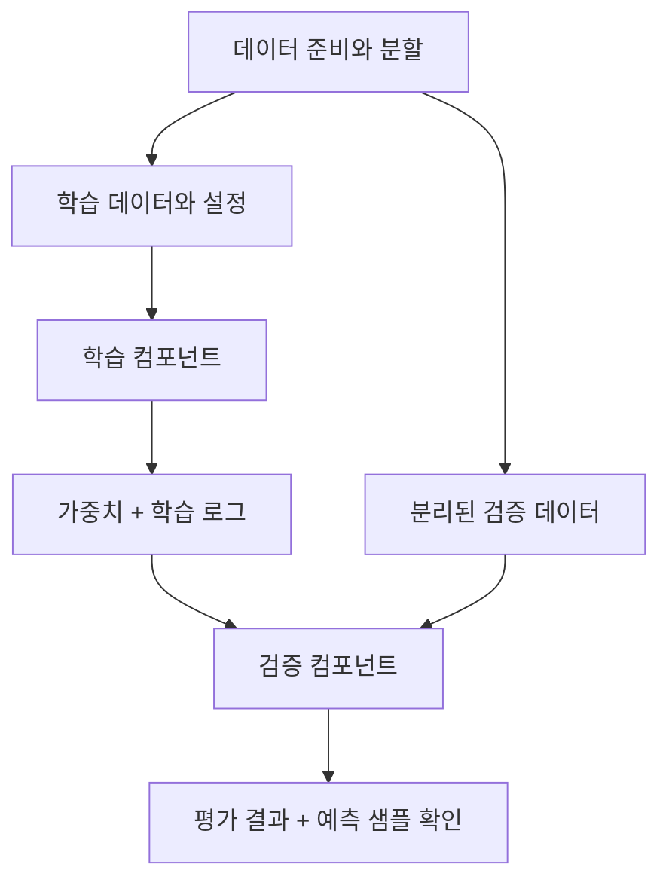

## 먼저, 연습을 마쳤다고 공연에 올릴 수는 없습니다

연주 연습을 끝낸 사실과 관객 앞에서 연주할 준비가 된 사실은 다릅니다. 곡을 틀리지 않는지, 실제 무대에서 문제가 없는지 별도로 확인해야 합니다.

모델도 학습 프로세스가 정상 종료했다고 사용할 준비가 된 것은 아닙니다. 이 장은 신분증 탐지 모델을 반복 가능한 학습 작업과 독립적인 검증 작업으로 나눕니다.

## 8.1 객체 탐지 모델 학습

### 8.1.1 사용자 데이터셋으로 YOLO 학습 준비

일반적인 사전학습 모델이 원하는 신분증 클래스를 그대로 잘 탐지하리라고 가정할 수 없습니다. 책은 준비한 이미지와 라벨을 바탕으로 YOLO를 학습합니다.

YOLO가 읽는 설정에는 데이터 위치, 분할된 경로와 클래스 정의 등이 들어갑니다. 따라서 학습의 입력은 “이미지 폴더”만이 아니라 데이터 버전 + 라벨 정의 + 학습 설정입니다.

이 흐름을 컴포넌트로 만들면 어느 데이터와 설정으로 학습했는지 남기고, 다른 자원이나 파라미터로 다시 실행하기 쉬워집니다.

### 8.1.2 모델 학습

YOLO 모델의 크기, 학습 횟수, 배치 크기, 입력 해상도 등은 품질뿐 아니라 학습 시간과 메모리, 서빙 지연에도 영향을 줍니다.

| 선택 | 기대하는 이점 | 함께 확인할 비용 |
| --- | --- | --- |
| 큰 모델 | 더 높은 표현력 | 메모리, 학습, 추론 시간 |
| 큰 입력 이미지 | 작은 대상의 정보 유지 가능 | 연산량과 메모리 |
| 많은 epoch | 충분한 학습 기회 | 과적합, 시간, 비용 |
| 큰 batch | 처리 효율 개선 가능 | 메모리와 학습 동작 변화 |

어떤 값이 언제나 낫다고 외우기보다, 우리 서비스의 품질, 지연, 비용 조건에서 비교해야 합니다. 고정값을 코드에 숨기지 않고 필요한 설정을 컴포넌트 입력으로 드러내는 것도 중요합니다.

### 8.1.3 시스템 의존성을 위한 컨테이너 컴포넌트

책은 OpenCV 계열의 `libGL.so.1` 같은 시스템 라이브러리 문제를 예로 듭니다. Python 패키지를 설치했다는 사실만으로 운영체제 라이브러리까지 갖춰지는 것은 아닙니다.

KFP의 Python 기반 컴포넌트 설정으로 패키지를 설치하는 방식과, 컨테이너 컴포넌트로 이미지, 명령, 인자를 직접 지정하는 방식을 비교합니다.

컨테이너 컴포넌트는 자유도가 크지만 설정이 길어지고 관리할 책임도 늘어납니다. 실무 적용 관점에서는 실행할 때마다 시스템 패키지를 설치하기보다 필요한 의존성을 갖춘 버전 고정 이미지를 준비하는 선택도 검토할 수 있습니다.

### 8.1.4 검증 컴포넌트 만들기

검증은 같은 데이터에 대한 손실을 다시 출력하는 일이 아닙니다. 분리된 데이터에서 모델을 평가하고, 모델 산출물을 다시 읽을 수 있는지 확인하며, 사용할 기준에 맞는 정보를 남깁니다.

객체 탐지에서는 분류가 맞았는지뿐 아니라 박스 위치가 맞는지도 봐야 합니다. precision, recall, mAP 등의 지표와 실제 예측 이미지는 서로 보완적입니다.

### 8.1.5 파이프라인 만들기

준비한 데이터, 학습, 검증 컴포넌트를 연결한다. 각 단계가 받는 데이터, 모델 경로와 산출물의 의미를 명시한다.

### 8.1.6 파이프라인 실행

실행 파라미터와 로그를 확인한다. 실행 성공 표시와 모델 품질 승인을 구분해 기록해야 한다.

### 8.1.7 모델 아티팩트 검증

자동화된 숫자만으로 놓치는 문제도 있습니다. 배경에 반응하는지, 기울어진 카드나 작은 카드에 실패하는지 직접 결과를 살피면 검증 케이스를 더 잘 설계할 수 있습니다. 다만 보기 좋은 몇 장으로 전체 평가를 대체해서는 안 됩니다.

## 실무 적용: 검증 결과를 출시 게이트로 바꿉니다

학습 성공, 검증 성공과 출시 승인은 서로 다른 상태다.

| 게이트 | 확인할 질문 | 남길 증거 |
| --- | --- | --- |
| 데이터 | 분할, 라벨, 범위가 계약에 맞는가? | 스냅샷과 검사 결과 |
| 모델 품질 | 기존 기준선과 비교해 요구사항을 충족하는가? | 동일 평가셋의 비교 결과 |
| 세부 집단 | 조명, 국가, 문서 유형 등 중요 조건에서 나빠지지 않는가? | 집단별 지표와 표본 수 |
| 산출물 | 저장한 가중치와 전처리를 다시 읽을 수 있는가? | 깨끗한 환경의 로드, 추론 결과 |
| 서비스 제약 | 목표 환경의 지연, 메모리 안에서 동작하는가? | 대표 하드웨어 시험 결과 |
| 출시 결정 | 허용할 손실과 예외를 누가 승인했는가? | 승인, 보류 이유와 대상 버전 |

작은 평가셋의 소폭 개선을 확정적인 향상으로 해석하지 않습니다. 표본 수와 불확실성, 실패 유형을 함께 보고 평가셋에 반복적으로 맞추고 있지 않은지도 확인합니다.

또한 무작위 시드를 고정해도 GPU 연산과 라이브러리 차이 등으로 완전한 수치 재현성이 어려울 수 있습니다. 팀이 요구하는 재현성이 같은 입력, 절차를 찾는 것인지, 통계적으로 유사한 결과인지, 비트 단위 일치인지 합의해야 합니다.

## 실행 성공과 모델 검증의 차이

학습 실행과 모델 검증은 성공 조건부터 다르다.

| 학습 실행의 성공 조건 | 모델 검증의 성공 조건 |
| --- | --- |
| 프로세스 정상 종료 | 분리된 데이터의 평가 결과 확보 |
| 가중치 파일 생성 | 저장한 가중치를 다시 로드 가능 |
| 설정과 로그 저장 | 주요 실패 유형의 예측 샘플 확인 |

흐린 이미지, 회전된 카드, 카드가 없는 이미지에서의 실패도 따로 확인해야 한다. 데이터 준비 문제와 모델의 한계를 구분할 수 있어야 한다.

## 북클럽 토론

Q. 검증 점수가 높으면 수동 확인은 불필요할까요?

수치가 잘 표현하지 못한 실패나 데이터 문제를 찾는 데 도움이 됩니다. 발견한 문제를 다시 자동 평가에 넣어 검증 체계를 개선하는 것이 좋습니다.

Q. 학습 컴포넌트가 모든 검증과 배포까지 처리하면 더 간단하지 않을까요?

파일은 줄겠지만 재사용, 자원 분리, 재실행과 책임 구분이 어려워질 수 있습니다. 어떤 경계가 변경, 실패를 다루기 좋은지 비교해 보세요.

자주 빠지는 함정: 파이프라인의 초록색 성공 표시를 모델의 품질 승인으로 읽거나, 학습 데이터에서의 예측으로 검증을 끝내는 것입니다.

## 한 줄 정리

운영 가능한 학습은 가중치를 만드는 데서 끝나지 않고, 그 가중치의 출처와 품질을 별도로 확인할 수 있어야 합니다.

[이전: 07. 데이터 분석과 준비](../07-data-preparation/), [시리즈 목차](../), [다음: 09. 학습과 검증 II](../09-training-and-validation-2/)
