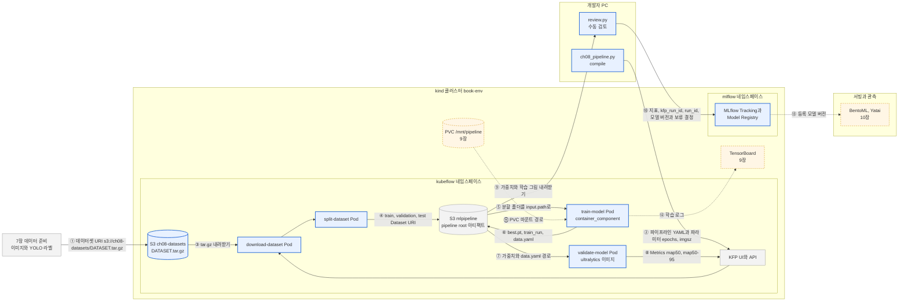
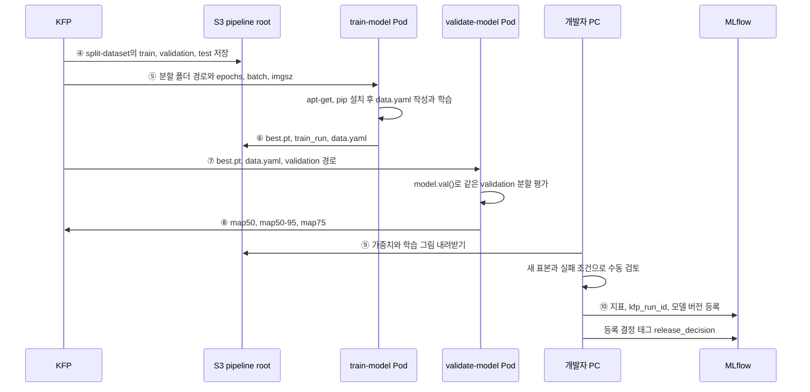

7장에서는 신분증 이미지와 YOLO 라벨을 train, validation, test로 나눴다. 8장은 그 분할로 YOLO를 학습하고, 저장한 가중치로 검증 지표를 남긴다. 노트북에서는 `model.train()` 한 줄이던 일이 파이프라인에서는 Pod와 컨테이너 이미지, 아티팩트 경로, 지표 기록으로 나뉜다.

읽으면서 붙잡은 질문은 두 가지였다. 학습을 언제든 다시 돌릴 수 있는 작업으로 만들려면 무엇을 고정해야 할까. 그리고 초록색으로 끝난 검증 작업은 정확히 무엇을 증명할까. 책은 첫 질문에 공을 들이고, 두 번째는 "trust, but verify"라는 말과 수동 확인으로 짧게 넘어간다. 이 글은 두 질문을 한 흐름으로 이어 본다.

개념은 [전체 그림](#platform-map)에서 출발해 [학습을 컴포넌트로 옮기는 이유](#why-components)를 거쳐 [출시 판단](#release-decision)으로 간다. [실습 순서](/docs/tech/machine-learning-platform-engineering/practice/ch08/#book-ch08-sop)에는 저자 코드를 지금 환경에서 돌리며 막힌 곳과 고친 내용을 화면과 함께 남겼다. 책의 데이터 주소는 더 이상 열리지 않아서 개인 정보가 없는 합성 신분증 데이터를 만들어 썼다. GPU 없이 CPU만 쓰는 kind 클러스터라 데이터 양과 epoch, 이미지 크기도 줄였다.

## 전체 그림 {#platform-map}

8장은 새 인프라를 설치하지 않는다. 4~5장에서 만든 KFP와 S3 저장소 위에서 데이터 아티팩트를 모델 아티팩트와 지표로 바꾸는 구간을 채운다. 그림의 번호는 무엇이 어디로 넘어가는지의 순서다. 강조한 상자가 8장의 범위이고, 점선은 9장 이후에 이 결과를 이어받는 부분이다. MLflow 기록과 등록은 책 8장에는 없고 9장에서 다룬다. 검증 결과가 출시 판단으로 이어지는 모습을 보이려고 보충 실습으로 앞당겼다.

| 번호 | 누가 | 무엇을 넘기는가 | 어디에 남는가 | 실습 단계 |
| --- | --- | --- | --- | --- |
| ① | 데이터 준비에서 S3로 | `MINIDATA/images`, `MINIDATA/labels` 구조의 압축 파일 | `ch08-datasets/DATASET.tar.gz` | B-3 |
| ② | PC에서 KFP로 | 컴파일한 `ch08_pipeline.yaml`과 실행 파라미터 | KFP의 파이프라인, 실험, 실행 기록 | C-4, D-2 |
| ③ | S3에서 다운로드 작업으로 | 압축 파일 | `download-dataset`의 `output_dataset` 아티팩트 | D-3 |
| ④ | 분할 작업에서 pipeline root로 | 이름으로 짝지은 이미지와 라벨 세 묶음 | `mlpipeline/v2/artifacts/.../split-dataset/...` | D-4 |
| ⑤ | pipeline root에서 학습 작업으로 | 세 분할 폴더의 로컬 경로 | 학습 Pod의 `/minio/mlpipeline/...` | D-5 |
| ⑥ | 학습 작업에서 pipeline root로 | `best.pt`, Ultralytics 실행 폴더, `data.yaml` | `train-model/.../model_output`, `data_yaml` | E-3 |
| ⑦ | pipeline root에서 검증 작업으로 | 가중치와 `data.yaml`, 검증 분할 | 검증 Pod의 같은 `/minio/...` 경로 | E-1 |
| ⑧ | 검증 작업에서 KFP로 | `map50`, `map50-95`, `map75` | `validate-model`의 `metrics` 아티팩트 | E-2 |
| ⑨ | pipeline root에서 PC로 | `best.pt`, `results.png`, 예측 샘플 | PC의 `kfp_artifacts` 폴더 | F-1~F-3 |
| ⑩ | PC에서 MLflow로 | 지표, 원천 KFP 실행 ID, 모델 버전 태그 | MLflow 실험 `ch08-id-card`, 모델 `ch08-id-card-detector` | G-1~G-2 |
| ⑪ | PVC에서 학습 작업으로 | 아티팩트 복사 대신 공유하는 마운트 경로 | 9장의 PVC | 9장 |
| ⑫ | 학습 작업에서 TensorBoard로 | epoch별 학습 로그 | 9장의 로그 저장 위치 | 9장 |
| ⑬ | MLflow에서 서빙으로 | 승인된 등록 모델 버전 | 10장의 Bento와 배포 | 10장 |

①부터 ⑩까지는 실습에서 실제로 돌려 화면을 남겼다. ⑪ 이후는 이 결과가 어디로 이어지는지 보여 줄 뿐이고, 이 글에서는 실행하지 않았다.

핵심 경로만 순서대로 그리면 아래와 같다. 학습과 검증이 모두 성공해도 등록 결정은 사람이 마지막에 남긴다.

KFP의 초록색 체크는 ⑧까지 예외 없이 끝났다는 뜻이다. 서비스에 써도 된다는 판단은 ⑨와 ⑩에서 따로 내린다.

## 학습을 컴포넌트로 옮기는 이유 {#why-components}

노트북에서 YOLO를 학습하면 데이터 경로, 패키지 버전, 하이퍼파라미터, 결과 폴더가 모두 그 PC의 상태에 기댄다. 다음 달에 모델을 다시 만들 때도, 다른 사람이 epoch만 바꿔 돌릴 때도, 가중치를 검증 단계로 넘길 때도 그 상태가 필요하다. 그래서 학습을 컴포넌트로 만드는 일은 코드를 옮기는 데서 끝나지 않는다. 입력과 실행 환경과 출력에 이름을 붙여 밖으로 드러내는 데 있다.

책 8장의 학습 컴포넌트는 세 가지 일을 한다. 분할된 이미지와 라벨을 정해진 폴더에 두고, YOLO가 읽을 `data.yaml`을 만들고, 학습해서 가장 좋은 가중치를 출력으로 남긴다. 이 셋을 한 Pod에서 처리하니 KFP가 보는 계약은 단순하다. 세 Dataset을 받아 Model 하나와 설정 Artifact 하나를 낸다. 대신 그 안쪽의 경로 규칙과 패키지 설치는 컴포넌트 코드가 떠안는다.

학습과 검증을 나누는 이유도 같다. 학습은 오래 걸리고 자원을 많이 쓴다. 검증은 가볍지만 기준이 바뀔 때마다 다시 돌려야 한다. 둘을 한 단계로 합치면 평가 기준만 바꿔도 학습을 반복하게 되고, 실패했을 때 어느 쪽 문제인지 가리기도 어렵다. 경계는 변경과 실패의 단위에 맞춰 긋는다.

## 데이터 설정은 학습 입력의 계약이 된다 {#data-config}

YOLO는 데이터 위치를 `data.yaml` 하나로 받는다. 책의 Listing 8.1에는 `path`, `train`, `val`, `test`와 클래스 이름 `0: id_card`가 적혀 있다. YOLOv8은 이미지 경로만 받는다. 라벨은 경로의 `images`를 `labels`로 바꾼 옆 폴더에서 같은 파일 이름으로 찾는다. 라벨 파일 한 줄은 `클래스 중심x 중심y 너비 높이`이고, 네 값은 이미지 크기로 나눈 0~1 사이 값이다.

**이미지와 라벨의 짝은 파일 이름으로만 이어진다.** 그런데 7장의 저자 분할 코드는 이미지 목록과 라벨 목록을 따로 `glob`으로 만든 뒤 함께 `train_test_split`에 넘긴다. 두 목록의 같은 위치가 같은 표본이라는 보장은 없다. 실습의 분할 Pod에서 저자 방식대로 짝지어 보니 192쌍 중 191쌍의 이름이 달랐다. 이대로 학습해도 YOLO는 오류를 내지 않는다. 라벨 없는 이미지는 배경으로, 남의 라벨은 그대로 배운다. 실습에서는 이름으로 짝을 만든 뒤 분할하도록 고쳤다.

`data.yaml`의 모양도 책 본문과 저자 코드가 다르다. Listing 8.1은 `path` 아래 상대 경로를 쓴다. 실제 학습 컴포넌트는 KFP가 넘긴 입력 폴더의 절대 경로를 `train`, `val`, `test`에 직접 적는다. 이 경로는 `/minio/mlpipeline/v2/artifacts/<파이프라인>/<실행 ID>/split-dataset/...` 형태다. 검증 컴포넌트가 이 `data.yaml`을 그대로 읽고도 동작하는 것은 같은 검증 Dataset을 입력으로 받아 같은 로컬 경로에 내려받기 때문이다. 책이 그림 8.6에서 "split-dataset의 출력이 validate-model에 연결된 이유"라고 짧게 언급한 숨은 결합이 이것이다. 검증 컴포넌트의 `validation_dataset` 입력은 코드에서 쓰이지 않는데도 지우면 실패한다.

## 모델 크기와 하이퍼파라미터는 서비스 조건에서 고른다 {#model-choice}

책은 YOLOv8n(Nano)에서 시작한다. 작은 모델로 가능성을 빨리 보고, 부족하면 같은 파이프라인에서 크기만 바꿔 다시 돌린다. 모델 크기, epoch, batch, 해상도는 품질만 바꾸지 않는다. 학습 시간과 메모리, 서빙 지연도 함께 움직인다.

| 선택 | 기대하는 이점 | 함께 확인할 비용 |
| --- | --- | --- |
| 큰 모델 | 더 높은 표현력 | 메모리, 학습, 추론 시간 |
| 큰 입력 이미지 | 작은 대상의 정보 유지 가능 | 연산량과 메모리 |
| 많은 epoch | 충분한 학습 기회 | 과적합, 시간, 비용 |
| 큰 batch | 처리 효율 개선 가능 | 메모리와 학습 동작 변화 |

책의 표 8.1에는 놓치기 쉬운 항목이 둘 있다. 하나는 `optimizer='auto'`다. 전체 반복 수를 보고 최적화기를 고르는데, 이번 작은 학습에서는 로그에 `AdamW(lr=0.002, momentum=0.9)`가 찍혔고 지정한 `lr0`와 `momentum`은 무시됐다. 학습률을 실험 변수로 삼으려면 최적화기를 명시해야 한다. 다른 하나는 `best.pt`의 정체다. 학습 중 validation 분할의 지표가 가장 좋았던 epoch의 가중치다. epoch를 늘려도 그중 최고를 고르지만, epoch가 너무 적으면 최고도 덜 학습된 상태다.

저자 코드는 `imgsz=640`을 고정하고 epoch와 batch만 파라미터로 열어 둔다. 무엇을 입력으로 드러낼지는 실행마다 바꿀 필요가 있는지로 정한다. 이번 실습은 CPU에서 끝나야 해서 `imgsz`를 파라미터로 꺼내 320을 넘겼다. 서비스에서 받을 해상도와 다르게 학습하면 작은 카드에서 성능이 달라진다. 실제로는 이 값을 서빙 조건과 함께 기록해야 한다.

## 시스템 의존성은 컨테이너 경계에서 해결한다 {#container-components}

`@dsl.component`의 `packages_to_install`이 하는 일은 Pod가 시작할 때 `pip install`을 돌리는 것까지다. OpenCV가 요구하는 `libGL.so.1` 같은 운영체제 라이브러리는 pip로 깔 수 없다. 책은 이 문제를 `@dsl.container_component`와 `dsl.ContainerSpec`으로 푼다. 이미지와 명령, 인자를 직접 정하니 `bash -c` 안에서 `apt-get`과 `pip install`을 실행할 수 있다. 학습 스크립트는 heredoc(`cat << 'EOF'`)으로 파일에 쓴 뒤 실행한다.

이때 KFP 입력은 bash의 위치 인자로 들어간다. `bash -c '스크립트' a b c`에서는 첫 인자 `a`가 `$0`이 된다. 그래서 저자 코드의 `--train-path "$0"`부터 `--data-yaml "$7"`까지가 `args` 리스트 순서와 정확히 맞아야 한다. 인자를 하나 늘리면 스크립트의 번호와 리스트 끝을 함께 고쳐야 한다. 이번 실습에서 `--imgsz "$8"`을 붙인 방식이 그 예다.

이 방식은 Dockerfile 없이 Python 파일 하나로 끝난다. 하지만 매 실행마다 패키지를 설치하므로 **실행 환경이 그날의 저장소 상태에 따라 달라진다.** 실제로 책의 코드는 지금 그대로 돌아가지 않았다. `python:3.11-slim`이 Debian trixie로 바뀌면서 `libgl1-mesa-glx` 패키지가 사라졌다. 버전을 고정하지 않은 `ultralytics`와 `torch`는 CUDA용 대용량 휠을 받았다. 최신 NumPy에서는 Ultralytics 8.3.40의 `np.trapz` 호출이 실패했다.

재현만 보면 책의 검증 컴포넌트처럼 의존성을 담은 고정 이미지(`ultralytics/ultralytics:8.0.194-cpu`)가 낫다. 다만 이번에는 학습을 8.3.40, 검증을 8.0.194로 돌려 두 단계의 라이브러리 버전이 다르다. 가중치는 문제없이 읽혔지만, 평가 코드 버전이 다르면 같은 가중치에서도 수치가 달라질 수 있다. 학습과 검증의 이미지는 맞추는 것이 원칙이다.

산출물에도 차이가 있다. 책 8.1.7은 Output artifacts에서 `project` 압축 파일을 내려받아 `best.pt`를 꺼낸다고 설명한다. 그런데 저자의 KFP v2 코드는 `project=os.path.dirname(model_output)`로 학습 폴더를 아티팩트 폴더 밖에 만들고, `best.pt` 하나만 `model_output`으로 복사한다. 혼동 행렬, PR 곡선, `results.csv`, 예측 샘플은 Pod와 함께 사라진다. 실습에서는 학습 폴더 전체를 `model_output/train_run`으로 복사하는 한 줄을 넣었다. 검증 컴포넌트의 그림도 컨테이너 안의 `/usr/src/ultralytics/runs/detect/val`에 저장됐다가 사라진다. 남길 그림은 출력 아티팩트 경로에 저장해야 한다.

## 검증 컴포넌트가 증명하는 것과 증명하지 못하는 것 {#validation-concepts}

검증 컴포넌트는 `best.pt`를 다시 읽어 `model.val()`로 mAP를 계산하고 KFP `Metrics`에 남긴다. 이것으로 세 가지가 확인된다. 저장한 가중치를 다른 Pod, 다른 이미지에서 다시 읽을 수 있다. 정해진 데이터에서 지표를 계산할 수 있다. 그 수치가 실행 기록에 붙어 다른 실행과 비교된다.

지표의 뜻부터 짚어 둔다. IoU는 예측 상자와 정답 상자가 겹친 넓이를 두 상자를 합친 넓이로 나눈 값이다. `map50`은 IoU 0.5 이상을 맞은 것으로 칠 때의 평균 정밀도(AP)다. `map50-95`는 IoU 기준을 0.5부터 0.95까지 0.05씩 올리며 구한 AP의 평균이다. AP는 예측을 신뢰도 순으로 늘어놓았을 때 precision-recall 곡선 아래 넓이라서, 특정 신뢰도 임계값에서의 동작은 직접 알려 주지 않는다. 클래스가 `id_card` 하나뿐이니 mAP가 곧 그 클래스의 AP다. `map50`이 높고 `map50-95`가 낮다면 카드는 찾지만 상자 경계가 덜 정확하다는 뜻이다.

문제는 평가 대상이다. 저자 코드의 검증은 학습 중 `best.pt`를 고르는 데 이미 쓴 validation 분할을 다시 평가한다. 실습에서 학습 로그 마지막 줄과 검증 컴포넌트의 수치가 `0.995 / 0.919`로 똑같았던 이유다. 모델 선택에 쓴 데이터의 점수는 그 선택만큼 낙관적이다. 만들어 둔 test 분할은 `data.yaml`에 적혀 있을 뿐 어디서도 평가하지 않는다. 출시 판단에 쓸 수치는 `model.val(split='test')`처럼 선택에 쓰지 않은 분할에서, 가능하면 한 번만 계산해야 한다. test 점수를 보고 학습 설정을 다시 만지기 시작하면 test도 validation처럼 낙관적인 점수가 된다.

## seed가 막지 못하는 누수 {#leakage}

`random_state=42`는 같은 파일 목록을 늘 같은 방식으로 나누게 해 준다. 하지만 그 분할이 평가하려는 상황을 닮았는지까지 챙겨 주지는 않는다. 7장에서 봤듯이 MIDV-500 같은 신분증 데이터는 문서를 찍은 영상에서 프레임을 뽑은 것이라 인접 프레임이 거의 같은 이미지다. 프레임 단위로 무작위로 나누면 같은 카드, 같은 배경의 다른 프레임이 train과 validation에 동시에 들어간다. 그러면 모델은 처음 보는 카드를 찾는 능력이 아니라 본 장면을 기억하는 능력으로 점수를 얻는다.

실습의 합성 데이터도 같은 구조로 만들었다. 30개 clip이 6프레임씩이다. 저자 분할을 그대로 쓰니 validation의 18개 clip이 모두 train에도 들어 있었다. 같은 데이터를 clip 단위로 나눠 다시 학습해 봤지만, 두 방식의 `map50-95`는 모두 0.928로 같았다. 합성 데이터가 너무 쉬웠던 탓이다. 그렇다고 누수가 무해하다는 뜻은 아니다. 이 데이터가 누수의 영향을 드러낼 만큼 어렵지 않았다. 실제 사진은 조명, 각도, 카드 종류가 훨씬 다양해서 장면을 기억하는 것만으로 점수가 크게 부풀 수 있다. 시간 순서가 있는 데이터라면 과거로 학습하고 미래로 평가하는 시간 분할도 필요하다. seed는 이 두 조건을 대신하지 못한다.

재현성의 범위도 따로 정해 둬야 한다. 고정 seed와 `deterministic=True`를 써도 GPU 종류, 라이브러리 버전, 스레드 수가 다르면 결과가 비트 단위로 같으리라는 법은 없다. 같은 입력과 절차로 돌렸다는 것으로 충분한지, 통계적으로 비슷하면 되는지, 비트 단위까지 같아야 하는지 중 필요한 수준을 고른다.

## 실행 성공, 모델 품질, 출시 결정은 다른 상태다 {#release-decision}

이번 실습의 KFP 실행은 네 작업 모두 초록색으로 끝났고 `map50`은 0.995였다. 그런데 같은 가중치가 강한 흐림, 작게 찍힌 카드, 어두운 조명에서는 카드를 하나도 찾지 못했다. 셋 다 학습 데이터에 없던 조건이다. 수치가 틀린 것은 아니다. 수치를 계산한 분할에 그 조건이 없었다. **학습 실행, 모델 검증, 출시 결정은 성공 조건부터 다른 별개의 상태다.**

| 학습 실행의 성공 조건 | 모델 검증의 성공 조건 | 출시 결정의 조건 |
| --- | --- | --- |
| 프로세스 정상 종료 | 선택에 쓰지 않은 데이터의 평가 결과 확보 | 기존 기준선과 같은 평가셋에서 비교 |
| 가중치 파일 생성 | 저장한 가중치를 깨끗한 환경에서 다시 로드 | 중요한 세부 조건에서 나빠지지 않음 |
| 설정과 로그 저장 | 주요 실패 유형의 예측 샘플 확인 | 허용할 손실과 예외를 승인한 사람과 대상 버전 |

출시 전에 거칠 게이트는 다음과 같이 잡았다.

| 게이트 | 확인할 질문 | 남길 증거 |
| --- | --- | --- |
| 데이터 | 분할, 라벨 짝, 범위가 계약에 맞는가? | 스냅샷과 검사 결과, 그룹 누수 수 |
| 모델 품질 | 기존 기준선과 비교해 요구사항을 충족하는가? | 동일 평가셋의 비교 결과 |
| 세부 집단 | 조명, 국가, 문서 유형 등 중요 조건에서 나빠지지 않는가? | 집단별 지표와 표본 수 |
| 산출물 | 저장한 가중치와 전처리를 다시 읽을 수 있는가? | 깨끗한 환경의 로드, 추론 결과 |
| 서비스 제약 | 목표 환경의 지연, 메모리 안에서 동작하는가? | 대표 하드웨어 시험 결과 |
| 출시 결정 | 허용할 손실과 예외를 누가 승인했는가? | 승인, 보류 이유와 대상 버전 |

평가셋이 작으면 개선폭도 조심해서 읽어야 한다. 이번 validation은 28장이고, 그중 여러 장이 같은 clip의 인접 프레임이었다. 0.995와 0.990의 차이는 이미지 한두 장의 차이일 수 있다. 그래서 표본 수와 불확실성, 실패 유형을 함께 적어 둔다.

### 수동 검토는 수치가 놓친 실패를 찾는 일이다

책 8.1.7은 내려받은 가중치로 표본 이미지를 직접 보며 "trust, but verify"를 강조한다. 이 확인의 목적은 잘 된 사례를 눈으로 다시 보는 데 있지 않다. 지표를 계산한 데이터에 없던 실패 유형을 찾는 데 있다. 책처럼 학습에 쓰지 않은 이미지를 고르고, 흐림, 회전, 작은 대상, 카드 없는 사진처럼 서비스에서 만날 조건을 일부러 섞는다. 여기서 찾은 실패는 다음 학습 데이터와 자동 평가의 세부 집단, 출시 게이트로 옮겨야 한다. 그래야 다음 검토가 사람의 기억에 기대지 않는다.

신뢰도 값도 이때 다시 본다. 책의 그림에서 사전학습 모델은 카드를 `book 0.28`로 잡는다. 상자 위치는 대략 맞아도 클래스와 신뢰도가 서비스 기준에 못 미친다. 서비스에서는 임계값을 정하고, 그 값에서의 오탐과 미탐을 따로 세야 한다. 책의 마지막 말처럼 "신뢰도가 일정 수준 이상이고 상자 좌표가 합리적인가"를 허용 오차와 함께 검사하는 코드로 바꿔야 비로소 자동화가 된다.

누가 책임지는지도 정해야 한다. 누가 어떤 표본으로 확인했는지, 무엇을 실패로 봤는지, 그래서 출시를 보류했는지가 모델 버전 옆에 남아야 한다. 이 글의 보충 실습은 그 결정을 MLflow 모델 버전 태그로 남겨 본다.

## 책 본문과 저자 코드의 차이 {#book-vs-code}

책 8장의 실습 코드는 별도의 `chapter-8` 저장소에 있지 않다. [practical-mlops/object-detection-project](https://github.com/practical-mlops/object-detection-project)의 `training_and_validation_pipeline.py`가 그것이고, 이 글은 커밋 `c6afb11`(2025-01-02) 기준이다. 같은 저장소의 `training_and_validation/` 폴더는 KFP v1 방식, `pipeline_with_pvc.py`는 9장의 PVC 방식이라 이번 실습에서는 쓰지 않았다.

| 위치 | 책 본문 | 저자 코드와 오늘의 실행 | 이 글의 처리 |
| --- | --- | --- | --- |
| 데이터 다운로드 | Manning이 제공한 데이터셋 | `manning.box.com` 주소가 404 | 합성 데이터를 S3에 올리고 boto3로 읽음 |
| 이미지와 라벨 짝 | 언급 없음 | 두 `glob` 목록을 위치로 짝지음, Pod에서 191/192쌍 불일치 | 파일 이름으로 짝지은 뒤 분할 |
| `data.yaml` | `path`와 상대 경로 | KFP 입력의 절대 경로 | 그대로 두고 검증과의 경로 결합을 설명 |
| 시스템 패키지 | `libgl1-mesa-glx` | Debian trixie에 패키지 없음 | `libgl1`로 교체 |
| Python 패키지 | 버전 없이 설치 | CUDA 휠, NumPy 2.4에서 `np.trapz` 오류 | CPU 휠과 `ultralytics==8.3.40`, `numpy==1.26.4` 고정 |
| 학습 산출물 | `project` 압축 파일을 내려받음 | `best.pt`만 출력, 학습 폴더는 아티팩트 밖 | 학습 폴더를 `model_output/train_run`에 복사 |
| 검증 데이터 | 검증 지표 | 모델 선택에 쓴 validation 재평가, test 미사용 | 그대로 실행하고 해석에서 구분 |
| 결과 화면 | 그림 8.9의 실행 목록 지표 열 | KFP 2.4.1 실행 목록에는 지표 열이 없음 | 지표는 metrics 아티팩트의 Visualization에서 확인 |
| 소요 시간 | 1 epoch 약 1시간 | CPU, 192장, 320px, 5 epoch로 축소 | 학습 Pod 약 13분, 그중 학습 0.111시간 |

## 실습 {#book-ch08-sop}

책 코드로 직접 실행한 순서와 결과 화면은 [8장 실습 기록](/docs/tech/machine-learning-platform-engineering/practice/ch08/)에 따로 모았다.

## 마치며

학습을 컴포넌트로 옮기는 일은 `model.train()`을 Pod 안에서 부르는 것으로 끝나지 않았다. 데이터의 짝, 경로 규칙, 패키지 버전, 산출물의 위치를 정해야 같은 실행을 다시 할 수 있다. C-1에서 고친 곳도 전부 이 경계에서 나왔다.

검증 작업의 초록색 체크가 말해 주는 것은 생각보다 적었다. 가중치를 다시 읽었고, 정해진 분할에서 지표를 계산했다는 것까지다. 그 분할이 이미 모델 선택에 쓰였고 같은 clip을 공유한다면 수치는 낙관적이다. 9장은 PVC와 MLflow, TensorBoard로 데이터 전달과 실험 추적을 넓히고, 그 위에서 등록 모델 버전을 서빙으로 넘기는 판단을 다시 다룬다.

[이전: 07. 데이터 분석과 준비](/docs/tech/machine-learning-platform-engineering/07-data-preparation/), [시리즈 목차](/docs/tech/machine-learning-platform-engineering/), [다음: 09. 학습과 검증 II](/docs/tech/machine-learning-platform-engineering/09-training-and-validation-2/)
