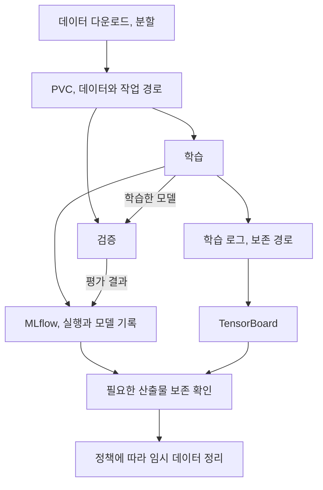

## 먼저, 재료를 매번 택배로 받을지 작업대에 둘지입니다

공정이 바뀔 때마다 같은 무거운 재료를 다시 배송받으면 낭비가 큽니다. 그렇다고 모든 재료를 작업대에 계속 쌓아 둘 수도 없습니다.

이 장은 학습 데이터의 이동, 저장 방식을 개선하고, TensorBoard와 MLflow로 실행을 서로 다른 깊이에서 관찰합니다. 이후 같은 원칙을 영화 추천 모델에 적용합니다.

## 9.1 PersistentVolumeClaim으로 데이터 저장하기

앞선 파이프라인의 반복 다운로드를 줄이기 위해, 책은 PVC를 만들고 여러 컴포넌트에서 마운트하는 구조로 바꿉니다.

PersistentVolumeClaim(PVC)은 애플리케이션이 Kubernetes에 저장 공간을 요청하는 객체입니다. 실제 저장 공간인 PV와 연결되어 Pod가 데이터를 사용할 수 있게 합니다.

공유 저장소가 생겼다고 데이터 계보가 자동으로 생기지는 않습니다. 경로의 내용이 덮어써지면 무엇으로 학습했는지 모호해집니다. 실행별 경로, 데이터 버전, 보존, 삭제 시점을 함께 정해야 합니다.

접근 모드도 확인해야 합니다. `ReadWriteOnce`를 “어떤 노드의 여러 Pod든 동시에 자유롭게 접근 가능”으로 읽으면 안 됩니다. 스토리지의 제약과 작업 배치를 함께 봐야 합니다.

### 데이터 접근 메모: PVC와 MinIO 직접 읽기

책은 영화 추천에서 객체 저장소를 직접 읽는 접근도 보여 줍니다.

| 접근 | 유리한 점 | 주의할 점 |
| --- | --- | --- |
| 볼륨에 준비 후 읽기 | 반복 로컬, 볼륨 접근을 활용 | 초기 복사, 용량, 마운트와 수명 관리 |
| 객체 저장소에서 직접 읽기 | 전체 복사를 줄이고 시작 가능 | 네트워크, 읽기 패턴, 라이브러리 지원 |

큰 이미지와 여러 번 순회할 학습, 상대적으로 다루기 쉬운 표 데이터가 같은 최적해를 갖지는 않습니다. MinIO 같은 객체 저장소를 일반 POSIX 파일시스템과 똑같이 취급하지 않는 것도 중요합니다.

## 9.2 TensorBoard로 학습 추적하기

TensorBoard는 한 학습 실행 내부에서 손실 곡선과 학습 상태를 살피는 데 유용합니다. MLflow는 여러 실행의 설정, 결과를 검색하고 모델 버전과 연결하는 데 유용합니다.

| 알고 싶은 것 | 먼저 살펴볼 곳 |
| --- | --- |
| 학습 중 손실과 검증 지표가 어떻게 변했는가? | TensorBoard의 실행 내부 시각화 |
| 어떤 설정을 쓴 실행이 더 좋았는가? | MLflow의 실행 비교 |
| 배포된 모델은 어느 실행에서 나왔는가? | 모델 레지스트리와 실행 기록 |

둘 다 쓰는 것이 필수는 아닙니다. 중요한 것은 질문에 맞는 관측값이 있고, 로그와 모델 산출물이 서로 연결되어 있는지입니다. TensorBoard가 읽을 로그를 담은 볼륨을 너무 일찍 삭제하면 관측 창문도 사라집니다.

## 9.3 영화 추천 프로젝트

책은 PyTorch의 행렬 분해 모델로 사용자와 영화의 잠재 표현을 학습합니다. 학습 전에 스키마와 데이터 타입 등 기본 QA를 다시 확인합니다.

평가에서는 precision, recall, RMSE 등을 다룹니다. 평점 예측 오차가 작다는 사실과 사용자가 실제로 좋아할 추천 목록을 상위에 놓는 능력은 같지 않습니다. 책의 예시 지표를 출발점으로 삼되, 실제 서비스에서는 추천 목록의 정의와 평가 대상을 명확하게 해야 합니다.

학습 결과는 MLflow에 기록하고 모델을 등록합니다. 저장소 직접 접근과 MLflow 서버를 통한 아티팩트 프록시 접근도 구분합니다. 직접 접근은 학습 환경의 저장소 권한이 필요하고, 프록시 방식은 접근 경로를 단순화하지만 서버에 전송 부담이 모일 수 있습니다.

## 실무 적용: 저장소 선택은 벤치마크로 결정합니다

PVC와 객체 저장소는 실제 데이터와 학습 코드, 네트워크에서 측정한 전체 실행 비용으로 비교해야 한다.

| 측정 항목 | 나누어 볼 것 |
| --- | --- |
| 시작 지연 | 스케줄 대기, 볼륨 준비, 이미지, 데이터 다운로드 |
| 실행 시간 | 데이터 읽기, 전처리와 모델 연산 |
| 반복 효과 | 최초 실행과 캐시가 있는 실행 |
| 자원 효율 | GPU 유휴, CPU, 메모리, 스토리지, 네트워크 병목 |
| 결과 비용 | 실패, 재시도를 포함한 유효 모델 한 개의 비용 |
| 동시 실행 | 단일 실행 성능과 여러 팀의 동시 실행 간섭 |

분산 스토리지의 볼륨 읽기도 네트워크를 사용할 수 있으므로, “PVC는 항상 로컬 디스크 속도”라고 가정하지 않습니다. 파일 개수와 크기, 반복 접근 방식, 스토리지, 접근 모드가 결과에 영향을 줍니다.

정리는 성공 경로뿐 아니라 실패, 취소 경로에서도 생각해야 합니다. 남은 PVC와 로그를 무작정 지우지 말고, 실행 소유자, 보존 기한, 모델 등록 상태를 확인하는 정책을 둡니다.

## 데이터와 산출물의 보존 기간

데이터셋, 임시 전처리 파일, TensorBoard 로그와 등록 모델은 필요한 기간이 다르다.

| 대상 | 누가 읽는가? | 언제까지 필요한가? | 삭제 전에 남길 정보는? |
| --- | --- | --- | --- |
| 학습 데이터 사본 | 학습, 검증 컴포넌트 | 실행 또는 재현 정책에 따름 | 원본 버전과 변환 조건 |
| 학습 로그 | 개발자, 분석 도구 | 비교, 디버깅 기간 | 실행 식별자와 보존 위치 |
| 모델 산출물 | 서빙, 검증, 롤백 절차 | 모델 보존 정책에 따름 | 실행, 데이터, 평가와의 연결 |

저장 비용을 줄이더라도 재현과 장애 조사에 필요한 정보는 남아 있어야 한다.

## 북클럽 토론

Q. 가장 빠르게 학습을 시작하는 데이터 접근 방식이 항상 좋을까요?

아닙니다. 전체 학습 시간과 네트워크 비용, 반복 읽기, 저장 용량까지 비교해야 합니다. 시작 지연 하나만으로 판단하면 안 됩니다.

Q. 추천 모델의 RMSE가 좋아졌는데 사용자 만족이 떨어질 수 있나요?

그럴 수 있습니다. 예측 오차와 상위 추천의 관련성, 다양성은 다른 성질입니다. 지표가 어떤 사용자 경험을 대신 측정하는지 토론해 보세요.

자주 빠지는 함정: PVC를 쓰면 모든 데이터 전달 문제가 해결된다고 생각하거나, 모델은 남겼지만 그 실행을 설명할 로그와 설정은 삭제하는 것입니다.

## 한 줄 정리

학습 파이프라인의 확장은 더 큰 연산 자원뿐 아니라, 데이터 이동 비용과 실행 이력의 보존을 함께 설계하는 일입니다.

[이전: 08. 학습과 검증 I](../08-training-and-validation-1/), [시리즈 목차](../), [다음: 10. 추론과 서빙](../10-inference-and-serving/)
