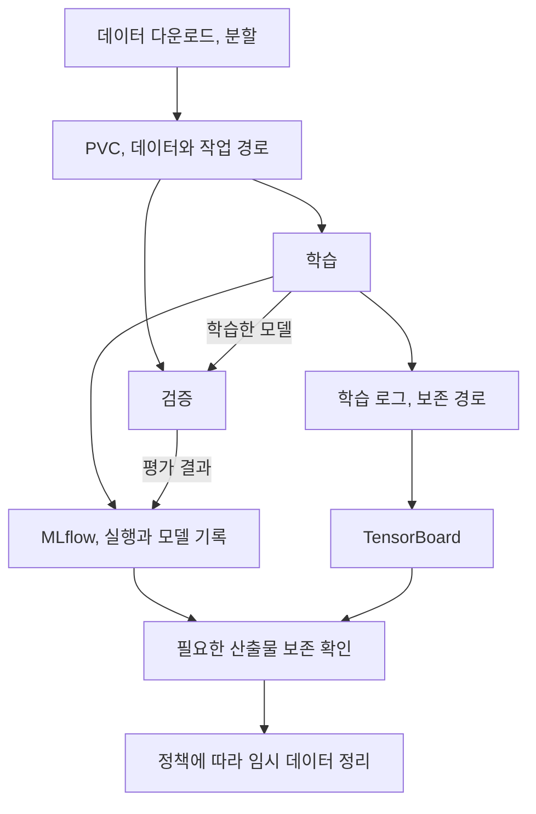

학습이 오래 걸릴 때 모델 연산만 느린 것은 아니다. 9장은 PVC로 반복적인 데이터 이동을 줄이고 TensorBoard와 MLflow로 학습 과정을 살핀다. 저장소 이름보다 **데이터를 읽는 방식과 전체 실행 시간**이 어떻게 바뀌는지를 기준으로 정리했다.

## 9.1 PersistentVolumeClaim으로 데이터 저장하기

반복 다운로드를 줄이도록 PVC를 만들어 여러 컴포넌트에서 마운트한다.

PersistentVolumeClaim(PVC)은 Kubernetes에 저장 공간을 요청해 PersistentVolume(PV)과 연결하고 Pod에 제공한다.

공유 저장소만으로 계보가 생기지는 않는다. 경로를 덮어쓰지 말고 실행별 데이터 버전과 보존, 삭제 시점을 기록한다.

`ReadWriteOnce`는 모든 노드의 Pod가 자유롭게 공유한다는 뜻이 아니다. 스토리지 제약과 작업 배치를 확인한다.

### 데이터 접근 메모: PVC와 MinIO 직접 읽기

책은 영화 추천에서 객체 저장소를 직접 읽는 접근도 보여 준다.

| 접근 | 유리한 점 | 주의할 점 |
| --- | --- | --- |
| 볼륨에 준비 후 읽기 | 반복 로컬, 볼륨 접근을 활용 | 초기 복사, 용량, 마운트와 수명 관리 |
| 객체 저장소에서 직접 읽기 | 전체 복사를 줄이고 시작 가능 | 네트워크, 읽기 패턴, 라이브러리 지원 |

반복 학습할 큰 이미지와 표 데이터의 저장 최적점은 다르다. MinIO는 POSIX 파일시스템과 같지 않다.

## 9.2 TensorBoard로 학습 추적하기

TensorBoard는 단일 실행의 손실, 상태를, MLflow는 실행 간 설정, 결과와 모델 버전을 관리한다.

| 알고 싶은 것 | 먼저 살펴볼 곳 |
| --- | --- |
| 학습 중 손실과 검증 지표가 어떻게 변했는가? | TensorBoard의 실행 내부 시각화 |
| 어떤 설정을 쓴 실행이 더 좋았는가? | MLflow의 실행 비교 |
| 배포된 모델은 어느 실행에서 나왔는가? | 모델 레지스트리와 실행 기록 |

두 도구를 모두 쓸 필요는 없지만 로그와 모델은 연결해야 한다. TensorBoard 로그 볼륨을 일찍 지우면 분석할 수 없다.

## 9.3 영화 추천 프로젝트

PyTorch 행렬 분해로 사용자와 영화의 잠재 표현을 학습하며 먼저 스키마와 데이터 타입을 검사한다.

precision, recall, RMSE를 평가한다. 평점 오차와 선호 항목의 상위 노출은 다르므로 추천 목록과 평가 대상을 정의한다.

학습 결과를 MLflow에 기록, 등록하고 저장소 직접 접근과 artifact proxy를 구분한다. 전자는 학습 환경 권한, 후자는 서버 전송 부하를 고려한다.

## 저장소를 비교할 기준

PVC와 객체 저장소는 실제 데이터, 코드, 네트워크로 전체 실행 비용을 비교한다.

| 측정 항목 | 나누어 볼 것 |
| --- | --- |
| 시작 지연 | 스케줄 대기, 볼륨 준비, 이미지, 데이터 다운로드 |
| 실행 시간 | 데이터 읽기, 전처리와 모델 연산 |
| 반복 효과 | 최초 실행과 캐시가 있는 실행 |
| 자원 효율 | GPU 유휴, CPU, 메모리, 스토리지, 네트워크 병목 |
| 결과 비용 | 실패, 재시도를 포함한 유효 모델 한 개의 비용 |
| 동시 실행 | 단일 실행 성능과 여러 팀의 동시 실행 간섭 |

분산 PVC도 네트워크를 쓸 수 있다. 파일 수, 크기, 반복 접근, 스토리지, 접근 모드가 성능을 바꾼다.

성공, 실패, 취소별 정리 정책을 두고 PVC와 로그는 소유자, 보존 기한, 등록 상태를 확인한 뒤 삭제한다.

## 데이터와 산출물의 보존 기간

데이터셋, 임시 전처리 파일, TensorBoard 로그와 등록 모델은 필요한 기간이 다르다.

| 대상 | 누가 읽는가? | 언제까지 필요한가? | 삭제 전에 남길 정보는? |
| --- | --- | --- | --- |
| 학습 데이터 사본 | 학습, 검증 컴포넌트 | 실행 또는 재현 정책에 따름 | 원본 버전과 변환 조건 |
| 학습 로그 | 개발자, 분석 도구 | 비교, 디버깅 기간 | 실행 식별자와 보존 위치 |
| 모델 산출물 | 서빙, 검증, 롤백 절차 | 모델 보존 정책에 따름 | 실행, 데이터, 평가와의 연결 |

저장 비용을 줄여도 재현과 장애 조사에 필요한 정보는 보존한다.

## 데이터 접근 비용과 추천 품질

### 시작 지연과 전체 학습 비용

데이터 접근은 전체 학습 시간, 네트워크, 반복 읽기, 저장 용량으로 비교한다.

### RMSE와 추천 경험의 차이

RMSE와 상위 추천의 관련성, 다양성은 다르다. 지표가 대변하는 사용자 경험을 확인한다.

PVC도 경로, 수명, 접근 모드를 정해야 한다. 로그, 설정 없이 모델만 보관하면 실행 차이를 설명하기 어렵다.

## 마치며

학습 지연은 데이터 복사, 스케줄 대기, 모델 연산으로 나눠 병목을 찾는다. TensorBoard와 MLflow는 서로 다른 질문에 답하므로 로그와 산출물도 목적에 맞게 보존한다.

[이전: 08. 학습과 검증 I](../08-training-and-validation-1/), [시리즈 목차](../), [다음: 10. 추론과 서빙](../10-inference-and-serving/)
