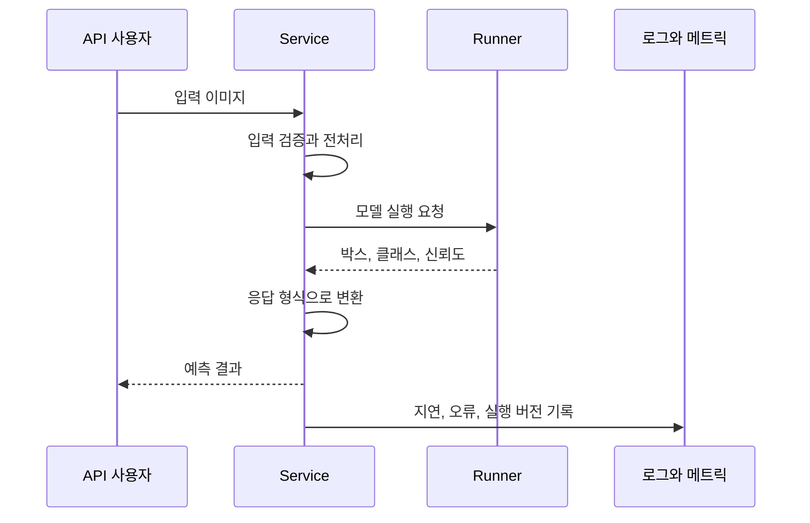

## 먼저, 엔진과 자동차는 다릅니다

엔진이 잘 돈다고 사람이 바로 운전할 수는 없습니다. 입력을 받는 장치, 결과를 전달하는 장치, 상태를 확인하는 계기판이 필요합니다.

추론(inference)이 모델을 실행해 예측을 만드는 일이라면, 서빙(serving)은 다른 사용자가 그 예측 기능을 안정적으로 쓰게 만드는 일입니다. 이 장은 신분증 탐지 모델을 API로 서비스하며 그 차이를 구체화합니다.

## 10.1 모델 배포가 어려운 이유

실시간 요청인지 배치인지, CPU와 GPU 중 무엇을 쓸지, 동시에 몇 요청을 받을지, 어떤 버전을 실행할지 정해야 합니다. 전처리와 출력 규격도 서비스의 일부입니다.



객체 탐지에서는 이미지 업로드와 박스, 클래스, 신뢰도 반환이 인터페이스가 됩니다. 책은 예측 결과를 반환하는 API뿐 아니라 탐지 결과를 그린 이미지를 얻는 경로도 보여 줍니다.

## 10.2 BentoML

BentoML은 모델과 서비스 코드를 배포할 단위로 묶는 경로를 제공한다. 프레임워크가 달라도 서비스 인터페이스와 패키징 절차를 공통화하려는 목적이다.

## 10.3 BentoML 구조 살펴보기

### 10.3.1 Service와 Runner

책의 BentoML 구성에서 Service는 요청 처리 흐름, Runner는 모델 실행 작업을 담당합니다. 모델 로딩과 예측을 API 입출력 처리와 구분하면 실행 자원과 병목을 생각하기 쉽습니다.

여러 Runner를 연결해 전처리와 모델을 나누거나 여러 모델을 사용하는 흐름도 만들 수 있습니다. 하지만 구성 요소를 늘린다고 자동으로 빨라지는 것은 아닙니다. 데이터 전달과 작업 간 의존성도 비용이 됩니다.

비동기 호출의 `await`는 작업 결과가 필요해질 때까지 협력적으로 기다리는 방식입니다. 비동기 코드라는 이유만으로 CPU, GPU 계산 자체가 병렬화되거나 모델 지연이 줄어드는 것은 아닙니다.

이 구조는 책의 BentoML 1.1 계열 예제를 읽기 위한 설명입니다. 실습에서는 책의 의존성 버전과 현재 문서의 API를 섞지 않아야 합니다.

## 10.4 BentoML Service 로컬 실행

학습한 모델을 로드하고 API의 입력, 출력과 실제 예측을 확인한다. 아래 내용은 모델 실행과 상태 확인을 묶어 읽은 메모다.

### 10.4.1 Runner에서 모델 로드

모델 초기화와 요청별 추론을 나눠 확인한다. 매 요청마다 무거운 모델을 다시 읽지 않는지도 점검할 부분이다.

### 상태 확인: 살아 있음과 요청을 받을 준비

서빙에는 상태 확인과 메트릭 경로가 필요하다.

| 관점 | 확인할 질문 |
| --- | --- |
| Liveness | 프로세스가 살아 있고 복구 가능한 상태인가? |
| Readiness | 모델 로딩 등을 마쳐 지금 트래픽을 받아도 되는가? |
| 메트릭 | 요청 지연, 오류, 처리량은 어떤가? |
| 모델 품질 | 예측이 실제 문제를 잘 해결하는가? |

Readiness와 liveness를 같은 검사로 취급하면 초기화 중인 모델을 계속 재시작하는 등 문제가 생길 수 있다. 정확한 경로와 응답 의미는 사용하는 버전에서 확인해야 한다.

## 10.5 Bento 빌드

로컬에서 서비스가 동작하면 `bentofile.yaml`을 통해 코드, 모델, 의존성을 Bento로 묶고, 컨테이너로 만들어 실행할 수 있습니다.

### 10.5.1 Bento 태그와 버전

이때 서비스 버전을 명시적으로 선택해야 합니다. 이름만 참조해 최신 버전을 암묵적으로 가져오면 “같은 설정을 재배포했는데 다른 모델이 실행되는” 일이 생길 수 있습니다.

## 10.6 BentoML과 MLflow 추론 연결

MLflow 모델 레지스트리와 연결할 때도 같습니다. 어떤 등록 모델을 선택했는지뿐 아니라 실제로 패키지에 들어간 모델 버전과 서비스 버전의 대응을 남겨야 합니다.

## 10.7 MLflow만으로 추론 서비스 만들기

별도 서빙 도구를 추가하지 않고 기존 모델 관리 체계에서 서비스로 이어지는 대안이다. 필요한 커스텀 처리와 운영 기능이 충족되는지 비교해야 한다.

## 10.8 대안으로서의 KServe

책은 BentoML과 MLflow를 연결하는 방법, MLflow만으로 추론 서비스를 만드는 방법, KServe라는 대안도 비교합니다.

| 도구 | 이 장에서 주목할 관점 |
| --- | --- |
| BentoML | 서비스 로직과 모델 실행을 패키징하는 개발 흐름 |
| MLflow Serving | 기존 모델 관리 흐름에서 추론 서비스로 이어지는 경로 |
| KServe | Kubernetes 중심의 선언적 모델 서빙과 운영 통합 |

표는 제품 전체의 우열이나 최신 기능 비교가 아닙니다. 커스텀 전처리, Kubernetes 운영 역량, 확장 요구와 기존 모델 관리 체계에 따라 선택이 달라집니다.

## 실무 적용: 모델 버전보다 큰 출시 단위를 관리합니다

서비스에 필요한 코드, 가중치, 전처리, 피처와 환경의 호환 조합을 출시 명세(release manifest)로 남길 수 있다.

출시 명세에 필요한 항목. 이미지 digest 등은 실제 빌드에서 얻은 식별자로 채워야 한다.

```yaml
release_id: "id-detector-release-17"
image_digest: "<빌드에서 확인한 불변 이미지 digest>"
model:
  registry_name: id-detector
  version: "42"
preprocessing_version: "3"
api_contract_version: "2"
evaluation_report: "<승인한 평가 보고서 위치>"
previous_release_id: "id-detector-release-16"
```

부하 시험에서는 정상 상태의 평균 지연뿐 아니라 동시 요청, 큰 입력, 콜드 스타트, 포화 시 동작, 외부 피처 조회 지연을 다룹니다. 용량을 넘으면 무한히 대기시키기보다 시간 제한과 백프레셔, 요청 제한을 어떻게 적용할지 정합니다.

카나리 배포는 일부 트래픽으로 새 버전의 영향을 관측하는 방식이고, shadow 실행은 응답에 쓰지 않는 병렬 결과로 비교하는 방식입니다. 둘 다 모델 품질의 정답 라벨이 자동으로 생기지는 않습니다. 비용, 입력 데이터 처리와 관측, 복구 조건을 함께 설계합니다.

## 출시 전 확인할 요청

정상 이미지, 잘못된 파일, 처리에 오래 걸리는 큰 이미지는 각각 응답과 실패 조건이 다르다. 시간 제한, 로그에 남길 정보와 사용자에게 반환할 오류를 확인해야 한다.

모델 초기화 중에 요청이 들어오는 상황도 포함해야 한다. 정상 입력에서 200 OK를 받았다는 사실만으로는 부족하다.

## 북클럽 토론

Q. API가 빠르게 응답하면 좋은 서빙인가요?

지연뿐 아니라 올바른 버전, 입력 검증, 오류 처리, 용량과 품질까지 봐야 합니다. 잘못된 예측을 빨리 반환하는 서비스도 있을 수 있습니다.

Q. 롤백할 때 모델 파일만 이전 버전으로 바꾸면 될까요?

전처리, 의존성, 피처 정의, API 규격이 함께 바뀌었다면 조합이 맞지 않을 수 있습니다. 되돌릴 수 있는 배포 단위를 먼저 정의해야 합니다.

자주 빠지는 함정: 로컬 성공을 운영 준비 완료로 읽거나, `latest`처럼 움직이는 참조만 남겨 실제 배포 버전을 특정하지 못하는 것입니다.

## 한 줄 정리

모델 서빙은 예측 함수를 공개하는 것을 넘어, 입력, 버전, 자원, 상태, 오류를 다루는 서비스 계약을 만드는 일입니다.

[이전: 09. 학습과 검증 II](../09-training-and-validation-2/), [시리즈 목차](../), [다음: 11. 모니터링과 설명가능성](../11-monitoring-and-explainability/)
