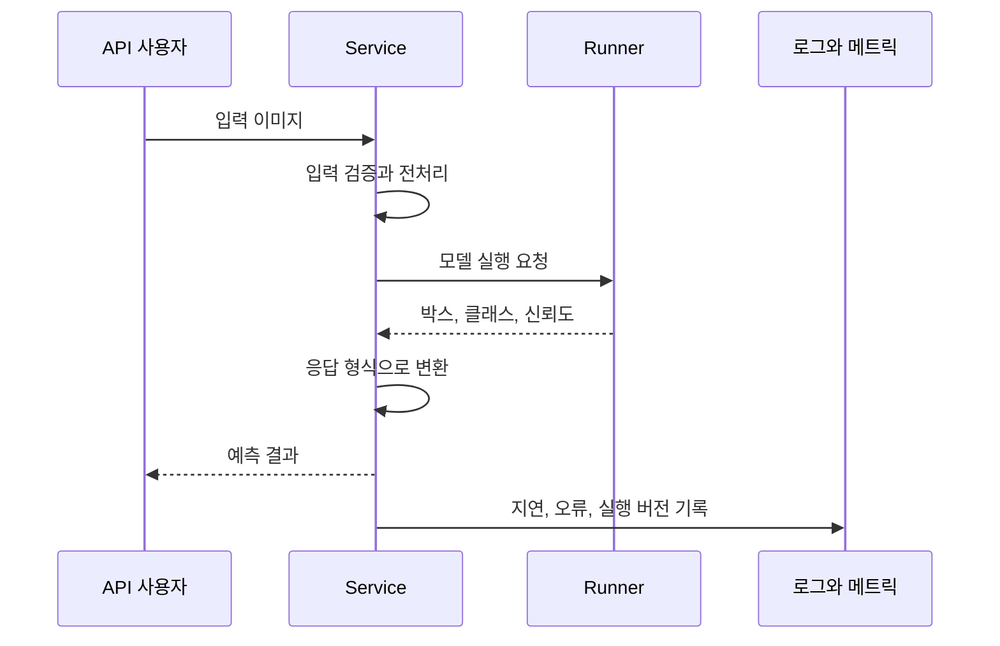

학습한 신분증 탐지 모델을 다른 프로그램이 사용할 수 있게 만드는 장이다. 모델로 예측하는 추론과 그 기능을 안정적으로 제공하는 서빙을 구분하고, **전처리와 출력 형식, 모델 로딩까지 포함한 API**로 보는 데 초점을 맞췄다.

## 10.1 모델 배포가 어려운 이유

실시간 요청인지 배치인지, CPU와 GPU 중 무엇을 쓸지, 동시에 몇 요청을 받을지, 어떤 버전을 실행할지 정해야 한다. 전처리와 출력 규격도 서비스의 일부이다.



객체 탐지 API는 이미지를 받아 박스, 클래스, 신뢰도와 탐지 결과 이미지를 반환한다.

## 10.2 BentoML

BentoML은 프레임워크와 무관하게 모델, 서비스 인터페이스와 패키징을 공통화한다.

## 10.3 BentoML 구조 살펴보기

### 10.3.1 Service와 Runner

책의 BentoML에서 Service는 요청 흐름, Runner는 모델 실행을 맡는다. API 입출력과 분리하면 자원, 병목을 구분하기 쉽다.

여러 Runner를 연결해 전처리와 모델을 나누거나 여러 모델을 사용하는 흐름도 만들 수 있다. 하지만 구성 요소를 늘린다고 자동으로 빨라지는 것은 아니다. 데이터 전달과 작업 간 의존성도 비용이 된다.

`await`는 결과가 필요할 때까지 협력적으로 기다린다. 비동기 코드만으로 CPU, GPU 계산이 병렬화되거나 지연이 줄지는 않는다.

이 구조는 BentoML 1.1 계열 예제에 한정된다. 실습에서 의존성 버전과 최신 API를 섞지 않는다.

## 10.4 BentoML Service 로컬 실행

모델을 로드해 API 입출력과 예측을 확인하고 초기화와 요청 준비 상태를 구분한다.

### 10.4.1 Runner에서 모델 로드

초기화와 요청 추론을 분리하고 매 요청마다 모델을 다시 읽지 않는지 확인한다.

### 상태 확인: 살아 있음과 요청을 받을 준비

서빙에는 상태 확인과 메트릭 경로가 필요하다.

| 관점 | 확인할 질문 |
| --- | --- |
| Liveness | 프로세스가 살아 있고 복구 가능한 상태인가? |
| Readiness | 모델 로딩 등을 마쳐 지금 트래픽을 받아도 되는가? |
| 메트릭 | 요청 지연, 오류, 처리량은 어떤가? |
| 모델 품질 | 예측이 실제 문제를 잘 해결하는가? |

Readiness와 liveness를 혼용하면 초기화 중 모델이 재시작될 수 있다. 경로와 응답 의미는 사용 버전에서 확인한다.

## 10.5 Bento 빌드

`bentofile.yaml`로 코드, 모델, 의존성을 Bento로 묶어 컨테이너로 실행한다.

### 10.5.1 Bento 태그와 버전

이때 서비스 버전을 고정한다. `latest`는 같은 설정에서도 재배포 시 다른 모델을 실행할 수 있다.

## 10.6 BentoML과 MLflow 추론 연결

MLflow Registry에서는 선택 모델, 패키지 버전, 서비스 버전의 대응을 기록한다.

## 10.7 MLflow만으로 추론 서비스 만들기

기존 모델 관리 체계에서 직접 서빙하는 대안이며 커스텀 처리와 운영 기능을 비교한다.

## 10.8 대안으로서의 KServe

책은 BentoML, MLflow 연결, MLflow 단독 서빙, KServe를 비교한다.

| 도구 | 이 장에서 주목할 관점 |
| --- | --- |
| BentoML | 서비스 로직과 모델 실행을 패키징하는 개발 흐름 |
| MLflow Serving | 기존 모델 관리 흐름에서 추론 서비스로 이어지는 경로 |
| KServe | Kubernetes 중심의 선언적 모델 서빙과 운영 통합 |

표는 제품 우열이나 최신 기능 비교가 아니다. 전처리, Kubernetes 역량, 확장, 기존 관리 체계로 선택한다.

## 함께 관리할 출시 정보

서비스에 필요한 코드, 가중치, 전처리, 피처와 환경의 호환 조합을 출시 명세(release manifest)로 남길 수 있다.

출시 명세에는 아래와 같은 정보를 남길 수 있다. 이미지 digest 등은 실제 빌드에서 얻은 식별자와 연결해야 한다.

```yaml
release_id: "id-detector-release-17"
image_digest: "<빌드에서 확인한 불변 이미지 digest>"
model:
  registry_name: id-detector
  version: "42"
preprocessing_version: "3"
api_contract_version: "2"
evaluation_report: "<승인한 평가 보고서 위치>"
previous_release_id: "id-detector-release-16"
```

부하 시험에서는 정상 상태의 평균 지연뿐 아니라 동시 요청, 큰 입력, 콜드 스타트, 포화 시 동작, 외부 피처 조회 지연을 다룬다. 용량을 넘으면 무한히 대기시키기보다 시간 제한과 백프레셔, 요청 제한을 어떻게 적용할지 정한다.

카나리 배포는 일부 트래픽으로 새 버전의 영향을 관측하는 방식이고, shadow 실행은 응답에 쓰지 않는 병렬 결과로 비교하는 방식이다. 둘 다 모델 품질의 정답 라벨이 자동으로 생기지는 않는다. 비용, 입력 데이터 처리와 관측, 복구 조건을 함께 설계한다.

## 출시 전 확인할 요청

정상, 잘못된, 큰 이미지를 시험해 응답, 실패 조건, timeout, 로그, 사용자 오류를 확인한다.

모델 초기화 중에 요청이 들어오는 상황도 포함해야 한다. 정상 입력에서 200 OK를 받았다는 사실만으로는 부족하다.

## 서빙 품질과 롤백 단위

### 응답 속도와 서빙 품질

지연, 버전, 입력 검증, 오류, 용량, 품질을 본다. 빠른 오답도 서비스 실패다.

### 모델과 전처리를 포함한 롤백

전처리, 의존성, 피처, API가 함께 바뀌면 호환 문제가 생기므로 롤백 단위를 정한다.

로컬 응답만으로 부하, 초기화, 오류를 검증할 수 없다. `latest` 대신 실제 배포 버전을 기록한다.

## 마치며

서빙은 모델 정확성, 요청 준비 상태, 실패 입력과 복구까지 관리한다. 롤백은 모델뿐 아니라 코드, 전처리, 환경의 호환 조합을 되돌린다.

[이전: 09. 학습과 검증 II](../09-training-and-validation-2/), [시리즈 목차](../), [다음: 11. 모니터링과 설명가능성](../11-monitoring-and-explainability/)
