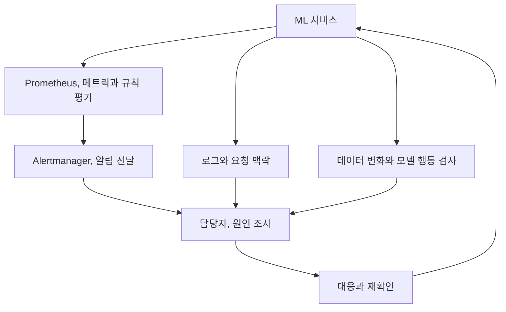

11장은 서비스 상태와 모델의 행동을 어떻게 관찰할지 다룹니다. 기본 메트릭과 로그에 더해 데이터 변화와 예측 결과, 설명가능성까지 확인합니다.

서버가 정상이라는 사실과 모델이 올바르게 예측한다는 사실은 다릅니다. 모니터링 지표를 더 많이 수집하는 것보다 각 지표로 무엇을 알 수 있고 무엇은 아직 모르는지 구분하는 것이 중요하다고 생각했습니다.

## 11.1 모니터링

### 11.1.1 기본 모니터링

CPU, 메모리, 요청 수, 오류율과 지연은 기본입니다. 하지만 서버가 정상이어도 모델은 엉뚱한 결과를 낼 수 있습니다.

### 11.1.2 커스텀 메트릭

책은 탐지 모델의 confidence 분포 같은 애플리케이션 고유 메트릭을 추가합니다. Prometheus의 Histogram으로 관측값을 구간에 나누어 모으면 시간에 따른 분포 변화를 볼 수 있습니다.

| 관측 계층 | 예시 | 알 수 없는 것 |
| --- | --- | --- |
| 시스템 | 지연, 오류율, 자원 사용량 | 예측의 정답 여부 |
| 모델 행동 | confidence, 예측 클래스 비율 | confidence만으로 실제 정확도 확정 |
| 데이터 | 결측, 밝기, 평점 분포 | 모든 개별 예측의 품질 |
| 비즈니스 | 전환, 성공률, 사용자 피드백 | 원인의 자동 식별 |

Confidence는 정답률과 같은 값이 아닙니다. 낮아지는 추세는 조사할 신호이며, 높게 유지된다고 오류가 없다는 보장도 없습니다.

### 11.1.3 로깅

Prometheus와 Grafana가 시간에 따른 수치와 추세를 보여 준다면, 로그는 오류 메시지와 요청 맥락을 제공합니다. 책은 BentoML의 로깅과 Loki를 통한 로그 활용도 다룹니다.

### 11.1.4 알림

알림에서는 Prometheus 규칙이 조건을 평가하고, Alertmanager가 그룹화, 억제, 라우팅 등을 통해 적절한 채널로 전달합니다.

알림에는 담당자와 대응 절차가 필요합니다. 어떤 상태가 얼마나 지속되면 알릴지, 어떤 실행 지침을 따를지 정해야 합니다. 경고 개수 자체는 운영 품질의 지표가 아닙니다.

## 11.2 데이터 드리프트 감지

### 11.2.1 객체 탐지

이미지 데이터에서는 표의 열을 바로 비교할 수 없습니다. 책은 Deepchecks를 이용해 밝기, 대비 같은 이미지 속성을 비교하는 접근을 설명합니다. 밝기를 의도적으로 바꾼 데이터는 감지 흐름을 이해하기 위한 실험이 됩니다.

### 11.2.2 영화 추천

영화 추천에서는 평점과 사용자, 아이템 잠재 표현의 변화를 살핍니다. 여기서 평점 변화가 사용자 취향의 변화인지, 수집 정책이나 추천 노출 변화 때문인지 해석해야 합니다.

별도로 재학습한 행렬 분해 모델은 같은 정보를 다른 좌표계로 표현할 수 있습니다. 모델 버전과 표현 공간을 확인하지 않은 좌표 변화만으로 취향 변화라고 단정할 수는 없습니다.

## 11.3 설명가능성

### 11.3.1 객체 탐지

객체 탐지에서는 Eigen-CAM으로 모델의 내부 표현에서 시각적 단서를 얻습니다. 카드 영역 주변이 강조되는지, 배경에 강하게 반응하는지 살펴볼 수 있습니다.

### 11.3.2 영화 추천

영화 추천에서는 설명가능한 행렬 분해(EMF)를 통해 비슷한 사용자, 아이템의 관계와 추천 설명을 연결합니다. “모델이 추천했으니까”보다 사용자가 이해할 수 있는 근거를 제시하려는 접근입니다.

다만 히트맵이 그럴듯하거나 추천 설명이 자연스럽다는 사실이 인과적 이유, 공정성, 모델의 무결함을 증명하지는 않습니다. 설명은 추가 검증과 이해를 돕는 수단으로 사용해야 합니다.

## SLO와 대응 절차

SLI는 실제 측정값, SLO는 그 측정값으로 정한 내부 목표, SLA는 외부와 약속한 계약입니다. 계약의 정확한 의미와 책임은 조직별 합의에 따릅니다.

가용성 SLI의 개념적 예시는 `기준을 충족한 요청 수 / 측정 대상 요청 수`입니다. 무엇이 측정 대상인지, 시간 제한을 넘긴 요청과 대체 응답을 어떻게 셀지 정의하지 않으면 같은 서비스도 서로 다른 수치가 나옵니다.

| 운영 지표 | 연결할 대응 | 빠뜨리기 쉬운 조건 |
| --- | --- | --- |
| 오류, 지연 SLO | 트래픽, 의존성 확인, 승인된 복구 | 콜드 스타트와 부분 장애 |
| 피처 최신성 | 데이터 생산, 적재 경로 조사 | 메트릭 수집 자체의 중단 |
| 드리프트 | 원인, 영향 확인 후 모델 검토 | 계절성, 적은 표본, 다중 비교 |
| 정답 기반 모델 품질 | 집단별 분석, 후보 평가 | 정답 지연과 선택 편향 |
| 비즈니스 결과 | 업무 담당자와 변화 해석 | 계절, 노출, 정책 변경 등 교란 |

한 번의 임계치 초과보다 지속성과 영향에 따라 알림을 설계합니다. SLO의 오류 예산 소모를 여러 시간 창으로 보는 접근도 검토할 수 있습니다. 긴급 호출, 업무 시간 검토, 대시보드 관찰을 구분하면 알림 피로를 줄이는 데 도움이 됩니다.

사용자 ID나 요청 ID를 메트릭 label로 무한히 붙이면 시계열 수가 폭증할 수 있습니다. 메트릭에는 제한된 범주를, 개별 실행의 상세 맥락에는 권한, 보존 정책을 갖춘 로그, 트레이스를 사용하는 식으로 나눕니다.

## 카메라 변경 이후 실패가 늘었다면

카메라를 바꾼 뒤 신분증 인식 실패가 늘었다면 입력 변화부터 확인할 필요가 있습니다.

해상도와 밝기, confidence 분포, 정답이 있는 평가 샘플을 비교할 수 있습니다. 지연 시간과 시각적 설명도 조명 문제, 전처리 문제, 모델의 한계를 구분하는 단서가 됩니다.

## 더 생각해 볼 부분

Q. Confidence가 낮아지면 사용자 요청을 막아야 할까요?

업무 위험과 대체 절차에 따라 다릅니다. 재촬영 요청이나 수동 확인으로 넘길 수도 있습니다. 근거 없는 일괄 차단보다 영향과 비용을 비교해야 합니다.

Q. 설명가능성은 모델을 믿게 만드는 기능일까요?

믿을 근거를 조사하고 한계를 발견하는 도구에 가깝습니다. 기대와 다른 설명이 나왔을 때 모델이나 평가를 바꿀 수 있어야 의미가 있습니다.

대시보드와 설명 이미지를 만드는 것만으로 검증이 끝나지는 않습니다. 이상이 나타났을 때 누가 어떤 근거로 판단할지까지 연결되어야 합니다.

## 마치며

모니터링은 이상을 발견하는 데, 설명가능성은 원인을 조사하는 데 도움을 줍니다. 다만 confidence와 히트맵 어느 쪽도 모델이 옳다는 증명으로 사용할 수는 없습니다.

이번 장은 관측 결과를 실제 대응으로 연결하는 부분이 특히 중요했습니다. 지표와 로그, 모델 버전이 이어져 있어야 같은 장애를 보고도 원인을 좁혀 갈 수 있겠습니다.

[이전: 10. 추론과 서빙](../10-inference-and-serving/), [시리즈 목차](../), [다음: 12. LLM 기반 시스템](../12-llm-powered-systems/)
