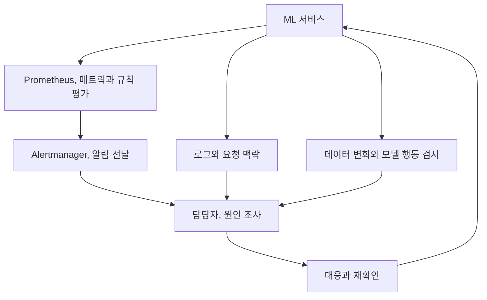

API가 정상 응답해도 모델은 틀릴 수 있다. 11장은 시스템 메트릭과 로그에서 시작해 데이터 변화, 예측 결과와 설명가능성까지 살핀다. **서비스 장애와 모델 품질 문제를 어떤 신호로 구분할지**를 중심으로 정리했다.

## 11.1 모니터링

### 11.1.1 기본 모니터링

CPU, 메모리, 요청 수, 오류율과 지연은 기본이다. 하지만 서버가 정상이어도 모델은 엉뚱한 결과를 낼 수 있다.

### 11.1.2 커스텀 메트릭

탐지 confidence 분포는 앱 메트릭의 예다. Prometheus Histogram은 값을 구간화해 시간별 변화를 보여 준다.

| 관측 계층 | 예시 | 알 수 없는 것 |
| --- | --- | --- |
| 시스템 | 지연, 오류율, 자원 사용량 | 예측의 정답 여부 |
| 모델 행동 | confidence, 예측 클래스 비율 | confidence만으로 실제 정확도 확정 |
| 데이터 | 결측, 밝기, 평점 분포 | 모든 개별 예측의 품질 |
| 비즈니스 | 전환, 성공률, 사용자 피드백 | 원인의 자동 식별 |

Confidence는 정답률이 아니다. 하락은 조사 신호이며 높은 값도 무오류를 보장하지 않는다.

### 11.1.3 로깅

Prometheus, Grafana는 수치, 추세를, 로그는 오류, 요청 맥락을 제공한다. 예제는 BentoML과 Loki도 다룬다.

### 11.1.4 알림

알림에서는 Prometheus 규칙이 조건을 평가하고, Alertmanager가 그룹화, 억제, 라우팅 등을 통해 적절한 채널로 전달한다.

알림 담당자, 지속 시간, 대응 절차를 정한다. 경고 수 자체는 운영 품질 지표가 아니다.

## 11.2 데이터 드리프트 감지

### 11.2.1 객체 탐지

이미지 데이터에서는 표의 열을 바로 비교할 수 없다. 책은 Deepchecks를 이용해 밝기, 대비 같은 이미지 속성을 비교하는 접근을 설명한다. 밝기를 의도적으로 바꾼 데이터는 감지 흐름을 이해하기 위한 실험이 된다.

### 11.2.2 영화 추천

추천의 평점, 잠재 표현 변화를 살펴 취향, 수집 정책, 추천 노출 중 원인을 구분한다.

재학습한 행렬 분해 모델은 잠재 공간이 달라질 수 있어 버전 확인 없이 좌표 변화를 취향 변화로 단정하지 않는다.

## 11.3 설명가능성

### 11.3.1 객체 탐지

객체 탐지에서는 Eigen-CAM으로 모델의 내부 표현에서 시각적 단서를 얻는다. 카드 영역 주변이 강조되는지, 배경에 강하게 반응하는지 살펴볼 수 있다.

### 11.3.2 영화 추천

영화 추천에서는 설명가능한 행렬 분해(EMF)를 통해 비슷한 사용자, 아이템의 관계와 추천 설명을 연결한다. “모델이 추천했으니까”보다 사용자가 이해할 수 있는 근거를 제시하려는 접근이다.

다만 히트맵이 그럴듯하거나 추천 설명이 자연스럽다는 사실이 인과적 이유, 공정성, 모델의 무결함을 증명하지는 않는다. 설명은 추가 검증과 이해를 돕는 수단으로 사용해야 한다.

## SLO와 대응 절차

SLI는 측정값, SLO는 내부 목표, SLA는 외부 계약이다. 의미와 책임은 조직별로 합의한다.

가용성 SLI 예시는 `기준 충족 요청 / 측정 대상 요청`이다. 대상, timeout, 대체 응답 집계 규칙에 따라 값이 달라진다.

| 운영 지표 | 연결할 대응 | 빠뜨리기 쉬운 조건 |
| --- | --- | --- |
| 오류, 지연 SLO | 트래픽, 의존성 확인, 승인된 복구 | 콜드 스타트와 부분 장애 |
| 피처 최신성 | 데이터 생산, 적재 경로 조사 | 메트릭 수집 자체의 중단 |
| 드리프트 | 원인, 영향 확인 후 모델 검토 | 계절성, 적은 표본, 다중 비교 |
| 정답 기반 모델 품질 | 집단별 분석, 후보 평가 | 정답 지연과 선택 편향 |
| 비즈니스 결과 | 업무 담당자와 변화 해석 | 계절, 노출, 정책 변경 등 교란 |

임계치 초과의 지속성과 영향을 기준으로 알린다. 오류 예산을 여러 시간 창으로 보고 긴급 호출, 업무 시간 검토, 대시보드 관찰을 구분한다.

사용자, 요청 ID를 메트릭 label로 쓰면 cardinality가 폭증한다. 메트릭은 제한 범주로, 상세 맥락은 접근, 보존 통제된 로그와 trace로 기록한다.

## 카메라 변경 이후 실패가 늘었다면

카메라 교체 뒤 실패가 늘면 해상도, 밝기, confidence 분포와 정답 샘플을 비교한다. 지연, 시각 설명은 조명, 전처리, 모델 한계를 구분하는 단서다.

## 관측 결과의 해석과 대응

### 낮은 Confidence와 대체 절차

위험과 대체 절차에 따라 재촬영, 수동 확인을 선택하고 일괄 차단의 영향과 비용을 비교한다.

### 설명가능성의 역할과 한계

설명가능성은 근거와 한계를 찾는 수단이며 결과를 모델, 평가 개선으로 연결한다.

대시보드와 설명 이미지에 담당자, 판단 근거, 대응 절차를 연결한다.

## 마치며

모니터링은 이상을, 설명가능성은 원인을 찾는다. Confidence와 히트맵은 정답의 증명이 아니며 지표, 로그, 모델 버전을 대응에 연결한다.

[이전: 10. 추론과 서빙](../10-inference-and-serving/), [시리즈 목차](../), [다음: 12. LLM 기반 시스템](../12-llm-powered-systems/)
