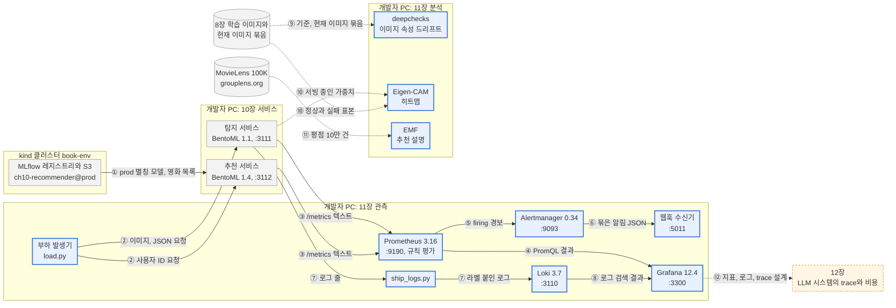
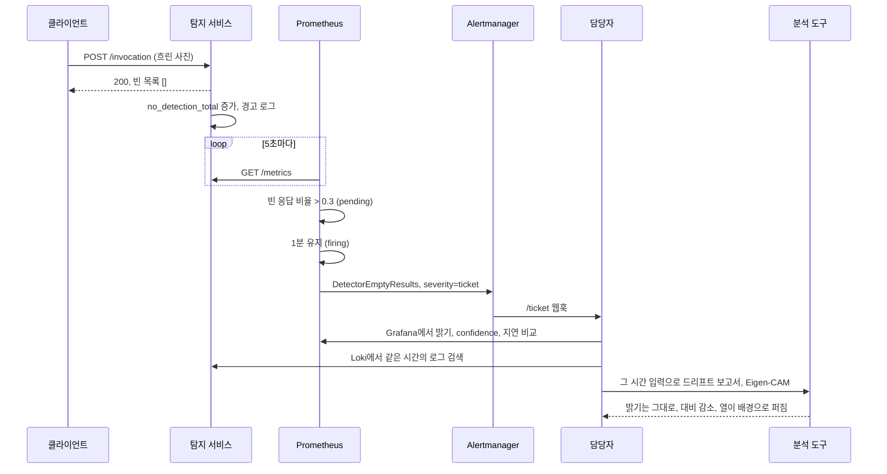

10장이 끝났을 때 두 모델은 요청을 받는 서비스가 되었다. 그런데 응답이 온다는 것과 답이 맞다는 것은 별개의 일이었다. 탐지 서비스는 모든 요청에 200을 돌려주면서도 흐려진 사진에서 카드의 87%를 놓칠 수 있다. 추천 서비스는 10밀리초 만에 답해도 그 답이 사용자의 취향과 멀어질 수 있다. 11장은 이 간극을 다룬다.

책은 운영 지표(11.1), 데이터 드리프트(11.2), 설명가능성(11.3)을 차례로 다룬다. 도구로는 BentoML의 기본 지표와 사용자 정의 지표, Prometheus와 Grafana, Loki, Alertmanager, deepchecks, Eigen-CAM, 설명가능한 행렬 분해(EMF)를 쓴다.

읽으면서 세 군데서 막혔다. 지표와 경보와 드리프트 보고서와 히트맵이 모두 "모니터링"으로 묶여 있어, 각자 어떤 질문에 답하는지 흐려진다. 책의 클러스터 설정과 저자 코드도 서로 맞지 않는다. 책이 3장에서 설치한 Prometheus 차트에는 PodMonitor가 없고, 가져오라는 Grafana 대시보드의 자원 패널은 그 설치로는 비어 있으며, 경보 규칙의 `job` 이름은 그 설치에서 나오지 않는다.

세 번째는 드리프트와 설명 예제다. 두 그림은 책이 말하는 것과 다른 것을 잰다. 추천 드리프트 노트북은 학습 초기값의 차이를 재고, Eigen-CAM 히트맵은 특정 박스와 무관한 주성분을 그린다. 실제로 돌린 과정과 화면은 [실습 순서](/docs/tech/machine-learning-platform-engineering/practice/ch11/#book-ch11-sop)에 있다.

## 전체 그림 {#platform-map}

11장이 하는 일은 서빙 중인 모델을 관측하고, 이상하면 원인을 좁히는 것이다. 아래 그림은 각 구성 요소가 어디서 실행됐고 번호 순서대로 무엇을 넘기는지 보여 준다. 회색은 10장의 서비스와 9장의 레지스트리, 파란 상자는 이 장에서 붙인 관측과 분석, 점선 상자는 12장으로 넘어갈 LLM 시스템의 관측이다.

책은 Prometheus와 Grafana를 클러스터에 Helm으로 설치한다. 이번에는 디스크 여유가 적어 같은 프로그램의 Windows 실행 파일을 PC에서 띄웠다. 서비스도 10장처럼 PC에서 돌기 때문에 수집 대상과 수집기가 한곳에 있다.

| 번호 | 누가 | 무엇을 넘기는가 | 어디에 남는가 | 실습 단계 |
| --- | --- | --- | --- | --- |
| ① | 추천 서비스 초기화 | `ch10-recommender@prod`가 가리키는 모델과 영화 목록 | 서비스 프로세스 메모리 | [B-4](/docs/tech/machine-learning-platform-engineering/practice/ch11/#ch11-b-4) |
| ② | `load.py` | 초당 2장의 이미지, 초당 1건의 추천 요청 | HTTP 응답, 콘솔 요약 | [C-2](/docs/tech/machine-learning-platform-engineering/practice/ch11/#ch11-c-2), [D-3](/docs/tech/machine-learning-platform-engineering/practice/ch11/#ch11-d-3)~[D-5](/docs/tech/machine-learning-platform-engineering/practice/ch11/#ch11-d-5) |
| ③ | Prometheus scrape | 요청 수, 지연 히스토그램, confidence, 밝기, 빈 응답 수 | Prometheus TSDB `ch11\mon\prom-data` | [B-3](/docs/tech/machine-learning-platform-engineering/practice/ch11/#ch11-b-3), [C-1](/docs/tech/machine-learning-platform-engineering/practice/ch11/#ch11-c-1) |
| ④ | Grafana | PromQL 질의 결과 | 대시보드 패널 | [C-3](/docs/tech/machine-learning-platform-engineering/practice/ch11/#ch11-c-3) |
| ⑤ | Prometheus 규칙 평가 | `for` 기간을 넘긴 경보와 라벨 | Prometheus Alerts 화면 | [D-1](/docs/tech/machine-learning-platform-engineering/practice/ch11/#ch11-d-1) |
| ⑥ | Alertmanager | 심각도별로 묶은 firing, resolved 알림 | 웹훅 수신기 로그 `webhook.log` | [D-2](/docs/tech/machine-learning-platform-engineering/practice/ch11/#ch11-d-2) |
| ⑦ | `ship_logs.py` | 서비스 로그 줄과 `app`, `job` 라벨 | Loki `ch11\loki-data` | [D-5](/docs/tech/machine-learning-platform-engineering/practice/ch11/#ch11-d-5) |
| ⑧ | Grafana Explore | LogQL 검색 결과 | 화면 | [D-5](/docs/tech/machine-learning-platform-engineering/practice/ch11/#ch11-d-5) |
| ⑨ | `image_drift.py` | 8장 학습 이미지와 현재 이미지 묶음 | HTML 보고서와 KS 점수 | [E-1](/docs/tech/machine-learning-platform-engineering/practice/ch11/#ch11-e-1), [E-2](/docs/tech/machine-learning-platform-engineering/practice/ch11/#ch11-e-2) |
| ⑩ | `run_cam.py` | 서빙 중인 탐지 가중치, 정상과 실패 표본 | 히트맵 이미지와 박스 안 열 비율 | [F-1](/docs/tech/machine-learning-platform-engineering/practice/ch11/#ch11-f-1), [F-2](/docs/tech/machine-learning-platform-engineering/practice/ch11/#ch11-f-2) |
| ⑪ | `rec_drift.py`, `run_emf.py` | grouplens.org에서 받은 MovieLens 100K 평점 | 드리프트 점수, 추천별 설명 | [E-3](/docs/tech/machine-learning-platform-engineering/practice/ch11/#ch11-e-3), [F-3](/docs/tech/machine-learning-platform-engineering/practice/ch11/#ch11-f-3) |
| ⑫ | 12장 | 같은 관측 원칙을 LLM 호출에 적용 | 다음 장 | 이 장에서는 다루지 않음 |

실선과 점선을 나눠 보면 그림이 쉽게 읽힌다. ②~⑧의 실선은 서비스가 도는 동안 계속 흐르는 신호다. 몇 초 단위로 쌓이고, 사람이 보지 않아도 규칙이 평가한다.

⑨~⑪의 점선은 누군가 표본을 모아 따로 돌리는 분석이다. 드리프트 보고서와 히트맵은 저절로 울리지 않는다. 경보가 울린 뒤 원인을 좁히거나 정기 점검 때 쓴다. 책은 둘을 한 장에 나란히 놓았지만, 실행 주기도 책임지는 사람도 다르다.

경보 하나가 울린 뒤 사람이 원인을 찾아가는 흐름은 아래와 같다. [D-3](/docs/tech/machine-learning-platform-engineering/practice/ch11/#ch11-d-3)에서 흐린 사진을 보냈을 때 실제로 지나간 경로다.

## 무엇을 관측하는가: 세 개의 층 {#what-to-watch}

책 11.1.1은 기본 모니터링을 자원 사용량과 요청 지표로 나누고, 11.2는 데이터 드리프트를 따로 다룬다. 한 단계 더 나누면 질문이 분명해진다. 서비스가 응답하는가. 들어오는 입력이 학습 때와 닮았는가. 모델의 답이 맞는가. 세 질문은 신호를 얻는 비용도, 걸리는 시간도 다르다.

| 층 | 묻는 것 | 이번 실습의 신호 | 얻는 시점 | 이것만으로 알 수 없는 것 |
| --- | --- | --- | --- | --- |
| 서비스 | 응답하는가, 얼마나 빨리, 얼마나 실패하는가 | `up`, 요청 수, 응답 코드, 지연 히스토그램, 진행 중 요청 수 | 즉시 | 답의 내용이 맞는지 |
| 데이터 | 입력이 학습 때와 닮았는가 | 입력 밝기 히스토그램, deepchecks 이미지 속성 분포, 평점 분포 | 표본이 모인 뒤 | 그 변화가 모델을 해치는지 |
| 모델 | 답이 맞는가 | 빈 응답 비율, confidence 분포(대리 지표), 정답이 생긴 뒤의 정확도 | 대리 지표는 즉시, 정답은 늦게 | 대리 지표와 실제 정확도의 관계 |

서비스 층은 Google SRE 책의 네 가지 황금 신호로 정리된다. 지연(latency), 트래픽(traffic), 오류(errors), 포화(saturation)다. BentoML 기본 지표가 앞의 셋을 덮고, 진행 중 요청 수가 포화를 대신한다. 책이 Grafana 대시보드로 보여 주는 CPU와 메모리도 포화 쪽 지표다.

**세 층은 서로를 대신하지 못한다.** [D-3](/docs/tech/machine-learning-platform-engineering/practice/ch11/#ch11-d-3)에서 흐린 사진을 4분 동안 보냈을 때 HTTP 응답은 모두 200이었고 지연 p95도 100밀리초 안쪽이었다. 서비스 층만 보면 아무 일도 없었다. 그런데 같은 4분 동안 카드가 있는 사진의 87%(60장 중 52장)에서 박스가 나오지 않았다.

반대 경우도 있었다. 사진을 어둡게만 바꾸자 입력 밝기가 138에서 48로 떨어졌고, 데이터 층의 드리프트 점수는 최대치가 됐다. 그래도 모델은 60장 중 59장을 찾았다. confidence 중앙값도 0.98에서 0.91로 조금 내려가는 데 그쳤다. 데이터가 바뀌는 일과 모델이 틀리는 일은 따로 일어난다.

모델 층의 진짜 지표는 정답과 비교한 정확도다. 문제는 서빙 중에는 정답이 없다는 것이다. 신분증 탐지라면 사람이 검수하거나 사용자가 재촬영을 요청할 때 비로소 정답이 생긴다. 추천이라면 사용자가 클릭하거나 평점을 남길 때까지 기다려야 한다.

그 사이를 메우는 것이 대리 지표다. 책은 confidence 히스토그램을 예로 들고, 이 실습은 박스가 하나도 없는 응답의 비율을 더했다. 대리 지표는 정답과 상관이 있을 때만 쓸모가 있으니, 정답이 모이면 둘의 관계를 다시 확인해야 한다. 8장에서 검토한 [수동 검토](/docs/tech/machine-learning-platform-engineering/practice/ch08/#f-수동-검토)가 그런 정답을 만드는 일이다.

## Prometheus의 지표 모델 {#prometheus-model}

Prometheus는 서비스가 내보낸 `/metrics` 텍스트를 정해진 간격으로 가져간다(pull). 서비스는 숫자를 메모리에 쌓아 두기만 하고, 언제 읽을지는 Prometheus 설정이 정한다. 3장 [3.5](/docs/tech/machine-learning-platform-engineering/03-kubernetes-foundation/#35-prometheus와-grafana)에서 본 지표 유형이 여기서 실제로 쓰인다.

| 유형 | 서비스에서 하는 일 | 질의에서 하는 일 | 이번 실습의 예 |
| --- | --- | --- | --- |
| Counter | 사건마다 1씩 더한다. 재시작하면 0 | `rate()`로 초당 증가율을 구한다 | `bentoml_api_server_request_total`, `no_detection_total` |
| Gauge | 현재 값을 덮어쓴다 | 값을 그대로 본다 | `bentoml_api_server_request_in_progress` |
| Histogram | 값이 들어갈 구간(bucket)의 개수를 더한다 | `histogram_quantile()`로 분위수를 추정한다 | 요청 지연, `confidence_score`, `input_brightness` |

Histogram은 개별 값을 저장하지 않고 구간별 누적 개수만 남긴다. 그래서 분위수는 구간 경계 사이를 직선으로 보간한 추정값이고, 마지막 구간을 넘는 값은 표현하지 못한다. BentoML 1.1의 지연 구간은 10초에서 끝난다. [D-4](/docs/tech/machine-learning-platform-engineering/practice/ch11/#ch11-d-4)에서 요청이 30초 넘게 걸렸는데도 Grafana의 p95가 10초에 붙어 있던 이유다.

책은 confidence에 0.1 간격 구간을 썼다. 값이 0과 1 사이이니 무난한 선택이다. 다만 탐지 모델은 값 대부분이 0.9 이상에 몰리므로, 위쪽 구간을 더 잘게 나누는 편이 변화를 잘 잡는다.

라벨은 같은 지표를 나눠 보는 축이다. `http_response_code="500"`처럼 값이 몇 가지로 정해진 라벨은 괜찮다. 사용자 ID나 요청 ID를 라벨로 쓰면 값마다 별도 시계열이 생기고, Prometheus의 메모리가 감당하지 못한다. 이것을 cardinality 폭증이라 부른다. 사용자별 정보는 로그나 trace에 남기고, 지표 라벨에는 엔드포인트, 응답 코드, 모델 버전처럼 개수가 제한된 값만 쓴다.

수집하는 쪽에서 붙는 라벨도 있다. Prometheus는 수집 대상마다 `job`, `instance`를 붙이고, 책의 Yatai PodMonitor는 `namespace`, `yatai_ai_bento_deployment`, `endpoint` 같은 라벨을 더한다. 서비스가 내보낸 라벨과 이름이 겹치면 서비스 쪽 라벨에 `exported_` 접두사가 붙는다.

BentoML이 내보내는 `endpoint="/invocation"`이 클러스터에서 `exported_endpoint`로 바뀌는 것이 이 때문이다. 책이 가져오라는 대시보드도 `exported_endpoint`로 질의한다. 이번 실습은 PC에서 수집하므로 같은 라벨을 정적으로 붙여 이 동작을 재현했다([C-1](/docs/tech/machine-learning-platform-engineering/practice/ch11/#ch11-c-1)).

BentoML 1.1에서 API 서버와 Runner는 별도 프로세스이고, API 서버도 여러 개 뜬다. 프로세스마다 따로 세면 `/metrics` 요청이 어느 프로세스에 걸리느냐에 따라 값이 달라진다. 그래서 BentoML은 `prometheus_client`의 다중 프로세스 모드로 모든 프로세스의 값을 한 폴더의 파일로 모은다. Runner 안에서 증가시킨 `confidence_score`가 API 서버의 `/metrics`에 나타나는 것도 이 덕분이다.

지표 이름은 BentoML 버전마다 다르다. 1.1은 `bentoml_api_server_request_total`과 `bentoml_runner_request_total`을 내보내고, 클래스 기반 API를 쓰는 1.2 이후는 `bentoml_service_request_total`을 내보낸다. 책의 대시보드는 앞의 이름으로 질의한다. 그래서 1.4로 띄운 추천 서비스는 대시보드의 배포 목록에 아예 나타나지 않는다. 10장에서 두 서비스의 BentoML 버전이 갈린 대가를 여기서 대시보드 두 벌로 치른다.

## 대시보드, 경보, SLO {#dashboards-alerts-slo}

대시보드, 경보, SLO는 같은 지표를 쓰지만 목적이 다르다. 대시보드는 사람이 볼 때만 의미가 있다. 경보는 아무도 보지 않을 때를 위한 것이고, 누군가에게 지금 움직이라고 요구한다. SLO는 어느 정도의 실패까지 받아들일지 미리 합의한 목표이며, 경보를 언제 울릴지 정하는 근거가 된다.

| 구성 | 답하는 질문 | 이번 실습 | 잘못 쓰면 |
| --- | --- | --- | --- |
| 대시보드 | 지금과 지난 한 시간에 무슨 일이 있었나 | BentoDeployment 대시보드, ch11 모델 대시보드 | 패널은 많은데 아무도 보지 않는다 |
| 경보 규칙 | 지금 누군가 움직여야 하나 | 서비스 중단, 오류 예산 소진, 빈 응답 비율 | 울려도 할 일이 없는 경보가 쌓여 무시된다 |
| SLO | 얼마나 실패해도 되는가 | 30일 동안 `/invocation` 요청의 99%가 1초 안에 5xx 없이 응답 | 목표 없이 임계치를 감으로 정한다 |
| 라우팅 | 누구에게 어떻게 알리나 | `critical`, `page`는 당직 웹훅, `ticket`은 일반 웹훅 | 모든 경보가 같은 채널로 가서 묻힌다 |

SLO가 99%라면 요청의 1%는 실패해도 된다. 이 여유를 오류 예산(error budget)이라 부른다. 소진 속도(burn rate)는 지금의 실패율이 그 여유의 몇 배인지를 나타낸다. 실패율이 10%면 소진 속도는 10이고, 그대로 가면 30일 예산을 3일에 다 쓴다.

단순히 "오류율 > 5%"로 경보를 걸면 짧은 튐에도 울리고, 오래 이어지는 1% 오류는 놓친다. 그래서 긴 창과 짧은 창을 함께 본다. 긴 창은 잠깐의 튐이 아님을, 짧은 창은 지금도 계속되고 있음을 확인한다. 운영에서는 흔히 1시간과 5분, 6시간과 30분을 짝짓는다. 이번 실습은 몇 분 안에 경보를 보려고 5분과 1분으로 줄였다([D-1](/docs/tech/machine-learning-platform-engineering/practice/ch11/#ch11-d-1)).

경보 규칙의 `for`는 조건이 그 시간 동안 계속 참이어야 firing이 된다는 뜻이다. 그 전까지는 pending 상태다. 책은 5분을, 이 실습은 1분을 썼다.

Alertmanager는 firing 경보를 받아 라벨로 묶고(`group_by`), 경로(`routes`)에 따라 수신자를 고르고, 같은 원인에서 나온 부수 경보를 억제한다(`inhibit_rules`). 억제가 없으면 서비스 하나가 죽었을 때 지연 경보와 빈 응답 경보까지 따로 울리고, 담당자는 셋을 따로 조사하게 된다.

실습에서 걸린 함정이 둘 있다. 하나는 서버 지표의 범위다. 서버 지표에는 서버가 받아서 끝낸 요청만 남는다. [D-4](/docs/tech/machine-learning-platform-engineering/practice/ch11/#ch11-d-4)에서 처리가 밀리자 클라이언트는 30초 만에 연결을 끊었는데, 서버는 그 요청을 계속 처리했고 일부는 49초 뒤에야 503으로 끝났다. 클라이언트가 본 실패와 서버가 센 실패는 시점도 개수도 다르다. 사용자 경험을 SLO로 삼으려면 로드밸런서나 클라이언트 쪽에서도 재야 한다.

다른 하나는 해소 알림이다. Alertmanager의 resolved 알림은 마지막 firing 때의 주석을 그대로 싣는다. 오류 예산 경보가 해소됐다는 알림에 "61.02배로 소진 중"이라고 찍혀 있었다. 해소 알림의 숫자는 현재 값으로 읽으면 안 된다.

## 로그는 지표가 답하지 못하는 질문에 답한다 {#logging}

지표는 "얼마나"를 싸게 알려 주지만 "왜"는 알려 주지 않는다. 오류 예산 경보가 울렸을 때 원인이 시간 초과인지, 모델 파일 손상인지, 입력 형식 문제인지는 로그의 예외 메시지와 스택 트레이스를 봐야 안다. 책 11.1.3은 BentoML 로거에 처리기를 붙이고, Loki로 로그를 모아 Grafana에서 지표와 같은 화면에서 검색한다.

Loki는 로그 본문이 아니라 라벨만 색인한다. `{app="yolo-v8"}`처럼 라벨로 범위를 좁힌 뒤 `|= "ERROR"`처럼 본문을 훑는 방식이다. 그래서 Loki 라벨도 Prometheus 라벨과 같은 규칙을 따른다. 서비스 이름, 환경, 수준처럼 개수가 적은 값만 라벨로 쓰고, 요청 ID는 본문에 둔다.

로그와 지표의 라벨이 같은 값을 가리키게 맞춰 두면(`app`과 `yatai_ai_bento_deployment`처럼) 편해진다. Grafana에서 패널의 시간대를 골라 같은 서비스의 로그로 바로 넘어갈 수 있다.

책의 리스팅 11.1을 그대로 쓰면 로그가 두 번씩 찍힌다. BentoML 1.1이 이미 `bentoml` 로거에 콘솔 처리기를 달아 두었는데, 같은 로거에 처리기를 하나 더 붙이기 때문이다. [D-5](/docs/tech/machine-learning-platform-engineering/practice/ch11/#ch11-d-5)의 Loki 화면에서 같은 오류가 BentoML 형식과 리스팅 11.1 형식으로 나란히 보인다. 로그 양도 경보 기준도 두 배가 되니, 형식만 바꾸고 싶다면 기존 처리기의 formatter를 바꾸거나 BentoML 로깅 설정을 쓴다.

저자 코드는 탐지 결과가 비면 `ERROR` 로그를 남기고 `{"status": "failed"}`를 200으로 돌려준다. 그러면 같은 실패가 로그에는 오류로, 지표에는 성공으로 남는다. 이 실습은 10장의 계약대로 빈 목록을 200으로 돌려주되, 이를 모델 신호로 보고 `no_detection_total` 카운터와 `WARNING` 로그로 남겼다. 무엇이 서비스 실패이고 무엇이 모델의 답인지 먼저 정해야 지표와 로그가 같은 말을 한다.

## 이미지와 추천의 드리프트 {#drift}

드리프트의 개념은 6장 [요청이 정상이어도 입력과 예측 품질은 달라질 수 있다](/docs/tech/machine-learning-platform-engineering/06-productionizing-models/#drift-concepts)에서 소득 분류 표 데이터로 다뤘다. 입력 분포 `P(X)`, 정답 분포 `P(y)`, 둘의 관계 `P(y|X)`가 바뀌는 경우를 나누고, 기준(reference)과 현재(current)를 비교하는 방법이다. 11장은 같은 생각을 이미지와 추천으로 넓힌다. 표 데이터는 열이 곧 비교할 특징이지만, 이미지는 픽셀을 그대로 비교할 수 없으니 비교할 속성부터 정해야 한다.

deepchecks의 `ImagePropertyDrift`는 이미지마다 밝기, RMS 대비, 넓이, 가로세로 비율, 빨강, 초록, 파랑의 상대 강도를 계산한다. 그리고 속성별로 기준 묶음과 현재 묶음의 분포를 Kolmogorov-Smirnov(KS) 통계로 비교한다. KS 점수는 두 누적분포 사이의 최대 거리라서, 0이면 같고 1이면 전혀 겹치지 않는다.

저자 코드의 `run_deepchecks.py`는 책과 달리 `ImageDatasetDrift`를 쓴다. 두 묶음을 구별하는 분류기를 학습해 그 AUC를 드리프트 점수로 삼는 방식이다. 둘 다 "다르다"는 것은 알려 준다. 앞의 것은 어느 속성이 다른지를, 뒤의 것은 여러 속성이 함께 바뀐 경우를 더 잘 보여 준다.

점수를 읽을 때 가장 중요했던 것은 대조군이었다. 8장 학습 이미지 192장을 기준으로 세 묶음을 비교했다. 같은 생성기에서 seed만 바꿔 만든 64장(바뀐 것 없음), 그 64장을 어둡게 한 것, 흐리게 한 것이다.

| 현재 묶음 | 밝기 KS | RMS 대비 KS | 빨강 KS | 모델이 놓친 카드 | confidence 중앙값 |
| --- | --- | --- | --- | --- | --- |
| 새 표본, 변경 없음 | 0.344 | 0.208 | 0.359 | 0/60 | 0.98 |
| 같은 표본, 밝기 0.35배 | 1.000 | 1.000 | 0.370 | 1/60 | 0.91 |
| 같은 표본, 가우시안 흐림 반경 6 | 0.344 | 0.521 | 0.375 | 52/60 | 0.57 |

아무것도 바꾸지 않은 묶음도 밝기 0.34, 빨강 0.36의 점수를 받았다. 새 묶음은 10개 클립에서 나온 64장이라 사실상 독립 표본이 10개 남짓이고, 같은 클립의 프레임은 배경이 같아 분포가 뭉친다. deepchecks 화면은 0.2부터 주황색으로 칠하는데, 이 기준을 그대로 쓰면 대조군부터 경보다. 임계치는 바뀐 것이 없을 때 점수가 얼마나 흔들리는지부터 재고 정해야 한다. 6장에서 50건 창이 87.5%의 열을 드리프트로 판정한 것과 같은 문제다.

나머지 두 줄은 드리프트와 성능이 따로 움직인다는 것을 보여 준다. 어둡게 한 사진은 밝기 관련 점수가 모두 최대인데 모델은 거의 다 찾았다. 흐린 사진은 밝기 점수가 대조군과 같고 대비 점수만 0.52로 올랐는데, 모델은 87%를 놓쳤다. 이미지 속성 드리프트는 학습 때 보지 못한 조건이 들어왔다는 신호일 뿐, 모델이 그 조건에서 실패한다는 증거는 아니다.

그래서 이 실습은 드리프트 보고서와 별개로 빈 응답 비율에 경보를 걸었다. 서비스 안에서는 비싼 분포 비교 대신 입력 밝기 히스토그램만 지표로 남겼다. 분포 전체의 비교는 표본을 모아 따로 돌리고 요청 경로에는 값싼 요약만 둔다는, 6장 [서빙 인프라에서 드리프트를 다루는 방식](/docs/tech/machine-learning-platform-engineering/06-productionizing-models/#production-monitoring)의 원칙과 같다.

추천 쪽에서 책은 영화 1~100번의 평점을 1씩 올린 데이터로 모델을 다시 학습하고, 두 모델의 아이템 임베딩을 deepchecks `FeatureDrift`로 비교한다. 그림 11.19는 `item_factor_2`의 분포가 달라졌으니 그 영화에 대한 취향이 바뀌었다고 해석한다. 실제로 이 비교가 잰 것은 취향이 아니라 초기값이었다.

먼저 노트북의 `introduce_user_drift`가 데이터프레임을 제자리에서 고친다. 그래서 `ratings_df`와 `movie_ratings_with_drift`가 같은 객체가 되고, 두 모델 모두 드리프트가 들어간 데이터로 학습된다.

학습 설정도 문제다. 학습률 0.001의 SGD로 5 epoch를 돌면 아이템 임베딩은 초기값에서 0.005%만 움직인다. 임베딩이 사실상 무작위 초기값 그대로라는 뜻이다. 그래서 같은 데이터에 seed만 다르게 학습한 두 모델도, 드리프트 전후 데이터에 seed가 다른 두 모델도 `item_factor_2`의 KS 점수가 똑같이 0.25였다. seed를 같게 하면 드리프트 전후를 비교해도 0.05다.

비교 방식 자체도 어색하다. `item_factor_2`라는 열은 20차원 임베딩 값 20개의 분포다. 행렬 분해의 잠재 축은 회전하거나 순서가 바뀌어도 같은 모델이므로, 따로 학습한 두 모델의 같은 번호 축을 비교해서는 의미 있는 결론을 얻기 어렵다.

입력을 직접 보면 변화는 분명하다. 영화 1~100번의 평점 분포를 비교하면 KS 0.384이고, 평균은 3.76에서 4.49로 올랐다. 추천에서 드리프트를 보려면 평점 분포, 아이템별 평점 수, 새 사용자와 새 영화의 비율처럼 입력 쪽부터 봐야 한다. 임베딩을 비교하고 싶다면 먼저 같은 좌표계로 정렬해야 한다.

## 설명가능성: 무엇을 보여 주고 무엇을 보여 주지 않는가 {#explainability}

모니터링이 "무언가 달라졌다"를 알려 준다면, 설명가능성은 "모델이 무엇을 근거로 답했나"를 묻는다. 책은 설명을 두 갈래로 나눈다. 모델 자체가 해석 가능한 경우(model-based)와 학습된 모델을 바깥에서 분석하는 경우(post hoc)다. 탐지에는 post hoc인 Eigen-CAM을, 추천에는 model-based를 표방하는 EMF를 쓴다.

### Eigen-CAM {#eigen-cam}

Eigen-CAM은 지정한 층의 활성값(feature map)을 모아 특이값 분해(SVD)로 첫 번째 주성분을 구한다. 그 주성분의 공간 분포를 이미지 크기로 늘린 것이 히트맵이다. 계산을 따라가 보면 무엇을 보여 주지 않는지도 드러난다.

우선 박스나 클래스를 보지 않는다. 저자의 `EigenCAM`은 `uses_gradients=False`이고, `get_cam_image`는 대상 클래스를 받지 않는다. 같은 이미지라면 박스가 둘이든 없든 히트맵은 하나다. **히트맵이 보여 주는 것은 "이 박스를 왜 찾았나"가 아니라 "이 층에서 가장 크게 변하는 패턴이 어디 있나"다.**

또 이미지마다 0~1로 정규화하기 때문에 카드가 없는 사진에도 빨간 영역이 생긴다. 열의 절대 크기는 사진끼리 비교할 수 없다. 해상도도 낮다. 저자 목록의 마지막 세 층은 입력의 1/32 크기라서 640x384 입력이 20x12 격자가 된다. 카드 안의 얼굴인지 글자인지 구분하기 어렵다.

책은 "중간 feature map에 접근하지 않아도 된다"고 쓴다. 실제 구현은 대상 층에 forward hook을 걸어 바로 그 feature map을 가져온다. 재학습이 필요 없다는 뜻으로 읽는 편이 맞다.

[F-2](/docs/tech/machine-learning-platform-engineering/practice/ch11/#ch11-f-2)의 결과가 이 한계를 그대로 보여 준다. 카드를 confidence 0.93으로 찾은 사진에서 카드 영역(사진 면적의 18%)에 들어간 열은 13%뿐이었고, 가장 뜨거운 곳은 배경의 빨간 원이었다. 다른 사진에서는 열의 34%가 카드(면적 21%)에, 특히 글자 줄에 모였다. 흐린 사진에서 모델이 카드를 놓쳤을 때는 열이 카드 밖 가장자리로 퍼졌다.

결국 히트맵은 "모델이 카드를 본다"는 확인보다 "이 사진에서는 배경 무늬가 표현을 지배한다" 같은 가설을 세우는 데 쓸모가 있었다. 책은 모델이 얼굴에 의존하는지 보고 얼굴 없는 신분증으로 일반화할 수 있는지 판단하라고 한다. 그러려면 얼굴을 가린 표본으로 실제 탐지율을 재는 실험이 따라야 한다.

### EMF 추천 설명 {#emf}

EMF(Explainable Matrix Factorization)는 사용자와 아이템의 잠재 벡터를 학습하면서 벌점 항 하나를 더한다. 비슷한 사용자들이 좋게 평가한 아이템이면 사용자 벡터와 아이템 벡터가 가까워지도록 하는 항이다. 설명은 "당신과 비슷한 사용자 10명 중 이 영화를 평가한 사람들의 평점 분포"다. 책의 예 `{3: 1, 4: 4, 5: 4}`는 "비슷한 사용자 9명이 평가했고 그중 8명이 4점 이상"으로 읽는다.

저자 코드를 돌려 보면 이 설명과 모델 사이의 연결이 책의 설명보다 느슨하다. 리스팅 11.8은 `expl_reg_term=0.0`이라 설명 가능성 벌점에 0을 곱한다. 학습은 보통의 행렬 분해와 같고, 책이 말한 "설명 점수를 가중치로 쓰는 학습"은 일어나지 않는다.

비슷한 사용자를 고르는 기준도 잠재 공간이 아니라 원래 평점 행렬의 코사인 유사도다. 설명은 모델의 계산 경로와 상관없이 원 데이터에서 만들어진다. 게다가 이웃이 준 평점은 높든 낮든 모두 센다. 이웃 셋이 모두 1점을 줬어도 `{1: 3}`이 설명으로 붙는다. 9,430개 추천 중 52%는 설명이 비어 있다. 비슷한 사용자 10명 중 아무도 그 영화를 평가하지 않았다는 뜻이다.

코드에는 버그도 하나 있다. `compute_explainability`는 이미 0부터 시작하는 아이템 번호에서 1을 한 번 더 빼서, 이웃 점수를 한 칸 왼쪽 열에 쓴다. 0번 아이템의 점수는 마지막 열로 간다. 지금은 벌점 계수가 0이라 결과에 영향이 없지만, 계수를 올리는 순간 엉뚱한 아이템에 벌점이 걸린다.

그러니 이 설명은 모델이 왜 그 순위를 냈는지 보여 주는 충실한 설명이라기보다, 그 추천을 사용자에게 납득시키는 근거(정당화)에 가깝다. 이웃 설명이 붙은 추천만 보여 줄지, 설명을 순위 결정에 쓸지는 따로 내려야 할 제품 결정이다.

### 디버깅을 위한 설명과 정당화를 위한 설명 {#debug-vs-justify}

설명은 누가 읽느냐에 따라 요구 조건이 다르다. 엔지니어가 모델을 고치려고 보는 설명은 모델의 실제 계산을 충실하게 반영해야 하고, 틀린 답에서 더 쓸모가 있다. 사용자나 규제 기관에 보여 주는 설명은 이해하기 쉽고 일관되어야 한다. 그런 설명이 모델 내부와 다르게 만들어지면 그럴듯한 이유가 실제 이유를 가린다.

| 쓰임 | 묻는 것 | 이 장의 예 | 필요한 확인 |
| --- | --- | --- | --- |
| 디버깅 | 모델이 무엇에 반응했나, 왜 틀렸나 | 흐린 사진에서 열이 가장자리로 퍼진 Eigen-CAM | 가린 표본, 바꾼 표본으로 실제 성능이 따라 변하는지 |
| 정당화 | 이 결과를 받아들여도 되나 | 이웃 평점 분포를 붙인 EMF 추천 | 설명이 없는 추천의 비율, 설명과 실제 순위 요인의 일치 |
| 감사, 규제 | 판단의 근거를 기록하고 설명할 수 있나 | 책의 신용 평가 예 | 모델 버전, 입력, 설명을 함께 보존 |

모니터링과 설명은 [전체 그림](#platform-map)의 순서대로 이어진다. 지표와 경보는 어디서 언제 문제가 생겼는지, 로그는 어떤 오류인지 알려 준다. 드리프트 보고서는 입력의 무엇이 바뀌었는지를, 설명은 모델이 그 변화에 어떻게 반응했는지에 대한 가설을 준다. 마지막 확인은 언제나 정답이 있는 표본으로 성능을 다시 재는 일이다.

## 책 본문과 저자 코드의 차이 {#book-vs-code}

11장 코드는 탐지 쪽이 [object-detection-project](https://github.com/practical-mlops/object-detection-project)의 `main`이 아니라 `chapter_11_changes` 브랜치(커밋 `8fb86af`)에 있다. `serving/metrics.py`, 바뀐 `serving/service.py`, `data_drift/`, `explainability/`가 그 브랜치에만 있다. 추천 쪽은 10장과 같은 [movie-recommender-project](https://github.com/practical-mlops/movie-recommender-project) 커밋 `4e0a808`의 `serving/metrics.py`, `data_drift/drift.ipynb`, `explainability/`다.

| 위치 | 책과 저자 코드 | 실제로 일어나는 일 | 이 실습의 처리 |
| --- | --- | --- | --- |
| Prometheus 설치 | 3장에서 `prometheus-community/prometheus` 차트 | 이 차트에는 Prometheus Operator와 PodMonitor CRD가 없다. 11.1.1의 `kubectl apply -f bentodeployment-podmonitor.yaml`은 대상 종류를 찾지 못한다 | PC에서 Prometheus를 띄우고 PodMonitor가 붙이는 라벨을 정적으로 붙임 |
| 경보 규칙의 `job` | `job="yatai/bento-deployment"` | Operator가 PodMonitor로 만드는 이름이다. 3장 차트의 기본 수집 작업은 `kubernetes-pods`라 규칙이 아무것도 고르지 못한다 | 실습의 작업 이름 `ch11/bento-deployment`로 바꿈 |
| BentoDeployment 대시보드 | Yatai 저장소의 JSON을 가져온다 | 요청 패널은 동작하지만 CPU, 메모리, 네트워크 패널은 kube-prometheus-stack의 기록 규칙과 kube-state-metrics, cAdvisor가 있어야 한다. 데이터 소스 UID도 `prometheus`로 고정 | 데이터 소스 UID를 `prometheus`로 프로비저닝. 자원 패널은 "No data"로 남음 |
| 대시보드와 BentoML 1.4 | 1.1의 `bentoml_api_server_*` 이름으로 질의 | 1.4 추천 서비스는 `bentoml_service_*`를 내보내 목록에 나오지 않는다 | 추천 패널은 ch11 대시보드에 따로 |
| 지표 정의 | `from bentoml.metrics import Histogram`으로 하나 정의 | BentoML 1.1에서는 같은 이름으로 가져온 객체를 두 번 호출하면 두 변수가 같은 지표가 된다. 두 번째 Histogram에 confidence가 기록됐다 | `bentoml.metrics.Histogram(...)`처럼 매번 속성으로 접근 |
| 추천 `metrics.py` | 두 카운터의 `name`이 같다 | 10장에서 본 `DuplicateTimeseries` | 10장에서 고친 파일 사용 |
| 탐지 `inference` | 첫 박스의 confidence만 기록, 결과가 비면 `ERROR` 로그와 200 `{"status": "failed"}` | 박스가 둘이면 하나만 세고, 응답 형식이 성공과 실패에서 다르다 | 모든 박스 기록, 빈 결과는 `[]`와 `no_detection_total`, `WARNING` |
| 로깅 리스팅 11.1 | `bentoml` 로거에 처리기 추가 | 기존 처리기와 합쳐 모든 줄이 두 번 찍힌다 | 수준만 지정하고 차이를 기록 |
| Alertmanager 경로 예 | `- match: severity: medium` | 한 줄에 두 매핑을 쓴 YAML이라 읽히지 않는다. `match`도 지금은 `matchers`로 대체됐다 | `matchers: ['severity=~"critical\|page"']` |
| 이메일 수신자 | Gmail 앱 비밀번호 | 실습에 개인 계정을 쓸 수 없다 | 로컬 웹훅 수신기 |
| `modify_brightness.py` | 책은 밝기를 낮춘다고 하고 그림도 어둡다 | 코드는 `brightness_factor=1.5`로 밝게 한다. 같은 100장을 원본과 변형으로 나누므로 기준과 현재가 같은 이미지다 | 그대로 실행한 결과와, 다른 표본으로 만든 대조군을 함께 비교 |
| `run_deepchecks.py` | 책은 `ImagePropertyDrift` | 코드는 `ImageDatasetDrift`(도메인 분류기) | 둘 다 실행 |
| 이미지 데이터 다운로드 | `download.py`의 Manning 주소 | 8장에서 확인한 대로 받을 수 없다 | 8장의 합성 신분증 데이터 |
| deepchecks 버전 | `deepchecks==0.18.1` | pandas 2.2 미만을 요구해 10장 환경과 맞지 않는다. 0.19.1은 plotly 6에서 HTML 저장 시 `anywidget`이 필요하다 | 0.19.1과 `anywidget` |
| HTML 저장 | `save_as_html("...html")` | 같은 이름이 있으면 덮어쓰지 않고 `(1)`을 붙인다. 위젯 형식은 브라우저가 CDN에서 스크립트를 받아야 보인다 | `as_widget=False` |
| 추천 드리프트 노트북 | 드리프트 전후 데이터로 두 모델 학습 | `introduce_user_drift`가 원본을 고쳐 두 모델이 같은 데이터를 본다. 임베딩은 초기값에서 거의 움직이지 않는다 | 대조 실험과 평점 분포 비교 추가 |
| 리스팅 11.7 색 | `cv2.imread`의 BGR 배열을 `use_rgb=True`로 그린다 | 사진의 빨강과 파랑이 바뀌어 보인다 | RGB로 바꿔 그림 |
| 리스팅 11.8 | 설명 점수를 학습에 쓴다고 설명 | `expl_reg_term=0.0`, 이웃 점수 열이 한 칸 어긋남 | 그대로 실행하고 확인 |
| 책의 추천 설명 표 | "user 1"의 상위 10개 | 표의 `userId`가 2.0이고 아이템 번호도 한 번 실행한 결과보다 1씩 크다. `+ 1` 셀을 두 번 실행한 결과로 보인다 | 한 번만 더함 |

## 이 장이 남기는 한계 {#remaining-limits}

이번 실습은 Prometheus, Alertmanager, Grafana, Loki를 클러스터가 아닌 PC에서 띄웠다. 그래서 Kubernetes 서비스 발견, PodMonitor, kube-state-metrics, 컨테이너 자원 지표는 확인하지 못했고, BentoDeployment 대시보드의 자원 패널은 비어 있다. 이메일, Slack, PagerDuty로 실제 알림을 보내지도 않았다. 웹훅으로 받은 JSON이 같은 내용이다.

억제 규칙(서비스 중단 중 다른 경보 억제)은 설정만 했다. 서비스를 멈췄을 때 다른 경보가 동시에 울리지 않아, 실제로 억제되는 장면은 보지 못했다. SLO 창도 5분과 1분으로 줄였으니 실제 30일 예산과 1시간, 6시간 창에서는 다르게 동작한다.

이미지 데이터는 8장의 합성 신분증이다. 실제 카메라의 노이즈, 반사, 기울기 분포는 이보다 훨씬 다양하고, 드리프트 임계치도 실제 데이터로 다시 정해야 한다.

정답이 늦게 도착하는 상황, 즉 사람의 검수 결과를 예측과 다시 맞추는 파이프라인은 만들지 않았다. 모델 층은 대리 지표까지만 봤다. EMF도 MovieLens 100K로 따로 학습한 모델이라, 10장에서 서빙한 추천 모델의 응답에 설명을 붙이지는 않았다.

## 실습 {#book-ch11-sop}

책 코드로 직접 실행한 순서와 결과 화면은 [11장 실습 기록](/docs/tech/machine-learning-platform-engineering/practice/ch11/)에 따로 모았다.

## 마치며 {#closing}

11장의 도구들은 "얼마나", "무슨 오류", "입력의 무엇이 바뀌었나", "모델이 어떻게 반응했나"라는 서로 다른 질문에 답한다. 실제로 장애를 일으켜 보니 이 신호들은 서로를 대신하지 못했다. 흐린 사진은 서비스 지표를 전혀 움직이지 않은 채 카드의 87%를 놓치게 했다. 어두운 사진은 드리프트 점수를 최대로 올렸지만 모델은 멀쩡했다. 그래서 경보는 사람이 움직여야 하는 신호(서비스 중단, 오류 예산 소진, 빈 응답 급증)에만 걸고, 드리프트와 히트맵은 그 경보 뒤에 원인을 좁히는 도구로 두는 편이 맞다고 본다.

저자 코드에서 드러난 문제들도 같은 이야기를 한다. 같은 객체를 가리키는 지표, 같은 데이터로 두 번 학습한 드리프트 실험, 박스와 무관한 히트맵, 학습에 쓰이지 않는 설명 점수가 그렇다. 관측 결과는 대조군과 정답이 있는 표본으로 다시 확인할 때만 근거가 된다. 다음 장은 같은 원칙을 LLM 시스템으로 옮긴다. 요청 하나가 여러 번의 모델 호출과 검색으로 이어질 때 무엇을 남기고 재야 하는지 다룬다.

[이전: 10. 추론과 서빙](/docs/tech/machine-learning-platform-engineering/10-inference-and-serving/), [시리즈 목차](/docs/tech/machine-learning-platform-engineering/), [다음: 12. LLM 기반 시스템](/docs/tech/machine-learning-platform-engineering/12-llm-powered-systems/)
