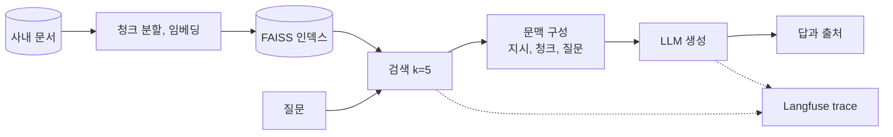

12장의 DakkaBot은 직접 학습한 모델 대신 남이 만든 LLM으로 사내 문서에 답하는 챗봇이다. 답이 틀렸을 때 학습 데이터를 거슬러 올라가는 방법은 여기서 통하지 않는다. 문서를 자른 방식, 찾아낸 조각, 프롬프트, 모델이 함께 답을 정하기 때문이다. 이 장은 RAG를 검색, 문맥 구성, 생성으로 나누고 각 단계를 trace로 남겨, 틀린 답이 어느 단계에서 나왔는지 가려내는 구조를 만든다.

## 결과를 정하는 것이 모델 가중치 밖으로 늘어난다 {#llmops-vs-mlops}

LLMOps는 앞 장의 MLOps를 버리지 않는다. DakkaBot도 컨테이너로 Kubernetes에 올라가고 CI/CD로 배포되며 Prometheus로 지연과 오류를 본다. 달라지는 것은 버전을 매길 대상과 품질을 판단하는 방법이다. 모델 제공자와 버전, 프롬프트, 검색 코퍼스와 인덱스, 검색 파라미터가 모두 답을 바꾸고, 시스템 프롬프트 한 줄도 모델 교체만큼 결과를 흔든다.

품질은 정답 비교로 판단할 수 없다. LLM은 다음 토큰을 확률 분포에서 고르고, 책은 temperature 0도 완전히 결정적이지 않다고 말한다. 같은 프롬프트로 "What is the capital of Australia?"를 네 번 물었더니 세 번은 문서와 무관하다며 거절했고 한 번은 "Canberra"라고 답했다. 답의 의미와 근거를 채점하는 평가가 필요하고, 그 일은 13장으로 넘어간다.

비용과 길이는 토큰이 묶는다. 문맥 창과 출력에 한도가 있어서 청크를 많이 넣을수록 비용과 지연이 늘고 답할 자리가 준다.

## 검색이 모델이 볼 자료를 정한다 {#retrieval-design}

문서 전체를 프롬프트에 넣으면 문맥 창을 넘고, 초점이 흐려지고, 질문마다 같은 비용을 치른다. RAG는 질문과 관련된 조각만 찾아 넣는다. 문서가 바뀌면 인덱스만 다시 만들면 되고 답에 근거 문서를 붙일 수 있다. 모델의 행동이나 출력 형식을 바꾸는 파인튜닝과는 목적이 다르다.

검색 품질은 세 가지 선택에 달려 있다. 첫째는 청크 분할이다. 저자 코드는 제목, 문단, 줄 순으로 내려가며 1,000자 청크와 200자 겹침으로 자른다. 둘째는 임베딩이다. 문서와 질문은 같은 임베딩 모델로 같은 공간에 놓여야 하는데, 차원만 같으면 다른 모델로 만든 인덱스를 검색해도 오류 없이 엉뚱한 청크가 나온다. 그래서 인덱스에는 임베딩 모델 이름을 붙여 버전을 매긴다. 셋째는 검색 개수와 임계값이다. 저자 코드는 무조건 가까운 5개를 돌려주고 거리 임계값이 없다.

임계값이 없으면 범위 밖 질문도 출처 5개를 달고 나온다. 키 교체 질문의 상위 5개 L2 거리는 0.39~0.73이었고, 호주 수도 질문은 0.94~1.00이었다. 이 코퍼스라면 0.8 근처에서 걸러낼 수 있어 보이지만, 그 값은 임베딩 모델과 문서에 묶여 있어 평가 질문으로 정해야 한다.

FAISS는 벡터 검색 라이브러리이고 권한, 부분 삭제, 백업 같은 데이터베이스 기능이 없다. 인덱스와 함께 저장되는 `index.pkl`은 pickle이라 불러오는 순간 코드를 실행할 수 있고, 청크 원문도 그대로 담는다. 인덱스 파일은 모델 파일과 원문 문서만큼 조심해서 다룬다.

## 문맥 구성과 생성은 따로 틀린다 {#augmentation-and-generation}

### 문맥 구성과 근거 표시 {#augmentation-grounding}

문맥 구성은 찾은 청크와 지시와 질문을 프롬프트 하나로 엮는 단계다. `DakkaBotCore`는 청크에 번호를 달고 "문서에 근거해 답하고 모르면 모른다고 하라"는 지시를 넣는다. 이 단계에서는 실제로 무엇이 들어갔는지부터 본다. 저자 코드는 클래스 안에서 들여쓴 f-string이라 지시 줄마다 공백 12칸이 따라 들어갔다.

출처 표시는 신뢰를 위한 장치지만, 출처는 "이 청크들을 모델에 줬다"는 기록에 그친다. 답의 각 문장이 그 청크에 있는지는 따로 확인해야 한다. 검색된 문서에 "이전 지시를 무시하라" 같은 문장이 있으면 모델은 그것을 지시로 읽을 수 있다(간접 프롬프트 주입). 문서와 지시를 구분해 표시하고, 검색 단계에서 사용자가 볼 권한이 있는 문서만 남긴다.

### 생성 {#generation}

생성 단계는 모델과 샘플링 설정을 정한다. 책은 `gemini-2.5-flash`를 쓰지만 실습은 비용과 API 키 없이 재현하도록 Ollama의 `llama3.2`(3B)로 바꿨다. 같은 청크 5개를 주고 모델만 바꾸자 차이가 분명했다. `llama3.2`는 운영 API 키 교체 주기 90일을 맞혔지만 문맥 안의 인접 절차를 섞었고, `gemma3:270m`은 질문과 무관한 JSON 예시를 복사했다. 검색은 둘 다 맞았으니 실패는 생성 단계에 있다. 작은 로컬 모델은 이렇게 **검색은 맞고 생성이 틀린 사례**를 쉽게 만들어, 실패를 나눠 보는 연습에 쓸모가 있다.

## trace로 실패를 단계별로 나눈다 {#failure-taxonomy}

CPU 사용률과 지연은 서비스가 고장 났는지 알려 주지만 답이 왜 나쁜지는 알려 주지 않는다. Langfuse는 질문 하나를 trace로, 그 안의 검색과 모델 호출을 span과 generation으로 남겨 단계별 입력, 출력, 토큰 수, 지연을 보여 준다. 저자 코드는 콜백을 LLM 호출에만 넘겨 검색 결과가 trace에 없었다. 질문 전체를 span으로 감싸고 retriever에도 콜백을 넘겨야 두 단계가 나란히 보인다.

trace가 있으면 "답이 틀렸다"를 원인별로 나눌 수 있다.

| 실패 | 판별 질문 | 고치는 곳 |
| --- | --- | --- |
| 검색 누락 | 필요한 근거가 상위 k개에 있는가 | 분할, 임베딩 모델, k |
| 문맥 구성 오류 | 근거가 프롬프트에 들어갔고 다른 절차와 섞이지 않았는가 | 청크 형식, 길이 제한, 중복 제거 |
| 생성 오류 | 근거가 있는데 모델이 잘못 읽었는가 | 모델, 지시, 출력 형식 |
| 환각 | 근거에 없는 내용을 지어냈는가 | 프롬프트, 근거 확인 평가, 더 큰 모델 |
| 범위 밖 응답 | 답이 문서에 없을 때 거절하는가 | 거리 임계값, 거절 지시, 가드레일 |

"How do I rotate encryption keys?"의 답이 좋은 예다. 키 교체 API는 문서대로 인용했지만, 함께 검색된 API 키 교체 절차를 섞었고 문서에 없는 Deployment YAML까지 지어냈다. 출처 5개가 붙어 화면만 보면 근거 있는 답이었고, trace에서 검색 출력과 생성 입력을 나란히 놓고서야 어디서 섞였는지 보였다. 검색 품질(정답 청크가 상위 k개에 드는가)과 답변 품질(정답성, 근거 충실성, 거절)을 따로 재야 무엇을 바꿔서 나아졌는지 가릴 수 있다.

trace에는 질문, 검색된 문서, 답이 모두 담기므로 원문과 같은 등급의 접근 권한과 보존 기간이 필요하다. 로컬 모델은 단가표가 없어 비용이 $0으로 찍히고, 대신 CPU에서 답 하나에 1분 가까운 시간으로 값을 치른다.

## 책 코드와 실제 저장소의 차이 {#book-code-gaps}

코드는 저자 저장소 [practical-mlops/dakkabot](https://github.com/practical-mlops/dakkabot)에 있다. 이해에 영향을 주는 차이는 다섯 가지다.

- 책의 Gemini 모델은 그대로 동작하지 않는다. [Gemini API 단종 목록](https://ai.google.dev/gemini-api/docs/deprecations)을 보면 `text-embedding-004`는 2026년 1월에 종료됐다. 실습은 임베딩과 생성을 Ollama로 바꿨고, LangChain이 두 쪽을 같은 인터페이스로 감싸서 교체는 함수 두 개 안에서 끝났다.
- 책은 콜백만 붙이면 검색도 기록된다고 하지만, 콜백은 자기를 넘겨받은 호출만 기록한다.
- 책은 UI가 출처를 보여 준다고 하지만 저자의 Chainlit 앱은 출처를 받아 두기만 한다.
- `guardrail_helpers.py`는 import될 때 `OTEL_SDK_DISABLED=true`를 설정해 같은 프로세스의 Langfuse 기록을 오류 없이 끈다. Langfuse SDK v3가 OpenTelemetry 위에서 동작하기 때문이다.
- 책의 청크 겹침 "200토큰"은 실제로는 문자 수이고, retriever 기본값은 책 설명의 3개가 아니라 4개다.

## 정리 {#closing}

RAG 답에 출처가 붙어 있다고 근거가 맞는 것은 아니다. 다른 절차가 섞이고, 문서에 없는 YAML이 끼고, 범위 밖 질문에도 출처가 붙었다. 이를 가려낼 수 있었던 것은 검색, 문맥 구성, 생성을 나누고 그 사이의 입출력을 trace로 남겼기 때문이다. 평가 집합, 프롬프트 버전 관리, 범위 밖 질문을 막는 가드, 비용 측정은 아직 비어 있고 13장이 이 자리를 채운다.

## 실습 {#book-ch12-sop}

책 코드로 직접 실행한 순서와 결과 화면은 [12장 실습 기록](/docs/tech/machine-learning-platform-engineering/practice/ch12/)에 따로 모았다.

[이전: 11. 모니터링과 설명가능성](/docs/tech/machine-learning-platform-engineering/11-monitoring-and-explainability/), [시리즈 목차](/docs/tech/machine-learning-platform-engineering/), [다음: 13. 프로덕션 LLM 시스템](/docs/tech/machine-learning-platform-engineering/13-production-llm-systems/)