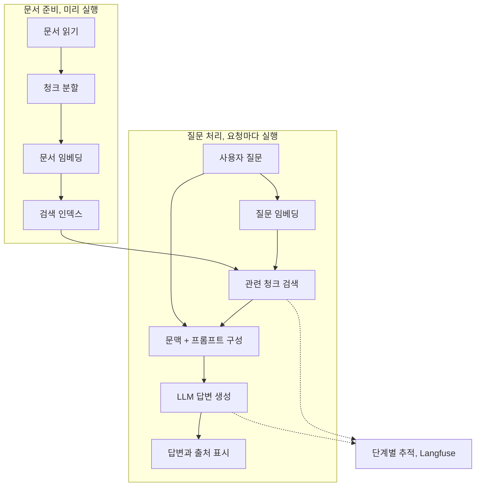

12장에서는 사내 문서를 검색해 답하는 DakkaBot을 만든다. 직접 학습한 모델 파일을 관리하던 앞부분과 달리, 이제는 문서와 인덱스, 프롬프트와 모델 API의 조합이 답을 결정한다. **검색과 생성 중 어디에서 잘못됐는지 구분하는 흐름**으로 정리했다.

## 12.1 LLMOps

배포, CI/CD, 로그, 모니터링은 여전히 필요하다. 달라지는 점은 답변이 모델 가중치 하나가 아니라 문서, 검색, 프롬프트, 모델 API의 조합에서 나온다는 것이다.

| 기존 운영 원칙 | LLM 애플리케이션에서 추가로 관리할 대상 |
| --- | --- |
| 버전과 계보 | 문서 스냅샷, 분할 방식, 임베딩, 인덱스, 프롬프트 |
| 품질 평가 | 의미적 정확성, 근거와의 일치, 답변 범위 |
| 성능 관측 | 검색, 생성 단계별 지연, 토큰 수 |
| 자원, 비용 관리 | API 요청 제한과 사용량 기반 비용 |

표현이 달라 문자열 일치만으로 평가하기 어렵다. temperature를 낮춰도 모든 환경의 결정성은 보장되지 않는다.

## 12.2 DakkaBot

### 12.2.1 만들 시스템

문서는 사전에 처리해 검색 인덱스를 준비한다.

### 12.2.2 조합 가능한 구조

검색, 문맥 구성, 생성을 분리하면 실패한 단계를 구분하고 다른 구현으로 교체하기 쉽다. 모델 호출과 서비스 책임을 분리한다.

### 12.2.3 Gemini 생성, 임베딩 모델

예제는 Gemini 생성, 임베딩, FAISS, LangChain, Chainlit을 사용하며 단계별 입력과 출력을 분리한다.

FAISS는 벡터 유사도 검색 라이브러리이며 인덱스가 권한, DB 운영 기능을 제공하지는 않는다.

### 12.2.4 검색 컴포넌트

임베딩은 문서와 질문의 벡터 유사도로 관련 내용을 찾지만 업무상 근거를 보장하지는 않는다.

작은 청크는 문맥을 끊고 큰 청크는 잡음과 토큰 비용을 늘린다. `k`, 유사도, 메타데이터, 최신성도 검색에 영향을 준다.

이전 연도의 유사 규정이 검색될 수 있으므로 모델 변경 전 문서 선택을 확인한다.

임베딩 모델, 차원 변경은 인덱스와 호환되지 않을 수 있어 재생성, 버전 전환을 배포로 관리한다.

### 12.2.5 문맥 구성 컴포넌트

문맥 구성(augmentation)은 검색 청크를 질문과 프롬프트에 넣는 단계다. 포함 자료, 길이 제한, 출처를 확인한다.

### 12.2.6 생성 컴포넌트

Generation은 모델 설정, 출력 규칙을 정한다. 근거가 없으면 모른다고 답하게 하고 근거 일치를 평가한다.

검색 문서는 시스템 지시가 아니다. 문서 속 명령을 실행 지시로 취급하지 말고 사용자 권한에 맞는 자료만 검색한다.

## 12.3 DakkaBot UI 만들기

DakkaBotCore에 Chainlit을 연결해 스트리밍, 대화 이력, 출처, 피드백을 제공한다.

## 12.4 LLM 애플리케이션 관측

Langfuse trace로 검색, 문맥 구성, 생성의 단계별 지연, 사용 자료, 토큰을 확인한다.

Prompt, 검색 문서, 답변 trace에는 민감 정보가 포함될 수 있어 수집, 마스킹, 접근, 보존 정책을 정한다.

## 검색 품질과 답변 품질

전체 답변 점수만으로는 검색, 모델, 프롬프트 변경 효과를 구분하기 어렵다.

| 평가 대상 | 질문 집합에 남길 정보 | 확인할 결과 |
| --- | --- | --- |
| 검색 | 관련 문서, 청크, 문서 버전 | 정답 근거의 Recall@k 등 검색 성능 |
| 문맥 구성 | 필요한 사실, 길이, 중복 제한 | 근거가 잘리거나 다른 문서와 섞이는지 |
| 답변 | 기대 사실, 허용 범위, 출처 | 정답성, 근거 충실성, 관련성 |
| 거절 | 답이 없거나 권한 밖인 질문 | 무리하게 답하지 않고 안전하게 안내하는지 |
| 사용자 경험 | 요청 유형, 길이, 동시성 | 첫 토큰 지연, 전체 지연, 실패, 비용 |

Recall@k는 상위 k개 검색 결과에 필요한 근거를 얼마나 포함했는지 보는 관점이다. 문서 단위인지 청크 단위인지와 여러 근거가 필요한 질문의 정답 정의를 고정해야 비교할 수 있다.

권한 필터는 생성 후의 문장 검사만으로 대신하지 않는다. 사용자가 볼 수 있는 문서 범위로 검색을 제한하고, 인덱스 갱신, 삭제에도 권한과 원천 문서 상태가 반영되는지 시험한다. 임베딩과 인덱스도 원천 자료의 민감성을 가진 파생 데이터로 관리해야 한다.

문서, 임베딩, 분할 방식을 바꿀 때에는 새 인덱스를 별도로 만들고 평가한 뒤 전환, 복구할 수 있는 구조를 검토한다. 버전이 섞인 인덱스를 일부만 갱신하면 결과 변화의 원인을 찾기 어렵다.

## 답변 오류를 나눠 보는 기준

평가 질문에 정답 근거를 연결하고 답이 없는 사례도 포함한다.

| 점검 | 결과 |
| --- | --- |
| 필요한 문서를 검색했는가? | 검색 품질 |
| 그 문서가 실제 프롬프트에 들어갔는가? | 문맥 구성 품질 |
| 문서에 없는 내용을 답했는가? | 생성과 근거 충실성 |
| 사용자가 출처를 확인할 수 있는가? | 검증 가능한 사용자 경험 |

정답, 오답만으로는 검색과 생성 중 개선 지점을 구분하기 어렵다.

## RAG의 역할과 검색 범위

### RAG와 파인튜닝의 목적

RAG와 파인튜닝은 목적이 다르다. 지식을 외부 문서로 공급하는 문제와 모델 행동, 형식, 특화 능력을 바꾸는 문제를 나누어 봐야 한다. RAG가 모든 문제를 해결하지는 않는다.

### 검색 개수와 답변 품질

잡음과 오래된 문서, 상충하는 설명, 토큰 비용이 늘어날 수 있다. 검색 개수도 실제 질문 집합으로 평가해야 한다.

답변 변화는 모델뿐 아니라 문서, 인덱스, 프롬프트 변경과 함께 추적한다.

## 마치며

RAG도 잘못된 검색이나 누락된 조건으로 오답을 낸다. 답변뿐 아니라 검색, 문맥 구성, 생성을 나눠 평가한다.

[이전: 11. 모니터링과 설명가능성](../11-monitoring-and-explainability/), [시리즈 목차](../), [다음: 13. 프로덕션 LLM 설계](../13-production-llm-systems/)
