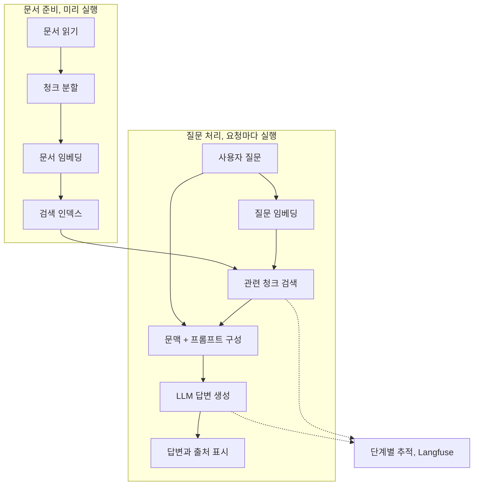

## 먼저, 모든 답을 외운 직원보다 자료를 찾아보는 직원을 생각해 보세요

회사의 모든 규정을 외우는 사람보다, 최신 문서를 찾아 근거를 확인하고 설명하는 사람이 필요할 때가 있습니다.

RAG(Retrieval-Augmented Generation)는 이와 비슷합니다. 질문에 맞는 자료를 찾고, 그 자료를 문맥으로 제공한 뒤 LLM이 답하도록 합니다. 책은 가상의 회사 DataKrypt의 문서 도우미 DakkaBot을 통해 이 구조를 만듭니다.

## 12.1 LLMOps

배포, CI/CD, 로그, 모니터링은 여전히 필요합니다. 달라지는 점은 답변이 모델 가중치 하나가 아니라 문서, 검색, 프롬프트, 모델 API의 조합에서 나온다는 것입니다.

| 기존 운영 원칙 | LLM 애플리케이션에서 추가로 관리할 대상 |
| --- | --- |
| 버전과 계보 | 문서 스냅샷, 분할 방식, 임베딩, 인덱스, 프롬프트 |
| 품질 평가 | 의미적 정확성, 근거와의 일치, 답변 범위 |
| 성능 관측 | 검색, 생성 단계별 지연, 토큰 수 |
| 자원, 비용 관리 | API 요청 제한과 사용량 기반 비용 |

같은 질문에도 표현이 달라질 수 있으므로 문자열의 완전 일치만으로 품질을 판단하기 어렵습니다. temperature 같은 샘플링 설정을 낮춰도 모든 환경에서 완전한 결정성이 보장되는 것은 아닙니다.

## 12.2 DakkaBot

### 12.2.1 만들 시스템

문서를 질문이 들어올 때마다 처음부터 처리할 필요는 없습니다. 먼저 검색 가능한 자료를 준비합니다.

### 12.2.2 조합 가능한 구조

검색, 문맥 구성, 생성을 분리하면 실패한 단계를 구분하고 다른 구현으로 교체하기 쉽다. 단일 모델 호출과 전체 서비스의 책임을 나눠 보는 구조다.

### 12.2.3 Gemini 생성, 임베딩 모델

책은 Gemini 계열의 생성, 임베딩 모델, FAISS 기반 벡터 검색, LangChain을 이용한 구성, Chainlit UI를 다룹니다. 이 이름들을 암기하기보다 각 단계의 입력, 출력과 실패 유형을 구분하는 것이 중요합니다.

FAISS는 벡터 유사도 검색 라이브러리입니다. 검색 인덱스를 만든다는 사실만으로 권한 관리나 모든 데이터베이스 운영 기능까지 생기는 것은 아닙니다.

### 12.2.4 검색 컴포넌트

임베딩은 문서와 질문을 벡터로 표현하여 관련 내용을 찾게 합니다. 하지만 의미가 비슷하다는 것과 업무상 올바른 근거라는 것은 다릅니다.

청크가 너무 작으면 문맥이 끊기고, 너무 크면 잡음과 토큰 비용이 늘어납니다. 검색 개수 `k`, 유사도 기준, 메타데이터와 문서 최신성도 영향을 줍니다.

예를 들어 가상의 휴가 규정 질문에 이전 연도의 비슷한 규정이 검색될 수 있습니다. 생성 모델을 바꾸기 전에 올바른 문서가 검색되었는지부터 확인해야 합니다.

임베딩 모델이나 차원을 바꾸면 기존 문서 인덱스와 질문 벡터가 호환되지 않을 수 있습니다. 인덱스 재생성과 버전 전환 역시 배포 문제로 취급해야 합니다.

### 12.2.5 문맥 구성 컴포넌트

검색한 청크를 질문과 함께 프롬프트에 넣는 단계가 문맥 구성(augmentation)입니다. 어떤 자료를 넣었는지, 길이 제한 안에서 무엇을 남겼는지, 출처가 보존되는지가 중요합니다.

### 12.2.6 생성 컴포넌트

Generation에서는 모델 설정과 출력 규칙을 정합니다. 근거가 없을 때는 모른다고 답하도록 설계하고, 반환된 답변이 실제로 근거와 맞는지 평가해야 합니다.

검색 문서는 참고 자료이지 실행 지시가 아닙니다. 문서 안에 있는 명령문을 신뢰된 시스템 지시처럼 취급하면 안 됩니다. 접근 가능한 문서의 범위도 사용자 권한과 일치해야 합니다. 이 부분은 13장의 안전 운영과 연결해서 읽을 지점입니다.

## 12.3 DakkaBot UI 만들기

책은 DakkaBotCore를 중심으로 핵심 질의 처리를 분리하고 Chainlit을 붙입니다. 스트리밍, 대화 이력, 출처 표시와 사용자 피드백은 서비스 경험을 만드는 요소입니다.

## 12.4 LLM 애플리케이션 관측

Langfuse는 검색, 문맥 구성, 생성의 실행 흔적을 연결하는 데 사용됩니다. 전체 응답 시간 하나만 보는 대신 어느 단계가 느렸는지, 어떤 자료를 사용했는지, 토큰을 얼마나 썼는지를 조사할 수 있어야 합니다.

로그와 트레이스에 프롬프트, 검색 문서, 답변을 남기면 민감한 내용도 함께 저장될 수 있습니다. 따라서 수집 범위, 마스킹, 접근 권한과 보존 기간은 관측 도구 도입과 별도로 정해야 합니다.

## 실무 적용: 검색 품질과 답변 품질을 따로 계측합니다

검색 평가 없이 전체 답변 점수만 보면 모델이나 프롬프트 변경의 효과를 해석하기 어렵다.

| 평가 대상 | 질문 집합에 남길 정보 | 확인할 결과 |
| --- | --- | --- |
| 검색 | 관련 문서, 청크, 문서 버전 | 정답 근거의 Recall@k 등 검색 성능 |
| 문맥 구성 | 필요한 사실, 길이, 중복 제한 | 근거가 잘리거나 다른 문서와 섞이는지 |
| 답변 | 기대 사실, 허용 범위, 출처 | 정답성, 근거 충실성, 관련성 |
| 거절 | 답이 없거나 권한 밖인 질문 | 무리하게 답하지 않고 안전하게 안내하는지 |
| 사용자 경험 | 요청 유형, 길이, 동시성 | 첫 토큰 지연, 전체 지연, 실패, 비용 |

Recall@k는 상위 k개 검색 결과에 필요한 근거를 얼마나 포함했는지 보는 관점입니다. 문서 단위인지 청크 단위인지와 여러 근거가 필요한 질문의 정답 정의를 고정해야 비교할 수 있습니다.

권한 필터는 생성 후의 문장 검사만으로 대신하지 않습니다. 사용자가 볼 수 있는 문서 범위로 검색을 제한하고, 인덱스 갱신, 삭제에도 권한과 원천 문서 상태가 반영되는지 시험합니다. 임베딩과 인덱스도 원천 자료의 민감성을 가진 파생 데이터로 관리해야 합니다.

문서, 임베딩, 분할 방식을 바꿀 때에는 새 인덱스를 별도로 만들고 평가한 뒤 전환, 복구할 수 있는 구조를 검토합니다. 버전이 섞인 인덱스를 일부만 갱신하면 결과 변화의 원인을 찾기 어렵습니다.

## 답변 오류를 나눠 보는 기준

평가 질문에는 정답 문서와 필요한 근거를 연결해 두는 편이 좋다. 문서에 답이 없는 질문도 포함해야 한다.

| 점검 | 결과 |
| --- | --- |
| 필요한 문서를 검색했는가? | 검색 품질 |
| 그 문서가 실제 프롬프트에 들어갔는가? | 문맥 구성 품질 |
| 문서에 없는 내용을 답했는가? | 생성과 근거 충실성 |
| 사용자가 출처를 확인할 수 있는가? | 검증 가능한 사용자 경험 |

정답과 오답으로만 나누면 검색과 생성 중 어디를 고쳐야 할지 알기 어렵다.

## 북클럽 토론

Q. RAG를 쓰면 파인튜닝이 필요 없나요?

둘의 목적이 다릅니다. 지식을 외부 문서로 공급하는 문제와 모델 행동, 형식, 특화 능력을 바꾸는 문제를 나누어 봐야 합니다. RAG가 모든 문제를 해결하지는 않습니다.

Q. 더 많은 문서를 검색하면 항상 답이 좋아질까요?

잡음과 오래된 문서, 상충하는 설명, 토큰 비용이 늘어날 수 있습니다. 검색 개수도 실제 질문 집합으로 평가해야 합니다.

자주 빠지는 함정: 답변이 틀릴 때 생성 모델부터 교체하거나, 인덱스와 프롬프트 버전을 기록하지 않아 같은 질문의 결과 변화를 설명하지 못하는 것입니다.

## 한 줄 정리

운영 가능한 RAG는 검색, 문맥 구성, 생성을 분리하고, 각 단계의 입력과 결과를 추적해 답변 실패의 위치를 찾을 수 있는 시스템입니다.

[이전: 11. 모니터링과 설명가능성](../11-monitoring-and-explainability/), [시리즈 목차](../), [다음: 13. 프로덕션 LLM 설계](../13-production-llm-systems/)
