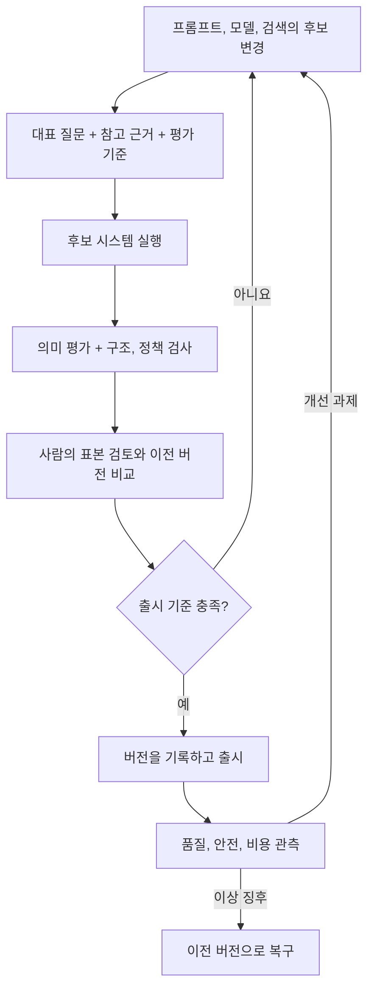

## 먼저, 개점 시연과 매일의 영업을 구분합니다

가게 개점 행사에서 한 번 멋진 서비스를 보여 주는 것과 매일 같은 기준으로 운영하는 것은 다릅니다. 직원 지침을 바꾸면 점검해야 하고, 예상 밖의 요청과 비용 급증에도 대응해야 합니다.

LLM 애플리케이션도 데모 이후가 중요합니다. 이 장은 프롬프트 변경 관리, 의미 기반 평가, 안전 장치, 비용 관리를 통해 DakkaBot을 지속적으로 운영하는 문제를 다룹니다.

## 13.1 프롬프트 엔지니어링 — 운영할 변경으로 취급

프롬프트는 역할, 답변 범위, 형식, 근거 사용 방식과 불확실할 때의 행동을 바꿉니다. 따라서 단순한 문자열 수정이 아니라 서비스 동작의 변경입니다.

책은 Langfuse로 프롬프트의 버전과 환경별 라벨을 관리하고, 코드에 하드코딩한 문자열과 분리합니다. 코드 배포 없이 바꿀 수 있다는 편리함에는 검증 없이도 동작이 달라질 수 있다는 책임이 따라옵니다.

| 함께 기록할 것 | 필요한 이유 |
| --- | --- |
| 프롬프트 버전과 실제 내용 | 어떤 지침이 적용되었는지 확인 |
| 모델과 생성 설정 | 모델 변경과 프롬프트 변경의 영향 분리 |
| 문서, 검색 설정 버전 | 답변의 근거가 달라졌는지 확인 |
| 평가 결과와 승인 | 변경을 선택한 이유 추적 |
| 되돌릴 버전 | 장애 시 대응 |

환경 라벨은 편리한 참조이지만 가리키는 버전이 바뀔 수 있습니다. 실제 요청에서 사용한 버전도 남겨야 합니다. 캐시된 프롬프트가 있으면 갱신과 장애 시 동작도 설계 대상입니다.

## 13.2 LLM 애플리케이션 테스트

“정확히 이 문자열이어야 한다”는 검사만으로는 다양한 정상 답변을 평가하기 어렵습니다. 책은 DeepEval과 G-Eval 같은 LLM-as-a-Judge 방식을 통해 의미적 기준을 적용합니다.

평가자는 근거와의 일치, 질문에 대한 관련성, 답변 범위와 정책 준수 등을 기준으로 판단할 수 있습니다. 하지만 LLM 평가자도 오류와 편향이 있으며, 평가 문구와 모델에 따라 결과가 달라집니다.

모든 검사를 LLM에게 맡길 필요는 없습니다. 응답 스키마, 필수 필드, 접근 권한처럼 명확한 조건은 결정적인 검사로 확인하고, 의미 판단이 필요한 부분에 평가 모델을 쓰는 편이 합리적입니다. 평가 호출의 비용과 재현 가능한 조건도 기록해야 합니다.

## 13.3 프로덕션 거버넌스와 안전

책은 Promptfoo로 적대적 상황을 점검하고, Guardrails AI와 모델의 안전 설정을 이용해 입력과 출력을 통제하는 흐름을 다룹니다.

| 경계 | 확인할 문제 |
| --- | --- |
| 입력 | 민감한 정보, 허용 범위 밖 요청, 비정상 형식 |
| 검색, 처리 | 사용자 권한에 맞는 문서인지, 외부 문서를 지시로 오해하는지 |
| 생성 | 근거와 무관한 주장, 정책 위반 |
| 출력 | 민감한 정보 노출, 부적절한 형식, 허용 범위 이탈 |
| 운영 | 실패 기록, 담당자 통보, 차단, 수동 검토 절차 |

“비밀을 말하지 마”라는 프롬프트가 권한 통제를 대신할 수는 없습니다. 모델이 보지 말아야 할 정보는 검색과 도구 접근 단계에서 제한해야 합니다. 입력, 출력 필터도 완전한 방어가 아니므로 여러 계층을 함께 설계합니다.

PII 탐지나 자동 수정이 모든 경우에 안전한 것도 아닙니다. 무엇을 제거했는지 모른 채 수정된 내용을 성공 응답으로 보내면 의미가 바뀔 수 있습니다. 차단, 재시도, 안전한 안내와 수동 검토 중 어떤 동작을 할지 명시해야 합니다.

환각 테스트에서도 “답을 그럴듯하게 했는가?”보다 제공된 문서로 확인할 수 있는가, 없을 때 인정하는가를 봐야 합니다. 평가 점수를 보안의 증명으로 사용하지 않는 것이 중요합니다.

## 13.4 비용 최적화 전략

LLM API에서는 입력과 출력 토큰이 비용을 만듭니다. 총비용에는 검색, 임베딩, 평가, 재시도와 주변 인프라도 들어갑니다.

| 전략 | 줄이는 것 | 추가되는 위험, 운영 책임 |
| --- | --- | --- |
| 작업별 모델 선택, 라우팅 | 비싼 모델 호출 | 잘못된 분류와 여러 모델의 관리 |
| 문맥 캐시 | 반복되는 긴 문맥 처리 | 제공자별 조건과 캐시 수명 |
| 의미 기반 답변 캐시 | 비슷한 질문의 반복 생성 | 다른 질문, 사용자에게 부적절한 답 재사용 |
| 프롬프트, 검색 문맥 축소 | 불필요한 입력 토큰 | 근거, 안전 지침 손실 |
| 예산, 비용 알림 | 발견이 늦어지는 지출 | 임계치 이후의 제한, 대응 정책 |

책은 RedisVL 기반 의미 캐시도 소개합니다. 의미가 비슷한 질문을 찾아 이전 답변을 재사용하는 방식이지만, 유사도만으로 캐시 적중을 결정하면 안 됩니다. 사용자 권한, 문서, 프롬프트, 모델 버전, 최신성에 맞는 범위를 정해야 합니다.

캐시를 통해 비용이 줄었다는 사실과 답변이 정확하다는 사실도 다릅니다. 평균 비용뿐 아니라 성공적인 답변당 비용, 비싼 요청의 원인, 재시도와 평가 비용을 함께 봐야 합니다. 책에서 제시하는 절감 수치를 모든 서비스에 그대로 적용하지는 않습니다.

## 실무 적용: 평가, 안전, 비용을 하나의 변경 절차로 묶습니다

프롬프트, 모델, 검색 인덱스와 안전 정책을 바꿀 때도 회귀 평가와 승인, 버전 기록, 관측과 복구가 필요하다.

| 변경 위험 | 검증할 것 | 운영에서 남길 것 |
| --- | --- | --- |
| 모델 제공자, 버전 변경 | 대표 질문, 장문, 도구 사용의 품질과 실패 | 실제 모델 식별, 설정, 제한, 비용 |
| 프롬프트 변경 | 기준 답변, 거절, 정책 준수의 회귀 | 프롬프트 버전, 승인, 복구 대상 |
| 평가자 변경 | 사람의 판단과 일치, 불일치, 반복 변동 | 평가자 모델, 기준, 버전 |
| 안전 정책 변경 | 정상 요청의 오차단과 위험 요청의 미차단 | 결정 이유, 이의 제기, 검토 경로 |
| 캐시, 라우팅 변경 | 권한, 최신성, 질문 의미와 품질 | 적중, 오응답, 라우팅, 비용 지표 |

안전 장치가 실패하거나 제한 시간이 지나면 서비스를 어떻게 동작시킬지 명시합니다. 위험한 작업에서는 검사 실패를 정상 통과로 처리하지 않고, 업무 특성에 맞는 차단, 제한, 수동 검토를 설계합니다. 정교한 프롬프트가 인증, 권한, 도구 실행의 강제 통제를 대신하지는 않습니다.

비용에서는 전체 비용 / 품질, 정책 기준을 충족한 유효 결과 수라는 단위 경제성도 확인할 수 있습니다. 싼 모델이 많은 재시도와 수동 처리를 만들면 건당 API 가격은 낮아도 업무 비용은 커집니다. 예산 알림은 지출 상한의 강제가 아니므로 쿼터, 속도 제한과 초과 시 행동을 따로 정합니다.

## 컨설팅 관점: 제한된 출시와 위험 수용의 주체를 정합니다

고객에게 LLM 답변이 단순 참고인지, 고객에게 직접 전달되는지, 결제, 승인 같은 행동을 실행하는지 묻습니다. 같은 RAG라도 영향과 필요한 통제가 달라집니다.

산출물은 사용 사례별 위험, 허용 범위, 버전별 평가 보고서, 통제, 실패 동작 표, 비용 모델, 단계별 출시, 철회 계획입니다. 제공자에게 전송되는 데이터, 보존, 학습 사용 조건, 지역, 규정 요구는 고객의 보안, 법무 담당자와 확인해야 합니다.

출시 전에는 합성 데이터와 허가된 환경으로 정상, 경계, 오류 상황을 시험하고, 사람의 검토 범위와 잔여 위험의 승인자를 명시합니다. “안전하다”는 포괄적인 보증보다 어떤 위협과 조건을 시험했고 무엇은 아직 확인하지 못했는지 보고하는 것이 전문적인 태도입니다.

## 프롬프트 변경의 승인 조건

답변을 짧게 만드는 프롬프트라도 비용만 비교해서는 안 된다. 변경 전후에 다음 항목을 확인해야 한다.

1. 평가 집합: 일반 질문, 근거가 없는 질문, 권한 밖 자료에 관한 질문을 포함합니다.
2. 승인 기준: 품질, 안전 기준을 유지하면서 지연과 비용을 어떻게 비교할지 정합니다.
3. 관측: 실제 사용 프롬프트 버전, 검색 자료, 평가와 토큰 사용량 중 남길 정보를 정합니다.
4. 복구: 어떤 징후에서 누구의 판단으로 이전 버전으로 되돌릴지 정합니다.

평가용 질문에는 실제 비밀이나 개인정보 대신 합성 데이터를 사용하세요. 안전 점검은 소유하거나 허가받은 테스트 환경에서만 진행합니다.

## 북클럽 토론

Q. LLM 평가자가 높은 점수를 주면 바로 출시해도 될까요?

평가 기준의 빈틈, 평가자 오류, 대표성이 없는 질문 집합이 있을 수 있습니다. 명시적 정책 검사와 사람의 검토를 함께 보고 출시 위험에 맞춰 판단해야 합니다.

Q. 같은 질문의 답변을 전 직원이 공유해도 될까요?

질문이 같아도 문서 권한과 문맥은 다를 수 있습니다. 캐시도 권한 경계와 정보 최신성을 지켜야 하며, 저장, 재사용 범위를 명시해야 합니다.

자주 빠지는 함정: 안전 지침을 추가했으니 문제가 해결됐다고 생각하거나, 토큰 수만 줄이고 답변 품질과 실패 처리의 변화를 확인하지 않는 것입니다.

## 한 줄 정리

프로덕션 LLM 운영은 프롬프트, 검색, 모델의 변경을 품질, 안전, 비용 기준으로 검증하고, 관측하며 되돌릴 수 있게 만드는 일입니다.

[이전: 12. LLM 기반 시스템](../12-llm-powered-systems/), [시리즈 목차](../), [처음으로: 책 전체 구성](../00-overview/)
