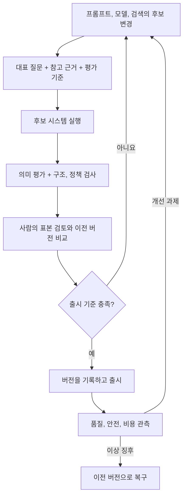

마지막 장은 DakkaBot을 계속 운영하면서 프롬프트와 평가, 안전과 비용을 관리하는 내용이다. 코드 한 줄을 바꾸지 않고 프롬프트만 고쳐도 답변 범위가 달라질 수 있어서, **변경을 무엇으로 평가하고 문제가 생기면 어디로 되돌릴지**를 중심으로 정리했다.

## 13.1 프롬프트 엔지니어링

프롬프트는 역할, 범위, 형식, 근거 사용, 불확실성 대응을 바꾸므로 서비스 동작 변경이다.

Langfuse는 프롬프트 버전과 환경 label을 코드와 분리한다. 코드 배포 없이 바꿔도 동작 검증은 필요하다.

| 함께 기록할 것 | 필요한 이유 |
| --- | --- |
| 프롬프트 버전과 실제 내용 | 어떤 지침이 적용되었는지 확인 |
| 모델과 생성 설정 | 모델 변경과 프롬프트 변경의 영향 분리 |
| 문서, 검색 설정 버전 | 답변의 근거가 달라졌는지 확인 |
| 평가 결과와 승인 | 변경을 선택한 이유 추적 |
| 되돌릴 버전 | 장애 시 대응 |

환경 라벨은 편리한 참조이지만 가리키는 버전이 바뀔 수 있다. 실제 요청에서 사용한 버전도 남겨야 한다. 캐시된 프롬프트가 있으면 갱신과 장애 시 동작도 설계 대상이다.

## 13.2 LLM 애플리케이션 테스트

문자열 일치만으로 다양한 답변을 평가하기 어려워 DeepEval, G-Eval 등 LLM-as-a-Judge로 의미 기준을 적용한다.

평가자는 근거, 관련성, 범위, 정책을 판단하지만 오류, 편향이 있고 문구와 모델에 따라 결과가 다르다.

스키마, 필수 필드, 권한은 결정적 검사로, 의미 판단은 평가 모델로 확인한다. 평가 비용과 재현 조건도 기록한다.

## 13.3 프로덕션 거버넌스와 안전

Promptfoo로 적대적 사례를 점검하고 Guardrails AI와 모델 설정으로 입출력을 통제한다.

| 경계 | 확인할 문제 |
| --- | --- |
| 입력 | 민감한 정보, 허용 범위 밖 요청, 비정상 형식 |
| 검색, 처리 | 사용자 권한에 맞는 문서인지, 외부 문서를 지시로 오해하는지 |
| 생성 | 근거와 무관한 주장, 정책 위반 |
| 출력 | 민감한 정보 노출, 부적절한 형식, 허용 범위 이탈 |
| 운영 | 실패 기록, 담당자 통보, 차단, 수동 검토 절차 |

“비밀을 말하지 마”라는 프롬프트가 권한 통제를 대신할 수는 없다. 모델이 보지 말아야 할 정보는 검색과 도구 접근 단계에서 제한해야 한다. 입력, 출력 필터도 완전한 방어가 아니므로 여러 계층을 함께 설계한다.

PII 자동 수정은 의미를 바꿀 수 있다. 차단, 재시도, 안내, 수동 검토 중 실패 동작을 정한다.

환각 테스트에서도 “답을 그럴듯하게 했는가?”보다 제공된 문서로 확인할 수 있는가, 없을 때 인정하는가를 봐야 한다. 평가 점수를 보안의 증명으로 사용하지 않는 것이 중요하다.

## 13.4 비용 최적화 전략

LLM API에서는 입력과 출력 토큰이 비용을 만든다. 총비용에는 검색, 임베딩, 평가, 재시도와 주변 인프라도 들어간다.

| 전략 | 줄이는 것 | 추가되는 위험, 운영 책임 |
| --- | --- | --- |
| 작업별 모델 선택, 라우팅 | 비싼 모델 호출 | 잘못된 분류와 여러 모델의 관리 |
| 문맥 캐시 | 반복되는 긴 문맥 처리 | 제공자별 조건과 캐시 수명 |
| 의미 기반 답변 캐시 | 비슷한 질문의 반복 생성 | 다른 질문, 사용자에게 부적절한 답 재사용 |
| 프롬프트, 검색 문맥 축소 | 불필요한 입력 토큰 | 근거, 안전 지침 손실 |
| 예산, 비용 알림 | 발견이 늦어지는 지출 | 임계치 이후의 제한, 대응 정책 |

RedisVL은 유사 질문에 답을 재사용한다. 유사도만 보지 말고 권한, 문서, 프롬프트, 모델 버전, 최신성을 확인한다.

캐시를 통해 비용이 줄었다는 사실과 답변이 정확하다는 사실도 다르다. 평균 비용뿐 아니라 성공적인 답변당 비용, 비싼 요청의 원인, 재시도와 평가 비용을 함께 봐야 한다. 책에서 제시하는 절감 수치를 모든 서비스에 그대로 적용하지는 않는다.

## 변경 전후에 확인할 기준

프롬프트, 모델, 검색 인덱스와 안전 정책을 바꿀 때도 회귀 평가와 승인, 버전 기록, 관측과 복구가 필요하다.

| 변경 위험 | 검증할 것 | 운영에서 남길 것 |
| --- | --- | --- |
| 모델 제공자, 버전 변경 | 대표 질문, 장문, 도구 사용의 품질과 실패 | 실제 모델 식별, 설정, 제한, 비용 |
| 프롬프트 변경 | 기준 답변, 거절, 정책 준수의 회귀 | 프롬프트 버전, 승인, 복구 대상 |
| 평가자 변경 | 사람의 판단과 일치, 불일치, 반복 변동 | 평가자 모델, 기준, 버전 |
| 안전 정책 변경 | 정상 요청의 오차단과 위험 요청의 미차단 | 결정 이유, 이의 제기, 검토 경로 |
| 캐시, 라우팅 변경 | 권한, 최신성, 질문 의미와 품질 | 적중, 오응답, 라우팅, 비용 지표 |

안전 검사 실패와 timeout의 동작을 정한다. 위험 작업은 실패를 통과시키지 말고 차단, 제한, 수동 검토를 적용한다. 프롬프트는 인증, 권한, 도구 통제를 대체하지 않는다.

비용에서는 전체 비용 / 품질, 정책 기준을 충족한 유효 결과 수라는 단위 경제성도 확인할 수 있다. 싼 모델이 많은 재시도와 수동 처리를 만들면 건당 API 가격은 낮아도 업무 비용은 커진다. 예산 알림은 지출 상한의 강제가 아니므로 쿼터, 속도 제한과 초과 시 행동을 따로 정한다.

## 프롬프트 변경의 승인 조건

답변을 줄이는 프롬프트도 비용 외 기준으로 변경 전후를 검증한다.

1. 평가 집합: 일반 질문, 근거가 없는 질문, 권한 밖 자료에 관한 질문을 포함한다.
2. 승인 기준: 품질, 안전 기준을 유지하면서 지연과 비용을 어떻게 비교할지 정한다.
3. 관측: 실제 사용 프롬프트 버전, 검색 자료, 평가와 토큰 사용량 중 남길 정보를 정한다.
4. 복구: 어떤 징후에서 누구의 판단으로 이전 버전으로 되돌릴지 정한다.

평가용 질문에는 실제 비밀이나 개인정보 대신 합성 데이터를 사용하고, 안전 점검은 허가된 테스트 환경에서 진행해야 한다.

## 출시 판단과 권한 경계

### LLM 평가 점수와 출시 판단

평가 공백, 평가자 오류, 비대표 질문을 고려해 정책 검사와 사람의 검토로 출시를 판단한다.

### 답변 캐시의 권한과 최신성

같은 질문도 권한, 문맥이 다를 수 있다. 캐시의 권한, 최신성, 저장, 재사용 범위를 제한한다.

안전 지침, 토큰 변경 뒤 정상, 근거 부족, 권한 밖 질문을 재검증한다.

## 마치며

ML과 LLM 모두 변경 출처와 검증 근거가 핵심이다. LLM은 검색 자료, 프롬프트, 안전 정책까지 출시 단위에 포함하고 비용, 품질, 정책 준수를 각각 평가한다.

[이전: 12. LLM 기반 시스템](../12-llm-powered-systems/), [시리즈 목차](../), [처음으로: 책 전체 구성](../00-overview/)
